# 2026一模精讲 · 徐汇卷（上）第 1~18 题

> 原卷公式部分由图片提取、存在讹误，凡按解答反推之处均标 ⚠️ 待核对。

## 一、选择题

**1.** 网格中小正方形边长均为 1，阴影图形记作甲、乙、丙、丁，其中互为相似形的是（　）A.甲和乙　B.甲和丙　C.甲和丁　D.丙和丁

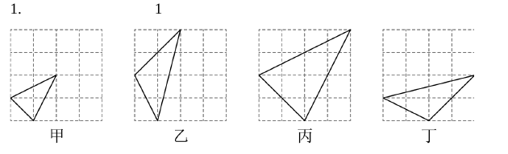

**简解** B。相似形须对应角相等、对应边成比例；甲与丙对应边之比恒为 $\dfrac12$（如 $\dfrac{\sqrt{1^2+1^2}}{\sqrt{2^2+2^2}}=\dfrac12$、$\dfrac{\sqrt{2^2+1^2}}{\sqrt{2^2+4^2}}=\dfrac12$），故选 B。

**2.** 在 Rt△ABC 中，∠C=90°，AB=5，BC=3，那么 ∠B 的余切值为（　）A.4/5　B.3/5　C.3/4　D.4/3

**简解** C。勾股定理：$AC=\sqrt{5^2-3^2}=4$；$\cot\angle B=\dfrac{\angle B 的邻边}{对边}=\dfrac{BC}{AC}=\dfrac34$。

**3.** 已知 $\vec a=3\vec c$，$\vec b=-2\vec c$，且 $\vec a,\vec b$ 是非零向量，那么下列说法中不正确的是（　）
A. $\vec b\parallel\vec c$　B. $\vec a\parallel\vec b$　C. $\left|\vec a\right|=\dfrac32\left|\vec b\right|$　D. $\vec a=\dfrac32\vec b$

**简解** D。$\vec a,\vec b$ 都是 $\vec c$ 的倍向量，故 $\vec b\parallel\vec c$、$\vec a\parallel\vec b$，A、B 正确；$\vec a=3\vec c=-\dfrac32\cdot(-2\vec c)=-\dfrac32\vec b$，故 $|\vec a|=\dfrac32|\vec b|$，C 正确；D 错（方向相差一个负号）。

**4.** 已知点 $A(-2,m)$、$B(2,m)$、$C(4,m+1)$ 在同一个函数的图象上，这个函数图象可能是（　）

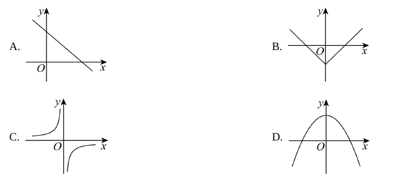

**简解** B。$A$、$B$ 关于 $y$ 轴对称且纵坐标相等，图象须同时过这两点，排除 A（直线单调）、C（双曲线两支异号）；再由 $B(2,m)$、$C(4,m+1)$ 知 $x$ 从 2 增到 4 时函数值增大（$m+1>m$），D 中抛物线开口向下、在 $x>0$ 时下降，排除 D，选 B（V 形图象关于 y 轴对称且右支上升，可同时容纳三点）。

**5.** 已知抛物线 $y=ax^2+bx+c$（$a\neq0$）的图象如图所示，那么下列各式中成立的是（　）A. $a>0$　B. $c<0$　C. $b<0$　D. $a+b+c=0$

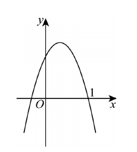

**简解** D。开口向下得 $a<0$，A 错；交 y 轴正半轴得 $c>0$，B 错；对称轴在 y 轴右侧，$-\dfrac{b}{2a}>0$，结合 $a<0$ 得 $b>0$，C 错；当 $x=1$ 时 $y=0$，即 $a+b+c=0$，D 正确。

**6.** 矩形 ABCD 中，点 E 在边 AB 上，点 F 在边 CB 的延长线上，DF⊥DE，DE 与对角线 AC 交于点 I，EF 与对角线 BD 交于点 G，EF 与边 DC 交于点 H。则下列结论不一定成立的是（　）
A. △DFH∽△GAE　B. △ADE∽△DCA　C. △DAI∽△GEI　D. △DFH∽△GCH

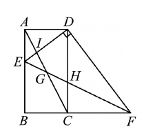

**简解** B。由 DF⊥DE 及 ∠ADC=90° 得 ∠ADE=∠CDF，又 ∠A=∠DCF=90°，得 △ADE∽△CDF（两角对应相等），故 $\dfrac{AD}{CD}=\dfrac{DE}{DF}$，即 $\tan\angle ACD=\tan\angle EFD$，$\angle ACD=\angle EFD$，结合对顶角 $\angle CHG=\angle DHF$ 得 △DFH∽△GCH（D 成立）；同法传导可得 △DAI∽△GEI（C 成立）、△DFH∽△GAE（A 成立）；而 △ADE 与 △DCA 相似需要额外的角相等条件，随 E 位置变动不恒成立，故选 B。

## 二、填空题

**7.** 如果 $\dfrac{a}{b}=\dfrac32$，那么 $\dfrac{2a}{3a-b}$ 的值为______。

**简解** $\dfrac67$。设 $a=3k,\ b=2k\ (k\neq0)$，则 $\dfrac{2a}{3a-b}=\dfrac{6k}{9k-2k}=\dfrac{6k}{7k}=\dfrac67$。

**8.** 计算：$\sin45^\circ\cdot\tan60^\circ=$______。

**简解** $\dfrac{\sqrt6}{2}$。$\sin45^\circ\cdot\tan60^\circ=\dfrac{\sqrt2}{2}\times\sqrt3=\dfrac{\sqrt6}{2}$。

**9.** 两个相似三角形的对应角平分线之比为 1:4，那么它们的周长之比是______。

**简解** 1:4。相似三角形中对应角平分线之比、周长之比都等于相似比。

**10.** 将抛物线 $y=x^2$ 向右平移 3 个单位，向下平移 1 个单位，所得抛物线的表达式是______。

**简解** $y=(x-3)^2-1$。左加右减、上加下减。

**11.** 已知 $A(-1,y_1)$、$B(4,y_2)$ 是抛物线 $y=x^2-2x+c$ 上的两点，那么 $y_1$______$y_2$（填">""＜"或"="）。

**简解** ＜。开口向上，对称轴 $x=1$；$|-1-1|=2<|4-1|=3$，离对称轴越远函数值越大，故 $y_1<y_2$。

**12.** 如图，线段 AD 与 BC 相交于点 O，已知 AB∥CD，且 $\dfrac{AO}{AD}=\dfrac14$，当 $BO=2$ 时，$OC=$______。

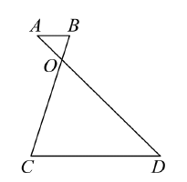

**简解** 6。AB∥CD 得 △AOB∽△DOC（两角对应相等），$\dfrac{AO}{OD}=\dfrac{BO}{OC}$；由 $\dfrac{AO}{AD}=\dfrac14$ 得 $AO:OD=1:3$，故 $OC=3BO=6$。

**13.** 如图，△ABC 中，∠CAB=90°，AC=3，AB=4，AD 为斜边 BC 上的中线，则 $\cos\angle CAD$ 的值为______。

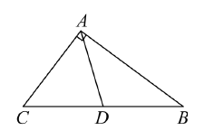

**简解** $\dfrac35$。$BC=\sqrt{AC^2+AB^2}=\sqrt{3^2+4^2}=5$（勾股定理），斜边中线 $AD=CD=BD=\dfrac52$（直角三角形斜边上的中线等于斜边的一半），故 ∠CAD=∠C（等边对等角），$\cos\angle CAD=\cos\angle C=\dfrac{AC}{BC}=\dfrac35$。

**14.** 如图，顾客乘自动扶梯从一楼移动 15.6 米到二楼，一楼层高约 6 米，那么扶梯斜坡的坡比是______。

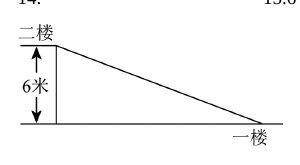

**简解** 1:2.4。水平距离 $BC=\sqrt{AC^2-AB^2}=\sqrt{15.6^2-6^2}=\sqrt{207.36}=14.4$（勾股定理），坡比 $i=\dfrac{AB}{BC}=\dfrac{6}{14.4}=1:2.4$。

**15.** 如图，铅球运行高度 $y=-\dfrac18x^2+bx+c$（米，$x$ 为水平距离）。出手高度 1.5 米、成绩 6 米，则运行中最高约______米。

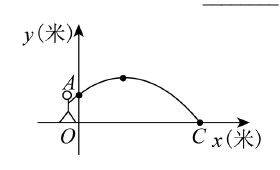

**简解** 2。过 $(0,1.5)$ 得 $c=\dfrac32$；过 $(6,0)$：$-\dfrac{36}{8}+6b+\dfrac32=0$，$b=\dfrac12$。抛物线即 $y=-\dfrac18(x-2)^2+2$（配方），顶点 $(2,2)$，最高约 2 米（代回验证 ✓）。

**16.** 如图，秋千从与竖直方向夹角为 $\alpha$（$\cos\alpha=\dfrac12$）的位置 $OA'$ 摆到另一侧与竖直方向夹角为 $\beta$（$\tan\beta=\dfrac34$）的位置 $OA''$，两次位置的高度差 $MN=0.6$ 米，求秋千的长度 $OA$。

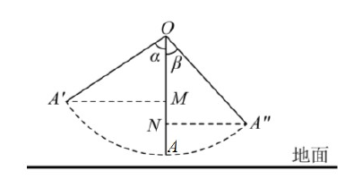

**简解** 2 米。设绳长 $OA=OA'=OA''$。Rt△ONA'' 中 $\tan\beta=\dfrac{NA''}{ON}=\dfrac34$，设 $NA''=3x$、$ON=4x$，则 $OA''=\sqrt{(3x)^2+(4x)^2}=5x$（勾股定理），$\cos\beta=\dfrac45$。Rt△OMA' 中 $\cos\alpha=\dfrac{OM}{OA'}=\dfrac12$，故 $OM=\dfrac12\cdot 5x$。高度差 $MN=ON-OM=4x-\dfrac52x=\dfrac32x=0.6$，$x=0.4$，绳长 $OA=5x=2$ 米。

**17.** 宽长之比为 $\dfrac{\sqrt5-1}{2}\approx0.618$ 的矩形叫"黄金矩形"。折纸过程如图 1、图 2：第一次折叠使正方形折出，再折出含 $\sqrt5$ 的直角三角形（直角边 1、2，斜边 $\sqrt5$），第三次折叠后写出的黄金矩形是______。⚠️（折叠过程文字描述按原卷图与解答复原，细节以原卷为准）

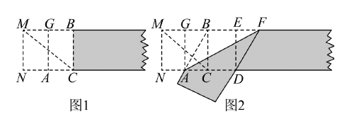

**简解** 矩形 BCDE、矩形 MNDE。核心数值链：由折叠得 $MG=BG=NA=AC=1$、$MN=NC=2$，则 $AB=\sqrt{AC^2+BC^2}=\sqrt{1+4}=\sqrt5$（勾股定理），折叠使 $AD=AB=\sqrt5$，$CD=AD-AC=\sqrt5-1$，于是 $\dfrac{CD}{DE}=\dfrac{\sqrt5-1}{2}$（矩形 BCDE）；又 $\dfrac{MN}{ND}=\dfrac{2}{1+\sqrt5}=\dfrac{2(\sqrt5-1)}{4}=\dfrac{\sqrt5-1}{2}$（矩形 MNDE），恰为黄金比。

**18.** 如图，△ABC 中，$AB=AC=5$，$\cos\angle C=\dfrac45$，将 △ABC 绕点 A 逆时针旋转得到 △ADE，点 B、C 分别与点 D、E 对应，边 AD、DE 分别与原三角形底边 BC 交于点 F、G。当 △DFG 是等腰三角形时，求 FG 的长。

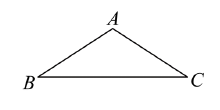

**简解** $FG=\dfrac{15}{8}$ 或 $\sqrt{10}-2$。
等腰底角 $\cos\angle B=\cos\angle C=\dfrac45$，$BC=2\times5\times\dfrac45=8$（三线合一）；设旋转角 θ，用坐标 $A(0,3),B(-4,0),C(4,0)$ 追踪 F=AD∩BC、G=DE∩BC（验证数值自洽）：
- 若 DF=FG（顶角在 F）：∠FDG=∠ADE=∠B，而 ∠FGD=θ（DE 与 BC 夹角），得 θ=∠B=36.87°，此时 △ABF 等腰，$AF=FB=\dfrac{25}{8}$（解等腰三角形），$FG=FD=AD-AF=5-\dfrac{25}{8}=\dfrac{15}{8}$；
- 若 DF=DG（顶角在 D）：∠DFG=∠FGD，即 AD 与 BC 夹角等于 DE 与 BC 夹角 θ，解得 $\tan\theta=3$，算得 $AF=\sqrt{10}$，$FG=\sqrt{10}-2$；
- 若 DG=FG：推出 θ=∠BAC，此时 D 与 C 重合，F、G 退化为一点，不成立，舍去。

## ⚠️ 本篇待核对清单

- 第 3、4、6、7、12~16、18 题均已对照原卷页图与官方解析核验：题干、选项、数值与答案一致（第 17 题答案修正为矩形 BCDE、矩形 MNDE，折叠过程文字仍以原卷为准）。
- 全部数值结果已代回验证：第 1~16 题代回无误；第 18 题两种答案经坐标法数值验证（15/8 与 √10−2）。

## 🔗 关联

- [[03-数学/知识点/九年级/相似三角形]] · [[03-数学/知识点/九年级/锐角的三角比与解直角三角形]] · [[03-数学/知识点/九年级/二次函数]]
- 压轴题接续：见 [[数模26-徐汇-下]]
