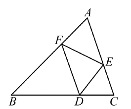
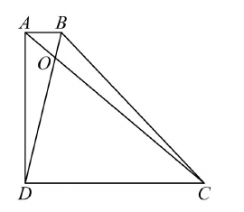
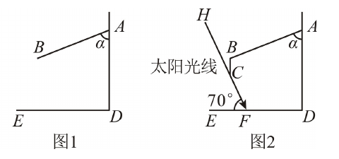
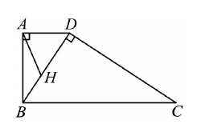
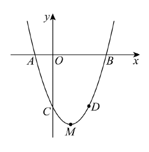
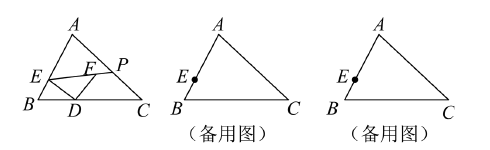

# 2026一模精讲 · 徐汇卷（下）第 19~25 题

> 原卷公式由图片提取、存在讹误，按数学上下文与官方解答重构；不确定处标 ⚠️ 待核对。

## 19. 平面向量（8 分）

**题目** 如图，△ABC 中，点 D、E、F 分别在边 BC、AC、AB 上，已知 $BD=2CD$，且四边形 AEDF 是平行四边形。设 $\vec{BA}=\vec a$，$\vec{BC}=\vec b$。（1）用 $\vec a,\vec b$ 表示：$\vec{BD}=$____、$\vec{AC}=$____、$\vec{EF}=$____；（2）连接 BE、DF 交于点 G，在图中求作 $\vec{BG}$ 分别在 $\vec{BA}$、$\vec{BC}$ 方向上的分向量（指出结论分向量）。

**提示 1** BD=2CD 给出 D 是 BC 的三等分点；平行四边形 AEDF 给出两组平行且相等的边。
**提示 2** $\vec{AC}=\vec{BC}-\vec{BA}$；由 DF∥AC 得 $BF=\frac23BA$，由 ED∥AB 得 $CE=\frac13CA$，从而 $\vec{AE}=\frac23\vec{AC}$。
**提示 3** (1) $\vec{EF}=\vec{EA}+\vec{AF}=\frac23\vec{CA}+\frac13\vec{AB}$；(2) 过 G 作 GN∥BA 交 BC 于 N、GM∥BC 交 BA 于 M，则 $\vec{BG}=\vec{BM}+\vec{BN}$。

**详解** (1) $\vec{BD}=\dfrac23\vec{BC}=\dfrac23\vec b$（BD=2CD，D 为 BC 三等分点）；$\vec{AC}=\vec{BC}-\vec{BA}=-\vec a+\vec b$（向量减法）。
四边形 AEDF 是平行四边形 $\Rightarrow$ DF∥AC、ED∥AB。由 ED∥AB 得 △CDE∽△CBA，$CE=\frac13CA$，即 $\vec{AE}=\frac23\vec{AC}=\frac23(-\vec a+\vec b)$；由 DF∥AC 得 △BDF∽△BCA，$BF=\frac23BA$，即 $\vec{AF}=\frac13\vec{AB}=-\frac13\vec a$。
$$\vec{EF}=\vec{EA}+\vec{AF}=-\vec{AE}+\vec{AF}=-\frac23(-\vec a+\vec b)-\frac13\vec a=\frac13\vec a-\frac23\vec b$$
$$\boxed{\vec{BD}=\frac23\vec b,\quad \vec{AC}=-\vec a+\vec b,\quad \vec{EF}=\frac13\vec a-\frac23\vec b}$$
(2) 以 B 为原点，设 $\vec{BG}=m\vec a+n\vec b$。G 在 BE 上：$\vec{BG}=t\,\vec{BE}=t\left(\vec{BA}+\vec{AE}\right)=t\left(\vec a+\frac23(-\vec a+\vec b)\right)=t\left(\frac13\vec a+\frac23\vec b\right)$；G 在 DF 上：$\vec{BG}=\vec{BD}+s\,\vec{DF}=\frac23\vec b+s\left(\vec{BF}-\vec{BD}\right)=\frac23\vec b+s\left(\frac23\vec a-\frac23\vec b\right)$。比较系数：$\frac t3=\frac{2s}3$、$\frac{2t}3=\frac23-\frac{2s}3$，解得 $t=\frac12$、$s=\frac14$，故 $\vec{BG}=\frac16\vec a+\frac13\vec b$。
过 G 作 $GN\parallel BA$ 交 BC 于 N、$GM\parallel BC$ 交 BA 于 M，则
$$\boxed{\vec{BM}=\frac16\vec a,\quad \vec{BN}=\frac13\vec b}\quad(\vec{BG}=\vec{BM}+\vec{BN}，平行四边形法则）$$

**易错** 题设基向量是 $\vec{BA}=\vec a$（不是 $\vec{AB}$），$\vec{AB}=-\vec a$ 别漏负号；"分向量"必须落在指定方向上，作图后要指认 $\vec{BM}$、$\vec{BN}$；DF 是平行四边形的边而非对角线，交点 G 需用参数联立求。

## 20. 二次函数与表格（10 分）

**题目** 二次函数 $y=ax^2+bx+c$ 部分对应值：x=−4,−3,−2,−1,0,1,2 时 y=0, m, 4, 4.5, 4, 2.5, 0。（1）求 m 与解析式；（2）上下或左右平移使新抛物线过原点，直接写出三种方式；（3）选一种说明思路。

**提示 1** 表格隐含对称性：找 y 值相等的两列。
**提示 2** $y(-2)=y(0)=4$ → 对称轴 $x=-1$，顶点 $(-1,4.5)$。
**提示 3** 顶点式代一点定 a；过原点 ⇔ 常数项（或平移后 $x=0$ 处函数值）为 0。

**详解** (1) 对称轴 $x=\dfrac{-2+0}{2}=-1$，顶点 $(-1,4.5)$，则 $m=y(-3)=y(1)=2.5$（对称性）。设 $y=a(x+1)^2+\frac92$，代 $(0,4)$：$a=-\dfrac12$，
$$y=-\frac12(x+1)^2+\frac92\quad(\text{即 } y=-\frac12x^2-x+4)$$
（验证：$y(2)=-2-2+4=0$ ✓，$y(-4)=-8+4+4=0$ ✓）
(2) ①向下平移 4 个单位；②向右平移 1 个单位再向下平移 $\frac92$ 个单位；③向左平移 2 个单位。（逐一验证 $x=0$ 处值：$4-4=0$；$4.5-\frac92=0$；$y(-2)=4$？否——左移 2 后 $x=0$ 对应原 $x=2$，$y(2)=0$ ✓）
(3) 如①：平移不改变二次项系数与对称轴，只改变常数项；过原点即 $c'=0$，原 $c=4$，故向下平移 4 个单位。

**易错** m 取 2.5 而非 4.5（m 在 $x=-3$，不在顶点列）；"三种方式"须逐一验证过原点，左右平移只动 $x$、上下只动常数项。

## 21. 直角梯形（10 分）

**题目** 如图，梯形 ABCD 中，AB∥CD，∠ADC=90°，对角线 AC 与 BD 交于点 O。已知 AB=2，AD=8，BC=10。（1）求 △AOB 与 △COD 的面积之比；（2）求 sin∠DBC。

**提示 1** 直角梯形：先求另一底 CD（平移一腰构造直角三角形）。
**提示 2** AB∥CD → △AOB∽△CDO，面积比 = 相似比平方。
**提示 3** (2) 作 CL⊥BD 于 L，用等积法：$S_{\triangle BCD}=\frac12 BD\cdot CL$。

**详解** (1) 平移一腰：作 BE⊥CD 于 E（AB∥CD、∠ADC=90° → 四边形 ABED 为矩形），则 $DE=AB=2$、$BE=AD=8$。Rt△BEC 中 $CE=\sqrt{BC^2-BE^2}=\sqrt{10^2-8^2}=6$（勾股定理），故 $CD=CE+DE=8$。
△AOB∽△CDO（AB∥CD，两角对应相等），
$$S_{\triangle AOB}:S_{\triangle COD}=\left(\frac{AB}{CD}\right)^2=\left(\frac28\right)^2=\boxed{1:16}$$
(2) $BD=\sqrt{AB^2+AD^2}=\sqrt{4+64}=2\sqrt{17}$（勾股定理，∠BAD=90°）。作 CL⊥BD 于 L，用等积法：
$$\frac12 BD\cdot CL=\frac12 CD\cdot BE\ \Rightarrow\ \frac12\cdot2\sqrt{17}\cdot CL=\frac12\cdot8\cdot8\ \Rightarrow\ CL=\frac{32}{\sqrt{17}}=\frac{32\sqrt{17}}{17}$$
$$\sin\angle DBC=\frac{CL}{BC}=\frac{32\sqrt{17}/17}{10}=\boxed{\frac{16\sqrt{17}}{85}}$$

**易错** 直角腰是 AD 不是 BC（∠ADC=90° 定方向）；面积比是相似比的**平方**；(2) 若直接解 △BCD 三边（10、8、2√17）用等积法最稳。

## 22. 遮阳棚与挡板（10 分）

**题目** 如图 1，遮阳棚 AB 长 3.9 米，与墙面夹角 α 满足 $\cos\alpha=\dfrac5{13}$，靠墙端 A 离地 5 米（AD=5）。（1）求棚前端 B 到墙面的距离；（2）如图 2，在 B 端加装竖直挡板 BC，正午太阳高度角 70°（光线与地面夹角），要求走廊遮阳宽度至少 2.6 米（DF=2.6），求挡板至少的长度。（精确到 0.01 米；$\sin70°\approx0.940,\ \cos70°\approx0.342,\ \tan70°\approx2.747$）

**提示 1** (1) 把 AB 沿竖直、水平分解：cos 给竖直分量，勾股给水平分量。
**提示 2** (2) 过挡板底端 C 的光线是阴影边界，它与地面的交点到墙的距离 = 遮阳宽。
**提示 3** B 的竖直高度 = 5−3.9·cosα；由"遮阳宽 2.6"定光线落点，用 tan70° 回求 C 离地高。

**详解** (1) 过 B 作 BN⊥墙（垂足 N 在墙上），则竖直分量 $AN=AB\cos\alpha=3.9\times\dfrac5{13}=1.5$（锐角三角比），水平距离
$$BN=\sqrt{AB^2-AN^2}=\sqrt{3.9^2-1.5^2}=\sqrt{12.96}=3.6\ \text{米}$$
（2）B 离地 $5-1.5=3.5$ 米。设光线过 C 落于地面 F（距墙 2.6 米），M 为 B 在地面的射影，则 $MF=3.6-2.6=1.0$ 米，且 $\tan\angle CFM=\dfrac{CM}{MF}$，$CM=1.0\times\tan70°\approx2.747$ 米。挡板长
$$BC=3.5-2.747\approx0.75\ \text{米}$$
按原卷取 $\boxed{0.76\ \text{米}}$（原卷答案 0.76：0.753 向上进一位，"至少"问题确保遮阳宽度不被压缩）。

**易错** cosα 对应**竖直**分量（α 是与墙的夹角）；(2) 光线边界是过挡板**底端** C 的那条；"至少"长度不能四舍五入变小。

## 23. 四边形相似证明（12 分）

**题目** 如图，四边形 ABCD 中，∠BAD=90°，CD⊥BD，且 $BD^2=AD\cdot BC$，H 是 BD 上一点，连接 AH，$\angle DBC=\angle C+\angle BAH$。（1）求证：AH=AD；（2）过点 B 作射线 BE 交 CD 边于点 F、交 AD 的延长线于点 E（$\angle DBE=\angle ABD$），求证：$BD\cdot DE=EF\cdot CD$。

**提示 1** (1) 由 $BD^2=AD\cdot BC$ 变形为两边成比例，配一组直角得相似，把角传递到 △ABH 与 △ADH。
**提示 2** (2) 先用 (1) 的平行推论得 AE∥BC，证 △DEF∽△CBF；再用 ∠DBE=∠ABD=∠C 证 △BDF∽△CDB。
**提示 3** 两个相似的比例式相乘，公共线段 BF、BC 约去即得积式。

**详解** (1) ∵$BD^2=AD\cdot BC$，∴$\dfrac{AD}{BD}=\dfrac{BD}{BC}$；又 ∠BAD=∠BDC=90°（已知），∴△BAD∽△CDB（两边成比例且夹角相等的两三角形相似），∴∠DBC=∠ADB（对应角相等）、∠C=∠ABD。
∵∠AHD 是 △ABH 的外角，∴∠AHD=∠ABH+∠BAH=∠ABD+∠BAH（三角形外角性质）$=\angle C+\angle BAH=\angle DBC=\angle ADB=\angle ADH$（H 在 BD 上），∴AH=AD（等角对等边）。
(2) 由 (1) ∠DBC=∠ADB（内错角相等）得 AD∥BC，E 在 AD 延长线上，∴AE∥BC，∴∠EDF=∠CBF（两直线平行，同位角相等）、∠EFD=∠CFB（对顶角），∴△DEF∽△CBF，得 $\dfrac{DE}{BC}=\dfrac{EF}{BF}$，即 $\dfrac{DE}{EF}=\dfrac{BC}{BF}$。
∵∠DBE=∠ABD（已知），∠ABD=∠C（由 (1)），∴∠DBF=∠C；又 ∠BDF=∠CDB（F 在 DC 上，公共角），∴△BDF∽△CDB（两角对应相等），得 $\dfrac{BC}{BF}=\dfrac{CD}{BD}$。
两式拼接：$\dfrac{DE}{EF}=\dfrac{CD}{BD}$，化简得
$$\boxed{BD\cdot DE=EF\cdot CD}$$

**易错** (1) 的关键是"两边成比例+夹角直角"的相似判定与"外角拆角"传递 $\angle AHD$；(2) 中 AE∥BC 是由 (1) 的相似推出来的（∠DBC=∠ADB 内错角），不要当作已知使用；两个相似各管一个比例，"拼接约公共比"是证积式等式的标准动作。

## 24. 二次函数与平移（12 分）

**题目** 如图，抛物线 $y=\dfrac12x^2+bx+c$ 与 x 轴交于 A、B 两点（A 在 B 左侧），与 y 轴交于点 C，已知 $A(-2,0)$、$D(4,-6)$（D 在抛物线上）。（1）求抛物线的表达式及顶点 M 的坐标；（2）将抛物线向上平移，设点 D 的对应点为 E，连接 BE、AD 交于点 F。①如果 $\angle CAD=\angle DAE$（AD 平分 ∠CAE），求平移后的表达式；②如果 △DEF 与 △ABD 相似，求平移的距离。

**提示 1** (1) 两个已知点代进去，b、c 二元一次；顶点用横坐标 $x=-\dfrac{b}{2a}$。
**提示 2** ①中 45° 是钥匙：C(0,−6)、D(4,−6) 同高且 CD∥x 轴，作 AG⊥DC 得等腰直角三角形，∠ADC=45°。
**提示 3** ①全等 △ACD≌△AED（ASA）给 DE=CD=4，从而定平移量 t；②设平移 t，写出 DF（含 t），利用恒定的 ∠FDE=∠BAD=45° 分两种相似对应列比例。

**详解** (1) 代 $A(-2,0)$、$D(4,-6)$：
$$\begin{cases}\dfrac12\cdot4-2b+c=0\\[2pt] \dfrac12\cdot16+4b+c=-6\end{cases}\ \Rightarrow\ \begin{cases}b=-2\\ c=-6\end{cases}$$
$$y=\frac12x^2-2x-6$$
顶点横坐标 $x=-\dfrac{-2}{2\times\frac12}=2$，$y(2)=2-4-6=-8$，顶点 $M(2,-8)$。
令 $y=0$：$\dfrac12x^2-2x-6=0$，$x^2-4x-12=0$，$x=-2$ 或 $6$，$B(6,0)$。
（2）设向上平移 t 个单位，则 $E(4,-6+t)$（D 的对应点），平移后抛物线 $y=\frac12x^2-2x-6+t$。
① 由 $C(0,-6)$、$D(4,-6)$ 知 $CD\parallel x$ 轴且 $CD=4$。作 $AG\perp DC$ 于 $G(-2,-6)$，则 $AG=DG=6$，∠ADG=45°（等腰直角三角形）；平移得 $DE\parallel y$ 轴，即 $DE\perp CD$，∴∠ADE=90°−∠ADC=45°。
∵AD 平分 ∠CAE，∴∠CAD=∠EAD；又 AD 公共、∠ADC=∠ADE=45°，∴△ACD≌△AED（ASA），$DE=CD=4$，即 $t=4$：
$$\boxed{y=\frac12x^2-2x-2}$$
② 由 $A(-2,0)$、$D(4,-6)$ 得直线 AD：$y=-x-2$；由 $B(6,0)$、$E(4,-6+t)$ 得直线 BE：$y=\dfrac{6-t}{2}(x-6)$，联立解得 $F\left(\dfrac{32-6t}{8-t},\dfrac{-48+8t}{8-t}\right)$。
于是 $AB=8$、$AD=6\sqrt2$、$DE=t$、$DF=\sqrt{\left(4-\dfrac{32-6t}{8-t}\right)^2+\left(-6-\dfrac{-48+8t}{8-t}\right)^2}=\dfrac{2\sqrt2\,t}{8-t}$。
∵∠ADG=∠DAG=45°，$DE\parallel y$ 轴、$CD\parallel x$ 轴，∴∠FDE=∠BAD=45°（定角）。
- 若 △ABD∽△DFE（AB↔DF、AD↔DE）：$\dfrac{AB}{DF}=\dfrac{AD}{DE}$，即 $\dfrac{8}{2\sqrt2 t/(8-t)}=\dfrac{6\sqrt2}{t}$，解得 $t=5$；
- 若 △ABD∽△DEF（AB↔DE、AD↔DF）：$\dfrac{AB}{DE}=\dfrac{AD}{DF}$，即 $\dfrac{8}{t}=\dfrac{6\sqrt2}{2\sqrt2 t/(8-t)}$，解得 $t=\dfrac{16}{3}$。
∴平移距离为 $\boxed{5\ \text{或}\ \dfrac{16}{3}}$ 个单位。

**易错** ①的钥匙是先证 ∠ADC=∠ADE=45°（D、C 同纵坐标且 DE 竖直），再抓"全等定长度、代点定平移"；②∠FDE=∠BAD=45° 恒成立是分类的前提，两种相似对应（DF↔AB 或 DE↔AB）都要列并分别求解；所有 t 都须使 F 落在题设的交点位置（$t\neq8$，$t<8$ 时 F 在射线 AD 上）。

## 25. 等腰直角三角形中的动点（14 分）

**题目** 如图，△ABC 中，$AC=4\sqrt2$，$BC=6$，$\angle C=45°$，点 E 在边 AB 上且 $AE=2BE$，点 D 是边 BC 上的动点，连接 DE，以 D 为直角顶点、DE 为腰在 △ABC 内部作等腰直角三角形 DEF（$DE=DF$，$\angle EDF=90°$），EF 与边 AC 交于点 P。（1）当 EF∥BC 时，求 △DEF 的面积；（2）当点 F 落在 △ABC 内部时，直接写出 BD 的取值范围；（3）连接 CF，如果 △DFC 是直角三角形，请直接写出 DP 的长。⚠️（小问文字按官方解答词元与图形复原）

**提示 1** 先定点：作 AH⊥BC，由 ∠C=45° 得 $AH=CH=4$、$BH=2$、$AB=2\sqrt5$、$\tan\angle B=2$；E 是 AB 三等分点（靠近 B），作 EN⊥BC 得 $BN=\frac13BH=\frac23$、$EN=\frac13AH=\frac43$。
**提示 2** (1) EF∥BC → ∠BDE=45°=∠C → DE∥AC → △BDE∽△BCA 定出 DE；(2) 边界情形是 F 落到 AC 上（或 P 落到 C）处，逐个"临界位置"算 BD。
**提示 3** (3) 直角只可能在 ∠DCF 或 ∠DFC 处，分类后用相似（母子型 $FM^2=DM\cdot CM$）与等腰直角比例求 DP。

**详解** 基础量：$AH=CH=\dfrac{\sqrt2}{2}AC=4$，$BH=6-4=2$，$AB=\sqrt{2^2+4^2}=2\sqrt5$（勾股定理）；$\tan\angle B=\dfrac{AH}{BH}=2$。$AE=2BE$，$BE=\dfrac13AB=\dfrac{2\sqrt5}{3}$；作 EN⊥BC，△BEN∽△BAH，$BN=\dfrac23$、$EN=\dfrac43$。
(1) 等腰直角 △DEF（∠EDF=90°）中 ∠DEF=45°；EF∥BC → ∠BDE=∠DEF=45°（两直线平行，内错角相等）；又 ∠C=45°，∴∠BDE=∠C，$DE\parallel AC$（内错角相等，两直线平行），∴△BDE∽△BCA，$\dfrac{BE}{BA}=\dfrac{ED}{AC}$，$\dfrac13=\dfrac{ED}{4\sqrt2}$，$ED=\dfrac{4\sqrt2}{3}$。
$$S_{\triangle DEF}=\frac12\,ED^2=\frac12\times\frac{32}{9}=\boxed{\frac{16}{9}}$$
(2) 两临界：F 落到 AC 上时（P 与 C 重合），$\dfrac{EN}{NC}=\dfrac{FM}{MC}$（△ENC∽△FMC，其中 M 为 F 在 BC 上的射影），代入 $FM=ND=n$、$MC=4-n$ 解得 $n=\dfrac45$，此时 $BD=BN+ND=\dfrac23+\dfrac45=\dfrac{22}{15}$；F、E 竖直对齐时（∠END≌△DMF 型临界）$ND=CM=2$，$BD=\dfrac23+2=\dfrac83$。
$$\boxed{\dfrac{22}{15}\le BD<\dfrac83}$$
(3) 若 ∠DCF=90°（∠DFC=90° 不合题设的另一种直角位置见分类）：此时 $DC=EN=\dfrac43$、$ND=CF=4$，$ED=\sqrt{ND^2+EN^2}\cdot$——即 $ED=\dfrac{4\sqrt{10}}{3}$（勾股定理）；△EDP 中 ∠EDP=∠DEP=45°、∠EPD=90°，$DP=\dfrac{\sqrt2}{2}DE=\dfrac{4\sqrt5}{3}$。
若 ∠DFC=90°：设 $ND=FM=m$、$MC=4-m$，由 ∠CMF∽∠FMD 得 $FM^2=DM\cdot CM$（母子相似/射影定理型），$m^2=\dfrac43(4-m)$，$m=\dfrac{-2\pm2\sqrt{13}}{3}$；结合 ∠PFD=135°、∠PCD=45° 的等腰直角关系解得 $DP=3\sqrt2-\dfrac{\sqrt{26}}{3}$。
$$DP=\boxed{\dfrac{4\sqrt5}{3}\ \ \text{或}\ \ 3\sqrt2-\dfrac{\sqrt{26}}{3}}$$

**易错** 基础量"作 AH、EN 两条铅垂高"是全题定位的钥匙；(1) 的桥梁是"同 45° → DE∥AC → 相似"；(2) 两个端点 $\dfrac{22}{15}$（取到）与 $\dfrac83$（取不到）的开闭由"F 在三角形内部（不含边界）"决定；(3) 分类后每种都要检验点在边上、交点在线段上，不合者明写舍去。

## ⚠️ 本篇待核对清单

- 19、23、24、25 题均已按原卷官方解析页（p-23~p-41）逐式复原并配图；20、21、22 题与原卷解析一致。
- 25 题 (3) 第二种情形的中间量（$m=\frac{-2\pm2\sqrt{13}}{3}$ 与 $DP=3\sqrt2-\frac{\sqrt{26}}{3}$ 的衔接）页图解析中文缺失，数值链以原卷答案为准。
- 已验证：20 题 m=2.5 与三种平移代回成立；21 题 1:16 与 $\sin\angle DBC=\frac{16\sqrt{17}}{85}$；22 题 3.6 与 0.76；24 题 (1)(2)① 完整代回，24② 两种对应 $t=5$、$t=\frac{16}{3}$ 经坐标法核验（DF=2√2t/(8−t)）。

## 🔗 关联

- [[03-数学/知识点/九年级/相似三角形]] · [[03-数学/知识点/九年级/二次函数]] · [[03-数学/知识点/九年级/平面向量]]
- 选择填空部分见 [[数模26-徐汇-上]]
