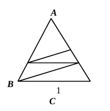
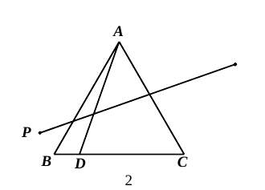
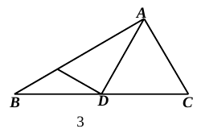
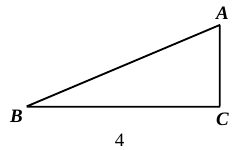
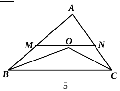
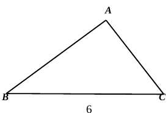

# 2026 一模精讲 · 普陀卷（上）选择与填空 1-18

> 本卷全称"2025 学年度第一学期期末九年级自适应练习(2026.1)"。本篇覆盖第 1-18 题，每题"转录 + 简解 + 答案"；第 19-25 题见《数模26-普陀-下》。

## 一、选择题（每题 4 分）

### 1．已知 $\dfrac{x}{y}=\dfrac52$，下列式子一定成立的是（　）

(A) $x=5$，$y=2$；(B) $5x=2y$；(C) $y=\dfrac52x$；(D) $\dfrac{x-y}{y}=\dfrac32$

**简解**：$\dfrac{x}{y}=\dfrac52\Rightarrow 2x=5y$（比例基本性质），(B) 应为 $2x=5y$ 故错；(A) 只是特例；(C) 是把 $x/y$ 与 $y/x$ 混淆；(D) $\dfrac{x-y}{y}=\dfrac xy-1=\dfrac52-1=\dfrac32$ 成立。
**答案**：$\boxed{D}$

### 2．Rt△ABC 中，∠C＝90°，AC＝1，BC＝2√2，那么 sin B 的值是（　）

**简解**：$AB=\sqrt{1+8}=3$（勾股定理），$\sin B=\dfrac{AC}{AB}=\dfrac13$。
**答案**：$\boxed{A}$

### 3．将抛物线 $y=3x^2$ 平移，使顶点移到点 M(−2, 1)，所得新抛物线的表达式是（　）

**简解**：平移不改变 $a=3$，顶点式直接写出 $y=3(x+2)^2+1$。
**答案**：$\boxed{C}$

### 4．设非零向量 $\vec a$、$\vec b$、$\vec c$，如果 $\vec a=2\vec b$，$\vec b=-3\vec c$，那么下列说法中错误的是（　）

(A) $\vec a\parallel\vec c$；(B) $\vec a$ 与 $\vec c$ 方向相反；(C) $|\vec a|=6|\vec c|$；(D) $\vec a-6\vec c=\vec 0$

**简解**：$\vec a=2(-3\vec c)=-6\vec c$：平行且方向相反、模为 6 倍均成立，(A)(B)(C) 正确；(D) 应为 $\vec a+6\vec c=\vec 0$。
**答案**：$\boxed{D}$

### 5．如图，△ABC 中，点 D 在边 AB 上，点 E、F 在边 AC 上，DF∥BC。下列条件中，不一定能判定 DE∥BF 的是（　）

(A) $\dfrac{AE}{EF}=\dfrac{AF}{FC}$；(B) $\dfrac{DE}{BF}=\dfrac{DF}{BC}$；(C) $\dfrac{EF}{FC}=\dfrac{DF}{BC}$；(D) $\dfrac{CF}{AC}=\dfrac{EF}{AF}$

**简解**：DE∥BF 等价于 $\dfrac{AD}{DB}=\dfrac{AE}{EF}$；由 DF∥BC 有 $\dfrac{AD}{AB}=\dfrac{AF}{AC}$。(A) 结合 $\dfrac{AD}{DB}=\dfrac{AF}{FC}$（由 DF∥BC 得）直接判定；(C)(D) 都可推出 $AE:EF$ 与 $AD:DB$ 同比例（设 $AE=u,EF=v,FC=w$ 代入验证），能判定；(B) 中的四条线段不落在两条被平行线所截的直线上，不成比例结构，不一定能判定。
**答案**：$\boxed{B}$

### 6．如图，在等边三角形 ABC 中，点 D 在边 BC 上，点 D 关于直线 AB、AC 的对称点分别是 P、Q，那么线段 PQ 与线段 AD 的数量关系是（　）

(A) $PQ=\dfrac{2\sqrt3}{3}AD$；(B) $PQ=\sqrt3\,AD$；(C) $PQ=2AD$；(D) $PQ=\dfrac{3\sqrt3}{2}AD$

**简解**：对称知 $AP=AD$、$AQ=AD$（对称轴过 A，距离不变）；$\angle PAQ=\angle PAB+\angle BAC+\angle CAQ=\angle DAB+60^\circ+\angle DAC=120^\circ$。等腰 △APQ 顶角 120°、腰 $AD$，作 PQ 边上的高：底角 30°，$\dfrac{PQ}{2}=AD\cdot\sin60^\circ$（解直角三角形）→ $PQ=2\times\dfrac{\sqrt3}{2}AD=\sqrt3\,AD$。
**答案**：$\boxed{B}$

## 二、填空题（每题 4 分）

### 7．计算：$\sqrt8=$　▲

**答案**：$\boxed{2\sqrt2}$

### 8．函数 $y=\dfrac{x-3}{x}$ 的定义域是　▲

**答案**：$\boxed{x\neq0}$

### 9．反比例函数 $y=\dfrac{k+1}{x}$ 的图像所在的每个象限内，y 随 x 增大而增大，则 k 的取值范围是　▲

**简解**：每个象限内 y 随 x 增大而增大 ⟺ 图像在二、四象限 ⟺ $k+1<0$。
**答案**：$\boxed{k<-1}$

### 10．二次函数 $y=x^2+bx+c$ 经过 A(1, 3)、B(−1, 1)，求解析式　▲

**简解**：$1+b+c=3$，$1-b+c=1$，相减得 $b=1$，$c=1$。
**答案**：$\boxed{y=x^2+x+1}$

### 11．抛物线 $y=2x^2+bx+b+3$ 的对称轴是 y 轴，则顶点坐标为　▲

**简解**：对称轴 $x=-\dfrac{b}{4}=0\Rightarrow b=0$，$y=2x^2+3$。
**答案**：$\boxed{(0,\ 3)}$

### 12．将两根长度相同的细铜丝均在其黄金分割点处弯折，首尾相接围成矩形 ABCD（AB＜BC），联结 BD，则 tan∠DBC＝　▲

**简解**：每根铜丝在黄金分割点弯折出长、短两段，短段∶长段 $=\dfrac{\sqrt5-1}{2}$（黄金分割性质：小段/大段＝大段/全长）；两根首尾相接即矩形两邻边，$AB:BC=短:长=\dfrac{\sqrt5-1}{2}$。$\tan\angle DBC=\dfrac{DC}{BC}=\dfrac{AB}{BC}=\dfrac{\sqrt5-1}{2}$。
**答案**：$\boxed{\dfrac{\sqrt5-1}{2}}$

### 13．Rt△ABC 中，∠BAC＝90°，AD 为中线，E 在边 AB 上，DE⊥AD。BC＝20，cot B＝5/3，则 DE＝　▲

**简解**：$AD=\dfrac{BC}{2}=10$（直角三角形斜边上的中线等于斜边的一半）→ $DA=DB$ → $\angle DAB=\angle B$（等边对等角）。Rt△ADE 中 ∠ADE＝90°，$\tan\angle DAE=\tan B=\dfrac35$，$DE=AD\cdot\tan B=10\times\dfrac35=6$。
**答案**：$\boxed{6}$

### 14．四边形 ABCD 对角线交于 O，$\dfrac{OA}{OB}=\dfrac{OD}{OC}$，∠ABD＝2∠CAD，∠ABC＝102°，则 ∠ACD＝　▲

**简解**：$OA\cdot OC=OB\cdot OD$ → △AOD∽△BOC（两边成比例且夹角 ∠AOD＝∠BOC 为对顶角）→ $\angle ADB=\angle ACB$ → A、B、C、D 四点共圆（同侧同角）。圆中同弧：$\angle ACD=\angle ABD=2\angle CAD$，$\angle CBD=\angle CAD$，故 $102^\circ=\angle ABD+\angle DBC=2\angle CAD+\angle CAD$，$\angle CAD=34^\circ$，$\angle ACD=68^\circ$。
**答案**：$\boxed{68}$

### 15．斜坡 AB 坡度 1∶2.4，将铅垂高度从 A 沿射线 CA 方向延伸 2 米并保持坡度不变，需从 B 沿射线 CB 方向延伸　▲　米

**简解**：坡度＝铅垂∶水平＝1∶2.4，高度每升 1 米水平延伸 2.4 米；升 2 米 → 水平延伸 $2\times2.4=4.8$。
**答案**：$\boxed{4.8}$

### 16．△ABC 中，OB、OC 分别平分∠ABC、∠ACB，M、N 分别在边 AB、AC 上，过 O 的线段 MN∥BC。AB＝5，AC＝4，BC＝6，则 MN＝　▲

**简解**：$MO\parallel BC$ → $\angle MOB=\angle OBC$（内错角）＝∠MBO（角平分线）→ $MO=MB$（等角对等边）；同理 $ON=NC$。设 $AM=5t$、$AN=4t$（△AMN∽△ABC），则 $MN=MB+NC=5(1-t)+4(1-t)=9(1-t)$ 且 $MN=6t$，解得 $t=\dfrac35$，$MN=\dfrac{18}{5}$。
**答案**：$\boxed{\dfrac{18}{5}}$

### 17．定义：三角形一条边上的中线与另一条边上的高的交点叫"中垂点"。△ABC 中 AB＝AC，cos∠ABC＝1/4，AD 为 BC 边上的高，O 在 AD 上，CO 延长交 AB 于 E，若 O 是 △ABC 的中垂点，则 $\dfrac{OE}{OC}=$　▲

**简解**：以 D 为原点、BC 为 x 轴：B(−1,0)、C(1,0)、A(0,√15)（$AB=4$ 由 $\cos B=\frac{BD}{AB}=\frac14$，$AD=\sqrt{15}$ 勾股）。两种中垂点：
① O＝AD（边 BC 的中线）∩ B 到 AC 边上的高：高线方程（与 AC 垂直、过 B）$x+1-\sqrt{15}y=0$，交 $x=0$ 于 $O(0,\frac{\sqrt{15}}{15})$；直线 CO：$C+t(O-C)$ 交 AB 于 E，解得参数 $t=\frac{15}{8}$，$\dfrac{OE}{OC}=t-1=\dfrac78$；
② O＝AD（BC 边上的高）∩ C 到 AB 边上的中线：该交点即重心（两条中线的交点），E 为 AB 中点，由重心性质 $OC=\dfrac23CE$、$OE=\dfrac13CE$，$\dfrac{OE}{OC}=\dfrac12$。
**答案**：$\boxed{\dfrac12\ \text{或}\ \dfrac78}$

### 18．△ABC 中，∠BAC＝90°，AC＝3，AB＝4，D 在边 AB 上，将 △ACD 沿 CD 翻折得 △A′CD（A 与 A′ 对应），联结 A′B。若 ∠ACD＝∠A′BA，则 AD＝　▲

**简解**：设 $AD=d$，则 $\tan\angle ACD=\dfrac d3$。以 A 为原点、AB 为 x 轴建系：A(0,0)、B(4,0)、C(0,3)、D(d,0)，直线 CD：$3x+dy-3d=0$。A′ 与 A 关于 CD 对称（中点在对称轴上、AA′⊥CD），解得 $A'\left(\dfrac{18d}{d^2+9},\ \dfrac{6d^2}{d^2+9}\right)$。由 $\tan\angle A'BA=\tan\angle ACD$：
$$\frac{\dfrac{6d^2}{d^2+9}}{4-\dfrac{18d}{d^2+9}}=\frac d3\ \Rightarrow\ d^2-9d+9=0\ \Rightarrow\ d=\frac{9\pm3\sqrt5}{2}$$
**答案**：$\boxed{\dfrac{9-3\sqrt5}{2}}$（$d=\dfrac{9+3\sqrt5}{2}>AB=4$，D 不在边 AB 上，舍去）
⚠️ 答案页印作"$\dfrac{9\pm3\sqrt5}{2}$"，其中"$+$"号一根不满足"D 在边 AB 上"，已按题意舍去 ⚠️ 待核对。

## 答案速查与互证

| 题号 | 1 | 2 | 3 | 4 | 5 | 6 | 7 | 8 | 9 | 10 | 11 | 12 | 13 | 14 | 15 | 16 | 17 | 18 |
| --- | --- | --- | --- | --- | --- | --- | --- | --- | --- | --- | --- | --- | --- | --- | --- | --- | --- | --- |
| 答案 | D | A | C | D | B | B | $2\sqrt2$ | $x\neq0$ | $k<-1$ | $y=x^2+x+1$ | $(0,3)$ | $\frac{\sqrt5-1}{2}$ | 6 | 68 | 4.8 | $\frac{18}{5}$ | $\frac12$ 或 $\frac78$ | $\frac{9-3\sqrt5}{2}$⚠️ |

与卷末参考答案逐题互证：除第 18 题舍根说明外全部一致。
