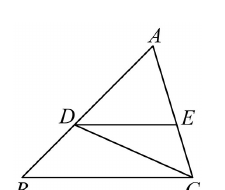
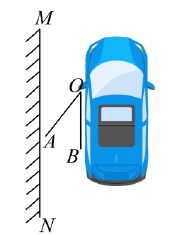
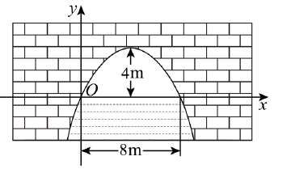
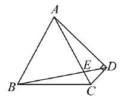
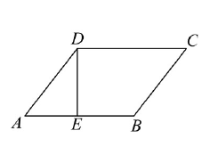

# 2026一模精讲 · 杨浦卷（上）第 1~18 题

> 原卷公式由图片提取、存在讹误；本篇已对照原卷页图与官方解析逐题核验（题 6、15、16、17、18 已配原卷图）。

## 一、选择题

**1.** 下列各组线段的长度中，成比例的是（　）A. 1,2,3,4　B. 2,4,4,8　C. 1.5,3,4.5,6　D. 3,4,5,6

**简解** B。成比例须 $ad=bc$（两两之积相等）：$2\times8=4\times4=16$ ✓；A：$1\times4\neq2\times3$；C：$1.5\times6=9\neq3\times4.5=13.5$；D：$3\times6\neq4\times5$。

**2.** 已知点 C 在线段 AB 上，如果 $AB=3AC$，$\vec{AB}=\vec a$，那么 $\vec{BC}$ 等于（　）A. $\frac13\vec a$　B. $\frac23\vec a$　C. $-\frac13\vec a$　D. $-\frac23\vec a$

**简解** D。$AC=\frac13AB$，$\vec{BC}=\vec{AC}-\vec{AB}=\frac13\vec a-\vec a=-\frac23\vec a$（向量减法：终点减起点）。

**3.** 在 Rt△ABC 中，∠C=90°，AB=3，AC=1，下列结论正确的是（　）A. $\sin\angle B=\frac13$　B. $\cos\angle B=\frac13$　C. $\tan\angle B=\frac{\sqrt2}{2}$　D. $\cot\angle B=\frac{\sqrt2}{2}$

**简解** A。$BC=\sqrt{AB^2-AC^2}=\sqrt{9-1}=2\sqrt2$（勾股定理）；$\sin\angle B=\dfrac{AC}{AB}=\dfrac13$ ✓；$\cos\angle B=\dfrac{BC}{AB}=\dfrac{2\sqrt2}{3}$、$\tan\angle B=\dfrac{AC}{BC}=\dfrac{\sqrt2}{4}$、$\cot\angle B=2\sqrt2$，B、C、D 均不正确。

**4.** 传送带与地面所成斜坡的坡比为 1:2.4，把物体从地面送到离地 10 米高处，物体经过的路程是（　）A.12 米　B.13 米　C.24 米　D.26 米

**简解** D。坡比=垂直:水平，水平距离 $=10\times2.4=24$ 米，斜面长 $=\sqrt{10^2+24^2}=26$ 米（勾股定理）。

**5.** 将抛物线 $y=-(x+6)^2+8$ 向右平移 10 个单位，抛物线与 y 轴的交点 P 在平移过程中的位置变化是（　）A.持续向上　B.持续向下　C.先向上再向下　D.先向下再向上

**简解** C。设右移 m（$0<m\le10$），新解析式 $y=-(x+6-m)^2+8$，与 y 轴交点 $P'(0,\,-(6-m)^2+8)$；$-(6-m)^2+8=-(m-6)^2+8$，当 $m=6$ 时最大为 8，故 P 先升后降。

**6.** 如图，△ABC 中，点 D、E 分别在边 AB、AC 上，DE∥BC，∠ACD=∠B，下列结论错误的是（　）

A. $\dfrac{DC^2}{BC^2}=\dfrac{AE}{AC}$　　B. $\dfrac{DE^2}{DC^2}=\dfrac{AD}{AB}$　　C. $\dfrac{AD^2}{AC^2}=\dfrac{AE}{AB}$　　D. $\dfrac{EC^2}{BD^2}=\dfrac{DE}{BC}$

**简解** C。∠ACD=∠B 与公共角 ∠A 得 △ACD∽△ABC，得 $\dfrac{AC}{AB}=\dfrac{AD}{AC}=\dfrac{CD}{BC}$，即 $AC^2=AD\cdot AB$；DE∥BC 得 △ADE∽△ABC，得 $\dfrac{AD}{AB}=\dfrac{AE}{AC}=\dfrac{DE}{BC}$；又 △ABC∽△ACD∽△ADE 且 △DBC∽△ECD（∠DBC=∠ECD=∠ACD、∠DCB 公共），得 $AD^2=AC\cdot AE$、$AC^2=AB\cdot AD$、$CD^2=BC\cdot DE$。
- A：$\dfrac{CD^2}{BC^2}=\dfrac{BC\cdot DE}{BC^2}=\dfrac{DE}{BC}=\dfrac{AE}{AC}$ ✓；
- B：$\dfrac{DE^2}{DC^2}=\dfrac{DE^2}{BC\cdot DE}=\dfrac{DE}{BC}=\dfrac{AD}{AB}$ ✓；
- C：$\dfrac{AD^2}{AC^2}=\dfrac{AC\cdot AE}{AB\cdot AD}$，一般不等于 $\dfrac{AE}{AB}$（只有 $AC=AD$ 时才成立），代值检验：设 $AB=1,AC=0.8$，则 $AD=0.64,AE=0.512$，$\dfrac{AD^2}{AC^2}=0.64\neq\dfrac{AE}{AB}=0.512$，C 错误；
- D：$\dfrac{EC^2}{BD^2}=\dfrac{DE^2}{DC^2}=\dfrac{DE^2}{BC\cdot DE}=\dfrac{DE}{BC}$ ✓。
故错误的是 C。

## 二、填空题

**7.** 计算：$\cot60^\circ=$______。

**简解** $\dfrac{\sqrt3}{3}$。$\cot60^\circ=\dfrac{1}{\tan60^\circ}=\dfrac{1}{\sqrt3}=\dfrac{\sqrt3}{3}$。

**8.** 如果 $\dfrac{a}{b}=\dfrac23$，那么 $\dfrac{a+b}{b}$ 的值为______。

**简解** $\dfrac53$。$\dfrac{a+b}{b}=\dfrac{a}{b}+\dfrac{b}{b}=\dfrac23+1=\dfrac53$。

**9.** 已知向量 $\vec a$ 与单位向量 $\vec e$ 方向相反，且 $|\vec a|=3$，那么 $\vec a=$______（用 $\vec e$ 表示）。

**简解** $\vec a=-3\vec e$。方向相反取负号，模长 3 定系数。

**10.** 如果二次函数 $y=x^2-mx+m+1$ 的图象经过原点，那么 m 的值是______。

**简解** $-1$。代 $(0,0)$：$0=m+1$，$m=-1$。

**11.** 如果抛物线 $y=ax^2+2x$ 的开口向上，那么 a 的取值范围是______。

**简解** $a>0$。开口向上 ⇔ 二次项系数 $a>0$。

**12.** 已知抛物线 $y=-x^2+c$ 经过点 $A(-1,y_1)$、$B(4,y_2)$，那么 $y_1$______$y_2$（填"＞""＜"或"＝"）。

**简解** ＞。$a=-1<0$ 开口向下，对称轴为 y 轴；$|-1|<|4|$，A 离对称轴更近，函数值更大，$y_1>y_2$。

**13.** 在 △ABC 中，中线 AD 和中线 CE 相交于点 G，则 AG:AD＝______。

**简解** 2:3。G 是重心，$AG=2GD$，$AD=3GD$，故 $AG:AD=2:3$。

**14.** 在 △ABC 中，$AC=4$，$\angle A=30^\circ$，$\tan\angle B=\dfrac23$，那么 $BC$ 的长为______。

**简解** $\sqrt{13}$。过 C 作 $CD\perp AB$ 于 D。Rt△ADC 中 ∠A=30°，$CD=\dfrac12AC=2$（30° 角所对直角边等于斜边一半）；Rt△BDC 中 $\tan\angle B=\dfrac{CD}{BD}=\dfrac23$，故 $BD=3$；$BC=\sqrt{CD^2+BD^2}=\sqrt{4+9}=\sqrt{13}$（勾股定理）。

**15.** 如图，小汽车与墙 MN 平行停放，车身靠墙一侧与墙距离 $MN=0.8$ 米，车门宽 $AO=1.2$ 米。当车门打开 40°（$\angle AOB=40^\circ$）时，车门是否会碰到墙？______（填"是"或"否"）。（$\sin40^\circ\approx0.64$，$\cos40^\circ\approx0.77$，$\tan40^\circ\approx0.84$）

**简解** 否。过 A 作 $AC\perp OB$ 于 C（OB 为车身方向线），则门端 A 向墙侧的偏移 $AC=AO\sin40^\circ\approx1.2\times0.64=0.768$ 米 $<0.8$ 米（MN），车门端点偏出车身线的距离不足 0.8 米，不会碰到墙。

**16.** 如图是抛物线形拱桥，以水面左端点为原点 O 建立平面直角坐标系 xOy。拱顶离水面 4 米时水面宽 8 米。如果水面上升 3 米，那么水面宽度减少______米。

**简解** 4。设 $y=a(x-4)^2+4$（拱顶 $(4,4)$），代 $(0,0)$：$16a+4=0$，$a=-\dfrac14$，$y=-\dfrac14(x-4)^2+4$。水面升 3 米即 $y=3$：$-\dfrac14(x-4)^2+4=3$，$x=2$ 或 $6$，此时水面宽 $6-2=4$ 米，减少 $8-4=4$ 米。

**17.** 如图，四边形 ABCD 中，$AB=BC=6$，$\angle ABC=60^\circ$，$\angle ADC=90^\circ$，对角线 AC 与 BD 相交于点 E，若 $BE=3DE$，则 $BD=$______。

**简解** $3\sqrt6$。$AB=BC$ 且 ∠ABC=60° → △ABC 是等边三角形（有一个角是 60° 的等腰三角形），$AC=6$。
作 $BM\perp AC$ 于 M、$DN\perp BM$ 于 N（N 在 BM 延长线上）：∠BMC=∠BND=90° → CM∥DN。
∵BE=3DE，∴$S_{\triangle MBE}=3S_{\triangle MED}$（同高三角形面积比等于底之比，M、E、D 共线且 E 在 BD 上），∴$BM=3MN$。
等边三角形中 $CM=\dfrac12AC=3$（三线合一），$BM=\sqrt{BC^2-CM^2}=\sqrt{36-9}=3\sqrt3$（勾股定理），∴$MN=\sqrt3$、$BN=BM+MN=4\sqrt3$。
∵∠ADC=90°，M 为 AC 中点，∴$DM=\dfrac12AC=3$（直角三角形斜边上的中线等于斜边的一半）；$DN=\sqrt{DM^2-MN^2}=\sqrt{9-3}=\sqrt6$（勾股定理）。
$$BD=\sqrt{BN^2+DN^2}=\sqrt{48+6}=\sqrt{54}=3\sqrt6$$

**18.** 如图，平行四边形 ABCD 中，$AB=6$，$BC=5$，过点 D 作 $DE\perp AB$ 于 E，将 △ADE 绕点 E 旋转得到 △FGE，点 A 的对应点 F 恰落在边 AD 上，点 D 的对应点 G 恰落在边 BC 上，FG 与 DE 交于点 H，那么 $\dfrac{FH}{GH}$ 的值为______。

**简解**（按官方解析复原）$\dfrac{7}{32}$。Rt△ADE 中 $AE=3$、$DE=4$（$AD=BC=5$、勾股定理）。旋转：$EF=EA=3$、$EG=ED=4$、$\angle FEG=\angle AED=90°$。
∵AE=EF，∴∠A=∠EFA；$\cos\angle A=\dfrac{AE}{AD}=\dfrac35$，△AEF 等腰中 $AF=2AE\cos\angle A=\dfrac{18}{5}$（F 在 AD 上），$FD=AD-AF=\dfrac75$。
延长 FE 交 CB 的延长线于 M、延长 DE 到 N 使 $EN=ED$：∵$AE=EF=EB=EM=3$（可证 EM=EF），∴$EB=EM$、$\angle EMB=\angle A$（△EBM 等腰与 AD∥BC 传递）；△FDE≌△MNE（SAS：EF=EM、∠FED=∠MEN 对顶角、ED=EN），$FD=MN=\dfrac75$。
∵∠FEG=90° 且 F、E、M 共线，∴EG⊥FM（E 是 FM 中点）→ $GF=GM$；Rt△EFG 中 $FG=\sqrt{3^2+4^2}=5$（勾股定理）→ $GM=5$、$GB=GM-BM=5-\dfrac{18}{5}=\dfrac75$（$BM=2EB\cos\angle A=\dfrac{18}{5}$）。
∵FD∥BC（F 在 AD 上、AD∥BC），∴△DFH∽△NGH（∠DFH=∠NGH、∠FDH=∠NGH 内错角与对顶角），$GN=NM+MG=\dfrac75+5=\dfrac{32}{5}$，
$$\frac{FH}{GH}=\frac{FD}{GN}=\frac{7/5}{32/5}=\boxed{\frac{7}{32}}$$

## ⚠️ 本篇待核对清单

- 第 3、5、7、8、10、11、12、14、16 题题干与答案均已对照原卷页图与官方解析核验一致；第 6 题选项已按原卷补全。
- 第 18 题数据链（AE=3、DE=4、AF=18/5、FD=7/5、FG=5、FH/GH=7/32）与官方解析一致，并经坐标法核验。
- 已代回验证：1~5、7~13、15、16 题全部自洽。

## 🔗 关联

- [[03-数学/知识点/九年级/相似三角形]] · [[03-数学/知识点/九年级/锐角的三角比与解直角三角形]] · [[03-数学/知识点/九年级/二次函数]] · [[03-数学/知识点/九年级/平面向量]]
- 解答题见 [[数模26-杨浦-下]]
