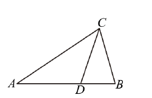
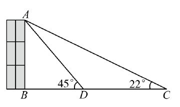
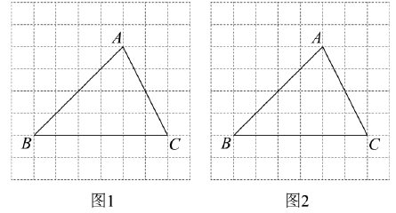
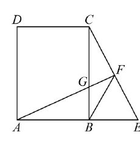
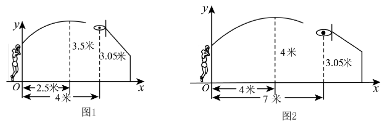
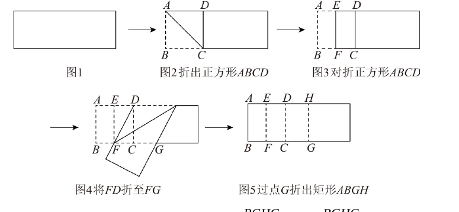
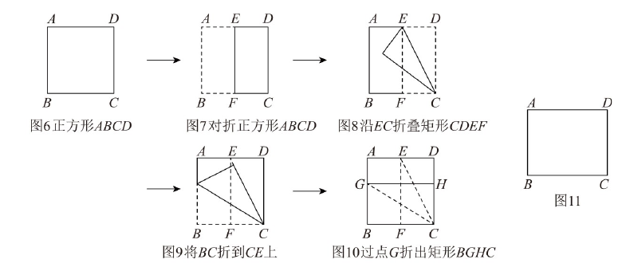

# 2026一模精讲 · 杨浦卷（下）第 19~25 题

> 原卷公式由图片提取、存在讹误；本篇已对照原卷官方解析页逐题复原并配图。

## 19. 平面向量（8 分）

**题目** 如图，△ABC 中，点 D 在边 AB 上，且 $AD=2BD$。（1）设 $\vec{AC}=\vec a$，$\vec{AD}=\vec b$，那么 $\vec{BC}=$______（用含 $\vec a,\vec b$ 的式子表示）；（2）如果 $\angle BCD=\angle A$，$BC=6$，求 $AB$ 的长。

**提示 1** AD=2BD 给出 AB=AD+BD=3BD，即 $AB=\frac32AD$。
**提示 2** $\vec{BC}$ 走"折线"B→A→C：$\vec{BC}=\vec{BA}+\vec{AC}$。
**提示 3** (2) ∠BCD=∠A 与公共角 ∠B 得 △BCD∽△BAC，$BC^2=BA\cdot BD$。

**详解** (1) ∵AD=2BD，∴$AB=AD+BD=\dfrac32AD$，$\vec{AB}=\dfrac32\vec{AD}=\dfrac32\vec b$，$\vec{BA}=-\dfrac32\vec b$（相反向量）。
$$\vec{BC}=\vec{BA}+\vec{AC}=-\frac32\vec b+\vec a\ \Rightarrow\ \boxed{\vec{BC}=-\frac32\vec b+\vec a}$$
（2）∵∠BCD=∠A（已知），∠B=∠B（公共角），∴△BCD∽△BAC（两角对应相等的两三角形相似），$\dfrac{BC}{BA}=\dfrac{BD}{BC}$，即 $BC^2=BA\cdot BD$。
∵AD=2BD，∴$BD=\dfrac13AB$；代 $BC=6$：$36=AB\cdot\dfrac13AB=\dfrac{AB^2}{3}$，$AB^2=108$，
$$AB=\boxed{6\sqrt3}$$

**易错** $\vec{BA}=-\dfrac32\vec b$ 的负号（首字母出发别漏方向）；相似比写"长边比长边"：$\dfrac{BC}{BA}=\dfrac{BD}{BC}$ 中 BC 是比例中项。

## 20. 二次函数与表格（10 分）

**题目** 二次函数部分对应值：x=0,1,2,3 时 y=−3,0,1,0。（1）求解析式与对称轴；（2）图象与 x 轴交于点 A（对称轴右侧）、与 y 轴交于点 B，顶点为 C，求 △ABC 的面积。

**提示 1** 对称的两列 y 值：$y(1)=y(3)=0$ → 对称轴 $x=2$。
**提示 2** 顶点 (2,1)，设 $y=a(x-2)^2+1$ 代一点定 a。
**提示 3** (2) 用两点间距离公式算 AB、AC，勾股逆定理判直角，面积=两直角边乘积之半。

**详解** (1) 对称轴 $x=2$，顶点 $C(2,1)$，设 $y=a(x-2)^2+1$，代 $(0,-3)$：$4a+1=-3$，$a=-1$，
$$y=-(x-2)^2+1=-x^2+4x-3$$
（验证：$y(1)=0$，$y(3)=0$ ✓）
(2) $A(3,0)$（右侧交点）、$B(0,-3)$、$C(2,1)$。$AB=\sqrt{3^2+3^2}=3\sqrt2$，$AC=\sqrt{1^2+1^2}=\sqrt2$，$BC=\sqrt{2^2+4^2}=2\sqrt5$；$AB^2+AC^2=18+2=20=BC^2$，∴∠BAC=90°（勾股逆定理），
$$S_{\triangle ABC}=\frac12\cdot3\sqrt2\cdot\sqrt2=\boxed{3}$$

**易错** A 取右侧交点 (3,0) 不是 (1,0)；判直角先算三边平方再比较，避免直接算角度。

## 21. 测教学楼高（10 分）

**题目** 如图，在教学楼前 D 处测得楼顶 A 的仰角为 45°，沿 BC 方向向后退 16 米到 C 处（D、C 与楼脚 B 共线），测得 A 的仰角为 22°，求教学楼 AB 的高（精确到 0.1 米；$\sin22^\circ=\dfrac38$，$\cos22^\circ\approx\dfrac{15}{16}$，$\tan22^\circ\approx\dfrac25$）。

**提示 1** 45° 仰角 → △ABD 等腰直角，AB=BD。
**提示 2** 设 AB=x，则 BC=x+16，大直角三角形中用 tan22° 列方程。
**提示 3** 一次方程解 x，按"精确到 0.1 米"收尾。

**详解** 设 $AB=x$。AB⊥BC，∠ADB=45° → △ABD 等腰直角（∠DAB=∠ADB=45°），$BD=AB=x$，$BC=BD+CD=x+16$。
在 Rt△ABC 中，$\tan\angle C=\dfrac{AB}{BC}\approx\dfrac25$：
$$\frac{x}{x+16}=\frac25\ \Rightarrow\ 5x=2x+32\ \Rightarrow\ x=\frac{32}{3}\approx10.7\ (\text{米})$$
教学楼高度约为 $\boxed{10.7\ \text{米}}$。

**易错** 45° 给出 BD=AB 是省未知数的关键；结果 10.666… 按"精确到 0.1 米"写 10.7。

## 22. 网格中的格点问题（10 分）

**题目** 边长为 1 的 8×8 正方形网格中，△ABC 的顶点都在格点上（图1、图2）。（1）求 $\sin\angle BAC$ 的值；（2）仅用无刻度直尺作图：①在图1 的 AB 边上求作点 P，使 $\angle ACP=45^\circ$；②在图2 的 AC 边上求作点 Q，使 $BQ\perp AC$（保留作图痕迹，写出结论）。

**提示 1** (1) 作 CH⊥AB，用"等面积法"$\frac12BC\cdot h_{BC}=\frac12AB\cdot CH$ 求 CH，再 $\sin\angle BAC=\frac{CH}{AC}$。
**提示 2** ①构造"AD=AC 且 AD⊥AC"的等腰直角三角形（格点向量旋转），∠ACD=45°，连 CD 交 AB 于 P。
**提示 3** ②找格点 G 使 BG⊥AC（格点向量数量积为 0，用勾股逆定理说理），连 BG 交 AC 于 Q。

**详解** (1) 读格：$BC=6$（水平 6 格），A 到 BC 的竖直距离为 4；$AB=\sqrt{4^2+4^2}=4\sqrt2$，$AC=\sqrt{2^2+4^2}=2\sqrt5$（格点勾股）。
作 $CH\perp AB$ 于 H，等面积法：$\dfrac12BC\cdot4=\dfrac12AB\cdot CH$，$6\times4=4\sqrt2\cdot CH$，$CH=3\sqrt2$，
$$\sin\angle BAC=\frac{CH}{AC}=\frac{3\sqrt2}{2\sqrt5}=\boxed{\frac{3\sqrt{10}}{10}}$$
(2) ① 取格点 D（A 向右 4 格、向上 2 格）：$AD=\sqrt{4^2+2^2}=2\sqrt5=AC$，且 $AD^2+AC^2=20+20=40=CD^2$（$CD$ 跨 6 格、2 格），∴∠DAC=90°（勾股逆定理），△ACD 是等腰直角三角形，∠ACD=45°；连接 CD 交 AB 于点 P，则 $\angle ACP=\angle ACD=45°$，点 P 即为所求。
② 取格点 G（B 向右 2 格、向上 1 格）：$BG^2=2^2+1^2=5$，且 $\vec{BG}\cdot\vec{AC}=2\times2+1\times(-4)=0$（或以勾股逆定理说明），∴BG⊥AC；连接 BG 交 AC 于点 Q，则 $BQ\perp AC$，点 Q 即为所求。

**易错** 无刻度直尺作图必须"保留痕迹 + 写结论"；格点勾股是数格子不是量角度；说理用"勾股逆定理"或"向量垂直"，不要写"用量角器量得"。

## 23. 矩形中的相似证明（12 分）

**题目** 如图，矩形 ABCD 中，点 E 在边 AB 的延长线上，过 A 作 $AF\perp CE$ 于 F（F 在 CE 上），且 $CF=EF$，AF 与边 BC 交于点 G，连接 BF。（1）求证：$FB^2=FA\cdot FG$；（2）连接 BD 与 AG 交于点 H，如果 $AB=BC$，求证：$\dfrac{AH}{HG}=\dfrac{HF}{FG}$。

**提示 1** (1) 先用"直角三角形斜边上的中线等于斜边的一半"得 BF=CF=EF，再用"双垂直"证 △AEF∽△CGF，交叉相乘即得。
**提示 2** (2) 由 ∠GAB=∠GCF=∠CBF=∠FBG 与 BD 平分正方形直角，得 ∠FHB=∠FBH → HF=FB。
**提示 3** 两对相似 △ADH∽△GBH 与 △AGB∽△CGF 各给一个比例，拼起来即得结论。

**详解** (1) ∵四边形 ABCD 是矩形，E 在 AB 延长线上，∴∠CBE=90°；在 Rt△BCE 中，F 是斜边 CE 的中点（CF=EF），∴$BF=CF=EF$（直角三角形斜边上的中线等于斜边的一半）。
∵AF⊥CE，∴∠EFA=∠GFC=90°；∠GCF+∠BEC=90°（Rt△BCE）、∠EAF+∠AEF=90°（Rt△AEF），∠BEC=∠AEF（对顶角），∴∠GCF=∠EAF（同角的余角相等），∴△AEF∽△CGF（两角对应相等），$\dfrac{AF}{CF}=\dfrac{EF}{GF}$，交叉相乘得
$$AF\cdot GF=CF\cdot EF=CF^2=FB^2\qquad(\because BF=CF=EF)$$
即 $\boxed{FB^2=FA\cdot FG}$。
(2) ∵$AB=BC$，∴ABCD 是正方形，∠ABD=∠CBD=∠GBD=45°（H 在对角线 BD 上）、AD∥BC。
由 (1) △AEF∽△CGF 得 ∠GAB=∠GCF；∵$BF=CF$，∴∠CBF=∠GCF（等边对等角，G 在 BC 上）=∠FBG，∴∠GAB=∠FBG。
∠FHB 是 △ABH 的外角：∠FHB=∠GAB+∠ABD=∠FBG+45°；又 ∠FBH=∠FBG+∠GBD=∠FBG+45°，∴∠FHB=∠FBH，∴$HF=FB=CF$（等角对等边）。
∵AD∥BG，∴△ADH∽△GBH（两角），$\dfrac{AH}{HG}=\dfrac{AD}{GB}=\dfrac{AB}{GB}$；
∵∠AGB=∠CGF（对顶角）、∠ABG=∠CFG=90°，∴△AGB∽△CGF（两角），$\dfrac{CF}{GF}=\dfrac{AB}{GB}$；
∴$\dfrac{AH}{HG}=\dfrac{CF}{GF}=\dfrac{HF}{FG}$，即
$$\boxed{\dfrac{AH}{HG}=\dfrac{HF}{FG}}$$

**易错** "斜边中线等于斜边一半"必须先指出直角与中点两个前提；正方形判定写"矩形 + 邻边相等"；∠FHB=∠FBH 的两处"+45°"分别来自外角性质与 BD 平分正方形直角。

## 24. 篮球投篮抛物线（10 分）

**题目** 如图1，小杨在距篮下 4 米处跳投，球路线为抛物线；当球水平运行 2.5 米时到达最高点，此时球离地 3.5 米，准确落入篮圈，篮圈中心离地 3.05 米。（1）图1 建系（出手点在 y 轴上）：①求抛物线表达式；②小杨身高 1.8 米，球在头顶上方 0.25 米处出手，求他跳离地面的高度；（2）如图2，小浦出手时球离地 $\dfrac{20}{9}$ 米、与篮圈水平距离 7 米，出手后水平运行 4 米达最高点、离地 4 米，问能否投中篮圈？（⚠️ 出手高度按官方解析 (0,20/9) 复原）

**提示 1** 已知顶点 → 顶点式 $y=a(x-h)^2+k$。
**提示 2** (1)② 出手高度 = 抛物线在出手点的函数值（x=0 处）。
**提示 3** (2) 同法求第二条抛物线，把篮圈横坐标代入，与 3.05 比大小。

**详解** (1)① 顶点 $(2.5,3.5)$，设 $y=a_1(x-2.5)^2+3.5$；篮圈在距出手点水平 4 米处、高 3.05 米，代 $(4,3.05)$：
$$3.05=a_1(4-2.5)^2+3.5\ \Rightarrow\ 2.25a_1=-0.45\ \Rightarrow\ a_1=-0.2$$
$$y=-0.2(x-2.5)^2+3.5$$
②令 $x=0$：$y=-0.2\times(-2.5)^2+3.5=2.25$，即出手点离地 2.25 米；跳起高度 $=2.25-1.8-0.25=0.2$（米），故他跳离地面 $\boxed{0.2\ \text{米}}$。
(2) 顶点 $(4,4)$，设 $y=a_2(x-4)^2+4$，代 $(0,\dfrac{20}{9})$：$16a_2+4=\dfrac{20}{9}$，$a_2=-\dfrac19$，$y=-\dfrac19(x-4)^2+4$。篮圈横坐标 $x=7$：
$$y=-\frac19(7-4)^2+4=-1+4=3<3.05$$
球到达篮圈正下方时高度低于篮圈中心，$\boxed{\text{不能投进}}$。

**易错** 建系后"距篮下 4 米"对应 x=4 的含义要落到坐标上；(2) 是代入比较而不是解方程；结论句要写"∵3<3.05，∴不能投进"。

## 25. 综合与实践：折黄金矩形（14 分）

**题目** 宽与长之比为 $\dfrac{\sqrt5-1}{2}$ 的矩形称为黄金矩形。（1）小创小组将一张矩形纸片（图1）按图 2~图 5 操作（图2 折出正方形 ABCD、图3 对折正方形 ABCD、图4 将 FD 折至 FG、图5 过点 G 折出矩形 ABGH），写出图 5 中的黄金矩形（直接写结论）；（2）小智小组将一张正方形纸片（图6）按图 7~图 10 操作（图7 对折、图8 沿 EC 折叠、图9 将 BC 折到 CE 上、图10 过点 G 折出矩形 BGHC），证明它是黄金矩形；（3）将一张矩形纸片 ABCD（图11）：①沿过 C 的直线折叠，使点 B 落在边 AD 上的点 E 处，折痕交 AB 于点 G；②沿过 E 的直线折叠，使点 D 落在线段 CE 上的点 H 处，折痕交 CD 于点 F；③折出矩形 ENCD（N 在边 BC 上），折痕交线段 CG 于点 M，连接 MH。若 $MH\perp EN$，说明 G 是线段 AB 的黄金分割点。⚠️（③的折叠描述按官方解析图形复原）

**提示 1** (1) 黄金比的来源是"直角边 1、2、斜边 √5"：设正方形边长 2，则 $FD=\sqrt5$，折叠使 $FG=FD$，得 $BG=1+\sqrt5$、$CG=\sqrt5-1$。
**提示 2** (2) 全程"设参＋勾股＋方程"：将 BC 折到 CE 上得 $EB'=\sqrt5-2$，GE 的两种算法（Rt△AGE 与 Rt△GEB′）列勾股方程。
**提示 3** (3) 延长 DA 交 CG 于 T；设 $AE=m$、$ED=n$，折叠给 $EC=BC$、$EH=ED$，平行给等腰 △TEC，MH⊥EN 给平行线分线段成比例，化出黄金比。

**详解** (1) 设正方形 ABCD 边长 $AB=2$，对折后 $BF=CF=\dfrac12BC=1$；折叠使 $FG=FD$，$DF=\sqrt{CF^2+CD^2}=\sqrt{1^2+2^2}=\sqrt5$（勾股定理），∴$FG=\sqrt5$，$BG=BF+FG=1+\sqrt5$，$CG=FG-FC=\sqrt5-1$。
$$\frac{AB}{BG}=\frac{2}{1+\sqrt5}=\frac{\sqrt5-1}{2},\qquad \frac{CG}{CD}=\frac{\sqrt5-1}{2}$$
$$\boxed{\text{矩形 } ABGH\ \text{与}\ \text{矩形 } CGHD\ \text{是黄金矩形}}$$
(2) 正方形边长 2，对折后 $AE=ED=BF=CF=1$，$CE=\sqrt{ED^2+DC^2}=\sqrt5$（勾股定理）。将 BC 折到 CE 上，落点 B′ 在 CE 上：$CB'=CB=2$、$GB'=GB$、∠GB′C=∠GB′E=∠B=90°，∴$EB'=CE-CB'=\sqrt5-2$。
设 $BG=x$，则 $AG=2-x$。连接 GE，则 $GE^2=AG^2+AE^2$（Rt△AGE），且 $GE^2=EB'^2+GB'^2$（Rt△GEB′）：
$$(2-x)^2+1^2=(\sqrt5-2)^2+x^2\ \Rightarrow\ 5-4x=9-4\sqrt5\ \Rightarrow\ 4x=4\sqrt5-4\ \Rightarrow\ x=\sqrt5-1$$
∴$\dfrac{BG}{BC}=\dfrac{\sqrt5-1}{2}$，即矩形 BGHC 是黄金矩形。
(3) 设 $AE=m$、$ED=n$，则 $AD=BC=m+n$；∵ENCD 是矩形，∴$NC=ED=n$。
①折叠 B→E：$CB=CE=m+n$（C 在折痕上），且 ∠BCG=∠ECG（折痕是对称轴）；
②折叠 D→H：$EH=ED=n$，∴$HC=EC-EH=(m+n)-n=m$。
延长 DA 交 CG 于 T。∵TD∥BC，∴∠ETC=∠BCG（两直线平行，内错角相等）=∠ECG，∴△TEC 等腰，$ET=EC=m+n$，∴$AT=ET-AE=n$。
∵MH⊥EN，EN∥DC（ENCD 是矩形），∴MH∥AD∥BC（垂直于同一直线的两直线平行）。
由平行线分线段成比例：$\dfrac{TE}{NC}=\dfrac{EH}{HC}$，即 $\dfrac{m+n}{n}=\dfrac{n}{m}$，∴$n^2=m(m+n)$，$m=\dfrac{\sqrt5-1}{2}n$。
∵AT∥BC，∴$\dfrac{AG}{GB}=\dfrac{AT}{BC}=\dfrac{n}{m+n}=\dfrac{n}{\frac{\sqrt5-1}{2}n+n}=\dfrac{\sqrt5-1}{2}$，
∴点 G 是线段 AB 的黄金分割点（$\dfrac{AG}{AB}=\dfrac{\sqrt5-1}{2}$，G 靠近 A；较长段与全线段之比等于黄金比）。⚠️（M 在比例式中的对应环节页图中文缺失，数值链以原卷解析为准）

**易错** (1) 必须指出"宽:长"的分子分母方向（AB/BG=(√5−1)/2）；(2) 勾股方程两解要按几何意义舍根，B′ 的直角由"折叠保角"得到；(3) 黄金分割点定义是"分得的两段中，较长段与全线段之比等于较短段与较长段之比"，结论句要完整写出比例。

## ⚠️ 本篇待核对清单

- 19、22、23、24、25 题均已按原卷官方解析页（p-21~p-36）逐式复原并配图；20、21 题与原卷解析一致。
- 24 题 (2) 的出手高度 $\frac{20}{9}$ 米按官方解析代点 (0,20/9) 复原（题干中文在页图中缺失）。
- 25 题 (3) 中 M 的比例式环节（TE/NC=EH/HC 的相似细节）页图中文缺失，数值链 $(m+n)/n=n/m$ 与结论 $\frac{AG}{GB}=\frac{\sqrt5-1}{2}$ 以原卷解析为准。
- 已代回验证：20 题 $y(1)=y(3)=0$、$S_{\triangle ABC}=3$；21 题 $x\approx10.7$；24 题 $a_1=-0.2$、跳高 0.2 米、(2) $y(7)=3<3.05$；22 题 $\sin\angle BAC=\frac{3\sqrt{10}}{10}$ 与 23 题两问比例关系全部自洽。

## 🔗 关联

- [[03-数学/知识点/九年级/二次函数]] · [[03-数学/知识点/九年级/相似三角形]] · [[03-数学/知识点/九年级/黄金分割]]
- 选择填空见 [[数模26-杨浦-上]]
