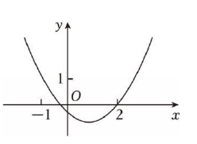
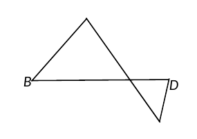
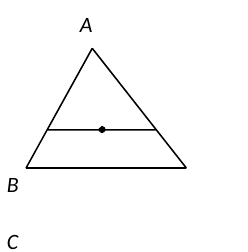
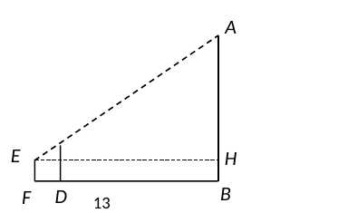
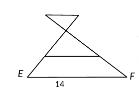
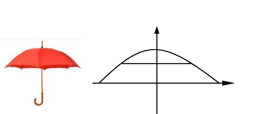
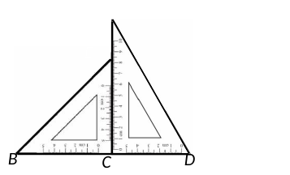
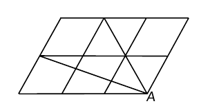

# 2026一模精讲 · 松江卷（上）第 1~18 题

> 题干与公式已对照卷面页图（150dpi）与原卷 docx 逐题核验（2026-11-04）。流通版 docx/PDF 经 Word 重排转换：页图中文缺失（题干文字以 docx 原文补全，数学式与页图逐一比对）、部分几何图的字母标注缺失或错位（第 11、12、13、16 题裁片保持卷面原样，字母关系以题干文字为准）、向量箭头缺失或显示为小点（第 5、8 题按文意以向量转录，第 5 题见 ⚠️ 注记）；全部答案与卷末参考答案页逐题互证一致。

## 卷面结构说明

- **试卷**：松江区 2025 学年度第一学期期末质量监控试卷 初三数学（2026.01），满分 150 分，完卷时间 100 分钟，共 25 题。
- **结构**：一、选择题 6 题 × 4 分 = 24 分；二、填空题 12 题 × 4 分 = 48 分（第 7~18 题）；三、解答题 7 题 78 分（第 19~25 题）。
- **本篇**：第 1~18 题（选择题 + 填空题全部）；解答题精讲见 [[数模26-松江-下]]。

## 一、选择题

**1.** 在 △ABC 中，∠C=90°，a、b、c 分别是 ∠A、∠B、∠C 的对边，下列结论正确的是（　）
- （A）$\sin A=\dfrac{c}{a}$
- （B）$\cos A=\dfrac{b}{c}$
- （C）$\tan A=\dfrac{b}{a}$
- （D）$\cot A=\dfrac{a}{b}$

> [!tip]- 💡 思路导航
> 锐角三角比回到直角三角形中定义：对边、邻边各是谁？按"斜边 c 恒在分母或分子"的规律逐项核对。

> [!success]- ✅ 详解 · 评分点 · 易错 · 关联
> **详解**：B。∠A 的对边是 a、邻边是 b、斜边是 c：$\sin A=\dfrac{a}{c}$（A 错）、$\cos A=\dfrac{b}{c}$（B 对）、$\tan A=\dfrac{a}{b}$（C 错）、$\cot A=\dfrac{b}{a}$（D 错）。
>
> **易错**：把 b 当成 ∠A 的对边（b 是 ∠B 的对边）。
>
> **关联**：[[03-数学/知识点/九年级/锐角的三角比与解直角三角形]]

**2.** 已知 △ABC 与 △DEF 相似，∠A=40°，∠D=60°，那么 ∠C 的度数可能是（　）
- （A）40°
- （B）50°
- （C）80°
- （D）100°

> [!tip]- 💡 思路导航
> "相似"未按字母顺序对应：两个三角形的内角集合相同。40° 必须也是 △DEF 的内角、60° 必须也是 △ABC 的内角，据此枚举 ∠C 的可能值。

> [!success]- ✅ 详解 · 评分点 · 易错 · 关联
> **详解**：C。若 ∠B=60°，则 ∠C=180°−40°−60°=80°，此时 △DEF 的三角为 60°、40°、80°，吻合；若 ∠C=60°，则 ∠B=80°，也吻合。故 ∠C 可能为 80° 或 60°。而 ∠C=40°/50°/100° 时 △ABC 的内角集合中不含 60°，与 ∠D=60° 矛盾。选项中只有 80°，选 C。
>
> **易错**：误以为 △ABC∽△DEF 一定按字母顺序对应而推出 ∠A=∠D=40° 的矛盾。
>
> **关联**：[[03-数学/知识点/九年级/相似三角形]]

**3.** 已知二次函数 $y=x^2-2x$ 的图像上有两点 $A(-\sqrt{2},\,y_1)$、$B(-1,\,y_2)$，那么 $y_1$、$y_2$ 的大小关系是（　）
- （A）$y_1<y_2$
- （B）$y_1>y_2$
- （C）$y_1=y_2$
- （D）无法确定

> [!tip]- 💡 思路导航
> 抛物线开口向上，先求对称轴；两个横坐标都在对称轴同一侧时，离对称轴越远函数值越大。

> [!success]- ✅ 详解 · 评分点 · 易错 · 关联
> **详解**：B。对称轴 $x=-\frac{b}{2a}=1$，开口向上，对称轴左侧 $y$ 随 $x$ 增大而减小。$-\sqrt2\approx-1.41<-1$，两点都在对称轴左侧且 $A$ 离对称轴更远（$|-\sqrt2-1|=1+\sqrt2>|-1-1|=2$），故 $y_1>y_2$。也可代入验证：$y_1=2+2\sqrt2\approx4.83$，$y_2=3$。
>
> **易错**：误以为 $-\sqrt2>-1$；比较大小时应比"到对称轴的距离"。
>
> **关联**：[[03-数学/知识点/九年级/二次函数]]

**4.** 已知二次函数 $y=ax^2+bx+c$ 的图像如图所示，那么下列结论正确的是（　）
- （A）$abc<0$
- （B）$2a+b=0$
- （C）$a-b+c>0$
- （D）$a+b+c>0$

> [!tip]- 💡 思路导航
> 开口定 a、对称轴位置定 b、与 y 轴交点定 c；$a-b+c$ 与 $a+b+c$ 分别是 $x=-1$、$x=1$ 处的函数值，对照图像看点在 x 轴上方还是下方。

> [!success]- ✅ 详解 · 评分点 · 易错 · 关联
> **详解**：C。开口向上 $a>0$；对称轴在 y 轴右侧得 $b<0$；交 y 轴于负半轴得 $c<0$，故 $abc>0$，A 错。由图，抛物线与 x 轴的两交点分别在 $-1$ 与 $0$ 之间、$1$ 与 $2$ 之间（并不恰好过 $-1$、$2$），对称轴 $x=\frac{x_1+x_2}{2}<\frac{0+2}{2}=1$，故 $2a+b>0$，B 错。$x=-1$ 时图像在 x 轴上方，$a-b+c=f(-1)>0$，C 正确；$x=1$ 时图像在 x 轴下方，$a+b+c=f(1)<0$，D 错。
>
> **易错**：把 $-1$、$2$ 当作抛物线与 x 轴的交点横坐标（它们只是刻度）。
>
> **关联**：[[03-数学/知识点/九年级/二次函数]]

**5.** 已知四边形 ABCD 的对角线交于点 O，如果 $\vec{AB}=2\vec{DC}$，那么下列结论正确的是（　）
- （A）$\vec{AO}=2\vec{OC}$
- （B）$\vec{BO}=2\vec{DO}$
- （C）$AC=BD$
- （D）$AD=BC$

> ⚠️ 核对注记：流通版 docx/PDF 转换时丢失向量箭头，印作"AB=2DC、AO=2OC、BO=2DO"。按线段长度理解时 AO=2OC 与 BO=2DO 将同时成立、与单选矛盾；按向量理解则唯一选 A，与参考答案一致，故本篇按向量题复原转录。

> [!tip]- 💡 思路导航
> 向量相等 ⇒ 平行且同向、长度 2 倍，四边形是梯形。用"AB∥DC ⇒ △AOB∽△COD"得对角线被 O 分成 2:1；再逐对检查向量方向：对角线 AC 上 AO 与 OC 同向吗？对角线 BD 上 BO 与 DO 同向吗？

> [!success]- ✅ 详解 · 评分点 · 易错 · 关联
> **详解**：A。$\vec{AB}=2\vec{DC}$ ⇒ AB∥DC 且 $AB=2DC$。AB∥DC ⇒ ∠OAB=∠OCD、∠OBA=∠ODC（内错角），∴△AOB∽△COD，相似比 $=\dfrac{AB}{DC}=2$，∴$\dfrac{AO}{OC}=\dfrac{BO}{DO}=2$。对角线 AC 上，O 在 A、C 之间，$\vec{AO}$ 与 $\vec{OC}$ 同向，∴$\vec{AO}=2\vec{OC}$，A 正确；对角线 BD 上，O 在 B、D 之间，$\vec{BO}$ 与 $\vec{DO}$ 方向相反，$\vec{BO}=-2\vec{DO}$，B 错误；C、D（对角线相等、另一组对边相等）均不能由条件保证。选 A。
>
> **易错**：只比长度不看方向——向量等式 $\vec{BO}=2\vec{DO}$ 必须方向也相同。
>
> **关联**：[[03-数学/知识点/九年级/平面向量]] · [[03-数学/知识点/九年级/相似三角形]]

**6.** 已知命题：① 腰和腰上的高对应成比例的两个等腰三角形相似；② 底边和腰上的高对应成比例的两个等腰三角形相似。下列对这两个命题的判断，正确的是（　）
- （A）①和②都是真命题
- （B）①和②都是假命题
- （C）①是真命题，②是假命题
- （D）①是假命题，②是真命题

> [!tip]- 💡 思路导航
> 等腰三角形由"一个角 + 一条边"形状即定。把"腰上的高"用腰长与顶角表示：高 = 腰 × sin 顶角；再看给定的两组量能否唯一确定顶角。

> [!success]- ✅ 详解 · 评分点 · 易错 · 关联
> **详解**：D。设腰长 $l$、顶角 $\alpha$，则腰上的高 $h=l\sin\alpha$，底边 $b=2l\sin\dfrac{\alpha}{2}$。①：$\dfrac{h}{l}=\sin\alpha$，而 $\sin60°=\sin120°$，如顶角 60° 与顶角 120°、腰相等的两个等腰三角形，腰与腰上的高都对应成比例（比值均为 1）但不相似，①是假命题；②：$\dfrac{h}{b}=\dfrac{l\sin\alpha}{2l\sin(\alpha/2)}=\cos\dfrac{\alpha}{2}$，在 $0°<\alpha<180°$ 内由 $\dfrac{h}{b}$ 唯一确定 $\alpha$，故对应成比例必相似，②是真命题。选 D。
>
> **易错**：①中"对应成比例"包括比值为 1（全等只是相似的特例，反例恰恰在"不全等却成比例"）。
>
> **关联**：[[03-数学/知识点/九年级/相似三角形]] · 锐角三角比

## 二、填空题

**7.** 已知线段 $a=2$，$b=6$，线段 c 是线段 a、b 的比例中项，那么 $c=$＿＿＿＿＿＿＿＿。

> [!tip]- 💡 思路导航
> 比例中项即 $c^2=ab$；线段长为正，开方时舍去负值。

> [!success]- ✅ 详解 · 评分点 · 易错 · 关联
> **详解**：$2\sqrt3$。由比例中项定义 $c^2=ab=12$，$c>0$，∴$c=\sqrt{12}=2\sqrt3$。
>
> **易错**：忘舍负根得 $\pm2\sqrt3$；线段长度不能为负。

**8.** 如果向量 $\vec a$、$\vec b$ 和 $\vec x$ 满足 $3\vec a-\vec x=2(\vec a+\vec b)$，那么 $\vec x=$＿＿＿＿＿＿＿＿。

> [!tip]- 💡 思路导航
> 把 $\vec x$ 当未知数，按去括号、移项的代数法则对向量运算即可。

> [!success]- ✅ 详解 · 评分点 · 易错 · 关联
> **详解**：$\vec a-2\vec b$。去括号：$3\vec a-\vec x=2\vec a+2\vec b$，移项得 $\vec x=3\vec a-2\vec a-2\vec b=\vec a-2\vec b$。
>
> **关联**：[[03-数学/知识点/九年级/平面向量]]

**9.** 已知抛物线 $y=ax^2$ 经过第二象限，那么这条抛物线的开口方向是＿＿＿＿＿＿＿＿。

> [!tip]- 💡 思路导航
> 第二象限的点横坐标为负、纵坐标为正；$x^2>0$ 恒成立，看 a 取何符号时 $y=ax^2$ 能为正。

> [!success]- ✅ 详解 · 评分点 · 易错 · 关联
> **详解**：向上。第二象限内 $x<0$、$y>0$；因 $x^2>0$，要 $y=ax^2>0$ 须 $a>0$，即开口向上（此时图像同时经过第一、二象限，"经过第二象限"只要求有该象限的点）。
>
> **易错**：误以为"只经过第二象限"而把开口方向想歪——抛物线 $y=ax^2$ 一定过原点。

**10.** 将抛物线 $y=x^2+1$ 先向右平移 3 个单位，再向下平移 1 个单位，所得抛物线的表达式是＿＿＿＿＿＿＿＿。

> [!tip]- 💡 思路导航
> 平移口诀"左加右减（x）、上加下减（常数）"，两步依次执行。

> [!success]- ✅ 详解 · 评分点 · 易错 · 关联
> **详解**：$y=(x-3)^2$。向右平移 3 个单位：$y=(x-3)^2+1$；再向下平移 1 个单位：$y=(x-3)^2+1-1=(x-3)^2$。
>
> **易错**：向右平移误写成 $(x+3)^2$。

**11.** 如图，已知 △ABC，点 D、E 分别在边 BC、AC 的延长线上，∠B=∠E，AC=3，BC=4，CD=1.5，那么 $CE=$＿＿＿＿＿＿＿＿。

> [!tip]- 💡 思路导航
> D、E 都是延长线上的点 ⇒ ∠DCE 与 ∠ACB 是对顶角；再配上已知的等角 ∠B=∠E，两个三角形便相似，公共角两侧的边对应成比例。

> [!success]- ✅ 详解 · 评分点 · 易错 · 关联
> **详解**：2。∵D 在 BC 延长线、E 在 AC 延长线上，∴∠DCE=∠ACB（对顶角）；又 ∠E=∠B，∴△CDE∽△CAB（C↔C、E↔B、D↔A），∴$\dfrac{CE}{CB}=\dfrac{CD}{CA}$，即 $\dfrac{CE}{4}=\dfrac{1.5}{3}$，∴$CE=2$。
>
> **易错**：对应边写错——CE 的对应边是 CB（夹公共对顶角的两侧边）。
>
> **关联**：[[03-数学/知识点/九年级/相似三角形]]

**12.** 如图，点 G 是 △ABC 的重心，EF 经过点 G，且 EF∥BC，那么 △AEF 与 △ABC 面积的比值是＿＿＿＿＿＿＿＿。

> [!tip]- 💡 思路导航
> 重心分中线成 2:1，先算出 AG 与整个中线（到底边）的比；EF∥BC 产生"边平行的小三角形"，相似比就是这条线的比，面积比是相似比的平方。

> [!success]- ✅ 详解 · 评分点 · 易错 · 关联
> **详解**：$\dfrac49$。设 AG 的延长线交 BC 于 M，则 AM 是中线，$AG=\dfrac23AM$（重心分中线成 2:1）。∵EF∥BC，∴△AEF∽△ABC，相似比 $=\dfrac{AG}{AM}=\dfrac23$，∴$\dfrac{S_{\triangle AEF}}{S_{\triangle ABC}}=\left(\dfrac23\right)^2=\dfrac49$。
>
> **易错**：把相似比当成 2:1 中的 2，或忘了面积比要平方。
>
> **关联**：[[03-数学/知识点/九年级/相似三角形]] · 三角形重心

**13.** 如图，某同学想利用一根标杆测量旗杆的高度，已知标杆高度 CD=2.7 米，标杆与旗杆的水平距离 BD=16 米，人的眼睛与地面的距离 EF=1.7 米，当 E、C、A 三点共线时，人与标杆 CD 的水平距离 DF=2 米，那么旗杆 AB 的高度是＿＿＿＿＿＿＿＿米。

> [!tip]- 💡 思路导航
> 过眼睛 E 作水平线，把"高出水平线的部分"分离出来：标杆顶 C 比水平线高多少？由视线的斜率（相似三角形）算出旗杆顶 A 比水平线高多少，最后把眼睛离地的高度加回去。

> [!success]- ✅ 详解 · 评分点 · 易错 · 关联
> **详解**：10.7 米。过 E 作 EH⊥AB 于 H，设 EH 交 CD 于 K，则 EK=DF=2，EH=DF+BD=18，KB=EF=1.7，KC=CD−KB=2.7−1.7=1。∵∠EKC=∠EHA=90°，∠KEC=∠HEA（公共角），∴△EKC∽△EHA，∴$\dfrac{HA}{KC}=\dfrac{EH}{EK}=\dfrac{18}{2}=9$，∴HA=9，∴$AB=HA+HB=9+1.7=10.7$（米）。
>
> **易错**：漏加人眼高度 1.7 米；或把 BD=16 当成 EH。
>
> **关联**：[[03-数学/知识点/九年级/相似三角形]] · 相似三角形的应用（测量）

**14.** 如图，已知 AB∥CD∥EF，AF 与 BE 交于点 O，$AD=2DF$，AB=6，CD=10，那么 EF 的长是＿＿＿＿＿＿＿＿。

> [!tip]- 💡 思路导航
> 两条相交线被三条平行线截出两组"8 字形"相似：先用 △OAB∽△ODC 求出 O 分 AF 的比例，再由 AD=2DF 把 OF 用同一参数表示，最后 △OEF∽△OAB 收口。

> [!success]- ✅ 详解 · 评分点 · 易错 · 关联
> **详解**：18。∵AB∥CD，∴△OAB∽△ODC（∠OAB=∠ODC、∠OBA=∠OCD，内错角），∴$\dfrac{OD}{OA}=\dfrac{CD}{AB}=\dfrac{10}{6}=\dfrac53$。设 $DF=t$，则 $AD=2t$；由 O 在 A、D 之间且 $OD:OA=5:3$，得 $OA=\dfrac38\cdot2t=\dfrac{3t}{4}$，$OD=\dfrac{5t}{4}$，∴$OF=OD+DF=\dfrac{9t}{4}$。∵EF∥AB，∴△OEF∽△OAB，∴$\dfrac{EF}{AB}=\dfrac{OF}{OA}=\dfrac{9t/4}{3t/4}=3$，∴$EF=3\times6=18$。
>
> **易错**：O 在 AF 上的位置（A、O、D 依次排列）要由 $OD:OA=5:3$ 先定下来，不能想当然。
>
> **关联**：[[03-数学/知识点/九年级/相似三角形]] · 平行线分线段成比例

**15.** 如图，左侧是一把撑开的雨伞，右侧是其直截面示意图，伞面的轮廓可以看作是一条抛物线，在图示的坐标系中，其表达式为 $y=-0.12x^2+3$，点 A、B 在抛物线上，且关于 y 轴对称。若顶点 C 到 AB 的距离是 1.08 分米，那么 A、B 两点之间的距离是＿＿＿＿＿＿＿＿分米。

> [!tip]- 💡 思路导航
> 顶点 C 的纵坐标就是抛物线最大值 3；AB 关于 y 轴对称且水平，"C 到 AB 的距离"给出 AB 所在直线的纵坐标，代入解析式解出 $x^2$，弦长 $AB=2|x|$。

> [!success]- ✅ 详解 · 评分点 · 易错 · 关联
> **详解**：6 分米。顶点 $C(0,3)$；AB 水平且 C 到 AB 的距离为 1.08，∴AB 所在直线的纵坐标为 $3-1.08=1.92$。令 $-0.12x^2+3=1.92$，得 $x^2=9$，$x=\pm3$，∴$A(-3,\,1.92)$、$B(3,\,1.92)$，$AB=6$（分米）。
>
> **易错**：距离单位是分米，别与坐标系刻度混读；$x=\pm3$ 只取一半得 3。
>
> **关联**：[[03-数学/知识点/九年级/二次函数]]

**16.** 已知一副三角板中，含 45° 三角板的斜边（BE）与含 30° 三角板的长直角边（AC）相等。如图，将一副三角板拼在一起，点 B、C、D 在一条直线上，那么 $\dfrac{AE}{AD}$ 的值是＿＿＿＿＿＿＿＿。

> [!tip]- 💡 思路导航
> 两块板都立在同一条底边上：45° 板的直角边 CE 可由"斜边 = √2 × 直角边"用 AC 表示；30° 板中 AC 是长直角边（对 60° 角），AD 是斜边。A、E、C 共线，AE 是两条直角边之差。

> [!success]- ✅ 详解 · 评分点 · 易错 · 关联
> **详解**：$\dfrac{2\sqrt3-\sqrt6}{4}$。由图，Rt△BCE 中 ∠BCE=90°、∠EBC=45°，BE 是斜边；Rt△ACD 中 ∠ACD=90°、∠ADC=60°，AC 是长直角边、AD 是斜边；B、C、D 共线，A、E、C 在过 C 的同一条垂线上。
> 设 $AC=a$。由 $BE=AC=a$ 得 $CE=BC=\dfrac{BE}{\sqrt2}=\dfrac{a}{\sqrt2}$（等腰直角三角形），且 $\dfrac{a}{\sqrt2}<a$，∴E 在线段 AC 上，$AE=AC-CE=a-\dfrac{a}{\sqrt2}=\dfrac{(\sqrt2-1)a}{\sqrt2}$。
> 在 Rt△ACD 中 ∠ADC=60°，∴$AD=\dfrac{AC}{\sin 60^\circ}=\dfrac{2a}{\sqrt3}$。
> ∴$\dfrac{AE}{AD}=\dfrac{(\sqrt2-1)a/\sqrt2}{2a/\sqrt3}=\dfrac{\sqrt3(\sqrt2-1)}{2\sqrt2}=\dfrac{\sqrt3(2-\sqrt2)}{4}=\dfrac{2\sqrt3-\sqrt6}{4}$。
>
> **易错**：30° 板中"长直角边 AC"对的是 60° 角（不是 30° 角），斜边 AD 与 AC 的关系是 $AC=AD\sin60°$；E、A 都在 C 的垂线上，先比出谁更高再作差。
>
> **关联**：[[03-数学/知识点/九年级/锐角的三角比与解直角三角形]]

**17.** 如图，由 6 个全等的菱形组成的网格中，每个小菱形的边长均为 1，∠BDC=120°，点 A、B、C 都在格点上，那么 $\tan\angle BAC$ 的值是＿＿＿＿＿＿＿＿。

> ⚠️ 核对注记：页图中 D 的标注在转换时缺失。按参考答案与图形结构，D 为网格左上角的格点，∠BDC=120° 即给出菱形的钝角为 120°（锐角 60°）。

> [!tip]- 💡 思路导航
> 菱形两边互相成 60° 角，把斜向的边拆成"水平 $\frac12$ + 竖直 $\frac{\sqrt3}{2}$"建系写出 A、B、C 坐标；求出 △ABC 三边后用勾股逆定理看它是不是直角三角形，是则正切直接等于两边之比。

> [!success]- ✅ 详解 · 评分点 · 易错 · 关联
> **详解**：$\dfrac{\sqrt3}{2}$。由 ∠BDC=120° 知菱形内角为 60°、120°。以水平方向为 x 轴（沿菱形的一组边）建系，每条斜向边对应位移 $\left(\dfrac12,\dfrac{\sqrt3}{2}\right)$。由图：A 为右下角格点 $A(3,0)$，B 为中间水平网格线左端点 $B\left(\dfrac12,\dfrac{\sqrt3}{2}\right)$，C 为上底边与左起第二条斜网格线上端的交点 $C(2,\sqrt3)$。
> 勾股（两点间距离）：$AB^2=\left(\dfrac52\right)^2+\left(\dfrac{\sqrt3}{2}\right)^2=7$；$AC^2=1^2+(\sqrt3)^2=4$；$BC^2=\left(\dfrac32\right)^2+\left(\dfrac{\sqrt3}{2}\right)^2=3$。
> ∵$AC^2+BC^2=4+3=7=AB^2$，∴∠ACB=90°（勾股逆定理），∴$\tan\angle BAC=\dfrac{BC}{AC}=\dfrac{\sqrt3}{2}$。
>
> **易错**：建系时斜向位移写错（应是 $\frac12$ 与 $\frac{\sqrt3}{2}$）；坐标化后三边要算全，直角恰在 C 处。
>
> **关联**：[[03-数学/知识点/九年级/锐角的三角比与解直角三角形]] · 勾股定理的逆定理

**18.** 已知 △ABC 中，∠ACB=90°，点 P、Q 分别在边 AB、BC 上，如果 △ACQ 与 △BPQ 相似，且 △APQ 是等腰三角形，那么 $\dfrac{PQ}{AQ}$ 的值是＿＿＿＿＿＿＿＿。

> [!tip]- 💡 思路导航
> △ACQ 的直角在 C，△BPQ 的直角只能在 P 或 Q（∠B 不可能是直角），据此分两大类；每类中由"相似 ⇒ ∠CAQ=∠B"先定 Q 的位置（CQ 用 a、b 表示），再按等腰三角形的三种选边情况逐一解方程，舍去使 P、Q 退化的解。

> [!success]- ✅ 详解 · 评分点 · 易错 · 关联
> **详解**：$\dfrac{\sqrt2}{2}$ 或 $\dfrac{\sqrt3}{3}$。设 $AC=a$、$BC=b$，$\tan\angle B=\dfrac{a}{b}$；Q 在 BC 上，△ACQ 中 ∠ACQ=90°。
> **情形一：∠BQP=90°（PQ⊥BC）。** 相似对应为 △ACQ∽△BQP（C↔Q 直角，∠CAQ=∠PBQ=∠B），∴$\tan\angle CAQ=\dfrac{CQ}{AC}=\dfrac{a}{b}$，得 $CQ=\dfrac{a^2}{b}$，$QB=\dfrac{b^2-a^2}{b}$；相似比 $\dfrac{AC}{QB}=\dfrac{CQ}{QP}$ 得 $PQ=\dfrac{a(b^2-a^2)}{b^2}$；又 $AQ=\dfrac{a}{b}\sqrt{a^2+b^2}$，$AP=\dfrac{a^2}{b^2}\sqrt{a^2+b^2}$（由 $BP=\dfrac{QB}{\cos\angle B}$ 及 $AP=AB-BP$）。
> ① $AP=PQ$：$a\sqrt{a^2+b^2}=b^2-a^2$，平方整理得 $3a^2b^2=b^4$，$b=\sqrt3a$，此时 $\dfrac{PQ}{AQ}=\dfrac{(b^2-a^2)/b}{\sqrt{a^2+b^2}}=\dfrac{2a/\sqrt3}{2a}=\dfrac{\sqrt3}{3}$；
> ② $AP=AQ$：推得 $a=b$，则 $CQ=a^2/b=a=b$，Q 与 B 重合，舍；
> ③ $PQ=AQ$：推得 $a=\sqrt3b$，则 $CQ=a^2/b=3b>b$，Q 落在 CB 延长线上，舍。
> **情形二：∠BPQ=90°（PQ⊥AB）。** 相似对应为 △ACQ∽△BPQ（C↔P 直角，∠CAQ=∠PBQ=∠B），同理 $CQ=\dfrac{a^2}{b}$；由 $CQ:QP=AQ:BQ$ 及 $AQ=\dfrac{a}{b}\sqrt{a^2+b^2}$ 得 $PQ=\dfrac{a(b^2-a^2)}{b\sqrt{a^2+b^2}}$，$AP=\dfrac{2a^2}{\sqrt{a^2+b^2}}$（$BP=BQ\cos\angle B$）。
> ① $AP=PQ$：$2ab=b^2-a^2$，即 $\left(\dfrac{a}{b}\right)^2+2\left(\dfrac{a}{b}\right)-1=0$，$\dfrac{a}{b}=\sqrt2-1$，此时 $\dfrac{PQ}{AQ}=\dfrac{b^2-a^2}{b^2+a^2}=\dfrac{1-(\sqrt2-1)^2}{1+(\sqrt2-1)^2}=\dfrac{2\sqrt2-2}{4-2\sqrt2}=\dfrac{\sqrt2}{2}$；
> ② $AP=AQ$：$2ab=a^2+b^2$，即 $(a-b)^2=0$，$a=b$，Q 与 B 重合，舍；
> ③ $PQ=AQ$：$b^2-a^2=a^2+b^2$，$a=0$，舍。
> 综上 $\dfrac{PQ}{AQ}=\dfrac{\sqrt2}{2}$ 或 $\dfrac{\sqrt3}{3}$。
>
> **易错**：只按一种相似对应（字母顺序）做而漏解；等腰三角形要分三种情况讨论，且每个解都要检验 P、Q 是否仍落在线段上。
>
> **关联**：[[03-数学/知识点/九年级/相似三角形]] · [[03-数学/知识点/九年级/锐角的三角比与解直角三角形]]

## 答案速查

| 题号 | 1 | 2 | 3 | 4 | 5 | 6 | 7 | 8 | 9 |
| ---- | - | - | - | - | - | - | -- | -- | -- |
| 答案 | B | C | B | C | A | D | $2\sqrt3$ | $\vec a-2\vec b$ | 向上 |

| 题号 | 10 | 11 | 12 | 13 | 14 | 15 | 16 | 17 | 18 |
| ---- | -- | -- | -- | ---- | -- | -- | -- | -- | -- |
| 答案 | $y=(x-3)^2$ | 2 | $\dfrac49$ | 10.7 米 | 18 | 6 分米 | $\dfrac{2\sqrt3-\sqrt6}{4}$ | $\dfrac{\sqrt3}{2}$ | $\dfrac{\sqrt2}{2}$ 或 $\dfrac{\sqrt3}{3}$ |

## 🔗 关联

- [[03-数学/知识点/九年级/锐角的三角比与解直角三角形]] · [[03-数学/知识点/九年级/二次函数]] · [[03-数学/知识点/九年级/相似三角形]] · [[03-数学/知识点/九年级/平面向量]]
- 解答题见 [[数模26-松江-下]]
