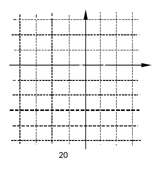
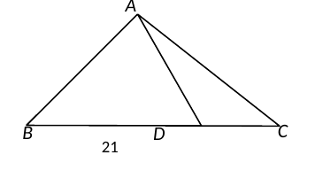
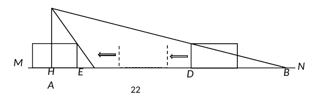
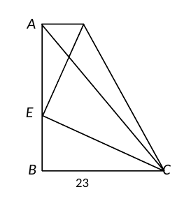
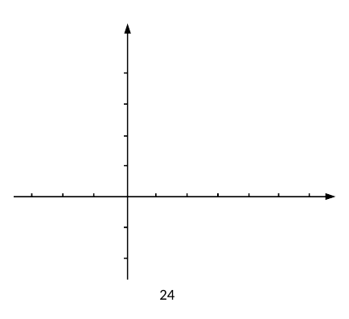
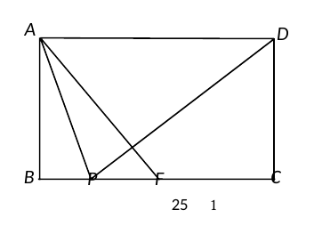
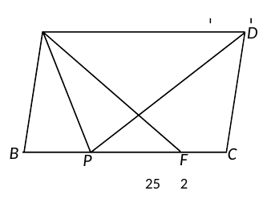

# 2026 一模精讲 · 松江卷（下）解答题 19-25

> 本篇覆盖第 19-25 题（解答题，共 78 分），每题"完整转录 + 思路导航 + 折叠详解"。第 1-18 题见《数模26-松江-上》。题干以卷面页图为准转录（流通版 docx/PDF 经 Word 重排：页图中文缺失，题干文字以 docx 原文补全，数学式与页图逐一放大比对），数值与卷末参考答案逐题互证。

> ⚠️ 核对注记（卷首汇总，详见各题处）：
> - 第 25（2）题"四边形 CDEF 的面积是 $\frac32$"：页图经重排仅存"3"与分数残迹，结合参考答案（$S_{CDEF}=\frac32$、$9a=\frac32$）确认为 $\frac32$；
> - 第 25（3）题"$CF=\frac12PF$、求 $\frac{AB}{AD}$"：分数在页图错位，按参考答案（设 $CF=a$、$PF=2a$；求 $\frac{AB}{AD}$）复原；
> - 第 24（2）② 官方答案行根号错位（页图呈"√4±2√2"残迹），按其方程 $\left(4-t\right)^2=8$ 与 $N(5,\frac12)$ 复原为平移距离 $4\pm2\sqrt2$，与官方解析无冲突；
> - 第 23 题图中 D、第 25 题图 2 中 A 的字母标注在页图转换时缺失，裁片保持卷面原样，字母关系以题干文字为准。

**19.**（本题满分 10 分）已知 △ABC 中，∠A、∠B、∠C 的对边分别是 $a$、$b$、$c$，且 $\dfrac{a}{5}=\dfrac{b}{12}=\dfrac{c}{13}$。（1）如果 △ABC 的周长为 60，求 $a$ 的值；（2）如果 △ABC 的面积为 60，求 $a$ 的值。

> [!tip]- 💡 思路导航
> 连比设一份参数 $k$ 最省力；看到 5、12、13 应立刻联想到一组勾股数——先用勾股逆定理判定三角形的形状，再决定用哪条面积公式，最后开方时注意边长为正。

> [!success]- ✅ 详解 · 评分点 · 易错 · 关联
> **详解**：设 $a=5k$，$b=12k$，$c=13k$（$k>0$）。
> **（1）** 由周长为 60：$5k+12k+13k=60$，即 $30k=60$，$k=2$，$\therefore\boxed{a=5k=10}$。
> **（2）** $\because(5k)^2+(12k)^2=25k^2+144k^2=169k^2=(13k)^2$，即 $a^2+b^2=c^2$，$\therefore$ △ABC 是直角三角形，$\angle C=90°$（勾股逆定理，$c$ 为斜边）。
> $\therefore S_{\triangle ABC}=\dfrac12ab=\dfrac12\cdot5k\cdot12k=30k^2=60$，$k^2=2$，$k=\sqrt2$（取正），$\therefore\boxed{a=5\sqrt2}$。
>
> **易错**：（2）必须先证直角三角形再用 $\frac12ab$ 求面积，直接套用缺少依据扣过程分；$k^2=2$ 开方取 $k=\sqrt2$，$a=5\sqrt2$ 别错写成 $5\times2$ 或 $10\sqrt2$。
>
> **关联**：[[03-数学/知识点/九年级/相似三角形]] · 勾股定理的逆定理

**20.**（本题满分 10 分）在画二次函数 $y=x^2+bx+c$ 的图像时，列表如下：

| $x$ | … | $-3$ | $-2$ | $-1$ | $0$ | $1$ | … |
| ---- | - | ---- | ---- | ---- | ---- | ---- | - |
| $y$ | … | $0$ | $m$ | $n$ | $-3$ | $0$ | … |

（1）直接写出 $b$、$c$、$m$、$n$ 的值：$b=$＿＿＿＿＿＿＿＿；$c=$＿＿＿＿＿＿＿＿；$m=$＿＿＿＿＿＿＿＿；$n=$＿＿＿＿＿＿＿＿；（2）在所给的平面直角坐标系 xOy 中，画出这个二次函数的大致图像，并描述图像的变化趋势。

> [!tip]- 💡 思路导航
> 常数项 $c$ 就是 $x=0$ 处的函数值，表格里现成；再用一组已知的函数值解出 $b$，解析式即定，$m$、$n$ 只需代入。画图抓"开口、对称轴、顶点、与两坐标轴交点"；描述趋势要按对称轴分左右两侧说。

> [!success]- ✅ 详解 · 评分点 · 易错 · 关联
> **详解**：**（1）** $x=0$ 时 $y=c=-3$；$x=1$ 时 $y=1+b+c=0$，即 $1+b-3=0$，$\therefore b=2$。
> $\therefore y=x^2+2x-3$；$m=f(-2)=4-4-3=-3$，$n=f(-1)=1-2-3=-4$。
> $\boxed{b=2,\ c=-3,\ m=-3,\ n=-4}$。
> **（2）** $y=x^2+2x-3=(x+1)^2-4$：开口向上，对称轴 $x=-1$，顶点 $(-1,-4)$，过点 $(-3,0)$、$(0,-3)$、$(1,0)$，用光滑曲线连接（图像关于直线 $x=-1$ 对称）。
> 变化趋势：**这个二次函数的图像在对称轴直线 $x=-1$ 的左侧部分是下降的（$y$ 随 $x$ 的增大而减小），在右侧部分是上升的（$y$ 随 $x$ 的增大而增大）**。
>
> **易错**：$c$ 可由 $x=0$ 直接读出，别解方程组解丢；描述趋势必须点明"对称轴 $x=-1$"并分左降、右升两侧表述，只答"先减后增"不完整。
>
> **关联**：[[03-数学/知识点/九年级/二次函数]]

**21.**（本题满分 10 分）如图，在 △ABC 中，∠B=45°，$AB=\sqrt6$，$AC=\sqrt7$，点 D 在边 BC 上，∠ADC=120°。（1）求 BD 的长；（2）求 ∠CAD 的余弦值。

> [!tip]- 💡 思路导航
> 作出 BC 边上的垂线，把 45° 与 120° 都装进直角三角形；120° 的邻补角 60° 是两问共用的桥梁。第（2）问再作一条垂线，把 ∠CAD 放进一个以 AC 为斜边的直角三角形里收口。

> [!success]- ✅ 详解 · 评分点 · 易错 · 关联
> **详解**：**（1）** 过 $A$ 作 $AE\perp BC$，垂足为 $E$。
> ∵$E$ 不可能在射线 $DC$ 上（否则 $\angle ADE=\angle ADC=120°$，与 Rt△ADE 中 $\angle ADE$ 为锐角矛盾），∴$E$ 在射线 $DB$ 上，$\angle ADE=180°-\angle ADC=60°$。
> Rt△ABE 中 $\angle B=45°$，$\therefore AE=BE=AB\sin45°=\sqrt6\times\dfrac{\sqrt2}{2}=\sqrt3$。
> Rt△ADE 中 $\angle ADE=60°$：$DE=\dfrac{AE}{\tan60°}=\dfrac{\sqrt3}{\sqrt3}=1$，$AD=\dfrac{AE}{\sin60°}=2$。
> $\therefore\boxed{BD=BE+ED=\sqrt3+1}$。
> **（2）** 过 $C$ 作 $CF\perp AD$，交 $AD$ 的延长线于点 $F$。
> Rt△ACE 中 $CE=\sqrt{AC^2-AE^2}=\sqrt{7-3}=2$，$\therefore CD=CE-DE=2-1=1$。
> Rt△CDF 中 $\angle CDF=180°-\angle ADC=60°$：$DF=CD\cos60°=\dfrac12$，$\therefore AF=AD+DF=2+\dfrac12=\dfrac52$。
> Rt△ACF 中（$A$、$D$、$F$ 共线，$\angle CAF=\angle CAD$）：
> $\cos\angle CAD=\dfrac{AF}{AC}=\dfrac{5/2}{\sqrt7}=\dfrac{5\sqrt7}{14}$，即 $\boxed{\cos\angle CAD=\dfrac{5\sqrt7}{14}}$。
>
> **易错**：垂足 $E$ 的位置要论证（$E$ 在 $B$、$D$ 之间），$BD=BE+ED$ 是"加"，凭直观写成 $BE-ED$ 即错；$CD=CE-DE$ 中 $D$ 在 $E$、$C$ 之间，别代反；（2）中 $F$ 在 $AD$ 延长线上，$AF=AD+DF$，$\angle CDF$ 是 $120°$ 的邻补角 $60°$。
>
> **关联**：[[03-数学/知识点/九年级/锐角的三角比与解直角三角形]]

**22.**（本题满分 10 分）如图，P 是在小区入口处安装的摄像头，△PAB 是摄像头的监控区域。MN 为水平地面，点 A、B 在直线 MN 上。已知摄像头离地面的高度 PH=4.8 米，∠APH=37°，∠APB=39°。（1）求 AB 的长；（2）一辆高 2 米、长 4.4 米的厢式货车（图中的矩形），以每小时 5.4 千米的速度进入小区，那么从车头（CD）进入监控区域到车尾（EF）驶出监控区域需要几秒？（参考数据：$\sin37°\approx0.6$，$\cos37°\approx0.8$，$\tan37°\approx0.75$，$\sin76°\approx0.97$，$\cos76°\approx0.24$，$\tan76°\approx4$）

> [!tip]- 💡 思路导航
> 两个直角三角形共用铅垂高 PH：先在"P 处"把左右两个边界角补齐。（2）抓两个瞬间——车头刚进入时车头上角落在右边界上、车尾刚驶出时车尾上角落在左边界上，各自产生一个直角三角形；行驶路程由三段拼成，最后统一单位。

> [!success]- ✅ 详解 · 评分点 · 易错 · 关联
> **详解**：**（1）** $PH\perp MN$，$\angle BPH=\angle BPA+\angle APH=39°+37°=76°$。
> Rt△BPH 中 $\tan\angle BPH=\dfrac{BH}{PH}\approx4$，$\therefore BH=4.8\times4=19.2$（米）；
> Rt△APH 中 $\tan\angle APH=\dfrac{AH}{PH}\approx0.75$，$\therefore AH=4.8\times0.75=3.6$（米）。
> $\therefore\boxed{AB=BH-AH=19.2-3.6=15.6\ 米}$。
> **（2）** **车头 CD 进入监控区域**：车头上角 $C$ 落在边界 $PB$ 上，此时 $CB$ 沿 $PB$、$CD$ 铅垂，$\angle BCD=\angle BPH=76°$。
> Rt△BCD 中（$CD=2$ 为车高）$\tan\angle BCD=\dfrac{BD}{CD}\approx4$，$\therefore BD=8$（米），即 $D$ 在 $B$ 左侧 8 米处，$AD=AB-BD=15.6-8=7.6$（米）。
> **车尾 EF 驶出监控区域**：车尾上角 $F$ 落在边界 $PA$ 上，$\angle AFE=\angle APH=37°$。
> Rt△AEF 中（$EF=2$）$\tan\angle AFE=\dfrac{AE}{EF}\approx0.75$，$\therefore AE=1.5$（米），即 $E$ 在 $A$ 左侧 1.5 米处。
> 全程行驶路程 $=AD+AE+$ 车长 $=7.6+1.5+4.4=13.5$（米）（驶出时车头已行至车尾左侧一个车长处）。
> 速度 $5.4$ 千米/时 $=\dfrac{5400}{3600}=1.5$ 米/秒，$\therefore t=\dfrac{13.5}{1.5}=9$（秒）。
> 答：$\boxed{从车头进入监控区域到车尾驶出监控区域需要\ 9\ 秒}$。
>
> **易错**：$\angle BPH=37°+39°=76°$（$PA$ 在 $PH$、$PB$ 之间），直接用 $39°$ 即错；（2）两个"刚接触"瞬间分别对应 $C$ 在 $PB$ 上、$F$ 在 $PA$ 上，别把两个三角形搬到同一时刻；路程是"两段距离＋车长"，漏加车长或漏单位换算（5.4 千米/时＝1.5 米/秒）均错。
>
> **关联**：[[03-数学/知识点/九年级/锐角的三角比与解直角三角形]]

**23.**（本题满分 12 分）如图，在梯形 ABCD 中，AD∥BC，AB⊥BC，E 是边 AB 上一点，DE 与 AC 交于点 G，如果 CE 平分 ∠ACB，且 DE⊥CE。求证：（1）$AE^2=AG\cdot AC$；（2）$AG\cdot GC=EG\cdot ED$。

> ⚠️ 核对注记：页图转换时 D 点标注缺失，裁片保持卷面原样；D 为上底 AD 的右端点，字母关系以题干文字为准。

> [!tip]- 💡 思路导航
> （1）要证 $AE^2=AG\cdot AC$，即证 △AEG∽△ACE：公共角 ∠EAG 现成，只差 $\angle AEG=\angle ACE$——由两组"垂直的 90°"借 △BCE 的外角把 ∠AED 与 ∠BCE 挂钩，再用角平分线过渡；（2）第（1）问的相似给出一组比例，"双垂直＋等角"再造一组相似，两个比例用公共比串联后作乘积变形。

> [!success]- ✅ 详解 · 评分点 · 易错 · 关联
> **详解**：**（1）** ∵$DE\perp CE$，$AB\perp BC$，∴$\angle DEC=\angle B=90°$。
> ∵$A$、$E$、$B$ 共线，∴$\angle AEC$ 是 △BCE 的外角，$\angle AEC=\angle B+\angle BCE$；又 $\angle AEC=\angle AED+\angle DEC$，
> ∴$\angle AED+\angle DEC=\angle B+\angle BCE$，结合 $\angle DEC=\angle B=90°$，得 $\angle AED=\angle BCE$。
> ∵$CE$ 平分 ∠ACB，∴$\angle ACE=\angle BCE$，∴$\angle AED=\angle ACE$。
> 又 $\angle EAG=\angle CAE$（公共角），∴△AEG∽△ACE（两角对应相等的两个三角形相似），
> ∴$\dfrac{AE}{AC}=\dfrac{AG}{AE}$（相似三角形对应边成比例），$\therefore\boxed{AE^2=AG\cdot AC}$。
> **（2）** 由 △AEG∽△ACE：$\dfrac{AG}{AE}=\dfrac{EG}{EC}$，∴$\dfrac{AG}{EG}=\dfrac{AE}{EC}$　①。
> ∵$AD\parallel BC$，$AB\perp BC$，∴$AD\perp AB$，$\angle DAE=90°$；又 $\angle CEG=\angle CED=90°$，∴$\angle DAE=\angle CEG$。
> 由（1）$\angle AED=\angle ACE=\angle ECG$，∴△ADE∽△EGC（两角对应相等），
> ∴$\dfrac{DE}{CG}=\dfrac{AE}{EC}$　②。
> 由 ①② 得 $\dfrac{AG}{EG}=\dfrac{DE}{CG}$，∴$AG\cdot CG=EG\cdot DE$，即 $\boxed{AG\cdot GC=EG\cdot ED}$。$\blacksquare$
>
> **评分点**（参考）：（1）"外角桥接 + 角平分线"得 $\angle AED=\angle ACE$、点出公共角、相似判定与比例化乘积，各为独立给分步骤；（2）由（1）写出一组比例、由双垂直与等角判定第二组相似、两比例以 $\frac{AE}{EC}$ 串联并变形为乘积式。
>
> **易错**：（1）$\angle AEC=\angle B+\angle BCE$ 是 △BCE 的外角性质，凭图直观"看"出 $\angle AED=\angle ACE$ 而不写依据要扣分；（2）第二组相似的对应关系是 △ADE∽△EGC（A↔E、E↔C、D↔G），$\frac{DE}{CG}=\frac{AE}{EC}$ 写错对应边则全盘皆错。
>
> **关联**：[[03-数学/知识点/九年级/相似三角形]]

**24.**（本题满分 12 分）在平面直角坐标系 xOy 中，一条抛物线与 x 轴交于点 A(−2, 0)、点 B(4, 0)，与 y 轴正半轴交于点 C，顶点为点 D，且 OB=OC。（1）求该抛物线的表达式和点 D 的坐标；（2）P 是抛物线上位于第一象限内的一点，且 ∠PAB＋∠CAB＝90°。① 求点 P 的坐标；② 将该抛物线向右平移，点 P 移到点 Q，新抛物线的顶点为 M，如果新抛物线上存在点 N，使得四边形 PMQN 是平行四边形，求平移的距离。

> [!tip]- 💡 思路导航
> （1）交点式最省力，$OC=OB$ 先把 C 定下来；（2）①"两角之和为 90°"用同角的余角转化成等角，在 A 处用正切列方程，注意舍去与 A 重合的根；②平移不改变"上下底"的关系，先用平行四边形把 N 的坐标定下来（与平移距离无关），再让 N 落进新抛物线解距离，两个根都是向右平移、都要保留。

> [!success]- ✅ 详解 · 评分点 · 易错 · 关联
> **详解**：**（1）** $OB=OC=4$，且 C 在 y 轴正半轴，∴$C(0,4)$。
> 设 $y=a(x+2)(x-4)$，代入 $C(0,4)$：$4=a\cdot2\cdot(-4)=-8a$，$a=-\dfrac12$。
> $\therefore\boxed{y=-\dfrac12x^2+x+4}$；配方 $y=-\dfrac12(x-1)^2+\dfrac92$，$\therefore\boxed{D\left(1,\dfrac92\right)}$。
> **（2）①** Rt△AOC 中 $\angle CAB+\angle ACO=90°$；又 $\angle PAB+\angle CAB=90°$，∴$\angle PAB=\angle ACO$（同角的余角相等）。
> $\tan\angle ACO=\dfrac{OA}{OC}=\dfrac24=\dfrac12$，∴$\tan\angle PAB=\dfrac12$。
> 设 $P\left(m,\,-\dfrac12m^2+m+4\right)$（第一象限，$m>0$）：$\tan\angle PAB=\dfrac{-\frac12m^2+m+4}{m+2}=\dfrac12$，
> 即 $-m^2+2m+8=m+2$，$m^2-m-6=0$，$m_1=3$，$m_2=-2$（舍，此时 $P$ 与 $A$ 重合）。
> $\therefore\boxed{P\left(3,\dfrac52\right)}$。
> **（2）②** 设向右平移的距离为 $t$（$t>0$）：新抛物线 $y=-\dfrac12(x-1-t)^2+\dfrac92$，顶点 $M(1+t,\ \dfrac92)$，$Q(3+t,\ \dfrac52)$。
> 由平移：$D\to M$、$P\to Q$ 为同一平移向量，∴四边形 DMQP 是平行四边形，$\therefore$ 向量 $\overrightarrow{MQ}=\overrightarrow{DP}=(2,-2)$；
> 由四边形 PMQN 是平行四边形：$\overrightarrow{PN}=\overrightarrow{MQ}$，∴$N=P+(2,-2)=\left(5,\dfrac12\right)$（$N$ 与 $t$ 无关）。
> $N$ 在新抛物线上：$\dfrac12=-\dfrac12(5-1-t)^2+\dfrac92$，即 $(4-t)^2=8$，$4-t=\pm2\sqrt2$，
> $\therefore t=4-2\sqrt2$ 或 $t=4+2\sqrt2$（均为正，此时 $Q$ 在第一象限、四边形不退化）。
> $\therefore\boxed{平移的距离为\ 4-2\sqrt2\ 或\ 4+2\sqrt2}$。
>
> **评分点**（参考）：（1）待定系数（交点式或一般式）求表达式、配方求顶点各一步；① 等角转化、设点列正切方程、舍根与写坐标；② 由平移得 $MQ=DP$、由平行四边形定出 $N$、代入新抛物线解 $t$ 并说明两解均有效。
>
> **易错**：① 中 $m=-2$ 对应点 $A$ 本身，必须舍去；② 的突破口是 $N(5,\frac12)$ 与平移距离无关，若带着 $t$ 硬解四边形条件会陷入化简泥潭；$(4-t)^2=8$ 的两个根 $4\pm2\sqrt2$ 都是向右平移，只取 $4-2\sqrt2$ 漏解。
>
> ⚠️ 核对注记：官方答案该行经 Word 重排根号错位（页图呈"√4±2√2"残迹），本解按其方程 $\left(4-t\right)^2=8$ 与 $N\left(5,\dfrac12\right)$ 复原，数值与官方解析过程一致。
>
> **关联**：[[03-数学/知识点/九年级/二次函数]]

**25.**（本题满分 14 分）在 ▱ABCD 中，P 是边 BC 上一点，将 △APB 沿直线 AP 翻折，点 B 落在 PD 上的点 E 处，AE 的延长线交射线 BC 于点 F。（1）如图 1，当四边形 ABCD 是矩形时，如果 BP=4，PF=5，求四边形 ABCD 的面积；（2）如图 2，如果 BP=1，CP=2，四边形 CDEF 的面积是 $\dfrac32$，求 ∠ADP 的正弦值；（3）如果 AB=AP，且 $CF=\dfrac12PF$，求 $\dfrac{AB}{AD}$ 的值。

 

> ⚠️ 核对注记：（2）"面积是 $\frac32$"页图仅存"3"与分数残迹，结合参考答案（$S_{CDEF}=\frac32$、方法二中 $9a=\frac32$）确认；（3）"$CF=\frac12PF$、求 $\frac{AB}{AD}$"的分数在页图错位，按参考答案（设 $CF=a$、$PF=2a$）复原。图 2 中 A 点标注缺失，按 ▱ABCD 顶点顺序（A 与 B 相邻、D 与 C 相邻）为准。

> [!tip]- 💡 思路导航
> 翻折三件套：等边（PB＝PE）、等角（∠APB＝∠APE）、对应角相等。先证 DA＝DP（等腰梯形式的对角线），再用"AD∥PF"产生的 A 字形相似把各线段接起来；（2）用"相似三角形面积比＝相似比的平方"把四边形面积差折算成小三角形面积；（3）按 F 落在线段 BC 上还是延长线上分类，核心等式 $PA^2=PE\cdot PD$ 由 △PEA∽△PAD 得到。

> [!success]- ✅ 详解 · 评分点 · 易错 · 关联
> **详解**：**（1）** 由翻折：$BP=PE=4$，$AB=AE$，$\angle AEP=\angle ABP=90°$。
> Rt△EPF 中 $PF=5$，$PE=4$：$EF=3$（勾股定理），∴$\tan\angle AFP=\dfrac{PE}{EF}=\dfrac43$。
> Rt△ABF 中 $\tan\angle AFP=\dfrac{AB}{BF}$，$BF=BP+PF=9$，∴$\dfrac{AB}{9}=\dfrac43$，$AB=12$，$AE=12$。
> ∵$AD\parallel PF$，∴$\angle ADE=\angle FPE$、$\angle AED=\angle FEP$（对顶角），△ADE∽△FPE，
> ∴$\dfrac{AD}{PF}=\dfrac{AE}{EF}=\dfrac{12}{3}=4$，$\therefore AD=20$。
> $\therefore\boxed{S_{矩形ABCD}=AB\cdot AD=12\times20=240}$。
> **（2）** 由翻折：$\angle APB=\angle APE$，$BP=PE=1$，$AB=AE$，$\angle AEP=\angle ABP$。
> ∵$\angle ABP+\angle BCD=180°$（▱ABCD 邻角），$\angle AEP+\angle PEF=180°$（A、E、F 共线），∴$\angle PEF=\angle PCD$；
> 又 $\angle EPF=\angle CPD$（$E$ 在 $PD$ 上、$F$ 在射线 $PC$ 上），∴△PEF∽△PCD（两角对应相等），
> ∴$\dfrac{S_{\triangle PEF}}{S_{\triangle PCD}}=\left(\dfrac{PE}{PC}\right)^2=\left(\dfrac12\right)^2=\dfrac14$，∴$S_{\triangle PCD}=4S_{\triangle PEF}$，$S_{CDEF}=S_{\triangle PCD}-S_{\triangle PEF}=3S_{\triangle PEF}=\dfrac32$，∴$S_{\triangle PEF}=\dfrac12$。
> ∵$\angle APD=\angle APE=\angle APB$，$AD\parallel BC$，∴$\angle APB=\angle PAD$（内错角），∴$\angle APD=\angle PAD$，$\therefore DA=DP$。
> ∵$BP=1$，$CP=2$，∴$AD=BC=3$，$DP=3$，$DE=DP-PE=2$。
> ∵$AD\parallel PF$，∴△ADE∽△FPE，$\dfrac{AD}{PF}=\dfrac{DE}{PE}=2$，∴$PF=\dfrac32$。
> 过 $E$ 作 $EH\perp PF$，垂足为 $H$：$S_{\triangle PEF}=\dfrac12\cdot PF\cdot EH=\dfrac12$，∴$EH=\dfrac23$。
> ∵$AD\parallel PF$，∴$\angle ADP=\angle DPC$（内错角），∴$\sin\angle ADP=\sin\angle EPF=\dfrac{EH}{PE}=\dfrac{2/3}{1}=\boxed{\dfrac23}$。
> **（3）** 设 $CF=a$，则 $PF=2a$；设 $BP=x$，则 $PE=BP=x$。同（2）可证 $DA=DP$。
> **情形一：F 在线段 BC 上**（$B$、$P$、$F$、$C$ 依次排列）：
> $AD=BC=x+3a$，$DP=x+3a$，$DE=DP-PE=3a$。
> ∵$AD\parallel PF$，∴$\dfrac{AD}{PF}=\dfrac{DE}{PE}$，即 $\dfrac{x+3a}{2a}=\dfrac{3a}{x}$，$x^2+3ax-6a^2=0$，
> 解得 $x=\dfrac{(\sqrt{33}-3)a}{2}$（负根舍去）。
> ∵$AB=AP$，翻折得 $AE=AB=AP$，∴$\angle APE=\angle AEP$；又 $\angle DAP=\angle APB=\angle APE$（$AD\parallel BC$ 内错角），∴$\angle DAP=\angle AEP=\angle APE$。
> ∴△PEA∽△PAD（$\angle PEA=\angle PAD$，$\angle APE=\angle APD$），∴$\dfrac{PE}{PA}=\dfrac{PA}{PD}$，$PA^2=PE\cdot PD=x(x+3a)=6a^2$（由方程 $x^2+3ax=6a^2$），∴$PA=\sqrt6a$。
> ∴$\dfrac{AB}{AD}=\dfrac{\sqrt6a}{\frac{(\sqrt{33}+3)a}{2}}=\dfrac{2\sqrt6}{\sqrt{33}+3}=\dfrac{2\sqrt6(\sqrt{33}-3)}{24}=\boxed{\dfrac{\sqrt{22}-\sqrt6}{4}}$。
> **情形二：F 在 BC 延长线上**（$B$、$P$、$C$、$F$ 依次排列）：
> $PC=PF-CF=a$，$AD=BC=x+a$，$DP=x+a$，$DE=a$。
> $\dfrac{AD}{PF}=\dfrac{DE}{PE}$：$\dfrac{x+a}{2a}=\dfrac{a}{x}$，$x^2+ax-2a^2=0$，$\therefore x=a$（负根舍去）。
> 同理 $PA^2=PE\cdot PD=x(x+a)=2a^2$，$PA=\sqrt2a$，∴$\dfrac{AB}{AD}=\dfrac{\sqrt2a}{2a}=\boxed{\dfrac{\sqrt2}{2}}$。
> 综上，$\dfrac{AB}{AD}$ 的值为 $\dfrac{\sqrt{22}-\sqrt6}{4}$ 或 $\dfrac{\sqrt2}{2}$。
>
> **评分点**（参考）：（1）翻折三性质、勾股/正切求 AB、A 字形相似求 AD、面积收口各一步；（2）相似面积比化 $S_{\triangle PEF}$、证 $DA=DP$、相似求 $PF$、等积求 $EH$、角转化得正弦；（3）分类讨论 F 的位置、一元二次方程解 $x$、$PA^2=PE\cdot PD$、最后分母有理化。
>
> **易错**：（2）面积比是相似比的**平方**，写成 $\frac12$ 即错；$S_{CDEF}=S_{\triangle PCD}-S_{\triangle PEF}$ 别写成两三角形面积之和；（3）必须讨论 F 在线段上与延长线上两类（F 在 B、P 之间时 $CF=CP+PF>\frac12PF$ 与条件矛盾，自动排除），漏一类少一解；$PA^2=PE\cdot PD$ 的依据是 △PEA∽△PAD，$\angle APE=\angle APD$ 依赖"E 在射线 PD 上"这一翻折前提。
>
> **关联**：[[03-数学/知识点/九年级/相似三角形]]

## 答案速查与互证

| 题号 | 19 | 20 | 21 | 22 | 23 | 24 | 25 |
| ---- | -- | -- | -- | -- | -- | -- | -- |
| 结果 | （1）$a=10$；（2）$a=5\sqrt2$ | $b=2$，$c=-3$，$m=-3$，$n=-4$；图像与趋势描述见上 | （1）$BD=\sqrt3+1$；（2）$\cos\angle CAD=\frac{5\sqrt7}{14}$ | （1）$AB=15.6$ 米；（2）$9$ 秒 | （1）（2）证明见上 | $y=-\frac12x^2+x+4$，$D(1,\frac92)$；① $P(3,\frac52)$；② $4-2\sqrt2$ 或 $4+2\sqrt2$ | （1）$240$；（2）$\sin\angle ADP=\frac23$；（3）$\frac{\sqrt{22}-\sqrt6}{4}$ 或 $\frac{\sqrt2}{2}$ |

与卷末参考答案逐题互证：19（$a=10$、$a=5\sqrt2$）✓、20（$b=2$、$c=-3$、$m=-3$、$n=-4$，趋势"对称轴 $x=-1$ 左侧下降、右侧上升"）✓、21（$BD=\sqrt3+1$、$\cos\angle CAD=\frac{5\sqrt7}{14}$）✓、22（$AB=15.6$、路程 13.5 米、9 秒）✓、24（$y=-\frac12x^2+x+4$、$D(1,\frac92)$、$P(3,\frac52)$、$N(5,\frac12)$、平移距离两值）✓、25（① $240$；② $\sin\angle ADP=\frac23$（官方方法一至三均给出 $EH=\frac23$、$PF=\frac32$、$EH/DG=1/3$）；③ $\frac{\sqrt{22}-\sqrt6}{4}$ 或 $\frac{\sqrt2}{2}$）✓；23 为证明题，证明链（△AEG∽△ACE；△ADE∽△EGC，$\frac{AE}{EC}$ 串联）与官方解析完全一致 ✓。全部数值均已独立重算；24② 官方答案行根号错位已按其方程复原（见 ⚠️ 注记），无实质冲突。

## 🔗 关联

- [[03-数学/知识点/九年级/锐角的三角比与解直角三角形]] · [[03-数学/知识点/九年级/二次函数]] · [[03-数学/知识点/九年级/相似三角形]]
- 选择题与填空题见 [[数模26-松江-上]]
