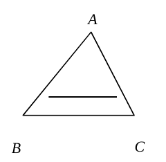
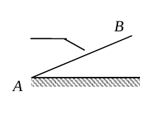
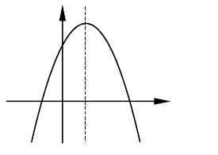
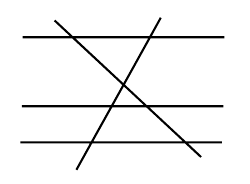
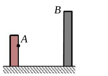
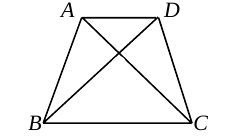
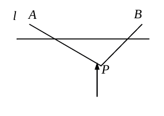
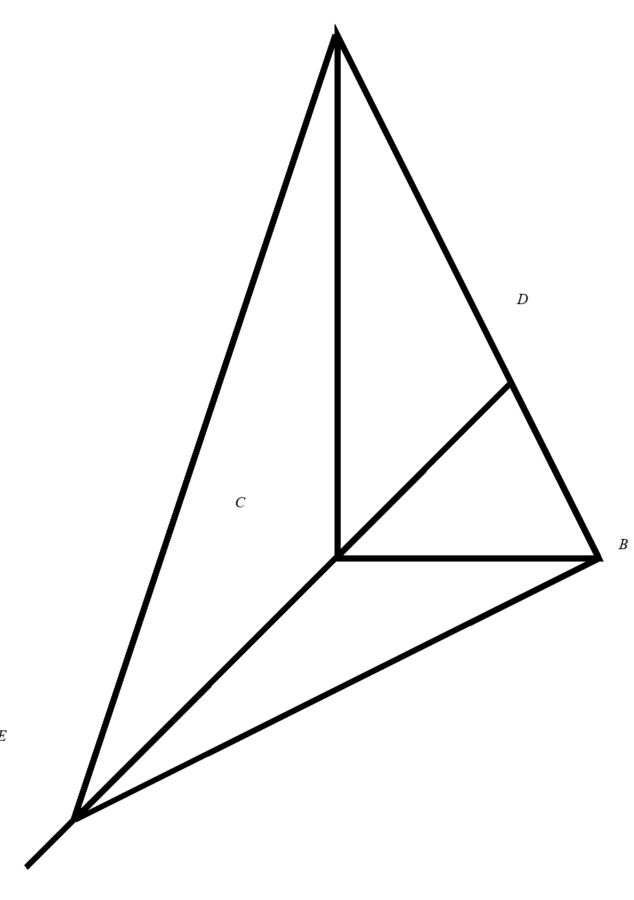
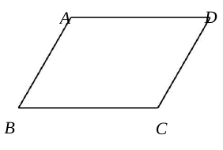

# 2026一模精讲 · 浦东卷（上）第 1~18 题

> 题干与公式已对照卷面页图（150dpi）与原卷 docx 逐题核验（2026-11-04）。流通版 docx/PDF 经 Word 重排转换：页图中文缺失（题干文字以 docx 原文补全，数学式与页图逐一比对）；第 8 题向量箭头与字母脱离（三个箭头游离于题行上方，按文意以向量转录，见 ⚠️ 注记）；第 18 题撇号（′）在流通版整体丢失，B′、A′D′、□A′B′C′D′ 按文意复原（见 ⚠️ 注记）；部分几何图的字母标注缺失（第 4 题 D、E，第 6 题刻度 −1 与 O，第 10 题全部字母，第 11 题甲楼/乙楼，第 12 题 O，第 15 题北向标注），裁片保持卷面原样、字母关系以题干文字为准，第 17 题配图按 docx 原件矢量数据复绘并补全字母（见 ⚠️ 注记）；全部答案与卷末参考答案页逐题互证一致。

## 卷面结构说明

- **试卷**：浦东新区初三数学期末练习卷（2026.1），共 25 题（选择题 24 分＋填空题 48 分＋解答题 78 分，合计 150 分）。
- **结构**：一、选择题 6 题 × 4 分 = 24 分；二、填空题 12 题 × 4 分 = 48 分（第 7~18 题）；三、解答题 7 题 78 分（第 19~25 题）。
- **本篇**：第 1~18 题（选择题 + 填空题全部）；解答题精讲见 [[数模26-浦东-下]]。

## 一、选择题

**1.** 下列两个图形不一定是相似形的是（　）
- （A）两个圆
- （B）两个等边三角形
- （C）两个正方形
- （D）两个菱形

> [!tip]- 💡 思路导航
> "一定相似"要求形状被条件完全锁定：看每种图形还剩哪些可以自由变化的量——边？角？

> [!success]- ✅ 详解 · 评分点 · 易错 · 关联
> **详解**：D。两个圆的形状由相似性天然确定（任意两圆相似）；等边三角形各角均为 60°；正方形四角都是直角、四边对应成比例——三者一定相似。菱形四边相等但内角可以不同（如内角 60°/120° 与内角 90° 的菱形不相似），不一定相似，选 D。
>
> **易错**：把"四边相等"当成形状相同——菱形的角可自由变化，这是唯一"不一定"的选项。
>
> **关联**：[[03-数学/知识点/九年级/相似三角形]]

**2.** 在 Rt△ABC 中，∠C=90°，那么 $\sin A$ 等于（　）
- （A）$\dfrac{BC}{AC}$
- （B）$\dfrac{AC}{BC}$
- （C）$\dfrac{BC}{AB}$
- （D）$\dfrac{AC}{AB}$

> [!tip]- 💡 思路导航
> 锐角三角比回到直角三角形中定义：先认清 ∠A 的对边、邻边与斜边各是谁，再按"正弦=对边比斜边"核对。

> [!success]- ✅ 详解 · 评分点 · 易错 · 关联
> **详解**：C。∠C=90°，斜边是 AB；∠A 的对边是 BC、邻边是 AC，∴$\sin A=\dfrac{\text{对边}}{\text{斜边}}=\dfrac{BC}{AB}$。A、B 用错了邻边，D 是 $\cos A$。
>
> **易错**：把 AC 当成 ∠A 的对边（AC 是邻边）。
>
> **关联**：[[03-数学/知识点/九年级/锐角的三角比与解直角三角形]]

**3.** 下列函数中，一定是二次函数的是（　）
- （A）$y=ax+1$
- （B）$y=ax^2+1$
- （C）$y=(a^2+1)x^2$
- （D）$y=(ax+1)^2$

> [!tip]- 💡 思路导航
> 二次函数三要素：整式、最高次数为 2、二次项系数不为 0；"一定"二字要求对字母的一切取值都成立，逐项检验 a=0 的情形。

> [!success]- ✅ 详解 · 评分点 · 易错 · 关联
> **详解**：C。C 中二次项系数 $a^2+1\ge1$ 恒不为零，一定是二次函数；A 是一次函数（a≠0 时）；B、D 在 $a=0$ 时二次项系数为零（B 退化为 $y=1$，D 展开为 $a^2x^2+2ax+1$ 退化为 $y=1$），只是"可能是"二次函数。
>
> **易错**：只看形式含 $x^2$ 就认定是二次函数，忽略系数可能为零。
>
> **关联**：[[03-数学/知识点/九年级/二次函数]]

**4.** 如图，点 D、E 分别在 △ABC 的边 AB、AC 上，下列条件中一定能判定 DE∥BC 的是（　）
- （A）$\dfrac{AD}{AE}=\dfrac{AB}{AC}$
- （B）$\dfrac{DE}{BC}=\dfrac{AD}{AB}$
- （C）$\dfrac{AD}{AC}=\dfrac{AE}{AB}$
- （D）$\dfrac{AE}{EC}=\dfrac{AB}{BD}$

> [!tip]- 💡 思路导航
> 推平行靠"夹公共角 ∠A 的两组对应边成比例"（SAS 相似）或平行线分线段成比例的逆用；逐项检查两条比是否围绕 ∠A 正确搭配。

> [!success]- ✅ 详解 · 评分点 · 易错 · 关联
> **详解**：A。A：$\dfrac{AD}{AE}=\dfrac{AB}{AC}\iff\dfrac{AD}{AB}=\dfrac{AE}{AC}$，即夹公共角 ∠A 的两组对应边成比例 → △ADE∽△ABC → ∠ADE=∠B → DE∥BC，能判定；B：$\dfrac{DE}{BC}=\dfrac{AD}{AB}$ 不是夹 ∠A 的边的搭配（如 AB=6、AC=5、∠A=60°、AD=3、AE=0.5 时条件成立但 AE/AC≠AD/AB，不平行），不能判定；C：两条比交叉搭配（AD 配 AC、AE 配 AB），不对应，不能判定；D：$AE(AB-AD)=AB(AC-AE)$ 与平行所需的 $AE\cdot AB=AD\cdot AC$ 不等价，不能判定。
>
> **易错**：把 $\dfrac{DE}{BC}=\dfrac{AD}{AB}$ 当成相似条件——那相当于"SSA"，夹角并不是 ∠A。
>
> **关联**：[[03-数学/知识点/九年级/相似三角形]] · 平行线分线段成比例

**5.** 如图，传送带和地面所成斜坡 AB 的坡度为 1:2.4，它把物体从点 A 处传送到斜坡高处，物体沿斜坡 AB 方向向上所经过的路程为 26 米，那么此时物体离地面的高度为（　）
- （A）5 米
- （B）10 米
- （C）12 米
- （D）13 米

> [!tip]- 💡 思路导航
> 坡度 i＝竖直∶水平＝1:2.4＝5:12；26 米是沿斜坡走的斜边长——按 5-12-13 的比例设未知数，勾股收口。

> [!success]- ✅ 详解 · 评分点 · 易错 · 关联
> **详解**：B。设物体上升的竖直高度为 $5k$ 米、水平距离为 $12k$ 米，则由勾股定理 $AB=\sqrt{(5k)^2+(12k)^2}=13k=26$，得 $k=2$，∴物体离地面的高度为 $5k=10$（米）。
>
> **易错**：把 26 米当成水平距离；坡度写成"水平∶竖直"。
>
> **关联**：[[03-数学/知识点/九年级/锐角的三角比与解直角三角形]] · 坡度与坡角

**6.** 如图，已知抛物线 $y=ax^2+bx+c\ (a\neq0)$ 的对称轴是直线 $x=1$，且过点 $(-1,\ 0)$，顶点在第一象限，其部分图像如图所示．给出以下结论：① $ab<0$；② $4a+2b+c>0$；③ $3a+c>0$．其中正确的选项是（　）
- （A）①②
- （B）①③
- （C）②③
- （D）①②③

> [!tip]- 💡 思路导航
> 对称轴 x=1 直接给出 b=-2a（于是 ① 与 a 的符号无关）；利用对称性写出新因式 $f(x)=a(x+1)(x-3)$，把 ②③ 都化成含 a 的式子。

> [!success]- ✅ 详解 · 评分点 · 易错 · 关联
> **详解**：A。对称轴 $x=-\dfrac{b}{2a}=1$ → $b=-2a$，∴$ab=-2a^2<0$，①成立。由对称性，抛物线与 x 轴的另一交点为 $(3,0)$，∴$f(x)=a(x+1)(x-3)$，$c=f(0)=-3a$。②：$4a+2b+c=f(2)=f(0)=c=-3a$，由图开口向下 $a<0$，∴$-3a>0$，②成立。③：$3a+c=3a-3a=0$，∴③不成立。选 A。
>
> **易错**：③ 中 $3a+c$ 恰好等于 0（不是大于 0）；$f(2)$ 与 $f(0)$ 关于对称轴对称这一步漏掉。
>
> **关联**：[[03-数学/知识点/九年级/二次函数]]

## 二、填空题

**7.** 已知 $\dfrac{x}{y}=\dfrac32$，那么 $\dfrac{x-y}{x+y}$ 的值是＿＿＿＿＿＿＿＿。

> [!tip]- 💡 思路导航
> 比值问题设"份数"最直接：由 x/y=3/2 设 x=3k、y=2k，代入所求分式。

> [!success]- ✅ 详解 · 评分点 · 易错 · 关联
> **详解**：$\dfrac15$。设 $x=3k,\ y=2k\ (k\neq0)$，则 $\dfrac{x-y}{x+y}=\dfrac{3k-2k}{3k+2k}=\dfrac{k}{5k}=\dfrac15$。
>
> **易错**：把 $\dfrac{x-y}{x+y}$ 误算成 $\dfrac{x}{y}-y$ 之类的混乱形式；应分子分母分别整体代入。

**8.** 计算：$2(\vec a-\vec b)+3\vec b=$＿＿＿＿＿＿＿＿。

> ⚠️ 核对注记：流通版页图中向量箭头与字母脱离（三个箭头游离于题行上方），docx 原文同样丢失箭头；结合卷面参考答案"$2\vec a+\vec b$"按向量题复原转录。

> [!tip]- 💡 思路导航
> 向量的数乘与加减完全按代数法则运算：去括号、合并"同类项"（同向向量按系数相加减）。

> [!success]- ✅ 详解 · 评分点 · 易错 · 关联
> **详解**：$2\vec a+\vec b$。去括号：$2(\vec a-\vec b)+3\vec b=2\vec a-2\vec b+3\vec b=2\vec a+\vec b$。
>
> **关联**：[[03-数学/知识点/九年级/平面向量]]

**9.** 抛物线 $y=-2(x+3)^2$ 的顶点坐标是＿＿＿＿＿＿＿＿。

> [!tip]- 💡 思路导航
> 顶点式 $y=a(x+m)^2+k$ 的顶点是 $(-m,\ k)$——注意 m 前是加号时横坐标要变号。

> [!success]- ✅ 详解 · 评分点 · 易错 · 关联
> **详解**：$(-3,\ 0)$。对照顶点式，$h=-3$、$k=0$，顶点为 $(-3,\ 0)$。
>
> **易错**：把横坐标写成 3（顶点式中 $(x+3)$ 对应 $x=-3$）。
>
> **关联**：[[03-数学/知识点/九年级/二次函数]]

**10.** 如图，已知 AB∥CD∥EF，它们依次交直线 $l_1$、$l_2$ 于点 A、D、F 和点 B、C、E．如果 $AD:DF=3:2$，$BC=21$，那么 $CE=$＿＿＿＿＿＿＿＿。

> [!tip]- 💡 思路导航
> 平行线分线段成比例：两条截线上的"上段∶下段"对应成比例，BC 与 CE 的比等于 AD 与 DF 的比。

> [!success]- ✅ 详解 · 评分点 · 易错 · 关联
> **详解**：14。由平行线分线段成比例：$\dfrac{BC}{CE}=\dfrac{AD}{DF}=\dfrac32$，∴$CE=21\times\dfrac23=14$。
>
> **易错**：对应段写反（CE 的对应段是 DF、BC 的对应段是 AD）；求出 3:2 后误乘 $\dfrac32$。
>
> **关联**：[[03-数学/知识点/九年级/相似三角形]] · 平行线分线段成比例

**11.** 如图，从甲楼的一窗口观测点 A 处测得乙楼的楼顶端 B 的仰角是 37°，那么从乙楼顶端 B 处看 A 处的俯角是＿＿＿＿＿＿＿＿°。

> [!tip]- 💡 思路导航
> 过 A、B 分别作水平线，两条水平线互相平行——视线 AB 与它们所成的仰角、俯角是一对内错角。

> [!success]- ✅ 详解 · 评分点 · 易错 · 关联
> **详解**：37。过 A 作水平线、过 B 作水平线，两水平线平行；AB 是截线，仰角与俯角是内错角，∴俯角=仰角=37°。
>
> **易错**：误以为俯角与仰角互余或相等之外还有其他关系——平行线的内错角是关键。
>
> **关联**：[[03-数学/知识点/九年级/锐角的三角比与解直角三角形]] · 解直角三角形的应用

**12.** 如图，在梯形 ABCD 中，AD∥BC，对角线 AC、BD 相交于点 O，如果 △BCD 的面积是 △ABD 的面积的 2 倍，那么 △BOC 与 △BCD 的面积之比是＿＿＿＿＿＿＿＿。

> [!tip]- 💡 思路导航
> △BCD 与 △ABD 分别以 BC、AD 为底且高相同（夹在平行线间），面积比就是底之比；O 分对角线的比由 △AOD∽△COB 而定，再用"同底三角形面积比等于高之比"收口。

> [!success]- ✅ 详解 · 评分点 · 易错 · 关联
> **详解**：2:3。A、D 到 BC 的距离相等（设为 h，AD∥BC），∴$S_{\triangle BCD}=\dfrac12 BC\cdot h$，$S_{\triangle ABD}=\dfrac12 AD\cdot h$，由题意 $\dfrac{BC}{AD}=2$，即 $BC=2AD$。
> ∵AD∥BC，∴△AOD∽△COB，相似比 $=\dfrac{AD}{BC}=\dfrac12$，∴$AO:OC=1:2$，$OC=\dfrac23AC$。
> △BOC 与 △ABC 同底 BC，O、A 到 BC 的距离之比 $=OC:AC=2:3$（相似），∴$\dfrac{S_{\triangle BOC}}{S_{\triangle ABC}}=\dfrac23$；又 $S_{\triangle ABC}=S_{\triangle BCD}$（同底 BC、A 与 D 到 BC 等距），∴$S_{\triangle BOC}:S_{\triangle BCD}=2:3$。
>
> **易错**：把 O 的高度比当成 $AO:AC$（应从 C 端数起，$OC:AC=2:3$）。
>
> **关联**：[[03-数学/知识点/九年级/相似三角形]] · 同底等高三角形

**13.** 如果将抛物线 $y=x^2+2x-1$ 向上平移，使它经过点 $A(0,\ 3)$，那么所得新抛物线的表达式是＿＿＿＿＿＿＿＿。

> [!tip]- 💡 思路导航
> 向上平移 k 个单位：新解析式 = 原解析式 + k；把点 A 的坐标代入解出 k，最后回答的是"表达式"。

> [!success]- ✅ 详解 · 评分点 · 易错 · 关联
> **详解**：$y=x^2+2x+3$。设向上平移 k 个单位，新抛物线为 $y=x^2+2x-1+k$；代入 $A(0,3)$：$3=-1+k$，得 $k=4$，∴新抛物线的表达式为 $y=x^2+2x+3$。
>
> **易错**：求出 k=4 后直接答"4"——题目要的是新抛物线的表达式。
>
> **关联**：[[03-数学/知识点/九年级/二次函数]] · 抛物线的平移

**14.** 二次函数 $y=ax^2+bx+2$ 的自变量 x 和函数值 y 的部分取值如下表所示：

| x | … | −1 | 0 | 1 | 2 | 3 | … |
| ---- | -- | -- | -- | -- | -- | -- | -- |
| y | … | 5 | 2 | n | p | 5 | … |

那么 n＿＿＿＿＿＿＿＿ p（填"＞""＜"或"＝"）。

> [!tip]- 💡 思路导航
> 表中函数值相等的两列藏着对称轴：f(−1)=f(3)=5；再用两组已知值解出 a、b，开口方向一确定，n、p 谁大谁小就清楚了。

> [!success]- ✅ 详解 · 评分点 · 易错 · 关联
> **详解**：＜。$f(-1)=f(3)=5$ → 对称轴为直线 $x=1$。由 $a-b+2=5$ 得 $a-b=3$；由 $9a+3b+2=5$ 得 $3a+b=1$；解得 $a=1$、$b=-2$，开口向上。∴$n=f(1)=1$（顶点处、最小值），$p=f(2)=2$，∴$n<p$。
>
> **易错**：表中 n、p 是待求的函数值而非字母乘积；由 $f(-1)=f(3)$ 立即看出对称轴 $x=1$ 是本题的钥匙。
>
> **关联**：[[03-数学/知识点/九年级/二次函数]] · 二次函数的对称性

**15.** 如图，监测点 P 在距离道路 l 的 100 米处，道路上的货车 A 在监测点 P 的北偏西 60°的方向，道路上的汽车 B 在监测点 P 的东北方向，此时货车 A 和汽车 B 相距＿＿＿＿＿＿＿＿米（结果保留根号）。

> [!tip]- 💡 思路导航
> 作 P 到道路的垂线段（方向正北），垂足 H 落在 A、B 之间：两个直角三角形共用高 PH=100，分别用 tan 求 HA、HB 后相加。

> [!success]- ✅ 详解 · 评分点 · 易错 · 关联
> **详解**：$100(\sqrt3+1)$。设 P 到道路 l 的垂足为 H，则 $PH=100$，PH 方向为正北。
> ∠APH=60°（北偏西 60°）：$HA=PH\cdot\tan60°=100\sqrt3$（米）；
> ∠HPB=45°（东北方向）：$HB=PH\cdot\tan45°=100$（米）。
> H 在 A、B 之间，∴$AB=HA+HB=100(\sqrt3+1)$（米）。
>
> **易错**：方向角的基准是正北/正南方向（北偏西 60° 是与正北夹 60°，不是与道路夹 60°）；垂足在 A、B 之间，两段相加而不是相减。
>
> **关联**：[[03-数学/知识点/九年级/锐角的三角比与解直角三角形]] · 方向角

**16.** 广场上音乐喷泉中的喷头与地面齐平，喷出的水线呈一条抛物线，水线上水珠的高度 y（米）关于水珠与喷头的水平距离 x（米）的函数解析式是 $y=-\dfrac12x^2+3x$．那么水珠从喷出到落地时的水平距离为＿＿＿＿＿＿＿＿米。

> [!tip]- 💡 思路导航
> "落地"即高度 y=0；喷头与地面齐平意味着 x=0 时 y=0（喷出点），解方程取另一个根。

> [!success]- ✅ 详解 · 评分点 · 易错 · 关联
> **详解**：6。令 $y=0$：$-\dfrac12x^2+3x=0$，即 $x\left(-\dfrac12x+3\right)=0$，得 $x=0$（喷出时）或 $x=6$（落地时），∴水珠从喷出到落地时的水平距离为 6 米。
>
> **易错**：只求出一个根就作答；或把 x=0（喷出点）当成落地位置。
>
> **关联**：[[03-数学/知识点/九年级/二次函数]] · 二次函数的应用

**17.** 如图，在 Rt△ABC 中，∠ACB=90°，$\tan\angle CAB=\dfrac12$．CD 平分∠ACB，E 为 DC 延长线上一点，且 ∠CEA=∠CBE，那么 $\dfrac{CD}{CE}$ 的值为＿＿＿＿＿＿＿＿。

> ⚠️ 核对注记：页图中该图字母标注仅剩 B（docx 原文含 A、D、C、E），且转制渲染线条失真；本配图按 docx 原件矢量数据复绘并按原文补全字母，几何关系以题干文字为准。

> [!tip]- 💡 思路导航
> CE 是 DC 的反向延长线上的点，∠ACE=∠ECB=135°；配上 ∠CEA=∠CBE 恰好得到 △ACE∽△ECB——CE 就是 AC 与 BC 的比例中项。CD 则用角平分线性质定出 D 的位置后作垂线求。

> [!success]- ✅ 详解 · 评分点 · 易错 · 关联
> **详解**：$\dfrac23$。设 $BC=a$，由 $\tan\angle CAB=\dfrac{BC}{AC}=\dfrac12$ 得 $AC=2a$，∴$AB=\sqrt{AC^2+BC^2}=\sqrt5a$（勾股定理）。
> **求 CE**：CD 平分∠ACB → ∠ACD=∠BCD=45°；E 在 DC 延长线上（D、C、E 共线，C 在中间）→ ∠ACE=180°−45°=135°，∠ECB=180°−45°=135°。又 ∠CEA=∠CBE，∴△ACE∽△ECB（A↔E、C↔C、E↔B），∴$\dfrac{AC}{EC}=\dfrac{EC}{CB}$，∴$CE^2=AC\cdot CB=2a^2$，$CE=\sqrt2a$。
> **求 CD**：由角平分线性质 $\dfrac{AD}{DB}=\dfrac{AC}{CB}=2$，∴$AD=\dfrac23AB=\dfrac{2\sqrt5}{3}a$。过 D 作 DH⊥AC 于 H：Rt△ADH 中 $\sin\angle A=\dfrac{BC}{AB}=\dfrac1{\sqrt5}$、$\cos\angle A=\dfrac{AC}{AB}=\dfrac2{\sqrt5}$（∠A 与 ∠CAB 是同一个角），∴$DH=AD\sin\angle A=\dfrac{2a}{3}$，$AH=AD\cos\angle A=\dfrac{4a}{3}$；∠DCH=∠ACD=45°，Rt△DCH 中 $CH=DH=\dfrac{2a}{3}$，∴$CD=\sqrt2\,DH=\dfrac{2\sqrt2}{3}a$。
> ∴$\dfrac{CD}{CE}=\dfrac{2\sqrt2 a/3}{\sqrt2 a}=\dfrac23$。
>
> **易错**：E 在 DC 的延长线上，∠ACE 与 ∠ECB 都是 135°（不是 45°）；由相似得 $CE^2=AC\cdot CB$（CE 是比例中项），别误当斜边。
>
> **关联**：[[03-数学/知识点/九年级/相似三角形]] · 角平分线性质 · [[03-数学/知识点/九年级/锐角的三角比与解直角三角形]]

**18.** 如图，在 ▱ABCD 中，AB=6，BC=8，∠B=60°．将 ▱ABCD 绕着 BC 的中点 O 旋转到 □A′B′C′D′ 的位置，当点 B′ 落在边 AB 上时，边 A′D′ 与边 CD 相交于点 G，则 $\cot\angle CGB'$ 的值是＿＿＿＿＿＿＿＿。

> ⚠️ 核对注记：流通版 docx/页图中撇号（′）整体丢失，印作"点 B 落在边 AB 上""边 AD 与边 CD 相交于点 G""cot∠CGB"；按文意复原为 B′、A′D′、□A′B′C′D′、∠CGB′。

> [!tip]- 💡 思路导航
> 旋转保持 OB=OB′，B′ 又落在 AB 上——△OBB′ 是含 60° 底角的等腰三角形，旋转角随之唯一确定；建系写出各点坐标并解出 G，最后连 B′C 用勾股逆定理发现直角，cot 就是两条直角边之比。

> [!success]- ✅ 详解 · 评分点 · 易错 · 关联
> **详解**：$\dfrac{\sqrt3}{6}$。以 B 为原点、BC 所在直线为 x 轴建系：$B(0,0)$、$C(8,0)$、$O(4,0)$；∠B=60°、AB=6 → $A=(6\cos60°,\ 6\sin60°)=(3,\ 3\sqrt3)$，$D=(11,\ 3\sqrt3)$。
> **定旋转角**：旋转保持 $OB=OB′=4$，△OBB′ 等腰；B′ 在 AB 上 → ∠OBB′=∠ABC=60°（OB 在 BC 上）→ ∠OB′B=∠OBB′=60° → ∠BOB′=60°，即绕 O 顺时针旋转 60°，且 B′ 落在线段 AB 上（$B′=(2,\ 2\sqrt3)$，满足 $y=\sqrt3x$，是唯一非重合位置）。
> **求 A′、D′ 与 G**：由绕 O 顺时针旋转 60° 计算，$A′=(8,\ 2\sqrt3)$、$D′=(12,\ -2\sqrt3)$；直线 A′D′：$y=-\sqrt3x+10\sqrt3$，直线 CD：$y=\sqrt3(x-8)$，联立解得 $G(9,\ \sqrt3)$。
> **求 cot∠CGB′**：$GC=\sqrt{(9-8)^2+(\sqrt3-0)^2}=2$，$GB′=\sqrt{(9-2)^2+(2\sqrt3-\sqrt3)^2}=\sqrt{49+3}=2\sqrt{13}$，$CB′=\sqrt{(8-2)^2+(2\sqrt3-0)^2}=\sqrt{36+12}=4\sqrt3$。
> ∵$GC^2+CB′^2=4+48=52=GB′^2$，∴∠GCB′=90°（勾股定理的逆定理），∴$\cot\angle CGB′=\dfrac{GC}{CB′}=\dfrac{2}{4\sqrt3}=\dfrac{\sqrt3}{6}$。
>
> **易错**：旋转方向与旋转角要由"B′ 落在 AB 上"唯一确定（顺时针 60°，逆时针 60° 时 B′ 落不到 AB 上）；G 是 A′D′ 与 CD 的交点，连三角形时别把对应边连错。
>
> **关联**：图形的旋转 · [[03-数学/知识点/九年级/锐角的三角比与解直角三角形]] · 勾股定理的逆定理

## 答案速查

| 题号 | 1 | 2 | 3 | 4 | 5 | 6 | 7 | 8 | 9 |
| ---- | - | - | - | - | - | - | -- | -- | -- |
| 答案 | D | C | C | A | B | A | $\dfrac15$ | $2\vec a+\vec b$ | $(-3,\ 0)$ |

| 题号 | 10 | 11 | 12 | 13 | 14 | 15 | 16 | 17 | 18 |
| ---- | -- | -- | -- | -- | -- | -- | -- | -- | -- |
| 答案 | 14 | 37 | 2:3 | $y=x^2+2x+3$ | ＜ | $100(\sqrt3+1)$ 米 | 6 | $\dfrac23$ | $\dfrac{\sqrt3}{6}$ |

## 🔗 关联

- [[03-数学/知识点/九年级/相似三角形]] · [[03-数学/知识点/九年级/锐角的三角比与解直角三角形]] · [[03-数学/知识点/九年级/二次函数]] · [[03-数学/知识点/九年级/平面向量]]
- 解答题见 [[数模26-浦东-下]]
