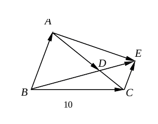
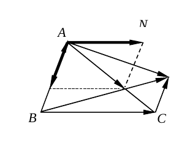
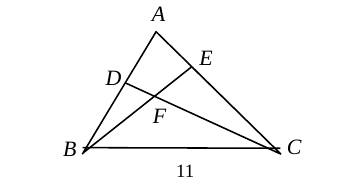
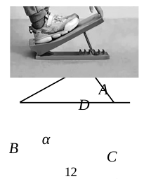
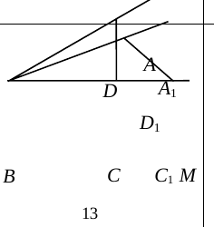
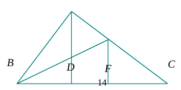
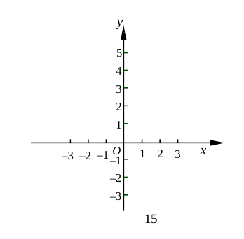
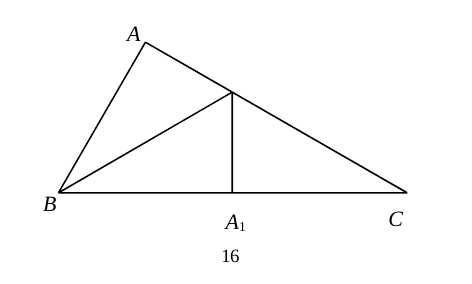
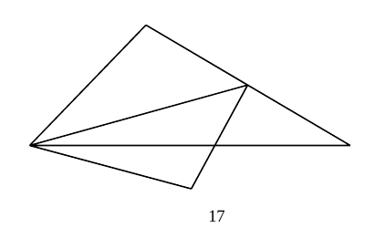

# 2026 一模精讲 · 浦东卷（下）解答题 19-25

> 本篇覆盖第 19-25 题（解答题，共 78 分），每题"完整转录 + 思路导航 + 折叠详解（含易错）"。第 1-18 题见《数模26-浦东-上》。题干以卷面页图为准转录（流通版 docx/PDF 经 Word 重排转换：页图中文缺失，中文题干以 docx 原文补全——第 20、21、23、24 题题干从 docx 文本框中逐字核出，数学式与页图逐一比对），数值与卷末参考答案逐题互证。

> ⚠️ 核对注记（卷首汇总，详见各题处）：
> - 第 19 题的中括号在页图呈竖线残迹，按官方解答第二行 $=\sqrt2-(\sqrt2-1)+1$ 确定为 $\left[2\cos45°-1\right]$；
> - 第 22 题参考数据在流通版仅存"精确到 0.01"，且公式 $F=mg\cdot\sin\alpha$ 中 g 的数值丢失，均按官方解答所用（g＝10 牛/千克；$\sin20°\approx0.34$、$\sin25°\approx0.42$、$\sin30°\approx0.50$）复原；
> - 第 24（2）题下标 $k_A$ 的"A"在流通版下标丢失（页图残存游离下标 A），按第（1）问 $k_P$ 的记法复原；
> - 图 12、图 13、图 14 的部分字母在页图转换时错位或缺失（图 12 中 C 错位、图 13 中 D₁ 位置漂移、图 14 中 M 未标出），裁片保持卷面原样，字母关系以题干文字为准。

## 卷面结构说明

- **试卷**：浦东新区初三数学期末练习卷（2026.1），共 25 题，满分 150 分。
- **结构**：一、选择题 6 题 × 4 分 = 24 分；二、填空题 12 题 × 4 分 = 48 分（第 7~18 题）；三、解答题 7 题 78 分（第 19~25 题：19~22 每题 10 分、23~24 每题 12 分、25 题 14 分）。
- **本篇**：第 19~25 题（解答题全部）；第 1~18 题见 [[数模26-浦东-上]]。

## 三、解答题

**19.**（本题 10 分）计算：$\sqrt{6}\cot 60°-\left[2\cos 45°-1\right]+4\sin^2 30°$

> [!tip]- 💡 思路导航
> 三个特殊角三角比（cot60°、cos45°、sin30°）先全部化为分数或根号代入；中括号先算内部，注意前面是"减去整个中括号"，去括号要变号；$\sin^230°$ 是"先平方再乘 4"。

> [!success]- ✅ 详解 · 易错 · 关联
> **详解**：$\cot60°=\dfrac{\sqrt3}{3}$，$\cos45°=\dfrac{\sqrt2}{2}$，$\sin30°=\dfrac12$（特殊角三角比）。
> 原式 $=\sqrt6\times\dfrac{\sqrt3}{3}-\left[2\times\dfrac{\sqrt2}{2}-1\right]+4\times\left(\dfrac12\right)^2$
> $=\sqrt2-\left(\sqrt2-1\right)+1$（其中 $\sqrt6\times\dfrac{\sqrt3}{3}=\dfrac{\sqrt{18}}{3}=\dfrac{3\sqrt2}{3}=\sqrt2$，二次根式化简）
> $=\sqrt2-\sqrt2+1+1=\boxed{2}$。
>
> **易错**："减去整个中括号"：$-\left[2\cos45°-1\right]=-(\sqrt2-1)=-\sqrt2+1$，去括号不变号即错；$4\sin^230°=4\times\dfrac14=1$，别算成 $4\times\dfrac12=2$。
>
> **关联**：[[03-数学/知识点/九年级/锐角的三角比与解直角三角形]] · 二次根式的运算

**20.**（本题共 10 分，第（1）小题 6 分，第（2）小题 4 分）
如图 10，在 △ABC 中，点 D 在边 AC 上，且 AD＝2DC，点 E 在 BD 的延长线上，CE∥AB．已知 $\vec{BA}=\vec{a}$，$\vec{BC}=\vec{b}$．
（1）用向量 $\vec{a}$、$\vec{b}$ 分别表示向量：$\vec{AC}=$＿＿＿＿＿＿＿＿，$\vec{AE}=$＿＿＿＿＿＿＿＿；
（2）作出向量 $\vec{AD}$ 分别在 $\vec{a}$、$\vec{b}$ 方向上的分向量．（写出结论，不要求写作法）

> [!tip]- 💡 思路导航
> $\vec{AC}$ 用向量减法一眼可写；$\vec{AE}$ 抓两个几何条件翻译成向量语言——E 在射线 BD 上即 $\vec{BE}=k\vec{BD}$，CE∥AB 即 $\vec{CE}$ 与 $\vec{BA}$ 共线，比较分解式系数（分解式唯一）即可定 k；（2）把 $\vec{AD}$ 沿两个基方向拆：过 D 分别作两个基方向的平行线，交点即给出分向量。

> [!success]- ✅ 详解 · 易错 · 关联
> **详解**：**（1）** $\vec{AC}=\vec{BC}-\vec{BA}=\boxed{\vec{b}-\vec{a}}$（向量减法：减数指向被减数）。
> ∵AD＝2DC，∴$\vec{AD}=\dfrac23\vec{AC}=\dfrac23(\vec{b}-\vec{a})$，
> $\vec{BD}=\vec{BA}+\vec{AD}=\vec{a}+\dfrac23(\vec{b}-\vec{a})=\dfrac13\vec{a}+\dfrac23\vec{b}$。
> ∵E 在 BD 的延长线上，∴$\vec{BE}=k\vec{BD}=\dfrac k3\vec{a}+\dfrac{2k}3\vec{b}$（$k>1$）；∵CE∥AB，∴$\vec{CE}=t\vec{a}$（$t$ 为实数）。
> $\vec{BE}=\vec{BC}+\vec{CE}=\vec{b}+t\vec{a}$，由分解式唯一比较系数：$\dfrac{2k}3=1\Rightarrow k=\dfrac32$，$t=\dfrac k3=\dfrac12$。
> ∴$\vec{AE}=\vec{AC}+\vec{CE}=(\vec{b}-\vec{a})+\dfrac12\vec{a}=\boxed{\vec{b}-\dfrac12\vec{a}}$。
>
> **（2）** 作图（保留痕迹，如上图）：过 D 作 BC 的平行线交 AB 于 M；过 A 作 BC 的平行线，再过 D 作 AB 的平行线，两线交于点 N。则 $\vec{AD}=\vec{AM}+\vec{AN}$，**向量 $\vec{AM}$、$\vec{AN}$ 就是向量 $\vec{AD}$ 分别在 $\vec{a}$、$\vec{b}$ 方向上的分向量**。
> 验证：$\vec{AM}=-\dfrac23\vec{a}$（M 在线段 AB 上，与 $\vec{a}$ 反向），$\vec{AN}=\dfrac23\vec{b}$，$-\dfrac23\vec{a}+\dfrac23\vec{b}=\dfrac23(\vec{b}-\vec{a})=\dfrac23\vec{AC}=\vec{AD}$ ✓。
>
> **易错**：$\vec{AE}$ 的系数在 $\vec{a}$ 上：$\vec{b}-\dfrac12\vec{a}$，写成 $\dfrac12(\vec{b}-\vec{a})$ 或 $\dfrac12\vec{a}-\vec{b}$ 即错；比较系数的依据是"分解式唯一"，k 由 $\vec{b}$ 的系数定出；作图中 M 在线段 AB 上（分向量与 $\vec{a}$ 反向、取负系数是允许的），结论句"向量 AM、AN 就是……分向量"必须写出。
>
> **关联**：[[03-数学/知识点/九年级/平面向量]]

**21.**（本题共 10 分，第（1）小题 6 分，第（2）小题 4 分）
已知，如图 11，在 △ABC 中，点 D、E 分别在边 AB 和 AC 上，$AD\cdot AB=AE\cdot AC$，点 F 是 BE 与 CD 的交点．
（1）求证：△FDB∽△FEC．
（2）如果 AB＝15，AC＝18，AD＝6，求 EF:DF 的值．

> [!tip]- 💡 思路导航
> 把乘积式化成比例 $\frac{AD}{AE}=\frac{AC}{AB}$，配上公共角 ∠A 用 SAS 得 △DAC∽△EAB，把 ∠ACD"搬"到 ∠ABE；（1）在对顶角的配合下两角相等即证；（2）由乘积式先算出 AE、EC、DB 三条线段，再用（1）的相似比收口。

> [!success]- ✅ 详解 · 易错 · 关联
> **详解**：**（1）** ∵$AD\cdot AB=AE\cdot AC$，∴$\dfrac{AD}{AE}=\dfrac{AC}{AB}$（比例变形）；
> 又 ∠DAC＝∠EAB（公共角），∴△DAC∽△EAB（两边成比例且夹角相等的两个三角形相似），
> ∴∠ACD＝∠ABE（相似三角形对应角相等）。
> ∵F 在 CD 上、E 在 AC 上，∴∠FCE＝∠ACD；∵F 在 BE 上、D 在 AB 上，∴∠FBD＝∠ABE，
> ∴∠FBD＝∠FCE（等量代换）；又 ∠DFB＝∠EFC（对顶角相等），
> ∴△FDB∽△FEC（两角对应相等的两个三角形相似）。$\blacksquare$
>
> **（2）** 由 $AD\cdot AB=AE\cdot AC$：$6\times15=18AE$，∴AE＝5，∴EC＝18−5＝13；BD＝AB−AD＝15−6＝9。
> 由（1）△FDB∽△FEC（F↔F、D↔E、B↔C）：$\dfrac{EF}{DF}=\dfrac{EC}{DB}$（相似三角形对应边成比例），
> ∴EF:DF＝EC:DB＝13:9，即 $\boxed{EF:DF=13:9}$。
>
> **易错**：乘积式化比例的对应关系是 $\frac{AD}{AE}=\frac{AC}{AB}$，SAS 的夹角必须是公共角 ∠A；(2) 中 EC＝13 是"减"不是"加"；EF:DF 来自 EC:DB（交叉对应），别写成 EC:AD。
>
> **关联**：[[03-数学/知识点/九年级/相似三角形]]

**22.**（本题共 10 分，第（1）小题 4 分，第（2）小题 2 分，第（3）小题 4 分）
拉伸运动的"密钥"
拉伸运动对身体机能的调节起着关键作用．从运动生理学角度来看，科学的拉伸可以改善关节活动范围，提升身体的灵活性和协调性．
拉伸板是一种有效的拉伸工具，其侧面结构可以看作一个三角形（如图 12）．脚踏板 AB 可绕底座铰链 B 转动，支撑杆 CD 的上端位于脚踏板的点 D 处．通过移动支撑杆 CD 下端点 C 的位置，可以改变脚踏板的倾斜角度，从而调节拉伸强度．当人站在倾斜的脚踏板上时，身体重量会产生一个沿着踏板方向的拉伸力 F，这个力的大小决定了拉伸的强度．
拉伸力 F 的大小可用公式表示为 F＝mg·sinα，其中 m（单位：千克）为体重，g＝10 牛/千克，α 是脚踏板与水平地面之间的夹角．
如图 13，小海有一款三档可调节拉伸板，三档的夹角 α 度数分别为 20°、25°、30°．已知 BD＝30 cm．
（1）小海的体重是 50 千克，如果拉伸力 F 在 180 牛至 220 牛可以达到锻炼的目的．结合计算说明，在这三档之中，小海选择哪个档位能达到锻炼的目的？
（2）当档位夹角为 30° 时，支撑杆 CD 恰好与底座 BM 垂直．求此时支撑杆下端点 C 与铰链 B 点的距离为多少厘米（结果保留根号）？
（3）当档位夹角从 30° 调到 20°，即支撑杆的位置变化到 D₁C₁ 时，支撑杆 CD 的端点 D 在竖直方向下降约为多少厘米？
（参考数据：$\sin20°\approx0.34$，$\sin25°\approx0.42$，$\sin30°\approx0.50$，精确到 0.01）

> [!tip]- 💡 思路导航
> （1）是代入求值再与区间比较：三档各算一个 F，落在 180~220 牛之间的即为所选；（2）CD⊥BM 时 △BCD 是直角三角形，斜边 BD＝30、锐角 ∠DBC 就是档位夹角 α，解直角三角形即得 BC；（3）"竖直方向下降"＝两个位置的高度差：两个高度都等于"斜边长 × sin（与地面的夹角）"，作 D₁H⊥BM 把 20° 档的高度表示出来。

> [!success]- ✅ 详解 · 易错 · 关联
> **详解**：**（1）** $F=mg\cdot\sin\alpha=50\times10\times\sin\alpha=500\sin\alpha$（牛）。
> α＝20°：$F\approx500\times0.34=170$（牛）；α＝25°：$F\approx500\times0.42=210$（牛）；α＝30°：$F=500\times0.50=250$（牛）。
> ∵170＜180＜210＜220＜250，只有 25° 档的拉伸力落在 180 牛至 220 牛之间，
> ∴**小海选择 25° 档**能达到锻炼的目的。
>
> **（2）** 当 α＝30° 时 CD⊥BM，∴∠BCD＝90°，BD＝30 cm（D 在脚踏板上，Rt△BCD 的斜边），∠DBC＝∠ABM＝α＝30°。
> ∴$BC=BD\cdot\cos\angle DBC=30\times\cos30°=30\times\dfrac{\sqrt3}{2}=15\sqrt3$（cm）。
> 答：支撑杆下端点 C 与铰链 B 点的距离为 $15\sqrt3$ cm。
>
> **（3）** 30° 档时 D 的高度：Rt△DBC 中 $DC=DB\cdot\sin\angle DBC=30\times\sin30°=30\times0.50=15$（cm）。
> 调到 20° 档：脚踏板上的定点到铰链 B 的距离不变，∴$D_1B=DB=30$ cm，∠D₁BM＝∠A₁BM＝20°。
> 作 D₁H⊥BM，垂足为 H，则 D₁ 的高度＝$D_1H=D_1B\cdot\sin\angle D_1BM=30\times\sin20°\approx30\times0.34=10.2$（cm）。
> ∴D 在竖直方向下降约为 $15-10.2=4.8$（cm）。
> 答：支撑杆 CD 的端点 D 在竖直方向下降约为 **4.8 cm**。
>
> **易错**：（1）三档各自代入后再与 [180, 220] 比较，不能凭"α 越大拉伸力越大"直接下结论；(2) 斜边是 BD＝30 而非 CD，BC 是 ∠DBC 的邻边用 cos，结果保留根号不再取近似；(3) 下降量是两个高度相减，30° 档的高度 DC 由第（2）问的直角三角形算出；"$D_1B=DB=30$" 的依据（脚踏板上定点到铰链距离不变）要交代，直接写 30 会被扣过程分。
>
> **关联**：[[03-数学/知识点/九年级/锐角的三角比与解直角三角形]] · 解直角三角形的应用

**23.**（本题共 12 分，第（1）小题 6 分，第（2）小题 6 分）
如图 14，在 Rt△ABC 中，∠BAC＝90°，AD⊥BC，垂足为点 D，点 E 是边 AC 上一点，EF⊥BC，垂足为点 F，AD、BE 交于点 M．
（1）如果 BE 平分∠ABC，求证：BM·CE＝AM·BE；
（2）如果 BD＝CF，求证：$\dfrac{EF}{AD}=\dfrac{AB^2}{AC^2}$．

> [!tip]- 💡 思路导航
> （1）用"同角的余角相等"把 ∠BAD＝∠C 造出来，再用角平分线给出第二对等角，两次 AA 相似即可；（2）把 $\frac{AB^2}{AC^2}$ 拆成两个"共角相似"的乘积式（△BAD∽△BCA 与 △CDA∽△CBA），相除后用 BD＝CF 换元，最后由 EF∥AD 的平行截线比例收口。

> [!success]- ✅ 详解 · 易错 · 关联
> **详解**：**（1）** ∵∠BAC＝90°，∴∠ABC＋∠C＝90°（直角三角形两锐角互余）；
> ∵AD⊥BC，∴Rt△ABD 中 ∠ABC＋∠1＝90°（∠1 即 ∠BAD），∴∠1＝∠C（同角的余角相等）。
> ∵BE 平分∠ABC，∴∠2＝∠3，即 ∠ABM＝∠CBE（M 在 BE 上）；
> 又 ∠BAM＝∠1＝∠C＝∠BCE（M 在 AD 上、E 在 AC 上），
> ∴△ABM∽△CBE（两角对应相等的两个三角形相似），
> ∴$\dfrac{BM}{BE}=\dfrac{AM}{CE}$（相似三角形对应边成比例），∴BM·CE＝AM·BE。$\blacksquare$
>
> **（2）** ∵∠1＝∠C，∠ABD＝∠ABC（公共角），∴△BAD∽△BCA（两角对应相等），
> ∴$\dfrac{BD}{BA}=\dfrac{BA}{BC}$，∴BD·BC＝BA²　①；
> 同理（∠C 公共，∠ADC＝∠BAC＝90°）：△CDA∽△CBA，∴CD·CB＝CA²　②。
> ①÷②（BC＝CB）：$\dfrac{BD}{CD}=\dfrac{BA^2}{CA^2}$；∵BD＝CF，∴$\dfrac{CF}{CD}=\dfrac{BA^2}{CA^2}$　③。
> ∵EF⊥BC，AD⊥BC，∴∠EFC＝∠ADC＝90°，∴EF∥AD（垂直于同一条直线的两直线平行），
> ∴△CEF∽△CAD（公共角 ∠C，EF∥AD），∴$\dfrac{EF}{AD}=\dfrac{CF}{CD}$　④。
> 由 ③④：$\dfrac{EF}{AD}=\dfrac{BA^2}{CA^2}$，即 $\boxed{\dfrac{EF}{AD}=\dfrac{AB^2}{AC^2}}$。$\blacksquare$
>
> **易错**：（1）∠1＝∠C 必须先写两个互余关系、点明"同角的余角相等"，凭图直观看出要扣分；△ABM∽△CBE 的对应是 A↔C、B↔B、M↔E，比例 $\frac{BM}{BE}=\frac{AM}{CE}$ 写反则乘积式全错；（2）两个乘积式来自两组不同的相似，对应边别混；相除时利用 BC＝CB 约去分母；④的相似对应是 △CEF∽△CAD（E↔A、F↔D），写成 EF/AD＝CE/CA 再代错线段即错。
>
> **关联**：[[03-数学/知识点/九年级/相似三角形]]

**24.**（本题共 12 分，第（1）小题 4 分，第（2）小题 4 分，第（3）小题 4 分）
新定义：在平面直角坐标系中，抛物线上的点和它的顶点的连线，与这条抛物线的对称轴所夹的角的正切值称为抛物线上这个点的开口程度．规定抛物线顶点的开口程度为 0．根据上述定义，解决以下问题：
如图 15，在平面直角坐标系 xOy 中．
（1）如果抛物线 $y=x^2-4x+5$ 与 y 轴交于点 P，求此抛物线上点 P 的开口程度 $k_P$；
（2）已知抛物线 $y=x^2-4x+a$ 与 x 轴交于 A、B 两点（A 在 B 的左侧），如果此抛物线上点 A 的开口程度 $k_A=1$，求 a 的值；
（3）将抛物线 $C_1:y=mx^2-2mx+n$（m＞0）平移，使平移后的抛物线 $C_2$ 经过抛物线 $C_1$ 的顶点 M，记抛物线 $C_2$ 的顶点为 N，$C_2$ 的对称轴交 $C_1$ 于点 Q，如果 $C_1$ 上点 Q 的开口程度与 $C_2$ 上点 M 的开口程度相等，均为 2，且 △QMN 的面积为 8，试求 m 的值．

> [!tip]- 💡 思路导航
> 新定义先翻译：过该点作对称轴的垂线，开口程度＝水平距离 ÷ 铅垂距离的正切。（1）配方读出顶点与对称轴，代点即算；（2）把 k_A＝1 翻译成"A 到对称轴的水平距离等于顶点到 x 轴的距离"，从而定出 A 的横坐标，代回抛物线解 a，"与 x 轴交于两点"是舍根的依据；（3）抓住两条对称轴互相平行且 Q、N 同在 C₂ 的对称轴上——等角的两次转化给出等腰三角形，用面积定出竖直边与水平距离，Q、N 的坐标随之而定。

> [!success]- ✅ 详解 · 易错 · 关联
> **详解**：**（1）** $y=x^2-4x+5=(x-2)^2+1$，顶点 D(2,1)，对称轴为直线 x＝2；P(0,5)。
> 作 PH⊥直线 x＝2，垂足为 H，则 PH＝|0−2|＝2，HD＝5−1＝4。
> ∴$k_P=\tan\angle PDH=\dfrac{PH}{HD}=\dfrac24=\boxed{\dfrac12}$。
>
> **（2）** $y=(x-2)^2+(a-4)$，顶点 E(2, a−4)，对称轴 x＝2；记直线 x＝2 与 x 轴的交点为 F(2,0)。
> ∵抛物线与 x 轴交于 A、B 两点，∴顶点 E 在 x 轴下方：a−4＜0，a＜4。
> $k_A=\tan\angle AEF=\dfrac{AF}{EF}=1$（A 在对称轴左侧：AF＝2−x_A；EF＝4−a），∴AF＝EF＝4−a，
> ∴x_A＝2−(4−a)＝a−2，即 A(a−2, 0)。
> 代入抛物线：$(a-2-2)^2+(a-4)=0$，即 $(a-4)^2+(a-4)=0$，提公因式 $(a-4)\left[(a-4)+1\right]=0$，∴a＝3 或 a＝4；
> a＝4 时顶点落在 x 轴上，抛物线与 x 轴只有一个交点，不合题意舍去。∴$\boxed{a=3}$。
>
> **（3）** $C_1:y=m(x-1)^2+(n-m)$，顶点 M(1, n−m)，对称轴为直线 x＝1（C₁ 上点 Q 的开口程度即 ∠QMI 的正切，I 在 C₁ 的对称轴上）。
> C₂ 由 C₁ 平移得到，两条抛物线的对称轴互相平行（都垂直于 x 轴）；Q 在 C₂ 的对称轴上，N 是 C₂ 的顶点也在其上，∴QN 沿竖直方向，M 在 C₁ 的对称轴上。
> ∵$k_Q=\tan\angle QMI=2$，MI∥NQ，∴∠QMI＝∠MQN（两直线平行，内错角相等），∴tan∠MQN＝2；
> 又 $k_M=\tan\angle MNQ=2$，∴∠MQN＝∠MNQ。
> 作 MG⊥QN 于 G：$\tan\angle MQN=\dfrac{MG}{QG}$，$\tan\angle MNQ=\dfrac{MG}{NG}$，∴QG＝NG，且 $\dfrac{MG}{QG}=2$。
> 设 QG＝NG＝t（t＞0），则 MG＝2t，$S_{\triangle QMN}=\dfrac12\cdot QN\cdot MG=\dfrac12\cdot2t\cdot2t=2t^2=8$，∴t＝2，MG＝4。
> ∵MG⊥QN 且 QN 竖直，∴MG 水平，G 与 M 等高：M 到 C₂ 对称轴的水平距离为 4，∴x_N＝1±4，即 x_N＝−3 或 5；Q 在 C₂ 的对称轴上，∴x_Q＝−3 或 5。
> 又 y_G＝y_M＝n−m，QG＝NG＝2，且 Q 在开口向上的 C₁ 上（y_Q≥y_M），∴y_Q＝n−m＋2，即 Q(−3, n−m+2) 或 (5, n−m+2)。
> 代入 C₁：$m(x_Q-1)^2=n-m+2-(n-m)=2$；x_Q＝−3 或 5 时 $(x_Q-1)^2=16$，∴$16m=2$，$\boxed{m=\dfrac18}$。
> （验证：C₂ 过 M，即 $m(1-x_N)^2=16\times\dfrac18=2=n-m-(n-m-2)$ ✓，几何关系自洽。）
>
> **易错**：开口程度的正切是"水平距离 ÷ 铅垂距离"，分子分母颠倒即错；(2) 中 a＝4 的根必须舍（"交于两点"要求顶点在 x 轴下方）；(3) 中 QN 是竖直线（两点同在 C₂ 对称轴上）、MG 是水平线，$S_{\triangle QMN}=\frac12\cdot QN\cdot MG$ 的底与高别取错；y_Q＝y_M＋2 取"+2"是因为 Q 在开口向上的 C₁ 上（y_Q≥y_M），若取 −2 则 $m(x_Q-1)^2=-2<0$ 无解，自动排除。
>
> **关联**：[[03-数学/知识点/九年级/二次函数]]

**25.**（本题共 14 分，第（1）小题 4 分，第（2）小题 5 分，第（3）小题 5 分）
在 △ABC 中，∠BAC≥90°，点 D 为边 AC 上一点，∠ABD＝∠ACB，CD＝2．将 △ABD 沿 BD 翻折得到 △A₁BD，点 A₁ 恰好落在边 BC 的垂直平分线上．
（1）如图 16，如果点 A₁ 在边 BC 上，求 $\dfrac{AD}{AB}$ 的值；
（2）如图 17，如果 AD＝CD，求 BD 的长；
（3）如果 AB＝CD，求 ∠BAC 的度数．

> [!tip]- 💡 思路导航
> 全题的引擎有两台：其一是"∠ABD＝∠ACB ＋ 公共角 ∠A ⇒ △ABD∽△ACB"（AD↔AB、AB↔AC 对应），其二是翻折三件套（AB＝A₁B、AD＝A₁D、BD 垂直平分 AA₁）加上"A₁ 在 BC 的垂直平分线上 ⇒ A₁B＝A₁C"。（1）用中点把面积三等分，再以"相似三角形面积比＝相似比的平方"收口；（2）AD＝CD 给出中位线，把斜边中线与两次勾股串起来；（3）由 AB＝CD 替换比例推出黄金分割点，再作平行线造等腰三角形链，用三角形内角和逼出角的大小，最后以等边三角形收口。

> [!success]- ✅ 详解 · 易错 · 关联
> **详解**：**（1）** ∵A₁ 在边 BC 上，又在 BC 的垂直平分线上，∴A₁ 是 BC 的中点（线段与其中垂线的交点）。
> 由翻折：△ABD≌△A₁BD，∴S△ABD＝S△A₁BD；又 BA₁＝A₁C，△A₁BD 与 △A₁CD 有公共顶点 D、底 BA₁ 与 A₁C 同在直线 BC 上（同高等底），
> ∴S△A₁BD＝S△A₁CD，∴$S_{\triangle ABD}=\dfrac13S_{\triangle ACB}$。
> ∵∠ABD＝∠ACB，∠A＝∠A（公共角），∴△ABD∽△ACB（两角对应相等），对应边 AD↔AB、AB↔AC，
> ∴$\dfrac{S_{\triangle ABD}}{S_{\triangle ACB}}=\left(\dfrac{AD}{AB}\right)^2=\dfrac13$（相似三角形面积的比等于相似比的平方），
> ∴$\dfrac{AD}{AB}=\dfrac{1}{\sqrt3}=\boxed{\dfrac{\sqrt3}{3}}$。
>
> **（2）** 联结 AA₁、A₁C。由翻折：BD 垂直平分 AA₁，设垂足为 M，则 AM＝A₁M＝½AA₁，∠AMD＝90°。
> ∵AD＝CD＝2，∴$\dfrac{AM}{MA_1}=\dfrac{AD}{DC}=1$，M 在 AA₁ 上、D 在 AC 上，∴DM∥A₁C（平行线分线段成比例的逆定理），
> ∴DM 是 △AA₁C 的中位线，$DM=\dfrac12A_1C$（且 ∠AA₁C＝∠AMD＝90°）。
> ∵△ABD∽△ACB，∴$\dfrac{AB}{AC}=\dfrac{AD}{AB}$，∴AB²＝AD·AC＝2×(2＋2)＝8，∴AB＝2√2。
> 由翻折：A₁B＝AB＝2√2；∵A₁ 在 BC 的垂直平分线上，∴A₁B＝A₁C＝2√2，∴$DM=\dfrac12A_1C=\sqrt2$。
> Rt△ADM 中：$AM=\sqrt{AD^2-DM^2}=\sqrt{4-2}=\sqrt2$（勾股定理）；
> Rt△ABM 中：$BM=\sqrt{AB^2-AM^2}=\sqrt{8-2}=\sqrt6$（勾股定理，M 在线段 BD 上，如图 17），
> ∴$\boxed{BD=BM+DM=\sqrt6+\sqrt2}$。
>
> **（3）** 过 D 作 DN∥AA₁，交 A₁C 于点 N。
> ∴$\dfrac{A_1N}{A_1C}=\dfrac{AD}{AC}$（平行线分线段成比例）　①；
> ∵△ABD∽△ACB，∴$\dfrac{AD}{AB}=\dfrac{AB}{AC}$　②。
> ∵AB＝CD＝2，②即 $\dfrac{AD}{CD}=\dfrac{CD}{AC}$，∴CD²＝AD·AC，∴点 D 是线段 AC 的黄金分割点，
> 由 AD＋CD＝AC 解得 $\dfrac{AD}{CD}=\dfrac{CD}{AC}=\dfrac{\sqrt5-1}{2}$（取正根）。
> ∴AD＝√5−1（CD＝2），A₁D＝AD＝√5−1（翻折），AC＝AD＋CD＝√5＋1；A₁C＝A₁B＝AB＝2（翻折与中垂线）。
> 由 ①：$A_1N=A_1C\cdot\dfrac{AD}{AC}=2\times\dfrac{\sqrt5-1}{\sqrt5+1}=3-\sqrt5$，∴CN＝A₁C−A₁N＝2−(3−√5)＝√5−1。
> ∴$\dfrac{A_1N}{A_1D}=\dfrac{3-\sqrt5}{\sqrt5-1}=\dfrac{\sqrt5-1}{2}$（分母有理化），又 $\dfrac{A_1D}{A_1C}=\dfrac{\sqrt5-1}{2}$，
> ∴$\dfrac{A_1N}{A_1D}=\dfrac{A_1D}{A_1C}$；又 ∠NA₁D＝∠DA₁C（公共角，N 在 A₁C 上），
> ∴△A₁ND∽△A₁DC（两边成比例且夹角相等），设 ∠A₁CD＝∠A₁DN＝α，
> 且 $\dfrac{DN}{DC}=\dfrac{A_1D}{A_1C}=\dfrac{\sqrt5-1}{2}$，∴DN＝√5−1。
> ∴DN＝CN＝√5−1，∴∠NDC＝∠NCD＝α（等边对等角），
> ∴∠CDA₁＝∠A₁DN＋∠NDC＝2α，∠DA₁C＝∠CDA₁＝2α（A₁C＝DC＝2，等边对等角）。
> △A₁CD 中：∠DA₁C＋∠CDA₁＋∠A₁CD＝2α＋2α＋α＝180°，∴α＝36°，∴∠A₁DN＝∠NDC＝36°。
> ∵DN∥AA₁，∴∠CAA₁＝∠NDC＝36°（两直线平行，同位角相等）；又 ∠A₁CA＝∠A₁CD＝36°（D 在边 AC 上），
> ∴A₁A＝A₁C（等角对等边）。
> ∵AB＝A₁B（翻折）＝A₁C＝A₁A，∴△ABA₁ 是等边三角形，∠BAA₁＝60°；
> ∴∠BAC＝∠BAA₁＋∠CAA₁＝60°＋36°＝$\boxed{96°}$。
>
> **易错**：（1）面积比的相似比是 $\frac{AD}{AB}$（AD 对应 AB），写成 $\left(\frac{AD}{AC}\right)^2$ 即错；"三个三角形面积相等"靠的是全等与同底等高，两步依据都要写；（2）DM∥A₁C 由比例的逆定理交代，两次勾股的斜边分别是 AD、AB 别混，BD＝BM＋DM 依赖 M 在线段 BD 上；(3) 由 ② 得"黄金分割点"必须经过 AB＝CD 的替换；∠BAC＝∠BAA₁＋∠CAA₁ 依赖 A₁ 在 ∠BAC 内部（如图 17，与 ∠BAC≥90° 相容）。
>
> **关联**：[[03-数学/知识点/九年级/相似三角形]] · 轴对称（翻折）· [[03-数学/知识点/九年级/锐角的三角比与解直角三角形]]

## 答案速查与互证

| 题号 | 19 | 20 | 21 | 22 | 23 | 24 | 25 |
| ---- | -- | -- | -- | -- | -- | -- | -- |
| 结果 | $2$ | （1）$\vec{AC}=\vec{b}-\vec{a}$，$\vec{AE}=\vec{b}-\dfrac12\vec{a}$；（2）作图见上，$\vec{AM}$、$\vec{AN}$ 为所求分向量 | （1）证明见上；（2）$EF:DF=13:9$ | （1）选 $25°$ 档；（2）$BC=15\sqrt3$ cm；（3）约 $4.8$ cm | （1）（2）证明见上 | （1）$k_P=\dfrac12$；（2）$a=3$；（3）$m=\dfrac18$ | （1）$\dfrac{AD}{AB}=\dfrac{\sqrt3}{3}$；（2）$BD=\sqrt6+\sqrt2$；（3）$\angle BAC=96°$ |

与卷末参考答案逐题互证：19（$=\sqrt2-(\sqrt2-1)+1=2$，官方两步完全一致）✓；20（$\vec{AC}=\vec{b}-\vec{a}$、$\vec{AE}=-\dfrac12\vec{a}+\vec{b}$；"向量 AM、AN 就是向量 AD 分别在 $\vec{a}$、$\vec{b}$ 方向上的分向量"，作图与官方答案图一致）✓；21（△FDB∽△FEC 的证明链 △DAC∽△EAB 与官方一致；$6\times15=18AE$、AE＝5、EC＝13、DB＝9、EF:DF＝13:9）✓；22（三档 F 值 170/210/250 牛选 25° 档；$BC=30\cos30°=15\sqrt3$；$D_1H=30\sin20°\approx10.2$、下降 $15-10.2=4.8$ cm）✓；23（BM·CE＝AM·BE 与 $EF/AD=AB^2/AC^2$，证明链 ∠1＝∠C、△ABM∽△CBE、△BAD∽△BCA、CD·CB＝CA²、EF∥AD 与官方完全一致）✓；24（$k_P=\tan\angle PDH=\frac24=\frac12$；A(a−2, 0) 代入得 a＝3 或 4、舍 4；Q(−3, n−m+2) 或 (5, n−m+2)、$16m=2$、m＝1/8）✓；25（面积比 $\left(\frac{AD}{AB}\right)^2=\frac13$ 得 $\frac{\sqrt3}3$；A₁B＝A₁C＝2√2、AM＝√2、BM＝√6、BD＝√6＋√2；黄金分割 $\frac{\sqrt5-1}2$ 链条与 α＝36°、等边 △ABA₁、∠BAC＝96°）✓。全部数值均已独立重算，无 ⚠️ 待核对项（卷首四条注记均为流通版转换缺失的复原说明，与官方解答无冲突）。

## 🔗 关联

- [[03-数学/知识点/九年级/锐角的三角比与解直角三角形]] · [[03-数学/知识点/九年级/相似三角形]] · [[03-数学/知识点/九年级/二次函数]] · [[03-数学/知识点/九年级/平面向量]]
- 第 1~18 题见 [[数模26-浦东-上]]
