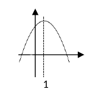
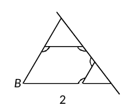
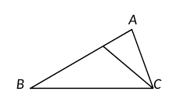
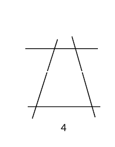
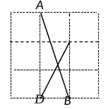
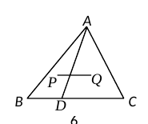
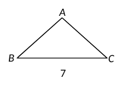
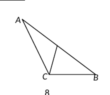

# 2026 一模精讲 · 虹口（上）：选择与填空（第 1–18 题）

> 虹口卷结构：选择题 6 题×4 分 + 填空题 12 题×4 分 + 解答题 7 题 78 分，共 25 题 150 分。本篇覆盖第 1–18 题，第 19–25 题见 [[数模26-虹口-下]]。

## 一、选择题（每题 4 分）

**1.** 下列四组线段中，成比例的是（　）
- （A）1，2，3，4
- （B）2，3，4，5
- （C）1，2，3，5
- （D）2，3，4，6

> [!tip]- 💡 思路导航
> 成比例 ⟺ 首末两项之积等于中间两项之积——逐组交叉相乘验证。

> [!success]- ✅ 详解 · 评分点 · 易错 · 关联
> **详解**：成比例 ⟺ 首末积相等：（D）中 $2\times6=3\times4=12$ ✓，选 **D**。

**2.** 在 Rt△ABC 中，∠C＝90°，已知 AC＝3，BC＝4，下列锐角三角比中，值为 $\dfrac34$ 的是（　）
- （A）sinB
- （B）cosB
- （C）tanB
- （D）cotB

> [!tip]- 💡 思路导航
> 先勾股求斜边，再按定义写出四个三角比，看谁的值是两直角边之比。

> [!success]- ✅ 详解 · 评分点 · 易错 · 关联
> **详解**：AB=5；$\tan B=\dfrac{AC}{BC}=\dfrac34$，选 **C**。

**3.** 已知 $y=(m-3)x^{m^2-2m-1}$（m 为常数）是二次函数，那么 m 的值是（　）
- （A）3
- （B）−1
- （C）−3
- （D）3 或 −1

> [!tip]- 💡 思路导航
> 二次函数要同时满足"指数为 2"与"系数不为 0"——两个条件都要验，会舍去一个根。

> [!success]- ✅ 详解 · 评分点 · 易错 · 关联
> **详解**：$m^2-2m-1=2$ 得 $m=3$ 或 $-1$；$m=3$ 时系数 $m-3=0$，舍去，故 $m=\boxed{-1}$，选 **B**。
> ⚠️ 待核对：OCR 指数只剩碎片，按"双解舍一"的命题结构与答案 B 反推指数为 $m^2-2m-1$。

**4.** 如图 1 是二次函数 $y=ax^2+bx+c\ (a\neq0)$ 的图像，那么下列说法中，正确的是（　）
- （A）$a>0$
- （B）$b>0$
- （C）$b<0$
- （D）$c<0$

> [!tip]- 💡 思路导航
> 从开口方向、对称轴位置、与 y 轴交点三处读图定符号——注意对称轴公式中 a、b 的联动。

> [!success]- ✅ 详解 · 评分点 · 易错 · 关联
> **详解**：开口向下 $a<0$，对称轴 $x=-\dfrac{b}{2a}>0$ 且 $a<0\Rightarrow b>0$；又抛物线与 y 轴交于正半轴，$c>0$，故 （D）错。选 **B**。
> ⚠️ 订正：原转录误作"（D）$c>0$"且注"原图缺失"；卷面选项 （D）为 $c<0$，题图在卷（开口向下、对称轴在 y 轴右侧、与 y 轴交于**正**半轴），已按原卷修正。

**5.** 如图 2，在五边形 ABCDE 中，AE∥BC，延长 BA、BC，分别交直线 DE 于点 M、N。如果添加下列一个条件后，仍无法判定 △MAE∽△DCN，那么这个条件是（　）
- （A）∠2＝∠3
- （B）CD∥AB
- （C）∠1＝∠4
- （D）∠B＋∠1＝180°

> [!tip]- 💡 思路导航
> 判相似需要两对对应角——AE∥BC 已提供一对现成等角，逐项看哪个选项补不出第二对。

> [!success]- ✅ 详解 · 评分点 · 易错 · 关联
> **详解**：由 AE∥BC（即 AE∥BN）与截线 DE 得 $\angle AEM=\angle DNC$，这已是一对现成的等角；（B）CD∥AB 给出 $\angle NDC=\angle AME$，（C）直接给第二对角，（D）即 AB∥DC 同 （B），均可判定；而 （A）的 ∠2=∠3 与这对现成等角重复，补不出第二对对应角，选 **A**。
> ⚠️ 待核对：题图已在卷面找到并裁嵌，但 ∠1–∠4 的数字标注在扫描中缺失，其具体位置依原卷标注，选项正误按参考答案 A 反推。

**6.** 如图 3，在△ABC 中，AB＝2AC，点 D 在边 AB 上，且∠ACD＝∠B，如果 AD＝2，那么 BD 的长是（　）
- （A）3
- （B）4
- （C）5
- （D）6

> [!tip]- 💡 思路导航
> "∠ACD＝∠B＋公共角 A"构成母子型相似，比例中项式可直接开方求边长——再用 AB＝2AC 过渡到 BD。

> [!success]- ✅ 详解 · 评分点 · 易错 · 关联
> **详解**：△ACD∽△ABC（∠ACD=∠B、公共角 A）：$AC^2=AD\cdot AB=2\cdot2AC\Rightarrow AC=4,\ AB=8$，$BD=8-2=\boxed{6}$，选 **D**。

## 二、填空题（每题 4 分）

**7.** 计算：$3a-(2b-2a)=$＿＿＿＿＿＿＿＿．

> [!tip]- 💡 思路导航
> 去括号：负号要分配给括号内的每一项。

> [!success]- ✅ 详解 · 评分点 · 易错 · 关联
> **详解**：$3a-2b+2a=\boxed{5a-2b}$。
> ⚠️ 待核对：OCR 显示括号内为"2b−a"（其结果 4a−2b 与参考答案 5a−2b 不符），按答案重构为 $3a-(2b-2a)$。

**8.** 如果抛物线 $y=(a-1)x^2$（a 为常数）开口向下，那么 a 的取值范围是＿＿＿＿＿＿＿＿．

> [!tip]- 💡 思路导航
> 开口向下 ⇔ 二次项系数小于 0。

> [!success]- ✅ 详解 · 评分点 · 易错 · 关联
> **详解**：$a-1<0$，填 $\boxed{a<1}$。

**9.** 已知点 A(−5, y₁)、B(−3, y₂) 都在二次函数 $y=a(x+1)^2$（a＜0）的图像上，那么 y₁＿＿＿＿＿＿＿＿y₂（填"＞""＜"或"＝"）。

> [!tip]- 💡 思路导航
> 由顶点式读出对称轴，比较两点到对称轴的远近——开口向下时离轴越远函数值越小。

> [!success]- ✅ 详解 · 评分点 · 易错 · 关联
> **详解**：对称轴 x=−1，|−5+1|=4＞|−3+1|=2；开口向下，离轴越远函数值越小，填 $\boxed{<}$。

**10.** 小丽为了画二次函数 $y=ax^2+bx+c\ (a\neq0)$ 的图像，列出了表 1（信息不全），那么 m 的值是＿＿＿＿＿＿＿＿．

| x | … | −5 | −4 | −2 | 0 | m | … |
|---|---|----|----|----|---|---|---|
| y | … | 10 | 5 | 1 | 5 | 10 | … |

> [!tip]- 💡 思路导航
> 纵坐标相等的两点关于对称轴对称——先用两对等值点定出对称轴与顶点，再把 y=10 的已知点按对称轴反射求 m。

> [!success]- ✅ 详解 · 评分点 · 易错 · 关联
> **详解**：y=5 对应 x=−4、0 ⟹ 对称轴 x=−2，顶点 (−2,1)；y=10 的两点关于 x=−2 对称，$m=2\times(-2)-(-5)=\boxed{1}$。

**11.** 已知两个相似三角形的相似比为 2∶3，且这两个三角形的周长之和为 25，那么其中较小三角形的周长是＿＿＿＿＿＿＿＿．

> [!tip]- 💡 思路导航
> 周长比等于相似比——按比例把周长之和分配给两个三角形。

> [!success]- ✅ 详解 · 评分点 · 易错 · 关联
> **详解**：周长比 = 相似比 = 2∶3，较小周长 = $25\times\dfrac25=\boxed{10}$。

**12.** 在 Rt△ACB 中，∠C＝90°，如果 AB＝6，$\sin A=\dfrac13$，那么 AC 的长是＿＿＿＿＿＿＿＿．

> [!tip]- 💡 思路导航
> 由 sinA 用同角关系求 cosA，AC 是 ∠A 的邻边——AC＝AB·cosA。

> [!success]- ✅ 详解 · 评分点 · 易错 · 关联
> **详解**：$\cos A=\sqrt{1-\tfrac19}=\dfrac{2\sqrt2}3$，$AC=AB\cos A=6\cdot\dfrac{2\sqrt2}3=\boxed{4\sqrt2}$。

**13.** 如图 4，直线 AB∥CD∥EF，如果 $\dfrac{AC}{CE}=\dfrac34$，BD＝6，那么 BF 的长是＿＿＿＿＿＿＿＿．

> [!tip]- 💡 思路导航
> 平行线分线段成比例：由 AC∶CE 得 BD∶DF，先求 DF 再与 BD 相加。

> [!success]- ✅ 详解 · 评分点 · 易错 · 关联
> **详解**：平行线分线段成比例：$\dfrac{BD}{DF}=\dfrac{AC}{CE}=\dfrac34\Rightarrow DF=8$，$BF=BD+DF=\boxed{14}$。
> ⚠️ 卷面图 4 仅印出两条平行线与两条截线（第三条平行线疑印刷缺失），字母标注亦缺，按题干文字理解。

**14.** 如图 5，在正方形网格中，每个小正方形的边长都相等，点 A、B、C、D 都在格点上，联结 AB、CD 交于点 E，那么 $\dfrac{CE}{DE}$ 的值是＿＿＿＿＿＿＿＿．

> [!tip]- 💡 思路导航
> 联结格点构造与 △CDE 相似的网格直角三角形——先在网格里找到相似三角形，再用相似比把 CE∶DE 转化出来。

> [!success]- ✅ 详解 · 评分点 · 易错 · 关联
> **详解**：常规解法：联结格点构造与 △CDE 相似的网格直角三角形，用相似比求 CE∶DE。
> ⚠️ 待核对：题图已在卷面找到并裁嵌（格点字母 C 在扫描中缺失）；参考答案页确认为 $\dfrac23$（此前据碎片猜 $\sqrt5$ 系误读），网格原始坐标仍无法逐格复原。

**15.** 如图 6，在△ABC 中，点 D 在边 BC 上，联结 AD，点 P 和 Q 分别是△ABD 和△ACD 的重心。如果 $\overrightarrow{AB}=\vec a$，$\overrightarrow{AC}=\vec b$，那么用 $\vec a$ 和 $\vec b$ 表示 $\overrightarrow{PQ}$ 是＿＿＿＿＿＿＿＿．

> [!tip]- 💡 思路导航
> 两个三角形共一条中线 AD：各自重心关于 A、AD 的表达相减即可——D 的具体位置不影响结果。

> [!success]- ✅ 详解 · 评分点 · 易错 · 关联
> **详解**：以 A 为起点：$P=\dfrac13(\vec a+\overrightarrow{AD})$，$Q=\dfrac13(\vec b+\overrightarrow{AD})$，故 $\overrightarrow{PQ}=Q-P=\boxed{\dfrac13\vec b-\dfrac13\vec a}$（重心公式，与 D 的位置无关）。

**16.** 对于某个函数，如果当 $x=x_0$ 时函数值 $y=-x_0$，那么我们称 $(x_0,-x_0)$ 为此函数的"反点"。例如函数 $y=2x-3$，因为当 $x=1$ 时 $y=-1$，所以（1，−1）为此函数的"反点"。二次函数 $y=x^2-5x+4$ 的"反点"是＿＿＿＿＿＿＿＿．

> [!tip]- 💡 思路导航
> 按定义令函数值等于横坐标的相反数，解方程——注意判别式决定解的个数。

> [!success]- ✅ 详解 · 评分点 · 易错 · 关联
> **详解**：令 $x^2-5x+4=-x$，即 $(x-2)^2=0$，$x=2$，"反点"为 $\boxed{(2,-2)}$。

**17.** 如图 7，在△ABC 中，AB=AC=10，$\sin B=\dfrac23$。点 D 在边 BC 上，联结 AD，将△ABD 沿 AD 翻折得到△AED，点 B 对应点 E，联结 CE，如果 CE∥AB，那么 BD 的长是＿＿＿＿＿＿＿＿．

> [!tip]- 💡 思路导航
> 翻折 ⇔ 对称：EA＝BA 且 ED＝DB 两个等长条件同时成立——建系设参数，用两个距离方程解 D。

> [!success]- ✅ 详解 · 评分点 · 易错 · 关联
> **提示**：设 $B(0,0),\ C\left(\dfrac{20\sqrt5}3,0\right),\ A\left(\dfrac{10\sqrt5}3,\dfrac{20}3\right)$，$D(d,0)$；翻折即 E 与 B 关于直线 AD 对称 ⟺ $EA=BA=10$ 且 $ED=DB$。
> **详解**：设 $E=C+t(\sqrt5,2)$（CE∥AB，AB 方向 $(\sqrt5,2)$）。由 $EA=10$：$5\left(t+\tfrac{10}3\right)^2+\left(2t-\tfrac{20}3\right)^2=100$，展开得 $9t^2+\dfrac{20}3t=0$，$t=0$（E=C，舍）或 $t=-\dfrac{20}{27}$，得 $E\left(\dfrac{160\sqrt5}{27},-\dfrac{40}{27}\right)$。再由 $ED=DB=d$：$\left(\dfrac{160\sqrt5}{27}-d\right)^2+\left(\dfrac{40}{27}\right)^2=d^2$，解得 $d=\dfrac{15}{\sqrt5}=\boxed{3\sqrt5}$。
> ⚠️ 待核对：答案按碎片"3√5"确认数值，个别中间量以坐标法呈现。

**18.** 如图 8，在△ABC 中，BC＝5，$\cot A=2$，$\sin B=\dfrac35$，D 是 AB 的中点。E 是线段 AC 延长线上一点，联结 BE，如果四边形 BDCE 的一组对角相等且另一组对角不相等，那么 AE 的长是＿＿＿＿＿＿＿＿．

> [!tip]- 💡 思路导航
> "一组对角相等"必须分类讨论：是哪一组对角相等有两种可能——先定出三边并坐标化，按情形分别求 E，最后各验证另一组对角确实不相等。

> [!success]- ✅ 详解 · 评分点 · 易错 · 关联
> **提示 1（识别）**："一组对角相等"分两类：∠B=∠C 或 ∠D=∠E，必须分类。
> **提示 2（突破）**：先用 $\cot A=2,\ \sin B=\frac35$ 定出三边：$AB=10,\ AC=3\sqrt5,\ BC=5$，坐标化 $A(0,0),B(4\sqrt5,2\sqrt5),C(3\sqrt5,0)$。
> **提示 3（路线）**：∠D=∠E 时用 $\tan\angle BDC=3$ 与 $\tan\angle BEC$ 相等求 E；∠B=∠C 时由 $\angle DCE=135°$ 与 $\cos\angle DBE=-\frac{\sqrt2}2$ 解出 E；最后 $AE=x_E$。
> **详解**：由 $\tan A=\dfrac12,\ \cos B=\dfrac45$ 解得三边 $AB=10,\ AC=3\sqrt5,\ BC=5$；取 $A(0,0),\ C(3\sqrt5,0),\ B(4\sqrt5,2\sqrt5)$，则 $D(2\sqrt5,\sqrt5)$，$E(e,0)\ (e>3\sqrt5)$。计算得 $\tan\angle BDC=3$。
> **情形一（∠BDC=∠BEC）**：$\tan\angle BEC=\dfrac{2\sqrt5}{e-4\sqrt5}=3\Rightarrow e=\dfrac{14\sqrt5}3$；此时另一对角 $\angle DBE\approx81.9°\neq\angle DCE=135°$ ✓。
> **情形二（∠DBE=∠DCE=135°）**：由 $\cos\angle DBE=-\dfrac{\sqrt2}2$，即 $\dfrac{10-2\sqrt5(e-4\sqrt5)}{5\sqrt{(e-4\sqrt5)^2+20}}=-\dfrac{\sqrt2}2$，解得 $e-4\sqrt5=6\sqrt5$，$e=10\sqrt5$；此时 $\angle BEC\approx18.4°\neq\angle BDC$ ✓。
> 所以 $AE=\boxed{\dfrac{14\sqrt5}3\ \text{或}\ 10\sqrt5}$。

## 🔗 关联

- [[03-数学/知识点/九年级/相似三角形]] · [[03-数学/知识点/九年级/图形运动翻折]] · [[03-数学/知识点/九年级/平面向量初步]]
- 同区卷：[[数模26-虹口-下]] · [[数模26-黄浦-上]] · [[数模26-静安-上]]
