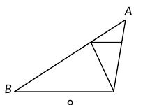
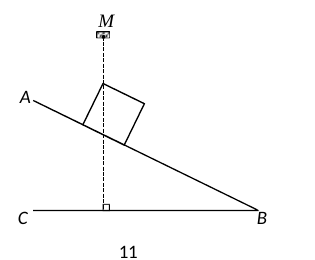
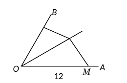
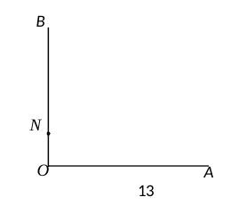
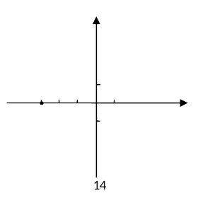
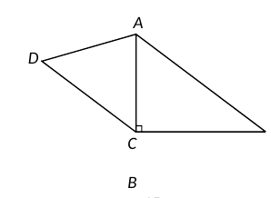
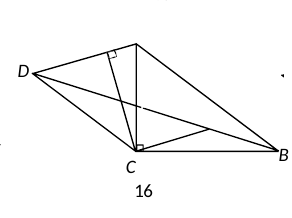
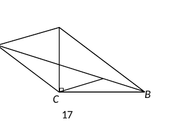

# 2026 一模精讲 · 虹口（下）：解答题（第 19–25 题）

> 前接 [[数模26-虹口-上]]。每题"题干 + 思路导航 + 折叠详解（含评分点与易错）"。

**19.**（10 分）计算

$$\cos^2 30°-\frac{\tan 45°}{1-\cos 60°}+\sin^2 45°$$

> [!tip]- 💡 思路导航
> 特殊角三角比先代值；看清结构再落笔——$1-\cos60°$ 处在分母位置，除以 $\frac12$ 等于乘 2。

> [!success]- ✅ 详解 · 评分点 · 易错 · 关联
> **详解**：原式 $=\dfrac34-\dfrac{1}{\frac12}+\dfrac12=\dfrac34-2+\dfrac12=\boxed{-\dfrac34}$。
>
> **易错**：先整体看清结构再落笔；$1-\cos60°$ 在分母位置（除以 $\frac12$ 等于乘 2），误当乘积因子会得 $+\frac34$，正确结果 $-\frac34$。⚠️ 订正：原转录误作"$\tan45°\,(1-\cos60°)$"（乘积），卷面为分数 $\dfrac{\tan45°}{1-\cos60°}$，参考答案为 $-\dfrac34$（非 ¾），已按原卷修正。

**20.**（10 分）

"已知抛物线 $C_1:y=ax^2+bx+c\ (a\neq0)$ 经过点 A(0，−5)，B(−1，0)，▓▓▓（黑色阴影部分因墨水污染无法辨认）。"经查询发现抛物线 $C_1$ 的表达式为 $y=x^2-4x-5$。
（1）请根据已有的信息添加一个缺失的条件 ＿＿＿＿＿＿＿＿；
（2）将抛物线 $C_1$ 向上平移 m 个单位后得到抛物线 $C_2$，如果 $C_2$ 的顶点关于原点的对称点在抛物线 $C_1$ 上，求 m 的值。

> [!tip]- 💡 思路导航
> （1）是"补条件"开放题——补的条件必须与 A、B 合起来恰好确定这条抛物线（能定出 a）；（2）中平移只动纵坐标，"顶点关于原点对称"意味着横、纵坐标同时变号，把对称点代回 $C_1$ 解 m。

> [!success]- ✅ 详解 · 评分点 · 易错 · 关联
> **详解**：**（1）** 补"抛物线经过点 (5,0)"（答案不唯一）。验证：由 A(0,−5) 得 c=−5；由 B(−1,0)、(5,0) 得对称轴 x=2，$y=(x-2)^2-9=x^2-4x-5$ ✓。
> **（2）** $C_2:y=x^2-4x-5+m$，顶点 $(2,\,-9+m)$，其关于原点的对称点 $(-2,\,9-m)$。代入 $C_1$：$9-m=4+8-5=7$，解得 $\boxed{m=2}$。
>
> **易错**：（1）补条件要与 A、B 联立后"恰好确定"抛物线，补"过点 (2,−9)"之外的顶点信息必须能定出 a；写"答案不唯一"不等于随便补。（2）平移 m 个单位只改变纵坐标——顶点纵坐标是 $-9+m$ 而不是 $-9$；对称要横、纵同时变号。

**21.**（10 分）

如图 9，D、E 分别是△ABC 边 AB、AC 上的点，且 DE∥BC，DE=4，BC=12，AE=3。
（1）求 CE 的长；
（2）联结 CD，如果 ∠ACD=∠ABC，求 CD 的长。

> [!tip]- 💡 思路导航
> （1）DE∥BC 的"A 字型"基本相似直接收口；（2）∠ACD=∠ABC 加公共角 ∠A，拼出母子相似 △ACD∽△ABC——"公共边的平方"模型给 AC²＝AD·AB，再用 DE∥BC 代入比例，最后按对应关系收口。

> [!success]- ✅ 详解 · 评分点 · 易错 · 关联
> **详解**：**（1）** DE∥BC ⟹ $\dfrac{AE}{AC}=\dfrac{DE}{BC}=\dfrac13$，$AC=9$，$CE=AC-AE=\boxed{6}$。
> **（2）** DE∥BC ⟹ $\dfrac{AD}{AB}=\dfrac{AE}{AC}=\dfrac13$；又 ∠ACD=∠ABC、∠A 公共，所以 △ACD∽△ABC（两角对应相等），得 $AC^2=AD\cdot AB=\dfrac13AB^2=81$，$AB=9\sqrt3$；且 $\dfrac{CD}{CB}=\dfrac{AC}{AB}$，$CD=12\times\dfrac{9}{9\sqrt3}=\boxed{4\sqrt3}$。
>
> ⚠️ 订正：第（2）小题条件原按 OCR 碎片重构为"$\angle CED=\angle CDB$"；卷面为"$\angle ACD=\angle ABC$"（官方解答同此），已修正，结果 $CD=4\sqrt3$ 不变。

**22.**（10 分）

某仓库有一传送带运输货柜，其侧面示意图如图 11：BC 为地面，AB 为斜坡上的传送带，∠B=26.5°，四边形 DEFG 是边长为 1.8 米的正方形（货柜截面）。点 M 为仓库卷帘门打开的最高位置，点 M、D、H 在同一直线上（这条线垂直于地面，H 在地面 BC 上），点 D 到地面的距离 DH 为 5 米。
（1）求 BE 的长（精确到 0.1 米）；
（2）已知 M 到地面的距离 MH 为 6.8 米，如果正方形 DEFG 的边长扩大为原来的 2 倍，能否继续利用该传送带运输？请通过计算说明（AB 足够长）。
（参考数据：sin26.5°≈0.45，cos26.5°≈0.90，tan26.5°≈0.50）

> [!tip]- 💡 思路导航
> 货柜上沿 DE 与传送带垂直 ⟹ ∠EDN＝∠B（同角的余角），Rt△DEN 的直角在 E；（1）沿 DN→NH→BN→BE 的链条传递；（2）中 N、H 是传送带与门框线的交点，位置固定、NH 不变，算出加宽后 D 的高度与 MH 比即可。

> [!success]- ✅ 详解 · 评分点 · 易错 · 关联
> **详解**：**（1）** 设 DH 交 AB 于 N。∠DNE 与 ∠BNH 为对顶角，∠DEN=90°=∠BHN，得 ∠EDN=∠B=26.5°（等角的余角相等）。在 Rt△DEN 中：$DN=\dfrac{DE}{\cos\angle EDN}=\dfrac{1.8}{0.90}=2$，$EN=DE\tan\angle EDN=1.8\times0.50=0.9$；故 $NH=DH-DN=3$。在 Rt△BHN 中：$BN=\dfrac{NH}{\sin B}=\dfrac{3}{0.45}\approx6.67$。所以 $BE=EN+BN\approx0.9+6.67\approx\boxed{7.6}$（米）。
> **（2）** 不能。边长扩为 2 倍后 $DE=3.6$：$DN=\dfrac{DE}{\cos\angle EDN}=\dfrac{3.6}{0.90}=4$，货柜最高点 D 的高度 $DH=DN+NH=4+3=7>6.8$，D 将顶到卷帘门以上，故不能继续运输。
>
> **易错**：∠EDN=26.5° 的来源（DE⊥传送带）必须写一句依据；（2）中 NH=3 沿用的是门框线与传送带交点固定的位置关系，要交代。

**23.**（12 分）

【模型探究】如图 12，已知 M、N 分别是∠AOB 边 OA、OB 上的点，P 是∠AOB 的平分线上一点，满足 $\angle MPN=180°-\dfrac12\angle AOB$。求证：$OP^2=OM\cdot ON$。
【模型应用】
（1）已知 M、N 分别是∠AOB 边 OA、OB 上的点，P 是∠AOB 的平分线上一点，如果 ∠AOB=60°，OM=6，ON=4，OP=2√6，求 ∠MPN 的度数；
（2）如图 13，已知 ∠AOB=90°，N 是边 OB 上一点，请在边 OA 上选择一个合适的点 M，并在 ∠AOB 内部求作一个点 P，满足 ∠MPN=135° 且 PM=2PN。（尺规作图，保留作图痕迹，不写作法）

 

> [!tip]- 💡 思路导航
> 证 $OP^2=OM\cdot ON$ 就是证母子相似 △NOP∽△POM——外角定理把 ∠MPN 拆成两组等角；应用（1）先验证三条线段是否满足模型，再套"∠MPN=180°−½∠AOB"；应用（2）倒用模型：设 OM 与 ON 的倍数关系，由 $\dfrac{PM}{PN}=\dfrac{OM}{OP}$ 及 PM＝2PN 定出倍数，再按模型作图。

> [!success]- ✅ 详解 · 评分点 · 易错 · 关联
> **详解**：**模型探究**：P 在角平分线上 ⟹ ∠MOP=∠NOP。由 ∠MPN=180°−½∠AOB 得 ∠MPN=∠ONP+∠NPO（三角形外角等于不相邻两内角和，∠ONP+∠NPO+∠NOP=180°）；又 ∠MPN=∠OPM+∠NPO，所以 ∠ONP=∠OPM，于是 △NOP∽△POM（两角相等），$\dfrac{OP}{ON}=\dfrac{OM}{OP}$，即 $OP^2=OM\cdot ON$。$\blacksquare$
> **（1）** $OP^2=(2\sqrt6)^2=24=OM\cdot ON=6\times4$，符合模型条件，故 $\angle MPN=180°-\dfrac12\angle AOB=180°-30°=\boxed{150°}$。
> **（2）** 作法：①在射线 OA 上截取 $OM=4\,ON$（用圆规连续截取四次 ON）；②作 ∠AOB 的平分线，在其上截取 $OP=2\,ON$，联结 PM、PN，P 即所求。证明：$\angle MOP=\angle NOP=45°$，且 $\dfrac{OP}{OM}=\dfrac{2ON}{4ON}=\dfrac12=\dfrac{ON}{OP}$，所以 △NOP∽△POM（两边成比例且夹角相等），得 $PM=2PN$；又 $OP^2=4ON^2=OM\cdot ON$，由模型探究 $\angle MPN=180°-\dfrac12\times90°=135°$ ✓。
>
> **易错**：（2）作图只交点、不写作法时，必须保留四次截取与角平分线的完整痕迹；证明 PM=2PN 用的是 △NOP∽△POM，不要误用等边三角形。⚠️ 订正：应用（1）的条件原按 OCR 碎片补写为"ON=6"；卷面为"OM=6，ON=4，OP=2√6"（恰满足模型 $OP^2=OM\cdot ON$），已修正，结果 150° 不变。

**24.**（12 分）

如图 14，在平面直角坐标系 xOy 中，已知抛物线 $y=ax^2+2ax+c\ (a\neq0)$ 交 x 轴于点 A(−3,0) 和点 B，交 y 轴于点 C，抛物线的顶点为 D。
（1）直接写出点 B 的坐标，并用含 a 的代数式表示顶点 D 的坐标；
（2）将该抛物线平移得到新抛物线，所得新抛物线的最高点是 B，且与 y 轴的交点为 E，联结 AC、AE，如果 △ACE 的面积为 6，求 a 的值；
（3）当点 D 的坐标为（−1，−4）时，如果点 P 在抛物线上，且 ∠ADP=45°，求点 P 的坐标。

> [!tip]- 💡 思路导航
> $y=ax^2+2ax+c$ 的对称轴 x＝−1 已定，A 关于它对称出 B；（2）"最高点 B"同时告诉你开口向下；（3）的 45° 用"构造等腰直角三角形"——过 A 作 AD 的垂线并截取 AF＝AD，把 AD 绕 A 旋转 90° 得两个 F，两条直线分别与抛物线联立，舍去对应点 D 本身的根。

> [!success]- ✅ 详解 · 评分点 · 易错 · 关联
> **详解**：**（1）** 对称轴 $x=-\dfrac{2a}{2a}=-1$，B 与 A(−3,0) 对称，$\boxed{B(1,0)}$。把 A 代入：$9a-6a+c=0$，$c=-3a$，$y=a(x+1)^2-4a$，故 $\boxed{D(-1,-4a)}$。
> **（2）** $C(0,-3a)$；新抛物线顶点为 B(1,0) 且"最高点"⟹ 开口向下 ⟹ a<0，其解析式 $y=a(x-1)^2$，交 y 轴于 $E(0,a)$。$S_{\triangle ACE}=\dfrac12\cdot CE\cdot AO=\dfrac12\cdot|a-(-3a)|\cdot3=6|a|=6$，又 a<0，解得 $\boxed{a=-1}$。
> **（3）** $-4a=-4\Rightarrow a=1$，抛物线 $y=x^2+2x-3$。过 A 作 $AD$ 的垂线，分别截取 $AF=AD$（两处）：$D-A=(2,-4)$，旋转 90° 得 $F(1,2)$、$F'(-7,-2)$，△ADF、△ADF′ 均为等腰直角三角形，∠ADF=∠ADF′=45°。直线 DF：$y=3x-1$，与抛物线联立 $x^2+2x-3=3x-1\Rightarrow x^2-x-2=0$，$x=2$ 或 $-1$（舍 D），得 $\boxed{P(2,5)}$；直线 DF′：$y=-\dfrac13x-\dfrac{13}3$，联立得 $3x^2+7x+4=0$，$x=-\dfrac43$（$-1$ 舍），得 $\boxed{P\left(-\dfrac43,-\dfrac{35}9\right)}$。
>
> **易错**：（3）的 45° 两种位置都要讨论（对称轴两侧各一个 P）；联立后的根 x=−1 对应点 D 本身，必须舍去。

**25.**（14 分）

如图 15，在△ABC 中，∠ACB=90°，CD∥AB 且 AC=AD。
（1）求证：$2AC^2=CD\cdot AB$；
（2）联结 BD 交 AC 于点 E，过点 C 作 CF∥AD 交 BD 于点 F。
① 过点 C 作 CG⊥AD，分别交 AD、BD 于点 G、H（如图 16）。已知 AB=5，$\tan\angle ABC=\dfrac34$，求 CF 和 CH 的长；
② 如图 17，如果 F 为 BE 的中点，求 $\dfrac{S_{\triangle ABC}}{S_{\triangle ADC}}$ 的值。

  

> [!tip]- 💡 思路导航
> （1）母子相似：作 AM⊥CD 得 △ABC∽△CAM；（2）① 三角形是 3-4-5 型，先定 AC、BC，一切长度沿"相似链"传递；② 不写具体边长——两组平行各给一个比例，联立出 DE、EF、EB 的关系，F 为中点后即得 EB 与 ED 之比，而两三角形同底 AC，面积比＝两高之比。

> [!success]- ✅ 详解 · 评分点 · 易错 · 关联
> **详解**：**（1）** 过 A 作 AM⊥CD 于 M。AC=AD ⟹ M 为 CD 中点，$CD=2CM$；AB∥CD ⟹ ∠BAC=∠ACM，又 ∠AMC=∠ACB=90°，所以 △ABC∽△CAM，$\dfrac{AC}{AB}=\dfrac{CM}{AC}$，即 $AC^2=CM\cdot AB$；代入 $CD=2CM$ 得 $2AC^2=CD\cdot AB$。$\blacksquare$
> **（2）①** Rt△ABC 中 $\tan\angle ABC=\dfrac34$、AB=5，得 AC=3、BC=4。AB∥CD ⟹ ∠ACM=∠BAC，$\cos\angle ACM=\dfrac35$，$CM=AC\cos\angle ACM=\dfrac95$，$CD=2CM=\dfrac{18}5$。CD∥AB ⟹ △ECD∽△EAB，$\dfrac{CE}{EA}=\dfrac{CD}{AB}=\dfrac{18}{25}$；CF∥AD ⟹ △ECF∽△EAD，$\dfrac{CF}{AD}=\dfrac{CE}{EA}=\dfrac{18}{25}$，故 $CF=3\times\dfrac{18}{25}=\boxed{\dfrac{54}{25}}$。Rt△DCG 中 $\cos\angle ADC=\cos\angle ACD=\dfrac{CM}{AC}=\dfrac{9/5}{3}=\dfrac35$（等腰 △ACD 中两底角相等），$DG=CD\cos\angle ADC=\dfrac{54}{25}=CF$，$CG=CD\sin\angle ADC=\dfrac{72}{25}$；CF∥DG ⟹ △HCF∽△HGD（对顶角 + 同位角），$\dfrac{CH}{HG}=\dfrac{CF}{DG}=1$，故 $CH=\dfrac12CG=\boxed{\dfrac{36}{25}}$。
> **②** CD∥AB ⟹ △ECD∽△EAB，$\dfrac{DE}{EB}=\dfrac{CE}{EA}=\dfrac{CD}{AB}$；CF∥AD ⟹ △ECF∽△EAD，$\dfrac{CE}{EA}=\dfrac{EF}{ED}$。两式联立：$DE^2=EF\cdot EB$；F 为 BE 中点，$EF=\dfrac12EB$，故 $DE^2=\dfrac12EB^2$，$\dfrac{EB}{DE}=\sqrt2$。过 D 作 DP⊥AC 于 P：∠ACB=90° ⟹ DP∥BC，△EDP∽△EBC，$\dfrac{DP}{BC}=\dfrac{DE}{EB}$。△ABC 与 △ADC 同底 AC，$\dfrac{S_{\triangle ABC}}{S_{\triangle ADC}}=\dfrac{BC}{DP}=\dfrac{EB}{DE}=\boxed{\sqrt2}$。
>
> **易错**：（2）② 不许把 ① 的边长（AC=3 等）搬进 ②——② 是新情景；面积比＝同底高之比＝BC:DP 这一步是得分关键。

## 🔗 关联

- [[03-数学/专题/第25题-相似与存在性综合]] · [[03-数学/知识点/九年级/相似三角形]] · [[03-数学/知识点/九年级/图形运动平移与旋转]]
- 同类卷：[[数模26-黄浦-下]] · [[数模26-静安-下]]
