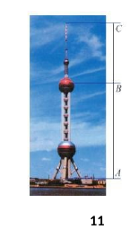
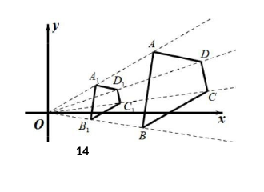

# 2026 一模精讲 · 金山卷（上）选择与填空 1-15

> 试卷满分 150 分，考试时间 100 分钟，共 23 题。本篇覆盖第 1-15 题（选择 5 题 × 4 分 + 填空 10 题 × 4 分，共 60 分），每题给"转录 + 简解 + 答案"；第 16-23 题（解答题）见《数模26-金山-下》。

## 一、选择题（每题 4 分）

### 1．在抛物线 $y=x^2$ 上的一个点是（　）

(A) $(1,2)$　(B) $(1,-1)$　(C) $(2,2)$　(D) $(0,0)$

**简解**：逐点代入 $y=x^2$：$0=0^2$ 成立，其余 $2\neq1^2$、$-1\neq1^2$、$2\neq2^2$。
**答案**：$\boxed{D}$

### 2．Rt△ABC 中，∠C＝90°，AC＝3，AB＝7，那么下列各式中正确的是（　）

(A) $\cos B=\dfrac47$　(B) $\sin B=\dfrac37$　(C) $\cot B=\dfrac34$　(D) $\tan B=\dfrac43$

**简解**：$BC=\sqrt{AB^2-AC^2}=\sqrt{40}=2\sqrt{10}$（勾股定理）。$\sin B=\dfrac{AC}{AB}=\dfrac37$ 正确；$\cos B=\dfrac{BC}{AB}=\dfrac{\sqrt{40}}7$、$\cot B=\dfrac{BC}{AC}=\dfrac{\sqrt{40}}3$、$\tan B=\dfrac{AC}{BC}=\dfrac{3\sqrt{10}}{20}$，(A)(C)(D) 全错。
**答案**：$\boxed{B}$

### 3．对于抛物线 $y=a(x+1)^2+2$（$a$ 是常数，且 $a\neq0$），下列叙述正确的是（　）

(A) 当 $a>0$ 时，抛物线开口向下；(B) 抛物线与 $y$ 轴交点坐标 $(0,2)$；(C) 顶点坐标是 $(-1,2)$；(D) 当 $a<0$ 时，顶点是抛物线的最低点。

**简解**：$a>0$ 开口向上（A 错）；$x=0$ 时 $y=a+2$ 随 $a$ 变（B 错）；$a<0$ 时顶点是最高点（D 错）；顶点式直接读出 $(-1,2)$。
**答案**：$\boxed{C}$

### 4．下列命题中真命题是（　）

(A) 如果 $\vec a=k\vec b$（$k\neq0$），那么 $\vec a\parallel\vec b$；(B) 如果两个相等的向量相减，那么结果为 $0$；(C) 如果 $\vec a$ 和 $\vec b$ 都是单位向量，那么 $\vec a=\vec b$；(D) 如果 $|\vec a|=|\vec b|$，那么 $\vec a=\vec b$。

**简解**：(B) 应得零向量 $\vec0$ 而非数 0；(C) 单位向量方向可以不同；(D) 模相等方向可不同；(A) 中 $\vec a$ 是 $\vec b$ 的倍数，必平行。
**答案**：$\boxed{A}$

### 5．在等边△ABC 中，点 E、F 分别在边 AB、AC 上，将△ABC 沿 EF 折叠，使点 A 与△ABC 的重心 G 重合，EF 与 AG 交于点 O，延长 AG 交 BC 于点 D，那么 EF∶OD 的值为（　）

(A) $\dfrac{\sqrt2}{2}$　(B) $\dfrac{\sqrt3}{2}$　(C) $\dfrac{\sqrt3}{3}$　(D) $1$

**简解**：设边长 $s$，高 $AD=\dfrac{\sqrt3}{2}s$，重心到顶点 $AG=\dfrac23AD=\dfrac{\sqrt3}{3}s$。折叠轴 $EF$ 是 $AG$ 的垂直平分线，$O$ 为 $AG$ 中点，$EF\parallel BC$，△AEF∽△ABC，相似比 $\dfrac{AO}{AD}=\dfrac13$，故 $EF=\dfrac{s}{3}$；$OD=AD-AO=\dfrac{\sqrt3}{2}s-\dfrac{\sqrt3}{6}s=\dfrac{\sqrt3}{3}s$。$EF:OD=\dfrac{s/3}{\sqrt3 s/3}=\dfrac{\sqrt3}{3}$。
**答案**：$\boxed{C}$

## 二、填空题（每题 4 分）

### 6．如果 $\dfrac{b}{a}=\dfrac32$，那么 $\dfrac{a+b}{a}=$　▲

**简解**：$\dfrac{a+b}{a}=1+\dfrac{b}{a}=1+\dfrac32=\dfrac52$。
**答案**：$\boxed{\dfrac52}$

### 7．已知 $f(x)=x^2-1$，那么 $f(\sqrt6)=$　▲

**简解**：$f(\sqrt6)=(\sqrt6)^2-1=6-1=5$。
**答案**：$\boxed{5}$

### 8．将抛物线 $y=2x^2$ 向左平移 3 个单位后，得到的新抛物线的表达式为　▲

**简解**：左移 3：$x\to x+3$（左加右减）。
**答案**：$\boxed{y=2(x+3)^2}$

### 9．毛蛤化石照片：照片上笔与化石的长度分别为 7cm 和 2cm，笔的实际长度为 14cm，那么该化石的实际长度为　▲　cm

**简解**：照片与实物成比例：$\dfrac{2}{7}=\dfrac{x}{14}$，$x=4$。
**答案**：$\boxed{4}$

### 10．两块相似三角形标牌对应边比为 1∶2，涂漆厚度一致，小标牌涂满用半听漆，一块大标牌涂满需要　▲　听

**简解**：面积比 $=1^2:2^2=1:4$，大标牌用漆 $0.5\times4=2$ 听。
**答案**：$\boxed{2}$

### 11．上海东方明珠塔高 AC＝468 米，上球体点 B 位于塔身的黄金分割点处，那么上球体到塔底的距离 AB 为　▲　米（结果保留根号形式）

**简解**：$B$ 是 $AC$ 的黄金分割点且 $AB>BC$：$AB=468\times\dfrac{\sqrt5-1}{2}=234\sqrt5-234$。
**答案**：$\boxed{234\sqrt5-234}$

### 12．对于抛物线 $y=2x^2+bx+c$，沿着 x 轴正方向看，抛物线在直线 x＝2 左侧的部分是下降的，写出一个符合条件的 b 的值是　▲

**简解**：开口向上，对称轴须在 $x=2$ 右侧或重合：$-\dfrac{b}{2\cdot2}\ge2\Rightarrow b\le-8$。如 $b=-8$（答案不唯一）。
**答案**：$\boxed{-8\ （b\le-8\ 均可）}$

### 13．在△ABC 中，设 $\vec{CA}=\vec a$，$\vec{CB}=\vec b$，点 M 是边 AB 的中点，若 $\vec{CM}=x\vec a+y\vec b$，那么 x＋y 的值为　▲

**简解**：中点公式 $\vec{CM}=\dfrac12(\vec{CA}+\vec{CB})=\dfrac12\vec a+\dfrac12\vec b$，故 $x=y=\dfrac12$，$x+y=1$。
**答案**：$\boxed{1}$

### 14．四边形 ABCD 与四边形 A₁B₁C₁D₁ 是位似图形，位似中心为点 O，点 D 的坐标为 (5，2)，AD＝2√3，位似比为 1/5，那么 A₁D₁ 的长为　▲

**简解**：位似图形的对应线段比等于位似比：$A_1D_1=\dfrac15AD=\dfrac{2\sqrt3}{5}$。
**答案**：$\boxed{\dfrac{2\sqrt3}{5}}$
⚠️ 扫描件本题中文缺字（"位似比 1/5、AD＝2√3" 系按卷面残片与参考答案 $2\sqrt3/5$ 反推），原卷表述以纸质卷为准 ⚠️ 待核对。

### 15．在矩形 ABCD 中，过点 C 作 CE⊥BD，垂足为 E，以 CE 为斜边在矩形内部作直角三角形 CEF（∠CFE＝90°），AF 与 BD 交于点 P。如果 $\dfrac{AP}{AF}=k$，那么 k 的取值范围是　▲

**简解**：$F$ 在以 $CE$ 为直径的圆（矩形内的弧）上运动。当 $F\to C$ 时，$AF\to AC$，$P\to$ 对角线交点，$k\to\dfrac{AO}{AC}=\dfrac12$；当 $F\to E$ 时，$AF\to AE$，$P\to E$，$k\to1$。故 $\dfrac12<k<1$（$F$ 不与 $C$、$E$ 重合，取不到端点）。
**答案**：$\boxed{\dfrac12<k<1}$

## 答案速查与互证

| 题号 | 1 | 2 | 3 | 4 | 5 | 6 | 7 | 8 | 9 | 10 | 11 | 12 | 13 | 14 | 15 |
| --- | --- | --- | --- | --- | --- | --- | --- | --- | --- | --- | --- | --- | --- | --- | --- |
| 答案 | D | B | C | A | C | $\frac52$ | 5 | $2(x+3)^2$ | 4 | 2 | $234\sqrt5-234$ | $-8$（不唯一） | 1 | $\frac{2\sqrt3}5$ | $\frac12<k<1$ |

与卷末参考答案逐题互证：全部一致。第 14 题题干数据为反推补全（见上⚠️），答案数值本身与卷面一致。
