# 2026 一模精讲 · 金山卷（下）解答题 16-23

> 本篇覆盖第 16-23 题（共 90 分），每题"完整转录 + 渐进三段提示 + 详解 + 易错"。第 1-15 题见《数模26-金山-上》。

### 16．（本题 10 分）计算：$\dfrac{\cos30°-\sin45°}{\sin60°-\cos45°}+\tan^260°-\cot30°$

**🧭 提示**：① 特殊角三角比先全部化成根号；② 观察分式的分子分母是否相同；③ 按运算顺序逐项计算。

**✍️ 详解**：
$\cos30°=\sin60°=\dfrac{\sqrt3}{2}$，$\sin45°=\cos45°=\dfrac{\sqrt2}{2}$，$\tan60°=\cot30°=\sqrt3$（特殊角三角比）。
原式 $=\dfrac{\frac{\sqrt3}{2}-\frac{\sqrt2}{2}}{\frac{\sqrt3}{2}-\frac{\sqrt2}{2}}+(\sqrt3)^2-\sqrt3=1+3-\sqrt3=\boxed{4-\sqrt3}$（分子分母相同商为 1，$\tan^260°=3$）。

**⚠️ 易错**：$\tan^260°$ 是先平方，得 3 而不是 $\sqrt3$；"$-\cot30°$" 的减号易漏；分式约成 1 必须分子分母完全相同。

### 17．（本题 10 分）如图，Rt△ABC 中，∠ACB＝90°，tan B＝5/12，点 D 在边 BC 上，BD＝8，CD＝4，过点 D 作 DE⊥AD 交 AC 的延长线于点 E。(1) 求 AD 的长；(2) 求 sin E 的值。

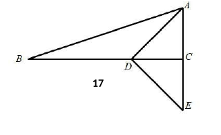

**🧭 提示**：① tan B 给的是 △ABC 的边比，先求 AC；② AD 在 Rt△ACD 中用 CD 与 AC；③ sin E 不能直接求——用互余传递找与 ∠E 相等的角。

**✍️ 详解**：
**(1)** $BC=BD+CD=12$；Rt△ABC 中 $\tan B=\dfrac{AC}{BC}=\dfrac{5}{12}$（正切定义），$\therefore AC=5$；Rt△ACD 中 $AD=\sqrt{AC^2+CD^2}=\sqrt{25+16}=\boxed{\sqrt{41}}$（勾股定理）。

**(2)** $\because DE\perp AD$，$\therefore\angle E+\angle DAE=90°$（直角三角形两锐角互余）；在 Rt△ACD 中 $\angle ADC+\angle DAC=90°$，又 $\angle DAE=\angle DAC$（同角），$\therefore\angle E=\angle ADC$（同角的余角相等）。
$\therefore\sin E=\sin\angle ADC=\dfrac{AC}{AD}=\dfrac{5}{\sqrt{41}}=\boxed{\dfrac{5\sqrt{41}}{41}}$（锐角三角比，分母有理化）。

**⚠️ 易错**：sin E 的对边是 AC（不是 CD）、斜边是 AD；结果必须分母有理化；∠E＝∠ADC 的互余传递是全题枢纽，理由要写全。

### 18．（本题 10 分）如图，在△ABC 中，AB＝AC，点 E、D 分别在边 BC、AC 上，∠AED＝∠B。(1) 求证：△ABE∽△ECD；(2) 若 AB＝10，BC＝16，BE＝12，求 CD 的长。

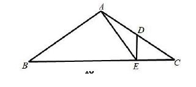

**🧭 提示**：① 等腰给 ∠B＝∠C；② 用三角形外角把 ∠AED＝∠B 转成 ∠DEC＝∠BAE；③ 第(2)问在相似式里先求 EC。

**✍️ 详解**：
**(1)** $\because AB=AC$，$\therefore\angle B=\angle C$（等边对等角）。
$\because\angle AEC$ 是 △ABE 的外角，$\therefore\angle AEC=\angle B+\angle BAE$（外角性质）；又 $\angle AEC=\angle AED+\angle DEC$，$\angle AED=\angle B$（已知），
$\therefore\angle DEC=\angle BAE$。$\therefore\triangle ABE\backsim\triangle ECD$（两角对应相等，两三角形相似）。

**(2)** $\because\triangle ABE\backsim\triangle ECD$，$\therefore\dfrac{BE}{CD}=\dfrac{AB}{EC}$（相似三角形对应边成比例）。
$EC=BC-BE=16-12=4$，$\therefore\dfrac{12}{CD}=\dfrac{10}{4}$，$CD=\dfrac{12\times4}{10}=\boxed{4.8}$。

**⚠️ 易错**：对应关系 A↔E、B↔C、E↔D，比例写成 $\frac{BE}{EC}$ 即错；先算 EC 再代入；4.8 也可写作 $\frac{24}{5}$。

### 19．（本题 10 分）在平面直角坐标系 xOy 中，把抛物线 y＝x²＋bx＋c 向下平移 1 个单位长度，所得新抛物线的顶点坐标为 A(−2，1)。(1) 求原抛物线的表达式；(2) 若新抛物线与 y 轴交于点 C，原抛物线顶点为 B，求 ∠ACB 的正切值。

**🧭 提示**：① 下平移 1 ⇒ 新抛物线 $y=x^2+bx+c-1$；② 顶点横坐标公式求 b，代顶点纵坐标求 c；③ tan∠ACB 没有现成直角三角形——用等积法作 BD⊥AC。

**✍️ 详解**：
**(1)** 新抛物线 $y=x^2+bx+c-1$：顶点横坐标 $-\dfrac{b}{2}=-2\Rightarrow b=4$；纵坐标 $(-2)^2+4\times(-2)+c-1=1\Rightarrow c=6$。
$\therefore$ 原抛物线 $\boxed{y=x^2+4x+6}$。

**(2)** 原顶点 $B(-2,2)$；新抛物线 $y=x^2+4x+5$，令 $x=0$ 得 $C(0,5)$。
$AB=1$，$AC=\sqrt{2^2+4^2}=2\sqrt5$，$BC=\sqrt{2^2+3^2}=\sqrt{13}$（两点间距离公式）。
过 $B$ 作 $BD\perp AC$ 于 $D$。C 到直线 AB 的距离 $h=|0-(-2)|=2$，由 $S_{\triangle ABC}=\dfrac12AB\cdot h=\dfrac12AC\cdot BD$：$\dfrac12\cdot1\cdot2=\dfrac12\cdot2\sqrt5\cdot BD\Rightarrow BD=\dfrac{\sqrt5}{5}$。
$CD=\sqrt{BC^2-BD^2}=\sqrt{13-\dfrac15}=\dfrac{8\sqrt5}{5}$（勾股定理）。
$\therefore\tan\angle ACB=\dfrac{BD}{CD}=\dfrac{\sqrt5/5}{8\sqrt5/5}=\boxed{\dfrac18}$。

**⚠️ 易错**：原抛物线顶点是 $(-2,2)$，$(-2,1)$ 是新抛物线的顶点 A；等积法中 $h$ 是 C 到竖直线 AB 的水平距离 2；tan 值是 $\frac{BD}{CD}$ 不是 $\frac{CD}{BD}$。

### 20．（本题 12 分）坡道改良：坡道设计需满足——最大坡度 1∶12（国际通用标准）；每段坡道垂直升高不宜超过 75cm，超过需设休息平台。折返形坡道（坡道 OV－休息平台 VR－坡道 VC′）需满足：单段最大坡度 1∶10，水平长度最大 560cm，休息平台宽度最小 150cm，轮椅入口宽度最小 150cm。三组测量数据：甲组 FG＝39cm，DE＝109cm，AC＝250cm；乙组 NK＝91.2cm，NM＝26.6cm；丙组 C′Q＝9.8cm，PQ＝33.6cm。休息平台宽为 VR，轮椅入口宽为 OT，A′T＝30cm，点 T 到连廊的距离 TI 为 520cm。(1) 根据三组数据求原坡道的坡度和坡高（BC 或 B′C′），并判断是否安全；(2) 请设计一种折返形坡道方案，写出单段坡道（OV、VC′）的坡度和坡高以及设计过程。

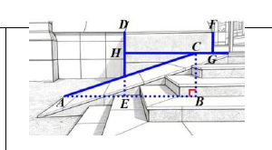 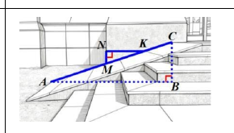

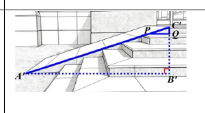 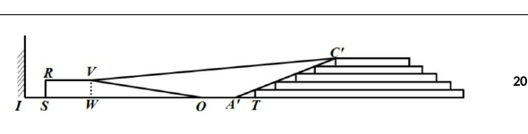

**🧭 提示**：① 坡度 i＝tan(坡角)＝竖直∶水平，乙组数据直接构成直角三角形；② 坡高用甲组 AC＝250 作斜边，按坡度比设 7k、24k；③ 设计方案先算 1∶10 下单段最大升高，再把总高拆成两段，最后用 TI＝520 校验平台与入口宽。

**✍️ 详解**：
**(1)** 如图 2，Rt△NMK 中 $\tan\angle NKM=\dfrac{NM}{NK}=\dfrac{26.6}{91.2}=\dfrac{7}{24}$（正切定义）；$\because NK\parallel AB$，$\therefore\angle A=\angle NKM$（同位角），$\therefore i=\tan A=\dfrac{7}{24}$，坡度为 $7:24$（丙组 $\frac{9.8}{33.6}=\frac7{24}$、甲组 $\frac{109-39}{250}$ 均吻合）。
如图 1，Rt△ABC 中 $AC=250$，设 $BC=7k$、$AB=24k$，由 $AB^2+BC^2=AC^2$（勾股定理）：$625k^2=250^2$，$k=10$，$\therefore$ 坡高 $BC=70$cm。
判断：$\dfrac{7}{24}>\dfrac{1}{12}$，坡度超过上限，$\boxed{原坡道不安全}$（坡高 70≤75cm 本身达标）。

**(2)** 总升高 70cm；单段按最大坡度 1∶10、水平最大 560cm，一段最多升高 $560\times\dfrac1{10}=56$cm，一段装不下 70cm，必须折返分两段。
方案：坡道 VC′ 坡高 56cm、坡度 1∶10（水平 $56\times10=560$cm，恰不超限）；坡道 OV 坡高 $70-56=14$cm、坡度 1∶10（水平 $OW=140$cm）。
校验：$WI+WO+OT=TI=520\Rightarrow OT=520-170-140=210$cm＞150cm ✓；平台宽 $VR=WI=170$cm＞150cm ✓；两段坡高 56、14 均 ≤75cm ✓。$\boxed{方案可行（方案不唯一）}$

**⚠️ 易错**：坡度是竖直∶水平，26.6/91.2 别颠倒；"不安全"的判据是坡度超标而非坡高；(2) 必须验算平台与入口宽，只给坡度坡高会扣分；$560\times\frac{1}{10}=56$ 是拆段的临界值。

### 21．（本题 12 分）在平面直角坐标系 xOy 中，已知抛物线 y＝ax²−2anx＋an²＋2n＋1（a＜0）的顶点为 A，点 B(−1，1)、C(3，1)。(1) 若抛物线经过点 B 和 C，求 a 的值；(2) 如果△ABC 的面积小于 3，求 n 的取值范围；(3) 点 A 关于原点的对称点为 D，若 AC⊥CD，直线 BC 与抛物线的交点 E 在点 C 右侧，当△ACE 与△CDE 相似时，求抛物线的表达式。

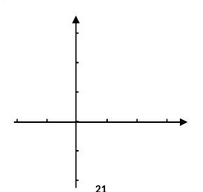

**🧭 提示**：① 先配方 $y=a(x-n)^2+2n+1$，顶点 $A(n,\,2n+1)$；② BC＝4 为底，高是 A 到直线 y＝1 的距离；③ "过 B、C" 两式相减先定 n；AC⊥CD 用数量积转成 n 的方程；相似分两种对应，∠ACE＝∠DCE 是钥匙。

**✍️ 详解**：
**(1)** $y=a(x-n)^2+2n+1$（配方）。过 $B(-1,1)$：$a(n+1)^2=-2n$；过 $C(3,1)$：$a(n-3)^2=-2n$。
相减得 $(n+1)^2=(n-3)^2\Rightarrow n=1$，$\therefore4a=-2$，$\boxed{a=-\dfrac12}$。

**(2)** $BC=4$；顶点 $A(n,\,2n+1)$，高 $=|2n+1-1|=|2n|$。
$S_{\triangle ABC}=\dfrac12\cdot4\cdot|2n|=4|n|<3\Rightarrow|n|<\dfrac34$；$n=0$ 时 $A(0,1)$ 落在直线 BC 上、三角形退化，$\therefore n\neq0$。
$\boxed{-\dfrac34<n<\dfrac34\ \text{且}\ n\neq0}$。

**(3)** $D(-n,-2n-1)$（关于原点对称）。$\vec{CA}=(n-3,\,2n)$，$\vec{CD}=(-n-3,\,-2n-2)$，由 $\vec{CA}\cdot\vec{CD}=0$（AC⊥CD 的数量积表示）：
$-n^2+9-4n^2-4n=0\Rightarrow5n^2+4n-9=0\Rightarrow n=1$ 或 $n=-\dfrac95$。
$n=-\dfrac95$ 时顶点纵坐标 $2n+1=-\dfrac{13}{5}<1$，开口向下的抛物线与直线 $y=1$ 无交点，与 "E 在 C 右侧" 矛盾，舍去。$\therefore A(1,3)$，$D(-1,-3)$。
此时 CA、CD 两射线关于水平线对称，$\angle ACE=\angle DCE$（E 在射线 $y=1,\ x>3$ 上）。△ACE 与 △CDE 相似有两种对应：
① $\dfrac{CA}{CD}=\dfrac{CE}{CE}\Rightarrow CA=CD$，但 $CA=2\sqrt2\neq4\sqrt2=CD$，舍去；② $\dfrac{CA}{CE}=\dfrac{CE}{CD}\Rightarrow CE^2=CA\cdot CD=2\sqrt2\times4\sqrt2=16\Rightarrow CE=4$（比例中项）。
$\therefore E(7,1)$，代入 $y=a(x-1)^2+3$：$1=36a+3\Rightarrow a=-\dfrac1{18}$。$\boxed{y=-\dfrac1{18}(x-1)^2+3}$。

**⚠️ 易错**：B 的横坐标是 $-1$（文本流易丢负号）；(2) 勿漏 $n\neq0$；(3) $n=-\frac95$ 的舍去理由要写"与直线 y＝1 无交点"；相似对应不讨论 CA＝CD 那支会失分。

### 22．（本题 12 分）"重差"是最早见于《周髀算经》的测量方法。如图 1，为测海岛高度：B 为岛顶，过 B 的铅垂线交地面于 C，岛高为 BC。第一次把测量杆竖立在距 C 较近的点 M 处（杆顶 Q），从 M 透过 Q 望岛顶 B，测量线 BQ 延长交地面于 K；第二次把杆竖立在距 C 较远的点 D 处（杆顶 P），BP 延长交地面于 A；联结 PQ 并延长交 BC 于点 E（两杆等高，E 在 BC 上，CE＝表高）。求证：(1) $\dfrac{BE}{CE}=\dfrac{CM}{MK}$；(2) $\dfrac{BE}{CE}=\dfrac{CD-CM}{DA-MK}$①；(3) 课本《漫谈"出入相补原理"》指出：点 O 在矩形对角线上时，过 O 作两邻边的平行线，所分的对角两矩形面积相等（图 2 中 S矩形TOSN＝S矩形ROWG）。请利用这个结论证明①成立。

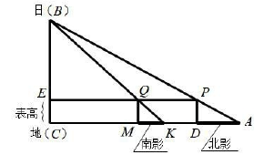 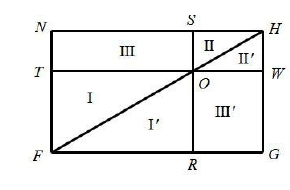

**🧭 提示**：① (1) 用两条平行线（EQ∥CK、QM∥BC）各写一个比例再过渡；② (2) 对第二次测量同样用平行线得 BE/CE＝CD/DA，与(1)联立用等比性质；③ (3) 把四条线段长做成同底矩形，两次使用"对角矩形等积"，作差即得。

**✍️ 详解**：
**(1)** $\because EQ\parallel CK$（E、Q 等高），$\therefore\dfrac{BE}{CE}=\dfrac{BQ}{QK}$（平行线分线段成比例）；$\because QM\parallel BC$（QM 为铅垂杆），$\therefore\dfrac{CM}{MK}=\dfrac{BQ}{QK}$。
$\therefore\boxed{\dfrac{BE}{CE}=\dfrac{CM}{MK}}$（等量代换）。

**(2)** 同理，$\because EP\parallel CA$，$\therefore\dfrac{BE}{CE}=\dfrac{PB}{PA}$；$\because PD\parallel BC$，$\therefore\dfrac{CD}{DA}=\dfrac{PB}{PA}$，$\therefore\dfrac{BE}{CE}=\dfrac{CD}{DA}$。
又由(1) $\dfrac{BE}{CE}=\dfrac{CM}{MK}$，$\therefore\dfrac{BE}{CE}=\dfrac{CD}{DA}=\dfrac{CM}{MK}$，由等比（分比）性质：$\dfrac{BE}{CE}=\dfrac{CD-CM}{DA-MK}$，即①。$\blacksquare$

**(3)** 作矩形 BCMF、BCKG、BCDN、BCAH（都以 BC 为公共边，另一边长分别为 CM、CK、CD、CA），延长 EP 交 AH 于 W，KG 与 EP 交于 R。杆顶 Q 在对角线 BK 上、P 在对角线 BA 上（相似三角形对应点），由出入相补原理（图 2 结论）：
$S_{矩形ECMQ}=S_{矩形QRGF}$，$S_{矩形ECDP}=S_{矩形NPWH}$（对角两矩形等积），$\therefore S_{矩形QMDP}=S_{矩形NPWH}-S_{矩形QRGF}$（作差）。
即 $DM\cdot PD=PW\cdot PN-QR\cdot GR$。$\because DM=CD-CM$，$PD=CE$，$PW=DA$，$PN=BE$，$QR=MK$，$GR=BE$，
$\therefore(CD-CM)\cdot CE=AD\cdot BE-MK\cdot BE=BE\cdot(DA-MK)$，$\therefore\dfrac{BE}{CE}=\dfrac{CD-CM}{DA-MK}$①。$\blacksquare$

**⚠️ 易错**：三组平行线各自对应哪个比例要逐一写清（按步给分）；等比性质 $\frac ab=\frac cd\Rightarrow\frac{a-c}{b-d}=\frac ab$ 使用时分母同号；(3) 中六条线段（DM、PD、PW、PN、QR、GR）与矩形的对应是采分点，须逐一交代。

### 23．（本题 14 分）在四边形 ABCD 中，点 E 在边 AB 上，BE＝3AE，点 F 在边 BC 上。(1) 如图 1，若四边形 ABCD 为矩形，且 BF＝3CF，联结 EF、AC，求证：△BEF∽△DCA；(2) 如图 2，若四边形 ABCD 为等腰梯形，AD∥BC，联结 FE 并延长交 DA 的延长线于点 G，联结 BG，如果 BG⊥GD，∠EFB＝2∠GBA，AG＝6，求 CD 的长；(3) 如图 3，若四边形 ABCD 为平行四边形，点 F 是 BC 中点，联结 DE、AF 交于点 K，联结 CK，过点 A 作 AM∥CK 交 DK 于点 M，联结 CM，求 S△KMC∶S△KFC 的值。

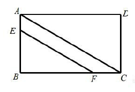 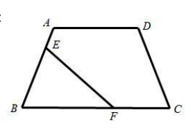 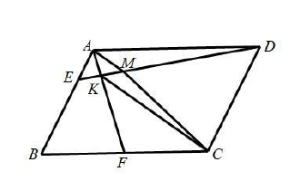

**🧭 提示**：① (1) 矩形对边相等，把 BE、BF 都用 CD、AD 表示，夹角为直角；② (2) 倍长 AG 到 P，用 BG⊥GD 构造全等，把"2∠GBA"凑成 ∠ABP，再与 ∠EFB 挂钩；③ (3) 过 C 作 DE 的平行线，用 A、K、Q 共线与面积比递推。

**✍️ 详解**：
**(1)** $\because$ 四边形 ABCD 为矩形，$\therefore\angle B=\angle D=90°$，$AB=CD$，$BC=AD$（矩形性质）。
$\because BE=3AE$，$\therefore BE=\dfrac34AB=\dfrac34CD$；同理 $BF=\dfrac34BC=\dfrac34AD$。$\therefore\dfrac{BE}{CD}=\dfrac{BF}{AD}=\dfrac34$，夹角 $\angle B=\angle D=90°$。
$\therefore\boxed{\triangle BEF\backsim\triangle DCA}$（两边成比例且夹角相等）。

**(2)** $\because$ 等腰梯形 $ABCD$，$\therefore AB=CD$（两腰相等）。
延长 $AG$ 至 $P$，使 $PG=AG=6$。$\because BG\perp GD$（即 $BG\perp AP$），$GB$ 公共，$\therefore\triangle AGB\cong\triangle PGB$（SAS），
$\therefore\angle ABG=\angle PBG$，$AB=PB$，$\therefore\angle ABP=\angle ABG+\angle PBG=2\angle GBA=\angle EFB$（等式性质）。
$\because AD\parallel BC$，$G$、$E$、$F$ 共线，$\therefore\angle EGA=\angle EFB$（内错角相等——两组边分别反向），$\therefore\angle EGA=\angle ABP$；又 $\angle GAE=\angle BAP$（公共角），
$\therefore\triangle AGE\backsim\triangle ABP$（两角对应相等），$\therefore\dfrac{AG}{AB}=\dfrac{AE}{AP}$（对应边成比例）。
$AP=2AG=12$，$AE=\dfrac14AB$：$\dfrac{6}{AB}=\dfrac{AB/4}{12}\Rightarrow AB^2=288$，$AB=12\sqrt2$（取正值）。$\therefore\boxed{CD=AB=12\sqrt2}$。

**(3)** 过 $C$ 作 $DE$ 的平行线，与 $AK$ 的延长线、$AB$ 的延长线分别交于 $Q$、$H$，可证 $AE=BH$。设 $S_{\triangle AKM}=k$。
$\because DE\parallel HC$，$BE=3AE$，$\therefore\dfrac{AK}{KQ}=\dfrac{AE}{EH}=\dfrac14$（平行线分线段成比例）。
$\because DE\parallel HC$，$AM\parallel CK$，$\therefore\angle AKM=\angle KQC$，$\angle KAM=\angle QKC$，$\therefore\triangle AKM\backsim\triangle KQC$（两角对应相等）。
$\therefore\dfrac{S_{\triangle AKM}}{S_{\triangle KQC}}=\left(\dfrac{AK}{KQ}\right)^2=\dfrac1{16}\Rightarrow S_{\triangle KQC}=16k$（面积比＝相似比平方）；$\dfrac{AM}{AK}=\dfrac{KC}{KQ}=\dfrac14\Rightarrow S_{\triangle KMC}=4k$（等积变换 $S_{\triangle KMC}=S_{\triangle KAC}$，A、M 在与 CK 平行的直线上）。
同理 $\triangle AKD\backsim\triangle FQC$：$\dfrac{AK}{FQ}=\dfrac{AD}{FC}=2$（AD＝BC＝2FC，F 为中点），$\therefore FQ=\dfrac12AK$；又 $KQ=4AK$，$\therefore\dfrac{KF}{FQ}=\dfrac{KQ-FQ}{FQ}=7$（A、K、F、Q 共线，K 在 A、F 之间）。
$\therefore S_{\triangle FQC}=2k$，$S_{\triangle KFC}=S_{\triangle KQC}-S_{\triangle FQC}=16k-2k=14k$，$S_{\triangle KMC}:S_{\triangle KFC}=4k:14k=\boxed{\dfrac27}$。

**⚠️ 易错**：(2) 中倍长 AG 后必须点明 △AGB≌△PGB 才能得 ∠ABP＝2∠GBA，跳步扣分；△AGE∽△ABP 的对应是 A↔A、G↔B、E↔P，比例写错全盘皆输；(3) 的面积比链条（16k→4k→2k→14k）环环相扣，"同高面积比＝底之比"每处都要交代。

## 答案速查与互证

| 题号 | 16 | 17 | 18 | 19 | 20 | 21 | 22 | 23 |
| --- | --- | --- | --- | --- | --- | --- | --- | --- |
| 结果 | $4-\sqrt3$ | $AD=\sqrt{41}$，$\sin E=\frac{5\sqrt{41}}{41}$ | $CD=4.8$ | $y=x^2+4x+6$，$\tan\angle ACB=\frac18$ | 坡度 $7:24$、坡高 70cm、不安全；VC′ 高 56 坡度 1∶10，OV 高 14 坡度 1∶10 | $a=-\frac12$；$-\frac34<n<\frac34$ 且 $n\neq0$；$y=-\frac1{18}(x-1)^2+3$ | (1)(2)(3) 证明见上 | 相似；$CD=12\sqrt2$；$2:7$ |

与卷末参考答案逐题互证：数值与结论全部一致。第 21(3) 题干中文缺字，按卷面残片与答案页（n=1、E(7,1)、y=−(1/18)(x−1)²+3）反推补全 ⚠️ 待核对；其余题干以页图为准。
