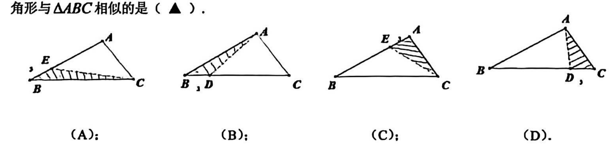
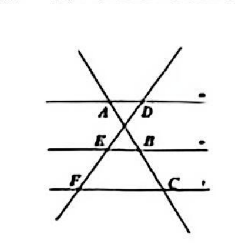
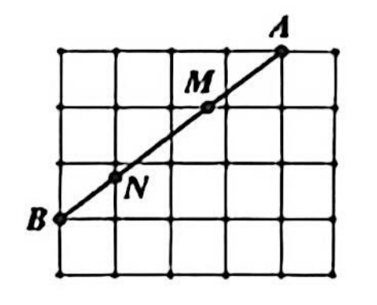
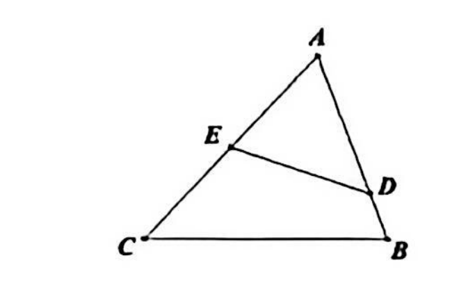

# 2026 一模精讲 · 长宁卷（上）选择填空 1-18

> 2025 学年第一学期初三数学教学质量调研试卷（长宁区，考试时间 100 分钟，满分 150 分）。本篇覆盖第 1-18 题（选择 6×4′＋填空 12×4′＝72′），每题"转录＋简解"；解答题 19-25 见《数模26-长宁-下》。

## 一、选择题（每题 4 分，共 24 分）

### 1．矩形相似判定
现有甲、乙、丙三个矩形，矩形甲的一组邻边长为 4 与 9，矩形乙的一组邻边长为 3 与 2，矩形丙的一组邻边长为 4.5 与 2，那么三个矩形间相似关系判断正确的是（ ▲ ）.
（A）甲、乙相似；（B）乙、丙相似；（C）丙、甲相似；（D）甲、乙、丙都不相似.

**简解**：矩形相似须"长比长、短比短"后对应成比例：甲为 $9:4$，丙为 $4.5:2=9:4$，且 $\frac{9}{4.5}=\frac{4}{2}=2$，∴丙、甲相似；乙的 $3:2$ 与谁都不配。选 $\boxed{\text{C}}$。

### 2．直角三角形的边角关系
在 △ABC 中，∠C=90°，∠A、∠B、∠C 的对边分别是 a、b、c，那么下列等式中不正确的是（ ▲ ）.
（A）$a=b\tan A$；（B）$c=a\sin A$；（C）$c=\dfrac{b}{\sin B}$；（D）$b=\dfrac{a}{\cot B}$.

**简解**：$\tan A=\frac ab\Rightarrow a=b\tan A$ ✓；$\sin A=\frac ac\Rightarrow c=\frac{a}{\sin A}$，(B) 把"除"写成"乘"，不正确；$\sin B=\frac bc\Rightarrow c=\frac b{\sin B}$ ✓；$\cot B=\frac ab\Rightarrow b=\frac a{\cot B}$ ✓。选 $\boxed{\text{B}}$。

### 3．抛物线的顶点坐标
宁宁同学在将某条抛物线表达式化为 $y=a(x+m)^2+n$ 形式时，他给出的结果是 $y=(2x+4)^2+4$，那么这条抛物线的顶点坐标为（ ▲ ）.
（A）$(-4,4)$；（B）$(-4,-4)$；（C）$(-2,4)$；（D）$(-2,-4)$.

**简解**：$y=(2x+4)^2+4=4(x+2)^2+4$（二次项系数须先化为 1），顶点 $(-2,4)$。选 $\boxed{\text{C}}$。

### 4．向量等式的判断
已知一个单位向量 $\vec e$，设 $\vec a$、$\vec b$ 都是非零向量，那么下列等式中一定成立的是（ ▲ ）.
（A）$|\vec e|\vec a=\vec a$；（B）$|\vec b|\vec e=\vec b$；（C）$|\vec a|=\bigl|\,|\vec e|\vec b\,\bigr|$；（D）$|\vec b|\vec a=|\vec a|\vec b$.

**简解**：$|\vec e|=1$，故 $|\vec e|\vec a=\vec a$ 恒成立；(B) 左边方向沿 $\vec e$，仅当 $\vec b$ 与 $\vec e$ 同向才等于 $\vec b$；(C) 即 $|\vec a|=|\vec b|$，不一定成立；(D) 需 $\vec a$、$\vec b$ 同向。选 $\boxed{\text{A}}$。

### 5．剪下的三角形与原三角形相似
在三角形纸片 ABC 中，AB=10，BC=12，AC=6，那么按图中数据沿虚线剪下的阴影部分三角形与 △ABC 相似的是（ ▲ ）.

**简解**：阴影三角形与 △ABC 有一个公共角，只需夹公共角的两边对应成比例：(A) 夹 ∠B 两边 $2:12=1:6$，而 $10:12=5:6$，不成比例；(B) 夹 ∠B 两边 $1:10$，不成比例；(C) 夹 ∠A 两边 $2:6=1:3$，而 $10:6=5:3$，不成比例；(D) 夹 ∠C 两边 $CD:CA=3:6=1:2=CA:CB=6:12$ ✓，∴△CDA∽△CAB（C↔C、D↔A、A↔B）。选 $\boxed{\text{D}}$。

### 6．三个条件确定 m
已知 m 是常数，它满足以下要求：
（1）抛物线 $y=(m+1)x^2$ 的最高点就是它的顶点.
（2）抛物线 $y=(x+m)^2+m+1$ 的对称轴在 y 轴的右侧.
（3）沿着 x 轴的正方向看，抛物线 $y=(m+3)x^2+1$ 在 y 轴左侧是下降的.
那么常数 m 可以取的值是（ ▲ ）.（A）$-3$；（B）$-2$；（C）$-1$；（D）$0$.

**简解**：(1) 有最高点 ⇔ 开口向下 ⇒ $m+1<0$；(2) 对称轴 $x=-m$ 在 y 轴右侧 ⇒ $m<0$；(3) y 轴左侧下降 ⇔ 开口向上 ⇒ $m+3>0$。综上 $-3<m<-1$，仅 $-2$ 可取。选 $\boxed{\text{B}}$。

## 二、填空题（每题 4 分，共 48 分）

### 7．比例求值
已知 $\dfrac a2=\dfrac b3\neq0$，那么 $\dfrac{a+3b}{2b}$ 的值为____.

**简解**：设 $a=2k$、$b=3k$：$\dfrac{a+3b}{2b}=\dfrac{2k+9k}{6k}=\boxed{\dfrac{11}{6}}$。

### 8．向量计算
计算：$\dfrac32\vec a-2\Bigl(\dfrac14\vec a-\dfrac32\vec b\Bigr)=$____.

**简解**：原式 $=\dfrac32\vec a-\dfrac12\vec a+3\vec b=\boxed{\vec a+3\vec b}$（去括号变号）。

### 9．相似三角形的周长比
如果两个相似三角形的面积比为 0.25，那么它们的周长之比为____.

**简解**：面积比 $1:4$ ⇒ 相似比 $1:2$ ⇒ 周长比为 $\boxed{1:2}$（相似三角形对应线段之比等于相似比）。

### 10．比例尺
小宁同学在绘制《学校校园平面图》时，经测量校园内 A、B 两点间距离为 150 米，他考虑画一条 5 厘米的线段来表示，那么小宁同学绘制的《学校校园平面图》的比例尺是____.

**简解**：150 米＝15000 厘米，$5:15000=1:3000$，比例尺为 $\boxed{1:3000}$。

### 11．二次函数的识别
在下列给定的 y 关于 x 的函数中：① $y=\pi x^2-1$，② $y=ax^2+bx+c$，③ $y=(\sqrt3-1)^2x+1$，④ $y=\dfrac1{x^2+1}$，一定是二次函数的是____.（填写序号）

**简解**：① 中 $\pi$ 是非零常数，是二次函数 ✓；② 未限定 $a\neq0$，不"一定"；③ 是一次函数；④ 右边是分式。填 $\boxed{①}$。

### 12．平移后顶点落在 y 轴上
若将抛物线 $y=2(x+m)^2+5$ 沿 x 轴向左平移 2 个单位后，所得抛物线的顶点恰好落在 y 轴上，那么 m 的值为____.

**简解**：左移 2 得 $y=2(x+m+2)^2+5$，顶点 $(-m-2,\,5)$ 在 y 轴上 ⇔ $-m-2=0$ ⇒ $\boxed{m=-2}$。

### 13．黄金分割求 AB
若点 P 是线段 AB 上的一点，满足 $AP^2=BP\cdot AB$，已知 $BP=\sqrt5-1$，那么 AB 的长为____.

**简解**：设 $t=\frac{AP}{AB}$：$AP^2=BP\cdot AB\Rightarrow t^2=1-t\Rightarrow t=\frac{\sqrt5-1}{2}$（负根舍去）。∴$BP=AB(1-t)=\frac{3-\sqrt5}{2}AB=\sqrt5-1$，解得 $AB=\dfrac{2(\sqrt5-1)}{3-\sqrt5}=\boxed{\sqrt5+1}$。（验算：$AP=AB-BP=2$，$AP^2=4=BP\cdot AB=(\sqrt5-1)(\sqrt5+1)$ ✓）

### 14．平行线分线段成比例
如图，两条直线被三条平行线 m、n、l 所截，分别相交于点 A、B、C、D、E、F，若 $AB=\dfrac32BC$，那么当 $EF=\dfrac32$ 时，DF 的长为____.

**简解**：三条平行线截两条直线，对应线段成比例：$\dfrac{DE}{EF}=\dfrac{AB}{BC}=\dfrac32$ ⇒ $DE=\dfrac32\times\dfrac32=\dfrac94$，∴$DF=DE+EF=\dfrac94+\dfrac32=\boxed{\dfrac{15}4}$。

### 15．网格中的线段比
如图，在由大小相同的小正方形组成的网格图中，联结格点 A、B 的线段交网格线于 M、N 两点，那么 $AM:MN:BN=$____.

**简解**：设小正方形边长为 1，则 B(0,1)、A(4,4)。M 在横向网格线上：A、B 到该线的竖直距离为 1、2，∴$AM:MB=1:2$，$AM=\frac13AB$；N 在竖向网格线上：A、B 到该线的水平距离为 3、1，∴$AN:NB=3:1$，$NB=\frac14AB$。∴$MN=\left(1-\frac13-\frac14\right)AB=\frac5{12}AB$，$AM:MN:BN=\frac13:\frac5{12}:\frac14=\boxed{4:5:3}$。

### 16．相似三角形求比值
如图，在 △ABC 中，∠A=60°，∠B=70°，D、E 分别是边 AB、AC 上的点，满足 $\dfrac{AD}{AB}=\dfrac45$，若 E 为中点，且 ∠ADE=50°，那么 $\dfrac{AB}{AC}$ 的值为____.

**简解**：∠AED＝180°−60°−50°＝70°＝∠B，∠ADE＝50°＝∠C（∠C＝180°−60°−70°），∴△ADE∽△ACB（A↔A、D↔C、E↔B），$\dfrac{AD}{AC}=\dfrac{AE}{AB}$。代入 $AD=\frac45AB$、$AE=\frac12AC$：$\frac45\cdot\frac{AB}{AC}=\frac12\cdot\frac{AC}{AB}$，$\left(\frac{AB}{AC}\right)^2=\frac58$，∴$\dfrac{AB}{AC}=\boxed{\dfrac{\sqrt{10}}4}$。

### 17．"和谐抛物线"
若抛物线 C₁ 的顶点在抛物线 C₂ 上，而抛物线 C₂ 的顶点又在抛物线 C₁ 上（两个顶点不重合），那么称抛物线 C₁ 和 C₂ 互为"和谐抛物线". 已知抛物线 C：$y=2(x-1)^2+2$ 与 y 轴交于点 A，点 B 与点 A 关于抛物线 C 的对称轴对称，那么以点 B 为顶点的抛物线 C 的"和谐抛物线"的表达式为____.

**简解**：C 的顶点 $(1,2)$、对称轴 $x=1$；令 $x=0$ 得 $A(0,4)$，∴$B(2,4)$（关于 $x=1$ 对称，且 $B$ 恰在 C 上 ✓）。所求抛物线以 B 为顶点、且过 C 的顶点：$y=a(x-2)^2+4$，代入 $(1,2)$：$a+4=2\Rightarrow a=-2$，∴$y=-2(x-2)^2+4=\boxed{y=-2x^2+8x-4}$。

### 18．翻折中的等腰三角形
在矩形 ABCD 中，AB=CD=6，AD=BC=5，E 为射线 AB 上一点，将 △ADE 沿 DE 翻折，得到 △A₁DE（点 A 的对应点为 A₁）. 联结 A₁A、A₁B，当 △A₁AB 为等腰三角形时，AE 长是____.

**简解**：建系：A(0,0)、B(6,0)、D(0,5)、E(e,0)（e≥0）。直线 DE：$5x+ey=5e$，A 关于它的对称点 $A_1\left(\dfrac{50e}{25+e^2},\ \dfrac{10e^2}{25+e^2}\right)$，于是 $A_1A^2=\dfrac{100e^2}{25+e^2}$，$A_1B^2=A_1A^2-\dfrac{600e}{25+e^2}+36$。等腰分三类：
① $A_1A=A_1B$ ⇔ $A_1$ 在 AB 中垂线上 ⇔ $\dfrac{50e}{25+e^2}=3$ ⇒ $3e^2-50e+75=0$ ⇒ $e=15$ 或 $e=\dfrac53$；
② $A_1A=AB=6$ ⇔ $\dfrac{100e^2}{25+e^2}=36$ ⇒ $64e^2=900$ ⇒ $e=\dfrac{15}4$；
③ $A_1B=AB=6$ ⇔ $A_1A^2=\dfrac{600e}{25+e^2}$ ⇒ $100e^2=600e$ ⇒ $e=6$（此时 E 与 B 重合）。
∴$AE=\boxed{\dfrac{15}4\ \text{或}\ \dfrac53\ \text{或}\ 6\ \text{或}\ 15}$（四解勿漏）。

## 答案速查与互证

| 题号 | 1 | 2 | 3 | 4 | 5 | 6 | 7 | 8 | 9 |
| --- | --- | --- | --- | --- | --- | --- | --- | --- | --- |
| 答案 | C | B | C | A | D | B | $\frac{11}6$ | $\vec a+3\vec b$ | $1:2$ |

| 题号 | 10 | 11 | 12 | 13 | 14 | 15 | 16 | 17 | 18 |
| --- | --- | --- | --- | --- | --- | --- | --- | --- | --- |
| 答案 | 1:3000 | ① | $-2$ | $\sqrt5+1$ | $\frac{15}4$ | $4:5:3$ | $\frac{\sqrt{10}}4$ | $y=-2x^2+8x-4$ | $\frac{15}4$ 或 $\frac53$ 或 6 或 15 |

与卷末参考答案逐题互证：选择 1.C、2.B、3.C、4.A、5.D、6.B 与填空 7-18 各答全部一致。
⚠️ 待核对①：第 16 题条件自我超定——若按三内角定形应有 $\frac{AB}{AC}=\frac{\sin50°}{\sin70°}\approx0.815$，与相似法解得的 $\frac{\sqrt{10}}4\approx0.791$ 不吻合；本讲按出题意图（△ADE∽△ACB）求解，结果与卷末答案一致。
⚠️ 待核对②：第 5 题各选项内的小数据标注扫描偏淡，辨读为 (A) BE=2、(B) BD=1、(C) AE=2、(D) CD=3；其中 CD=3 代入验证恰使 △CDA∽△CAB，与卷末答案 D 吻合。

## 🔗 关联
- 知识点：[[相似三角形的判定与性质]]、[[二次函数的图像与性质]]、[[平行线分线段成比例]]、[[翻折（轴对称）的性质]]、[[平面向量]]
- 同类卷：[[数模26-金山-上]]、[[数模26-长宁-下]]
