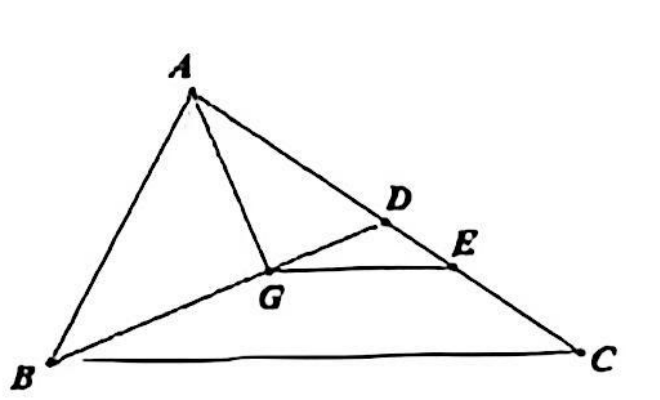
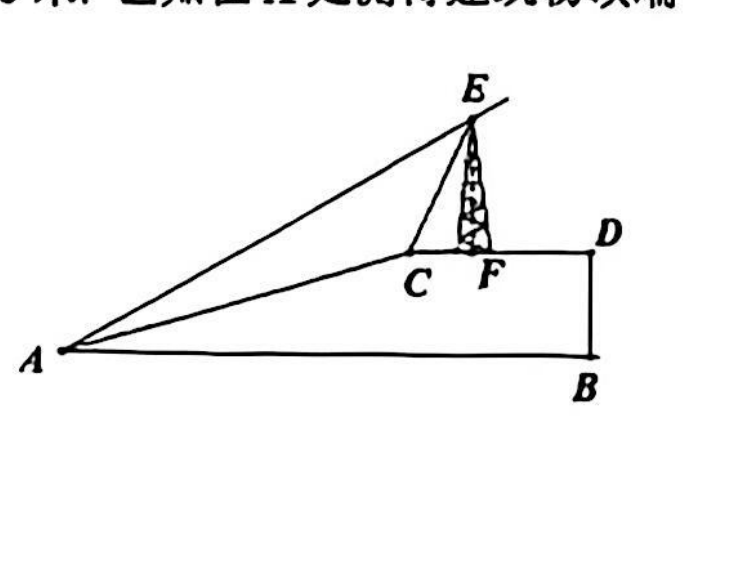
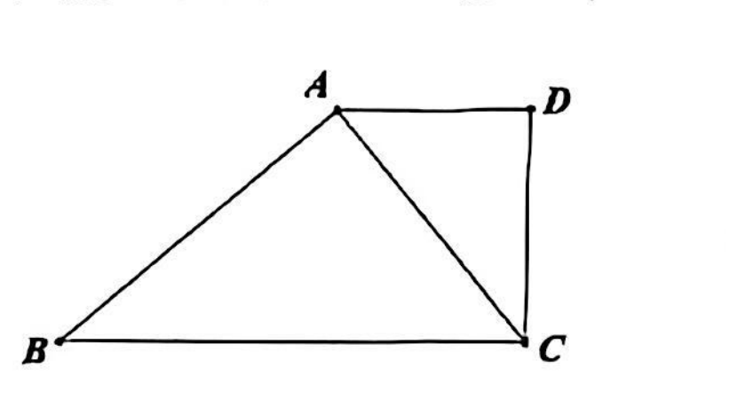
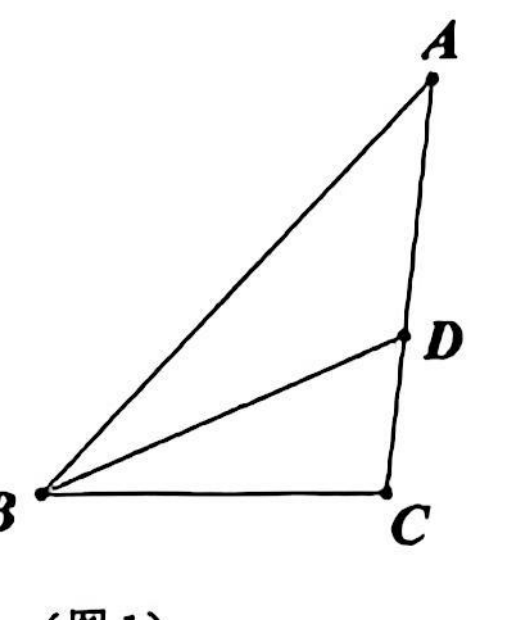
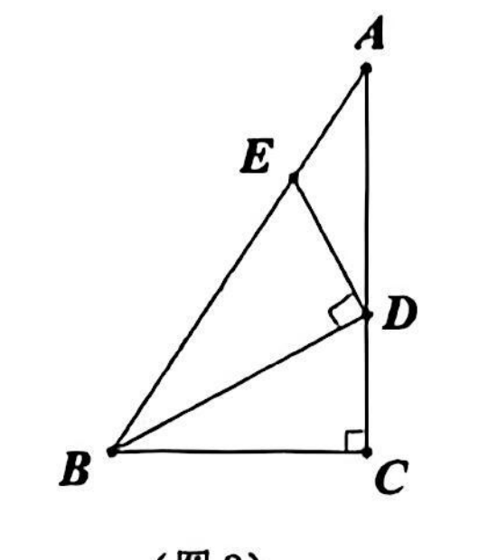
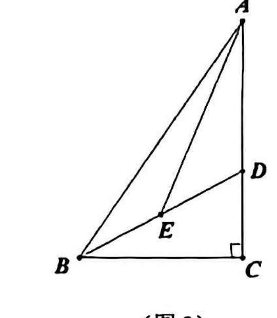

# 2026 一模精讲 · 长宁卷（下）解答题 19-25

> 本篇覆盖第 19-25 题（共 78 分），每题"完整转录＋渐进三段提示＋详解＋易错"。第 1-18 题见《数模26-长宁-上》。

### 19．（本题满分 10 分）计算：$\dfrac{\sin30°}{\cos^230°-\dfrac12}+\tan60°-\dfrac{1}{\cot30°+2\cos45°}$

**🧭 提示**：① 六个特殊角三角比先全部代入；② 第一个分式的分母 $\cos^230°-\frac12$ 先算平方再相减；③ 第三项分母有理化后会得到 $\sqrt3-\sqrt2$，注意前面有减号。

**✍️ 详解**：
$\sin30°=\frac12$，$\cos^230°=\frac34$，$\tan60°=\sqrt3$，$\cot30°=\sqrt3$，$\cos45°=\frac{\sqrt2}2$（特殊角三角比）。
原式 $=\dfrac{\frac12}{\frac34-\frac12}+\sqrt3-\dfrac{1}{\sqrt3+\sqrt2}=\dfrac{\frac12}{\frac14}+\sqrt3-\dfrac{1}{\sqrt3+\sqrt2}$（分母先合并）
$=2+\sqrt3-(\sqrt3-\sqrt2)=\boxed{2+\sqrt2}$（第一分式约分；$\frac{1}{\sqrt3+\sqrt2}=\sqrt3-\sqrt2$ 分母有理化）。

**⚠️ 易错**：$\cos^230°$ 是"先平方"得 $\frac34$；第三项前的减号管到整个分式，有理化后是减 $(\sqrt3-\sqrt2)$，最终才合并出 $+\sqrt2$；结果须化到最简。

### 20．（本题满分 10 分，第 (1) 小题 5 分，第 (2) 小题 5 分）如图，已知点 G 是 △ABC 的重心，联结 BG 并延长交边 AC 于点 D，联结 AG，过点 G 作 GE∥BC 交边 AC 于点 E.（1）如果设 $\vec{AB}=\vec a$，$\vec{AC}=\vec b$，试用 $\vec a$、$\vec b$ 表示 $\vec{BG}$.（2）当 AG⊥BD，BG=9，∠GAD=30° 时，求 △DGE 的面积.

**🧭 提示**：① 重心 ⇒ BD 是 AC 边上的中线，且 $GD=\frac12BG$；② 向量走"回路"$\vec{BG}=\vec{BD}-\vec{GD}$；③ GE∥BC 给出 △DGE∽△DBC，面积比取平方，△DBC 的面积用"底 BD×高 AG"计算。

**✍️ 详解**：
**(1)** ∵G 是重心，BG 延长交 AC 于 D，∴D 是 AC 中点且 $GD=\frac12BG$（重心把每条中线分成 2:1 两段）。
$\vec{BD}=\vec{AD}-\vec{AB}=\frac12\vec b-\vec a$（向量减法、D 为中点）；$\vec{GD}=\frac12\vec{BG}$（与 $\vec{BG}$ 同向、长度减半）。
由 $\vec{BG}=\vec{BD}-\vec{GD}$：$\vec{BG}=\frac12\vec b-\vec a-\frac12\vec{BG}$，∴$\frac32\vec{BG}=\frac12\vec b-\vec a$，$\boxed{\vec{BG}=-\frac23\vec a+\frac13\vec b}$。
**(2)** $GD=\frac12BG=4.5$，$BD=13.5$。∵AG⊥BD 且 D 在直线 BD 上，∴AG⊥GD，Rt△AGD 中 ∠AGD=90°、∠GAD=30°：
$AD=\dfrac{GD}{\sin30°}=9$，$AG=AD\cos30°=\dfrac{9\sqrt3}{2}$（解直角三角形）。
∵GE∥BC，∴△DGE∽△DBC（平行于三角形一边的直线截另两边所得的三角形与原三角形相似），相似比 $\dfrac{DG}{DB}=\dfrac{4.5}{13.5}=\dfrac13$。
$S_{\triangle DBC}=S_{\triangle ABD}=\dfrac12\cdot BD\cdot AG=\dfrac12\times\dfrac{27}2\times\dfrac{9\sqrt3}2=\dfrac{243\sqrt3}8$（D 为 AC 中点 ⇒ 等底同高；AG⊥BD 即 △ABD 中 BD 边上的高）。
∴$S_{\triangle DGE}=\left(\dfrac13\right)^2\cdot\dfrac{243\sqrt3}8=\boxed{\dfrac{27\sqrt3}{8}}$（相似三角形面积比＝相似比的平方）。

**⚠️ 易错**：$\vec{GD}=\frac12\vec{BG}$ 别写成 $2\vec{BG}$；(2) 面积比是相似比平方 $1:9$，直接用 $1:3$ 会算成 $\frac{9\sqrt3}8$；"$S_{\triangle DBC}=S_{\triangle ABD}$"须交代 D 是 AC 中点的依据。

### 21．（本题满分 10 分，第 (1) 小题 2 分，第 (2) 小题 4 分，第 (3) 小题 4 分）宁宁同学用"描点法"画二次函数 $y=ax^2+bx+c\ (a\neq0)$ 的图像时，列表如下：

| x | … | −2 | −1 | 0 | 1 | 2 | 3 | 4 | … |
| --- | --- | --- | --- | --- | --- | --- | --- | --- | --- |
| y | … | 5 | 0 | 3 | 4 | 3 | 0 | −5 | … |

（1）由于计算粗心，宁宁算错了其中的一个 y 值，请指出这个算错的 y 值所对应的 x=____.
（2）上述函数图像的对称轴是____，且当 y≥0 时，x 的取值范围是____.
（3）若 $A\left(\dfrac54,m\right)$、$B(-3,n)$ 都在这个函数图像上，比较 m、n 的大小，并说明为什么？

**🧭 提示**：① y 值相等的两点关于对称轴对称，先把表中 y 值配对；② 由两对相等的 y 值定出对称轴，再用"对称位置函数值相等"揪出错误值并求出解析式；③ 比较函数值大小＝"开口方向＋离对称轴远近"。

**✍️ 详解**：
**(1)** (0,3) 与 (2,3)、(−1,0) 与 (3,0) 的 y 值两两相等，两组中点横坐标都是 $\frac{0+2}2=\frac{-1+3}2=1$，∴对称轴为直线 x=1，于是 $y(-2)$ 应与 $y(4)$ 相等，而表中 $5\neq-5$，必有一错。由三个正确点 (−1,0)、(0,3)、(1,4) 用待定系数法解得 $y=-x^2+2x+3$（c=3，a+b+3=4，a−b+3=0），验证 $y(2)=3$、$y(3)=0$、$y(4)=-5$ 全部吻合，且 $y(-2)=-5$，∴算错的是 x=−2 对应的 y 值（表中 5 应为 −5）。填 $\boxed{-2}$。
**(2)** 对称轴是直线 $x=1$；$y=-x^2+2x+3\geq0$ ⇔ $x^2-2x-3\leq0$ ⇔ $(x+1)(x-3)\leq0$，∴$-1\leq x\leq3$。
**(3)** $a=-1<0$，开口向下；$\left|\frac54-1\right|=\frac14$，$|-3-1|=4$，点 A 离对称轴更近，∴m＞n（开口向下的抛物线，离对称轴越近函数值越大）。

**⚠️ 易错**：(1) 只说"5 与 −5 矛盾"不完整，须指出错的是 x=−2 处的 y=5；(2) 取值范围两端都带等号；(3) 理由必须同时写"开口向下"与"A 到对称轴距离更小"两层，缺一扣分。

### 22．（本题满分 10 分）如图，已知水平地面 AB 上方有一水平的平台 CD，该平台上有一个竖直的建筑物 EF，满足 EF⊥CD. 从 A 到 C 处的斜坡 AC 的坡度 i=1:3，且 $AC=20\sqrt{10}$ 米. 已知在 A 处测得建筑物顶端 E 的仰角为 30°，在 C 处测得 E 的仰角为 60°. 假设 A、B、C、D、E、F 在同一竖直平面内.（1）求平台 CD 的高度.（2）求建筑物 EF 的高度.（结果保留根号）

**🧭 提示**：① 坡度 i=1:3 是"竖直:水平"，配合 AC 的长先拆出点 C 的高度与水平距离；② F 是 E 向平台所作垂线的垂足，两个仰角分别给出 Rt△EFC 与"E—A"大直角三角形的边比；③ 设 CF=d、EF=h，两式联立。

**✍️ 详解**：
**(1)** 坡度 i=1:3 ⇒ 竖直分量:水平分量＝1:3。设 C 相对 A 的竖直距离为 k、水平距离为 3k，由 $k^2+(3k)^2=AC^2$（勾股定理）：$10k^2=(20\sqrt{10})^2=4000$，$k=20$（取正）。
∴平台 CD 的高度为 $\boxed{20\ \text{米}}$（水平距离 $3k=60$ 米，供 (2) 使用）。
**(2)** 设 $CF=d$、$EF=h$（F 为垂足）。∵EF⊥CD 且 CD∥AB：
在 C 处测 E 仰角 60°：Rt△EFC 中 $\tan60°=\dfrac{h}{d}$ ⇒ $h=\sqrt3 d$；
在 A 处测 E 仰角 30°：E 相对 A 的水平距离为 $60+d$、竖直距离为 $20+h$，$\tan30°=\dfrac{20+h}{60+d}$。
代入 $h=\sqrt3d$：$20+\sqrt3d=\dfrac{60+d}{\sqrt3}$，去分母：$20\sqrt3+3d=60+d$，∴$d=30-10\sqrt3$。
∴$h=\sqrt3(30-10\sqrt3)=\boxed{(30\sqrt3-30)\ \text{米}}$（≈22.0 米＞0，合理）。

**⚠️ 易错**：坡度是"竖直:水平"，别颠倒成水平:竖直；"在 C 测 E"的直角三角形三边是 EF、CF、CE（垂足是 F 不是 D）；去分母时 $\frac{60+d}{\sqrt3}$ 乘 $\sqrt3$ 别漏项。

### 23．（本题满分 12 分，第 (1) 小题 6 分，第 (2) 小题 6 分）已知，如图，在四边形 ABCD 中，∠BAC=∠ADC=90°，AD=m，BC=n，$AC=\sqrt{mn}$，其中 n＞m.（1）求证：△ACD∽△CBA.（2）如果 $S_{四边形ABCD}:S_{\triangle ABC}=3:2$，求证：BC=2AD.

**🧭 提示**：① (1) 把 $\frac{AD}{AC}$ 与 $\frac{AC}{BC}$ 都化到 $\frac{\sqrt m}{\sqrt n}$；② 夹角用已知的两个直角；③ (2) 先把四边形面积拆成两个三角形面积之和，再用"相似三角形面积比＝相似比的平方"。

**✍️ 详解**：
**(1)** $\dfrac{AD}{AC}=\dfrac{m}{\sqrt{mn}}=\dfrac{\sqrt m}{\sqrt n}$，$\dfrac{AC}{BC}=\dfrac{\sqrt{mn}}{n}=\dfrac{\sqrt m}{\sqrt n}$（约去 $\sqrt m$、分母有理化），
∴$\dfrac{AD}{AC}=\dfrac{AC}{BC}$；又 ∠ADC=∠BAC=90°（已知），
∴△ACD∽△CBA（两边成比例且夹角相等的两个三角形相似）。∎
**(2)** ∵$S_{四边形ABCD}=S_{\triangle ABC}+S_{\triangle ACD}$（对角线 AC 把四边形分成两个三角形），且 $S_{四边形ABCD}:S_{\triangle ABC}=3:2$，
∴$S_{\triangle ACD}:S_{\triangle ABC}=1:2$。
由 (1)，△ACD∽△CBA 中 AD 的对应边是 CA，相似比 $\dfrac{AD}{CA}=\sqrt{\dfrac mn}$，∴$\dfrac{S_{\triangle ACD}}{S_{\triangle CBA}}=\left(\dfrac{AD}{AC}\right)^2=\dfrac mn$（相似三角形面积比等于相似比的平方）。
∴$\dfrac mn=\dfrac12$ ⇒ $n=2m$，即 $\boxed{BC=2AD}$。∎

**⚠️ 易错**：△ACD∽△CBA 的顶点对应（A↔C、C↔B、D↔A）决定面积比须用 $\left(\frac{AD}{AC}\right)^2$，对应写错全盘皆错；(2) 必须先交代"四边形面积＝两个三角形面积之和"这一步。

### 24．（本题满分 12 分，第 (1) ① 小题 4 分、第 (1) ② 小题 4 分，第 (2) 小题 4 分）在平面直角坐标系 xOy 中，抛物线 $y=-x^2+mx+2$ 与 x 轴的负半轴交于点 A，与 y 轴交于点 C.（1）已知 $\tan\angle ACO=\dfrac12$. ① 求抛物线的表达式. ② 若点 B 为该抛物线上一点，且 △ABC 的重心恰好落在 x 轴上，求点 B 的坐标.（2）坐标平面内有点 M(0,3)、N(2,3)，如果抛物线 $y=-x^2+mx+2$ 与线段 MN 有且只有一个公共点，求 m 的值或取值范围.

**🧭 提示**：① C(0,2)，在 C 处把 tan∠ACO 用"水平:竖直"表示，先定出 A；② 重心在 x 轴 ⇔ 三顶点纵坐标之和为 0，先求 $y_B$ 再代抛物线求 x；③ (2) 分"相切（唯一公共点）"与"两根恰有一根落在线段内"两类，边界 m=5/2 必须单独检验。

**✍️ 详解**：
**(1)①** 令 x=0 得 C(0,2)。A 在 x 轴负半轴，设 A(−t,0)（t＞0）。在 C 处看：$\tan\angle ACO=\dfrac{OA}{OC}=\dfrac t2=\dfrac12$ ⇒ t=1，∴A(−1,0)。
代入抛物线：$-1-m+2=0$ ⇒ m=1，∴$\boxed{y=-x^2+x+2}$。
**②** 重心 G 在 x 轴上 ⇔ $\dfrac{y_A+y_B+y_C}{3}=0$（重心坐标公式），$y_A=0$、$y_C=2$ ⇒ $y_B=-2$。
令 $-x^2+x+2=-2$：$x^2-x-4=0$，$x=\dfrac{1\pm\sqrt{17}}2$（求根公式）。
∴$\boxed{B\left(\dfrac{1+\sqrt{17}}2,\,-2\right)\ \text{或}\ B\left(\dfrac{1-\sqrt{17}}2,\,-2\right)}$。（卷末答案首支纵坐标印作"2"，由重心条件两支纵坐标都应为 −2，判为答案页漏印负号 ⚠️。）
**(2)** 公共点满足 $-x^2+mx+2=3$，即 $x^2-mx+1=0$，且根须落在 $0\leq x\leq2$。
两根之积 $x_1x_2=1>0$：若 m＜0，两根皆负，线段上无公共点，舍；故讨论 m＞0（有实根要求 $m\geq2$）。
① 相切：Δ=m²−4=0 ⇒ m=2（m=−2 舍），切点 $x=\frac m2=1\in[0,2]$ ✓，恰一个公共点；
② 两不等根：大根 $x_2=\dfrac{m+\sqrt{m^2-4}}2\leq2$ ⇔ $m+\sqrt{m^2-4}\leq4$ ⇔ $\sqrt{m^2-4}\leq4-m$（须 m≤4）⇔ $m^2-4\leq16-8m+m^2$ ⇔ $m\leq\frac52$。
∴当 $2<m<\frac52$ 时两根都在 (0,2) 内，有两个公共点，不合；当 $m=\frac52$ 时两根为 $\frac12$ 和 2，N(2,3) 恰在抛物线上，仍有两个公共点，不合；
当 $m>\frac52$ 时 $x_2>2$ 落在段外，小根 $x_1=\dfrac1{x_2}\in(0,1)$ 在段内，恰一个公共点 ✓。
∴$\boxed{m=2\ \text{或}\ m>\dfrac52}$。

**⚠️ 易错**：② 两支的纵坐标都是 −2，别照答案页误写成 $(\cdots,2)$；(2) 勿漏"相切"这一类（m=2 时顶点 (1,3) 落在线段 MN 上）；边界 $m=\frac52$ 恰有两个公共点，不能并入答案；判别式只保证有根，还须逐根核对是否在 0≤x≤2。

### 25．（本题满分 14 分，第 (1) 小题 5 分，第 (2) ① 小题 5 分，第 (2) ② 小题 4 分）如图 1，在 △ABC 中，D 为 AC 边上一点，始终满足 $\dfrac{AB}{BC}=\dfrac{AD}{CD}$.（1）求证：∠ABD=∠CBD.（2）在 △ABC 中，当 ∠C=90° 时. ① 如图 2，已知 $\sin A=\dfrac35$，过点 D 作 ED⊥BD 交 AB 于点 E，若 △BDE 的面积为 5，求 AC 长. ② 如图 3，E 为 BD 中点，如 ∠ABC=2∠DAE，设 BE 长为 x，记 AB 与 BC 的差为 y，求 y 关于 x 的函数关系式及函数定义域.

  

**🧭 提示**：① (1) 用"同高（同底在 AC 上）三角形面积比＝底之比"翻译 $\frac{AD}{CD}$，再用"底×高"写出两个面积，夹出两边上的高相等；② (2)① 按 sinA 设三边，在 Rt△BCD 中算 BD 与 tan∠DBC，Rt△BDE 中算 DE，面积方程解出 k；③ (2)② 设 ∠ABC=2β，则 ∠DAE=β：角 chase 得 △EAD∽△ABD，用"DE=BD/2"列比例解出 cos2β，最后算 y/x。

**✍️ 详解**：
**(1)** 过 D 作 DH⊥AB 于 H、DF⊥BC 于 F。
∵D 在 AC 上，△ABD 与 △BCD 同高（B 到直线 AC 的距离），∴$\dfrac{S_{\triangle ABD}}{S_{\triangle BCD}}=\dfrac{AD}{CD}$（同高三角形面积比＝底之比）；
又 $S_{\triangle ABD}=\frac12AB\cdot DH$，$S_{\triangle BCD}=\frac12BC\cdot DF$，∴$\dfrac{AB\cdot DH}{BC\cdot DF}=\dfrac{AD}{CD}=\dfrac{AB}{BC}$（已知），
两边同除 $\frac{AB}{BC}(\neq0)$：$\dfrac{DH}{DF}=1$，即 DH=DF。
∴点 D 到 ∠ABC 两边 AB、BC 的距离相等，BD 平分 ∠ABC（到角两边距离相等的点在这个角的平分线上），∴∠ABD=∠CBD。∎
**(2)①** $\sin A=\frac35=\frac{BC}{AB}$ ⇒ 设 AB=5k、BC=3k，则 $AC=\sqrt{AB^2-BC^2}=4k$（勾股定理）。
$\dfrac{AD}{CD}=\dfrac{AB}{BC}=\dfrac53$，AD+CD=AC=4k ⇒ $AD=\frac52k$、$CD=\frac32k$。
Rt△BCD（∠C=90°）：$BD=\sqrt{BC^2+CD^2}=\sqrt{9k^2+\frac{9k^2}4}=\frac{3\sqrt5}2k$（勾股定理），$\tan\angle DBC=\dfrac{CD}{BC}=\dfrac12$。
ED⊥BD 交 AB 于 E ⇒ ∠BDE=90°，且 ∠DBE=∠DBA=∠DBC（E 在 AB 上，用 (1) 的结论），
Rt△BDE 中 $DE=BD\cdot\tan\angle DBE=\dfrac{3\sqrt5}2k\times\dfrac12=\dfrac{3\sqrt5}4k$。
$S_{\triangle BDE}=\frac12BD\cdot DE=\dfrac12\times\dfrac{3\sqrt5}2k\times\dfrac{3\sqrt5}4k=\dfrac{45}{16}k^2=5$ ⇒ $k^2=\dfrac{16}9$ ⇒ $k=\dfrac43$（取正）。
∴$AC=4k=\boxed{\dfrac{16}3}$。
**(2)②** 设 ∠ABC=2β（β 为锐角），由 (1) ∠ABD=∠DBC=β；又 ∠ABC=2∠DAE ⇒ ∠DAE=β。∠C=90° ⇒ ∠BAC=90°−2β。
角 chase：△ABD 中 ∠ADB＝180°−(90°−2β)−β＝90°+β；△AED 中 ∠ADE=∠ADB=90°+β（E 在 BD 上），∠AED＝180°−β−(90°+β)＝90°−2β。
∴∠EAD=∠ABD=β，∠AED=∠BAD=90°−2β，∴△EAD∽△BAD（两角对应相等；E↔A、A↔B、D↔D），
∴$\dfrac{ED}{AD}=\dfrac{AD}{BD}$（对应边成比例）。∵E 是 BD 中点，$ED=\dfrac12BD$，∴$AD^2=\dfrac{BD^2}2$，即 $BD=\sqrt2\,AD$。
设 AB=s、BC=b、AC=a（$a^2=s^2-b^2$，勾股），由 $\dfrac{AD}{CD}=\dfrac sb$、AD+CD=a 得 $AD=\dfrac{as}{s+b}$、$CD=\dfrac{ab}{s+b}$。
Rt△BCD 中勾股：$BD^2=b^2+CD^2=b^2+\dfrac{a^2b^2}{(s+b)^2}$。代入 $BD^2=2AD^2=\dfrac{2a^2s^2}{(s+b)^2}$：
$b^2(s+b)^2+a^2b^2=2a^2s^2$ ⇒ $b^2\left[(s+b)^2+a^2\right]=2a^2s^2$；而 $(s+b)^2+a^2=2s(s+b)$（用 $a^2=s^2-b^2$），
∴$b^2(s+b)=a^2s$ ⇒ $b^2s+b^3=s^3-b^2s$ ⇒ $2b^2s+b^3=s^3$。
设 $u=\dfrac bs$（0＜u＜1）：$u^3+2u^2=1$，即 $(u+1)(u^2+u-1)=0$ ⇒ $u^2+u-1=0$ ⇒ $u=\dfrac{\sqrt5-1}2$（负根舍去）。
$y=AB-BC=s(1-u)$；$x=BE=\dfrac12BD=\dfrac{AD}{\sqrt2}=\dfrac{as}{(s+b)\sqrt2}=\dfrac{s\sin2β}{(1+u)\sqrt2}$（Rt△ABC 中 $\sin\angle ABC=\frac as$，$\sin2β=\sqrt{1-u^2}$）。
∴$\dfrac yx=\dfrac{s(1-u)(1+u)\sqrt2}{s\sqrt{1-u^2}}=\sqrt{2(1-u^2)}$；由 $u^2+u-1=0$ 得 $1-u^2=u$，∴$\dfrac yx=\sqrt{2u}=\sqrt{\sqrt5-1}$。
∴$\boxed{y=\sqrt{\sqrt5-1}\,x\quad(x>0)}$（三角形可任意缩放，x 取遍一切正实数）。

**⚠️ 易错**：(1) 两步面积转换各要写依据（同高→底之比；底×高），直接跳到 DH=DF 会扣步分；(2)② 的相似对应是 △EAD∽△BAD（E↔A、A↔B、D↔D），比例写成 $\frac{ED}{BD}=\frac{AD}{AD}$ 就错了；cos2β 取正根的理由（2β＜90°）必须交代；定义域 x＞0 别漏。

## 答案速查与互证

| 题号 | 19 | 20 | 21 | 22 | 23 | 24 | 25 |
| --- | --- | --- | --- | --- | --- | --- | --- |
| 结果 | $2+\sqrt2$ | $\vec{BG}=-\frac23\vec a+\frac13\vec b$；$\frac{27\sqrt3}8$ | $-2$；$x=1$，$-1\le x\le3$；$m＞n$ | 20 米；$(30\sqrt3-30)$ 米 | 证明见上 | $y=-x^2+x+2$；$B\left(\frac{1\pm\sqrt{17}}2,-2\right)$；$m=2$ 或 $m>\frac52$ | ∠ABD=∠CBD；$AC=\frac{16}3$；$y=\sqrt{\sqrt5-1}\,x\ (x>0)$ |

与卷末参考答案逐题互证：19（$2+\sqrt2$）、20（$-\frac23\vec a+\frac13\vec b$、$\frac{27}8\sqrt3$）、21（−2；x=1；−1≤x≤3；m＞n）、22（20 米；$(30\sqrt3-30)$ 米）、23（n=2m ⇒ BC=2AD）、24①（$y=-x^2+x+2$；$B$ 两支横坐标 $\frac{1\pm\sqrt{17}}2$）、25①（$\frac{16}3$）、25②（$\sqrt{\sqrt5-1}\,x$，x＞0）全部一致。
⚠️ 待核对：第 24② 卷末答案首支纵坐标印作"，2"，按重心条件 $y_A+y_B+y_C=0$ 应为 −2（与第二支相同），判为答案页漏印负号；其余题干与结果均以页图为准。

## 🔗 关联
- 知识点：[[锐角三角比与解直角三角形]]、[[三角形重心]]、[[相似三角形的判定与性质]]、[[二次函数的图像与性质]]、[[角的平分线判定]]
- 同类卷：[[数模26-金山-下]]、[[数模26-长宁-上]]
