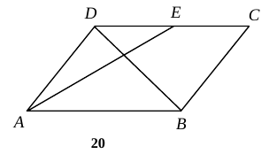
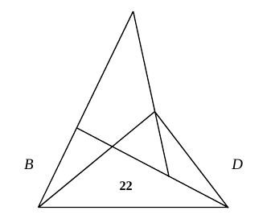
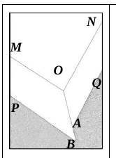
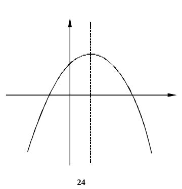
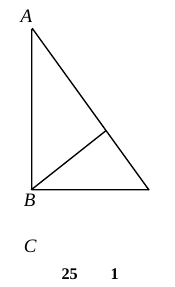
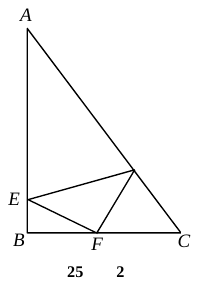
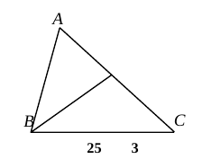

# 2026 一模精讲 · 闵行卷（下）解答题 19-25

> 本篇覆盖第 19-25 题（78 分）。每题给"题目—渐进提示—详解"；卷末附评分点与易错。

## 19．（满分 10 分）计算

$$\sin45^\circ-2\sin60^\circ+\frac{2\cot45^\circ}{\tan60^\circ+1}$$

**提示 1**：先把特殊角三角比全部代入：$\sin45^\circ=\frac{\sqrt2}{2}$、$\sin60^\circ=\frac{\sqrt3}{2}$、$\cot45^\circ=1$、$\tan60^\circ=\sqrt3$。
**提示 2**：分式 $\frac{2}{\sqrt3+1}$ 需分母有理化（分子分母同乘 $\sqrt3-1$）。
**提示 3**：化简后 $-\sqrt3$ 与 $+\sqrt3$ 恰好相消。

**详解**：
$$原式=\frac{\sqrt2}{2}-2\times\frac{\sqrt3}{2}+\frac{2\times1}{\sqrt3+1}\qquad(\text{特殊角三角比})$$
$$\frac{2}{\sqrt3+1}=\frac{2(\sqrt3-1)}{(\sqrt3+1)(\sqrt3-1)}=\sqrt3-1\qquad(\text{分母有理化，平方差公式})$$
$$原式=\frac{\sqrt2}{2}-\sqrt3+\sqrt3-1=\boxed{\frac{\sqrt2}{2}-1}$$

## 20．（满分 10 分，第（1）小题 6 分，第（2）小题 4 分）

如图，已知平行四边形 ABCD 中，点 E 是边 DC 的中点，AE 与对角线 BD 交于点 G，设 $\vec{AB}=\vec a$，$\vec{AD}=\vec b$。

(1) 填空：$\vec{DB}=$　▲　，$\vec{AG}=$　▲　（结果用含 $\vec a$、$\vec b$ 的式子表示）；
(2) 作出向量 $\vec{DG}$ 分别在 $\vec a$、$\vec b$ 方向上的分向量。

**提示 1**：(1) $\vec{DB}=\vec{AB}-\vec{AD}$（终点减起点）；求 $\vec{AG}$ 先表 $\vec{AE}$，再用交点 G 的分比。
**提示 2**：AB∥DE 且 AB＝2DE ⇒ △ABG∽△DEG，对应比 2∶1 ⇒ $AG=\frac23AE$。
**提示 3**：(2) $\vec{DG}=\vec{AG}-\vec{AD}$，拆成平行于 $\vec a$ 的分向量与平行于 $\vec b$ 的分向量（注意第二个与 $\vec b$ 反向）。

**详解**：
**(1)** $\vec{DB}=\vec{AB}-\vec{AD}=\vec a-\vec b$（向量减法）。
E 是 DC 中点，且 $\vec{DC}=\vec{AB}=\vec a$（平行四边形对边平行且相等）⇒ $\vec{DE}=\frac12\vec a$；
$$\vec{AE}=\vec{AD}+\vec{DE}=\vec b+\frac12\vec a\qquad(\text{三角形法则})$$
AB∥DE ⇒ △ABG∽△DEG（平行于三角形一边的直线截其他两边，所得三角形与原三角形相似）⇒ $\dfrac{AG}{GE}=\dfrac{AB}{DE}=2$，∴ $AG=\dfrac23AE$，
$$\vec{AG}=\frac23\vec{AE}=\boxed{\vec{DB}=\vec a-\vec b,\quad \vec{AG}=\frac13\vec a+\frac23\vec b}$$
**(2)** $\vec{DG}=\vec{AG}-\vec{AD}=\dfrac13\vec a-\dfrac13\vec b=\dfrac13\vec a+\dfrac13\vec{DA}$（向量减法；$\vec{DA}=-\vec b$）。
作法：在 DC 上截取 $DH=\dfrac13DC$，则 $\vec{DH}=\dfrac13\vec a$（与 $\vec a$ 同向）；联结并延长使 $\vec{HG}=\dfrac13\vec{DA}$（过 H 作 DA 的平行线，沿 DA 方向截取 $HG=\dfrac13DA$），则 $\vec{DH}$、$\vec{HG}$ 即为 $\vec{DG}$ 在 $\vec a$、$\vec b$ 方向上的分向量，其中沿 $\vec b$ 方向的分向量为 $-\dfrac13\vec b$（与 $\vec b$ 反向）。

## 21．（满分 10 分，第（1）小题 4 分，第（2）小题 6 分）

某餐厅购买了一个送餐机器人，机器人与地面的接触面积可以调整。水平地面上，当机器人对地面的压力一定时，地面所受压强 $p$（Pa）与接触面积 $S$（m²）之间是反比例函数关系（表一）。餐厅地面由玻璃、木地板和大理石拼接而成，地面材质与能承受的最大压强的关系见表二。

表一：

| 地面所受压强 p（Pa） | …… | 4×10⁴ | 6×10⁴ | 8×10⁴ | 1×10⁵ | …… |
| --- | --- | --- | --- | --- | --- | --- |
| 接触面积 S（m²） | …… | 1.2×10⁻³ | 8×10⁻⁴ | 6×10⁻⁴ | 4.8×10⁻⁴ | …… |

表二：

| 地面材质 | 玻璃 | 木地板 | 大理石 |
| --- | --- | --- | --- |
| 能承受的最大压强 p（Pa） | 4.8×10⁷ | 2.4×10⁷ | 2.5×10⁸ |

(1) 求 $p$ 关于 $S$ 的函数表达式（不写定义域）；
(2) 若接触面积 $S$ 保持不变，为了确保机器人在餐厅内不同材料的地面上工作时均不会对地面造成破坏，求接触面积至少为多少平方米？

**提示 1**：设 $p=\dfrac{k}{S}$，用表一任一组数据求 $k$。
**提示 2**：(2) 要找三种材质中"最娇贵"（能承受压强最小）的木地板作限制：$p\le2.4\times10^7$。
**提示 3**：$p$ 越小 $S$ 越大，解不等式取最小面积。

**详解**：
**(1)** 设 $p=\dfrac{k}{S}$（$k\ne0$）。把 $p=4\times10^4$、$S=1.2\times10^{-3}$ 代入：
$$k=4\times10^4\times1.2\times10^{-3}=48\qquad\therefore\ \boxed{p=\frac{48}{S}}$$
**(2)** 三种材质能承受的最大压强中最小的是木地板 $2.4\times10^7$ Pa，故需 $p\le2.4\times10^7$：
$$\frac{48}{S}\le2.4\times10^7\ \Rightarrow\ S\ge\frac{48}{2.4\times10^7}=2\times10^{-6}$$
答：机器人与地面的接触面积至少为 $\boxed{2\times10^{-6}}$ 平方米。

## 22．（满分 12 分，每小题 6 分）

如图，线段 AD 与 BC 相交于点 E，点 F 是 DE 的中点，延长 BA、FC 相交于点 G，∠BAD＝90°，$\dfrac{AE}{CE}=\dfrac{BE}{DE}$。

(1) 求证：∠ABE＝∠FCD；
(2) 如果 DA 平分∠BDC，求证：$\dfrac{BG}{BD}=\dfrac{BC}{2CF}$。

**提示 1**：(1) 已知"两边成比例"，再找相等的夹角——E 处的对顶角；相似之后两个直角由∠BAD＝90° 与 E 在 AD 上转化而来。
**提示 2**：(1) 再用 F 是 Rt△DCE 斜边中点：斜边中线等于斜边一半，造出等腰三角形。
**提示 3**：(2) 角链两条：∠BED＝∠BCG（平角＋等腰的补角）；∠CBG＝∠ABE＝∠EDB（角平分线＋G 在 BA 延长线上），两次相似收口。

**详解**：
**(1)** 在 △BAE 与 △DCE 中：∠AEB＝∠CED（对顶角相等），$\dfrac{AE}{CE}=\dfrac{BE}{DE}$（已知），
∴△BAE∽△DCE（两边成比例且夹角相等的两个三角形相似），
∴∠BAE＝∠DCE，∠ABE＝∠CDE（相似三角形对应角相等）。
∵ E 在 AD 上，∴∠BAE＝∠BAD＝90°，∴∠DCE＝90°，即 △DCE 是直角三角形。
∵ F 是斜边 DE 的中点，∴$CF=\dfrac12DE=DF$（直角三角形斜边上的中线等于斜边的一半），
∴∠FCD＝∠FDC（等边对等角）。又 F 在 DE 上，∠CDE 即∠CDF，∴$\boxed{∠ABE＝∠FCD}$。
**(2)** ∵DA 平分∠BDC，E 在 AD 上，∴∠BDE＝∠CDE＝∠CDF（角平分线定义）；由 (1) ∠ABE＝∠CDF，∴∠ABE＝∠EDB。
∵ B、E、C 共线，∴∠BED＋∠DEC＝180°（平角）；F 在 DE 上 ⇒ ∠FEC＝∠DEC，∴∠BED＋∠FEC＝180°。
∵ G 在 FC 的延长线上，∴∠BCG＋∠BCF＝180°（邻补角）；E 在 BC 上 ⇒ ∠FCE＝∠FCB，∴∠BCG＋∠FCE＝180°。
又 $CF=EF$ ⇒ ∠FCE＝∠FEC（等边对等角），由同角的补角相等得 ∠BED＝∠BCG。
∵ G 在 BA 延长线上，∴射线 BG 与射线 BA 重合，∠CBG＝∠CBA＝∠ABE＝∠EDB。
在 △BCG 与 △DEB 中：∠BCG＝∠DEB，∠CBG＝∠EDB，∴△BCG∽△DEB（两角对应相等的两个三角形相似），
$$\frac{BG}{DB}=\frac{BC}{DE}\qquad(\text{相似三角形对应边成比例})$$
∵ $CF=\dfrac12DE$，∴$DE=2CF$，∴$\boxed{\dfrac{BG}{BD}=\dfrac{BC}{2CF}}$。∎

> ⚠️ 本题题干的中文叙述在页图中缺失，这里由页图（字母、比例式、∠BAD＝90°）与官方答案的证明过程互证重构，数学内容与答案一致。

## 23．（满分 10 分，第（1）小题 4 分，第（2）小题 4 分，第（3）小题 2 分）

探究活动：巧拼地砖外边。装修工人有一大一小两根条形边角料（大条形边角料 MOBP 中 MO∥PB，小条形边角料 NOAQ 中 ON∥AQ，∠MOB＝∠NOA＝135°），如图 1 拼接到直角地砖（∠MON＝90°）的外边上，发现点 A 与点 B 不能重合。为了尽可能节约用料，又能使两根条形边角料拼成一个直角，工人师傅用一把直尺、一支笔和一台切割机，经过图 2—图 9 的操作解决了问题。

【操作说明】图2：画出 QA 的延长线，交 BP 于点 C；图3：联结 OC；图4：沿着射线 OB 方向平移小条形边角料 NOAQ，使点 A 与点 B 重合，得到四边形 O′N′Q′B；图5：画出 MO 的延长线，交小条形边角料的边 O′N′ 于点 D；图6：联结 BD；图7：沿着 OC、BD 切割；图9：拼接切割后的两根条形边角料。

(1) 请根据图 2—图 6 的操作说明，在图①中画出操作过程相应的图形，并按操作过程标注相应的字母；
(2) 如果大条形边角料 MOBP 的宽度为 12cm，小条形边角料 NOAQ 的宽度为 9cm，大条形边角料裁剪后的锐角是∠OCP，那么 $\tan\angle OCP=$　▲；
(3) 请根据上述探究，设计一个新裁剪方案，在图②中画出剪裁方法，并简单说明理由。

**提示 1**：由 ∠MON＝90°、∠MOB＝∠NOA＝135° 算出 ∠BOA＝360°−90°−135°−135°＝0°，即射线 OA 与 OB 重合——这是全题的钥匙。
**提示 2**：(2) QA∥ON、BP∥MO 且 MO⊥ON ⇒ QA⊥BP；过 O 作 BP 的垂线，两条垂线段恰是两个"宽度"。
**提示 3**：(3) 新方案的关键是让两根条形的切割面等长：设切割线与 MO 成锐角 φ，大条形切割面长 $\frac{12}{\sin\varphi}$，小条形切割面长 $\frac{9}{\cos\varphi}$。

**详解**：
**(1)** 依次画出：②作 QA 的延长线交 BP 于 C；③联结 OC；④沿射线 OB 方向平移小条形，使 A 与 B 重合，得四边形 O′N′Q′B（平移距离 $=OB-OA=12\sqrt2-9\sqrt2=3\sqrt2$）；⑤作 MO 的延长线交 O′N′ 于 D（因 O′N′∥ON⊥MO，故 O′D⊥MO，$O'D=3$）；⑥联结 BD。标注字母如图①。
**(2)** ∵∠MON＝90°，∠MOB＝∠NOA＝135°，∴∠BOA＝360°−90°−135°−135°＝0°，即射线 OA 与射线 OB 重合。MO⊥ON、QA∥ON、BP∥MO ⇒ QA⊥BP（垂直于两平行线中的一条）。
过 O 作 OH⊥BP 于 H：则 OH∥ON，$OH=12$（平行线 MO、PB 间的距离＝大条形宽）；$CH=9$（C 在 QA 延长线上，QA 与 ON 间距离＝小条形宽 9，且 H 与 P 都在射线 CP 上）。Rt△OCH 中（∠OHC＝90°）：
$$\tan\angle OCP=\tan\angle OCH=\frac{OH}{CH}=\frac{12}{9}=\boxed{\frac43}$$
**(3)** 新方案：沿射线 OB 方向平移小条形边角料，使其直角顶点 O″ 落在过 O 的切割射线 OA″ 上（O、O″、A″ 共线），然后将两根条形边角料沿同一射线 OA″ 同时切割。理由：设切割射线与 MO 所成锐角为 φ，大条形切割面长 $=\dfrac{12}{\sin\varphi}$，小条形切割面长 $=\dfrac{9}{\cos\varphi}$；令两切割面等长：
$$\frac{12}{\sin\varphi}=\frac{9}{\cos\varphi}\ \Rightarrow\ \tan\varphi=\frac43$$
此时两切割面长均为 15cm，可完全重合；又两根条形分居切割线两侧，拼接后切割面无重叠、无缝隙，两根条形的外边恰好拼成直角并贴合地砖两直角边，用料最省。

> ⚠️ 图②中 E、O″、A″ 的准确位置依答案图转录，作图细节以文字方案为准。

## 24．（满分 12 分，每小题 4 分）

如图，在平面直角坐标系 xOy 中，抛物线 $C_1$：$y=-\dfrac12x^2+bx+c$（$b$、$c$ 是常数）经过点 A（5，−6），对称轴为直线 $x=1$，顶点为 B。

(1) 求抛物线 $C_1$ 的函数表达式及点 B 的坐标；
(2) 点 M 为抛物线 $C_1$ 上的动点，过点 M 作直线 $x=m$。
① 当点 M 在对称轴右侧时，抛物线在直线 $x=m$ 右侧部分（包含交点）的最高点的纵坐标为 $2-m$，求 m 的值；
② 当点 M 不在坐标轴上时，直线 $x=m$ 交抛物线 $C_2$：$y=x^2-2x-3$ 于点 P，过点 P 作 y 轴垂线，垂足为点 D，在线段 PD 的延长线上截取 DQ＝2PD，联结 MQ。当抛物线 $C_1$ 的顶点 B 在△PQM 内部时，直接写出 m 的取值范围。

**提示 1**：(1) 对称轴 $x=-\frac{b}{2a}$ 直接定 $b$，再代点 A 定 $c$。
**提示 2**：① 开口向下 ⇒ 对称轴右侧 $y$ 随 $x$ 增大而减小 ⇒ "右侧部分的最高点"就是交点 M 本身。
**提示 3**：② B 在△PQM 内部 ⟺ B 与 Q 在直线 PM（x＝m）同侧、与 M 在直线 PQ 同侧、与 P 在直线 QM 同侧，逐一翻译成不等式再按 m 的范围分类。

**详解**：
**(1)** 对称轴 $x=-\dfrac{b}{2a}=-\dfrac{b}{2\times(-\frac12)}=b=1$，∴ $b=1$，$y=-\dfrac12x^2+x+c$。代 A(5,−6)：
$$-\frac{25}{2}+5+c=-6\ \Rightarrow\ c=\frac32$$
$$\therefore\ C_1:\ y=-\frac12x^2+x+\frac32=-\frac12(x-1)^2+2\qquad\boxed{B(1,\ 2)}\quad(\text{配方法})$$
**(2)①** 开口向下，在对称轴右侧 $y$ 随 $x$ 增大而减小，故直线 $x=m$ 右侧部分（$x\ge m$）的最高点就是交点 $M\left(m,-\dfrac12m^2+m+\dfrac32\right)$：
$$-\frac12m^2+m+\frac32=2-m\ \Rightarrow\ m^2-4m+1=0\ \Rightarrow\ m=2\pm\sqrt3$$
又 M 在对称轴右侧 ⇒ $m>1$，∴$\boxed{m=2+\sqrt3}$。
**②** $P(m,\ m^2-2m-3)$，$D(0,\ m^2-2m-3)$；DQ＝2PD 沿 PD 延长线 ⇒ $Q(-2m,\ m^2-2m-3)$；$M\left(m,\ -\dfrac12m^2+m+\dfrac32\right)$。记 $y_P=m^2-2m-3$，$y_M=-\dfrac12m^2+m+\dfrac32$，则
$$y_M-y_P=\frac32(-m^2+2m+3)=\frac32(3-m)(m+1),\qquad 2-y_P=5-m^2+2m$$
B(1,2) 在△PQM 内部 ⟺ 三个"同侧"条件同时成立：
- （i）B 与 Q 在直线 PM（$x=m$）同侧：$(1-m)(-2m-m)>0$ ⇒ $(1-m)(-3m)>0$ ⇒ $m<0$ 或 $m>1$；
- （ii）B 与 M 在直线 PQ（$y=y_P$）同侧：$(2-y_P)(y_M-y_P)>0$；
- （iii）B 与 P 在直线 QM 同侧：直线 QM 在 $x=1$ 处的纵坐标 $y_0=y_P+\dfrac{1+2m}{3m}(y_M-y_P)$，P 在 $x=m$ 处直线下（上）方偏差为 $y_P-y_M$，故 $(2-y_0)(y_P-y_M)>0$。化简 $2-y_0=(2-y_P)-\dfrac{1+2m}{3m}(y_M-y_P)=\dfrac{(m+3)(m-1)}{2m}$（展开合并），∴ $\dfrac{(m+3)(m-1)}{2m}\cdot\bigl(-(y_M-y_P)\bigr)>0$。

分类：当 $-1<m<0$ 时 $y_M-y_P>0$，（iii）要求 $(m+3)(m-1)>0$，与 $m<0$ 矛盾，无解；当 $m<-1$ 时 $y_M-y_P<0$，（ii）要求 $2-y_P<0$ 即 $m<1-\sqrt6$（或 $m>1+\sqrt6$ 舍去），（iii）要求 $(m+3)(m-1)<0$ 即 $-3<m<1$，得 $\boxed{-3<m<1-\sqrt6}$；当 $1<m<3$ 时 $y_M-y_P>0$，（iii）要求 $m<1$，矛盾；当 $m>3$ 时 $y_M-y_P<0$，（ii）要求 $m>1+\sqrt6$，（iii）要求 $(m+3)(m-1)>0$ 成立，得 $\boxed{m>1+\sqrt6}$。
综上 $-3<m<1-\sqrt6$ 或 $m>1+\sqrt6$（此时 M 均不在坐标轴上；边界 $m=-3,\ 1\pm\sqrt6$ 使 B 落在边上，"内部"不含，故开区间）。

## 25．（满分 14 分，第（1）①小题 4 分，第（1）②小题 5 分，第（2）小题 5 分）

如图，已知在△ABC 中，点 D 是边 AC 上的一点。

  

(1) 当∠ABC＝90° 时：
① 如图 1，BD 是边 AC 上的高，求证：$BD^2=AD\cdot CD$；
② 如图 2，AD＝AE，点 F 在边 BC 上，且 CF＝CD，顺次联结 DE、EF、FD。如果 EF＝DF，$\tan\angle EFB=\dfrac12$，求 cot C 的值；
(2) 如图 3，如果点 D 是边 AC 的中点，∠ABD＝∠ACB，点 G 在线段 DB 的延长线上，且 BG＝BC，联结 CG，取 CG 中点 H，分别延长 HB、CA 交于点 O，求 $\dfrac{S_{\triangle BOD}}{S_{\triangle COH}}$ 的值。

**提示 1**：① 同一个角（∠A 或∠C）的余角相等，得 △ABD∽△BCD。
**提示 2**：② 由两组等腰算出 ∠EDF＝45°，叠加 EF＝DF 得 ∠EFD＝90°；再作 DH⊥BC，用外角把∠EFB"搬"进 Rt△DFH，得全等三角形。
**提示 3**：(2) 相似 △ABD∽△ACB 给出 $AB^2=AD\cdot AC$、$BC=\sqrt2BD$；BG＝BC 且 H 是 GC 中点 ⇒ BH⊥CG，OH 垂直平分 GC ⇒ ∠OGB＝∠ACB＝∠ABD ⇒ AB∥OG ⇒ $\frac{AD}{OA}=\frac{BD}{BG}$；面积全部用"同高比底"化归到 $S_{\triangle BCD}=a$。

**详解**：
**(1)①** ∵BD⊥AC，∴∠ADB＝∠BDC＝90°。∠A＋∠ABD＝90°（直角三角形两锐角互余），∠ABC＝90° ⇒ ∠CBD＋∠ABD＝90°，∴∠A＝∠CBD（同角的余角相等）。
∴△ABD∽△BCD（两角对应相等的两个三角形相似）⇒ $\dfrac{AD}{BD}=\dfrac{BD}{CD}$，∴$\boxed{BD^2=AD\cdot CD}$。
**(1)②** ∵AE＝AD，∴∠AED＝∠ADE（等边对等角），∠ADE＝$\dfrac{180^\circ-\angle A}{2}$（三角形内角和）；同理 CF＝CD ⇒ ∠CDF＝$\dfrac{180^\circ-\angle C}{2}$。
∴∠EDF＝180°−∠ADE−∠CDF＝$\dfrac{\angle A+\angle C}{2}=45^\circ$（∠A＋∠C＝90°，∠ABC＝90°）。
∵EF＝DF，∴∠FED＝∠FDE＝45°，∠EFD＝90°（三角形内角和）。
过 D 作 DH⊥BC 于 H，则 ∠BFD＝∠FDH＋∠DHB（三角形外角性质），即 ∠EFB＋90°＝∠FDH＋90°，∴∠EFB＝∠FDH。
又 ∠EBF＝∠FHD＝90°，EF＝FD，∴△EBF≌△FHD（AAS），∴FH＝EB，DH＝BF。
Rt△EBF 中 $\tan\angle EFB=\dfrac{EB}{BF}=\dfrac12$，设 $EB=a$、$BF=2a$，则 $DH=2a$、$FH=a$；设 $CH=b$：
$$CD=CF=FH+HC=a+b,\qquad DH^2+CH^2=CD^2\ (\text{勾股定理})\ \Rightarrow\ 4a^2+b^2=(a+b)^2$$
∴$b=\dfrac32a$，∴$\cot C=\dfrac{CH}{DH}=\dfrac{\frac32a}{2a}=\boxed{\dfrac34}$。
**(2)** ∵∠ABD＝∠ACB，∠A＝∠A，∴△ABD∽△ACB（两角对应相等）⇒ $\dfrac{AB}{AC}=\dfrac{AD}{AB}=\dfrac{BD}{CB}$。
设 $AD=CD=k$，则 $AC=2k$，$AB^2=AD\cdot AC=2k^2$，$AB=\sqrt2k$（比例中项）；$\dfrac{BD}{CB}=\dfrac{AD}{AB}=\dfrac1{\sqrt2}$，∴$BC=\sqrt2BD$，设 $BD=m$，$BG=BC=\sqrt2m$。
∵BG＝BC，H 是 GC 中点，∴BH⊥GC 且 ∠BGC＝∠BCG（等腰三角形三线合一）。
∵O 在 HB 延长线上，∴OH⊥GC 且 H 平分 GC，即 OH 是线段 GC 的垂直平分线；联结 OG，∴OG＝OC，∠OGC＝∠OCG（等边对等角）。
∴∠OGC−∠BGC＝∠OCG−∠BCG（等量减等量），即 ∠OGB＝∠OCB＝∠ACB（O 在 CA 延长线上）。
又 ∠ABD＝∠ACB，∴∠ABD＝∠OGB，∴∠ABG＋∠OGB＝180°，∴AB∥OG（同旁内角互补，两直线平行）。
AB∥OG，D、A、O 共线且 D、B、G 共线 ⇒ △DAB∽△DOG ⇒ $\dfrac{AD}{DB}=\dfrac{DO}{DG}=\dfrac{AD+AO}{DB+BG}$（相似三角形对应边成比例、合比性质），整理得 $\dfrac{AD}{OA}=\dfrac{DB}{BG}=\dfrac{BD}{BC}=\dfrac1{\sqrt2}$，∴$OA=\sqrt2k$。
设 $S_{\triangle BCD}=a$，用"同高三角形面积比等于底之比"：
$$S_{\triangle BCO}=\frac{OC}{DC}a=\frac{OA+AC}{DC}a=(2+\sqrt2)a,\qquad S_{\triangle BCG}=\frac{BG}{BD}a=\sqrt2\,a$$
$$S_{\triangle BCH}=\frac12S_{\triangle BCG}=\frac{\sqrt2}{2}a\ (H\text{为}GC\text{中点}),\qquad S_{\triangle OCH}=S_{\triangle OCB}+S_{\triangle HCB}=\left(2+\sqrt2+\frac{\sqrt2}{2}\right)a=\frac{4+3\sqrt2}{2}a$$
$$S_{\triangle BOD}=S_{\triangle BOC}-S_{\triangle BDC}=(1+\sqrt2)\,a\quad(D\text{在}OC\text{上})$$
$$\frac{S_{\triangle BOD}}{S_{\triangle COH}}=\frac{(1+\sqrt2)a}{\frac{4+3\sqrt2}{2}a}=\frac{2+2\sqrt2}{4+3\sqrt2}=\frac{(2+2\sqrt2)(4-3\sqrt2)}{(4+3\sqrt2)(4-3\sqrt2)}=\boxed{2-\sqrt2}$$

## ⚠️ 评分点与易错

- **19**：$2\cot45^\circ=2$ 不要丢；$\dfrac{2}{\sqrt3+1}$ 必须分母有理化后再合并，"约分"是常见失分点。
- **20**：$\vec{AG}$ 的系数 $\frac13$、$\frac23$ 来自 $AG:GE=2:1$，只写到 $\vec{AE}$ 会丢分；(2) 的两个分向量中沿 $\vec b$ 方向的那个与 $\vec b$ **反向**（$-\frac13\vec b$），必须指明方向。
- **21**：(2) 要取三种材质中能承受压强**最小**的木地板作限制；科学记数法运算 $10^4\times10^{-3}$ 易错。
- **22**：相似的依据是"两边成比例且夹角相等"，夹角是对顶角 ∠AEB＝∠CED；∠DCE＝90° 是由 ∠BAE＝90° 相似而来，不能直接当已知写；(2) 中两次"同角的补角相等"是角链关键。
- **23**：(2) 必须先说明射线 OA 与 OB 重合（90°＋135°＋135°＝360°），才能锁定 C 的位置；(3) 的核心是切割面等长条件 $\frac{12}{\sin\varphi}=\frac{9}{\cos\varphi}$，与 (2) 的 $\tan\varphi=\frac43$ 相互印证。
- **24**：①"右侧部分的最高点"就是直线与抛物线的交点（开口向下，右侧单调递减）；② 三条"同侧"条件缺一不可，$m=3$ 时 M 与 P 重合、$m=-1$ 或 $m=0$ 时 M 在坐标轴上，均已排除；边界值使 B 落在三角形边上，取开区间。
- **25**：(1)② 先证 ∠EDF＝45° 再得 ∠EFD＝90°，全等 △EBF≌△FHD 是全部设参的桥梁；(2) 中 AB∥OG 之后用 △DAB∽△DOG 取比例，面积一律用"同高比底"化归，避免死算。
- **题源说明**：第 22 题题干文字由页图与官方答案互证重构（见该题下注）；第 24(2)② 的范围已与答案页逐字核对一致。
