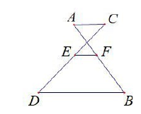
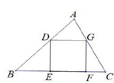
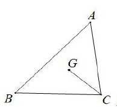
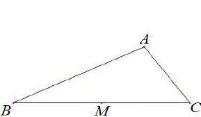

# 2026一模精讲 · 青浦卷（上）第 1~18 题

> 题干与公式已对照卷面页图（150dpi）与原卷 docx 逐题核验（2026-11-04）。流通版 docx/PDF 经 Word 重排转换：页图中文缺失（题干文字以 docx 原文补全，数学式与页图逐一比对）；第 7 题卷面在填空线前印出重复等号（"…y = = ▲"，为转换冗余，本篇按单个等号转录）；第 3 题向量记号在页图中完整可读，无箭头丢失。全部答案与卷末参考答案页逐题互证一致。

## 卷面结构说明

- **试卷**：青浦区 2025 学年第一学期九年级期终学业质量调研 数学试卷（202601），满分 150 分，完卷时间 100 分钟，共 25 题。
- **结构**：一、选择题 6 题 × 4 分 = 24 分；二、填空题 12 题 × 4 分 = 48 分（第 7~18 题）；三、解答题 7 题 78 分（第 19~25 题）。
- **本篇**：第 1~18 题（选择题 + 填空题全部）；解答题精讲见 [[数模26-青浦-下]]。

## 一、选择题

**1.** 下列各组图形中，一定相似的是（　）

- （A）两个等腰三角形
- （B）两个直角三角形
- （C）两个正方形
- （D）两个等腰梯形

> [!tip]- 💡 思路导航
> "一定相似"要求形状被条件完全锁定：等腰三角形、直角三角形、等腰梯形都还剩可以自由变化的角度，看正方形的边与角是否全被确定。

> [!success]- ✅ 详解 · 评分点 · 易错 · 关联
> **详解**：C。两个正方形四角都是直角（对应角相等）、四边对应成比例，一定相似。等腰三角形的顶角、直角三角形的锐角、等腰梯形的底角都可取不同值，形状不唯一，均只是"不一定相似"。
>
> **易错**：把"都是等腰"当成形状相同——腰与底的比例、顶角大小都可不同。
>
> **关联**：[[03-数学/知识点/九年级/相似三角形]]

**2.** 在 △ABC 中，∠C=90°，AC=3，BC=4．下列结论正确的是（　）

- （A）$\sin A=\dfrac35$
- （B）$\cos A=\dfrac35$
- （C）$\tan A=\dfrac35$
- （D）$\cot A=\dfrac35$

> [!tip]- 💡 思路导航
> 先用勾股定理求出斜边 AB，认清 ∠A 的对边（BC）、邻边（AC），再按四个三角比的定义逐一核对。

> [!success]- ✅ 详解 · 评分点 · 易错 · 关联
> **详解**：B。$AB=\sqrt{AC^2+BC^2}=\sqrt{9+16}=5$（勾股定理）。∠A 的对边是 BC=4、邻边是 AC=3：$\sin A=\dfrac45$（A 错）、$\cos A=\dfrac{AC}{AB}=\dfrac35$（B 对）、$\tan A=\dfrac{BC}{AC}=\dfrac43$（C 错）、$\cot A=\dfrac{AC}{BC}=\dfrac34$（D 错）。
>
> **易错**：把 AC 当成 ∠A 的对边（AC 是邻边，对边是 BC）。
>
> **关联**：[[03-数学/知识点/九年级/锐角的三角比与解直角三角形]]

**3.** 已知实数 k（k≠0）及非零向量 $\vec a$，下列结论正确的是（　）

- （A）$|k\vec a|=|k|\cdot|\vec a|$
- （B）$k\vec a=|k|\cdot|\vec a|$
- （C）$|k|\vec a=k|\vec a|$
- （D）$k\vec a=|k|\vec a$

> [!tip]- 💡 思路导航
> 数乘向量的模满足"模的绝对值相乘"；逐项看等式两边是向量还是数量——向量与数量不能画等号，D 还要看 k 的符号。

> [!success]- ✅ 详解 · 评分点 · 易错 · 关联
> **详解**：A。A：数乘向量的模等于 k 的绝对值乘以 $\vec a$ 的模，成立；B：左边 $k\vec a$ 是向量、右边 $|k|\cdot|\vec a|$ 是数量，不能相等；C：左边 $|k|\vec a$ 是向量、右边 $k|\vec a|$ 是数量，不能相等；D：$k<0$ 时 $k\vec a$ 与 $|k|\vec a$ 方向相反，仅当 $k>0$ 才成立，不成立。
>
> **易错**：忽略向量的方向性——D 中 k 为负时等式不成立；B、C 中"向量 = 数量"本身就是类型错误。
>
> **关联**：[[03-数学/知识点/九年级/平面向量]]

**4.** 二次函数 $y=x^2-4x+1$ 的图像一定不经过（　）

- （A）第一象限
- （B）第二象限
- （C）第三象限
- （D）第四象限

> [!tip]- 💡 思路导航
> 配方定顶点与开口，再按 x 的符号分段考察纵坐标的符号；抓住"x<0 时 y 的符号"这一关键即可排除一个象限。

> [!success]- ✅ 详解 · 评分点 · 易错 · 关联
> **详解**：C。$y=(x-2)^2-3$，开口向上，顶点 $(2,-3)$ 在第四象限。x<0 时 $x^2>0$、$-4x>0$，故 $y=x^2-4x+1>1>0$，图像只能落在第二象限；$2-\sqrt3<x<2+\sqrt3$ 时 y<0，此时 x>0，图像在第四象限；其余部分 y>0 且 x>0，在第一象限。故图像经过一、二、四象限，一定不经过第三象限。
>
> **易错**：只看顶点在第四象限就下结论——需说明各象限的经过与否，尤其 x<0 时 y 恒正。
>
> **关联**：[[03-数学/知识点/九年级/二次函数]]

**5.** 已知 BD 是四边形 ABCD 的对角线，∠BDC=∠A，下列补充的条件中，**不能**判定 △ABD 和 △BCD 相似的是（　）

- （A）$\angle ABD=\angle CBD$
- （B）$\angle ADB=\angle C$
- （C）$AB\cdot DC=AD\cdot DB$
- （D）$BD^2=AD\cdot CD$

> [!tip]- 💡 思路导航
> 已有一组等角 ∠A=∠BDC，判定只需再补一组等角（AA），或夹这对等角的两组边对应成比例（SAS）；逐项按"A↔D"的对应关系去核对，注意 D 选项中公共边 BD 出现了两次。

> [!success]- ✅ 详解 · 评分点 · 易错 · 关联
> **详解**：D。已知 ∠A=∠BDC。
> A：补 ∠ABD=∠CBD，两角对应相等（A↔D、B↔B、D↔C），△ABD∽△DBC，能判定；
> B：补 ∠ADB=∠C，同样两角对应相等，能判定；
> C：$AB\cdot DC=AD\cdot DB\iff \dfrac{AB}{DB}=\dfrac{AD}{DC}$，即夹等角 ∠A 与 ∠BDC 的两组对应边成比例，两边成比例且夹角相等，能判定；
> D：$BD^2=AD\cdot CD$ 中公共边 BD 出现两次，无论哪种对应都凑不出"夹等角的两边对应成比例"，不能判定。
>
> **易错**：C 变形后误以为要"AB/AD=DB/DC"才行——夹角两边对应可以整体按 A↔D、B↔B、D↔C 搭配；D 中的比例式涉及的三条边不属于同一组对应关系。
>
> **关联**：[[03-数学/知识点/九年级/相似三角形]]

**6.** 学校在操场上举行庄严的升旗仪式，每个学生均站立在旗杆前方的水平地面上面向国旗行注目礼．已知国旗的初始位置距地面高度均大于或等于每个学生的身高．如果将看向国旗的视线与水平视线所形成的夹角定义为注视角，那么国旗从初始位置开始匀速上升至顶端的过程中，以下说法正确的是（　）

- （A）每个学生的注视角大小不变
- （B）每个学生的注视角逐渐减小
- （C）每个学生的注视角逐渐增大
- （D）同一时刻，相同身高学生的注视角相等

> [!tip]- 💡 思路导航
> 设旗杆上国旗高度 h、学生眼高 h₀、学生到旗杆的水平距离 d，注视角 θ 满足 $\tan\theta=\dfrac{h-h_0}{d}$；上升过程中哪个量在变、哪些量不变，一比便知。

> [!success]- ✅ 详解 · 评分点 · 易错 · 关联
> **详解**：C。$\tan\theta=\dfrac{h-h_0}{d}$：上升过程中 h 增大，h₀ 与 d 不变（初始高度不低于身高保证 $h\ge h_0$，θ 非负），故 tan θ 逐渐增大，θ 逐渐增大，C 正确、A/B 错误；同一时刻相同身高的学生若与旗杆距离不同，则 d 不同、注视角不同，D 错误。
>
> **易错**：忽略"离旗杆远近"对注视角的影响而误选 D。
>
> **关联**：[[03-数学/知识点/九年级/锐角的三角比与解直角三角形]]

## 二、填空题

**7.** 如果 $x:y=5:2$，那么 $(x-y):y=$＿＿＿＿＿＿＿＿．

> [!tip]- 💡 思路导航
> 比的前项拆分：$(x-y):y=x:y-y:y$，整体代入已知比值。

> [!success]- ✅ 详解 · 评分点 · 易错 · 关联
> **详解**：$3:2$。$(x-y):y=\dfrac{x}{y}-1=\dfrac52-1=\dfrac32$，即 $3:2$。
>
> **易错**：把 $(x-y):y$ 算成 $x:y-y=5:2-2$ 之类的混乱写法；比要化成同一分母再相减。

**8.** 如果两个相似三角形的周长之比是 1:2，那么这两个三角形的相似比是＿＿＿＿＿＿＿＿．

> [!tip]- 💡 思路导航
> 相似三角形中，周长比等于相似比——不用平方。

> [!success]- ✅ 详解 · 评分点 · 易错 · 关联
> **详解**：$1:2$。相似比 = 对应线段的比 = 周长之比 = 1:2。
>
> **易错**：与面积比混淆而开方得 $1:\sqrt2$；周长比、对应边比都不需要开方。
>
> **关联**：[[03-数学/知识点/九年级/相似三角形]]

**9.** 在比例尺为 1:1000 的图纸上，一座建筑物的高是 2 厘米，它的实际高度是＿＿＿＿＿＿＿＿米．

> [!tip]- 💡 思路导航
> 实际距离 = 图上距离 × 1000，最后注意厘米换米。

> [!success]- ✅ 详解 · 评分点 · 易错 · 关联
> **详解**：20。$2\times1000=2000$（厘米）$=20$ 米。
>
> **易错**：漏换单位答成 2000；比例尺 1:1000 是长度比，不是面积比。

**10.** 抛物线 $y=x^2-2x$ 与 y 轴的交点坐标是＿＿＿＿＿＿＿＿．

> [!tip]- 💡 思路导航
> 与 y 轴相交即横坐标为 0，令 x=0 求 y。

> [!success]- ✅ 详解 · 评分点 · 易错 · 关联
> **详解**：$(0,0)$。令 x=0，得 y=0，交点为原点。
>
> **易错**：令 y=0 去求与 x 轴的交点；与 y 轴交点横坐标必为 0。
>
> **关联**：[[03-数学/知识点/九年级/二次函数]]

**11.** 如果抛物线 $y=(a-1)x^2-1$ 有最高点，那么实数 a 的取值范围是＿＿＿＿＿＿＿＿．

> [!tip]- 💡 思路导航
> "有最高点"即开口向下，由二次项系数的符号决定。

> [!success]- ✅ 详解 · 评分点 · 易错 · 关联
> **详解**：$a<1$。有最高点 ⇔ 开口向下 ⇔ 二次项系数 $a-1<0$，即 $a<1$。
>
> **关联**：[[03-数学/知识点/九年级/二次函数]]

**12.** 在平面直角坐标系 xOy 中，已知点 A(−3,0)、B(2,12)，则 ∠BAO 正弦值是＿＿＿＿＿＿＿＿．

> [!tip]- 💡 思路导航
> ∠BAO 的顶点在 A：一边是射线 AO（x 轴正方向），另一边是射线 AB。求出 AB 长，再取 B 相对 A 的竖直落差与 AB 之比。

> [!success]- ✅ 详解 · 评分点 · 易错 · 关联
> **详解**：$\dfrac{12}{13}$。$AB=\sqrt{(2+3)^2+12^2}=\sqrt{25+144}=13$（两点间距离公式）。射线 AO 沿 x 轴正方向，B 相对 A 的竖直落差为 12，∴$\sin\angle BAO=\dfrac{12}{13}$。
>
> **易错**：把 ∠BAO 的顶点当成 O；竖直落差应除以斜边 AB 而不是水平距离 5。
>
> **关联**：[[03-数学/知识点/九年级/锐角的三角比与解直角三角形]]

**13.** 如图 1，已知 AC∥EF∥DB，AF:BF=2:3，CD=10，CE=＿＿＿＿＿＿＿＿．

> [!tip]- 💡 思路导航
> 三条平行线截两条相交的直线 AB、CD：上段比下段在两条截线上相同——AF:BF 对应 CE:ED，再按比例分 CD=10。

> [!success]- ✅ 详解 · 评分点 · 易错 · 关联
> **详解**：4。AC∥EF∥DB，直线 AB、CD 被三条平行线所截（A、C 在最上层线，F、E 在中间层，B、D 在最下层线），∴$\dfrac{AF}{BF}=\dfrac{CE}{ED}=\dfrac23$（平行线分线段成比例）。CD=10，∴$CE=\dfrac{2}{2+3}\times10=4$。
>
> **易错**：对应段写反（E 对应 F、D 对应 B）；CE 占 CD 的 $\frac25$ 而不是 $\frac23$。
>
> **关联**：[[03-数学/知识点/九年级/相似三角形]] · 平行线分线段成比例

**14.** 小海沿着坡度为 1:√3 的斜坡上行 80 米时，他的铅垂高度上升了＿＿＿＿＿＿＿＿米．

> [!tip]- 💡 思路导航
> 坡度 i = 铅直:水平 = tan 坡角；$1:\sqrt3$ 对应 30° 坡角，铅垂高度 = 坡面行程 × sin 坡角。

> [!success]- ✅ 详解 · 评分点 · 易错 · 关联
> **详解**：40。坡度 $i=1:\sqrt3$，即 $\tan\alpha=\dfrac1{\sqrt3}$，坡角 $\alpha=30°$。沿斜坡上行 80 米，铅垂高度 $=80\sin30°=40$（米）。
>
> **易错**：把 80 米当成水平距离或铅垂高度去解直角三角形；"上行 80 米"指沿坡面行进 80 米。
>
> **关联**：[[03-数学/知识点/九年级/锐角的三角比与解直角三角形]]

**15.** 如果等边三角形的周长为 C，面积为 S，那么面积 S 关于周长 C 的函数解析式为＿＿＿＿＿＿＿＿．

> [!tip]- 💡 思路导航
> 边长 = 周长 ÷ 3，代入等边三角形面积公式 $\dfrac{\sqrt3}{4}a^2$，化为关于 C 的解析式。

> [!success]- ✅ 详解 · 评分点 · 易错 · 关联
> **详解**：$S=\dfrac{\sqrt3}{36}C^2$（C>0）。边长 $a=\dfrac C3$，$S=\dfrac{\sqrt3}{4}a^2=\dfrac{\sqrt3}{4}\left(\dfrac C3\right)^2=\dfrac{\sqrt3}{36}C^2$。
>
> **易错**：忘写自变量取值范围 C>0；系数错成 $\frac{\sqrt3}{4}$ 或 $\frac{\sqrt3}{12}$（忘平方）。

**16.** 如图 2，正方形 DEFG 的顶点均在 △ABC 的边上，BC=6，DE=2，BC 边上高线长为＿＿＿＿＿＿＿＿．

> [!tip]- 💡 思路导航
> 正方形对边平行 ⇒ DG∥BC ⇒ △ADG∽△ABC；DG=DE=2，相似比用"高被正方形截去 2"来表示，列方程解高。

> [!success]- ✅ 详解 · 评分点 · 易错 · 关联
> **详解**：3。设 BC 边上高线长为 h。正方形 DEFG 中 $DG\parallel BC$ 且 $DG=DE=2$，∴△ADG∽△ABC，相似比 $=\dfrac{DG}{BC}=\dfrac{h-2}{h}$（A 到 DG 的距离为 h−2），即 $\dfrac{2}{6}=\dfrac{h-2}{h}$，解得 $h=3$。
>
> **易错**：分子写成 h−DE 时漏掉"DG=DE=2"这层正方形性质的转换；相似比对应错成 $\frac{h}{h-2}$。
>
> **关联**：[[03-数学/知识点/九年级/相似三角形]]

**17.** 如图 3，点 G 是 △ABC 的重心，AB=4，BC=3，tan B=1，则 $\cot\angle BCG=$＿＿＿＿＿＿＿＿．

> [!tip]- 💡 思路导航
> 建系最直接：B 为原点、BC 在 x 轴上。tan B=1 说明 ∠B=45°，AB=4 直接给出 A 的坐标；G 是三顶点坐标的平均值，最后在 C 处看 CG 的水平、竖直分量之比。

> [!success]- ✅ 详解 · 评分点 · 易错 · 关联
> **详解**：$\dfrac{3\sqrt2-2}{2}$。以 B 为原点、BC 所在直线为 x 轴建系，则 C(3,0)；tan B=1 即 ∠B=45°，$AB=4$，∴$A=(4\cos45°,\ 4\sin45°)=(2\sqrt2,\ 2\sqrt2)$。
> 重心 $G=\left(\dfrac{2\sqrt2+3+0}{3},\ \dfrac{2\sqrt2+0+0}{3}\right)=\left(\dfrac{2\sqrt2+3}{3},\ \dfrac{2\sqrt2}{3}\right)$。
> 在 C 处：CG 的竖直分量为 $\dfrac{2\sqrt2}{3}$，水平分量为 $3-\dfrac{2\sqrt2+3}{3}=\dfrac{6-2\sqrt2}{3}$，
> ∴$\cot\angle BCG=\dfrac{(6-2\sqrt2)/3}{2\sqrt2/3}=\dfrac{6-2\sqrt2}{2\sqrt2}=\dfrac{6\sqrt2-4}{4}=\dfrac{3\sqrt2-2}{2}$。
>
> **易错**：cot 用成"竖直比水平"（那是 tan）；重心坐标错用中线 2:1 时把比例方向弄反。
>
> **关联**：[[03-数学/知识点/九年级/锐角的三角比与解直角三角形]] · 三角形重心

**18.** 如图 4，已知 △ABC 中，$\tan B=\dfrac{\sqrt2}{3}$，$\tan C=\sqrt2$，$BC=4\sqrt2$．点 M 是 BC 中点，点 D 在边 AB 上，连接 DM，将 △BDM 沿着直线 DM 翻折，点 B 的对应点为点 E．联结 AE，如果 AE∥BC，那么 ∠BMD 的度数为＿＿＿＿＿＿＿＿．

> [!tip]- 💡 思路导航
> 先作 BC 边上的高把两个 tan 化成具体长度，得到 A 的高度与 M 的位置；翻折给出两条硬信息——ME=MB 且折痕 DM 平分 ∠BME；AE∥BC 说明 E 与 A 同高，用勾股定出 E 的两个可能位置，各得一个折痕方向。

> [!success]- ✅ 详解 · 评分点 · 易错 · 关联
> **详解**：22.5° 或 67.5°。作 AF⊥BC 于 F。设 AF=h：$\tan B=\dfrac{h}{BF}=\dfrac{\sqrt2}{3}$，$\tan C=\dfrac{h}{FC}=\sqrt2$，∴$BF=\dfrac{3}{\sqrt2}h$、$FC=\dfrac{1}{\sqrt2}h$，$BF+FC=BC=4\sqrt2$ ⇒ $\dfrac{4}{\sqrt2}h=4\sqrt2$ ⇒ $h=2$，从而 $BF=3\sqrt2$、$FC=\sqrt2$。
> $BC=4\sqrt2$，M 为中点，∴$BM=2\sqrt2$，$MF=BF-BM=\sqrt2$。
> AE∥BC ⇒ E 与 A 同高，即 E 到 BC 的距离为 2。翻折 ⇒ $ME=MB=2\sqrt2$，且折痕 DM 是 BE 的垂直平分线（M 在其上），故 DM 平分 ∠BME。设 E 在 BC 上的射影为 H，则 $EH=2$，$MH=\sqrt{ME^2-EH^2}=\sqrt{8-4}=2$（勾股定理）。
> **情形一**：E 在 M 左侧 2 处（靠 B 一侧），ME 与 MB（都指向左）夹角 $\tan\angle BME=\dfrac{EH}{MH}=\dfrac22=1$，∠BME=45°，∴∠BMD=$\dfrac12\times45°=22.5°$；
> **情形二**：E 在 M 右侧 2 处（靠 C 一侧），∠BME=180°−45°=135°，∴∠BMD=$\dfrac12\times135°=67.5°$。
> 两种情形中，折痕（∠BME 的平分线）与线段 AB 的交点 D 都落在 B、A 之间，两解均成立。∴∠BMD 为 22.5° 或 67.5°。
>
> **易错**：漏掉 E 在 M 两侧的两种位置；误以为折痕与 AB 的交点一定在线段上——两情形都需检验 D 在边 AB 上（本题均成立）。
>
> **关联**：[[03-数学/知识点/九年级/相似三角形]] · [[03-数学/知识点/九年级/锐角的三角比与解直角三角形]] · 轴对称（翻折）

## 答案速查

| 题号 | 1 | 2 | 3 | 4 | 5 | 6 | 7 | 8 | 9 |
| ---- | - | - | - | - | - | - | -- | -- | -- |
| 答案 | C | B | A | C | D | C | 3:2 | 1:2 | 20 |

| 题号 | 10 | 11 | 12 | 13 | 14 | 15 | 16 | 17 | 18 |
| ---- | -- | -- | ---- | -- | -- | -- | -- | -- | -- |
| 答案 | (0,0) | a<1 | $\dfrac{12}{13}$ | 4 | 40 | $S=\dfrac{\sqrt3}{36}C^2$（C>0） | 3 | $\dfrac{3\sqrt2-2}{2}$ | 22.5° 或 67.5° |

## 🔗 关联

- [[03-数学/知识点/九年级/相似三角形]] · [[03-数学/知识点/九年级/锐角的三角比与解直角三角形]] · [[03-数学/知识点/九年级/二次函数]] · [[03-数学/知识点/九年级/平面向量]]
- 解答题见 [[数模26-青浦-下]]
