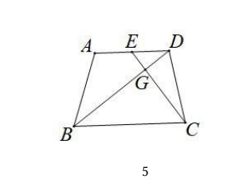
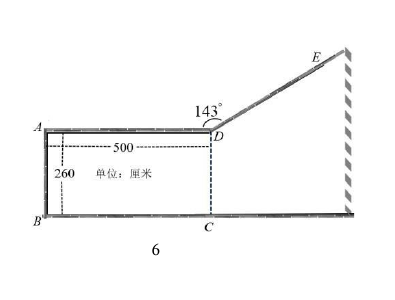
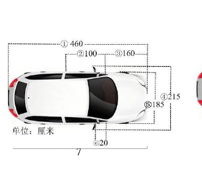
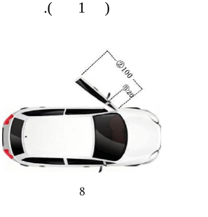
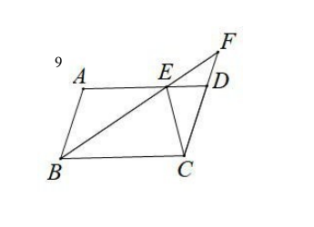
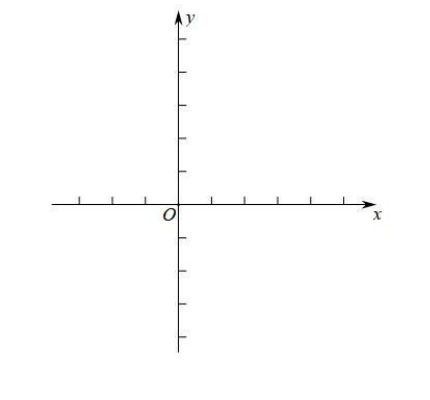
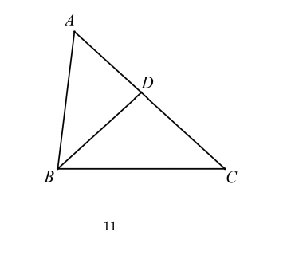
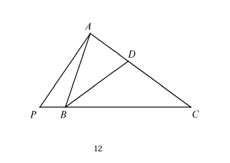

# 2026一模精讲 · 青浦卷（下）第 19~25 题

> 题干与公式已对照卷面页图（150dpi，p1~p5 为试卷、p6~p10 为参考答案）与原卷 docx 逐题核验（2026-11-04）。流通版 docx/PDF 经 Word 重排转换：页图中文缺失（题干文字以 docx 原文补全，数学式与页图逐一比对）；第 23 题的两条"求证"在 docx 中连排一段，已按页图分行转录；第 25 题题干仅给出"BD 平分∠ABC"，点 D 在边 AC 上由图 11、图 12 示出。每题解答均与卷面参考答案逐题互证，评分点依参考答案页的分值标注整理。

## 卷面结构说明

- **试卷**：青浦区 2025 学年第一学期九年级期终学业质量调研 数学试卷（202601），满分 150 分，完卷时间 100 分钟，共 25 题。
- **结构**：一、选择题 6 题 × 4 分 = 24 分；二、填空题 12 题 × 4 分 = 48 分（第 7~18 题）；三、解答题 7 题 78 分（第 19~25 题：19~22 每题 10 分、23~24 每题 12 分、25 题 14 分）。
- **本篇**：第 19~25 题（解答题全部）；第 1~18 题见 [[数模26-青浦-上]]。

## 三、解答题

**19.**（本题满分 10 分）计算：$2(1-\cot 30°)+\dfrac{4\sin 60°}{3\tan 30°-\tan 45°}$

> [!tip]- 💡 思路导航
> 四个特殊角三角比（cot30°、sin60°、tan30°、tan45°）先全部化成根号或分数代入，分子分母各自化简：分母是"先乘后减"，分子约分后还要分母有理化，最后合并同类根式。

> [!success]- ✅ 详解 · 评分点 · 易错 · 关联
> **详解**：$\cot30°=\sqrt3$，$\sin60°=\dfrac{\sqrt3}{2}$，$\tan30°=\dfrac{\sqrt3}{3}$，$\tan45°=1$（特殊角三角比）。
> 原式 $=2(1-\sqrt3)+\dfrac{4\times\frac{\sqrt3}{2}}{3\times\frac{\sqrt3}{3}-1}=(2-2\sqrt3)+\dfrac{2\sqrt3}{\sqrt3-1}$（8 分）
> $=(2-2\sqrt3)+\dfrac{2\sqrt3(\sqrt3+1)}{(\sqrt3+1)(\sqrt3-1)}=(2-2\sqrt3)+\sqrt3(\sqrt3+1)$（分母有理化）
> $=2-2\sqrt3+3+\sqrt3=\boxed{5-\sqrt3}$（2 分）。
>
> **评分点**：正确代换四个特殊角三角比并完成化简（8 分）；得出最终结果（2 分）。
>
> **易错**：$\cot30°=\sqrt3$，别写成 $\frac{\sqrt3}{3}$；分母 $3\tan30°-\tan45°=\sqrt3-1$，先算乘法再相减；$\dfrac{2\sqrt3}{\sqrt3-1}$ 必须分母有理化（分子分母同乘 $\sqrt3+1$）后再合并，直接留着根号在分母会扣过程分。
>
> **关联**：[[03-数学/知识点/九年级/锐角的三角比与解直角三角形]]

**20.**（本题满分 10 分，第（1）小题 5 分，第（2）小题 5 分）
已知抛物线 $y=(x-1)(x+3)$．
（1）写出这条抛物线的开口方向、对称轴，以及它的变化情况；
（2）将这条抛物线平移，使其顶点 P 移到点 Q(-3,1) 的位置，求抛物线平移的距离．

> [!tip]- 💡 思路导航
> 交点式先化为顶点式，开口、对称轴、增减性一并读出；（2）的关键是"抛物线的平移就是抛物线上所有点的平移"，平移的距离即线段 PQ 的长度，用两点间距离公式求出。

> [!success]- ✅ 详解 · 评分点 · 易错 · 关联
> **详解**：**（1）** $y=(x-1)(x+3)=x^2+2x-3=(x+1)^2-4$（1 分）。
> ∴抛物线的开口方向向上，对称轴为直线 $x=-1$（2 分）；在对称轴直线 $x=-1$ 左侧部分是下降的（y 随 x 的增大而减小），右侧部分是上升的（y 随 x 的增大而增大）（2 分）。
>
> **（2）** 由（1）得顶点 $P(-1,-4)$（2 分）。
> ∵抛物线的平移就是抛物线上所有点的平移，∴平移的距离等于线段 PQ 的长（1 分）。
> $PQ=\sqrt{(-1+3)^2+(-4-1)^2}=\sqrt{4+25}=\sqrt{29}$（两点间距离公式），
> ∴抛物线平移的距离是 $\boxed{\sqrt{29}}$（2 分）。
>
> **评分点**：（1）化为顶点式（1 分）、开口方向与对称轴（2 分）、变化情况（2 分）；（2）顶点 P 的坐标（2 分）、指出平移距离 = PQ（1 分）、求出 PQ（2 分）。
>
> **易错**："变化情况"必须答"对称轴左侧下降、右侧上升"，只写开口和对称轴会丢分；平移距离是位移的长度（标量）$\sqrt{29}$，不是水平位移 2 或竖直位移 5；顶点是 $(-1,-4)$，由 $y=(x+1)^2-4$ 读出，别把符号弄反。
>
> **关联**：[[03-数学/知识点/九年级/二次函数]]

**21.**（本题满分 10 分，第（1）小题 4 分，第（2）小题 6 分）
如图 5，在梯形 ABCD 中，AD∥BC，已知 AD : BC = 2 : 3，点 E 是 AD 的中点，联结 EC 交 BD 于点 G．
（1）如果 △EDG 的面积等于 5，求 △BCG 的面积；
（2）设 $\vec{BA}=\vec a$，$\vec{BC}=\vec b$，求向量 $\vec{BG}$ 关于向量 $\vec a$、$\vec b$ 的分解式．

> [!tip]- 💡 思路导航
> AD∥BC 直接给出"8 字型"相似 △EDG∽△BCG，面积比等于相似比的平方；（2）先由相似把 BG 放到 BD 上去，再把 $\vec{BD}$ 用 $\vec a$、$\vec b$ 分解——注意 E 是中点且 AD : BC = 2 : 3，$\vec{AD}$ 与 $\vec b$ 同向。

> [!success]- ✅ 详解 · 评分点 · 易错 · 关联
> **详解**：**（1）** ∵AD : BC = 2 : 3，点 E 是 AD 的中点，∴$\dfrac{DE}{BC}=\dfrac{AD/2}{BC}=\dfrac13$（1 分）。
> ∵AD∥BC，∴∠EDG=∠GBC，∠EGD=∠GCB，∴△EDG∽△BCG（两角对应相等的两个三角形相似），
> ∴$\dfrac{S_{\triangle DEG}}{S_{\triangle BCG}}=\left(\dfrac{DE}{BC}\right)^2=\dfrac19$（2 分）。
> ∵$S_{\triangle DEG}=5$，∴$S_{\triangle BCG}=9S_{\triangle DEG}=\boxed{45}$（1 分）。
>
> **（2）** 由 △EDG∽△BCG 得 $\dfrac{DG}{BG}=\dfrac{DE}{BC}=\dfrac13$（1 分），∴$BG=3DG$，$\dfrac{BG}{BD}=\dfrac34$，即 $\vec{BG}=\dfrac34\vec{BD}$（1 分）。
> ∵AD : BC = 2 : 3，AD∥BC，$\vec{BC}=\vec b$，∴$\vec{AD}=\dfrac23\vec b$（1 分）。
> $\vec{BD}=\vec{BA}+\vec{AD}=\vec a+\dfrac23\vec b$，且 $\vec{BG}$ 与 $\vec{BD}$ 方向相同（1 分），
> ∴$\vec{BG}=\dfrac34\vec{BD}=\dfrac34\left(\vec a+\dfrac23\vec b\right)=\boxed{\dfrac34\vec a+\dfrac12\vec b}$（2 分）。
>
> **评分点**：（1）DE : BC = 1 : 3（1 分）、相似与面积比 1 : 9（2 分）、S=45（1 分）；（2）$\dfrac{DG}{BG}=\dfrac{DE}{BC}=\dfrac13$（1 分）、$\vec{BG}=\dfrac34\vec{BD}$（1 分）、$\vec{AD}=\dfrac23\vec b$（1 分）、$\vec{BD}$ 的分解与同向说明（1 分）、最终分解式（2 分）。
>
> **易错**：面积比是相似比的**平方**（1 : 9），误用 1 : 3 即错；$\vec{BG}=\frac34\vec{BD}$ 的系数来自 BG : GD = 3 : 1（BG 占全长 3/4），写成 $\frac13$ 或 $\frac23$ 都不对；$\vec{AD}$ 与 $\vec{BC}$ 同向（梯形 AD∥BC），系数 $\frac23$ 别颠倒成 $\frac32$。
>
> **关联**：[[03-数学/知识点/九年级/相似三角形]] · [[03-数学/知识点/九年级/平面向量]]

**22.**（本题满分 10 分，第（1）小题 5 分，第（2）小题 5 分）
某小区为方便居民停车，拟在角落处增设一个矩形停车位 ABCD，车位的三面围墙及墙 DE 均高于车顶，相关数据如图 6 所示．已知拟停在该车位的汽车前车门完全打开时与车身夹角为 70°，当前车门与车身夹角不小于 25° 时，驾驶员能顺畅地出来．图 7 是该汽车外形的部分数据，例如：数据②是前车门长度 100 厘米，数据④是车外后视镜完全打开时车身占用的宽度为 215 厘米．图 8 是车门打开的示意图．假设车身始终与墙 BC 保持平行，车外后视镜完全打开时与墙之间有 10 厘米的安全距离．（参考数据：$\sin70°≈0.94$，$\cos70°≈0.34$，$\tan70°≈2.76$，$\sin25°≈0.42$，$\cos25°≈0.91$，$\tan25°≈0.46$，$\sin53°≈0.80$，$\cos53°≈0.60$，$\tan53°≈1.33$．）结合上述条件，回答下列问题：
（1）当该汽车倒车停入车位 ABCD 区域时，驾驶员是否能够顺畅地从车中出来？请说明理由．
（2）已知车库门前有一条平行于 CD 且与 CD 距离 270 厘米的人行道，当驾驶室的车门能完全打开时，汽车是否占用到人行道？请说明理由．（精确到 1 厘米）

 

> [!tip]- 💡 思路导航
> 车位进深 260 厘米是"总账"：倒车停入后车头朝开口 CD 一侧，驾驶员一侧靠墙 AD，车门绕轴 F 向上开，车门末端超出车身侧线的高度＝车门长 × sin（车门与车身的夹角）；把它与车身宽、后视镜外伸的一半、安全距离相加，与车位进深比较。（2）中完全打开所需净空超过车位深度，车门只能伸向车位外侧——车门末端绕 F 旋转的圆恰与斜墙 DE 相切（FP⊥DE 且 FP＝车门长）就是临界位置，再用两个直角三角形把水平距离串到车头，与 270 比较。

> [!success]- ✅ 详解 · 评分点 · 易错 · 关联
> **详解**：**（1）** 设驾驶员一侧车身所在直线为 MN，F 为前车门与车身的连接处（车门旋转轴），G 为车门外端，则 FG=100（数据②：前车门长度）。过点 G 作 GH⊥MN，垂足为 H。车门与车身夹角最小时为 25°，此时 Rt△GFH 中 ∠GFH=25°（1 分）。
> ∵$\sin\angle GFH=\dfrac{GH}{GF}$，∴$GH=100\sin25°≈42$（厘米）（2 分）。
> 副驾驶一侧后视镜伸出车身 $\dfrac{215-185}{2}=15$（厘米），与墙 BC 之间留 10 厘米安全距离。从车门末端到墙 BC 共需
> $42+185+15+10=252$（厘米）（1 分）。
> ∵$252<260$（车位垂直于 BC 方向的深度 AB），∴驾驶员能够顺畅地从车中出来（1 分）。
>
> **（2）** 车门完全打开（与车身成 70°）时，车门末端到 MN 的距离为 $100\sin70°≈94$（厘米）。
> ∵$94+185+15+10=304>260$，∴前车门在矩形 ABCD 内部不能完全打开（1 分）。
> 车门只能伸到车位外部：车头一侧越出开口 CD，其上方已无墙 AD（墙 AD 止于点 D），对应边界是斜墙 DE。车门末端绕 F 旋转的轨迹是以 F 为圆心、FG=100 为半径的圆；过 F 作 FP⊥DE，垂足 P 在 DE 上。∵∠ADE=143°，∴DE 与车身方向（水平）成 37° 角，FP 与水平成 53°，即 ∠MFP=53°<70°（M 为 MN 上沿车身向后方向的点），切线方向落在车门 0°~70° 的旋转范围内；当 FP=FG=100 时，车门末端的轨迹圆与斜墙 DE 相切（在 53° 的最小距离状态车门能完全打开，那么在 70° 时车门也一定能完全打开），取这个临界位置。
> 过点 P 作 PR⊥MN 于 R，延长 AD 交 PR 于点 Q（1 分）。在 Rt△PFR 中，∠PFR=53°：
> $PR=100\sin53°≈80$（厘米），$FR=100\cos53°=60$（厘米）（1 分）。
> MN 到 BC 的距离为 185+15+10=210，故 Q（在直线 AD 上）到 MN 的距离为 260−210=50，
> ∴$PQ=PR+185+15+10-260=80+210-260=30$（厘米），即 P 在直线 AD 上方 30 厘米处。
> 在 Rt△DPQ 中，∠DPQ=53°（DP 沿斜墙 DE，与水平成 37°，故与竖直的 PQ 成 53°），
> ∵$\tan\angle DPQ=\dfrac{QD}{PQ}$，∴$QD=30\tan53°≈39.9$（厘米）。
> 车头最前端到直线 CD 的距离为 $QD+FR+③≈39.9+60+160≈260$（厘米）（数据③：前车门旋转轴到车头最前端 160 厘米），
> ∵$260<270$，∴当驾驶室的车门能完全打开时，汽车没有占用人行道（2 分）。
>
> **评分点**：（1）构设 MN、FG 与 ∠GFH=25°（1 分）、GH=100sin25°≈42（2 分）、总和 252（1 分）、252<260 得结论（1 分）；（2）车内不能完全打开的判断（1 分）、临界位置 FP=FG=100、∠MFP=53°<70° 的说明与辅助线 PR、Q 的构造（1 分）、Rt△PFR 求 PR=80、FR=60（1 分）、Rt△DPQ 求 QD≈39.9 并与 270 比较（2 分）。
>
> **易错**：参考数据要按卷面取值（$\sin25°≈0.42$ 得 GH≈42），自行取更精确的三角比值会与官方结果相差 1 厘米；∠MFP=53° 的来源是 ∠ADE=143° ⇒ DE 与水平成 37° ⇒ FP（⊥DE）与水平成 53°，需交代推导；PQ=30 是"P 在直线 AD 上方"的高度差，写成 80−30 之类的混淆全盘皆错；最后比较的对象是 270（CD 到人行道的距离），不是 260。
>
> **关联**：[[03-数学/知识点/九年级/锐角的三角比与解直角三角形]]

**23.**（本题满分 12 分，第（1）小题 6 分，第（2）小题 6 分）
如图 9，在 ▱ABCD 中，点 E 在边 AD 上，BE、CD 的延长线交于点 F，联结 CE，已知 $CE^2=DE\cdot BC$．
（1）求证：△ABE∽△EFC；
（2）求证：$CE\cdot CF=EF\cdot AD$．

> [!tip]- 💡 思路导航
> 把 $CE^2=DE\cdot BC$ 化成 $\frac{DE}{CE}=\frac{CE}{BC}$，配上 AD∥BC 造出的等角 ∠DEC=∠ECB，用 SAS 得 △DEC∽△ECB，把 ∠DCE"搬"到 ∠EBC；再串联 ∠AEB=∠EBC（AE∥BC）与 ∠ABE=∠F（AB∥CD）两组内错角即得（1）；（2）换用公共角 ∠F 的一组相似把 EF、CF、CE、BC 连成比例，最后用 AD=BC 换边收尾。

> [!success]- ✅ 详解 · 评分点 · 易错 · 关联
> **详解**：**（1）** 在 ▱ABCD 中，∵AD∥BC，∴∠AEB=∠EBC，∠DEC=∠BCE（两直线平行，内错角相等）（2 分）。
> ∵$CE^2=DE\cdot BC$，∴$\dfrac{DE}{CE}=\dfrac{CE}{BC}$（比例变形）；
> 又 ∠DEC=∠ECB（即上式，且它是两组对应边的夹角），∴△DEC∽△ECB（两边成比例且夹角相等的两个三角形相似）（2 分）。
> ∴∠DCE=∠EBC（相似三角形对应角相等）。∵F 在 CD 的延长线上，∴∠ECF=∠ECD=∠DCE；
> 又 ∠AEB=∠EBC，∴∠AEB=∠ECF（1 分）。
> 在 ▱ABCD 中，∵AB∥CD，∴∠ABE=∠F（两直线平行，内错角相等）。
> ∴△ABE∽△EFC（两角对应相等的两个三角形相似）（1 分）。
>
> **（2）** ∵∠ECF=∠EBC=∠CBF（E 在线段 BF 上，射线 BE 与射线 BF 重合），∠F=∠F（公共角），
> ∴△ECF∽△CBF（两角对应相等）（2 分）。
> ∴$\dfrac{EF}{CF}=\dfrac{CE}{CB}$（相似三角形对应边成比例）（1 分）。
> ∵四边形 ABCD 是平行四边形，∴AD=BC，∴$\dfrac{EF}{CF}=\dfrac{CE}{AD}$，
> 即 $CE\cdot CF=EF\cdot AD$（3 分）。$\blacksquare$
>
> **评分点**：（1）平行得两对内错角（2 分）、SAS 得 △DEC∽△ECB（2 分）、∠AEB=∠ECF（1 分）、∠ABE=∠F 与结论（1 分）；（2）△ECF∽△CBF（2 分）、比例式 EF/CF=CE/BC（1 分）、AD=BC 代换整理（3 分）。
>
> **易错**：SAS 的夹角必须是两组比 $\frac{DE}{CE}=\frac{CE}{BC}$ 的公共承载角 ∠DEC 与 ∠ECB，配错夹角相似即不成立；F 在 CD 的延长线上，∠ECF 与 ∠ECD 是同一个角；（2）的对应关系是 E↔C、C↔B、F↔F，比例写成 $\frac{EF}{CF}=\frac{CE}{BC}$ 后才能用 AD=BC 收尾。
>
> **关联**：[[03-数学/知识点/九年级/相似三角形]]

**24.**（本题满分 12 分，其中第（1）小题 4 分，第（2）①小题 4 分，第（2）②小题 4 分）
如图 10，平面直角坐标系 xOy 中，已知抛物线 $M_1:y=-x^2+bx+3$ 与 x 轴交于点 A(-1,0)、B，与 y 轴交于点 C，抛物线 $M_1$ 的顶点为点 D．
（1）求 b 的值和点 D 的坐标；
（2）已知以点 G 为顶点的抛物线 $M_2:y=-(x-m)^2+5-m$ 与抛物线 $M_1$ 相交．
① 设抛物线 $M_1$、$M_2$ 的交点为点 E，在抛物线 $M_2$ 上，如果点 E 与点 G 之间的部分是上升的，求 m 的取值范围；
② 联结 AD、AG，过点 G 作 AD 的平行线，交抛物线 $M_2$ 于点 N，如果 AG 平分 ∠NAD，求 m 的值．

> [!tip]- 💡 思路导航
> （1）把 A 的坐标代入即得 b，再配方得顶点；（2）①两条抛物线二次项系数相同，联立后未知数的平方项抵消、只剩一次方程，交点唯一——"E 与 G 之间的部分上升"就是 E 必须落在开口向下抛物线对称轴的左侧；②AD∥GN 给出一对内错角，角平分线再给一对等角，两个等角拼出等腰 AN=GN，用距离平方列方程。

> [!success]- ✅ 详解 · 评分点 · 易错 · 关联
> **详解**：**（1）** 将 A(-1,0) 代入 $y=-x^2+bx+3$：$-(-1)^2+(-1)b+3=0$，即 $-1-b+3=0$，∴$\boxed{b=2}$（2 分）。
> ∴$y=-x^2+2x+3=-(x-1)^2+4$（配方），∴顶点 $\boxed{D(1,4)}$（2 分）。
>
> **（2）①** 联立 $M_1$、$M_2$：$-x^2+2x+3=-(x-m)^2+5-m$，整理得 $2(m-1)x=(m-1)(m+2)$（1 分）。
> ∵两抛物线二次项系数相同，只要不重合就恰有一个交点；当 m=1 时 $M_2:y=-(x-1)^2+4$ 与 $M_1$ 重合，不合题意，∴$m\neq1$，$x_E=\dfrac{m+2}{2}$，即 $E\left(\dfrac{m+2}{2},y_E\right)$（1 分）。
> $M_2$ 开口向下，对称轴为直线 $x=m$：对称轴左侧部分上升、右侧部分下降。"点 E 与点 G 之间的部分是上升的"等价于 E 在对称轴左侧且 E、G 不重合：
> $\dfrac{m+2}{2}<m$，解得 $\boxed{m>2}$（2 分）。
>
> **（2）②** ∵A(-1,0)、D(1,4)，∴直线 AD：$y=2x+2$（待定系数法）。
> 设直线 GN：$y=2x+n$，过 G(m, 5−m)：$5-m=2m+n$，∴$n=5-3m$，直线 GN：$y=2x+5-3m$（1 分）。
> 联立 $y=2x+5-3m$ 与 $y=-(x-m)^2+5-m$：$x^2-2(m-1)x+m(m-2)=0$，即 $(x-m)\left(x-(m-2)\right)=0$，
> ∴$x_1=m$（即点 G），$x_2=m-2$，∴$N(m-2,\ 1-m)$（1 分）。
> ∵AD∥GN，∴∠DAG=∠AGN（两直线平行，内错角相等）；∵AG 平分 ∠NAD，∴∠NAG=∠GAD。
> ∴∠NAG=∠AGN，∴AN=GN（等角对等边），∴$AN^2=GN^2$：
> $AN^2=(m-2+1)^2+(1-m-0)^2=2(m-1)^2$；$GN^2=\left(m-(m-2)\right)^2+\left((5-m)-(1-m)\right)^2=2^2+4^2=20$，
> ∴$2(m-1)^2=20$，$(m-1)^2=10$，$\boxed{m=1\pm\sqrt{10}}$（2 分）。
>
> **评分点**：（1）代入求 b（2 分）、配方求 D（2 分）；①联立整理（1 分）、m≠1 与 $x_E$（1 分）、上升条件得 m>2（2 分）；②直线 GN（1 分）、求点 N（1 分）、AN=GN 列方程与两根（2 分）。
>
> **易错**：①不能只解出 $x_E$ 而不交代 m=1 时两抛物线重合；$\frac{m+2}{2}<m$ 移项变号，解成 m>−2 即错；②由 AN=GN 得到的是关于 (m−1)² 的方程，两根都要保留——m=1−√10 时 G 在 y 轴左侧，仍满足全部条件（此时 N≠G、AD∥GN、角平分线关系都成立）；"等角对等边"要落在 △AGN 中：∠NAG 与 ∠AGN 的对边分别是 GN 与 AN。
>
> **关联**：[[03-数学/知识点/九年级/二次函数]]

**25.**（本题满分 14 分，其中第（1）小题 4 分，第（2）①小题 5 分，第（2）②小题 5 分）
△ABC 中，已知 ∠ABC=2∠C，BD 平分 ∠ABC．
（1）如图 11，如果 AD=4，DC=5，求 BC 的长；
（2）如图 12，过点 A 作 AC 的垂线 AP，与边 CB 的延长线交于点 P．
① 试猜想线段 PC 与边 AB 的数量关系，并证明；
② 在线段 DB 上截取 DQ=DA，联结 AQ，当 ∠PAQ=2∠BAQ 时，探究是否存在实数 k，使得 $AB=kBQ+PB$ 成立？如果存在，请求出 k 的值；如果不存在，请说明理由．

 

> [!tip]- 💡 思路导航
> 全题的引擎是"BD 平分 ∠ABC 且 ∠ABC=2∠C"⇒ ∠ABD=∠DBC=∠C，配上公共角 ∠A，随时可激活 △ABD∽△ACB；（1）用"∠DBC=∠C ⇒ BD=DC"接力求线段；（2）①取 PC 中点联结 AE，用直角三角形斜边上的中线把 PC 折半，再证 AB=AE；②从 ∠PAQ=2∠BAQ 入手，把 90° 拆成 ∠PAB、∠BAQ、∠DAQ 三个角，借外角与等腰把所有内角定值化，再用相似与等腰三角形把 AB、BQ、PB 都用同一个未知数表示，代入解出 k。

> [!success]- ✅ 详解 · 评分点 · 易错 · 关联
> **详解**：**（1）** ∵BD 平分 ∠ABC，∴∠ABC=2∠ABD=2∠DBC；又 ∠ABC=2∠C，∴∠ABD=∠DBC=∠C（1 分）。
> ∵∠DBC=∠C，DC=5，∴BD=DC=5（等角对等边）。
> ∵D 在边 AC 上，∴∠BAD=∠BAC（公共角）；又 ∠ABD=∠C，∴△ABD∽△ACB（两角对应相等）（1 分）。
> ∴$\dfrac{AD}{AB}=\dfrac{AB}{AC}=\dfrac{BD}{BC}$（相似三角形对应边成比例），
> ∴$AB^2=AD\cdot AC=4\times(4+5)=36$，AB=6；由 $\dfrac{4}{6}=\dfrac{5}{BC}$，∴$\boxed{BC=\dfrac{15}{2}}$（2 分）。
>
> **（2）①** 猜想：$\boxed{PC=2AB}$（1 分）。
> 证明：取 PC 的中点 E，联结 AE。∵AP⊥AC，∴∠PAC=90°，
> ∴$AE=EC=\dfrac12 PC$（直角三角形斜边上的中线等于斜边的一半）（1 分）。
> ∴∠EAC=∠C（等边对等角），∴∠AEB=∠EAC+∠C=2∠C（△AEC 的外角性质；本卷构型中 E 落在线段 BC 上）（1 分）。
> ∵E 在线段 BC 上，∴∠ABE=∠ABC=2∠C，∴∠AEB=∠ABE，∴AB=AE（等角对等边）（1 分）。
> ∴$AB=\dfrac12 PC$，即 $PC=2AB$（1 分）。
>
> **（2）②** 在 Rt△APC 中，∠PAC=90°，射线 AP、AB、AQ、AD 依次落在直角内，∴∠PAB+∠BAQ+∠QAD=90°。
> ∵∠PAQ=∠PAB+∠BAQ=2∠BAQ，∴∠PAB=∠BAQ，∴2∠PAB+∠DAQ=90°。
> ∵DQ=DA，∴∠DAQ=∠DQA（等边对等角）；∵∠DQA 是 △ABQ 的外角（D、Q、B 共线），
> ∴∠DQA=∠BAQ+∠ABD=∠PAB+∠C（∠ABD=∠C），
> ∴2∠PAB+∠PAB+∠C=90°，即 3∠PAB+∠C=90°；∴∠P=90°−∠C=3∠PAB（直角三角形两锐角互余）（1 分）。
> ∵∠ABC 是 △ABP 的外角（P、B、C 共线），∴∠ABC=∠P+∠PAB=4∠PAB；又 ∠ABC=2∠C，∴∠C=2∠PAB（1 分）。
> ∴3∠PAB+2∠PAB=90°，∠PAB=18°，∴∠P=54°，∠C=∠ABD=∠DBC=36°，∠ABC=∠BAC=72°（1 分）。
> ∴AC=BC（∠ABC=∠BAC），AB=BD（∠BAD=∠ADB=72°），BD=CD（∠DBC=∠DCB=36°）。
> 记 AB=a，则 AB=BD=CD=a。∵△ABD∽△ACB（∠BAD=∠BAC 为公共角，∠ABD=∠C），
> ∴$\dfrac{AD}{AB}=\dfrac{AB}{AC}$，∴$AD\cdot AC=a^2$；又 $AC=AD+DC=AD+a$，
> ∴$AD(AD+a)=a^2$，即 $AD^2+aAD-a^2=0$，解得 $AD=\dfrac{\sqrt5-1}{2}a$（负根舍去）（1 分）。
> ∴$BC=AC=AD+DC=\dfrac{\sqrt5+1}{2}a$；$BQ=BD-DQ=AB-AD=a-\dfrac{\sqrt5-1}{2}a=\dfrac{3-\sqrt5}{2}a$；
> $PB=PC-BC=2AB-BC=2a-\dfrac{\sqrt5+1}{2}a=\dfrac{3-\sqrt5}{2}a$。
> 代入 $AB=kBQ+PB$：$a=k\cdot\dfrac{3-\sqrt5}{2}a+\dfrac{3-\sqrt5}{2}a$，
> ∴$(k+1)\cdot\dfrac{3-\sqrt5}{2}=1$，$k+1=\dfrac{2}{3-\sqrt5}=\dfrac{3+\sqrt5}{2}$（分母有理化），
> ∴$\boxed{k=\dfrac{1+\sqrt5}{2}}$，即存在实数 $k=\dfrac{1+\sqrt5}{2}$，使得 AB=kBQ+PB 成立（1 分）。
>
> **评分点**：（1）∠ABD=∠DBC=∠C（1 分）、△ABD∽△ACB（1 分）、比例式与 BC=15/2（2 分）；①猜想（1 分）、斜边中线 AE=½PC（1 分）、∠AEB=2∠C（1 分）、AB=AE（1 分）、结论（1 分）；②拆 90° 与外角代换得 3∠PAB+∠C=90°（1 分）、∠C=2∠PAB（1 分）、∠PAB=18° 与各角定值、等腰链 AC=BC、AB=BD=CD（1 分）、求 AD 与 BC、BQ（1 分）、求 PB 并解出 k（1 分）。
>
> **易错**：（1）中"公共角 ∠A"依赖 D 在边 AC 上（射线 AD 与射线 AC 重合），∠ABD 与 ∠C 才能凑成 AA；①中 ∠AEB=2∠C 用的是 △AEC 的外角性质，别与 ∠AEC=180°−2∠C 混淆（若 ∠C>45°，中点 E 会落在线段 PB 上，此时改用补角同样可证 AB=AE）；②的射线顺序是 AP、AB、AQ、AD，∠PAQ=∠PAB+∠BAQ 才能化出 ∠PAB=∠BAQ；AD 由方程 $AD^2+aAD-a^2=0$ 求出，负根要舍去；最后 k 是 $\frac{1+\sqrt5}{2}$，有理化时 (3−√5)(3+√5)=4 别算错。
>
> **关联**：[[03-数学/知识点/九年级/相似三角形]] · [[03-数学/知识点/九年级/锐角的三角比与解直角三角形]]

## 答案速查与互证

| 题号 | 19 | 20 | 21 | 22 | 23 | 24 | 25 |
| --- | --- | --- | --- | --- | --- | --- | --- |
| 结果 | $5-\sqrt3$ | （1）开口向上，对称轴 $x=-1$，左降右升；（2）$\sqrt{29}$ | （1）$45$；（2）$\vec{BG}=\dfrac34\vec a+\dfrac12\vec b$ | （1）能顺畅出来（需 $252<260$）；（2）不占用人行道（车头距 CD 约 $260<270$） | （1）（2）证明见上 | $b=2$，$D(1,4)$；① $m>2$；② $m=1\pm\sqrt{10}$ | （1）$BC=\dfrac{15}{2}$；① $PC=2AB$；② $k=\dfrac{1+\sqrt5}{2}$ |

与卷末参考答案逐题互证：19（$5-\sqrt3$，8 分 + 2 分）✓；20（开口向上、对称轴 $x=-1$、左降右升；顶点 $P(-1,-4)$、$PQ=\sqrt{29}$）✓；21（$S_{\triangle BCG}=45$；$\vec{BG}=\frac34\vec{BD}=\frac34\vec a+\frac12\vec b$）✓；22（$42+185+15+10=252<260$ 能顺畅出来；$GH=100\sin70°≈94$ 判定车内打不开，临界位置 $FP=FG=100$，$QD=30\tan53°≈39.9$，$39.9+60+160≈260<270$ 不占用）✓；23（求证 △ABE∽△EFC 与 $CE\cdot CF=EF\cdot AD$，证明链 △DEC∽△ECB、△ECF∽△CBF 与官方完全一致）✓；24（$b=2$、$D(1,4)$；① $m>2$；② $m=1\pm\sqrt{10}$）✓；25（（1）$BC=\frac{15}{2}$；① $PC=2AB$；② $k=\frac{1+\sqrt5}{2}$，与官方分数链 $AD=\frac{\sqrt5-1}{2}a$、$BQ=PB=\frac{3-\sqrt5}{2}a$ 一致）✓。全部数值均已独立重算，无 ⚠️ 待核对项。

## 🔗 关联

- [[03-数学/知识点/九年级/相似三角形]] · [[03-数学/知识点/九年级/锐角的三角比与解直角三角形]] · [[03-数学/知识点/九年级/二次函数]] · [[03-数学/知识点/九年级/平面向量]]
- 第 1~18 题见 [[数模26-青浦-上]]
