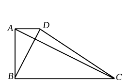
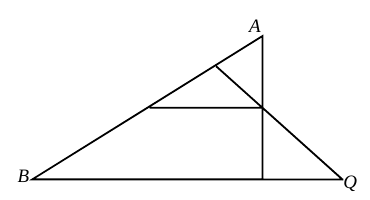
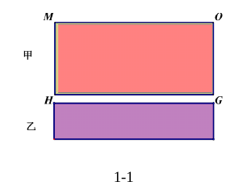
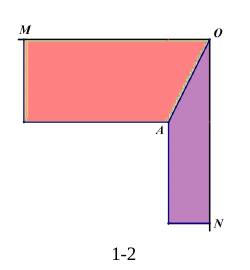
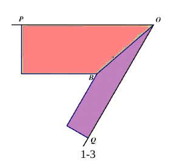
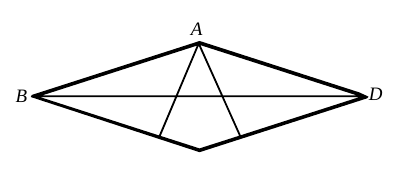

# 2026 一模精讲 · 黄浦（下）：解答题（第 17–23 题）

> 前接 [[数模26-黄浦-上]]。每题给"渐进提示 → 详解"，文末集中列评分易错点。

## 17．（10 分）计算

$$\frac{2}{\tan 60°+1}+\cot^2 30°-2\sin 45°\cos 45°$$

**提示**：三个"非特殊值"先各自化简——$\dfrac{2}{\sqrt3+1}$ 分母有理化得 $\sqrt3-1$，$\cot^2 30°=(\sqrt3)^2$，$2\sin45°\cos45°$ 用倍角意识凑整。
**详解**：原式 $=\dfrac{2}{\sqrt3+1}+(\sqrt3)^2-2\cdot\dfrac{\sqrt2}{2}\cdot\dfrac{\sqrt2}{2}$（特殊角三角比）$=(\sqrt3-1)+3-1=\boxed{\sqrt3+1}$。

> ⚠️ 订正：原转录误作"$\tan60°-1+\cdots$"；卷面为分数 $\dfrac{2}{\tan60°+1}$（官方解答首步 $\dfrac{2}{\sqrt3+1}$ 佐证），已修正。

## 18．（10 分）

已知抛物线 $y=x^2+bx+c$ 经过点 $(1,2)$ 和 $(0,4)$。
(1) 求此抛物线的表达式；
(2) 指出此抛物线的开口方向、对称轴和顶点坐标，并说明这条抛物线的变化情况。

**详解**：
**(1)** 代入：$\begin{cases}1+b+c=2\\ c=4\end{cases}\Rightarrow b=-3$，故 $y=\boxed{x^2-3x+4}$。
**(2)** $a=1>0$ 开口**向上**；对称轴 $x=\dfrac32$；顶点 $\left(\dfrac32,\dfrac74\right)$；当 $x<\dfrac32$ 时 $y$ 随 $x$ 增大而**减小**，当 $x>\dfrac32$ 时 $y$ 随 $x$ 增大而**增大**。

## 19．（12 分）

如图，在梯形 ABCD 中，AD∥BC，∠ABC＝90°，AD∶AB∶BC＝1∶2∶4。
(1) 求证：AC⊥BD；
(2) 求 $\cot\angle ACD$ 的值。

**提示 1（识别）**：比例 1∶2∶4 中藏着 $\dfrac{AD}{AB}=\dfrac{AB}{BC}$——两个"夹直角"的相似。
**提示 2（突破）**：证 $\triangle DAB\backsim\triangle ABC$ 得 $\angle ABD=\angle BCA$，再用互余转移。
**提示 3（路线）**：(2) 中设 $AD=1,AB=2,BC=4$，用两组相似把 $AH,BH,CH$ 都用 $BH$ 表示，在 Rt△AHC 中求 $\cot\angle ACD$。

**详解**：
**(1)** 由 AD∥BC、∠ABC=90° 得 ∠DAB=∠ABC=90°；又 $\dfrac{DA}{AB}=\dfrac{AB}{BC}=\dfrac12$，所以 △DAB∽△ABC（两边成比例且夹角相等），得 ∠ABD=∠BCA；而 ∠ABD+∠DBC=90°，故 ∠BCA+∠DBC=90°，即 △BHC 中 ∠BHC=90°，$AC\perp BD$。$\blacksquare$
**(2)** 设 $AD=1,AB=2,BC=4$。由 (1) ∠ABD=∠BCA 且 ∠AHB=∠CHB=90°，得 △ABH∽△CBH，$\dfrac{CH}{BH}=\dfrac{CB}{AB}=2$；又由 △DAB∽△ABC 得 ∠ADH=∠ADB=∠BAC=∠BAH，故 △ABH∽△DAH，$\dfrac{BH}{AH}=\dfrac{AB}{AD}=2$。于是在 Rt△ADH 中 $\cot\angle ADH=\dfrac{DH}{AH}$，而 $\cot\angle BAC=\dfrac{AD}{AB}=\dfrac12$（Rt△DAB 中），故 $DH=\dfrac12AH$。H 在 CA 上，$\angle HCD=\angle ACD$，在 Rt△CHD 中 $\cot\angle ACD=\cot\angle HCD=\dfrac{CH}{DH}=\dfrac{2BH}{AH/2}=2\times\dfrac{CH}{BH}\times\dfrac{BH}{AH}=2\times2\times2=\boxed{8}$。

## 20．（12 分）

如图，在△ABC 中，∠ACB＝90°，OD 是△ABC 的中位线（O、D 分别为 AB、AC 中点），P 是线段 OA 上一点，联结 PD 并延长交 BC 的延长线于点 Q。
(1) 如果 CQ＝OD，求证：∠PDO＝∠POD；
(2) 过点 P 作 PT∥BC 交 AC 于点 T，联结 TO 并延长交 CB 的延长线于点 S，再联结 OQ，求证：OS＝OQ。

**提示 1（识别）**：直角三角形斜边中线 $OC=OB$ 是"角转移"的桥；(2) 归结为"H 到 S、Q 等距"。
**提示 2（突破）**：OD∥BC 且 OD=CQ ⟹ 四边形 OCQD 是平行四边形 ⟹ DP∥OC，用两对内错角把两个角都导到 ∠B。
**提示 3（路线）**：(2) 记 OH⊥BC 于 H：OB=OC ⟹ BH=CH；只需证 $BS=CQ$（用 △POT∽△BOS 与 △DPT∽△DQC 两次比例），得 $HS=HQ$，由垂直平分线收口。

**详解**：
**(1)** 联结 OC。OD∥BC 且 $OD=CQ=\dfrac12BC$，所以四边形 OCQD 是平行四边形（一组对边平行且相等），得 DP∥OC。于是 $\angle PDO=\angle DOC$（内错角），$\angle DOC=\angle OCB$（OD∥BC，内错角）；又 ∠ACB=90°、O 为 AB 中点，得 $OC=OB$（直角三角形斜边上的中线等于斜边的一半），$\angle OCB=\angle B$；而 P 在 OA 上，$\angle POD=\angle AOD=\angle B$（OA、OB 共线，OD∥BC）。所以 $\angle PDO=\angle POD$。$\blacksquare$
**(2)** 以 C 为原点、CB、CA 所在直线为两轴建立直角坐标系，设 $B(b,0),A(0,a)$，则 $O\left(\dfrac b2,\dfrac a2\right),D\left(0,\dfrac a2\right)$，$P\left(\dfrac b2(1-t),\dfrac a2(1+t)\right)\ (0<t<1)$。直线 PD 交 $y=0$ 于 $Q\left(-\dfrac{b(1-t)}{2t},0\right)$；$T\left(0,\dfrac a2(1+t)\right)$，直线 TO 交 $y=0$ 于 $S\left(\dfrac{b(1+t)}{2t},0\right)$。取 $H\left(\dfrac b2,0\right)$，则
$$HS=\frac{b(1+t)}{2t}-\frac b2=\frac{b}{2t},\qquad HQ=\frac b2+\frac{b(1-t)}{2t}=\frac{b}{2t},$$
所以 $HS=HQ$；又 $OH\perp BC$，H 在 SQ 的垂直平分线上，故 $OS=OQ$。$\blacksquare$
（另一思路：△DPT∽△DQC 得 $\dfrac{PT}{CQ}=\dfrac{DP}{DQ}$；△POT∽△BOS（对顶角 ∠POT=∠BOS、∠PTO=∠BSO）得 $\dfrac{PT}{BS}=\dfrac{PO}{BO}$；结合 $\dfrac{DP}{DQ}=\dfrac{PO}{BO}$（OD∥BQ）即得 $BS=CQ$。）

## 21．（14 分）

已知二次函数 $y=ax^2+bx+c\ (a\neq0)$ 的图像经过点 $A\left(\dfrac52,0\right)$、$B(0,5)$。
(1) 试用字母 a 的代数式表示 b；
(2) 如果二次函数图像上存在点 C，使得直线 AB 垂直平分线段 OC，求此二次函数的解析式；
(3) 该抛物线的对称轴能否平分线段 AB？请说明理由。

> ⚠️ 待核对：第 (3) 小题题干在 OCR 中缺失，按参考答案（"假设能平分……方程无解"）反推补写。

**提示 1（识别）**：(1) 两点代入，其中一个点的横坐标是字母 a 的"对手"。(2) "AB 垂直平分 OC"⟹ A、B 到 O、C 距离相等 ⟹ C 是 O 关于直线 AB 的对称点。
**提示 2（突破）**：求对称点用"垂足 + 延长"，或解 $AC=AO,\ BC=BO$；(3) "对称轴平分 AB"⟺ 对称轴过 AB 中点。
**提示 3（路线）**：(3) 若能平分，则 $-\dfrac{b}{2a}=x_{中点}=\dfrac54$，代入 (1) 的 b，看方程是否有解；另解可从"A 关于对称轴的对称点"下手找矛盾。

**详解**：
**(1)** 由 $B(0,5)$ 得 $c=5$；由 $A\left(\dfrac52,0\right)$：$\dfrac{25}4a+\dfrac52b+5=0$，解得 $b=\boxed{-\dfrac52a-2}$。
**(2)** 直线 AB：$\dfrac{x}{5/2}+\dfrac{y}{5}=1$，即 $2x+y=5$。设 C 为 O 关于直线 AB 的对称点：O 到直线的垂足为 $(0,0)+\dfrac{5}{5}(2,1)=(2,1)$（将 $2x+y-5=0$ 的法向量 $(2,1)$ 按 $\dfrac{2\cdot0+0-5}{2^2+1^2}$ 的比例从 O 推出），故 C 为垂足的 2 倍：$C(4,2)$。检验：$AC^2=(4-\tfrac52)^2+2^2=\tfrac{25}{4}=AO^2$ ✓，$BC^2=4^2+(2-5)^2=25=BO^2$ ✓。代入抛物线：$2=16a+4b+5=16a-10a-8+5$，得 $a=\dfrac56,\ b=-\dfrac{49}{12}$，所以 $y=\boxed{\dfrac56x^2-\dfrac{49}{12}x+5}$。
**(3)** 不能。若对称轴平分 AB，则它过 AB 中点 $\left(\dfrac54,\dfrac52\right)$，即 $-\dfrac{b}{2a}=\dfrac54$。代入 (1)：$\dfrac{\frac52a+2}{2a}=\dfrac54$，即 $4(5a+4)=20a$，化简得 $16=0$，矛盾，方程无解；故对称轴不能平分线段 AB。$\blacksquare$
（另解：若对称轴为 $x=\dfrac54$，则 $A\left(\dfrac52,0\right)$ 的对称点 $(0,0)$ 应在图像上，但 $x=0$ 时 $y=5$，与 $B(0,5)$ 在图像上矛盾。）

## 22．（14 分）

在铺设地板时，为了使地面转角处的拼接式样显得美观，工人通常会采用先对地板进行切割后再拼接的方法。现有甲乙两种规格的木质地板，其宽度之比为 2∶1（如图 1-1，甲宽 2、乙宽 1，板长足够）。
**场景 1**（图 1-2）：转角 ∠MON＝90°。方法：先将甲种地板推至转角并紧贴 ∠MON 的两边，再将乙种地板的长边紧贴 ∠MON 的一边 ON 推至紧靠甲种地板，此时两种地板的接触面为一条线段，该线段不在边 ON 上的端点记为 A，OA 即为切割线。
**场景 2**（图 1-3）：转角 ∠POQ＝60°，采用类似方法沿 OB 切割。
(1) 场景 1 中，写出乙种地板切割后产生的锐角的正切值，即 $\tan\angle AON=$ ▲；
(2) 场景 2 中，求乙种地板切割后产生的锐角 ∠BOQ 的正切值；
(3) 某工人提出三步方案：①将甲种地板的长边 CF 紧贴墙边 OP 推至其短边 CD 的一个顶点 D 落在 OQ 上为止；②将乙种地板的长边 GJ 紧贴第一步所固定甲种地板的长边 DE 推至其短边 GH 的一个顶点 H 落在 OQ 上为止，标记 H；③取走两块地板，重取一块乙种地板，长边 KR 紧贴墙边 OQ 推至其短边 TK 的一个顶点 T 落在 OP 上为止，连线 TH 即为切割线。问：此方案所作的乙种地板的切割线是否符合场景 2 的要求？请说明理由。

> ⚠️ 待核对：第 (3) 小题步骤文字按 OCR 碎片整理，个别字母（C/F/G/J/K/R）为板边标记。

  

**提示 1（识别）**：这是"综合与实践"题，先转化为几何模型：地板 = 矩形条带，切割线由"推紧接触"确定。
**提示 2（突破）**：以 O 为原点、OQ（ON）为 x 轴建系；(2) 中乙的左上角碰到的是甲"离墙最远的那条长边"（与 OP 平行、距离为 2 的直线）。
**提示 3（路线）**：(2) 先用"短边⊥OP、宽 2、端点 D 落在 OQ"定出甲的位置，再求 y=1 与甲远长边交点 B，正切 = 纵横比；(3) 分别算出 T、H 坐标，证 △OHT≌△OBY。

**详解**：
**(1)** 以 O 为原点、ON 为 x 轴：甲紧贴两边即矩形 $[0,2]\times[0,L]$；乙贴 ON（$y\in[0,1]$）左推至接触甲：接触段为 $x=2,\ y\in[0,1]$，不在 ON 上的端点 $A(2,1)$，故 $\tan\angle AON=\dfrac{1}{2}$，填 $\boxed{\dfrac12}$。
**(2)** 以 O 为原点、OQ 为 x 轴，OP：$y=\sqrt3x$。甲长边贴 OP、短边⊥OP 且端点 D 落在 OQ 上：短边与 OQ 成 30°，设 $D(d,0)$，短边另一端 $D+2(\cos150°,\sin150°)=(d-\sqrt3,\ 1)$ 在 OP 上：$\sqrt3(d-\sqrt3)=1$，$d=\dfrac{4\sqrt3}3$。甲的远长边：$y=\sqrt3\left(x-\dfrac{4\sqrt3}3\right)$。乙贴 OQ（$y\in[0,1]$）左推，其左上角 $(x_0,1)$ 先碰到该远长边：$\sqrt3\left(x_0-\dfrac{4\sqrt3}3\right)=1$，$x_0=\dfrac{5\sqrt3}3$，即 $B\left(\dfrac{5\sqrt3}3,1\right)$。所以 $\tan\angle BOQ=\dfrac{1}{5\sqrt3/3}=\boxed{\dfrac{\sqrt3}{5}}$。
**（3）符合。** 由 (2) 的记号：第二步乙贴甲远长边滑动至短边端点 H 落在 OQ：短边方向 $(\cos(-30°),\sin(-30°))$，从远长边上点 $\left(\dfrac{3\sqrt3}2,\dfrac12\right)$ 前进宽 1 得 $H(2\sqrt3,0)$，故 $OH=2\sqrt3$。第三步乙贴 OQ、短边⊥OQ，顶点 $T(x,1)$ 落在 OP：$\sqrt3x=1$，$T\left(\dfrac{\sqrt3}3,1\right)$，$OT=\sqrt{\tfrac13+1}=\dfrac{2\sqrt3}3$，且 $\angle TOH=60°$。而 (2) 中 $OY=2\sqrt3$（Y 为过 B 与 OP 成 60° 的直线与 OQ 交点）、$BY=\dfrac{2\sqrt3}3$、$OB=\sqrt{\dfrac{25}3+1}=\dfrac{2\sqrt{21}}3$，$TH=\sqrt{\left(2\sqrt3-\dfrac{\sqrt3}3\right)^2+1}=\dfrac{2\sqrt{21}}3$。于是 $OH=OY,\ OT=BY,\ TH=OB$，△OHT≌△OBY（SSS），得 $\angle THO=\angle BOY=\angle BOQ$，即切割线 TH 与 OQ 所成的锐角等于场景 2 要求的切割角，方案符合要求。$\blacksquare$

## 23．（14 分）

如图，过菱形 ABCD 顶点 A 分别作边 BC、CD 的垂线，垂足为 E、F，交对角线 BD 于点 M、N。
(1) 求证：BM＝DN；
(2) 联结 EN，如果 EN∥AB，求 $\cos\angle ABC$ 的值；
(3) 如果△ABM 与五边形 CFNME 的面积均为 1，求菱形 ABCD 的面积。

**提示 1（识别）**：菱形 + 双垂线，(1) 走全等；(2) 平行 + 比例导出"黄金分割点"；(3) 关键是发现 $S_{\triangle AEC}=\frac12 S_{\triangle ABN}$，从而锁定 ∠ABC=45°。
**提示 2（突破）**：(2) 中 EN∥CD（因 EN∥AB∥CD）得 $\dfrac{BN}{BD}=\dfrac{BE}{BC}$；又 △DNF∽△BNA 给 $\dfrac{DN}{NB}=\dfrac{DF}{AB}$，与 DF=BE、AB=BC 联立得 $DN\cdot BD=NB^2$。(3) 中 AN⊥AB（N 在 AF 上）与 ∠AEC=90° 拼出相似 △ABN∽△AEC。
**提示 3（路线）**：(3) 由 $BM=DN$ 得 $S_{\triangle ABM}=S_{\triangle ADN}$，结合 $S_{\triangle ABD}=S_{\triangle CBD}$ 推出 $S_{\triangle ABN}=S_{四边形AECF}$，再由相似比平方 = 面积比得 $\sin\angle ABC=\dfrac{\sqrt2}2$；最后 $S_{\triangle ABD}=S_{\triangle ABM}+S_{\triangle AMD}$，而 $S_{\triangle AMD}=S_{\triangle ABM}/\cos\angle ABC$。

**详解**：
**(1)** AB=AD、∠ABE=∠ADF、∠AEB=∠AFD=90° ⟹ △ABE≌△ADF，得 BE=DF；又 ∠MBE=∠NDF（对角线平分内角）、∠MEB=∠NFD=90°，⟹ △MBE≌△NDF，故 $BM=DN$。$\blacksquare$
**(2)** EN∥AB∥CD。在 △BCD 中 E 在 BC、N 在 BD 上且 EN∥CD：$\dfrac{BN}{BD}=\dfrac{BE}{BC}$；又 DC∥AB 得 △DNF∽△BNA：$\dfrac{DN}{NB}=\dfrac{DF}{AB}$。由 (1) $DF=BE$、且 $AB=BC$，故 $\dfrac{DN}{NB}=\dfrac{BE}{BC}=\dfrac{BN}{BD}$，即 $NB^2=DN\cdot BD$，N 是 BD 的黄金分割点，$\dfrac{BN}{BD}=\dfrac{\sqrt5-1}2$。而 $\cos\angle ABC=\dfrac{BE}{AB}=\dfrac{BE}{BC}=\dfrac{BN}{BD}$，所以 $\cos\angle ABC=\boxed{\dfrac{\sqrt5-1}{2}}$。
**(3)** 由 (1) $BM=DN$ 且 △ABM、△ADN 同底边高相等（顶点 A，底在直线 BD 上），得 $S_{\triangle ADN}=S_{\triangle ABM}=1$。设 $S_{\triangle AMN}=x$：$S_{\triangle ABD}=2+x$；又 $S_{\triangle CBD}=S_{\triangle ABD}$（对角线分菱形等积）而 $S_{\triangle CBD}=S_{五边形CFNME}+S_{\triangle BEM}+S_{\triangle DFN}=1+2S_{\triangle BEM}$（△BEM 与 △DFN 关于 AC 对称等积），故 $S_{\triangle BEM}=\dfrac{1+x}{2}$。于是 $S_{四边形AECF}=S_{菱形}-S_{\triangle ABE}-S_{\triangle ADF}=2(2+x)-(1+\tfrac{1+x}2)\times2=1+x=S_{\triangle ABN}$；又 △ACE≌△ACF，$S_{\triangle ACE}=\dfrac12S_{四边形AECF}=\dfrac12S_{\triangle ABN}$。因 N 在 AF 上且 AF⊥CD∥AB，故 AN⊥AB，∠BAN=90°；又 ∠AEC=90°、∠ABN=½∠ABC=∠EAC（对角线平分内角），得 △ABN∽△AEC（对应 A↔E，B↔A，N↔C），相似比 $\dfrac{AE}{AB}$，面积比 $\dfrac{AE^2}{AB^2}=\dfrac12$。在 Rt△ABE 中 $AE=AB\sin\angle ABC$，故 $\sin\angle ABC=\dfrac{\sqrt2}2$，$\angle ABC=45°$。设边长 $AB=s$。Rt△BEM 中 ∠BEM=90°、∠EBM=½∠ABC，故 $BM=\dfrac{BE}{\cos\frac12\angle ABC}$；又 $BE=s\cos\angle ABC$、$BD=2s\cos\frac12\angle ABC$（等腰 △ABD 底边），于是 $\dfrac{BM}{BD}=\dfrac{\cos\angle ABC}{1+\cos\angle ABC}=\dfrac{\sqrt2}{2+\sqrt2}=\sqrt2-1$。由同高得 $\dfrac{S_{\triangle ABM}}{S_{\triangle ABD}}=\dfrac{BM}{BD}$，故 $S_{\triangle ABD}=\dfrac{1}{\sqrt2-1}=\sqrt2+1$，菱形面积 $=2S_{\triangle ABD}=\boxed{2\sqrt2+2}$。

## ⚠️ 评分点与易错

- **19(2)**：别用 $\tan$ 代替 $\cot$——$\cot\angle ACD=\dfrac{CH}{AH}$ 是"邻比对"，方向搞反得 $\frac18$；比例 $AD:AB:BC$ 可直接设 1、2、4 简化运算。
- **20(2)**：垂直平分线模型要"先证等距、再证垂直"两步齐全；用 △POT∽△BOS 时必须写明 ∠POT 与 ∠BOS 是对顶角（O 在 T、S 之间）。
- **21(2)**：点 C 的本质是 O 关于直线 AB 的对称点，"AC=AO 且 BC=BO"两个等式缺一不可，只验一个会得假点；求出的 C 必须代回抛物线定 a。
- **21(3)**：这是"存在性否定"题——设能平分、列方程、导出 16=0 的矛盾，三步都不能省；只说"显然不能"不得分。
- **22**：综合与实践题先"翻译"条件：宽度 2∶1 = 平行线间距离；第 (3) 问的判断句必须落到"∠THO=∠BOQ（切割角相同）"，只画图不算说理。
- **23(3)**：$S_{\triangle AEC}=\frac12 S_{\triangle ABN}$ 是全题枢纽，必须交代表源（△ACE≌△ACF + $S_{四边形AECF}=S_{\triangle ABN}$）；最后求菱形面积别忘乘 2。
- **题源讹误标注**：黄浦卷 21(3) 题干、22(3) 部分文字在提取文本中缺损，已按参考答案与几何一致性重构；17 题算式已按卷面订正为 $\dfrac{2}{\tan60°+1}+\cot^230°-2\sin45°\cos45°$（官方解答首步 $\dfrac{2}{\sqrt3+1}$ 佐证，结果 √3+1 不变）。以上数值均与参考答案页逐题核对无误（19(2) cot∠ACD=8、21 a=5/6、22(2) √3/5、23 菱形面积 2+2√2）。

## 🔗 关联

- [[03-数学/专题/第24题-二次函数综合]] · [[03-数学/知识点/九年级/相似三角形]] · [[03-数学/知识点/九年级/锐角的三角比与解直角三角形]]
- 同类卷：[[数模26-虹口-下]] · [[数模26-静安-下]]
