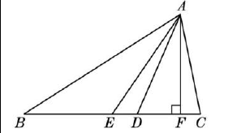
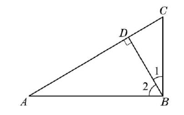

# 三角形（七年级下）

> [!note] 📖 使用导航
> 本文是概要版（初三基础回炉·考前速查）。公式总表：[[03-数学/知识点/00-六至八年级核心公式定理总表]]；同册章节：[[03-数学/知识点/七年级/实数]]、[[03-数学/知识点/七年级/相交线与平行线]]、[[03-数学/知识点/七年级/平面直角坐标系]]。

> [!note] 中考地位
> **几何证明的主干起点**：全等三角形的判定与性质是上海中考几何论证题（18、22 题等）的核心工具；等腰三角形"三线合一"与分类讨论贯穿到九年级相似、圆。概念（三边关系、内外角）则是选择填空的常客。

## 📌 三角形的有关概念（14.1）

- **三角形**：三条线段**首尾相接**组成的图形；表示为 $\triangle ABC$；有三条边、三个顶点、三个内角。
- **外角**：三角形的一边与另一边的延长线组成的角（每个顶点处有两个，与相邻内角互补）。
- **三边关系**：==三角形任意两边之和大于第三边==；等价说法：两边之差小于第三边。
  - 快捷判断：只需检验**两条较短边之和是否大于最长边**。
  - 已知两边 $a$、$b$，第三边 $c$ 的范围：$\lvert a-b\rvert < c < a+b$。
- **三角形的高、中线、角平分线**（对照表）：

| 线段 | 定义 | 图中表示 | 条数与交点 |
| ---- | ---- | ---- | ---- |
| 高 | 从顶点向对边所在直线作的**垂线段** | $AF\perp BC$，垂足 $F$ | 3 条；三条高所在直线交于一点（钝角三角形的高可在形外） |
| 中线 | 顶点与对边**中点**连结的线段 | $BD=DC$ | 3 条；三条中线交于一点 |
| 角平分线 | 内角的平分线与对边之间的**线段** | $\angle BAD=\angle CAD$ | 3 条；三条角平分线交于一点 |

- 高、中线、角平分线都是**线段**（不是直线或射线）。

## 📐 三角形的内角与外角（14.2）

- **内角和定理**：三角形的三个内角和等于 $180^\circ$（说理：过一顶点作对边的平行线，把三个内角拼成平角——用平行线性质转移角）。
- **按角分类**：锐角三角形（三个内角都是锐角）、直角三角形（Rt△，有一个直角）、钝角三角形（有一个钝角）。**直角三角形的两个锐角互余**。
- **外角性质**：
  1. 三角形的一个外角**等于**与它不相邻的两个内角的和（$\angle ACD=\angle A+\angle B$）；
  2. 三角形的一个外角**大于**任何一个与它不相邻的内角；
  3. 三角形的外角和（每个顶点取一个外角）等于 $360^\circ$。
- 设两内角为 $\alpha$、$\beta$，则相邻外角 $=\alpha+\beta$——求外角不必先求第三个内角。

## 🟰 全等三角形（14.3 / 14.4）

- **全等三角形**：能够**完全重合**的两个三角形；重合的顶点、边、角分别叫对应顶点、对应边、对应角。记作 $\triangle ABC\cong\triangle DEF$（**对应顶点的字母写在对应位置上**）。
- **性质**：全等三角形的**对应边相等，对应角相等**。
- **判定方法**（沪教版记号，条件须"对应相等"）：

| 方法 | 条件 | 简记 |
| ---- | ---- | ---- |
| 判定方法 1 | 两边及它们的**夹角**对应相等 | S.A.S |
| 判定方法 2 | 两角及它们的**夹边**对应相等 | A.S.A |
| 判定方法 3 | 两角及其中**一角的对边**对应相等 | A.A.S |
| 判定方法 4 | **三条边**对应相等 | S.S.S |

- 说明全等时的书写框架：在 $\triangle ABC$ 与 $\triangle DEF$ 中，列三个条件（用大括号），得 $\triangle ABC\cong\triangle DEF$（S.A.S）；再由全等得对应边/角相等。
- **三角形的稳定性**：三边长确定，三角形的形状、大小就完全确定（应用：三脚架、桥梁拉杆、电线塔）。
- 选方法思路：已知两边找**夹角**（S.A.S）或第三边（S.S.S）；已知两角找**夹边**（A.S.A）或其中一角的对边（A.A.S）；公共边、公共角、对顶角、等角之余（等角的补角）是常用的"隐藏相等条件"。

## ⚖️ 等腰三角形（14.5 / 14.6 / 14.7）

- **性质**（14.5）：
  1. 等腰三角形是**轴对称图形**（底边的垂直平分线是对称轴）；
  2. **等边对等角**：两底角相等（$\because AB=AC\ \therefore \angle B=\angle C$）；
  3. **三线合一**：==顶角平分线、底边上的中线、底边上的高互相重合==。
- **判定**（14.6）：**等角对等边**——有两个角相等的三角形是等腰三角形（"等边对等角"的逆用；常用来说明线段相等）。
- **等边三角形**（14.7）：三边都相等的三角形。
  - 性质：三内角相等且都等于 $60^\circ$；
  - 判定：三边相等 / 三角相等 / **有一个角是 $60^\circ$ 的等腰三角形**。
- **分类讨论**是本章的暗线：
  - 已知"一个角"求其余角：先判断它是底角还是顶角（钝角/直角只能是顶角，如 $110^\circ$ 只能当顶角）；
  - 已知"两边"求周长：先分别当腰、当底，**再用三边关系检验**。
- 常用辅助线：等腰三角形中作**顶角平分线（即底边中线、高）**，构造全等或直角三角形。

> [!warning] 🔥 易错点
> - 三边关系判断只验"两短边之和 > 最长边"一条即可，逐对相加容易乱；$2+4=6$ 时**不能**构成三角形（等号不行）。
> - 高是**线段**且垂足可在边的延长线上（钝角三角形有两条高在形外）；"三角形的高"别只画在形内的。
> - $\triangle ABC\cong\triangle DEF$ 的字母顺序对应不能乱写：$AB$ 对应 $DE$、$\angle C$ 对应 $\angle F$——顺序一错，对应边全错。
> - **"边.边.角"（S.S.A）不能判定三角形全等**（沪教版阅读材料专门论证：两边及其中一边的对角对应相等，可画出两个不同的三角形）。
> - 等腰三角形"一个角是 $70^\circ$"：底角、顶角两种情况都要算；"一个角是 $110^\circ$"只能是顶角（底角和会超 $180^\circ$）。
> - 等腰"两边长 $a$、$b$"求周长必须检验三边关系，不成立的情形要舍去。
> - 外角等于**不相邻**的两个内角之和——"相邻的外角 = 平角 − 内角"，两者别混。

## 🔗 关联

- 前置：[[03-数学/知识点/七年级/相交线与平行线]]（内角和、外角性质的说理都靠平行线）
- 后续：八年级[[03-数学/知识点/八年级/几何证明]]（全等证明的正式训练）、等腰梯形、九年级相似三角形与圆（等腰、半径模型）；中考几何论证题的工具箱。

## 📝 本讲小结

- **三边关系**：任意两边之和大于第三边（验"短 + 短 > 长"）；$|a-b|<c<a+b$。
- **重要线段**：高、中线、角平分线各 3 条，都是线段；等腰三角形中"三线合一"。
- **角**：内角和 $180^\circ$；外角 = 不相邻两内角之和；外角和 $360^\circ$；直角三角形两锐角互余。
- **全等**：对应边相等、对应角相等；判定 S.A.S、A.S.A、A.A.S、S.S.S，"边边角"不行；公共边/公共角/对顶角是隐藏条件。
- **等腰**：等边对等角 ↔ 等角对等边；三线合一；等边三角形三内角 $60^\circ$；含 $60^\circ$ 的等腰三角形是等边三角形。
- **思想**：分类讨论（底角/顶角、腰/底）、转化（证角等 → 证三角形全等）、方程思想（设未知角）。

## 📮 例题速递

**1.**（14.5 课后练习 第 1（3）题，题源：14.5 课后练习 PDF 第 1 页）如果等腰三角形的两边长分别为 $12\ \text{cm}$、$8\ \text{cm}$，那么这个三角形的周长为＿＿＿＿＿＿＿＿ cm。

> [!tip]- 💡 思路导航
> "两边"中**谁当腰**没说——两种分法都算，再逐一用三边关系检验。

> [!success]- ✅ 简解
> 情形一：腰为 12，底为 8，三边 $12,12,8$，满足 $12+12>8$，成立，周长 $=12+12+8=32\ \text{cm}$；
> 情形二：腰为 8，底为 12，三边 $8,8,12$，满足 $8+8=16>12$，成立，周长 $=8+8+12=28\ \text{cm}$。
> 所以周长为 $32$ 或 $28\ \text{cm}$。
> **易错**：不检验三边关系。若改为"两边长 $4$、$9$"，腰取 4 时 $4+4<9$ 不成立，必须舍去。

**2.**（14.2 课后练习 第 4 题，题源：14.2 课后练习 PDF 第 2 页）如图，在 Rt$\triangle ABC$ 中，$\angle ABC=90^\circ$，BD 是斜边 AC 上的高，$\angle1=30^\circ$，求 $\angle2$、$\angle A$、$\angle C$ 的度数。

> [!tip]- 💡 思路导航
> $\angle1$、$\angle2$ 拼成直角；高 $BD$ 造出两个小直角三角形——直角三角形两锐角互余一路算到底。

> [!success]- ✅ 简解
> 因为 $\angle ABC=90^\circ$，所以 $\angle2=90^\circ-\angle1=60^\circ$。在 Rt$\triangle BDC$ 中，$\angle C=90^\circ-\angle1=60^\circ$；在 Rt$\triangle ABC$ 中，$\angle A=90^\circ-\angle C=30^\circ$。
> **易错**：$\angle1$ 是 $\angle DBC$（$\angle1$ 与 $\angle2$ 以 $BD$ 分界），别把 $\angle1$ 当成 $\angle ABD$ 算反；"斜边上的高"垂足在 $AC$ 上，$\angle BDA=\angle BDC=90^\circ$。
