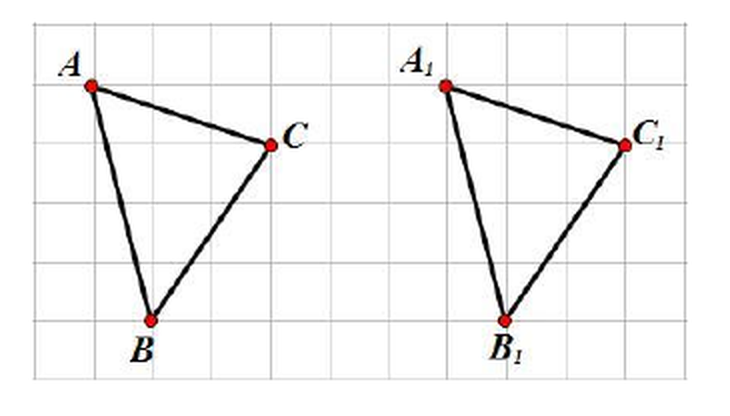
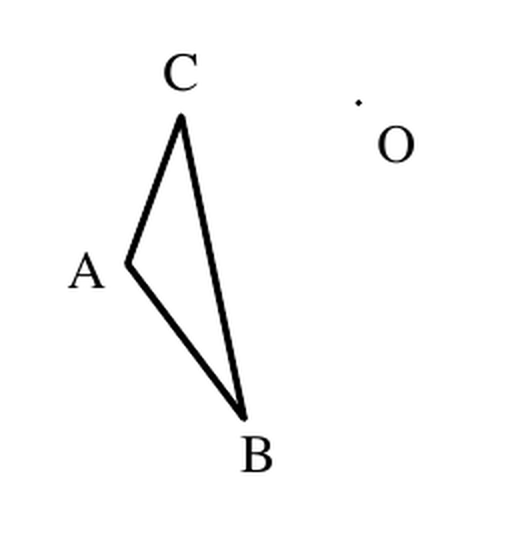
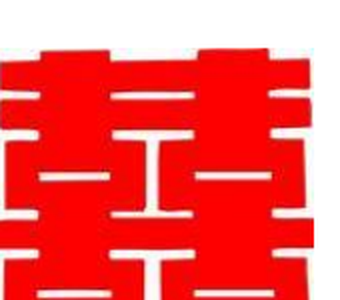

# 图形的运动（七年级上）

> [!note] 📖 使用导航
> 本文是概要版（初三基础回炉·考前速查）。公式总表：[[03-数学/知识点/00-六至八年级核心公式定理总表]]；同册章节：[[03-数学/知识点/七年级/整式]]、[[03-数学/知识点/七年级/分式]]。

> [!note] 中考地位
> 上海中考填空压轴（17～18 题）"图形运动"类问题的概念地基：折叠求线段长、旋转找对应点都从这里起步。基础层面则是画图题（画平移/旋转/对称图形、找对称轴与对称中心）和"判断轴对称图形、中心对称图形"的选择题。

## ➡️ 图形的平移（11.1）

- **定义**：平面内，图形沿着**一定的方向**移动**一定的距离**，这样的图形运动叫做图形的平移（translation）。**方向**称为平移的方向，**距离**称为平移的距离——**方向与距离**是确定一次平移的两个要素。
- 生活原型：移门。门把手 $E$ 向右移动 0.5 米到 $E'$，则门上其他各点都向右移动 0.5 米。
- **对应元素**：平移前后，点与点（$A$ 与 $A_1$）、线段与线段（$AB$ 与 $A_1B_1$）、角与角（$\angle A$ 与 $\angle A_1$）分别叫做对应点、对应线段、对应角。
- **性质**：平移**不改变图形的形状和大小**；对应线段、对应角分别相等；联结对应点的线段**互相平行（或在同一条直线上）且相等**，且每条都等于平移的距离。
- **平移的方向与距离**：方向是**对应点连线所在射线**的方向（从原指向新），距离是**对应点连线段的长度**。
- 位置关系保持：若 $D$ 是 $AB$ 的中点，则它的对应点 $D_1$ 是 $A_1B_1$ 的中点（平移不改变"点在线段上的位置"）。

## 🔄 图形的旋转（11.2～11.4）

### 旋转（11.2）

- **定义**：平面内，图形绕着**某一个定点**沿某个方向**转动一个角度**，这样的图形运动叫做图形的旋转（rotation）。定点叫**旋转中心**，转动的角叫**旋转角**——==旋转中心、旋转方向、旋转角是旋转的三要素==。
- **性质**：旋转**不改变图形的形状和大小**；对应点到**旋转中心的距离相等**；对应点与旋转中心所连线段的夹角都**等于旋转角**。
- **画旋转图形**（课本 99 页例题）：把各关键点（如 $A$）绕旋转中心 $O$ 按同方向转同一角度得对应点，再顺次连结。操作上连 $OA$，以 $O$ 为顶点、$OA$ 为一边作出等于旋转角的角，在另一边上截取 $OA'=OA$。
- **旋转经过的路线**（课本 100 页思考）：点绕 $O$ 旋转 $90°$，经过的路线是以 $O$ 为圆心、$OA$ 为半径的**圆弧**；线段绕它的一个端点旋转 $45°$，扫过的平面部分是**扇形**。

### 旋转对称图形与中心对称图形（11.3）

- **旋转对称图形**：一个图形绕某一定点旋转**一定的角度**（$0°<$ 角 $<360°$）后能与**自身**重合。
- **中心对称图形**：一个图形绕某一点旋转 **$180°$** 后能与自身重合——中心对称图形是旋转对称图形的**特例**。
- 常见图形判别（11.3 思考题）：

| 图形 | 旋转对称图形？（最小旋转角） | 中心对称图形？ |
| ---- | ---- | ---- |
| 正三角形 | 是（$120°$） | 否 |
| 正方形 | 是（$90°$） | 是 |
| 正五边形 | 是（$72°$） | 否 |
| 正六边形 | 是（$60°$） | 是 |
| 等腰梯形 | 否 | 否（但它是轴对称图形） |

- 规律：**正 $n$ 边形**都是旋转对称图形（最小旋转角 $=\dfrac{360°}{n}$）；$n$ 为**偶数**时才是中心对称图形。

### 中心对称（11.4）

- **定义（两个图形的关系）**：把一个图形绕某一点旋转 $180°$，如果它能与**另一个图形**重合，就说这两个图形关于这个点**成中心对称**，该点叫**对称中心**。
- **性质**：成中心对称的两个图形中，对应点的连线**经过对称中心，且被对称中心平分**（对称中心是对应点连线的中点）。
- **画法**：连结图形各关键点与对称中心 $O$ 并延长一倍得对应点，顺次连结。
- **找对称中心**：取两组对应点，分别连线段，**交点（中点重合处）**即对称中心。

## 🪞 图形的翻折与轴对称（11.5～11.6）

- **翻折**：把图形沿一条直线**翻折过来**（对折），翻折前后的图形关于这条直线对称；翻折**不改变图形的形状和大小**。
- **轴对称图形**：把一个图形沿一条直线折叠，**直线两旁的部分能够互相重合**，这个图形叫做轴对称图形；这条直线叫**对称轴**。
- **轴对称（两个图形的关系）**：把一个图形沿某一条直线折叠后，如果它能与**另一个图形**重合，就说这两个图形关于这条直线**成轴对称**。
- **性质**：成轴对称的两个图形中，对应点的连线被对称轴**垂直平分**。
- **画轴对称图形**：过各关键点作对称轴的**垂线**，在对称轴另一侧截取等距得对应点，顺次连结。
- **找对称轴**：连结一对对应点，作其连线的**垂直平分线**。
- 剪纸原型：把纸对折剪出单"喜"，展开即得轴对称的"囍"——折痕就是对称轴。

### 常见图形的对称轴条数

| 图形 | 对称轴条数 | 备注 |
| ---- | ---- | ---- |
| 线段 | 2 | 所在直线、中垂线 |
| 角 | 1 | 角平分线所在直线 |
| 等腰三角形 | 1 | 底边的垂直平分线 |
| 等边三角形 | 3 | |
| 长方形 | 2 | |
| 正方形 | 4 | |
| 菱形 | 2 | 对角线所在直线 |
| 正六边形 | 6 | |
| 圆 | 无数 | 对称轴最多 |

### 轴对称图形 vs 轴对称、中心对称图形 vs 中心对称

| 概念 | 说的是 | 例子 |
| ---- | ---- | ---- |
| 轴对称图形 | **一个**图形自身的特征：沿一条直线折叠，直线两旁的部分能互相重合 | "囍"字、等腰三角形 |
| 轴对称 | **两个**图形之间的位置关系：一个图形沿一条直线折叠后能与另一个图形重合 | 折痕两侧的两个"喜"字 |
| 中心对称图形 | **一个**图形自身的特征：绕一点旋转 $180°$ 后与自身重合 | 平行四边形、圆 |
| 中心对称 | **两个**图形之间的位置关系：一个图形绕一点旋转 $180°$ 后与另一个图形重合 | 三角形 $ABC$ 与绕点 $A$ 旋转 $180°$ 后的三角形 $ADE$ |

> [!note] 辨析提醒
> 四个词的分工：带"图形"的是**一个图形**的特征，不带"图形"的是**两个图形**的关系；"轴"看折叠重合，"中心"看旋转 $180°$ 重合。

## 🗺️ 三种运动对照表

| 项目 | 平移 | 旋转 | 翻折 |
| ---- | ---- | ---- | ---- |
| 运动要素 | 方向、距离 | 旋转中心、旋转方向、旋转角 | 对称轴（折痕） |
| 形状、大小 | 不变 | 不变 | 不变 |
| 对应线段/对应角 | 相等 | 相等 | 相等 |
| 对应点连线的特征 | 互相平行（或共线）且相等 | 与旋转中心的连线夹角等于旋转角；对应点到旋转中心距离相等 | 被对称轴垂直平分 |
| 与全等的关系 | 平移前后两图形全等 | 旋转前后两图形全等 | 翻折前后两图形全等 |
| 特殊形态 | —— | 旋转 $180°$ → 中心对称 | 翻折即轴对称 |

==三种运动都不改变图形的形状和大小，都是全等变换==；区别只在"怎么动"：滑（平移）、转（旋转）、折（翻折）。

> [!warning] 🔥 易错点
> - 平移的"方向"必须明确指向：说"平移的方向是射线 $AA_1$ 的方向"，别只说"向右"而不结合图形；距离是**对应点**连线段的长，不是图形上任意两点间的距离。
> - 旋转三要素缺一不可：绕哪个点、什么方向（顺/逆时针）、转多少度。旋转角是**对应点与旋转中心连线**的夹角，不是图形转过的任意角。
> - "中心对称图形"与"两个图形成中心对称"混为一谈：前者是一个图形，后者是两个图形的关系；轴对称与轴对称图形同理。
> - 高频判断：**平行四边形是中心对称图形但不是轴对称图形**；**正三角形是轴对称图形、旋转对称图形，但不是中心对称图形**；等腰梯形只是轴对称图形。
> - 对称轴是**直线**，不是射线或线段；轴对称图形的对称轴可能不止一条（画全）。
> - 折叠问题全靠"折叠前后重合"：对应线段相等、对应角相等——如 $AD'=AD$，先标等长再计算。
> - 找对称中心要连**两组**对应点取交点，只连一组无法确定。

## 🔗 关联

- 前置：[[03-数学/知识点/00-六至八年级核心公式定理总表]]
- 后续：[[03-数学/专题/填空压轴17-18-图形运动与新定义]]（图形运动综合）、[[03-数学/知识点/八年级/几何证明]]（等腰三角形与轴对称性质、图形运动作图论证）、[[03-数学/知识点/八年级/四边形]]（平行四边形的中心对称性）、[[03-数学/知识点/九年级/圆与正多边形]]（旋转、对称轴在圆中的大量应用）

## 📝 本讲小结

- **三种运动**：平移（方向＋距离）、旋转（中心＋方向＋角）、翻折（对称轴）——都是保持形状、大小不变的**全等变换**。
- **平移**：对应线段平行且相等，对应点连线平行（或共线）且相等；中点的对应点仍是中点。
- **旋转**：对应点到旋转中心距离相等，连线夹角等于旋转角；旋转 $180°$ 的特殊形态是中心对称。
- **对称图形与对称关系**：轴对称图形/中心对称图形说"一个图形"，轴对称/中心对称说"两个图形"；画图工具分别是"垂线段等距"与"连线延长等距"。
- **找对称要素**：对称轴——对应点连线的中垂线；对称中心——两组对应点连线的交点。
- **判断口径**：正 $n$ 边形旋转对称角 $\frac{360°}n$，偶数边才中心对称；平行四边形中心对称非轴对称；等腰梯形仅轴对称。
- **思想**：从运动变化中研究图形（动态几何初步），"变"与"不变"的辩证关系。

## 📮 例题速递

**1.**（图形运动单元讲评 学习任务单 第 4(1) 题，题源：图形运动单元讲评 学习任务单 PDF 第 2 页）已知长方形纸片 $ABCD$ 中，$AB=10$，$AD=6.5$。将长方形纸片 $ABCD$ 折叠，使点 $D$ 落在 $AB$ 边上，记作点 $D'$，折痕为 $AE$。求图中线段 $D'B$ 的长。

> [!tip]- 💡 思路导航
> 折叠即翻折：点 $D$ 与 $D'$ 是对应点，折痕过点 $A$，所以 $AD'=AD$；而 $D'$ 落在 $AB$ 上，用 $AB-AD'$ 即得。

> [!success]- ✅ 简解
> 由翻折性质，$AD'=AD=6.5$。点 $D'$ 在边 $AB$ 上，且 $AB=10$，所以 $D'B=AB-AD'=10-6.5=3.5$。
> **考点**：翻折前后对应线段相等——一切折叠计算题的起点（本单元讲评第 (2) 问还把 $AD=x$ 再翻折一次求 $x$，用同一性质列方程）。

**2.**（图形的运动复习与小结 课后练习 第 2 题，题源：图形的运动复习与小结 课后练习 PDF 第 1 页）下面图形中，不是中心对称图形的是（　　）

- （A）平行四边形
- （B）圆
- （C）正方形
- （D）正三角形

> [!tip]- 💡 思路导航
> 中心对称图形的标准：绕中心旋转 $180°$ 与自身重合。对正多边形直接用"$n$ 为偶数才是中心对称"判断。

> [!success]- ✅ 简解
> 平行四边形、圆、正方形旋转 $180°$ 都与自身重合；正三角形旋转 $180°$ 后倒置，不与自身重合（其最小旋转角为 $120°$）。故选 **（D）**。（课后练习答案：D。）
> **关联**：正三角形是轴对称图形、旋转对称图形，但不是中心对称图形——三张"身份证"分清。
