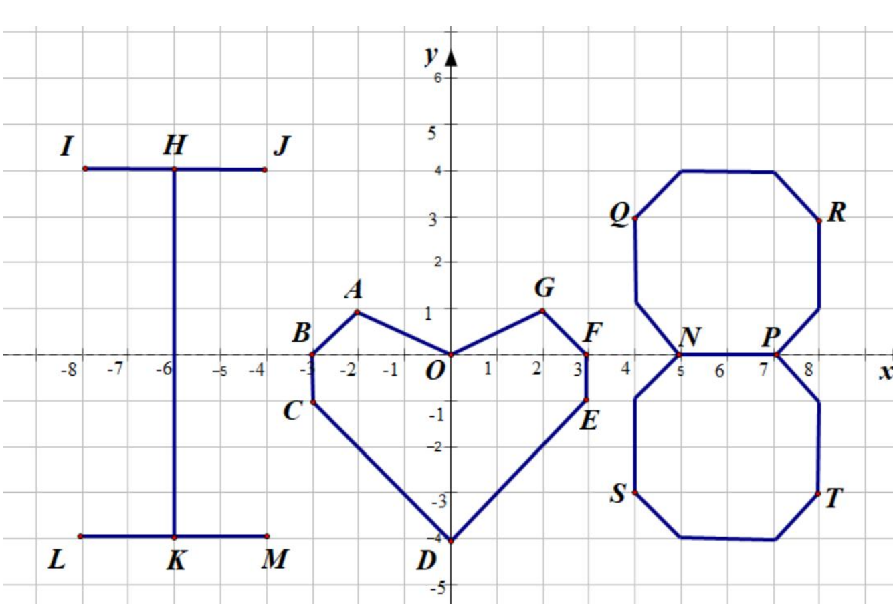
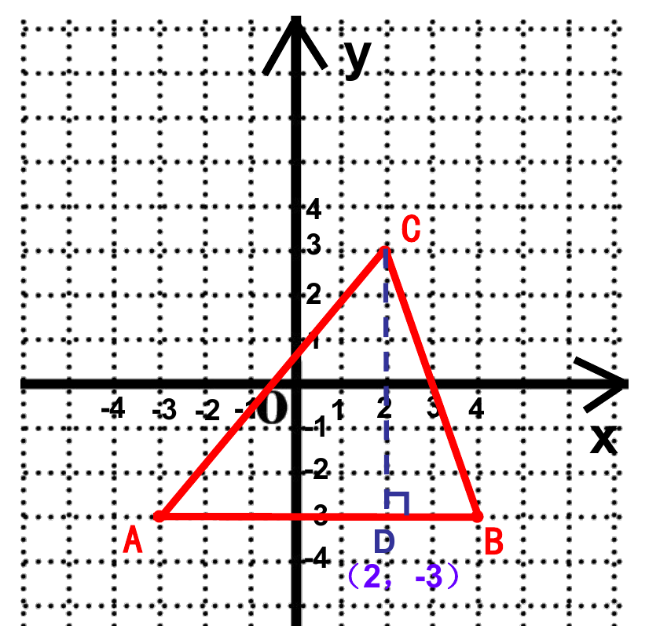

# 平面直角坐标系（七年级下）

> [!note] 📖 使用导航
> 本文是概要版（初三基础回炉·考前速查）；第一次学或没学懂 → 详细版：[[03-数学/知识点详解/七年级/平面直角坐标系]]。公式总表：[[03-数学/知识点/00-六至八年级核心公式定理总表]]；同册章节：[[03-数学/知识点/七年级/实数]]、[[03-数学/知识点/七年级/相交线与平行线]]、[[03-数学/知识点/七年级/三角形]]。

> [!note] 中考地位
> **代数与几何的桥梁**：本身考得不深，但一次函数、二次函数、几何综合题全在坐标系里做——点的坐标特征、平移与对称的坐标规律、平行于坐标轴的线段长度是每天都要用的基本功。

## 📌 平面直角坐标系的概念（15.1）

- **从数轴到平面**：数轴上的点与实数一一对应；确定**平面内**一个点的位置需要两个数（有序数对）——如影院"几排几座"。
- **平面直角坐标系**：在平面内取一点 $O$，过 $O$ 画**两条互相垂直**的数轴，且以 $O$ 为公共原点：
  - 水平放置、正方向向右的一条叫**横轴**（$x$ 轴）；
  - 铅直放置、正方向向上的一条叫**纵轴**（$y$ 轴）；
  - 交点 $O$ 叫**原点**。
- **点的坐标**：过点分别向 $x$ 轴、$y$ 轴作垂线，垂足对应的数 $a$、$b$ 组成**有序实数对** $(a,b)$，$a$ 是横坐标、$b$ 是纵坐标。**横前纵后，顺序不可换**：$(2,3)$ 与 $(3,2)$ 表示两个不同的点。
- 直角坐标平面内的点与有序实数对**一一对应**（这就是"笛卡尔坐标系"，解析几何的开端）。

**坐标特征与象限**（对照下图）：

| 位置 | 坐标特征 | 图中例子 |
| ---- | ---- | ---- |
| 第一象限 | $(+,\ +)$ | $G(2,1),\ Q(4,3)$ |
| 第二象限 | $(-,\ +)$ | $A(-2,1),\ J(-4,4)$ |
| 第三象限 | $(-,\ -)$ | $C(-3,-1),\ K(-6,-4)$ |
| 第四象限 | $(+,\ -)$ | $E(3,-1),\ S(4,-3)$ |
| $x$ 轴上 | 纵坐标为 $0$：$(a,0)$ | $B(-3,0),\ N(5,0)$ |
| $y$ 轴上 | 横坐标为 $0$：$(0,b)$ | $D(0,-4)$ |
| 原点 | $(0,0)$ | $O$ |

> [!note] 象限记忆
> 一、二、三、四象限按**逆时针**排列（右上起）；**坐标轴上的点不属于任何象限**。

## 🚶 直角坐标平面内点的运动（15.2）

- **平行于坐标轴的直线**的代数表示：
  - 平行于 $x$ 轴的直线：$y=b$（直线上所有点**纵坐标相同**）；
  - 平行于 $y$ 轴的直线：$x=a$（直线上所有点**横坐标相同**）。
- **平行于坐标轴的两点距离**（由数轴上 $AB=\lvert a-b\rvert$ 类比得到）：

| 情形 | 公式 |
| ---- | ---- |
| $A(x_1,b)$、$B(x_2,b)$（水平） | $AB=\lvert x_1-x_2\rvert$ |
| $C(a,y_1)$、$D(a,y_2)$（竖直） | $CD=\lvert y_1-y_2\rvert$ |

- **点的平移**与坐标变化：

| 运动 | 坐标变化 | 例 |
| ---- | ---- | ---- |
| 向右平移 $k$ | 横坐标 $+k$ | $(a,b)\to(a+k,b)$ |
| 向左平移 $k$ | 横坐标 $-k$ | $(a,b)\to(a-k,b)$ |
| 向上平移 $k$ | 纵坐标 $+k$ | $(a,b)\to(a,b+k)$ |
| 向下平移 $k$ | 纵坐标 $-k$ | $(a,b)\to(a,b-k)$ |

- **轴对称与中心对称**的坐标规律：

| 对称方式 | 坐标变化 | 例 |
| ---- | ---- | ---- |
| 关于 $x$ 轴对称 | 横不变，纵变号 | $(a,b)\to(a,-b)$ |
| 关于 $y$ 轴对称 | 横变号，纵不变 | $(a,b)\to(-a,b)$ |
| 关于原点对称 | 横纵都变号 | $(a,b)\to(-a,-b)$ |

- **格点图形面积**：以平行于坐标轴的线段为底、另一顶点到该直线的距离（铅垂/水平）为高；斜放的三角形用"**割补**"——补成矩形或分成两个直角三角形再相加减。如图：$A(-3,-3)$、$B(4,-3)$、$C(2,3)$，过 $C$ 作 $CD\perp AB$ 于 $D(2,-3)$，则 $AB=7$、$CD=6$，$S_{\triangle ABC}=\dfrac12\times7\times6=21$。

- 已知面积反求点的坐标时：==先画大致图形定位置，再算线段长；线段长必须加绝对值，防漏解==。

> [!warning] 🔥 易错点
> - $(2,3)$ 与 $(3,2)$ 是**不同**的点——横坐标在前、纵坐标在后，别颠倒。
> - 平移的加减别搞反：**右加左减**（横坐标）、**上加下减**（纵坐标）；先向右再向上是"横加完再纵加"，不是只动一次。
> - 关于原点对称是**横纵都变号**；只变一个号的是关于坐标轴的对称。
> - 求距离要加绝对值：$A(x_1,b)$、$B(x_2,b)$ 的距离是 $\lvert x_1-x_2\rvert$，$x_1<x_2$ 时直接减当然行，但字母型问题必须加绝对值。
> - "$GH=2$，$H(b,1)$、$G(2,1)$"型问题 $b$ 有**两解**（$H$ 在 $G$ 左、右各一个），只答一个就漏解。
> - 坐标轴上的点**不属于任何象限**；原点既在 $x$ 轴上也在 $y$ 轴上。

## 🔗 关联

- 前置：[[03-数学/知识点/七年级/实数]]（数轴、实数与点的一一对应）
- 后续：八年级[[03-数学/知识点/八年级/一次函数]]、九年级[[03-数学/知识点/九年级/二次函数]]（顶点、平移全靠本章规律）、中考第 24 题坐标系中的几何计算。

## 📝 本讲小结

- **概念**：两条互相垂直、原点重合的数轴；坐标 $(a,b)$ 有序；点 ↔ 有序实数对一一对应。
- **特征**：四象限符号 $(+,+)(-,+)(-,-)(+,-)$；$x$ 轴纵为 0，$y$ 轴横为 0；轴上点不属于任何象限。
- **运动**：平行 $x$ 轴的直线 $y=b$、平行 $y$ 轴的直线 $x=a$；水平/竖直两点距离 = 对应坐标差的绝对值。
- **平移**：右加上减、上加下减；**对称**：关于谁对称谁变号，关于原点全变号。
- **面积**：横平竖直作底、垂直作高；斜图形用割补；由面积求坐标要分类（绝对值）。
- **思想**：数形结合、从特殊到一般（数轴 → 坐标平面）、类比。

## 📮 例题速递

**1.**（15.2 学习任务单 例题 1（4），题源：15.2 学习任务单 PDF 第 2 页）在直角坐标平面内，已知点 $G(2,1)$、$H(b,1)$，且 $GH=2$，求 $b$ 的值。

> [!tip]- 💡 思路导航
> $G$、$H$ 纵坐标相同 ⟹ $GH\parallel x$ 轴，用水平距离公式；"$=2$"是绝对值方程，**别只顾一边**。

> [!success]- ✅ 简解
> 因为纵坐标相同，所以 $GH=\lvert b-2\rvert=2$，得 $b-2=2$ 或 $b-2=-2$，即 $b=4$ 或 $b=0$。
> **易错**：只写 $b=4$ 漏解——$H$ 可以在 $G$ 的右侧也可以在左侧。

**2.**（单元复习与小结 学习任务二，题源：平面直角坐标系单元复习与小结 学习任务单 PDF 第 1 页）在直角坐标平面内，点 $A$ 的坐标是 $(-5,0)$。将点 $A$ 向右平移 2 个单位，再向上平移 4 个单位到达点 $B$ 的位置；点 $C$ 与点 $B$ 关于原点对称；点 $D$ 与点 $A$ 关于 $y$ 轴对称。求点 $B$、$C$、$D$ 的坐标。

> [!tip]- 💡 思路导航
> 一步一步翻译成坐标运算：平移=加减，对称=变号；横纵分开处理就不会乱。

> [!success]- ✅ 简解
> $A(-5,0)\xrightarrow{\text{右}2}(-3,0)\xrightarrow{\text{上}4}B(-3,4)$；
> $C$ 与 $B$ 关于原点对称：$C(3,-4)$；
> $D$ 与 $A$ 关于 $y$ 轴对称：$D(5,0)$。
> **易错**：关于原点对称只变了一个号（如写成 $(3,4)$）——**横纵都要变号**；平移"右 2"加在横坐标上，别加到纵坐标。
