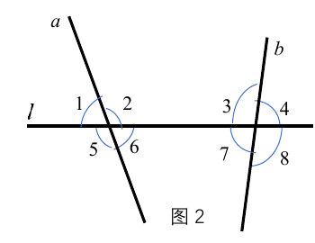
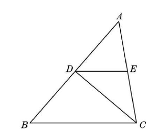
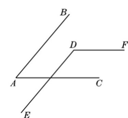

# 相交线与平行线（七年级下）

> [!note] 📖 使用导航
> 本文是概要版（初三基础回炉·考前速查）；第一次学或没学懂 → 详细版：[[03-数学/知识点详解/七年级/相交线与平行线]]。公式总表：[[03-数学/知识点/00-六至八年级核心公式定理总表]]；同册章节：[[03-数学/知识点/七年级/实数]]、[[03-数学/知识点/七年级/三角形]]、[[03-数学/知识点/七年级/平面直角坐标系]]。

> [!note] 中考地位
> 几何说理的**起点章**：对顶角、垂直、三线八角、平行线的判定与性质是后续三角形内角和、八年级几何证明的"说理零件"。中考解答题中每一步"∵…∴…（依据）"的功夫都从这一章练起。

## 📌 邻补角与对顶角（13.1）

- 两条直线相交，**有且只有一个交点**（若有两个交点，则两直线重合，矛盾——初步感知反证法思想）。
- **邻补角**：有一条公共边，且另一边互为反向延长线的两个角。判别要同时满足"**相邻**"+"**互补**"两个条件。
- **对顶角**：一个角的两边分别是另一个角两边的**反向延长线**（有公共顶点、无公共边）。对顶角**成对出现**。
- **性质**：==对顶角相等==。说理依据是"同角的补角相等"（$\angle1$ 与 $\angle3$ 都是 $\angle2$ 的补角）。

## 📏 垂线（13.2）

- **夹角**：两条相交直线所成的四个角中"不大于直角的角"。斜交时为一个锐角、一个钝角；夹角为 $90^\circ$ 即垂直。
- **垂直**：两条直线相交所成的四个角中，有一个角是直角（其余三个也都是直角），就说这两条直线互相垂直，记作 $AB\perp CD$，交点叫**垂足**。
- **垂线基本性质**：平面内经过一点，**有且只有一条**直线与已知直线垂直（点在直线上、点在直线外都成立）。
- **垂线段与距离**：直线外一点与直线上各点连结的所有线段中，**垂线段最短**；点到直线的距离 = 垂线段的**长度**（数量）。
- **线段的垂直平分线（中垂线）**：经过线段中点且垂直于这条线段的直线；可用尺规作图（分别以线段两端点为圆心、大于一半长为半径画弧取交点）。
- **平行线间的距离**：两条平行线中，一条直线上任一点到另一条直线的距离（夹在两平行线间的垂线段长度，处处相等）。

## 📐 三线八角：同位角、内错角、同旁内角（13.3）

| 角的类型 | 位置特征 | 形象 | 图中例子 |
| ---- | ---- | ---- | ---- |
| 同位角 | 都在截线同旁、被截直线同侧 | "F"型 | $\angle1$ 与 $\angle5$、$\angle3$ 与 $\angle7$ |
| 内错角 | 夹在两被截直线之间、截线两旁 | "Z"型 | $\angle3$ 与 $\angle5$、$\angle4$ 与 $\angle6$ |
| 同旁内角 | 夹在两被截直线之间、截线同旁 | "U"型 | $\angle3$ 与 $\angle6$、$\angle4$ 与 $\angle5$ |

- **识别三步**：先找两条被截直线与截线 → 公共边所在的直线是**截线** → 另两边分别是两条被截直线。
- 三类角只描述**位置关系**：不平行时同位角并不相等。复杂图形（折线、多线）中常"**拆图**"：把一对角单独抽出来看。

## ⚖️ 平行线的判定（13.4）

- **平行线**：同一平面内，不相交的两条直线，记作 $a\parallel b$。
- **画法**：三角尺沿直尺平移（"推平行线"）——平移中保持同位角不变，这正是判定方法 1 的来源。
- **平行线基本性质**：经过直线外一点，**有且只有一条**直线与这条直线平行。

| 判定方法 | 条件 → 结论 | 简记 |
| ---- | ---- | ---- |
| 方法 1（基本事实） | 同位角相等 ⟹ 两直线平行 | 同位角相等，两直线平行 |
| 方法 2 | 内错角相等 ⟹ 两直线平行 | 内错角相等，两直线平行 |
| 方法 3 | 同旁内角互补 ⟹ 两直线平行 | 同旁内角互补，两直线平行 |
| 推论 1 | 平行于同一条直线的两条直线平行 | 平行传递 |
| 推论 2 | 同一平面内，垂直于同一条直线的两条直线平行 | 同垂直则平行 |

- 推论 2 的说理模板（课件 13.4 图 5）：$a\perp c,\ b\perp c$ ⟹ $\angle1=\angle2=90^\circ$（垂直的意义）⟹ 同位角相等 ⟹ $a\parallel b$。

## 🔁 平行线的性质（13.5）与判定·性质对照

| | 判定（角 ⟹ 平行） | 性质（平行 ⟹ 角） |
| ---- | ---- | ---- |
| 同位角 | ∵ 同位角相等，∴ 两直线平行 | ∵ 两直线平行，∴ 同位角相等 |
| 内错角 | ∵ 内错角相等，∴ 两直线平行 | ∵ 两直线平行，∴ 内错角相等 |
| 同旁内角 | ∵ 同旁内角互补，∴ 两直线平行 | ∵ 两直线平行，∴ 同旁内角互补 |

- 性质 1"两直线平行，同位角相等"是**基本事实**；性质 2、3 由它推出。
- ==由角推平行用判定，由平行推角用性质==——两个方向在综合题中常**交替连用**（判定 → 得平行 → 性质 → 得新角关系 → 再判定……）。
- 说理表达用"三段论"：已知条件 + 依据（括号内写理由）→ 结论，如：因为 $a\parallel b$（已知），所以 $\angle1=\angle4$（两直线平行，同位角相等）。
- **平行线被折线所截**（探究专题）：过拐点作一条平行线作"桥"，把折线两侧的角拆到两条平行线之间，再合并。

> [!warning] 🔥 易错点
> - 对顶角相等，但**相等的角不一定是对顶角**；邻补角必须"既相邻又互补"，互补但不相邻（如平行线的同旁内角）不是邻补角。
> - 距离是**长度（数量）**："点到直线的距离"是垂线段的长度，不是垂线段这条图形本身。
> - 同位角相等 ⟹ 平行是**判定**；已知平行再得"同位角相等"是**性质**——方向写反，说理全错。
> - 同旁内角互补的前提是"两直线平行"：不平行时同旁内角只是位置关系，没有数量结论。
> - "垂直于同一条直线的两直线平行"必须加**同一平面内**。
> - 垂足、垂直符号 $\perp$ 与平行符号 $\parallel$ 别混写；说理每一步都要有依据，不能"看图显然"。

## 🔗 关联

- 前置：[[03-数学/知识点/00-六至八年级核心公式定理总表]]（角的概念）
- 后续：[[03-数学/知识点/七年级/三角形]]（内角和、外角的说理全靠平行线性质）、八年级[[03-数学/知识点/八年级/几何证明]]、一次函数中"两直线平行"的图形基础。

## 📝 本讲小结

- **相交线**：对顶角相等；邻补角互补且相邻；垂直 ⟹ 四个角都是直角；过一点有且只有一条直线与已知直线垂直；垂线段最短。
- **三线八角**：同位角（F）、内错角（Z）、同旁内角（U）——先认截线再认被截线，只讲位置不讲大小。
- **判定**（角 → 平行）：同位角相等 / 内错角相等 / 同旁内角互补 / 平行同一直线 / 同垂直同一直线。
- **性质**（平行 → 角）：同位角相等、内错角相等、同旁内角互补。
- **方法**：判定与性质交替连用；折线问题过拐点作平行线；说理步步有依据。

## 📮 例题速递

**1.**（13.5 课后练习 第 4 题，题源：13.5 课后练习 PDF 第 2 页）如图，CD 平分 $\angle ACB$，$DE\parallel BC$，$\angle AED=80^\circ$，请说明 $\angle BCD=40^\circ$ 的理由。

> [!tip]- 💡 思路导航
> 要说明 $\angle BCD$ 的大小，先借 $DE\parallel BC$ 把已知角 $\angle AED$ 转移到 $\angle ACB$（性质），再用角平分线折半。

> [!success]- ✅ 简解
> 因为 $DE\parallel BC$（已知），所以 $\angle AED=\angle ACB$（两直线平行，同位角相等）。又 $\angle AED=80^\circ$（已知），所以 $\angle ACB=80^\circ$（等量代换）。因为 $CD$ 平分 $\angle ACB$（已知），所以 $\angle BCD=\dfrac12\angle ACB=40^\circ$（角平分线的意义）。
> **关联**：判定→平行→性质→角平分线，是平行线综合题的标准链条。

**2.**（单元复习与小结 课后练习 第 4 题，题源：相交线与平行线单元复习与小结 课后练习 PDF 第 2 页）如图，已知 $\angle A$ 的两边与 $\angle D$ 的两边分别平行，且 $\angle D$ 比 $\angle A$ 的 3 倍少 $20^\circ$，求 $\angle D$ 的度数。

> [!tip]- 💡 思路导航
> "两边分别平行"的两个角，**相等或互补**两种可能；结合图示两角开口相反，取互补列方程。

> [!success]- ✅ 简解
> 由图，$\angle A$ 与 $\angle D$ 的两边分别平行且开口相反，所以 $\angle A+\angle D=180^\circ$。设 $\angle A=x$，则 $\angle D=3x-20^\circ$，得 $x+3x-20^\circ=180^\circ$，$x=50^\circ$，所以 $\angle D=130^\circ$。
> **易错**：若默认"两边分别平行 ⟹ 两角相等"，会解得 $\angle D=10^\circ$，与图不符——**先看图定相等还是互补，再列方程**。
