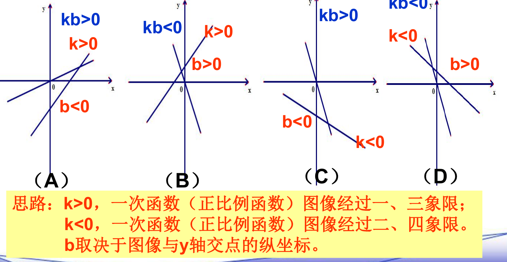

# 一次函数（八年级下）

> [!note] 📖 章导航
> 本篇属八年级下册（沪教版五四制）概要四章之一：
> [[03-数学/知识点/八年级/一次函数]] · [[03-数学/知识点/八年级/代数方程]] · [[03-数学/知识点/八年级/四边形]] · [[03-数学/知识点/八年级/概率初步]]
> 供初三基础回炉使用；内容依据国平台备课包（课件/学习任务单/课后练习）整理。
> 第一次学或没学懂 → 详细版：[[03-数学/知识点详解/八年级/一次函数]]

> [!note] 中考地位
> 函数主线的基础一环。==图像与性质、待定系数法、图像与坐标轴交点的面积、实际应用建模==是常考点，也是九年级反比例函数、二次函数综合的根基。

## 📌 定义与表达式（20.1）

- **一次函数**：形如 $y=kx+b$（$k$、$b$ 是常数，且 $k\neq 0$）的函数。其中 $k$ 叫**比例系数**，$b$ 叫**截距**。
- 当 $b=0$ 时，$y=kx$ 是**正比例函数**——==正比例函数是特殊的一次函数==。
- 判断是否为一次函数：**先化简成一般式再判断**。如 $y=x^2-(x-1)(x-2)=3x-2$ 是一次函数；$y=-\dfrac{3}{x}$、$y=x^2+2$ 不是。
- 系数含字母时要**分类讨论**：$y=(a+1)x+a$ 中，只有 $a\neq -1$ 才是一次函数（$a=-1$ 时是常值函数）。
- **待定系数法**（两点定一函数）：已知两点 $(x_1,y_1)$、$(x_2,y_2)$，代入 $y=kx+b$ 解关于 $k$、$b$ 的方程组。例如：$x=2$ 时 $y=-1$，$x=5$ 时 $y=8$，解得 $y=3x-7$。
- 实际问题中的定义域由实际意义确定：等腰三角形周长 40，底边 $x$、腰长 $y$，则 $y=\dfrac{40-x}{2}$，定义域 $0<x<20$（还需满足三角形三边关系 $0<x<20$ 且腰大于底的一半）。

## 📈 图像与截距（20.2）

- 一次函数 $y=kx+b$ 的图像是**一条直线**，称为**直线 $y=kx+b$**；解析式 $y=kx+b$ 也称为这一直线的表达式。
- 画图用**两点法**最方便：取与两坐标轴的交点 $(0,b)$ 和 $\left(-\dfrac{b}{k},0\right)$。
- **截距**：直线与 $y$ 轴交点 $(0,b)$ 的**纵坐标** $b$，叫这条直线在 $y$ 轴上的截距。
- 求交点：令 $y=0$ 得与 $x$ 轴交点；令 $x=0$ 得与 $y$ 轴交点。
- **平行**：直线 $y=k_1x+b_1$ 与 $y=k_2x+b_2$ 平行 $\iff k_1=k_2$ 且 $b_1\neq b_2$。
- **平移**：直线上下平移只改变截距 $b$（上加下减），$k$ 不变。如 $y=3x-2$ 向下平移 5 个单位得 $y=3x-7$。

## 🔀 增减性与象限（20.3）

- 当 $k>0$ 时，函数值 $y$ 随 $x$ 增大而**增大**（图像上升）；当 $k<0$ 时，$y$ 随 $x$ 增大而**减小**（图像下降）。
- $k>0$，图像经过一、三象限；$k<0$，图像经过二、四象限；$b$ 取决于图像与 $y$ 轴交点的纵坐标。

| $k$、$b$ 符号 | 经过象限 | 增减性 |
| ---- | ---- | ---- |
| $k>0,\ b>0$ | 一、二、三 | 增大 |
| $k>0,\ b<0$ | 一、三、四 | 增大 |
| $k<0,\ b>0$ | 一、二、四 | 减小 |
| $k<0,\ b<0$ | 二、三、四 | 减小 |

- 比较两点函数值大小：直接用增减性（同增减区间内，$x$ 大者 $y$ 大/小），或代入计算。
- **一次函数与方程、不等式**：$kx+b>0$ 的解集就是图像在 $x$ 轴**上方**部分对应的 $x$ 的取值范围（$kx+b=0$ 的根即与 $x$ 轴交点的横坐标）。

## 🧮 面积与交点模型

- 直线与两坐标轴围成的三角形面积：$S=\dfrac{1}{2}\times\left|-\dfrac{b}{k}\right|\times|b|$（两直角边取**绝对值**）。
- 已知面积反求参数时，**常有两解**（交点在正、负半轴各一种），逐类检验。
- 直线过定点/两点时，待定系数法列方程（组）求解；与两直线交点相关的问题用**联立方程组**。

## 🌍 实际应用（20.4）

建模四步：**设变量 → 列解析式（写定义域）→ 求解 → 作答**。

- 匀速变化型：蜡烛燃烧、水池进水、气温随海拔下降（$y=-\dfrac{3}{500}x+34$）。
- 分段计费型：水费、行李费、话费——超过临界值后**分段列出两个解析式**，各自注明定义域。
- 预测决策型：用两组数据定系数，再代入自变量作估计（如沙漠面积、水位上涨）。

> [!warning] 🔥 易错点
> - **截距是纵坐标不是距离**：截距 $b$ 可正、可负、可为 0；"截距为 $-5$"就是 $b=-5$。
> - 系数含字母（如 $y=(a+1)x+a$、$y=(m-3)x+m+2$）时，**必须讨论字母取值**，别默认 $k\neq 0$。
> - 用坐标值表示线段长、求面积时**要加绝对值**，否则会漏掉负半轴的解（如 $b=\pm 4$ 型双解）。
> - 实际应用题的**定义域必须写**，由实际意义（剩余量非负、时间非负、三角形三边关系等）确定。
> - 判断"图像不经过第几象限"这类问题，用 $k$、$b$ 符号逐个排查，别凭感觉。

## 📝 本讲小结

- **一个定义**：$y=kx+b$（$k\neq 0$）；正比例函数是 $b=0$ 的特例；判断前先化简、再看系数。
- **两个工具**：待定系数法（两点定一函数）；令 $y=0$ / $x=0$ 求坐标轴交点。
- **两条性质**：$k$ 定增减（$k>0$ 增、$k<0$ 减），$b$ 定与 $y$ 轴交点；两者合起来定象限。
- **一个模型**：与坐标轴围成三角形面积 $=\dfrac{1}{2}\times|x$ 轴交点横坐标$|\times|b|$，注意双解与绝对值。
- **一种思想**：数形结合——不等式解集看图像上下方，应用题先建模再求解。

## 📮 例题速递

**例1**　已知一次函数 $y=2x+b$，它的图像与两坐标轴所围成的三角形的面积是 4，求 $b$ 的值．

> [!tip]- 💡 思路导航
> 用 $b$ 表示直线与 $x$ 轴、$y$ 轴的交点坐标，代入面积公式；**坐标表示线段长要加绝对值**，留意双解。

> [!success]- ✅ 简解
> 令 $y=0$，得与 $x$ 轴交点 $\left(-\dfrac{b}{2},\,0\right)$；令 $x=0$，得与 $y$ 轴交点 $(0,\,b)$．
> 由 $S=\dfrac{1}{2}\left|-\dfrac{b}{2}\right|\cdot|b|=\dfrac{b^2}{4}=4$，得 $|b|=4$，所以 $b=\pm 4$．
>
> **题源**：《一次函数单元讲评》课后练习第 7 题（练习册 B 组第 4 题），PDF 第 2 页。

**例2**　一个水池的容积是 90 m³，现在水池中有一定量的水。如果保持一定的速度向水池中进水，那么 1 小时后水池中有水 15 m³，5 小时后水池中有水 35 m³。
（1）写出水池的蓄水量 $V$（m³）与进水时间 $t$（时）的函数解析式．
（2）要让水池蓄满水，进水时间需要几小时？

> [!tip]- 💡 思路导航
> $V$ 随 $t$ 匀速增长，是一次函数；用两组对应值待定系数，定义域由"水池已有一定量水、上限 90 m³"确定。

> [!success]- ✅ 简解
> （1）设 $V=kt+b$，由 $\begin{cases}k+b=15\\ 5k+b=35\end{cases}$，解得 $k=5$，$b=10$，所以 $V=5t+10$；由 $V\ge 0$ 且 $V\le 90$，得定义域 $0\le t\le 16$．
> （2）令 $5t+10=90$，解得 $t=16$，即进水 16 小时恰好蓄满．
>
> **题源**：《20.4 一次函数的应用》课后练习第 2 题，PDF 第 1 页（答案在第 2 页）。
