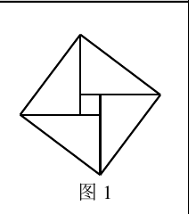

# 代数方程（八年级下）

> [!note] 📖 章导航
> 本篇属八年级下册（沪教版五四制）概要四章之一：
> [[03-数学/知识点/八年级/一次函数]] · [[03-数学/知识点/八年级/代数方程]] · [[03-数学/知识点/八年级/四边形]] · [[03-数学/知识点/八年级/概率初步]]
> 供初三基础回炉使用；内容依据国平台备课包（课件/学习任务单/课后练习）整理。
> 第一次学或没学懂 → 详细版：[[03-数学/知识点详解/八年级/代数方程]]

> [!note] 中考地位
> 解方程是全卷的基本功：分式方程、无理方程的**验根**、含字母系数方程的**分类讨论**、列方程解应用题的**建模**，是这一章在中考中的三大高频动作。

## 🗂 方程分类总览

按代数式家族类比整理（备课包·本章小结课件）：

- **代数方程**
  - **有理方程**
    - **整式方程**：一元一次方程、一元二次方程、一元高次方程
    - **分式方程**：分母中含有未知数
  - **无理方程**：根号内含有未知数

贯穿全章的思想是**化归**：分式方程"整式化"、无理方程"有理化"、高次方程"降次"、多元方程"消元"，最终都化归为一元一次、一元二次方程求解。

## ✏️ 一元整式方程与含字母系数方程（21.1）

- **整式方程**：方程两边都是整式的方程；只含一个未知数、最高次数为 $n$ 的整式方程叫**一元 $n$ 次方程**；==未知数的最高次数大于 2 的一元整式方程叫做高次方程==。
- **含字母系数的一元一次方程** $ax=b$：$a\neq 0$ 时有唯一解 $x=\dfrac{b}{a}$；$a=0$ 且 $b=0$ 时解为任意数（无数个解）；$a=0$ 且 $b\neq 0$ 时无解。
- **含字母系数的一元二次方程**：先看二次项系数是否为 0——为 0 退化成一次方程，不为 0 才能用判别式与求根公式，**分类讨论是这类题的灵魂**。
- 整式方程、一元几次方程的识别也要"先化简"：如 $\dfrac{1}{2}x^2+a^3x-1=0$ 关于 $x$ 是一元二次方程。

## 🔢 二项方程（21.2）

- **二项方程**：只含有未知数的 $n$ 次项和常数项的一元 $n$ 次方程，一般形式 $ax^n+b=0$（$a\neq 0$，$b\neq 0$）。
- 实数范围内的解的情况：

| $n$ 的奇偶 | 解的情况 |
| ---- | ---- |
| $n$ 为奇数 | **有且只有一个**实数根 $x=\sqrt[n]{-\dfrac{b}{a}}$ |
| $n$ 为偶数 | $a$、$b$ **异号**时有两个实数根 $\pm\sqrt[n]{-\dfrac{b}{a}}$；$a$、$b$ **同号**时没有实数根 |

- 解法：$n=1$、2 用旧方法；更高次用**计算器**求近似根（题目常要求保留三位小数）；$(x+m)^n$ 型先把 $x+m$ 看作整体。

## ➗ 可化为一元二次方程的分式方程（21.3）

- **分式方程**：分母中含有未知数的方程。
- 解法步骤：**去分母**（两边同乘最简公分母，化为整式方程）→ 解整式方程 → **检验**（把根代入最简公分母：使公分母为 0 的是**增根**，舍去；否则是原方程的根）。
- 增根的来源：去分母时扩大了未知数的取值范围，所以==解分式方程必须验根==。
- "无解"有两类：① 化得的整式方程本身无解；② 整式方程的根全是增根。两类都要排查。

## 🧩 无理方程（21.4）

- **无理方程**：根号下含有未知数的方程。**有理方程** = 整式方程 + 分式方程；**代数方程** = 有理方程 + 无理方程。
- 解法步骤：**两边平方**（有理化）→ 化为整式方程 → 解 → **验根**（把根代入**原方程**两边：使被开方数为负或两边不等的都是增根）。
- 增根来自"平方"这一非同解变形，验根时逐一代回原方程，缺一不可。

## 📐 二元二次方程和方程组（21.5）

- **二元二次方程**：含有两个未知数、并且含未知数的项的最高次数是 2 的整式方程；一般形式
  $ax^2+bxy+cy^2+dx+ey+f=0$（$a$、$b$、$c$ 不全为零），其中 $ax^2$、$bxy$、$cy^2$ 是二次项，$dx$、$ey$ 是一次项，$f$ 是常数项。
- **二元二次方程组**：其中至少有一个二元二次方程的方程组；它的解是一对使每个方程都成立的未知数的值（成对出现）。
- 经典模型——**赵爽弦图**：四个全等直角三角形拼成大正方形，中间围出小正方形。已知大正方形面积 13、小正方形面积 1，设直角三角形两直角边为 $x$、$y$（$x<y$）：

  列得 $\begin{cases}x^2+y^2=13\\ (y-x)^2=1\end{cases}$，解得 $x=2$，$y=3$。同一模型也可用分式方程（$y=\dfrac{6}{x}$，$y-x=1$）或无理方程（$\sqrt{13-x^2}-x=1$）求解——一个模型串起三种方程。

## 🔄 二元二次方程组的解法（21.6）

| 方程组类型 | 策略 | 要点 |
| ---- | ---- | ---- |
| 二元一次 + 二元二次 | **代入消元法** | 从二元一次方程解出 $y=mx+n$，代入二次方程 |
| 两个二元二次方程 | **因式分解降次** | 如 $x^2-3xy+2y^2=0$ 分解为 $(x-y)(x-2y)=0$，拆成两个方程组分别解 |

- 双向口诀：**消元、降次**，化归为二元一次方程组或一元二次方程。
- 方程组的解必须**成对配组**：由两个方程分别解出的 $x$、$y$ 不能交叉乱配（备课包专设错解辨析：把 $x_1,x_2$ 与 $y_1,y_2$ 任意组合是典型错误）。

## 🏗 列方程（组）解应用题（21.7）

步骤：**审 → 设 → 列 → 解 → 验 → 答**。常用模型：

| 模型 | 数量关系 |
| ---- | ---- |
| 增长率 | $a(1+x)^n=b$（$n$ 期为 $a(1+x)^n$） |
| 面积 | 长 $=$ 宽 $+$ 差，$长\times 宽=面积$ |
| 销售利润 | 单件利润 $\times$ 销量 $=$ 总利润（降价 $x$ 元、每降 $m$ 元多售 $k$ 件） |
| 传递计数 | $n$ 人互发短信共 $n(n-1)$ 条 |
| 折旧/折半 | 每期折旧率相同，逐期乘 $(1-x)$ |

- 检验关：除验根外，还要检验解是否符合实际（人数、件数取正整数，边长、价格为正，降价后单价不低于成本等）。

## 📚 拓展：特殊的一元高次方程（阅读材料）

- **双二次方程** $ax^4+bx^2+c=0$：设 $y=x^2$ 换元，先解 $ay^2+by+c=0$，再回代开方；推广到 $ax^{2k}+bx^k+c=0$ 设 $y=x^k$。
- **因式分解法**：如 $x^3-x^2-2x=0$，提公因式 $x(x^2-x-2)=0$ 降次；换元与分解是解高次方程的两把钥匙。

> [!warning] 🔥 易错点
> - 分式方程验根用**最简公分母**，无理方程验根代**原方程两边**——两者验法不同，别混。
> - 含字母系数方程（$ax=b$、含字母的一元二次方程）**必须分类讨论**，漏掉"系数为 0"是最常见丢分点。
> - 二项方程 $n$ 为偶数时，$a$、$b$ **同号无实根**；判断实数根个数先看符号（如 $x^4+1=0$ 无实数根）。
> - 二元二次方程组的解要**配对**，不能把两组 $x$、$y$ 交叉组合。
> - 应用题双解（如降价问题 $x=10$ 或 $20$）要逐一检验实际意义；增根与不合实际的解都要舍去并说明。
> - 列方程前先统一单位、设清未知数；增长率问题分清"增长到"与"增长了"。

## 📝 本讲小结

- **一张分类图**：代数方程 = 有理方程（整式 + 分式）+ 无理方程；位置决定解法与验根方式。
- **两条化归主线**：分式方程去分母、无理方程去根号，都化归为整式方程；高次降次、多元消元。
- **两次必检验**：分式方程、无理方程的增根；应用题的实际意义。
- **一种讨论**：字母系数方程按"系数是否为 0"分类。
- **一个模型库**：增长率、面积、销售、工程、行程（弦图模型串起二元二次方程组、分式方程、无理方程）。

## 📮 例题速递

**例1**　小杰把分式方程
$$\frac{6}{(x-1)(x+1)}-\frac{3}{x-1}-1=0\quad①$$
化成了整式方程 $x^2+3x-4=0$　②，并求出了整式方程②的根是 $x_1=1$，$x_2=-4$．此时，小杰说：方程①的根就是 $x_1=1$，$x_2=-4$．你同意小杰的说法吗？为什么？

> [!tip]- 💡 思路导航
> 去分母这一步不是同解变形，可能产生**增根**；判断的关键是逐根检验"是否使最简公分母为 0"。

> [!success]- ✅ 简解
> 不同意。$x_1=1$ 使最简公分母 $(x-1)(x+1)=0$，是原方程的**增根**，应舍去；把 $x_2=-4$ 代入原方程检验成立，所以原方程的根只有 $x=-4$．
>
> **题源**：《21.3 可化为一元二次方程的分式方程》课后练习第 2 题，PDF 第 1 页。

**例2**　某商场服装柜在销售中发现，某品牌童装平均每天可售出 20 件，每件盈利 40 元。为了迎接"六一"国际儿童节，商场决定采取适当的降价措施。经市场调查发现，如果每件童装降价 4 元，那么平均每天就可多售出 8 件。要想在销售这种童装上平均每天盈利 1200 元，那么每件童装应降价多少元？

> [!tip]- 💡 思路导航
> 设降价 $x$ 元，则"单件利润 $40-x$、日销量 $20+2x$"，用"利润 $=$ 单件利润 $\times$ 销量"列一元二次方程；双解都要检验。

> [!success]- ✅ 简解
> 设每件童装降价 $x$ 元，则每件盈利 $(40-x)$ 元，每天售出 $(20+2x)$ 件．
> 由 $(40-x)(20+2x)=1200$，整理得 $x^2-30x+200=0$，解得 $x_1=10$，$x_2=20$．
> 两解均符合题意，所以每件童装应降价 10 元或 20 元．
>
> **题源**：《21.7 列方程（组）解应用题》课后练习第 3 题，PDF 第 2 页。
