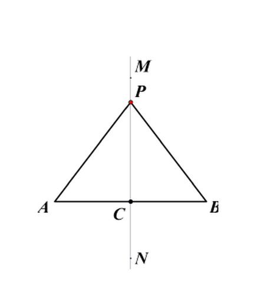
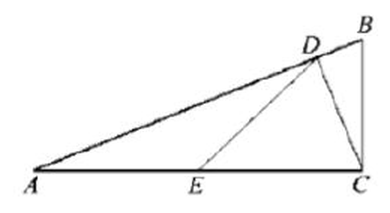

# 几何证明（八年级上）

> [!note] 📖 使用导航
> 本文是概要版（初三基础回炉·考前速查）。公式总表：[[03-数学/知识点/00-六至八年级核心公式定理总表]]；同册章节：[[03-数学/知识点/八年级/二次根式]]、[[03-数学/知识点/八年级/正比例函数与反比例函数]]。

> [!note] 中考地位
> 上海初中几何"说理"的正式起点：定义—命题—证明的规则、垂直平分线/角平分线/直角三角形三大块定理，是九年级相似、四边形乃至中考第 22～25 题几何证明的工具库。==定理的符号语言==要能默写。

## 📖 命题与证明（19.1 / 19.3）

- **定义**：能界定某个对象含义的句子；**命题**：判断一件事情的句子。命题由**题设（条件）与结论**两部分组成。
  - **真命题**：判断正确；**假命题**：判断错误（举一个反例即可）。
  - **公理**：从长期实践中总结出来、不需证明就可作为推理依据的真命题；**定理**：从公理或其他真命题出发**经过推理证明为正确**的真命题。所有定理都是真命题，但真命题不一定是定理。
- **演绎证明**：从已知出发，依据已知的定义、公理、定理，一步步推出结论。规范格式：

```
已知：……
求证：……
证明：∵……（依据），
      ∴……（依据）。
```

- 每一步都要有**依据**，因果关系（"由什么推出什么"）不能颠倒、不能循环。
- **互逆命题**：第一个命题的题设是第二个命题的结论，第一个命题的结论是第二个命题的题设，这两个命题叫互逆命题；把其中一个叫**原命题**，另一个叫它的**逆命题**。
- **逆定理**：如果一个定理的逆命题经过证明也是真命题（定理），那么它们是一对**互逆定理**。==每个命题都有逆命题，但一个定理不一定有逆定理==（如"全等三角形对应角相等"的逆命题是假命题）。

## ✂️ 线段的垂直平分线与角的平分线（19.4 / 19.5）



| 定理 | 内容 | 符号语言 |
| ---- | ---- | ---- |
| 线段垂直平分线**性质定理** | 线段垂直平分线上的任意一点，与这条线段两个端点的**距离相等** | ∵ 点 P 在线段 AB 的垂直平分线上，∴ PA=PB |
| 线段垂直平分线**逆定理** | 与线段两个端点距离相等的点，在这条线段的垂直平分线上 | ∵ PA=PB，∴ 点 P 在线段 AB 的垂直平分线上 |
| 角平分线**性质定理** | 在角的平分线上的点，到这个角**两边的距离相等** | ∵ OC 平分∠AOB，P 在 OC 上，PD⊥OA，PE⊥OB，∴ PD=PE |
| 角平分线**逆定理** | 在一个角的内部（包括顶点）且到角的两边距离相等的点，在这个角的平分线上 | ∵ PD⊥OA，PE⊥OB，PD=PE，∴ 点 P 在∠AOB 的平分线上 |

- 垂直平分线的证明套路（化归为全等）：垂直平分线 ⇒ 两个直角三角形全等（SAS）⇒ PA=PB。
- 用角平分线性质时，**"距离"是垂线段长**——先作垂线，再谈相等；这正是辅助线"见角平分线作双垂线"的由来。

## 🧭 三条基本轨迹（19.6）

**点的轨迹**：符合某些条件的所有的点的集合。

| 条件 | 轨迹 |
| ---- | ---- |
| 到线段两个端点距离相等 | 这条线段的垂直平分线 |
| 在一个角的内部（包括顶点）且到这个角两边距离相等 | 这个角的平分线 |
| 到定点的距离等于定长 | 以这个定点为圆心、定长为半径的圆 |

- 轨迹题回答要**图形 + 条件**完整（"是……"，并画图）；有的条件对应的轨迹不止一条（如"到已知直线 AB 的距离等于 3cm 的点"的轨迹是**两条**平行直线）。

## 📐 直角三角形（19.7 / 19.8 / 19.9 / 19.10）

**1. 全等的特殊判定（HL）**：在两个直角三角形中，如果**斜边和一条直角边对应相等**，那么这两个直角三角形全等（记作 H.L.）。书写时先指出"都是直角三角形"（或 $\angle C=\angle C'=90^\circ$），再列 HL 三条件。

**2. 性质定理**：

- 定理 1：**直角三角形的两个锐角互余**（$\angle C=90^\circ\Rightarrow\angle A+\angle B=90^\circ$）。
- 定理 2：**直角三角形斜边上的中线等于斜边的一半**（$\angle ACB=90^\circ$，$D$ 为 $AB$ 中点 $\Rightarrow CD=\dfrac12AB$）。逆用它可判直角：一边上的中线等于这条边的一半的三角形是直角三角形。

**3. 勾股定理**：直角三角形的两条**直角边**的平方和等于**斜边**的平方。在 Rt$\triangle ABC$ 中，$\angle C=90^\circ$，$a,b$ 为直角边、$c$ 为斜边，则

$$a^2+b^2=c^2$$

- 我国《周髀算经》记载"勾三股四弦五"；面积割补法（四个全等直角三角形拼成正方形）是经典证明。
- **逆定理**：如果三角形的一条边的平方等于另外两条边的平方和，那么这个三角形是直角三角形（验证时**先取最大边为 c**）。

**4. 两点的距离公式**：直角坐标平面内 $A(x_1,y_1)$、$B(x_2,y_2)$，则

$$AB=\sqrt{(x_1-x_2)^2+(y_1-y_2)^2}$$

- 特殊情形：两点同在 x 轴上或平行于 x 轴的直线上时 $AB=\lvert x_1-x_2\rvert$；同在 y 轴方向时 $AB=\lvert y_1-y_2\rvert$。推导就是向坐标轴作垂线构造直角三角形后用勾股定理。

## 🖊️ 证明举例与常用思路（19.2 + 单元复习）

- **平行线判定与性质互逆**："角相等/互补 ⇒ 平行"是判定，"平行 ⇒ 角相等/互补"是性质；证明中反复交替使用（如：$AB\parallel CD$，$\angle B+\angle D=180^\circ\Rightarrow CB\parallel DE$）。
- **分析思路**：从结论倒推"要证什么，只需证什么"，落到已知条件与已有定理上；等腰三角形常配"三线合一"，中点常配"斜边中线/中位线方向"的辅助线。
- 等腰三角形的形成：垂直平分线性质、角平分线性质都是"造等腰"的基本图形。

> [!warning] 🔥 易错点（从学习任务单与课后练习错型提炼）
> - **性质定理与逆定理混用**：用垂直平分线性质定理的前提是"点在垂直平分线上"，由距离相等推"在线上"是逆定理——方向不能反。
> - **角平分线里的"距离"必须是垂线段**：没有作垂线就说"距离相等"是错的；辅助线先垂直，再用 HL/SAS。
> - **HL 只对直角三角形生效**：书写时要先写 $\angle C=\angle C'=90^\circ$；对一般三角形"两边一对直角"的误用是常见失分点。
> - **斜边中线定理前提是直角**：任意三角形中线≠一半；反之"中线=半边"才能判直角。
> - **勾股逆定理先找最大边**：最大边的平方 = 其余两边平方和 才是直角；别把斜边当直角边代入。
> - **书写规范（沪教版）**：每步"∵……∴……（依据）"；"已知、求证"两行不能省；因果颠倒（用结论证结论）等于没证。
> - **距离公式去根号要加绝对值**：$AB=\lvert x_1-x_2\rvert$（水平）不是 $x_1-x_2$，坐标差可能为负。

## 🔗 关联

- 前置：[[03-数学/知识点/00-六至八年级核心公式定理总表]]（全等三角形判定、平行线）。
- 后续：九年级相似三角形证明、四边形性质证明都建立在本章"命题—定理—演绎证明"框架上；勾股与两点距离公式服务于解析法（[[03-数学/知识点/八年级/正比例函数与反比例函数]]）。

## 📝 本讲小结

- **规则**：定义→命题→（真/假）→公理/定理；演绎证明 = 已知 + 依据 + ∵∴ 推理链。
- **互逆**：原命题 ⇄ 逆命题；定理不一定有逆定理。
- **两大对称性质**：垂直平分线（到两端点等距）、角平分线（到两边等距垂线段），各有性质定理 + 逆定理。
- **三条基本轨迹**：垂直平分线、角平分线、圆。
- **直角三角形**：HL 判全等；两锐角互余；斜边中线 = 斜边一半；勾股定理 + 逆定理；两点的距离公式。
- **方法**：判定与性质分清方向；分析从结论倒推；书写步步有据。

## 📮 例题速递

**1.**（19.8 课后练习 第 1 题，题源：19.8 直角三角形的性质 课后练习 PDF 第 1 页）如图，已知 $\triangle ABC$ 中，$\angle ACB=90^\circ$，$CD\perp AB$，垂足为点 $D$，点 $E$ 是边 $AC$ 的中点，$DE=2\text{ cm}$，$\angle BCD=20^\circ$，那么 $AC=$＿＿＿＿＿＿＿＿cm，$\angle A=$＿＿＿＿＿＿＿＿$^\circ$．



> [!tip]- 💡 思路导航
> 见"$CD\perp AB$ + $E$ 是 $AC$ 中点"立刻锁定 Rt$\triangle ACD$ 的**斜边中线**；求角则利用 $DE=AE=EC$ 造两个等腰三角形，再把角集中到一个外角关系里。

> [!success]- ✅ 简解
> 由 $CD\perp AB$ 知 $\angle ADC=90^\circ$，即 $\triangle ACD$ 是直角三角形；$E$ 是斜边 $AC$ 的中点，由**斜边中线定理** $DE=\dfrac12AC$，得 $AC=4$ cm。
> 又 $DE=EC$，故 $\angle EDC=\angle ECD=\angle ACD$。而 $\angle ACD=90^\circ-\angle BCD=70^\circ$，于是 $\angle DEC=180^\circ-2\times70^\circ=40^\circ$。由 $DE=AE$ 得 $\angle A=\angle ADE$，外角 $\angle DEC=\angle A+\angle ADE=2\angle A$，所以 $\angle A=20^\circ$。
> **考点**：斜边中线定理 + 等腰三角形 + 外角性质的综合链。

**2.**（19.10 课后练习 第 3 题，题源：19.10 两点的距离公式 课后练习 PDF 第 2 页）在直角坐标平面内，已知点 $P$ 的坐标为 $(m,m)$，且 $P$ 到点 $A(-2,3)$、$B(-1,-2)$ 的距离相等，求 $m$ 的值。

> [!tip]- 💡 思路导航
> 两个方向都通：直接写 $PA=PB$ 代距离公式得关于 $m$ 的方程；或用轨迹视角——$P$ 在线段 $AB$ 的垂直平分线上。代入后展开，二次项会抵消。

> [!success]- ✅ 简解
> 由两点的距离公式与 $PA=PB$：
> $(m+2)^2+(m-3)^2=(m+1)^2+(m+2)^2$，
> 展开得 $2m^2-2m+13=2m^2+6m+5$，即 $8m=8$，$m=1$。
> **考点**：距离公式列方程；到两定点距离相等的点在垂直平分线上（轨迹视角可检验：$P(1,1)$ 确在 $AB$ 垂直平分线上）。
