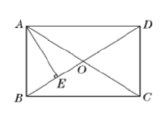

# 四边形（八年级下）

> [!note] 📖 章导航
> 本篇属八年级下册（沪教版五四制）概要四章之一：
> [[03-数学/知识点/八年级/一次函数]] · [[03-数学/知识点/八年级/代数方程]] · [[03-数学/知识点/八年级/四边形]] · [[03-数学/知识点/八年级/概率初步]]
> 供初三基础回炉使用；内容依据国平台备课包（课件/学习任务单/课后练习）整理。

> [!note] 中考地位
> 几何论证主线的主战场：**特殊平行四边形的性质与判定、梯形与中位线**是第 22～24 题几何论证与压轴题的常驻工具，平面向量为向量知识起步。

## 📐 多边形（22.1）

- **多边形**：平面内由不在同一直线上的一些线段**首尾顺次联结**所组成的封闭图形；由 $n$ 条线段组成的多边形叫 $n$ 边形。初中阶段研究的多边形都指**凸多边形**（任何一边双向延长，其他各边都在延长所得直线的同旁）。
- 元素：边、顶点、内角、外角、**对角线**（联结不相邻两个顶点的线段）。

| $n$ 边形 | 内角和 | 外角和 | 从一个顶点出发的对角线 | 对角线总数 |
| ---- | ---- | ---- | ---- | ---- |
| 公式 | $(n-2)\cdot 180°$ | $360°$（与边数无关） | $n-3$ 条 | $\dfrac{n(n-3)}{2}$ 条 |

- 推导思路（化归）：从一个顶点引对角线，把 $n$ 边形分成 $n-2$ 个三角形；也可从内角和与外角和相加、在形内取点分割等多种途径验证。
- 各角相等的 $n$ 边形：每个内角 $=\dfrac{(n-2)\cdot 180°}{n}$，每个外角 $=\dfrac{360°}{n}$。
- 常用方程法：用内角和公式**建立方程**求边数（如内角和 $2160°\Rightarrow(n-2)\cdot180°=2160\Rightarrow n=14$）。

## 🧭 平行四边形（22.2）

- **定义**：两组对边分别平行的四边形叫做平行四边形。
- **性质**（边、角、对角线、对称性四方面）：

| 性质定理 | 内容 |
| ---- | ---- |
| 性质定理 1 | 平行四边形的**对边相等** |
| 性质定理 2 | 平行四边形的**对角相等** |
| 性质定理 3 | 平行四边形的**对角线互相平分** |
| 对称性 | **中心对称图形**（对称中心是对角线交点） |

- **判定**：

| 判定方法 | 内容 |
| ---- | ---- |
| 定义 | 两组对边分别平行 |
| 判定定理 1 | 两组对边分别相等 |
| 判定定理 2 | 一组对边平行且相等（**平行与相等必须是同一组对边**） |
| 判定定理 3 | 对角线互相平分 |

- 常用模型：**"平行 + 角平分线"⇒ 等腰三角形**（角平分线 + 两线平行 ⇒ 内错角相等 ⇒ 等角对等边），如"∠ADC 的平分线交 AB 于 E ⇒ AE=AD=BC"。
- 周长、面积问题：周长按"两邻边之和 ×2"列式；面积 = 底 × 高（高用含 $30°$ 角的直角三角形求）。

## ⭐ 特殊的平行四边形（22.3）

- **定义**：
  - **矩形**：有一个内角是直角的平行四边形。
  - **菱形**：有一组邻边相等的平行四边形。
  - **正方形**：有一组邻边相等并且有一个内角是直角的平行四边形。

- **性质对照表**（备课包课件原图整理）：

| | 边 | 角 | 对角线 | 对称性 |
| ---- | ---- | ---- | ---- | ---- |
| 平行四边形 | 对边平行且相等 | 对角相等 | 互相平分 | 中心对称 |
| 矩形 | 同平行四边形 | **四个角都是直角** | **相等**且平分 | 中心对称 + 轴对称 |
| 菱形 | **四条边相等** | 同平行四边形 | **互相垂直**、且每一条对角线**平分一组对角** | 中心对称 + 轴对称 |
| 正方形 | 四边相等 | 四直角 | 相等、垂直、每条平分一组对角 | 中心对称 + 轴对称 |

- **判定表**：

| 图形 | 判定方法 |
| ---- | ---- |
| 矩形 | ① 有一个内角是直角的**平行四边形**（定义）；② 对角线相等的平行四边形；③ 三个角是直角的四边形 |
| 菱形 | ① 有一组邻边相等的**平行四边形**（定义）；② 对角线互相垂直的平行四边形；③ 四条边相等的四边形 |
| 正方形 | **判定定理 1**：有一组邻边相等的**矩形**是正方形；**判定定理 2**：有一个内角是直角的**菱形**是正方形 |

- ==判定的本质是性质的逆用：先想"它有什么特殊性质"，再反过来说"具备该性质即判定"==
- 重要推论（沪教版 22.3 作业）：**直角三角形斜边上的中线等于斜边的一半**。
- 对角线分图形：矩形的两条对角线把矩形分成四个等腰三角形；**菱形的两条对角线把菱形分成四个直角三角形**（判断题常客）。
- 计算套路：矩形对角线夹角 + 对角线互相平分 ⇒ 等边三角形；菱形对角线 ⇒ 四个全等直角三角形（勾股定理求对角线）。

## 🏔 梯形与等腰梯形（22.4 / 22.5）

- **梯形定义**：**一组对边平行而另一组对边不平行**的四边形——两个条件缺一不可。
- 元素：平行的两边叫**底**（**较短的底叫上底，较长的底叫下底**，不是按上下位置分），不平行的两边叫**腰**，两底之间的距离叫**高**。
- 特殊梯形：**直角梯形**（一腰垂直于底）、**等腰梯形**（两腰相等）。
- **等腰梯形性质**：
  - 性质定理 1：等腰梯形**在同一底上的两个内角相等**；
  - 性质定理 2：等腰梯形的**两条对角线相等**；
  - 等腰梯形是**轴对称图形**，过两底中点的直线是它的对称轴。
- **等腰梯形判定**：两腰相等的梯形（定义）；同一底上的两个内角相等的梯形；对角线相等的梯形。
- **梯形问题化归**（添辅助线转化为三角形、平行四边形）：
  - **平移一腰**：过梯形一腰的平行线（如 $DE\parallel CB$），把梯形拆成"平行四边形 + 三角形"；
  - **作双高**：从上底两端向下底作垂线（$30°$、$45°$ 角求坝底长就用它）；
  - 延长两腰、平移对角线等，视条件选用。
- 面积：$S=\dfrac{(\text{上底}+\text{下底})\times 高}{2}=$ 中位线 $\times$ 高。

## ✂️ 三角形、梯形的中位线（22.6）

- **三角形中位线**：联结三角形**两边中点**的线段（区别于**中线**——中线联结顶点与对边中点）。
- **三角形中位线定理**：三角形的中位线**平行于第三边，并且等于第三边的一半**。
- **梯形中位线定理**：梯形的中位线**平行于两底，并且等于两底之和的一半**。
- **中点四边形**（顺次联结四边形四条边的中点所得）：==中点四边形的形状由原四边形两条对角线决定——与边无关==。

| 原四边形 | 中点四边形 |
| ---- | ---- |
| 任意四边形 | 平行四边形 |
| 对角线相等的四边形（矩形、等腰梯形等） | 矩形 |
| 对角线互相垂直的四边形（菱形等） | 菱形 |

- 中点三角形（联结三边中点）：周长为原三角形的一半，面积为原三角形的四分之一。

## ➡️ 平面向量及其加减运算（22.7–22.9）

- **有向线段**：带有方向的线段，三要素是**起点、方向、长度**；有向线段 $\overrightarrow{PQ}$ 与 $\overrightarrow{QP}$ 方向相反，不是同一条。
- **向量**：具有大小和方向的量；向量既有大小又有方向，与只有大小的"数量"不同。
- **加法（三角形法则）**：作 $\overrightarrow{OA}=\vec{a}$、$\overrightarrow{AB}=\vec{b}$，则 $\overrightarrow{OB}=\vec{a}+\vec{b}$——**首尾相接，和向量从第一个起点指向第二个终点**；满足交换律、结合律。
- **零向量**：大小为 0 的向量，方向任意；互为相反向量的两向量之和是零向量。
- **减法**：向量减法是向量**加法的逆运算**（$\vec{b}+\vec{x}=\vec{a}\Rightarrow\vec{x}=\vec{a}-\vec{b}$）；同一起点作 $\vec{a}$、$\vec{b}$，则 $\vec{a}-\vec{b}$ 是**从 $\vec{b}$ 的终点指向 $\vec{a}$ 的终点**的向量；减法可转化为加法：$\vec{a}-\vec{b}=\vec{a}+(-\vec{b})$。
- 化简套路：全部转化为加法，**首尾相接**拼链条，如 $\overrightarrow{AB}-\overrightarrow{AC}+\overrightarrow{BC}=\overrightarrow{AB}+\overrightarrow{CA}+\overrightarrow{BC}=\vec{0}$。

> [!warning] 🔥 易错点
> - **梯形定义两条件**："一组对边平行且不相等的四边形是梯形"（√）；只说"一组对边平行"（×）——另一组必须**不平行**。
> - 判定定理 2 中"平行且相等"必须指**同一组对边**，否则只是等腰梯形式的错误组合。
> - "对角线相等"的判定前提是**平行四边形**：对角线相等的四边形不一定是矩形（还可能是等腰梯形）。
> - 正方形判定要**两条**：邻边相等 + 一个直角，缺一不可（只有其一分别是菱形/矩形）。
> - **中位线 ≠ 中线**：中位线联结两边中点，中线联结顶点与对边中点。
> - 对角线总数公式是 $\dfrac{n(n-3)}{2}$，别错写成 $n-3$（那是从一个顶点出发的条数）。
> - 向量减法方向别搞反：**从"减向量"的终点指向"被减向量"的终点**；零向量方向任意。

## 📝 本讲小结

- **两个定理族**：多边形内角和 $(n-2)\cdot 180°$、外角和恒为 $360°$；中位线"平行且为一半"（三角形对第三边、梯形对两底）。
- **一张性质表**：平行四边形 → 矩形/菱形 → 正方形，边、角、对角线、对称性逐级叠加。
- **一张判定表**：从定义出发，性质逆用即判定；正方形 = 矩形 + 菱形的公共部分。
- **一类化归**：梯形添辅助线（平移腰、作双高）化归为三角形与平行四边形。
- **一个工具**：平面向量——有向线段表向量，加法首尾相接、减法同起点的"指路"法则。
- **一个模型**：中点四边形形状由对角线定（相等 → 矩形，垂直 → 菱形）。

## 📮 例题速递

**例1**　如图，已知矩形 $ABCD$ 中，对角线 $AC$ 与 $BD$ 相交于点 $O$，$AE$ 垂直平分线段 $BO$，垂足为 $E$，$BD=15\text{ cm}$，求 $AC$，$AB$ 的长．

> [!tip]- 💡 思路导航
> 矩形对角线相等且互相平分 ⇒ $AO=BO$；再抓"垂直平分"⇒ $AB=AO$，从而 $\triangle ABO$ 是**等边三角形**。

> [!success]- ✅ 简解
> 由矩形性质得 $AC=BD=15\text{ cm}$，且 $AO=BO=\dfrac{1}{2}AC=7.5\text{ cm}$．
> 因为 $AE$ 垂直平分 $BO$，所以 $AB=AO$；于是 $AB=AO=BO$，$\triangle ABO$ 是等边三角形，故 $AB=AO=7.5\text{ cm}$．
>
> **题源**：《22.3 特殊的平行四边形（1）》课后练习第 2 题（练习部分习题 22.3(1) 第 2 题），PDF 第 1 页（答案在第 3 页）。

**例2**　已知：在四边形 $ABCD$ 中，$AD=BC$，$E$、$F$、$G$ 分别是 $BD$、$AB$、$DC$ 的中点．求证：$\triangle EFG$ 是等腰三角形．

> [!tip]- 💡 思路导航
> 图中没有现成的"中位线"，要**先联结（或借助）两条对角线**：$EF$、$EG$ 分别是 $\triangle ABD$、$\triangle DCB$ 的中位线，长度各由一条对角线决定。

> [!success]- ✅ 简解
> 在 $\triangle ABD$ 中，$E$、$F$ 分别是 $BD$、$AB$ 的中点，所以 $EF=\dfrac{1}{2}AD$（中位线定理）；
> 在 $\triangle DCB$ 中，$E$、$G$ 分别是 $BD$、$DC$ 的中点，所以 $EG=\dfrac{1}{2}BC$．
> 又 $AD=BC$，所以 $EF=EG$，即 $\triangle EFG$ 是等腰三角形．
>
> **题源**：《22.6 三角形、梯形的中位线》课后练习第 4 题，PDF 第 1 页（答案在第 2 页）。
