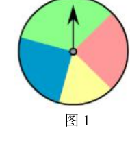

# 概率初步（八年级下）

> [!note] 📖 章导航
> 本篇属八年级下册（沪教版五四制）概要四章之一：
> [[03-数学/知识点/八年级/一次函数]] · [[03-数学/知识点/八年级/代数方程]] · [[03-数学/知识点/八年级/四边形]] · [[03-数学/知识点/八年级/概率初步]]
> 供初三基础回炉使用；内容依据国平台备课包（课件/学习任务单/课后练习）整理。
> 第一次学或没学懂 → 详细版：[[03-数学/知识点详解/八年级/概率初步]]

> [!note] 中考地位
> 中考必拿分点：常以选择、填空或小解答出现，考**事件分类、可能性大小比较、树状图与列表法求概率、游戏公平性判断**。

## 🎲 确定事件和随机事件（23.1）

| 类别 | 含义 | 例子 |
| ---- | ---- | ---- |
| **必然事件** | 一定发生的事件 | 太阳从东边升起；十进制中 $1+1=2$ |
| **不可能事件** | 一定不发生的事件 | 水中捞月；在实数范围内解 $x^2+1=0$ 得到两个实数根 |
| **随机事件** | 可能发生、也可能不发生的事件 | 抛硬币正面朝上；买彩票中大奖 |

- **确定事件** = 必然事件 + 不可能事件（事先能确定发不发生）；数学对象也能造事件：任取两个无理数求和（$\sqrt2+(-\sqrt2)=0$ 是有理数）是**随机事件**；10 只鸟关进 3 个笼子"至少一个笼子超过 3 只"是**必然事件**（平均分不掉）。
- 布袋中有 3 个白球、2 个黑球，摸出 1 个球："摸出白球或黑球"是必然事件；"摸出白球""摸出黑球"是随机事件；"摸出红球"是不可能事件。
- 判断套路：**与事实/数学规律对照**——违背规律⇒不可能，永远成立⇒必然，其余⇒随机。

## ⚖️ 事件发生的可能性（23.2）

- 随机事件发生的可能性**有大小之分**，比较依据是各自占的"份额"：

| 情境 | 比较依据 |
| ---- | ---- |
| 摸球（10 红、3 黄、1 白） | 球数：红 > 黄 > 白；"红或黄或白"必发生，"绿"不可能 |
| 交通信号灯（红 30 s、绿 50 s、黄 3 s） | 时间长短：遇绿 > 遇红 > 遇黄 |
| 游戏转盘 | **扇形圆心角度数**：度数大 ⇔ 可能性大 |

- 可能性的表述等级（从大到小）：**一定发生 > 很有可能发生 > 可能发生 > 不太可能发生 > 一定不会发生**。
- 例：抛硬币反面朝上——"可能发生"；买发行量很大的彩票中五百万——"很不可能发生"；连续雨天在路上遇到撑伞行人——"很有可能发生"。

## 📏 事件的概率（23.3）

- **概率**：刻画事件发生的可能性大小的数，记作 $P(A)$，且 $0\le P(A)\le 1$。
- 三类事件的概率：不可能事件 $P=0$；必然事件 $P=1$；**随机事件 $0<P<1$**（很可能发生的事件 $P$ **接近 1**，小概率事件 $P$ **接近 0**）。
- **频率**：$n$ 次重复试验中事件 $A$ 发生 $m$ 次，比值 $\dfrac{m}{n}$ 叫事件 $A$ 发生的频率。
- 频率与概率的关系：**频率随试验而变，概率是客观的稳定值**；==大数次试验中，频率稳定于概率，可以用频率估计概率==。
- 例：摸球 200 次，131 次红、69 次白，红球频率 $131/200=0.655\approx\dfrac23$，故估计袋中红球约 2 个、白球约 1 个。

## 🌳 概率计算举例（23.4）

- **等可能试验**：一次试验所有可能结果有 $n$ 个（每个等可能），事件 $A$ 包含其中 $m$ 个，则
$$P(A)=\frac{m}{n}.$$
- **列表法**：适合"两步"试验（各步的每个结果与每步的每个结果搭配）。四张牌（1～4）放回抽两张的全部结果：

|  第一次＼第二次 | 1 | 2 | 3 | 4 |
| ---- | ---- | ---- | ---- | ---- |
| **1** | （1，1） | （1，2） | （1，3） | （1，4） |
| **2** | （2，1） | （2，2） | （2，3） | （2，4） |
| **3** | （3，1） | （3，2） | （3，3） | （3，4） |
| **4** | （4，1） | （4，2） | （4，3） | （4，4） |

共 $4\times4=16$ 种等可能结果。
- **树状图**：按步骤逐层画"枝"，每层列出该步所有等可能结果，一条从根到叶的路径对应一个结果。例如袋中 1 红 1 白、**不放回**摸两次：

  - 第一次摸红 → 第二次只能摸白 ⇒（红，白）
  - 第一次摸白 → 第二次只能摸红 ⇒（白，红）

  （若**放回**再摸，每层都有红、白两枝，共 4 条路径——有无放回画图不同，先看清规则。）
- **公平性**：==游戏规则公平 $\iff$ 双方获胜的概率相等==；不公平时可通过修改得分/条件使双方概率一致。
- 抓阄与顺序无关：3 人抓 1 张有记号的纸片，先抓、后抓的概率都是 $\dfrac13$——"先抓机会大"是错的。
- 随机归还问题：3 把伞随意还给 3 人，共 $3!=6$ 种等可能分法，恰好人各得己伞只有 1 种，概率 $\dfrac16$。

> [!warning] 🔥 易错点
> - **可能性小 ≠ 不可能发生**，可能性大 ≠ 必然发生——"可能性很小的事件不可能发生""可能性很大就必然发生"都是错的，"可能性很小的事也有可能发生"才是对的。
> - **频率 ≠ 概率**：少量试验的频率波动大，不能直接当概率用；要用**大数次**试验的频率估计。
> - 列表、画树状图前先确认**有无放回**：有放回才有（2，2）这类结果，不放回则没有。
> - 数"所有可能结果"必须保证**等可能**：不能把"摸到红球/摸到非红球"当成等可能的两类（含球数不同时份额不同）。
> - 判断公平性要比**概率**，不能只数结果个数（如点数和为 8 与 9 的组合数不同）。
> - 填"接近 1 / 接近 0"这类估计题，先分清事件是大概率还是小概率。

## 📝 本讲小结

- **一次分类**：确定事件（必然 $P=1$、不可能 $P=0$）与随机事件（$0<P<1$）。
- **两级比较**：可能性大小看"份额"（数量、时间、面积、角度）；表述分五档（一定发生 → 一定不会发生）。
- **两个工具**：**列表法**（两步试验全排列）与**树状图**（分步画枝，看清有无放回），数出 $m$ 与 $n$ 后 $P(A)=\dfrac{m}{n}$。
- **一个桥梁**：频率 $\xrightarrow{\text{大数次试验}}$ 稳定值 = 概率，用频率估计概率。
- **一条准则**：游戏公平 $\iff$ 双方获胜概率相等；抓阄与先后顺序无关。

## 📮 例题速递

**例1**　小明从点数为 1 到 4 的四张牌中任意抽出一张牌，放回洗匀后，小杰再从中任意抽出一张牌，求两张牌的点数之和等于 5 的概率。（小杰已用列表法列出全部 16 种结果：和为 5 的有（1，4）、（2，3）、（3，2）、（4，1）共 4 种，概率 $\dfrac{4}{16}=\dfrac14$。）你能求出两张牌的点数互素的概率吗？

> [!tip]- 💡 思路导航
> 直接沿用上表 16 种等可能结果，**逐格检查"最大公约数是否为 1"**，数出互素的格数再除以 16。

> [!success]- ✅ 简解
> 16 种结果中互素的：（1，1）（1，2）（1，3）（1，4）（2，1）（2，3）（3，1）（3，2）（3，4）（4，1）（4，3），共 11 种，
> 所以两张牌点数互素的概率 $P=\dfrac{11}{16}$．
>
> **题源**：《23.4 概率计算举例》课后练习第 4 题，PDF 第 2 页（答案在第 3 页）。

**例2**　比较下列事件发生的可能性大小，并将它们按可能性从大到小的顺序排列．
事件一：我的书包里共有 12 本书，我随便把手往里一伸，恰好摸到数学书（假设书的大小厚薄相同）；
事件二：我花 2 元钱买了一张彩票，中了大奖，得 500 万元奖金；
事件三：学校搞迎新年活动，我抽中了全校唯一的大奖．

> [!tip]- 💡 思路导航
> 不必算精确概率，估"份额"：书包摸书约 $\dfrac1{12}$；全校唯一大奖概率为"全校人数分之一"，远小于 $\dfrac1{12}$；中五百万大奖是典型的小概率事件。

> [!success]- ✅ 简解
> 事件一（约 $\dfrac1{12}$）> 事件三（$\dfrac1{\text{全校人数}}$，但远大于彩票中奖）> 事件二（极小概率），
> 所以按可能性从大到小排列为：事件一，事件三，事件二．
>
> **题源**：《23.2 事件发生的可能性》课后练习第 4 题，PDF 第 2 页（答案在第 3 页）。
