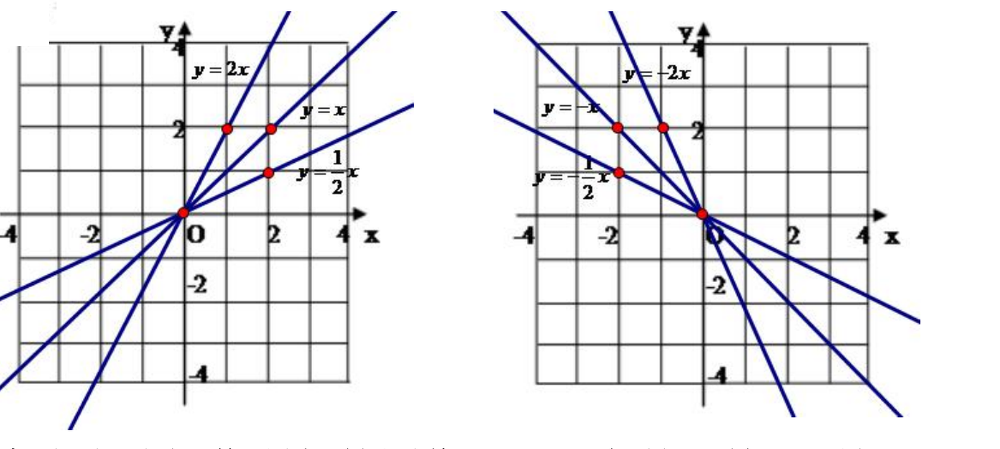
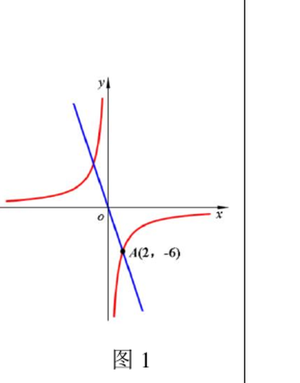
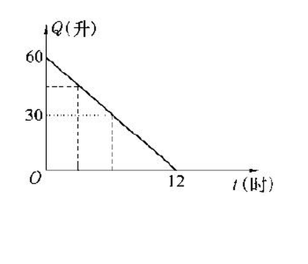

# 正比例函数与反比例函数（八年级上）

> [!note] 📖 使用导航
> 本文是概要版（初三基础回炉·考前速查）。公式总表：[[03-数学/知识点/00-六至八年级核心公式定理总表]]；同册章节：[[03-数学/知识点/八年级/一元二次方程]]；进阶：[[03-数学/知识点/九年级/二次函数]]；第一次学或没学懂 → 详细版：[[03-数学/知识点详解/八年级/正比例函数与反比例函数]]

> [!note] 中考地位
> 函数的地基章：函数概念（含"唯一对应"）、图像信息读取、待定系数法是九年级二次函数和中考函数综合题的入场券；==反比例函数的"每象限"增减性==与==k 的几何意义==是选择填空的常客。

## 📌 函数的概念（18.1）

- 在某个变化过程中，**数值发生变化的量叫变量**，**保持不变的量叫常量（常数）**。
- **函数**：在某个变化过程中有两个变量 $x$ 和 $y$，如果在变量 $x$ 的**允许取值范围内**，变量 $y$ 随着 $x$ 的变化而变化，它们之间存在**确定的依赖关系**（$x$ 每取一个确定的值，$y$ 都有**唯一**确定的值与之对应），那么 $y$ 叫做 $x$ 的**函数**，$x$ 叫做**自变量**。
- 表示这种依赖关系的数学式子叫**函数解析式**；求解析式后别忘了**定义域**（实际问题的定义域受实际意义限制）。

## 📈 正比例函数（18.2）

**成正比例**：$\dfrac{y}{x}=k$（$k$ 是不等于零的常数），即 $y=kx$。

- **定义**：解析式形如 $y=kx$（$k$ 是常数，$k\ne0$）的函数叫**正比例函数**，常数 $k$ 叫**比例系数**；定义域是**一切实数**。
- **待定系数法**求解析式：设 $y=kx$ → 代入一组对应值 $(x_0,y_0)$ → 解出 $k=\dfrac{y_0}{x_0}$（$x_0\ne0$）。
- **图像**：一条经过**原点 $(0,0)$ 和点 $(1,k)$** 的**直线**；反之，过原点与点 $(1,k)$ 的直线就是 $y=kx$ 的图像。
- **性质**（数形结合的核心表）：

| $k$ 的符号 | 图像经过的象限 | $y$ 随 $x$ 的变化 |
| ---- | ---- | ---- |
| $k>0$ | 第一、三象限 | $y$ 随 $x$ 的增大而**增大** |
| $k<0$ | 第二、四象限 | $y$ 随 $x$ 的增大而**减小** |

- **实际问题中**：定义域往往受限制（如时间 $0\le x\le 10$、件数为正整数），此时图像可能是**线段、射线或一些离散的点**。

## 📉 反比例函数（18.3）

**成反比例**：$xy=k$（$k$ 是不等于零的常数），即 $y=\dfrac{k}{x}$。

- **定义**：解析式形如 $y=\dfrac{k}{x}$（$k$ 是常数，$k\ne0$）的函数叫**反比例函数**，$k$ 也叫比例系数；定义域是 $x\ne0$。三种等价形式：$y=\dfrac{k}{x}$，$y=kx^{-1}$，$xy=k$。
- **待定系数法**：设 $y=\dfrac{k}{x}$，代入一组对应值求 $k$。注意**谁与谁成反比例要照题意写解析式**：如 "$y$ 与 $2x+7$ 成反比例" 应设 $y=\dfrac{k}{2x+7}$；"$y$ 与 $x^2$ 成反比例" 应设 $y=\dfrac{k}{x^2}$。
- **图像与性质**：图像是**双曲线**，断成两支（$x\ne0$）：

| $k$ 的符号 | 图像所在象限 | $y$ 随 $x$ 的变化（同一支内） |
| ---- | ---- | ---- |
| $k>0$ | 第一、三象限 | 每一象限内 $y$ 随 $x$ 的增大而**减小** |
| $k<0$ | 第二、四象限 | 每一象限内 $y$ 随 $x$ 的增大而**增大** |

- **k 的几何意义**：过双曲线上任一点向两坐标轴作垂线，与坐标轴围成的**矩形面积为 $\lvert k\rvert$**，与原点连线构成的**直角三角形面积为 $\dfrac{\lvert k\rvert}{2}$**（双曲线上点的横、纵坐标之积恒为 $k$）。

## 🖼️ 函数的表示法（18.4）

| 表示法 | 优点 | 局限 |
| ---- | ---- | ---- |
| **解析法** | 关系明确，便于计算任意自变量对应的函数值 | 较抽象，有的函数写不出解析式 |
| **列表法** | 一目了然，直接查对应值 | 只能列有限个值 |
| **图像法** | 直观呈现变化趋势、便于整体把握 | 读出的值往往是近似的 |

- **读图要点**：先看两轴含义与单位，再看起点/转折点/终点，最后看"平段=不变、越陡=变化越快"。

> [!warning] 🔥 易错点（从课件例题与课后练习错型提炼）
> - **正比例函数的判别**：$y=3x^2$、$y=3(x+1)$、$y=\dfrac5x$ 都不是 $y=kx$ 型；含参数时如 $y=(k-2)x+k^2-5k-6$ 是正比例函数，需 $k^2-5k-6=0$ **且** $k-2\ne0$，两个条件一起解。
> - **反比例函数的判别**：$y=\dfrac1x+1$ 不是（多了一项），$xy=2$ 是（即 $y=\dfrac2x$）；含参数型如 $y=\dfrac{k+1}{x}+k^2-1$ 是反比例函数，需**同时**满足 $k^2-1=0$ 与 $k+1\ne0$，得 $k=1$。
> - **增减性必须"每象限内"谈**：反比例函数比较 $y_1,y_2$ 大小，先看两点是否在同一支（同象限）；跨象限比较要借助符号，**不能直接套"y 随 x 增大而减小"**。
> - **图像过哪个象限只由 $k$ 决定**：$mn<0$ 时 $y=\dfrac{m}{n}x$ 中 $\dfrac mn<0$，图像过二、四象限。
> - **实际问题定义域**：解析式为 $y=60-5t$ 时，自变量范围是 $0\le t\le12$（油抽完即停），写解析式必须连同定义域。
> - 待定系数法求出 $k$ 后，**正比例函数检查 $k\ne0$、反比例函数检查 $k\ne0$ 且定义域 $x\ne0$**。

## 🔗 关联

- 前置：[[03-数学/知识点/00-六至八年级核心公式定理总表]]（坐标系、比例）。
- 后续：[[03-数学/知识点/九年级/二次函数]]（同套路：概念→图像→性质→待定系数）；反比例与正比例图像的位置关系是中考函数选填的常客。

## 📝 本讲小结

- **函数**：一个 x 对唯一 y；解析式 + 定义域缺一不可。
- **正比例函数** $y=kx$（$k\ne0$）：过原点与 $(1,k)$ 的直线；$k>0$ 增、过一三象限，$k<0$ 减、过二四象限。
- **反比例函数** $y=\dfrac kx$（$k\ne0$）：双曲线，定义域 $x\ne0$；$k>0$ 一三象限每支减，$k<0$ 二四象限每支增；矩形面积 $\lvert k\rvert$、三角形面积 $\dfrac{\lvert k\rvert}2$。
- **表示法**：解析法、列表法、图像法各有优劣；读图先读轴、再读点。
- **通法**：待定系数法（设 → 代 → 解 → 写解析式和定义域）。

## 📮 例题速递

**1.**（18.4 课后练习 第 3 题，题源：18.4 函数的表示法 课后练习 PDF 第 2 页）一辆汽车在行驶过程中，油箱内的油 $Q$（升）与耗油时间 $t$（时）的函数关系如图所示．请根据图像回答下列问题：

（1）油箱内原有油量是＿＿＿＿＿＿＿＿升．
（2）汽车行驶 3 小时后，耗油＿＿＿＿＿＿＿＿升，油箱剩油＿＿＿＿＿＿＿＿升．
（3）当油箱剩油 30 升时，汽车行驶了＿＿＿＿＿＿＿＿小时．
（4）$Q$ 与 $t$ 的函数解析式是＿＿＿＿＿＿＿＿．

> [!tip]- 💡 思路导航
> 图像是一条线段：先读两个端点的意义（起点油量、油尽时刻），再由两点求每小时的耗油量，解析式要带定义域。

> [!success]- ✅ 简解
> 图像是过 $(0,60)$ 与 $(12,0)$ 的线段：每小时耗油 $60\div12=5$ 升。
> （1）60；（2）15，45；（3）$60-5t=30\Rightarrow t=6$；
> （4）$Q=60-5t$（$0\le t\le12$）。
> **考点**：从图像读关键点 + 写解析式时**连定义域一起写**。

**2.**（18.3 课后练习 第 3 题，题源：18.3 反比例函数 课后练习 PDF 第 2 页）已知反比例函数 $y=\dfrac{k}{x}$（$k\ne0$），当 $x=-\dfrac{\sqrt2}{2}$ 时，$y=2\sqrt2$，求 $k$ 的值，并求当 $x=\sqrt6$ 时的函数值。

> [!tip]- 💡 思路导航
> 待定系数法：把已知的一组对应值代入 $y=\dfrac{k}{x}$ 解出 $k$；再代 $x=\sqrt6$，结果要分母有理化。

> [!success]- ✅ 简解
> 代入：$2\sqrt2=\dfrac{k}{-\frac{\sqrt2}{2}}$，得 $k=2\sqrt2\times\Big(-\dfrac{\sqrt2}{2}\Big)=-2$。
> 解析式 $y=-\dfrac2x$；当 $x=\sqrt6$ 时 $y=-\dfrac{2}{\sqrt6}=-\dfrac{\sqrt6}{3}$。
> **考点**：待定系数法求 $k$；代值计算含分母有理化（呼应[[03-数学/知识点/八年级/二次根式]]）。
