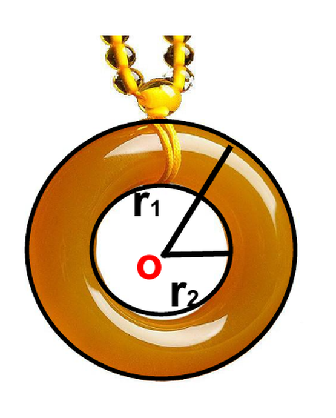
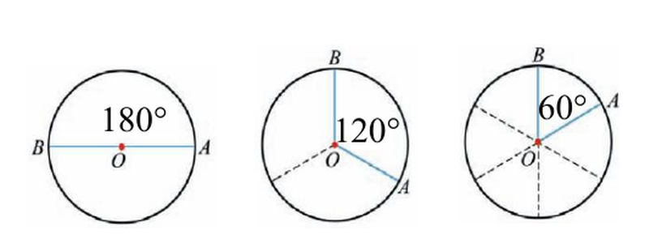
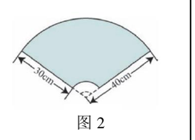
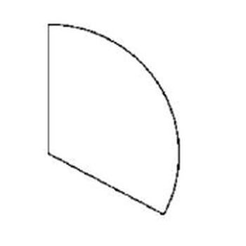

# 圆和扇形（六年级上）

> [!note] 📖 使用导航
> 本文是概要版（初三基础回炉·公式速查）。公式总表：[[03-数学/知识点/00-六至八年级核心公式定理总表]]；同册章节：[[03-数学/知识点/六年级/数的整除]]、[[03-数学/知识点/六年级/分数]]、[[03-数学/知识点/六年级/比和比例]]。

> [!note] 中考地位
> 上海中考 18 题常考**圆与扇形的面积/弧长组合图形**，九年级[[03-数学/知识点/九年级/圆与正多边形]]是它的正式续篇。六上这四个公式是全卷几何计算题的最底层工具，公式记混（$\frac{n\pi r}{180}$ 与 $\frac{n\pi r^2}{360}$）是高频失分点。

## ⭕ 圆的周长与圆周率（4.1）

- **圆周率**：圆的周长 $C$ 与直径 $d$ 的**比值是一个固定的数**，叫做圆周率，用字母 $\pi$ 表示。
  $$\pi=\frac Cd\quad(\pi\text{ 是无限不循环小数，}\pi\approx3.14)$$
- 数学史料：祖冲之计算出 $\pi$ 在 3.1415926 与 3.1415927 之间，是世界上第一个把比值精确到 7 位小数的人。计算中除非说明，一般取 $\pi\approx3.14$。
- **周长公式**及变形：

$$C=\pi d=2\pi r,\qquad d=\frac C\pi,\qquad r=\frac C{2\pi}$$

- 圆环的宽度 = 外圆半径 − 内圆半径：$d=r_1-r_2$（已知内外圆周长时，先用 $r=\dfrac C{2\pi}$ 各自求半径再相减）。

## 📏 弧长（4.2）

- **圆心角**：顶点在**圆心**的角（顶点不在圆心的角不是圆心角）。
- **弧与圆心角的关系**：圆心角越大，所对的弧越长；圆心角 $n^\circ$ 的圆心角所对的弧长是圆周长的 $\dfrac n{360}$。

- **弧长公式**（$r$ 为半径，$n$ 为圆心角度数）：

$$l=\frac{n}{360}\cdot 2\pi r=\frac{n\pi r}{180}$$

- 记忆支点：$1^\circ$ 的圆心角所对的弧长 $=\dfrac{2\pi r}{360}=\dfrac{\pi r}{180}$，$n^\circ$ 就是它的 $n$ 倍。

| 圆心角 | 180° | 120° | 90° | 72° | 60° |
| ---- | ---- | ---- | ---- | ---- | ---- |
| 所对弧长占圆周长 | $\dfrac12$ | $\dfrac13$ | $\dfrac14$ | $\dfrac15$ | $\dfrac16$ |

## ⚫ 圆的面积（4.3）

- 把圆等分后拼成近似的**长方形**（无限逼近思想）：长≈圆周长的一半 $\pi r$，宽≈半径 $r$，于是
  $$S=\pi r\times r=\pi r^2$$
- 已知直径或周长求面积：**先化成半径**再代入（$d=24$ 分米 → $r=12$ 分米；$C=62.8$ 米 → $r=62.8\div3.14\div2=10$ 米）。
- 半圆的面积 $=\dfrac12\pi r^2$；半圆的**周长** $=\pi r+2r$（弧 + 直径，别漏直径）。

## 🍕 扇形（4.4）

- **扇形的定义**：由组成圆心角的**两条半径**和圆心角所对的**弧**围成的图形。
- 类比弧长的推导，圆心角 $n^\circ$ 的扇形面积是圆面积的 $\dfrac n{360}$：
  $$S_{\text{扇形}}=\frac{n}{360}\cdot\pi r^2=\frac{n\pi r^2}{360}$$
- **用弧长表示扇形面积**（已知 $l$ 与 $r$ 时最好用）：
  $$S_{\text{扇形}}=\frac12 lr$$
  已知弧长和半径时==首选 $S=\dfrac12lr$==，不必再求圆心角（见例题速递第 2 题）。
- **扇形的周长** $=$ 弧长 $+$ 两条半径 $=l+2r$。

**本章公式对照表**（部分与整体的关系一列看清）：

| 名称 | 公式 | 与整体的关系 |
| ---- | ---- | ---- |
| 圆的周长 | $C=2\pi r$ | — |
| 弧长 | $l=\dfrac{n\pi r}{180}$ | 圆周长的 $\dfrac n{360}$ |
| 圆的面积 | $S=\pi r^2$ | — |
| 扇形的面积 | $S=\dfrac{n\pi r^2}{360}=\dfrac12lr$ | 圆面积的 $\dfrac n{360}$ |

## 🧩 组合图形阴影面积的常用拆法

- **大扇形 − 小扇形**（同圆心角不同半径）：如圆心角 240° 的环形扇域。
- **矩形 − 扇形**：直角扇形从矩形角落"抠"掉，$S=ab-\dfrac14\pi r^2$ 型。
- **扇形 + 三角形 / 弧长拼周长**：先分辨边界是"直边还是弧"，周长题逐段相加。
- 解题通用步骤：①认出每个扇形的**圆心角和半径**；②套公式；③按题目要求取近似值。

> [!warning] 🔥 易错点（从备课包课后练习错型提炼）
> - **π ≠ 3.14**：$\pi$ 是无限不循环小数，3.14 只是近似值，"π 的值等于 3.14"是错误说法（4.1 判断题）。
> - **周长与面积不能比较"大小"或说"相等"**：单位不同（厘米 vs 平方厘米），是两类不同的量（4.3 判断题"半径 2 厘米的圆周长与面积相等"是错的）。
> - **半径扩大 $k$ 倍**：周长扩大 $k$ 倍，面积扩大 $k^2$ 倍（4.3 判断题"半径扩大 3 倍面积也扩大 3 倍"是错的）。
> - **半圆周长** $=\pi r+2r$，只算 $\pi r$ 就漏了直径。
> - **扇形周长别忘两条半径**：半径 12 cm、周长 50 cm 的扇形，弧长 $l=50-12-12=26$ cm，而不是 50−12。
> - **两个公式分母别混**：弧长 $l=\dfrac{n\pi r}{180}$（$r$ 一次方），扇形面积 $S=\dfrac{n\pi r^2}{360}$（$r$ 平方）——写公式前先问自己"算的是长度还是面积"。
> - 求圆心角：由"部分占整体的比例"反推，如扇形面积是同半径圆的 20% → 圆心角 $360^\circ\times20\%=72^\circ$。
> - 组合图形先拆再算：大扇形减小扇形时**确认两者圆心角相同**；含曲线边界的周长要一段一段加。
> - 计算时看清 $\pi$ 取值与精确度要求（"精确到 0.01"要算到 0.001 再四舍五入）。

## 🔗 关联

- 前置工具：份数/比例思想（弧占圆周的比例）→ [[03-数学/知识点/六年级/比和比例]]；百分数（面积占比）→ 同上。
- 中考续篇：圆与正多边形、阴影面积压轴 → [[03-数学/知识点/九年级/圆与正多边形]]。
- 工具页：[[03-数学/知识点/00-六至八年级核心公式定理总表]]

## 📝 本讲小结

- **圆周率**：$\pi=C\div d$，无限不循环，计算取 3.14；$C=\pi d=2\pi r$。
- **弧长**：$l=\dfrac{n\pi r}{180}$，本质是"圆周长的 $\dfrac n{360}$"。
- **面积**：圆 $S=\pi r^2$（等分拼长方形推导）；扇形 $S=\dfrac{n\pi r^2}{360}=\dfrac12lr$。
- **扇形周长**：$l+2r$，别漏两条半径。
- **组合图形**：拆成扇形、矩形、三角形的和与差，认清圆心角与半径是第一步。
- **思想**：化曲为直（测周长）、无限逼近（面积推导）、部分与整体（$\frac n{360}$）。

## 📮 例题速递

**1.**（圆和扇形单元复习与小结 课后练习 第 4 题，题源：该课后练习 PDF 第 2 页）张华有一张直径为 10cm 的半圆形纸片，他从中剪下一个面积尽可能大的圆，那么剩下部分的纸片面积是多少？（精确到 $0.01\text{cm}^2$）

> [!tip]- 💡 思路导航
> 半圆内能剪下的最大圆，直径等于半圆的**半径**（5cm）；剩下的面积 = 半圆面积 − 小圆面积。

> [!success]- ✅ 简解
> 半圆半径 $R=5$cm，小圆直径 5cm、半径 $r=2.5$cm。
> $$S_{剩}=\frac12\pi R^2-\pi r^2=12.5\pi-6.25\pi=6.25\pi\approx19.63\ (\text{cm}^2)$$
> 答：剩下部分的纸片面积约是 19.63 平方厘米。

**2.**（4.4 扇形的面积 课后练习 第 4 题，题源：该课后练习 PDF 第 2 页）如图，所给扇形的半径是 12 厘米，周长是 50 厘米，这个扇形的面积是多少平方厘米？

> [!tip]- 💡 思路导航
> 扇形周长 = 弧长 + 两条半径 → 先反求弧长 $l$，再直接用 $S=\dfrac12lr$，绕开求圆心角。

> [!success]- ✅ 简解
> $l=50-12-12=26$（厘米）；
> $$S_{\text{扇形}}=\frac12lr=\frac12\times26\times12=156\ (\text{平方厘米})$$
> 答：这个扇形的面积是 156 平方厘米。
> **考点**：$S=\frac12lr$ 的正向使用——已知周长与半径求面积的最短路径。
