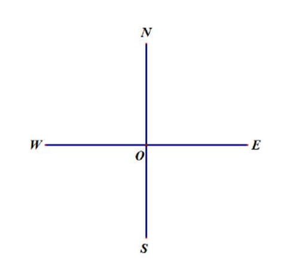
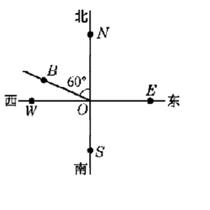

# 线段与角的画法（六年级下）

> [!note] 📖 使用导航
> 本文是概要版（初三基础回炉·考前速查）。公式总表：[[03-数学/知识点/00-六至八年级核心公式定理总表]]；同册章节：[[03-数学/知识点/六年级/有理数]]、[[03-数学/知识点/六年级/一次方程与不等式]]、[[03-数学/知识点/六年级/长方体的再认识]]。

> [!note] 中考地位
> **平面几何的第一课**：线段的比较与中点、角的表示与和差、余角补角，是七年级图形运动、八年级三角形与几何证明、九年级第 25 题角度计算的全部地基。==同角（等角）的余角相等、补角相等==在九年级几何证明中仍天天在用。

## 📏 线段（7.1 / 7.2）

### 线段的表示与大小比较

- **表示**：两个端点的大写字母——线段 $AB$；或一个小写字母——线段 $a$。
- **比较两条线段大小**的三种方法：**观察法**、**度量法**（用刻度尺量长度）、**叠合法**（把一条线段移到另一条上比较）。
- 叠合法的三种可能：把线段 $AB$ 叠到线段 $AC$ 上，使 $A$ 与 $A$ 重合、$AB$ 沿 $AC$ 落下——点 $B$ 落在 $AC$ 内部则 $AB<AC$；点 $B$ 与 $C$ 重合则 $AB=AC$；点 $B$ 落在 $AC$ 延长线上则 $AB>AC$。
- **尺规作图**：用**没有刻度的直尺和圆规**画图。画一条线段等于已知线段 $a$ 的画法：① 画射线 $AC$；② 用圆规量取线段 $a$ 的长；③ 在射线 $AC$ 上**截取** $AB=a$，线段 $AB$ 就是所要求作的线段。

### 两点之间，线段最短

- 联结两点的所有线中，==两点之间，线段最短==。
- **两点间的距离**：联结两点的**线段的长度**（是一个数值，不是图形"线段"本身）。

### 线段的和、差、倍与中点（7.2）

线段可以相加减：$A$、$B$、$C$ 三点在一条直线上时，$AC=AB+BC$，$AB=AC-BC$。已知线段 $a$、$b$（$a>2b$）画线段 $a-2b$：① 画射线；② 在射线上截取 $=a$；③ 在这条线段上**顺次截取**两段 $=b$，剩余部分就是 $a-2b$。

**线段的中点**：点 $C$ 把线段 $AB$ 分成两条相等的线段（$AC=BC$），点 $C$ 叫做线段 $AB$ 的中点。符号语言：$AC=BC=\dfrac12AB$，即 $AB=2AC=2BC$。

## 📐 角的概念、比较与画法（7.3 / 7.4 / 7.5）

### 角的概念与表示（7.3）

- **静态定义**：从一点引出的两条射线所组成的图形叫做角；公共端点叫**顶点**，两条射线叫**边**。
- **动态定义**：角也可以看作由一条射线绕着它的端点旋转所形成的图形；旋转开始与终止位置间的平面部分是**角的内部**。
- **三种表示方法**：

| 方法 | 记法 | 适用 |
| ---- | ---- | ---- |
| 三个大写字母 | $\angle ABC$（顶点字母 $B$ 写中间） | 任何角 |
| 顶点一个大写字母 | $\angle A$ | **仅当顶点处只有一个角** |
| 数字或希腊字母 | $\angle1$、$\angle\alpha$、$\angle\beta$ | 加弧线标注后使用 |

- **方向角（方位角）**：以**正北或正南**方向为基准，向东或向西偏转的角，如"北偏西 60°"。基准线永远是南北向，先写"北/南"，再写"偏东/偏西"。

### 角的大小比较与画相等的角（7.4）

- 比较方法：**度量法**（量角器）、**叠合法**——顶点重合、一条边叠合、另一条边落在同侧，再比较另一条边的位置（类比线段比较）。
- **角的大小与边的长短无关**（边是射线，无限延伸）；放大镜看角，度数不变。

### 画角的和、差、倍（7.5）

- 角的和差：$\angle AOC=\angle AOB+\angle BOC$，$\angle AOB=\angle AOC-\angle BOC$；用量角器画 $\angle\alpha+\angle\beta$、$2\angle\alpha-\angle\beta$。
- **一副三角尺能画出的特殊角**（小于平角）：

| 直接画 | 和差拼画 |
| ---- | ---- |
| $30°,45°,60°,90°$ | $15°,75°,105°,120°,135°,150°,165°$ |

它们都是 $15°$ 的倍数，共 11 个（$180°$ 本身是平角，用直线即可）。

- **求和差要分类**：如 $\angle AOB=55°$，$\angle BOC=20°$，当 $OC$ 在 $\angle AOB$ 内部时 $\angle AOC=55°-20°=35°$；当 $OC$ 在 $\angle AOB$ 外部时 $\angle AOC=55°+20°=75°$——题目未给图时两种都要考虑。

## 🧮 余角与补角（7.6）

| 概念 | 定义 | 记法要点 |
| ---- | ---- | ---- |
| 互余 | 两个角的和等于 $90°$（直角） | $\angle\alpha+\angle\beta=90°$，$\angle\beta$ 是 $\angle\alpha$ 的余角 |
| 互补 | 两个角的和等于 $180°$（平角） | $\angle\alpha+\angle\gamma=180°$，$\angle\gamma$ 是 $\angle\alpha$ 的补角 |

- 余角、补角只与**数量关系**有关，与两个角的位置无关。
- **两个重要命题**：同角（或等角）的余角相等；同角（或等角）的补角相等。
- **角的度量单位**是六十进制：$1°=60'$，$1'=60''$（度、分、秒）；进退位计算要满 60 才进 1。
- 方程工具：设这个角为 $x°$，则余角为 $(90-x)°$、补角为 $(180-x)°$，且**补角 − 余角 = 90°** 恒成立。

| 角的类型 | 度数范围 | 能否互余/互补备注 |
| ---- | ---- | ---- |
| 锐角 | $0°<\angle\alpha<90°$ | 互补的两角不可能都是锐角 |
| 直角 | $=90°$ | 互补的两角可以都是直角 |
| 钝角 | $90°<\angle\alpha<180°$ | 互余的两角不可能都是钝角 |

> [!warning] 🔥 易错点
> - **方向角写反基准**：北偏西 60° 与西偏北 60° 不是同一个角——方向角必须以南北向为基准；画图先定观测点、画南北东西十字再量角（原题情境：上海西站在人民广场北偏西 60°）。
> - **单字母表示角有条件**：顶点处不止一个角时，$\angle O$ 含义不明，必须用三个字母或数字/希腊字母标注。
> - **"两点间的距离"是长度（数）**，不是线段（图形）；"两点之间线段最短"说的是路径，不是距离定义。
> - **角的大小与边长无关**：别被"边画得长"骗了；量角器读数先看内圈外圈。
> - **度分秒 60 进制**：借位、进位都是 60，如 $63°24'-22°57'44''$ 要从分位借 1°=60′；度分秒混合运算常列竖式防错。
> - **余角补角方程别漏设**：解"一个角的补角是它的余角的 3 倍"型题目，用 $(180-x)=3(90-x)$ 列方程，别把"余角"写成 $(180-x)$。

## 🔗 关联

- 前置：小学"线段、射线、直线"与量角器使用；[[03-数学/知识点/六年级/有理数]]（度分秒计算的六十进制与混合运算）
- 后续：八年级三角形内角和、几何证明（余角补角性质是证明题常客）；九年级第 25 题角度计算
- 全局：[[03-数学/知识点/00-六至八年级核心公式定理总表]]

## 📝 本讲小结

- **线段**：表示（两字母/单字母）；比较（观察、度量、叠合）；尺规作一条线段等于已知线段（截取）；**两点之间，线段最短**；中点 $AC=BC=\frac12AB$；和差倍用"截取、顺次截取"叙述画法。
- **角**：静态+动态定义；三种表示（三字母、单字母限时用、数字/希腊字母）；比较（度量、叠合）；量角器画和差倍；一副三角尺画 11 个特殊角。
- **余角补角**：和为 $90°/180°$；同角（等角）的余角相等、补角相等；度分秒六十进制；"补角−余角=90°"。
- **思想**：类比（线段→角）、分类讨论（点的位置、角的位置）、数形结合（方向角）。

## 📮 例题速递

**1.**（7.3 课后练习 第 5 题，题源：7.3 课后练习 PDF 第 2 页）图中点 $O$ 表示人民广场，点 $B$ 表示上海西站。如果徐家汇在人民广场的西南方向，在上海西站的正南方向，试确定徐家汇的位置（用点 $C$ 表示）。

> [!tip]- 💡 思路导航
> 一个地点同时满足两个"方向条件"：分别从两个参照点画出方向射线，**交点**就是所求位置。

> [!success]- ✅ 简解
> 以 $O$ 为中心，画西南方向（南偏西 45°）的射线；以 $B$ 为中心，画正南方向的射线；两射线的交点就是徐家汇的位置 $C$。
> **考点**：方向角的画法——先定基准线（南北/东西），再按"北/南偏东/西"量角；两条件交会定位。

**2.**（7.6 课后练习 第 7 题·选做，题源：7.6 课后练习 PDF 第 3 页）一个角的补角比它的余角的三倍多 $18°$，求这个角的度数。

> [!tip]- 💡 思路导航
> 设这个角为 $x°$，则补角 $(180-x)°$、余角 $(90-x)°$；把"比……多"翻译成等量关系列方程。

> [!success]- ✅ 简解
> 设这个角的度数为 $x$。根据题意，得 $180-x=3(90-x)+18$，展开：$180-x=270-3x+18$，移项合并：$2x=108$，解得 $x=54$。
> 答：这个角为 $54°$。
> **考点**：余角补角方程（$90-x$、$180-x$ 别写反）；一元一次方程解应用题——衔接 [[03-数学/知识点/六年级/一次方程与不等式]]。
