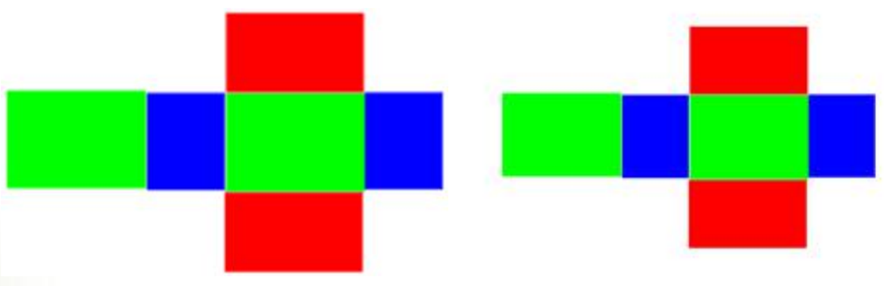
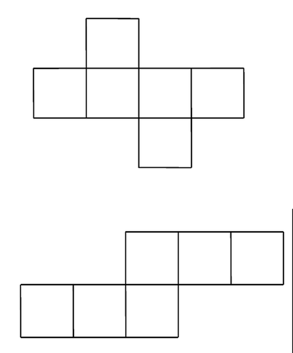
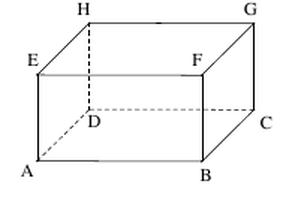

# 长方体的再认识（六年级下）

> [!note] 📖 使用导航
> 本文是概要版（初三基础回炉·考前速查）。公式总表：[[03-数学/知识点/00-六至八年级核心公式定理总表]]；同册章节：[[03-数学/知识点/六年级/有理数]]、[[03-数学/知识点/六年级/一次方程与不等式]]、[[03-数学/知识点/六年级/线段与角的画法]]。

> [!note] 中考地位
> **空间观念的第一课**：长方体元素与展开图服务七年级图形的认识；"棱与棱、棱与平面、平面与平面"三种位置关系是高中立体几何的雏形。中考直接命题不多，但==展开图折叠==是历年选择填空的经典小题，斜二侧画法是画一切立体图形的基本功。

## 🧊 长方体的元素与特征（8.1）

- 长方体有 **8 个顶点、12 条棱、6 个面**。

| 元素 | 个数 | 分组 | 每组特征 |
| ---- | ---- | ---- | ---- |
| 顶点 | 8 | — | 每个顶点引出 3 条棱 |
| 棱 | 12 | 3 组 | 每组中四条棱长度相等 |
| 面 | 6 | 3 组 | 每组中两个面的形状和大小都相同 |

- **长方体的每个面都是长方形**；相对的两个面形状大小相同（面积相等）。
- **正方体**是特殊的长方体：六个面都是形状大小相同的正方形，十二条棱长都相等。
- **表面积**（有盖纸盒）：$S=2(ab+ah+bh)$（$a,b,h$ 为长、宽、高）。**无盖**纸盒要讨论哪一面是"底"，答案不唯一：棱长 4、6、8 厘米的无盖纸盒，按盖子是 $4\times6$、$4\times8$ 还是 $6\times8$ 的面，外表面积分别为 184、176、160 平方厘米。
- **平面展开图**：沿棱剪开摊平。相对的面在展开图中"隔一行/列"或分居两侧——由展开图判断"哪一面在上面"要抓住**相对面**。

正方体的平面展开图共有 11 种（"一四一""二三一""二二二""三三"等型）；含"田"字形、"凹"字形的图形不能围成正方体。

## ✏️ 长方体直观图的画法（8.2）

- **平面的画法与表示**：平面用**平行四边形**表示，记作 `平面ABCD`（用顶点字母）或 `平面α`（在平行四边形一个角上写小写希腊字母）。
- **斜二侧画法**（画长、宽、高为 3、4、5 厘米的长方体）：水平方向画**长**；与长垂直的方向画**高**；斜方向（与水平线约成 $45°$）画**宽**，长度取实际的**一半**；对应端点平行连线补全，**被遮住的棱画虚线**。
- 补全一个长方体的直观图，至少需要知道 **3 条棱**——它们分别是长方体的**长、宽、高**。
- 长方体记作 $ABCD\text{-}EFGH$：$ABCD$ 为底面，$EFGH$ 为顶面，$AE$、$BF$、$CG$、$DH$ 为侧棱。

## 📐 长方体中的位置关系（8.3 / 8.4 / 8.5）

### 棱与棱（8.3）

空间两条直线的位置关系只有三种：

| 关系 | 特征 | 长方体中的例子（$ABCD\text{-}EFGH$） |
| ---- | ---- | ---- |
| 相交 | 同一平面内，恰有一个公共点 | 棱 $EF$ 与棱 $FB$ |
| 平行 | 同一平面内，没有公共点 | 棱 $EF$ 与棱 $AB$ |
| 异面 | 不同在任何一个平面内（既不相交也不平行） | 棱 $EF$ 与棱 $BC$ |

以棱 $AD$ 为例：与它**平行**的棱有 3 条（$EH$、$FG$、$BC$）；与它**相交**的棱有 4 条（$AB$、$DC$、$AH$、$DH$）；与它**异面**的棱有 4 条（$EF$、$HG$、$BF$、$CG$）。

### 棱与平面（8.4）

- 直线 $PQ$ 垂直于平面 $ABCD$，记作 `直线PQ⊥平面ABCD`。生活原型：旗杆垂直于地面。
- 在长方体 $ABCD\text{-}EFGH$ 中：与平面 $ABCD$ 垂直的棱是 $AE$、$BF$、$CG$、$DH$；与棱 $EF$ 垂直的面是平面 $ADHE$ 和平面 $BCGF$。==与一个面垂直的棱有 4 条，与一条棱垂直的面有 2 个==。

**检验直线与平面垂直的方法**：

| 方法 | 操作 | 局限 |
| ---- | ---- | ---- |
| 铅垂线检验 | 提起铅垂线，若与被测直线紧贴，则直线垂直于水平面 | 只能检验与**水平面**垂直的直线 |
| 三角尺检验 | 两块三角尺各有一条直角边紧贴平面且位置相交，另一条直角边都能紧贴被测棱 | 需一块检验两次 |
| 合页型折纸检验 | 硬纸片对折后张开，折痕紧贴被测棱且直立于平面 | 折痕须与被测棱贴合 |

### 平面与平面（8.5）

- 门面无论开到什么位置都与地面垂直——平面与平面垂直的直观形象；可用**铅垂线**（检验与水平面垂直的面）或**合页型折纸**（折痕贴两面的交线）检验。
- 长方体中：**每一个面都与其余 4 个面垂直**，相对的两个面互相平行。如垂直于平面 $DCGH$ 的平面有平面 $ABCD$、平面 $ABFE$、平面 $BCGF$、平面 $ADHE$。

> [!warning] 🔥 易错点
> - **顶点引出的棱是 3 条**，不是 4 条；"有 8 个顶点、12 条棱、6 个面的立体图形"**不一定**是长方体。
> - **无盖纸盒的表面积要分类讨论**：哪一面开口（盖子取哪组尺寸）不同，结果就不同，别只算一种。
> - **展开图折叠**：相对的面折叠后不相邻——"共顶点/共边"的两个面不相对；数清六个面，含"田""凹"字型的直接排除。
> - **斜二侧画宽取一半**：斜方向的宽若按实际长度画，图形会"太宽失真"；被遮挡的棱忘画虚线也是常见扣分点。
> - **空间两直线"不相交就平行"是错的**：还有第三种位置关系——异面（如前后两面中方向不同的棱）。
> - **数位置关系要数全**：与一条棱平行的棱是 3 条（不含它自己），异面的也是 4 条；铅垂线检验不能用于检验不与水平面垂直的直线。

## 🔗 关联

- 前置：小学长方体正方体（体积、表面积）；[[03-数学/知识点/六年级/线段与角的画法]]（垂直的直观基础）
- 后续：七年级图形的认识、八年级几何证明、高中立体几何（线面、面面位置关系的语言雏形）
- 全局：[[03-数学/知识点/00-六至八年级核心公式定理总表]]

## 📝 本讲小结

- **元素**：8 顶点、12 棱（3 组，每组等长）、6 面（3 组，每组全等）；每个顶点引出 3 条棱；正方体是特殊的长方体。
- **画法**：平面用平行四边形表示（平面 ABCD / 平面 α）；斜二侧画长方体——长水平、高竖直、宽斜 45° 取一半，遮挡棱画虚线；补全至少需长、宽、高 3 条棱。
- **位置关系**：棱与棱——相交、平行、异面；棱与平面——垂直（记 ⊥，与一面垂直的棱 4 条、与一棱垂直的面 2 个），检验用铅垂线/三角尺/合页型折纸；平面与平面——垂直（每个面与其余 4 面垂直、相对面平行）。
- **展开图**：长方体展开图先定相对面；正方体展开图 11 种，"田""凹"不可折。
- **思想**：观察—操作—归纳；分类讨论（无盖纸盒、展开图位置）。

## 📮 例题速递

**1.**（8.1 课后练习 第 2 题，题源：8.1 课后练习 PDF 第 1 页）已知长方体无盖纸盒的棱长分别为 4 厘米、6 厘米和 8 厘米，这个纸盒的外表面积和容积各是多少？

> [!tip]- 💡 思路导航
> "无盖"意味着有一面不算——但**没说哪一面开口**，按盖子（缺的那面）的三种可能分类求和；容积不受影响。

> [!success]- ✅ 简解
> 三组面的面积分别为 $4\times6=24$、$4\times8=32$、$6\times8=48$（平方厘米）。
> ① 缺 $4\times6$ 面：$S=24+(32+48)\times2=184$ 平方厘米；
> ② 缺 $4\times8$ 面：$S=32+(24+48)\times2=176$ 平方厘米；
> ③ 缺 $6\times8$ 面：$S=48+(24+32)\times2=160$ 平方厘米。
> 容积 $V=4\times6\times8=192$ 立方厘米。
> **考点**：无盖情形的分类讨论；长方体表面积 $=$ 各面面积之和、容积 $=$ 长 $\times$ 宽 $\times$ 高。

**2.**（8.1 课后练习 第 5 题·选做，题源：8.1 课后练习 PDF 第 2 页）把一个棱长为 4 厘米的正方体的六个面都涂上红色，将它的棱四等分，然后从等分点把正方体锯开。（1）能得到多少个棱长为 1 厘米的小正方体？（2）三个面涂有红色的小正方体有多少个？（3）两个面涂有红色的小正方体有多少个？（4）一个面涂有红色的小正方体有多少个？（5）有没有各面都没有涂颜色的小正方体？如果有，那么有多少个？

> [!tip]- 💡 思路导航
> 每条棱四等分后沿 $4\times4\times4$ 切开；涂色面数由小正方体**原来的位置**决定——顶点 3 面、棱上 2 面、面上 1 面、内部 0 面，直接"按位置数"。

> [!success]- ✅ 简解
> （1）$4\times4\times4=64$ 个；
> （2）3 面涂色的小正方体在 8 个顶点处，共 **8** 个；
> （3）2 面涂色的在 12 条棱上（每条棱中间 2 个），$2\times12=24$ 个；
> （4）1 面涂色的在 6 个面的中央（每面 $2\times2=4$ 个），$4\times6=24$ 个；
> （5）有，位于正方体内部：$64-8-24-24=8$ 个（即 $2\times2\times2$ 的内芯）。
> **考点**：长方体元素的空间位置分析——顶点、棱、面、体四个层次各归各类，检查总数 $8+24+24+8=64$。
