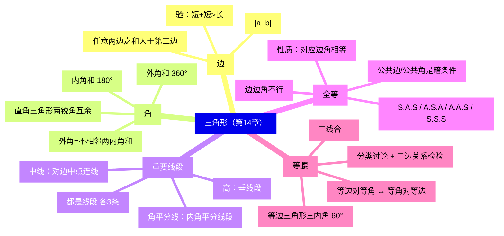
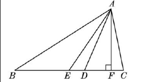
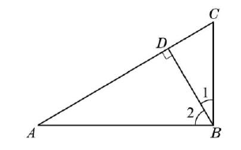
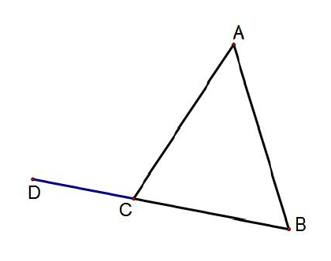
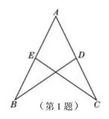
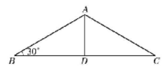
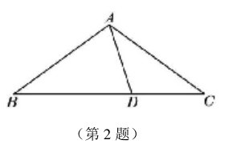
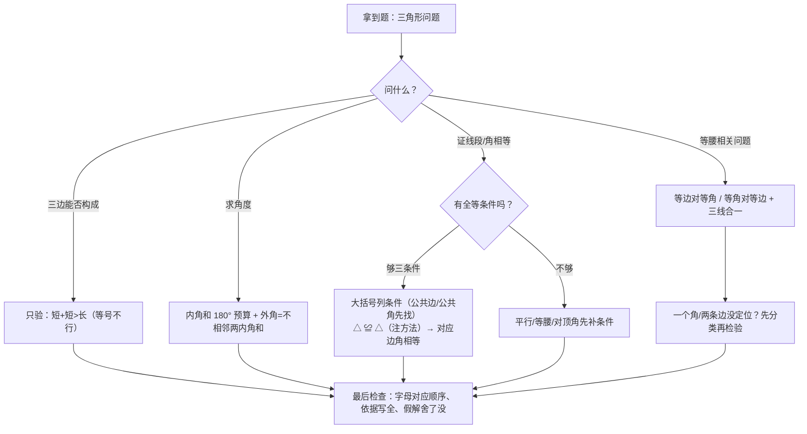

# 三角形（详解版）

> [!note] 使用说明
> 本文是详解版，从"为什么"讲起供从头自学；考前速查和掌握度跟踪在概要版：[[03-数学/知识点/七年级/三角形]]。本章配图裁自备课包学习任务单与课后练习原图。

## 0️⃣ 这章学什么 & 中考怎么考

- **这章解决什么问题**：三角形是几何世界的"原子"——所有多边形都能拆成三角形，所以先把它的规矩立全：**三边**怎么搭配才拼得起来（三边关系），**三个角**有什么预算（内角和 $180^\circ$），**两个三角形**怎样才能"完全一样"（全等的判定），**两边相等的三角形**有什么特权（等腰：等边对等角、三线合一）。这一章把上一章的平行线当作"角的搬运工"，第一次大规模使用"∵…∴…（依据）"的说理格式。
- **和前后章节的关系**：往前，你要会[[03-数学/知识点/七年级/相交线与平行线]]（对顶角、平行线的判定与性质——内角和、外角的说理全靠它）；往后，八年级[[03-数学/知识点/八年级/几何证明]]正式训练全等证明，九年级相似三角形、圆里的等腰模型，乃至中考几何论证题的工具箱，都从本章攒起。
- **中考怎么考**（依据概要版，不编造分值）：
  - 三边关系、内外角计算是选择/填空常客；
  - **全等三角形的判定与性质**是上海中考几何论证题的核心工具（18、22 题等的"证全等 → 得对应边角"骨架）；
  - 等腰三角形"三线合一"与**分类讨论**（底角还是顶角、谁当腰）贯穿到九年级。
- 一句话总结：**三边关系只验"短+短>长"；内角和 $180^\circ$ 是角度预算；全等四判 S.A.S、A.S.A、A.A.S、S.S.S（"边边角"不行）；等腰见"两边相等"就想到"等角对等边 + 三线合一"；遇"一个角/两条边"先分类再检验。**

### 学完本章，你应该能做到

1. 给三组线段，立刻判断能否构成三角形；已知两边写出第三边范围 $\lvert a-b\rvert<c<a+b$。
2. 在图中指认三角形的高、中线、角平分线（都是**线段**），知道钝角三角形的高可以在形外。
3. 用"过顶点作平行线"说出内角和 $180^\circ$ 的来龙去脉，并用外角定理解角度题。
4. 按沪教版格式书写全等证明：大括号列三条件 + 括号内注依据 + 结论写判定方法。
5. 等腰三角形问题主动分类（底角/顶角、腰/底），并用三边关系检验舍去假解。

### 本章知识地图

## 🧭 先修自检（学不下去先回到这里）

> [!note] 先修自检怎么用
> 下面每一项都是本章的地基。做不出就先去补对应知识，硬学只会更挫败。

| # | 你应该会的 | 自查题（先做再看答案） | 答案 | 不会去哪补 |
| - | ---------- | ---------------------- | ---- | ---------- |
| 1 | 平行线的性质 | 两直线平行，同位角/内错角/同旁内角分别怎样？ | 同位角相等、内错角相等、同旁内角互补 | [[03-数学/知识点/七年级/相交线与平行线]] |
| 2 | 对顶角与邻补角 | 两直线相交，$\angle1=70^\circ$，它的对顶角、邻补角各是？ | $70^\circ$；$110^\circ$ | 同上 |
| 3 | 用方程解角 | 三个角的比 $1:2:3$，各是多少？ | $180^\circ\div(1+2+3)=30^\circ$，得 $30^\circ,60^\circ,90^\circ$ | [[03-数学/知识点/00-六至八年级核心公式定理总表]] |
| 4 | 补角与等量代换 | $\angle A+\angle B=180^\circ$，$\angle C+\angle B=180^\circ$，$\angle A$ 与 $\angle C$？ | 相等（同角的补角相等） | 同上 |
| 5 | 垂直与垂线段 | $AD\perp BC$ 于 $D$，图中直角有几个？ | $\angle ADB=\angle ADC=90^\circ$（两个） | 同上 |

**自查题做错的，先把那一项补上再往下读。第 1、3 项几乎每道三角形角度题都要用。**

## 🌱 概念从头讲

> [!note] 概念讲法约定
> 每个概念按"**为什么需要它 → 它是什么 → 符号与记号含义 → 容易想错的地方**"四步讲。

### 概念 1：三角形与三边关系——什么样的三边"拼得起来"

- **为什么需要**：三条线段首尾相接不一定围成三角形——$2$、$4$、$6$ 就会"躺平"成一条线段（$2+4=6$，第三段刚刚够到，围不起来）。要能围拢，必须**任何两边拼起来都压得住第三边**。
- **定义**：==三角形任意两边之和大于第三边==；等价说法：任意两边之差小于第三边。用 $a$、$b$、$c$ 写成：$a+b>c$，$a+c>b$，$b+c>a$，合起来就是 $\lvert a-b\rvert<c<a+b$。
- **符号/记号**：三角形 $ABC$ 记作 $\triangle ABC$，三边可记 $AB$、$BC$、$CA$（或小写 $c$、$a$、$b$，边与对角同名对应）。
- **为什么只需检验"短 + 短 > 长"一条**：设 $c$ 是最长边，则 $a<c$、$b<c$，于是 $a+c>c>b$、$b+c>a$ **自动成立**——三条不等式里只有 $a+b>c$ 可能翻车。判断题三秒完成：==两条较短边之和是否大于最长边==。
- **"两类三边"与第三边范围**：已知两边 $a$、$b$，第三边 $c$ 必须同时满足 $c<a+b$（否则围不拢）和 $c>\lvert a-b\rvert$（否则被两边"夹死"），即 $\lvert a-b\rvert<c<a+b$——**开区间**，等号不行。
- **容易想错**：❌"$2+4=6$，三边 $2,4,6$ 能构成三角形。" → 等号不行：两短边之和**等于**最长边时三条线段"叠"成线段，不是三角形。❌ 判断时逐对相加验三遍。 → 只验"短+短>长"，又快又不乱。

### 概念 2：三角形的高、中线、角平分线——三条"家族线段"

- **为什么需要**：三角形内部的三种"标准割线"是后续一切计算的手术刀：高算面积、中线分面积、角平分线分角。
- **定义与对照**：

| 线段 | 定义 | 上图表示 | 要点 |
| ---- | ---- | ---- | ---- |
| 高 | 从顶点向对边**所在直线**作的垂线段 | $AF\perp BC$，垂足 $F$ | 3 条；三条高所在直线交于一点；**钝角三角形有两条高在形外**（垂足在延长线上） |
| 中线 | 顶点与对边**中点**连结的线段 | $BD=DC$ | 3 条；三条中线交于一点；中线平分**面积**（等底同高） |
| 角平分线 | 内角的平分线与对边之间的**线段** | $\angle BAE=\angle CAE$（角平分线 $AE$） | 3 条；三条角平分线交于一点 |

- **符号/记号**：三条都是**线段**——不是直线、不是射线。"对边所在直线"这个说法就是为钝角三角形的高准备的。
- **容易想错**：❌"三角形的高都在形内。" → 钝角三角形夹钝角的两边上作不出形内高，高落到对边延长线上；直角三角形有两条高恰是两条直角边。❌"角平分线是射线。" → 三角形的角平分线=内角平分线**从顶点到对边的那一段**（线段）；角的平分线才是射线。

（看图记两个用处：①"高"造出直角 $\angle ADB=\angle BDC=90^\circ$；②一个大直角三角形被高切成**两个小直角三角形**，"两锐角互余"在每个小三角形里都能用。）

### 概念 3：内角和、外角——三角形的"角度预算"

- **为什么需要**：三角形三个内角加起来恒为 $180^\circ$——这是角度世界的"总预算"。知道两角就能算第三角；知道一个角和比例就能算全部。而"外角"是预算的另一种读法。
- **内角和定理的推导（必须会讲）**：过顶点 $A$ 作 $BC$ 的平行线 $DE$。由两直线平行，内错角相等：$\angle DAB=\angle B$，$\angle EAC=\angle C$（把 $\angle B$、$\angle C$ "搬"到 $A$ 处）；而 $\angle DAB+\angle BAC+\angle EAE'=180^\circ$（平角），所以 $\angle B+\angle BAC+\angle C=180^\circ$。==平行线是搬运角的传送带==——这就是上一章性质定理的第一次大调度。
- **按角分类**：锐角三角形（三个内角都是锐角）、直角三角形（有一个直角，记 Rt$\triangle$）、钝角三角形（有一个钝角）。==直角三角形的两个锐角互余==（$90^\circ$ 的预算被两锐角瓜分）。
- **外角与外角性质**：三角形的一边与另一边的延长线组成的角叫外角（每个顶点两个，与相邻内角互补）：

  1. ==一个外角等于与它不相邻的两个内角的和==：$\angle ACD=\angle A+\angle B$。推导：$\angle ACD=180^\circ-\angle ACB$（邻补角），而 $\angle A+\angle B=180^\circ-\angle ACB$（内角和）——同一个数的两个表达式相等；
  2. 一个外角**大于**任何一个与它不相邻的内角（由 1 立刻得到：整体大于部分）；
  3. 每个顶点取一个外角，外角和 $=360^\circ$（三个外角与三个相邻内角拼成三个平角：$3\times180^\circ-180^\circ=360^\circ$）。
- **容易想错**：❌"外角等于两个内角的和。" → 必须**不相邻**！与外角相邻的那个内角和它是邻补角关系（$=180^\circ-$内角），不是相加关系。❌"钝角三角形的内角和更大。" → 任何三角形内角和都是 $180^\circ$，与形状无关。

### 概念 4：全等三角形——"完全重合"与对应关系

- **为什么需要**："两个三角形一模一样"在数学里要可操作：能**完全重合**。重合之后，每一对重合的顶点、边、角就有了名字——对应顶点、对应边、对应角。全等是"证线段相等、证角相等"的万能转化器。
- **定义**：能够完全重合的两个三角形叫全等三角形；$\triangle ABC\cong\triangle DEF$，==对应顶点的字母写在对应位置上==。
- **性质**：全等三角形的**对应边相等、对应角相等**（还有周长相等、面积相等，但前两条是根本）。
- **找对应的窍门**：①书写顺序即对应顺序（$AB$ 对 $DE$、$\angle C$ 对 $\angle F$）；②最长的边对最长的边、最大的角对最大的角；③**公共边、公共角、对顶角、等角的补角**是题目里不出声的相等条件。
- **容易想错**：❌ 字母顺序随手写。 → $\triangle ABC\cong\triangle DEF$ 中 $AB$ 对应 $DE$；写成 $\triangle ABC\cong\triangle DFE$，对应边角就全乱了，后续计算全错。落笔前先想好"谁和谁重合"。

### 概念 5：全等的判定——四把钥匙与一把废钥匙

- **为什么需要**：重合是操作，考试不能真拿纸片去叠。判定方法回答：**最少需要几组相等的条件，就能保证重合？**沪教版给了四把钥匙。
- **四条判定（条件必须"对应相等"）**：

| 方法 | 条件 | 简记 | 直观理解 |
| ---- | ---- | ---- | -------- |
| 判定方法 1 | 两边及它们的**夹角**对应相等 | S.A.S | 两根栏杆 + 转轴角度定死，第三边被动确定 |
| 判定方法 2 | 两角及它们的**夹边**对应相等 | A.S.A | 两角定了形状，夹边定了大小 |
| 判定方法 3 | 两角及其中一角的对边对应相等 | A.A.S | 由内角和凑出第三个角，化归 A.S.A |
| 判定方法 4 | 三条边对应相等 | S.S.S | 三根定长的杆铰成框，形状大小唯一（**三角形稳定性**） |

- **书写框架（沪教版标准格式）**：在 $\triangle ABC$ 和 $\triangle DEF$ 中，用大括号列三个条件（每个括号注依据），得 $\triangle ABC\cong\triangle DEF$（S.A.S）；再由"全等三角形对应边（角）相等"收尾。==条件列在哪个三角形名下要前后一致==。
- **"边.边.角"为什么不行（S.S.A，废钥匙）**：两边及其中一边的**对角**对应相等，可以画出两个**不同**的三角形（教材阅读材料专门构造：固定两边 $AB$、$AC$ 与 $\angle B$，点 $C$ 可以落在两个位置）。四把钥匙都含"夹"字逻辑——==两边的夹角、两角的夹边，'夹'住才唯一==。
- **容易想错**：❌"三个角对应相等就全等。" → 形状同、大小可以不同（两个大小不同的等边三角形），只能得**相似**。❌"SSA 有时也对，为什么不能写？" → 判定必须**万无一失**；存在反例的方法不能当定理用。

### 概念 6：等腰三角形——等边对等角、三线合一与分类讨论

- **为什么需要**：两边相等的三角形自带对称性（底边的垂直平分线是对称轴），对称把"边相等"翻译成"角相等"，把一条线变成三条用。
- **性质（14.5）**：
  1. 等腰三角形是**轴对称图形**；
  2. **等边对等角**：$AB=AC\Rightarrow\angle B=\angle C$（推导：作顶角平分线 $AD$，S.A.S 证 $\triangle ABD\cong\triangle ACD$，对应角相等）；
  3. **三线合一**：==顶角平分线、底边上的中线、底边上的高互相重合==（同一次全等的三个对应结论）。见到等腰 + 底边中点（或底边垂线、顶角平分线）任一条件，其余两条性质免费送。
- **判定（14.6）**：**等角对等边**——有两个角相等的三角形是等腰三角形。它是"等边对等角"的**逆定理**，是"证线段相等"的新武器：不用凑全等，两个角相等直接升级成两条边相等。
- **等边三角形（14.7）**：三边都相等。性质：三内角相等且都等于 $60^\circ$；判定：三边相等 / 三角相等 / **有一个角是 $60^\circ$ 的等腰三角形**（$60^\circ$ 当顶角 → 两底角各 $60^\circ$；$60^\circ$ 当底角 → 另一底角、顶角也是 $60^\circ$，两种情况殊途同归）。
- **分类讨论是本章暗线**：
  - 已知"一个角"求其余角：先判断它是底角还是顶角。钝角、直角**只能当顶角**（底角若是 $110^\circ$，两底角和 $220^\circ>180^\circ$，不成立）；
  - 已知"两边"求周长：先分别当腰、当底算两轮，==再用三边关系检验==，不成立的舍去。
- **容易想错**：❌"等腰三角形一个角是 $70^\circ$，顶角就是 $40^\circ$。" → $70^\circ$ 也可能当**顶角**：两底角 $(180^\circ-70^\circ)\div2=55^\circ$。两种情况都写。❌"三线合一"用在**任意**三角形。 → 三线合一是等腰（含等边）三角形的专属性质。

## 🧮 定理逐个拆解

> [!note] 定理拆解约定
> 每条定理都能回答四件事：符号语言怎么写？什么时候用？怎么来（谁推谁）？配一个最小使用场景。

### 定理 1：三边关系（含第三边范围）

- 符号语言：$\triangle ABC$ 三边 $a$、$b$、$c$ ⟹ $a+b>c$ 且 $\lvert a-b\rvert<c$；合并写作 $\lvert a-b\rvert<c<a+b$。
- 怎么来："两点之间线段最短"——从 $B$ 到 $C$ 直达的 $BC$ 边，不会比绕道 $BA+AC$ 更长。
- 最小场景：判断 $2,5,6$ 能否构成三角形——只验 $2+5>6$ ✓，能；$2,4,6$——$2+4=6$，不能。

### 定理 2：内角和定理与外角性质

- 符号语言：$\angle A+\angle B+\angle C=180^\circ$；外角 $\angle ACD=\angle A+\angle B$，且 $\angle ACD>\angle A$，$\angle ACD>\angle B$；外角和 $360^\circ$。
- 怎么来：内角和靠"过顶点作对边平行线 + 内错角相等 + 平角"；外角性质 = 邻补角 + 内角和两式相减。
- 最小场景：$\angle B=60^\circ$、$\angle C=80^\circ$，求外角 $\angle A$ 的外角旁角——直接 $60^\circ+80^\circ=140^\circ$，不必先算 $\angle A$。

### 定理 3：直角三角形两锐角互余

- 符号语言：Rt$\triangle ABC$ 中 $\angle C=90^\circ$ ⟹ $\angle A+\angle B=90^\circ$。
- 怎么来：内角和定理直接减去 $90^\circ$。
- 最小场景：直角三角形一个锐角 $35^\circ$，另一个 $55^\circ$；斜边上的高再造两个直角三角形时，互余在每个小三角形里重复生效。

### 定理 4：全等的性质与四条判定

- 符号语言：$\triangle ABC\cong\triangle DEF$ ⟹ $AB=DE$，$BC=EF$，$CA=FD$，$\angle A=\angle D$，$\angle B=\angle E$，$\angle C=\angle F$；判定 S.A.S / A.S.A / A.A.S / S.S.S（条件对应相等）。
- 怎么来：判定是基本事实与推导的组合（A.A.S 由内角和化归 A.S.A）；性质由"完全重合"直接读出。
- 最小场景：$AB=AC$、$AD=AE$ 夹公共角 $\angle A$ ⟹ $\triangle ABD\cong\triangle ACE$（S.A.S）⟹ $BD=CE$（对应边相等）。

### 定理 5：等边对等角与三线合一

- 符号语言：$AB=AC$ ⟹ $\angle B=\angle C$；$AB=AC$、$AD$ 是 $\angle BAC$ 的平分线 ⟹ $AD\perp BC$ 且 $BD=DC$（三条任知其一推其余两条）。
- 怎么来：作顶角平分线，S.A.S 证左右两个小三角形全等。
- 最小场景：等腰三角形底角 $70^\circ$ → 顶角 $40^\circ$（等边对等角 + 内角和）；底边中线一画，高和平分角同时到手。

### 定理 6：等角对等边（判定）与等边三角形

- 符号语言：$\angle B=\angle C$ ⟹ $AB=AC$；等边三角形：三边相等 ⟺ 三角相等且均为 $60^\circ$；有一个角是 $60^\circ$ 的等腰三角形是等边三角形。
- 怎么来：等角对等边是等边对等角的逆定理（同一套全等倒着用）；$60^\circ$ 判定分"$60^\circ$ 当顶角/当底角"两种情况验证。
- 最小场景：图中两个角相等要证两条线段相等——写"等角对等边"三个字收工，比绕全等快一倍。

## 🪜 例题阶梯

> [!note] 例题怎么用
> 五级台阶，每题先自己画图标条件，再跟着"依据插话"走。题源均为备课包课后练习原题，配图裁自原卷。

### 第 1 级 · 入门（三边关系：判定 + 范围）

> **题目**（14.1 课后练习 第 2、4 题）：
> ① 用以下各组线段为边能组成三角形的是（　）
> - (A) $2\text{ cm}$、$4\text{ cm}$、$6\text{ cm}$
> - (B) $2\text{ cm}$、$5\text{ cm}$、$6\text{ cm}$
> - (C) $2\text{ cm}$、$9\text{ cm}$、$6\text{ cm}$
> - (D) $10\text{ cm}$、$4\text{ cm}$、$6\text{ cm}$
>
> ② 已知 $\triangle ABC$ 的两边 $a=18\text{ cm}$，$b=12\text{ cm}$，第三边 $c$ 的长度在什么范围内？为什么？
>
> **每一步为什么这么做**：
> - ①只需验"**两条较短边之和 > 最长边**"一条（最长边参与的另外两条不等式自动成立）；
> - ②第三边被"两边之和"封顶、被"两边之差"托底，且**等号取不到**。
>
> **完整解答**：
> ① (A) $2+4=6$，两短边之和**等于**最长边，围不起来，×；
> (B) $2+5=7>6$ ✓，能构成三角形，选 **B**；
> (C) $2+6=8<9$，×；(D) $4+6=10$，等于最长边，×。
> （(A)(D) 都死在"等号"上——等号时三条线段叠成一条线段。）
> ② 由三边关系：$c<a+b=18+12=30$ 且 $c>\lvert a-b\rvert=\lvert18-12\rvert=6$，
> 所以 $6<c<30$（单位 cm）。
> （两个方向都要写：$c$ 太大围不拢、$c$ 太小被两边夹死；端点取不到。）
> **验算**：取 $c=20$：$12+18>20$ ✓、$12+20>18$ ✓、$18+20>12$ ✓；取端点 $c=30$：$12+18=30$，退化成线段，不能算 ✓（说明开区间是对的）。
>
> **变式提醒**：判断题最爱把范围题伪装成"**周长**为 $n$，求第三边"——先写周长 $=a+b+c$，再对 $c$ 用范围夹逼。==凡是"范围"都要检查开闭==。

### 第 2 级 · 标准（内角和 + 比例：一份预算按比例分）

> **题目**（14.2 课后练习 第 3 题）：在 $\triangle ABC$ 中，$\angle B=60^\circ$，$\angle A:\angle C=1:2$，求 $\angle A$、$\angle C$ 的度数。
>
> **每一步为什么这么做**：
> - 内角和是**总预算** $180^\circ$：先扣掉已知的 $\angle B$，剩下的 $120^\circ$ 按 $1:2$ 分；
> - 比例问题设"每份"为 $x$，把几何条件变成一元方程。
>
> **完整解答**：
> 因为 $\angle A+\angle B+\angle C=180^\circ$（三角形内角和定理），$\angle B=60^\circ$（已知），
> 所以 $\angle A+\angle C=180^\circ-60^\circ=120^\circ$。
> 设 $\angle A=x$，则 $\angle C=2x$（比例 $1:2$），得 $x+2x=120^\circ$，$x=40^\circ$。
> 所以 $\angle A=40^\circ$，$\angle C=80^\circ$。
> **验算**：$40^\circ+60^\circ+80^\circ=180^\circ$ ✓；$40:80=1:2$ ✓。
>
> **变式提醒**：同题若改问"这个三角形按角分类是哪类"，看最大角 $80^\circ<90^\circ$——锐角三角形。==求完角顺手做"按角分类"，是预算的副产品==。

### 第 3 级 · 中档（全等判定 S.A.S：公共角是不出声的条件）

> **题目**（14.4 课后练习 第 1 题）：如图，已知 $AB=AC$，$AD=AE$。说明 $\triangle ABD$ 与 $\triangle ACE$ 全等的理由。
>
> 
>
> **思路从哪来**：手里已有两组边相等（$AB=AC$、$AD=AE$），四把钥匙里配"两边"的是 S.A.S（还差夹角）和 S.S.S（还差第三边）。看图：两个三角形共用顶点 $A$，$\angle BAD$ 与 $\angle CAE$ **是同一个角**（公共角）——S.A.S 条件齐了。
>
> **完整解答**：
> 在 $\triangle ABD$ 和 $\triangle ACE$ 中，
> $\begin{cases}AB=AC & （已知）\\ \angle A=\angle A & （公共角）\\ AD=AE & （已知）\end{cases}$
> 所以 $\triangle ABD\cong\triangle ACE$（S.A.S）。
> （大括号里三条件顺序按"边、角、边"排列正好夹住 $\angle A$；"公共角"三个字就是依据，不用再证。）
> 由此 $BD=CE$（全等三角形对应边相等）——如果题目追问线段相等，这一步就是收获。
> **验算**：对应关系核对：$AB\leftrightarrow AC$、$AD\leftrightarrow AE$、夹角 $\angle A\leftrightarrow\angle A$，字母位置一致 ✓。
>
> **变式提醒**：14.4 课后练习第 2 题是同款训练：$A$、$D$、$C$、$F$ 共线，$AC=FD$、$AB=FE$、$\angle A=\angle F$ ⟹ $\triangle ABC\cong\triangle FED$（S.A.S）。注意 $AC$ 与 $FD$ 不是公共边，是**等量条件**；而第 3 题（$AB=AC$、$AE=AD$、$\angle EAB=\angle DAC$）要先做 $\angle EAB=\angle EAC+\angle CAB=\angle DAC$ 的**加减拆合**把夹角凑出来——==公共角会"藏"在等式变形里==。

### 第 4 级 · 提高（三线合一：一条线当三条用）

> **题目**（14.5 课后练习 第 3 题）：如图，已知 $AB=AC$，$BD=CD$，$\angle B=30^\circ$，求 $\angle BAD$ 的度数。
>
> 
>
> **思路从哪来**：$AB=AC$ 说它是等腰三角形；$BD=CD$ 说 $D$ 是底边中点，$AD$ 是底边中线——**三线合一**立刻送来两条免费性质：$AD\perp BC$（高）和 $AD$ 平分 $\angle BAC$。直角一出现，$\triangle ABD$ 里两锐角互余就能收工。
>
> **完整解答**：
> 在 $\triangle ABC$ 中，因为 $AB=AC$（已知），$BD=CD$（已知），
> 所以 $AD\perp BC$，$AD$ 平分 $\angle BAC$（等腰三角形三线合一）。
> 所以 $\angle ADB=90^\circ$（垂直的意义）。
> 在 Rt$\triangle ABD$ 中，$\angle BAD+\angle B=90^\circ$（直角三角形两锐角互余），
> 所以 $\angle BAD=90^\circ-30^\circ=60^\circ$。
> **验算**：走另一条性质核对：$AD$ 平分顶角，$\angle BAC=180^\circ-30^\circ-30^\circ=120^\circ$（内角和 + 等边对等角），一半正是 $60^\circ$ ✓——**三线合一的两条性质在同一个图里互相印证**。
>
> **变式提醒**：把条件换成"$AD$ 是高，$\angle BAD=60^\circ$，求 $\angle B$"——三线合一反向用：高 + 等腰 ⟹ $AD$ 也是中线、顶角平分线。==等腰三角形里见到"中线/高/角平分线"任一身份，其余两个身份免费解锁==，这一招在八年级几何证明里天天用。

### 第 5 级 · 压轴（等腰 + 外角：经典"金三角"36°）

> **题目**（14.5 课后练习 第 2 题）：如图，点 $D$ 在 $BC$ 上，$AB=AC=BD$，$AD=DC$。(1) 图中等腰三角形共有几个？(2) $\angle BDA$ 是 $\angle C$ 的几倍？(3) $\angle BAD$ 是 $\angle C$ 的几倍？(4) 求 $\angle C$ 的度数。
>
> 
>
> **思路从哪来**：三组相等边给出**三个等腰三角形**，每对"等边"都兑换成"等角"。设最小的角 $\angle C=x$，用"外角 = 不相邻两内角之和"把其它角全部用 $x$ 表达，最后在一个三角形里用内角和解出 $x$——==设最小角、层层表达、一次方程收网==。
>
> **完整解答**：
> (1) 3 个：$\triangle ABC$（$AB=AC$）、$\triangle ABD$（$AB=BD$）、$\triangle ADC$（$AD=DC$）。
> (2) 在 $\triangle ADC$ 中，$AD=DC$（已知），所以 $\angle DAC=\angle C$（等边对等角）。
> $\angle BDA$ 是 $\triangle ADC$ 的外角（$B$、$D$、$C$ 共线），所以 $\angle BDA=\angle DAC+\angle C=2\angle C$（三角形的一个外角等于与它不相邻的两个内角之和）。
> （==求外角不必先求第三个内角==，一步到位。）
> (3) 在 $\triangle ABD$ 中，$AB=BD$（已知），所以 $\angle BAD=\angle BDA$（等边对等角），
> 所以 $\angle BAD=2\angle C$。
> (4) 在 $\triangle ABC$ 中，$AB=AC$（已知），所以 $\angle B=\angle C$（等边对等角）。
> 又 $\angle B+\angle BDA+\angle BAD=180^\circ$（三角形内角和定理），
> 所以 $\angle C+2\angle C+2\angle C=180^\circ$，即 $5\angle C=180^\circ$，
> 所以 $\angle C=36^\circ$。
> **验算**：$\angle C=36^\circ$，$\angle B=36^\circ$，$\angle BDA=\angle BAD=72^\circ$；$36+36+72=180^\circ$ ✓；$\angle DAC=36^\circ$，$\angle BAC=72^\circ+36^\circ=108^\circ$，$\triangle ABC$ 内角和 $36+36+108=180^\circ$ ✓。
>
> **变式提醒**：本题第 (4) 问原练习给的是"半程填空"，脱稿完整书写才是训练目标。若是等腰**等边**混合题（如 14.7：$AB=AD=DC$、$\angle B=60^\circ$），先用"$60^\circ$ 的等腰三角形是等边三角形"锁死一个等边，其余角全部倒下——==压轴题的每一步都是本章某条定理在打工==。

## 🗺️ 解题流程图

## 🔥 易错点：为什么会错

| ❌ 常见错误想法 | 为什么会这样想 | ✅ 正确理解 / 自救方法 |
| -------------- | -------------- | ---------------------- |
| $2+4=6$ 能构成三角形 | 验算时"≥"当成了">" | 两短边之和**大于**最长边才围得拢；等号时叠成线段。三秒自查只验这一条 |
| 三角形的高都在形内 | 课本标准图全是锐角三角形 | 钝角三角形有两条高在形外（垂足在延长线上）；高的定义里写的是"对边**所在直线**" |
| 角平分线是射线、高是直线 | 与"角的平分线""垂线"混淆 | 三角形的高、中线、角平分线都是**线段**（顶点到对边）；射线/直线版本属于角与垂线的定义 |
| 外角等于两内角之和 | 背结论漏了限定词 | 必须**不相邻**的两个内角；相邻那个与外角是邻补角。写定理名时把"不相邻"带上 |
| 字母顺序乱写的全等符号 | 觉得 $\cong$ 左右顺序无所谓 | 对应顶点写对应位置：$AB$ 对 $DE$、$\angle C$ 对 $\angle F$。落笔前先想"谁和谁重合" |
| "边.边.角"也当判定用 | 觉得条件够多了 | S.S.A 有反例（同一组条件能画出两个三角形），教材阅读材料专门论证过；只用 S.A.S / A.S.A / A.A.S / S.S.S |
| 等腰"一个角 $70^\circ$"只答一种情况 | 潜意识把给出的角当顶角（或当底角） | 底角、顶角两种情况都算；但 $90^\circ$、钝角只能当顶角（否则内角和爆表）。算完用内角和检验 |
| 等腰"两边 $4$、$9$"周长写 $4+4+9=17$ | 没检验三边关系 | $4+4=8<9$ 围不起来，此情形舍去，周长只有 $22$。==周长题 = 分类 + 三边关系检验== |
| 求外角先算第三个内角 | 习惯走"全流程" | 外角 = 不相邻两内角之和，一步直达；先算第三角多一次运算多一次出错机会 |

## 📝 本讲小结

- **三边关系**：任意两边之和大于第三边（验"短+短>长"）；第三边范围 $\lvert a-b\rvert<c<a+b$，开区间。
- **重要线段**：高、中线、角平分线各 3 条，都是线段；钝角三角形的高可在形外；等腰三角形"三线合一"。
- **角**：内角和 $180^\circ$（过顶点作平行线推导）；外角 = 不相邻两内角之和，大于任一不相邻内角；外角和 $360^\circ$；直角三角形两锐角互余。
- **全等**：性质对应边角相等；判定 S.A.S、A.S.A、A.A.S、S.S.S，"边边角"不行；公共边/公共角/对顶角/等角的补角是隐藏条件；三角形稳定性 = S.S.S。
- **等腰**：等边对等角 ↔ 等角对等边；三线合一；等边三角形三内角 $60^\circ$；含 $60^\circ$ 的等腰是等边三角形。
- **思想**：分类讨论（底角/顶角、腰/底，算完必检验）、转化（证相等 → 证全等）、方程思想（设最小角列式）、推理（每步带依据）。

## ✅ 自测清单（能独立做到才打勾）

- [ ] 1. 能用"短+短>长"三秒判断三组线段，并写出第三边范围 $\lvert a-b\rvert<c<a+b$
- [ ] 2. 能在图中指认高、中线、角平分线，说出它们都是线段、各有 3 条
- [ ] 3. 能脱稿讲出内角和 $180^\circ$ 的推导（作平行线 + 内错角 + 平角）
- [ ] 4. 能用外角定理解"求 $\angle BDA$ 与 $\angle C$ 的倍数关系"式的小题
- [ ] 5. 能按沪教版格式（大括号 + 依据 + 判定方法）完成一道 S.A.S 全等证明
- [ ] 6. 能说出"边.边.角"为什么不能判定全等
- [ ] 7. 能独立做出例题阶梯第 1～4 级，并在第 5 级里完成"设最小角 → 表达 → 解方程"
- [ ] 8. 遇"等腰一个角/两条边"问题，能主动分类并用三边关系（内角和）检验舍解
- [ ] 9. 能说出本章 3 个易错点及自救方法

## 🔗 关联

- 概要版：[[03-数学/知识点/七年级/三角形]]（掌握度在这边更新）
- 前置知识：[[03-数学/知识点/七年级/相交线与平行线]]（对顶角、平行线判定与性质——本章说理的传送带）
- 兄弟详解：[[03-数学/知识点详解/七年级/实数]] · [[03-数学/知识点详解/七年级/相交线与平行线]] · [[03-数学/知识点详解/七年级/平面直角坐标系]]（同册四章）
- 后续衔接：[[03-数学/知识点/八年级/几何证明]]（全等证明的正式训练与书写规范）、探究专题"分割等腰三角形"、阅读材料"'边.边.角'能判定三角形全等吗"（SSA 反例构造）、九年级相似与圆中的等腰模型
