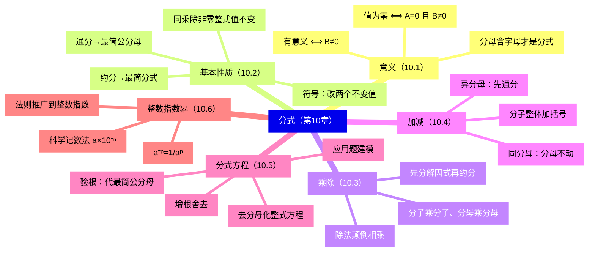
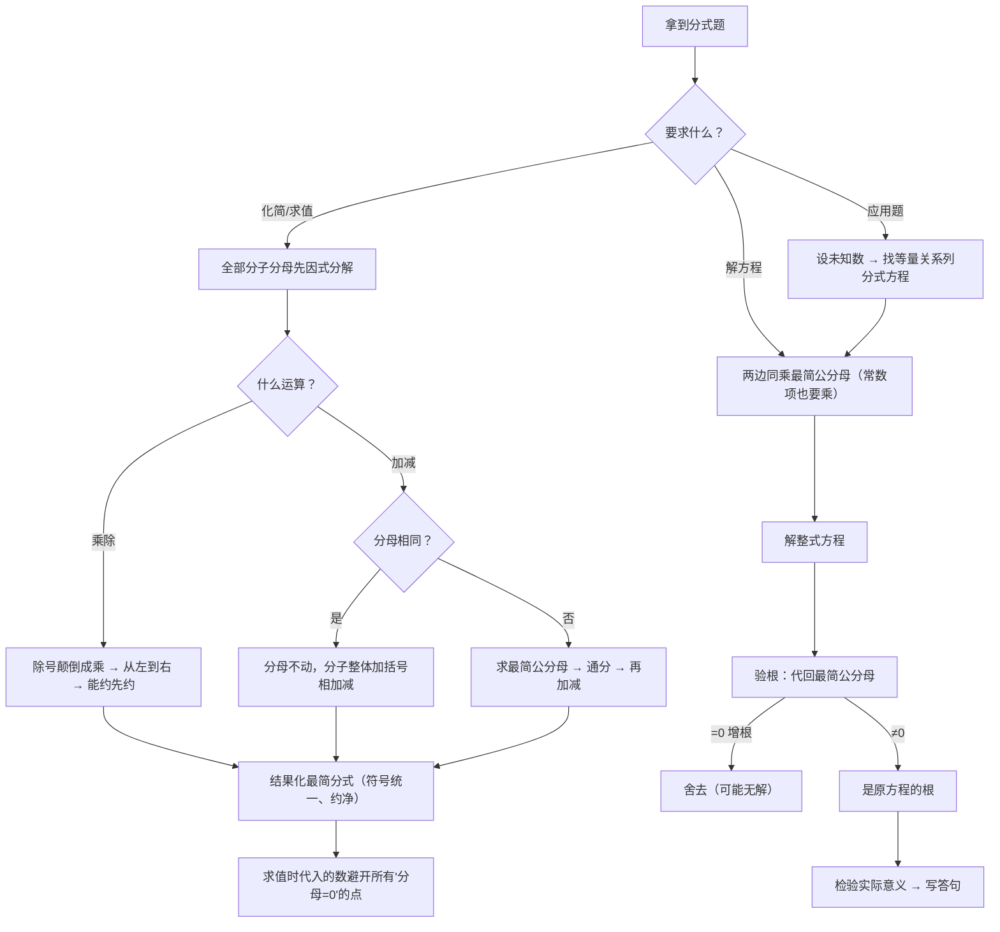

# 分式（详解版）

> [!note] 使用说明
> 本文是详解版，从"为什么"讲起供从头自学；考前速查和掌握度跟踪在概要版：[[03-数学/知识点/七年级/分式]]。

## 0️⃣ 这章学什么 & 中考怎么考

- **这章解决什么问题**：整式里字母只出现在"分子"的位置。可是"350 米跳了 $t$ 秒，平均每秒降多少米"要写 $\dfrac{350}{t}$；"面积 $S$、长 $x$ 的长方形宽是多少"要写 $\dfrac{S}{x}$——**除数（分母）里出现了字母**。分母是活的：字母一变它就可能变成 0，而除以 0 没有意义。所以这一章的全部规矩，都围绕一件新事：**分母会变**。
- **和前后章节的关系**：往前，你只需要整式运算（尤其**因式分解**，见[[03-数学/知识点/七年级/整式]]）和分数运算；往后，八年级代数方程（[[03-数学/知识点/八年级/代数方程]]）把"分式方程"升级成可化为一元二次方程的版本，二次根式的"分母有理化"也用同样的"分母不为零"意识。
- **中考怎么考**（依据概要版与备课包，不编造分值）：
  - 计算题常客：**先化简再求值**——分式四则运算＋因式分解一气呵成；
  - 选择填空经典：分式**有意义/值为零**的条件（分母不为零的双条件）；
  - 解答题常客：**分式方程应用题**（行程、工程、折纸这类"效率"问题），丢**验根**是最大扣分点。
- 一句话总结：**分式的一切动作＝"把分数的规矩搬到式子上"＋"先因式分解再说话"；方程多一步验根，应用题多一句答句。**

### 学完本章，你应该能做到

1. 一眼判断一个式子是不是分式（只看分母有没有字母），并报出"有意义""值为零"的条件。
2. 说清分式基本性质为什么成立，并用它完成约分、通分（结果化成最简分式）。
3. 完成分式乘除：先因式分解、能约先约、除法颠倒相乘、连续乘除从左到右。
4. 完成分式加减：异分母先通分（最简公分母），分子相加减整体加括号。
5. 解分式方程并**验根**（代最简公分母），识别增根；用"时间＝路程÷速度"等关系列分式方程解应用题。

### 本章知识地图

## 🧭 先修自检（学不下去先回到这里）

> [!note] 先修自检怎么用
> 下面每一项都是本章的地基。做不出就先去补对应知识，硬学只会更挫败。

| # | 你应该会的 | 自查题（先做再看答案） | 答案 | 不会去哪补 |
| - | ---------- | ---------------------- | ---- | ---------- |
| 1 | 分数基本性质 | $\dfrac23$ 与 $\dfrac8{12}$ 相等吗？依据是什么？ | 相等：分子分母同乘 4，分数值不变 | [[03-数学/知识点/00-六至八年级核心公式定理总表]]（数与式板块） |
| 2 | 因式分解 | 分解：$x^2-4$；$x^2-3x$；$x^2-6x+9$；$x^2-7x+12$ | $(x+2)(x-2)$；$x(x-3)$；$(x-3)^2$；$(x-3)(x-4)$ | [[03-数学/知识点/七年级/整式]]（因式分解） |
| 3 | 分数除法 | $\dfrac23\div\dfrac45=$？ | $=\dfrac23\times\dfrac54=\dfrac{10}{12}=\dfrac56$（颠倒相乘） | 同上（分数运算） |
| 4 | 一元一次方程 | 解 $2(x-1)=x+3$ | $2x-2=x+3$，$x=5$ | 同上（方程板块） |
| 5 | 同底数幂除法 | $x^6\div x^2=$？ | $x^4$（指数相减） | [[03-数学/知识点/七年级/整式]]（幂运算） |

**自查题做错的，先把那一项补上再往下读。因式分解（第 2 项）是本章用得最多的一把刀——分式的约分、通分、解方程全靠它。**

## 🌱 概念从头讲

> [!note] 概念讲法约定
> 每个概念按"**为什么需要它 → 它是什么 → 符号与记号含义 → 容易想错的地方**"四步讲。

### 概念 1：分式的定义（和整式只差一个"分母含字母"）

- **为什么需要**：平均速度 = 路程 ÷ 时间。路程 350 是死的，时间 $t$ 是活的——写成 $\dfrac{350}{t}$ 后，除数不再是数字而是字母。这类"分母会动"的式子，需要一套新的规矩，所以单独命名。
- **定义**：两个整式 $A$、$B$ 相除，写作 $\dfrac{A}{B}$；如果**除式 $B$ 中含有字母**，式子 $\dfrac{A}{B}$ 就叫做**分式**。其中 $A$ 叫分子，$B$ 叫分母。
- **判别只看一个地方**：**分母里有没有字母**。
  - $\dfrac{x}{3}$、$\dfrac{xy}{3}$、$x^2-2y$：分母（或没有分母）不含字母 → **整式**；
  - $\dfrac{3}{x}$、$\dfrac{x}{x-y}$、$\dfrac{1}{a+2b+3c}$：分母含字母 → **分式**；
  - $\dfrac{x+2}{\pi}$：分母是 $\pi$，$\pi$ 是**数**不是字母 → **整式**。
- **容易想错**：
  - ❌"长得像分数就是分式。" → 看分母，不看长相。$\dfrac{xy}{3}$ 是整式，$\dfrac{x}{y}$ 才是分式。
  - ❌ 分子里有字母就算分式。 → 分子含字母的多了去了（整式 $3x^2$ 也是"字母"）。**唯一标准在分母**。

### 概念 2：分式有意义、无意义、值为零（本章第一道选择题）

- **为什么需要**：分母是活的。$\dfrac{3}{x}$ 里 $x=0$ 那一刻，除以零，式子失去意义。所以**用分式之前，必须先声明"分母不许是 0"**。
- **三种条件（核心三问）**：

| 问题 | 条件 | 直观理解 |
| ---- | ---- | -------- |
| 分式有意义 | 分母 $B\neq0$ | 除数不许是零 |
| 分式无意义 | 分母 $B=0$ | 恰好除以了零 |
| 分式的值为零 | 分子 $A=0$ **且** 分母 $B\neq0$ | 商为零 ⟺ 被除数为零且除法能进行 |

- **为什么"值为零"是双条件**：$\dfrac{A}{B}=0$ 意思是"$A\div B$ 算出来等于 0"。要完成除法，先得 $B\neq0$；要商为 0，再要 $A=0$。**缺一条都不行**。
- **最小例子（备课包·10.1 例题 4）**：$\dfrac{2x+1}{3x-1}$ 的值为零：$2x+1=0$ 得 $x=-\dfrac12$；回代分母 $3\times(-\dfrac12)-1=-\dfrac52\neq0$ ✓。所以 $x=-\dfrac12$。
- **反例纠错（备课包·分式单元讲评 填空 2(3)）**：当 $x$ 为何值时 $\dfrac{x^2-4}{x+2}$ 的值为零？
  分子为零：$x^2-4=0$，$x=\pm2$。**但 $x=-2$ 时分母 $x+2=0$，分式无意义，舍去**。答案只有 $x=2$。
  ❌ 常见错误：只令分子为零，两个答案都写上——分子为零与分母非零**缺一不可**。
- **容易想错**：❌"有意义要分母大于零。" → 分母只需**不为零**：$\dfrac{x^2+1}{2x}$ 有意义只需 $x\neq0$，$x$ 取负数照样有意义。

### 概念 3：分式的基本性质（约分通分的总依据）

- **定义**：分式的分子与分母都**乘以（或除以）同一个不等于零的整式**，分式的值不变：
  $$\frac{A}{B}=\frac{A\cdot C}{B\cdot C}=\frac{A\div C}{B\div C}\quad(C\neq0,\ B\neq0)$$
- **为什么成立**：这就是分数基本性质的"代数版"。用除法看：$\dfrac{A}{B}=A\div B$；把被除数、除数同乘 $C$，商不变（$A\times C\div(B\times C)=A\div B$，这是"商不变"规律）。条件 $C\neq0$ 不是装饰：$C=0$ 时右边是 $\dfrac00$，没有意义。
- **符号法则**：分子、分母与分式本身，**同时改变其中任意两个的符号，分式的值不变**：$\dfrac{-a}{b}=\dfrac{a}{-b}=-\dfrac{a}{b}$。来源：$-a\div b=-(a\div b)=a\div(-b)$（有理数除法的符号法则）。
- **容易想错**：
  - ❌ $\dfrac{x+m}{y+m}=\dfrac{x}{y}$。 → 基本性质只许**乘除**，不许**加减**！"同时加 $m$"不改变分式的值。自救：代数验证，$x=1,y=2,m=1$：左边 $\dfrac23$，右边 $\dfrac12$，不等 ✓。
  - ❌ 忘了 $C\neq0$。 → "同乘"从来不是无条件免费：乘上的整式必须非零，这就是为什么后面去分母要验根。

### 概念 4：约分与最简分式

- **是什么**：把分子分母中的**公因式**约去，叫约分；分子分母**没有公因式**（1 除外）的分式叫最简分式。**分式运算的结果都要化成最简分式**。
- **操作两步**：①分子分母**先因式分解**；②约去公因式。
- **最小例子（10.2 例题）**：
  $$\frac{x-2}{x^2-4x+4}=\frac{x-2}{(x-2)^2}=\frac1{x-2},\qquad \frac{15b-5a}{2a-6b}=\frac{5(3b-a)}{2(a-3b)}=\frac{-5(a-3b)}{2(a-3b)}=-\frac52$$
  （第二题分子提 $5$、分母提 $2$ 后，$3b-a=-(a-3b)$，符号统一后才能约净。）
- **容易想错**：
  - ❌ $\dfrac{x^6}{x^2}=x^3$。 → 约分是**除法**，指数相减：$x^4$。
  - ❌ "$\dfrac{x^2-y^2}{x+y}$ 不能约，因为没有公因式"。 → 没先分解：$\dfrac{(x+y)(x-y)}{x+y}=x-y$。**见到多项式，先分解再谈约不约**。
  - ❌ $\dfrac{4x^2(y-1)}{x(1-y)}$ 直接约成 $4x$。 → $y-1$ 与 $1-y$ **互为相反数**：$\dfrac{4x^2(y-1)}{x\cdot[-(y-1)]}=-4x$。

### 概念 5：通分与最简公分母

- **为什么需要**：$\dfrac12+\dfrac13$ 不能直接加——两份的"单位"不一样大。分式同理：$\dfrac1{a-b}$ 与 $\dfrac1{a+b}$ 的"单位"不同，必须先**换算成同一单位**（同一分母）才能相加。
- **定义**：把异分母分式化成同分母分式叫**通分**；公分母取**最简公分母**——各分母系数的最小公倍数 × **所有出现的字母（因式）的最高次幂**。
- **操作两步**：①各分母**先因式分解**；②系数取最小公倍数、每个因式取最高次幂，拼出最简公分母。
- **最小例子**：$\dfrac{1}{2a}$ 与 $\dfrac{1}{3a^2}$：系数 $\text{lcm}(2,3)=6$，字母 $a$ 取最高次 $a^2$，最简公分母 $6a^2$，通分得 $\dfrac{3a}{6a^2}$ 与 $\dfrac{2}{6a^2}$。
- **容易想错**：❌ 公分母把所有分母**连乘**。 → 那不是"最简"，运算量白翻倍：取**最高次幂**，不是全乘（$6a^2$，不是 $2a\times3a^2\times\dots$）。分母互为相反数时先统一：$y-x=-(x-y)$，取其一即可。

### 概念 6：分式方程与增根（为什么必须验根）

- **定义**：**分母中含有未知数**的方程叫分式方程；分母不含未知数的（一元一次方程等）叫整式方程。
- **解法思想**：分式方程不会解，整式方程会——所以**去分母，把它化归成整式方程**（化归思想）。

| 步骤 | 操作 | 注意 |
| ---- | ---- | ---- |
| ① 去分母 | 两边同乘**最简公分母** | 常数项也要乘；含相反数的分母先统一符号 |
| ② 解整式方程 | 移项、合并、系数化 1 | 一元方程的解也叫方程的**根** |
| ③ 验根 | 把根代入**最简公分母** | 公分母 $=0$ 是**增根**，舍去；$\neq0$ 才是原方程的根 |

- **增根从哪来（这是理解题，不是流程题）**：去分母那一步，我们给方程两边同乘了"最简公分母"——**这个乘法只有在公分母 $\neq0$ 时才是可逆的**。如果解出的根恰好让公分母 $=0$，说明我们是在"两边同乘 0"，什么方程都能被它"解出"这个根——这个根不属于原方程，叫增根。所以**验根不是形式，是替去分母那一步补交"公分母 $\neq0$"的检查**。
- **最小例子**：解 $\dfrac{x}{x-1}+1=\dfrac1{x-1}$。去分母：$x+(x-1)=1$，解得 $x=1$；代回公分母 $x-1=0$ → 增根，舍去。**原方程无解**（无解也是答案！）。
- **容易想错**：❌ 验根时"代回原方程看一眼像不像"。 → 必须代**最简公分母**，它才是增根的裁判。

### 概念 7：负整数指数幂（让"除法"并入"乘法"）

- **为什么需要**：算 $2^2\div2^5$，两条路打架——
  - 路一（分数约分）：$\dfrac{2^2}{2^5}=\dfrac4{32}=\dfrac18$；
  - 路二（幂法则）：$2^{2-5}=2^{-3}$——但指数是负数，我们没学过！
  两个结果必须相等，于是**规定** $2^{-3}=\dfrac1{2^3}$。推广成一般规定：
- **规定**：$a^{-p}=\dfrac1{a^p}$（$a\neq0$，$p$ 是正整数）。它与 $a^0=1$ 一样，是**为了"同底数幂相除法则在 $m<n$ 时仍成立"而做的规定**，不是新运算。
- **带来了什么**：指数从正整数扩充到**全体整数**（$a\neq0$ 时），且
  - $a^m\cdot a^n=a^{m+n}$、$(ab)^m=a^mb^m$、$(a^m)^n=a^{mn}$ 对**整数**指数幂仍成立（可用计算器举例验算，备课包 10.6 任务单就是让学生这么验的）；
  - $a^m\div a^n=a^{m-n}$ 也适用——**负指数已把"除"收编**，除法不再单列法则；
  - **整式与分式在形式上统一了**：$x^{-2}$ 与 $\dfrac1{x^2}$ 是同一个东西的两种写法。
- **科学记数法**：绝对值小于 1 的正数写成 $a\times10^{-n}$（$1\le a<10$，$n$ 为正整数）。如 $0.0009=9\times10^{-4}$（小数点向右移 4 位才变成 9，所以 $n=4$）。
- **容易想错**：
  - ❌ $2^{-3}=-8$。 → 负指数**不是负数**，是"倒数"：$2^{-3}=\dfrac18$。
  - ❌ $\big(-\dfrac12\big)^{-2}=\dfrac14$。 → 倒数再平方：$\big(-\dfrac12\big)^{-2}=(-2)^2=4$。**先算倒数，再定符号**。

## 🧮 运算法则逐个拆解

> [!note] 法则拆解约定
> 每条法则都必须能回答四件事：**它从哪来（类比或推导）？什么时候能用（条件）？怎么用？用反例提醒自己哪里易错？**

### 法则 1：分式的乘法与乘方

$$\frac{A}{B}\cdot\frac{C}{D}=\frac{AC}{BD},\qquad \Big(\frac{b}{a}\Big)^n=\frac{b^n}{a^n}$$

- **来源**：分数乘法类比——$\dfrac12\times\dfrac23=\dfrac{1\times2}{2\times3}=\dfrac26=\dfrac13$，"分子乘分子、分母乘分母"。乘方是连续相乘：$\big(\dfrac ba\big)^2=\dfrac ba\cdot\dfrac ba=\dfrac{b^2}{a^2}$。
- **操作口诀**：**先分解因式、能约分的先约分，再相乘**——约在乘之前，数字小一半。
- **最小例子**：
  $$\frac{x^2-1}{x^2}\div\frac{x+1}{x}=\frac{(x+1)(x-1)}{x^2}\cdot\frac{x}{x+1}=\frac{x-1}{x}$$
  （分子 $x^2-1$ 先分解成 $(x+1)(x-1)$；除法先颠倒成乘（见法则 2）；约去 $x+1$ 与一个 $x$。）
- **易错**：❌ 乘方忘了分子分母**各自**乘方：$\big(\dfrac ba\big)^2\ne\dfrac{b^2}{a}$。

### 法则 2：分式的除法

$$\frac{A}{B}\div\frac{C}{D}=\frac{A}{B}\cdot\frac{D}{C}$$

- **来源**：分数除法——$\dfrac23\div\dfrac45=\dfrac23\times\dfrac54$。"除以一个数等于乘以它的倒数"，分式同理（$D\neq0$ 时 $\dfrac CD$ 的倒数是 $\dfrac DC$）。
- **条件**：除式 $\dfrac CD$ 的分子 $C\neq0$（否则它自身无意义，没有倒数）。
- **连续乘除**：**从左到右**依次进行，谁在除号后就把谁颠倒。❌ 典型错例（备课包单元复习）：$\dfrac{x^2-y^2}{x}\div(x-y)^2\cdot\dfrac1x$ 若先把 $(x-y)^2\cdot\dfrac1x$ 乘起来，顺序就错了——正确做法是从左到右：$\dfrac{(x+y)(x-y)}{x}\cdot\dfrac1{(x-y)^2}\cdot\dfrac1x$。
- **最小例子**：$\dfrac{a}{b}\div\dfrac{a}{2b}=\dfrac{a}{b}\cdot\dfrac{2b}{a}=2$。
- **易错**：❌ 除法不颠倒直接约分：$\dfrac{a}{b}\div\dfrac{a}{2b}\ne\dfrac{2b}{b}$——除号必须先变乘号。

### 法则 3：同分母加减

$$\frac{A}{C}\pm\frac{B}{C}=\frac{A\pm B}{C}\ (C\neq0)$$

- **来源**：分数类比——$\dfrac35+\dfrac15=\dfrac45$：3 个 $\dfrac15$ 加 1 个 $\dfrac15$ 是 4 个 $\dfrac15$。分母相同 = 单位相同，直接数个数。
- **最小例子**：$\dfrac{3a+b}{x}-\dfrac{a+2b}{2x}$ 不能直接减——分母是 $x$ 与 $2x$，先通分成 $2x$（见法则 4）。真正的同分母例：$\dfrac{2x+1}{x-1}-\dfrac{x+3}{x-1}=\dfrac{(2x+1)-(x+3)}{x-1}=\dfrac{x-2}{x-1}$——**分子相减要整体加括号**。
- **易错**：❌ $\dfrac{3x+1}{x^2-1}-\dfrac{x+2}{x^2-1}$ 的分子写成 $3x+1-x+2$。 → 减号管的是**整个**分子：$(3x+1)-(x+2)=3x+1-x-2=2x-1$。

### 法则 4：异分母加减（通分）

- **操作**：①各分母因式分解；②求**最简公分母**；③各分式乘"缺的因式"通分；④按同分母加减；⑤结果化最简分式。
- **最小例子（10.4 例题 1）**：
  $$\frac{2}{x^2-4}+\frac{x}{4-x^2}=\frac{2}{(x+2)(x-2)}-\frac{x}{(x+2)(x-2)}=\frac{2-x}{(x+2)(x-2)}$$
  （$4-x^2=-(x^2-4)$，先把相反数分母统一；分母保留**分解形式**，便于最后判断分子能否约分——本例分子 $2-x=-(x-2)$，恰与分母的 $x-2$ 相差符号，若分子恰能约分要约净。）
- **易错**：
  - ❌ 通分时每个分母全乘起来。 → 公分母取"系数最小公倍数 × 每个因式最高次幂"，重复因式只留一份。
  - ❌ 结果不化简。 → 答题规范要求**最简分式**（分子分母分解到底、约净公因式）。
- **符号统一先行**：分母出现 $1-2x$ 与 $2x-1$、$2b-a$ 与 $2a-b$ 这类相反数，**第一步**就把它们化成同底：$1-2x=-(2x-1)$。符号不统一，后面步步是坑。

## 🪜 例题阶梯

> [!note] 例题怎么用
> 四级台阶，每一级都要动笔跟着算，不许只看。题目全部选自备课包课后练习与单元任务单。

### 第 1 级 · 入门（照着模仿：异分母加减）

> **题目**（备课包·分式单元讲评 课后练习 3(1)）：计算：$\dfrac{3a+b}{x}+\dfrac{a-2b}{2x}$。
>
> **每一步为什么这么做**：
> - 分母 $x$ 与 $2x$：系数取 $\text{lcm}(1,2)=2$、字母取 $x$ → 最简公分母 $2x$；
> - 第一个分式分母缺一个"2"，分子分母**同乘 2**（基本性质，$2\neq0$）；
> - 同分母后分子相加，**每个分子自带括号**。
>
> **完整解答**：
> $\dfrac{3a+b}{x}+\dfrac{a-2b}{2x}=\dfrac{2(3a+b)}{2x}+\dfrac{a-2b}{2x}=\dfrac{6a+2b+a-2b}{2x}=\dfrac{7a}{2x}$。
> （同乘 2 依据分式基本性质；分子 $(6a+2b)+(a-2b)$ 直接去括号合并：$6a+a=7a$，$2b-2b=0$。）
> **验算**：取 $a=1$、$b=1$、$x=2$：原式 $=\dfrac4{2}+\dfrac{-1}{4}=2-\dfrac14=\dfrac74$；结果 $\dfrac{7\times1}{2\times2}=\dfrac74$ ✓。
>
> **变式提醒**：若题目是 $\dfrac{3a+b}{x}-\dfrac{a-2b}{2x}$，分子是 $(6a+2b)-(a-2b)=5a+4b$——**减号后面整块加括号**，别只给 $a$ 变号。

### 第 2 级 · 标准（单元讲评题：逐对合并的通分策略）

> **题目**（备课包·分式单元讲评 课后练习 3(2)）：计算：$\dfrac{1}{a-b}-\dfrac{1}{a+b}+\dfrac{2b}{a^2+b^2}$。
>
> **思路从哪来**：三个分母 $(a-b)$、$(a+b)$、$(a^2+b^2)$ 互不相同。三个一起通分？公分母是 $(a-b)(a+b)(a^2+b^2)$，数字很大。先看前两个：它们通分后分母是 $(a-b)(a+b)=a^2-b^2$——恰好与第三个分母 $a^2+b^2$ 又是"一对平方差伙伴"。**逐对合并，每步只用一个平方差**，运算量最小。
>
> **完整解答**：
> 第一步：$\dfrac{1}{a-b}-\dfrac{1}{a+b}=\dfrac{(a+b)-(a-b)}{(a-b)(a+b)}=\dfrac{2b}{a^2-b^2}$。
> （通分用平方差 $(a-b)(a+b)=a^2-b^2$；分子整体相减：$a+b-a+b=2b$。）
> 第二步：$\dfrac{2b}{a^2-b^2}+\dfrac{2b}{a^2+b^2}=\dfrac{2b(a^2+b^2)+2b(a^2-b^2)}{(a^2-b^2)(a^2+b^2)}$。
> （公分母 $(a^2-b^2)(a^2+b^2)$；分子分别乘上各自缺的因式。）
> 第三步：分子 $=2b(a^2+b^2+a^2-b^2)=2b\cdot2a^2=4a^2b$；分母 $=a^4-b^4$（再用一次平方差）。
> 所以原式 $=\dfrac{4a^2b}{a^4-b^4}$。分子分母已无公因式，是最简分式。（答案与备课包一致。）
> **验算**：取 $a=2$、$b=1$：原式 $=\dfrac{1}{1}-\dfrac13+\dfrac25=\dfrac23+\dfrac25=\dfrac{10+6}{15}=\dfrac{16}{15}$；结果 $\dfrac{4a^2b}{a^4-b^4}=\dfrac{4\times4\times1}{16-1}=\dfrac{16}{15}$ ✓。
>
> **变式提醒**：这题的隐藏考点是**平方差连用**：$(a-b)(a+b)=a^2-b^2$，$(a^2-b^2)(a^2+b^2)=a^4-b^4$。九年级还会见到 $(a-b)(a+b)(a^2+b^2)(a^4+b^4)=a^8-b^8$——同一个动作反复用。

### 第 3 级 · 提高（单元讲评题：混合运算与"先算括号"）

> **题目**（备课包·分式单元讲评 课后练习 3(4)）：计算：$\dfrac{3-x}{2x-4}\div\Big(x+2-\dfrac{5}{x-2}\Big)$。
>
> **思路从哪来**：有除号、有括号 → 先算括号内（一个整式减一个分式），再处理除法；除式含 $3-x$ 与 $2x-4$ 这类"反着写"的因式，**先把符号统一**。
>
> **完整解答**：
> 第一步（括号内）：$x+2-\dfrac{5}{x-2}=\dfrac{(x+2)(x-2)-5}{x-2}=\dfrac{x^2-9}{x-2}=\dfrac{(x+3)(x-3)}{x-2}$。
> （整式 $x+2$ 要通分：乘上分母 $x-2$，即 $(x+2)(x-2)$；分子 $x^2-4-5=x^2-9$ 分解成 $(x+3)(x-3)$——**分解到底，后面才约得动**。）
> 第二步（被除式统一符号）：$\dfrac{3-x}{2x-4}=\dfrac{-(x-3)}{2(x-2)}$。
> （$3-x=-(x-3)$；$2x-4=2(x-2)$。与括号结果的 $(x-3)$ 对上号。）
> 第三步（颠倒相乘）：
> $$\frac{-(x-3)}{2(x-2)}\cdot\frac{x-2}{(x+3)(x-3)}=-\frac{1}{2(x+3)}=-\frac{1}{2x+6}$$
> （约去 $x-3$、$x-2$；答案与备课包一致 $-\dfrac{1}{2x+6}$。）
> **验算**：取 $x=0$（各分母 $-4$、$-2$、$(0+3)(0-3)$ 均非零）：原式 $=\dfrac{3}{-4}\div(2-(-2.5))=-\dfrac34\div\dfrac92=-\dfrac34\times\dfrac29=-\dfrac16$；结果 $-\dfrac{1}{2\times0+6}=-\dfrac16$ ✓。
>
> **变式提醒（同页 4(2) 题的"链式除法"）**：$\dfrac{4x-12}{x^2-4x-5}\div\dfrac{2x-6}{x^2-1}\div(x-1)$，其中 $x=7$，先化简再求值：
> $$\frac{4(x-3)}{(x-5)(x+1)}\cdot\frac{(x-1)(x+1)}{2(x-3)}\cdot\frac{1}{x-1}=\frac{2}{x-5}$$
> （**连续除法从左到右**：每个除号后的式子都颠倒；系数 $4\div2=2$；约去 $(x-3)$、$(x+1)$、一个 $(x-1)$。$x=7$ 时原式 $=\dfrac2{7-5}=1$，且 $x=7$ 使各分母非零 ✓。顺带注意：化简后的 $x$ 取值范围是 $x\neq5$ 且 $x\neq-1$、$x\neq1$、$x\neq3$——求值时代入的数必须全部避开。）

### 第 4 级 · 挑战（应用题：分式方程＋验根＋检验）

> **题目**（备课包·分式单元讲评 课后练习 6）：小丽与小杰在劳技课上折纸鹤。小丽每分钟比小杰能多折一只纸鹤，结果在相同的时间里小丽折了 48 只，小杰折了 36 只。小丽与小杰每分钟各能折多少只纸鹤？
>
> **思路从哪来**：工程/效率问题的等量关系是**工作量 = 效率 × 时间**。时间相同 → $\dfrac{\text{工作量}_1}{\text{效率}_1}=\dfrac{\text{工作量}_2}{\text{效率}_2}$。设**较小的**效率为 $x$（每分钟 $x$ 只），另一个就是 $x+1$——设小的、表示大的，分母更简单。
>
> **完整解答**：
> 设小杰每分钟折 $x$ 只，则小丽每分钟折 $(x+1)$ 只。由时间相同得
> $$\frac{48}{x+1}=\frac{36}{x}$$
> （两边同乘最简公分母 $x(x+1)$，$x\neq0$ 且 $x\neq-1$。）
> 去分母：$48x=36(x+1)$，即 $48x=36x+36$，$12x=36$，$x=3$。
> **验根**：$x=3$ 时 $x(x+1)=12\neq0$，是原方程的根 ✓。
> **检验与作答**：小杰每分钟折 3 只，小丽每分钟折 $3+1=4$ 只。检验：所用时间 $48\div4=12$（分），$36\div3=12$（分），相同 ✓，且"小丽比小杰多折一只"✓。效率均为正数，符合实际。
> **答**：小丽每分钟能折 4 只纸鹤，小杰每分钟能折 3 只。（答案与备课包一致。）
>
> **变式提醒**：①应用题的完整链条是"设 → 列 → 解 → **验根** → **检验合理性** → 答句"，少了哪步都扣分：验根管数学（分母非零），检验管实际（速度为正、时间为正）。②概要版例题（10.5 课后练习第 4 题）的通信员送信是同构题：去回时间相加 $=40$ 分钟，设回程速度 $x$、去程 $1.5x$，列 $\dfrac{2400}{1.5x}+\dfrac{2400}{x}=40$。两题都赢在**把"相同时间/总时间"翻译成分式方程**。

## 🗺️ 解题流程图

## 🔥 易错点：为什么会错

| ❌ 常见错误想法 | 为什么会这样想 | ✅ 正确理解 / 自救方法 |
| -------------- | -------------- | ---------------------- |
| 值为零只令分子为零 | 忘了除法要先"能除" | 双条件：$A=0$ **且** $B\neq0$。$\dfrac{x^2-4}{x+2}$ 值为零只有 $x=2$ |
| $\dfrac{x+m}{y+m}=\dfrac{x}{y}$ | 把"同乘"记成"同加" | 基本性质只许**乘除非零整式**。代数自检：$x=1,y=2,m=1$ 时 $\frac23\neq\frac12$ |
| $\dfrac{x^6}{x^2}=x^3$ | 把约分当"指数相除" | 约分是除法：指数相减，$x^4$ |
| $\dfrac{x^2-y^2}{x+y}$ 说"不能约" | 没先分解因式 | 先分解：$\dfrac{(x+y)(x-y)}{x+y}=x-y$。见多项式先分解 |
| 除法不颠倒直接约 | 想省一步 | 除号必须先变乘号；连续乘除**从左到右** |
| 分子相减不加括号 | 减号"管辖范围"没看清 | $\dfrac{3x+1}{x^2-1}-\dfrac{x+2}{x^2-1}$ 分子写 $(3x+1)-(x+2)$ |
| 通分把分母全乘起来 | 求省事 | 最简公分母＝系数最小公倍数 × 因式最高次幂；相反数分母先统一 |
| 结果不是最简分式 | 拿到"能看"的结果就停 | 分子分母分解到底、约净公因式才算完 |
| 解分式方程忘验根 | 把它当普通一元一次方程 | 去分母可能"乘 0"，必须代**最简公分母**验根；增根要写"舍去" |
| $2^{-3}=-8$ | 把负指数当负数 | 负指数是**倒数**：$a^{-p}=\dfrac1{a^p}$。$\big(-\dfrac12\big)^{-2}=4$ |

## 📝 本讲小结

- **概念**：分母含字母的式子 $\dfrac AB$；有意义 $\iff B\neq0$；值为零 $\iff A=0$ 且 $B\neq0$（双条件缺一不可）。
- **变形**：基本性质（同乘除非零整式）支撑约分与通分；约分通分的**第一动作都是因式分解**；结果一律化最简分式；符号"改两个不变值"，相反数因式先统一。
- **运算**：乘除先分解再约分，除法颠倒相乘、从左到右；加减先通分（最简公分母），分子相加减整体加括号。
- **方程**：去分母整式化 → 解一元一次方程 → **验根**（代最简公分母，增根舍去）——验根是在补交"公分母 $\neq0$"的检查。
- **幂**：$a^{-p}=\dfrac1{a^p}$、$a^0=1$（$a\neq0$）由"除法法则要继续成立"规定；正整数指数幂的性质推广到整数指数；科学记数法 $a\times10^{-n}$ 表示绝对值小于 1 的数。
- **思想**：类比分数、化归（分式→整式、异分母→同分母）、整体代换、从特殊到一般。

## ✅ 自测清单（能独立做到才打勾）

- [ ] 1. 能一眼判断分式，并说清 $\dfrac{x+2}{\pi}$、$\dfrac{xy}{3}$、$\dfrac{3}{x-y}$ 各是什么
- [ ] 2. 能写出"有意义/值为零"的条件，并解释为什么值为零是双条件（能举出 $\dfrac{x^2-4}{x+2}$ 这样的反例）
- [ ] 3. 能说明分式基本性质为什么成立，并指出 $\dfrac{x+m}{y+m}\ne\dfrac xy$ 错在哪
- [ ] 4. 能对 $\dfrac{x-2}{x^2-4x+4}$ 完成约分，并说出"先分解再约分"的理由
- [ ] 5. 能独立做出例题阶梯第 1、2 级（逐对合并的通分策略）
- [ ] 6. 能独立做出第 3 级混合运算，并处理"链式除法"从左到右
- [ ] 7. 能完整解一道分式方程应用题（设 → 列 → 解 → 验根 → 检验 → 答句），并解释增根从哪来
- [ ] 8. 能推导 $a^{-p}=\dfrac1{a^p}$ 这个规定的来历，并用它算 $2^{-3}$、$\big(-\dfrac12\big)^{-2}$
- [ ] 9. 能说出本章 5 个易错点及自救方法

## 🔗 关联

- 概要版：[[03-数学/知识点/七年级/分式]]（掌握度在这边更新）
- 前置知识：[[03-数学/知识点/七年级/整式]]（因式分解、幂运算法则）；[[03-数学/知识点/00-六至八年级核心公式定理总表]]（分数运算、一元一次方程）
- 后续：[[03-数学/知识点/八年级/代数方程]]（可化为一元二次方程的分式方程、无理方程）、[[03-数学/知识点/八年级/二次根式]]（分母有理化同样"分母 $\neq0$"）
- 中考落点：化简求值题、分式方程应用题、有意义/值为零小题。
