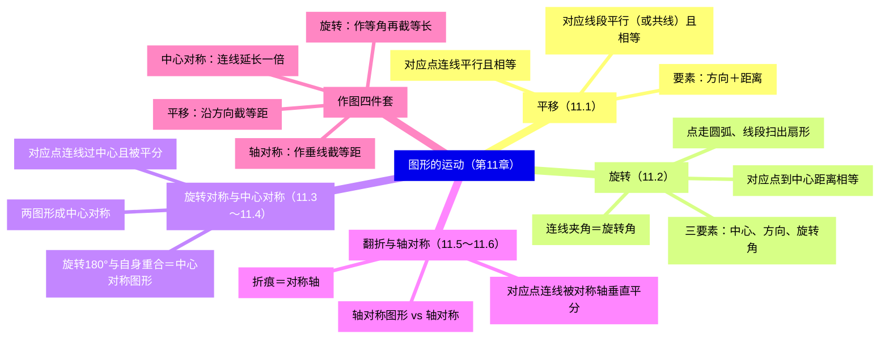
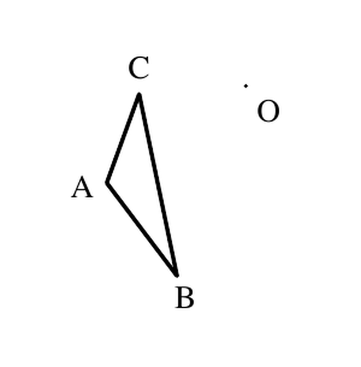
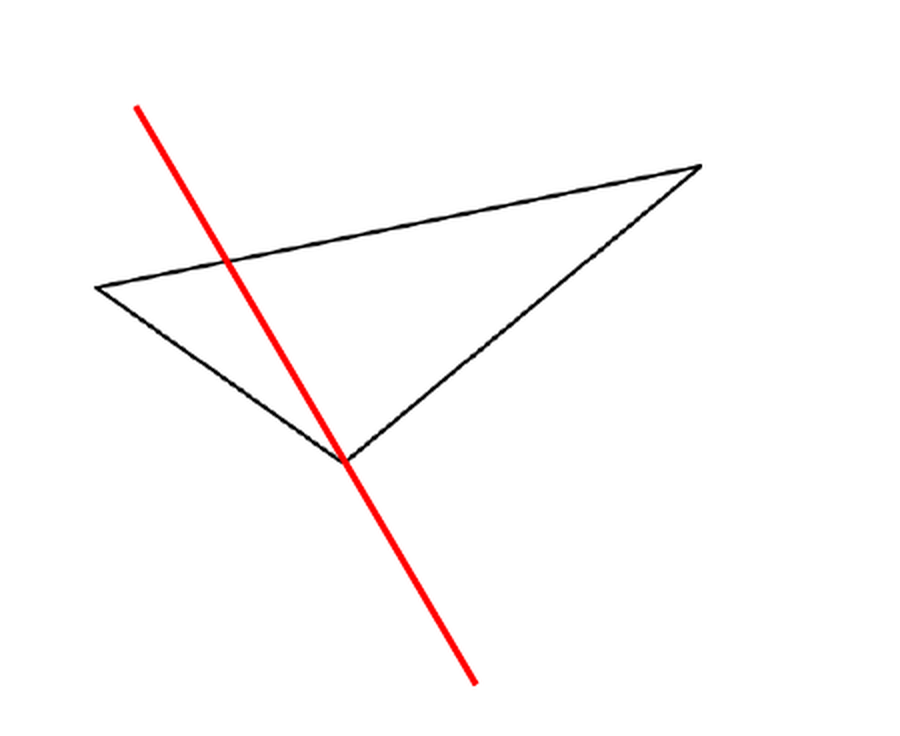
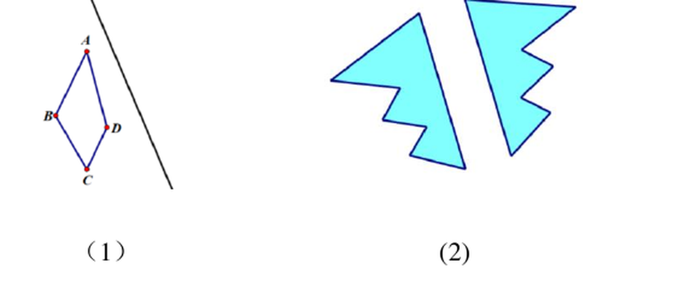
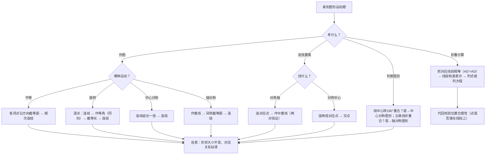

# 图形的运动（详解版）

> [!note] 使用说明
> 本文是详解版，从"为什么"讲起供从头自学；考前速查和掌握度跟踪在概要版：[[03-数学/知识点/七年级/图形的运动]]。

## 0️⃣ 这章学什么 & 中考怎么考

- **这章解决什么问题**：前面学的图形都是"静止"的。可现实里门会滑、风车会转、纸会折——图形会**动**。这一章研究三种最基本的运动：**平移**（滑）、**旋转**（转）、**翻折**（折）。核心问题只有一个：图形动起来之后，**什么变了，什么没变**？答案是位置变了、形状大小没变——抓住"不变的量"，就能在运动前后的图形之间搭桥。
- **和前后章节的关系**：往前，你只需要会画线段、角、垂线（作图的三件工具）；往后，八年级几何证明里等腰三角形的对称性、四边形的中心对称（见[[03-数学/知识点/八年级/四边形]]）、九年级圆的旋转对称（见[[03-数学/知识点/九年级/圆与正多边形]]），全部建立在本章"对应"的语言之上。中考填空压轴的"图形运动"问题（见[[03-数学/专题/填空压轴17-18-图形运动与新定义]]）也是从这里起步。
- **中考怎么考**（依据概要版与备课包，不编造分值）：
  - 基础层：画图题（画平移/旋转/对称图形、找对称轴与对称中心）＋判断"轴对称图形、中心对称图形"的选择题；
  - 进阶层：折叠求线段长（利用"翻折前后对应线段相等"列式或列方程）。
- 一句话总结：**三种运动都是全等变换——"怎么动"决定了作图步骤（滑：截等距；转：作等角；折：作垂线），"不变"给出了计算依据（对应线段相等、对应角相等）。**

### 学完本章，你应该能做到

1. 说出每种运动的确切要素：平移（方向＋距离）、旋转（中心＋方向＋旋转角）、翻折（对称轴）。
2. 用"对应点、对应线段、对应角"的语言描述运动前后的关系。
3. 按标准步骤画出平移、旋转、中心对称、轴对称后的图形；由两图反找对称轴或对称中心。
4. 用"翻折前后对应线段相等"做折叠计算，并会列方程（如 $AD'=AD$）。
5. 判别轴对称图形与中心对称图形，熟记正 $n$ 边形与常见图形的口径。

### 本章知识地图

## 🧭 先修自检（学不下去先回到这里）

> [!note] 先修自检怎么用
> 下面每一项都是本章作图题的地基。做不出就先去补对应知识，硬学只会更挫败。

| # | 你应该会的 | 自查题（先做再看答案） | 答案 | 不会去哪补 |
| - | ---------- | ---------------------- | ---- | ---------- |
| 1 | 用圆规截等长 | 在射线 $OP$ 上截取 $OA'=3\text{cm}$（已知线段 3cm） | 圆规两脚距＝3cm，以 $O$ 为圆心画弧交射线于 $A'$ | [[03-数学/知识点/00-六至八年级核心公式定理总表]]（图形与几何板块） |
| 2 | 作一个角等于已知角 | 以 $O$ 为顶点、$OA$ 为一边，作 $\angle AOB'=45°$ | 量角器直接量，或尺规作等角 | 同上 |
| 3 | 过一点作垂线 | 过直线 $l$ 外一点 $P$ 作 $l$ 的垂线 | 三角板两条直角边（或尺规作中垂线思想） | 同上 |
| 4 | 线段中点与中垂线 | 线段 $AB$ 的垂直平分线有什么性质？ | 其上任意一点到 $A$、$B$ 距离相等；它是"到两端等距的点的轨迹" | 同上 |
| 5 | 重合即全等 | 两个图形能完全重合，它们的对应线段、对应角怎样？ | 对应线段相等、对应角相等（全等的直觉） | 同上 |

**自查题做错的，先把那一项补上再往下读。第 1、2、3 项是本章每道作图题的基本动作。**

## 🌱 概念从头讲

> [!note] 概念讲法约定
> 每个概念按"**为什么需要它 → 它是什么 → 符号与记号含义 → 容易想错的地方**"四步讲。

### 概念 1：平移（要素：方向＋距离）

- **为什么需要**：推拉门、电梯、传送带上的箱子——它们"整体搬家"，不翻不转。要描述"搬了多少"，只需要两个数：往哪搬（方向）、搬多远（距离）。
- **定义**：在平面内，图形沿着**一定的方向**移动**一定的距离**，这样的图形运动叫做图形的**平移**（translation）。**方向**与**距离**是确定一次平移的两个要素。
- **对应元素**：平移前的图形叫初始图形，平移后的叫像。点与点（$A$ 与 $A_1$）、线段与线段（$AB$ 与 $A_1B_1$）、角与角（$\angle A$ 与 $\angle A_1$）分别叫**对应点、对应线段、对应角**。
- **性质（为什么）**：
  - 平移**不改变图形的形状和大小**——每个点都"走了一样长、一样方向的路"，图形是整体搬运的；
  - 对应线段**平行（或在同一条直线上）且相等**，对应角相等；
  - 联结**对应点的线段**互相平行（或共线）且相等，且每条都**等于平移的距离**——因为每一点都沿同一方向移动了同一距离，"走的路"就是对应点连线段。
- **方向与距离怎么说**：方向是**对应点连线所在射线**的方向（从原来的点指向像的点）；距离是**对应点连线段的长度**。⚠️ 是"对应点"之间连线，不是图形上任意两点的距离。
- **容易想错**：
  - ❌"平移的距离就是图形移动的位移，随便取图形上一个点量一下。" → 必须取**对应点**：$A$ 与 $A_1$、$B$ 与 $B_1$ 的距离才是平移距离；$A$ 到 $B_1$ 的距离不是。
  - ❌"平移不改变图形，所以图上点的相对位置会变。" → 相对位置也不变：$D$ 是 $AB$ 中点，平移后 $D_1$ 仍是 $A_1B_1$ 的中点（平移连"点在线段上的位置关系"都保持）。

### 概念 2：旋转（三要素，缺一不可）

- **为什么需要**：钟表指针、风车、开门——它们绕着一个不动的点转。描述"转了多少"，要三件事：绕**哪个点**（旋转中心）、往**哪个方向**（顺/逆时针）、转**多大角**（旋转角）。
- **定义**：在平面内，图形绕着**某一个定点**沿某个方向**转动一个角度**，这样的图形运动叫做图形的**旋转**（rotation）。定点叫**旋转中心**，转动的角叫**旋转角**。==旋转中心、旋转方向、旋转角是旋转的三要素==。
- **性质（为什么）**：
  - 旋转**不改变图形的形状和大小**；
  - 对应点到**旋转中心的距离相等**——旋转是"绕着定点转"，点到中心的连线像钟表的指针，长度不变；
  - 对应点与旋转中心所连线段的夹角都**等于旋转角**——每个"指针"都扫过同样的角度。
- **旋转经过的路线**（课本 100 页思考）：点 $A$ 绕 $O$ 旋转 $90°$，走过的路线是以 $O$ 为圆心、$OA$ 为半径的**圆弧**；线段 $AB$ 绕它的一个端点 $A$ 旋转 $45°$，扫过的平面部分是**扇形**（两条半径＋一段弧围成）。这为九年级"旋转扫过面积"埋下伏笔。
- **容易想错**：
  - ❌"旋转角就是图形转过的任意一个角。" → 旋转角特指**对应点与旋转中心连线**的夹角：$\angle AOA_1$、$\angle BOB_1$ 才是。
  - ❌ 只说"绕点 $O$ 旋转"不说方向和角度。 → 三要素缺一不可，图形就定不下来。

### 概念 3：旋转对称图形与中心对称图形（一个图形自己的特征）

- **定义**：一个图形绕某一定点旋转**一定的角度**（$0°<$ 角 $<360°$）后能与**自身**重合，叫**旋转对称图形**；如果这个角恰好是 **$180°$**，就叫**中心对称图形**。所以==中心对称图形是旋转对称图形的特例==。
- **常见判别（备课包 11.3 思考题口径）**：

| 图形 | 旋转对称图形？（最小旋转角） | 中心对称图形？ |
| ---- | ---- | ---- |
| 正三角形 | 是（$120°$） | 否 |
| 正方形 | 是（$90°$） | 是 |
| 正五边形 | 是（$72°$） | 否 |
| 正六边形 | 是（$60°$） | 是 |
| 等腰梯形 | 否 | 否（但它是轴对称图形） |

- **规律**：**正 $n$ 边形**都是旋转对称图形（最小旋转角 $=\dfrac{360°}{n}$，因为转一格就把一条边换到相邻边的位置）；$n$ 为**偶数**时才是中心对称图形（转 $180°$ 恰好转过 $\frac n2$ 格，顶点能对上）。
- **容易想错**：
  - ❌"正三角形转 $180°$ 会与自身重合。" → 转 $180°$ 后"倒立"，顶点对不上底边中点，不重合。**$n$ 奇数 → 不是中心对称图形**。
  - ❌"平行四边形对边相等，是轴对称图形。" → 平行四边形**是中心对称图形但不是轴对称图形**（沿任何直线折叠，两旁都不重合）。

### 概念 4：中心对称（两个图形之间的关系）

- **定义**：把一个图形绕某一点旋转 $180°$，如果它能与**另一个图形**重合，就说这两个图形关于这个点**成中心对称**，该点叫**对称中心**。
- **性质**：成中心对称的两个图形中，**对应点的连线经过对称中心，且被对称中心平分**（对称中心是对应点连线段的中点）。
  **为什么**：绕 $O$ 转 $180°$，点 $A$ 沿着射线 $AO$ 走了 $OA$ 长落到 $A'$——所以 $O$ 在 $AA'$ 上且 $AO=OA'$，即 $O$ 是 $AA'$ 的中点。
- **画法**：联结图形各关键点与对称中心 $O$ 并**延长一倍**，得对应点，顺次连结。
- **反找对称中心**：取**两组**对应点，分别连线段，两线段的**交点**（中点重合处）即对称中心。只连一组也能算出中点，但要**两组互相验证**才稳。
- **容易想错**：❌"中心对称图形"与"两个图形成中心对称"混为一谈。 → 带"图形"的是**一个图形自己的特征**；不带"图形"的是**两个图形之间**的位置关系。轴对称与轴对称图形同理。

### 概念 5：翻折与轴对称（折痕就是对称轴）

- **定义**：把图形沿一条直线**翻折过来**（对折），这样的图形运动叫**翻折**；翻折前后的图形关于这条直线**对称**，翻折**不改变图形的形状和大小**。
- **轴对称图形**：一个图形沿一条直线折叠，**直线两旁的部分能够互相重合**，这个图形叫**轴对称图形**，这条直线叫**对称轴**。
- **轴对称（两个图形）**：把一个图形沿某一条直线折叠后，如果它能与**另一个图形**重合，就说这两个图形关于这条直线**成轴对称**。
- **性质（为什么）**：成轴对称（或轴对称图形）中，**对应点的连线被对称轴垂直平分**。
  **为什么**：把纸沿折痕对折，$A$ 折过去落在 $A'$——折痕两侧"路程一样、方向垂直"。折痕就是到 $A$、$A'$ 等距的点的集合，即 $AA'$ 的**垂直平分线**。
- **四词分工（高频辨析）**：

| 概念 | 说的是 | 例子 |
| ---- | ---- | ---- |
| 轴对称图形 | **一个**图形自身的特征 | "囍"字、等腰三角形 |
| 轴对称 | **两个**图形之间的位置关系 | 折痕两侧的两个"喜"字 |
| 中心对称图形 | **一个**图形自身的特征 | 平行四边形、圆 |
| 中心对称 | **两个**图形之间的位置关系 | 三角形 $ABC$ 与绕点 $A$ 旋转 $180°$ 后的三角形 $ADE$ |

- **容易想错**：
  - ❌ 对称轴画成射线或线段。 → 对称轴是**直线**。
  - ❌ 以为轴对称图形只有一条对称轴。 → 正方形 4 条、正六边形 6 条、圆**无数条**——画全。

### 概念 6：常见图形的对称轴条数（背下来防选择填空）

| 图形 | 对称轴条数 | 对称轴是什么 |
| ---- | ---- | ---- |
| 线段 | 2 | 所在直线、中垂线 |
| 角 | 1 | 角平分线所在直线 |
| 等腰三角形 | 1 | 底边的垂直平分线 |
| 等边三角形 | 3 | 三条中垂线 |
| 长方形 | 2 | 对边中点连线所在直线 |
| 正方形 | 4 | 对边中点连线＋对角线 |
| 菱形 | 2 | 对角线所在直线 |
| 正六边形 | 6 | |
| 圆 | 无数 | 任何直径所在直线 |

### 三种运动对照（一页看全）

| 项目 | 平移 | 旋转 | 翻折 |
| ---- | ---- | ---- | ---- |
| 运动要素 | 方向、距离 | 旋转中心、旋转方向、旋转角 | 对称轴（折痕） |
| 形状、大小 | 不变 | 不变 | 不变 |
| 对应线段/对应角 | 相等 | 相等 | 相等 |
| 对应点连线的特征 | 互相平行（或共线）且相等 | 与旋转中心的连线夹角等于旋转角；对应点到旋转中心距离相等 | 被对称轴垂直平分 |
| 与全等的关系 | 平移前后两图形全等 | 旋转前后两图形全等 | 翻折前后两图形全等 |
| 特殊形态 | —— | 旋转 $180°$ → 中心对称 | 翻折即轴对称 |

==三种运动都不改变图形的形状和大小，都是全等变换==；区别只在"怎么动"：**滑、转、折**。

## 🧭 作图逐步拆解（本章的"手上的功夫"）

> [!note] 作图约定
> 每种作图都分三步：**定要素 → 求关键点的对应点 → 顺次连结**。所有作图题都是这个骨架，只是"求对应点"的动作不同。

### 平移作图：沿方向截等距

已知图形与平移方向、距离：
1. 把图形的**各个顶点**沿平移方向作射线；
2. 在每条射线上**截取相同的长度**（等于平移距离），得对应点 $A_1$、$B_1$、$C_1$；
3. 顺次连结对应点。
**依据**：每一点都移动相同的方向与距离（平移定义）。

### 旋转作图：作等角再截等长（最常考）

已知图形、旋转中心 $O$、旋转方向与旋转角（例：绕 $O$ 逆时针 $45°$）：
1. **连线**：联结 $OA$、$OB$、$OC$；
2. **作角**：以 $O$ 为顶点、$OA$ 为一边，按指定方向作 $\angle AOA_1=$ 旋转角（量角器或尺规作等角）；
3. **截长**：在另一边 $OA_1$ 上截取 $OA_1=OA$；对 $B$、$C$ 重复（同一个 $O$，同方向、同角度）；
4. 顺次连结 $A_1B_1C_1$。
**依据**：对应点到旋转中心距离相等（第 3 步）；连线夹角等于旋转角（第 2 步）。**每一步都在还原旋转的性质**。

### 中心对称作图：连线延长一倍

已知图形与对称中心 $O$：
1. 联结 $AO$ 并**延长**到 $A_1$，使 $OA_1=OA$（$O$ 是 $AA_1$ 中点）；对每个关键点重复；
2. 顺次连结。
**依据**：对应点连线经过对称中心且被它平分。

### 轴对称作图：作垂线截等距

已知图形与对称轴 $l$（或 $MN$）：
1. 过各关键点作对称轴的**垂线**（垂足为 $H$）；
2. 在垂线上对称轴**另一侧**截取 $A_1H=AH$；
3. 顺次连结。
**依据**：对应点连线被对称轴垂直平分。
（若关键点恰在对称轴上，它的对应点就是它自己——不动。）

### 反找对称要素（两图 → 要素）

- **找对称轴**：联结**一对**对应点，作其连线的**垂直平分线**（两组对应点各作一条，互相验证重合）。
- **找对称中心**：联结**两组**对应点，两条连线段的**交点**即对称中心。

## 🪜 例题阶梯

> [!note] 例题怎么用
> 四级台阶，每一级都要动笔画、动笔算，不许只看。题目全部选自备课包学习任务单与课后练习。

### 第 1 级 · 入门（照着模仿：旋转作图）

> **题目**（备课包·11.2 学习任务单 例题 1，课本 99 页例题）：在下图中，画出三角形 $ABC$ 绕点 $O$ 按逆时针方向旋转 $45°$ 后的图形。
>
> 
>
> **每一步为什么这么做**：
> - 旋转三要素已知：中心 $O$、逆时针、$45°$ → 对每个顶点执行"连线、作角、截长"；
> - 作角时必须用**同方向、同角度**——旋转对每个点一视同仁；
> - 截长保证 $OA_1=OA$——对应点到旋转中心距离相等。
>
> **完整解答（作图步骤）**：
> ① 连结 $OA$。以 $O$ 为顶点、$OA$ 为一边，按**逆时针**方向作 $\angle AOA_1=45°$；
> ② 在射线 $OA_1$ 上截取 $OA_1=OA$，得 $A$ 的对应点 $A_1$；
> ③ 同法处理 $B$、$C$：连 $OB$、作 $\angle BOB_1=45°$（逆时针）、截 $OB_1=OB$；连 $OC$、作 $\angle COC_1=45°$、截 $OC_1=OC$；
> ④ 顺次连结 $A_1B_1C_1$，即得所求图形。
> （三个角都是对 $O$ 张开、都等于 $45°$：$\angle AOA_1=\angle BOB_1=\angle COC_1=$ 旋转角。）
> **自查**：量一量 $OA_1$ 与 $OA$ 是否相等；$\triangle A_1B_1C_1$ 与 $\triangle ABC$ 三边是否对应相等（全等）——旋转不改变形状大小。
>
> **变式提醒**：①若把题目改成"线段 $AB$ 绕端点 $A$ 顺时针旋转 $45°$"，扫过的区域是**扇形**（课本 100 页思考）——旋转路线题与作图题常在同一道题里出现；②若旋转角是 $180°$，本例就变成"关于点 $O$ 成中心对称"的作图（连线延长一倍）——$180°$ 是旋转与中心对称的接口。

### 第 2 级 · 标准（画轴对称图形＋反找对称轴）

> **题目**（备课包·11.6 学习任务单 学习任务四）：画出如图所示的三角形 $ABC$ 关于直线 $MN$ 的轴对称图形。
>
> 
>
> **每一步为什么这么做**：
> - 轴对称的性质说"对应点连线被对称轴垂直平分"→ 求对应点就两步：**作垂线、截等距**；
> - 三角形有三个顶点，逐点求对应点后顺次连结。
>
> **完整解答（作图步骤）**：
> ① 过顶点 $A$ 作直线 $MN$ 的垂线，垂足为 $H_A$；在 $MN$ 另一侧的垂线上截取 $H_AA_1=H_AA$，得 $A_1$；
> ② 同法过 $B$、$C$ 作 $MN$ 的垂线、截取等距，得 $B_1$、$C_1$；
> ③ 顺次连结 $A_1B_1C_1$，即得三角形 $ABC$ 关于直线 $MN$ 的轴对称图形。
> （若某顶点恰在 $MN$ 上，它的对应点就是它自己——垂足即该点，截距为 0。）
> **自查**：对折验证——沿 $MN$ 折过去，两个三角形应完全重合；量 $AA_1$ 是否被 $MN$ 垂直平分。
>
> **变式（反问题，课本 108 页思考）**：图中的两个图形**已经**成轴对称，如何画出它们的对称轴？
>
> 
>
> 作法：联结**一对**对应点（如两个图形上的最远对应顶点），作这条线段的**垂直平分线**；再换一对对应点重复作，两条中垂线应当重合（或同一条直线），这就是对称轴。
> （依据仍是"对应点连线被对称轴垂直平分"——正用求像、反用求轴，一张纸的两面。）

### 第 3 级 · 提高（中心对称的性质应用：从"看图"到"说理"）

> **题目**（备课包·图形的运动复习与小结 学习任务单 问题 3）：三角形 $ABC$ 绕点 $A$ 旋转 $180°$ 后与三角形 $ADE$ 重合（$B$ 的对应点是 $D$，$C$ 的对应点是 $E$）。点 $P$、$Q$ 分别是线段 $BC$、$DE$ 的中点，联结 $PQ$。
> （1）三角形 $ABC$ 与三角形 $ADE$ 有什么对称关系？（2）直线 $PQ$ 经过哪个点？$AP$ 与 $AQ$ 有什么数量关系？
>
> **思路从哪来**：旋转 $180°$ 后与另一个图形重合 → 就是**成中心对称**的定义；而"中点"是中心对称性质的主场——对称中心平分对应点连线，旋转 $180°$ 也把线段 $BC$ 的中点变到 $DE$ 的中点。
>
> **完整解答**：
> （1）因为三角形 $ABC$ 绕点 $A$ 旋转 $180°$ 后能与三角形 $ADE$ 重合，由定义，**三角形 $ABC$ 与三角形 $ADE$ 关于点 $A$ 成中心对称**，点 $A$ 是对称中心。
> （顺带的两条推论：旋转不改变形状大小，所以 $BC=DE$；旋转 $180°$ 把线段变到平行位置，所以 $BC\parallel DE$。）
> （2）由中心对称的性质：对应点的连线经过对称中心且被它平分。$D$ 与 $B$、$E$ 与 $C$ 是对应点，所以线段 $BD$、$CE$ 都经过点 $A$ 且被 $A$ 平分。
> 旋转是整体运动：$BC$ 上的中点 $P$ 被旋转到 $DE$ 上的对应位置，即 $Q$（中点的对应点仍是中点）。于是 $P$、$Q$ 是一对**对应点**，联结 $PQ$ 必**经过对称中心 $A$**，且 $AP=AQ$（$A$ 平分 $PQ$）。
> （本题同时用到了中心对称的"定义"与"性质"，以及"运动保持相对位置"——平移里中点的对应点仍是中点，中心对称同理。）
>
> **变式提醒**：若题目给两个成中心对称的三角形（不给旋转过程），要找对称中心：联结**两组对应点**（如 $BD$、$CE$），两条线段的交点即对称中心。**只连一组不保险**——两组都过同一点，才能确认。

### 第 4 级 · 挑战（折叠计算：两问递进，压轴题雏形）

> **题目**（备课包·图形运动单元讲评 学习任务单 题 4）：长方形纸片 $ABCD$ 中，$AB=10$，$AD<AB$。
> （1）当 $AD=6.5$ 时，将长方形纸片 $ABCD$ 折叠，使点 $D$ 落在 $AB$ 边上，记作点 $D'$，折痕为 $AE$（$E$ 在 $DC$ 上）。求线段 $D'B$ 的长。
> （2）若 $AD=x$，先按（1）的方法折叠得 $D'$，再将三角形 $AED'$ 沿直线 $D'E$ 向右翻折，使点 $A$ 落在线段 $D'B$ 上，记作点 $A'$。若翻折后的图形中，线段 $BD'=2BA'$，请根据题意画出草图，并求 $x$ 的值。
>
> **思路从哪来**：折叠的本质是**翻折**——折叠前后图形全等。一切折叠计算题的起点都是同一句话：==对应线段相等==。本题要抓的对应关系只有两条：$AD'=AD$（第（1）（2）问都用），$A'D'=AD'=x$（第（2）问新增）。先把它们在图上标出来，再用线段的和差表示 $D'B$、$BA'$。
>
> **完整解答**：
> （1）由翻折性质，$AD'=AD=6.5$。
> 点 $D'$ 在边 $AB$ 上，且 $AB=10$，所以 $D'B=AB-AD'=10-6.5=3.5$。
> （草图：长方形 $ABCD$，$D$ 折到 $AB$ 上的 $D'$，折痕 $AE$；$AD'$ 与 $AD$ 是一对对应线段。）
> **验算**：$AD'+D'B=6.5+3.5=10=AB$ ✓（与备课包答案一致）。
> （2）设 $AD=x$。同（1），$AD'=AD=x$，且 $D'$ 在 $AB$ 上，所以
> $$D'B=AB-AD'=10-x$$
> 第二次翻折：三角形 $AED'$ 沿 $D'E$ 翻折，$A$ 落在 $D'B$ 上的 $A'$，所以
> $$A'D'=AD'=x$$
> 点 $A'$ 在线段 $D'B$ 上，故 $BA'=D'B-A'D'=(10-x)-x=10-2x$。
> 由条件 $BD'=2BA'$：
> $$10-x=2(10-2x)$$
> 解得 $10-x=20-4x$，$3x=10$，$x=\dfrac{10}{3}$。
> （先画草图：$AB$ 上从左到右依次是 $A$、$A'$、$D'$、$B$，两段折痕 $AE$、$D'E$ 形成两块重合三角形。）
> **验算**：$x=\dfrac{10}{3}$ 时，$D'B=10-\dfrac{10}{3}=\dfrac{20}{3}$；$A'D'=\dfrac{10}{3}$；$BA'=\dfrac{20}{3}-\dfrac{10}{3}=\dfrac{10}{3}$。检查条件：$BD'=\dfrac{20}{3}=2\times\dfrac{10}{3}=2BA'$ ✓；且 $BA'=\dfrac{10}{3}>0$，$A'$ 确实落在线段 $D'B$ 上（含端点检验：$0<\dfrac{10}{3}<\dfrac{20}{3}$）✓。
>
> **再走一步（中考长相）**：第（2）问的条件"$BD'=2BA'$"换成"$D'A'=D'B$"，方程就变成 $x=10-2x$，解得 $x=\dfrac{10}{3}$（同一答案）；换成"$BA'=\dfrac12 AD'$"则是 $10-2x=\dfrac{x}{2}$，$x=4$。**折叠题的套路不变：抓对应线段相等 → 用同一条线段的不同表示列方程 → 解完代回检验位置合理性**。这就是[[03-数学/专题/填空压轴17-18-图形运动与新定义]]里折叠问题的原型。

## 🗺️ 解题流程图

## 🔥 易错点：为什么会错

| ❌ 常见错误想法 | 为什么会这样想 | ✅ 正确理解 / 自救方法 |
| -------------- | -------------- | ---------------------- |
| 平移距离取"任意两点的距离" | 没抓"对应"两个字 | 距离＝**对应点**连线段的长：$AA_1$、$BB_1$，不是 $AB_1$ |
| 旋转只说中心和角度，漏方向 | 三要素背不全 | 顺/逆时针必须说清；缺一要素图形定不下来 |
| 旋转角取图形转过的任意角 | 混淆"扫过的角"与"旋转角" | 旋转角＝**对应点与旋转中心连线**的夹角 $\angle AOA_1$ |
| 正三角形认为中心对称 | 只记得"它很对称" | 正 $n$ 边形：$n$ 为**偶数**才中心对称；正三角形转 $180°$ 倒立不重合 |
| 平行四边形当轴对称图形 | 对边相等想当然 | 平行四边形是**中心对称**图形，**不是**轴对称图形；等腰梯形只有轴对称 |
| 对称轴画成射线/线段 | 与"角平分线是射线"混了 | 对称轴是**直线**；轴对称图形的对称轴可能不止一条（画全） |
| "中心对称图形"与"中心对称"不分 | 四个词长得像 | 带"图形"＝一个图形的特征；不带＝两个图形的关系 |
| 折叠题不标对应线段就硬算 | 没把"全等"落到图上 | 第一步在图上标 $AD'=AD$、$A'D'=AD'$；对应线段相等是一切计算的起点 |
| 找对称中心只连一组对应点 | 交点/中点没互验 | 连**两组**对应点，交点（中点重合处）才是对称中心 |
| 作图后不自查 | 画完就交 | 量对应线段是否相等、对应角是否相等——"形状大小不变"就是自查工具 |

## 📝 本讲小结

- **三种运动**：平移（方向＋距离）、旋转（中心＋方向＋角）、翻折（对称轴）——都是保持形状、大小不变的**全等变换**；区别只在"怎么动"：滑、转、折。
- **平移**：对应线段平行（或共线）且相等；对应点连线平行且等于平移距离；中点的对应点仍是中点。
- **旋转**：对应点到旋转中心距离相等，连线夹角等于旋转角；点走圆弧、线段扫出扇形；旋转 $180°$ 的特殊形态是中心对称。
- **对称**：轴对称图形/中心对称图形说"一个图形"，轴对称/中心对称说"两个图形"；正 $n$ 边形旋转角 $\frac{360°}n$、偶数边才中心对称；平行四边形中心对称非轴对称。
- **作图四件套**：平移截等距、旋转作等角截等长、中心对称连线延长一倍、轴对称作垂线截等距；反找对称轴用中垂线、找对称中心用两组对应点连线交点。
- **折叠计算**：翻折前后对应线段相等（$AD'=AD$）→ 线段和差 → 列方程 → 检验位置合理。
- **思想**：动态地研究图形，抓住"变中的不变"（形状大小不变），用"对应"语言沟通运动前后。

## ✅ 自测清单（能独立做到才打勾）

- [ ] 1. 能说清三种运动各自的要素，并解释为什么它们都保持形状大小不变
- [ ] 2. 能不看书写出平移、旋转、翻折的"对应点连线"特征（平行且相等／夹角等于旋转角／被垂直平分）
- [ ] 3. 能按四步完成"绕定点转一个角"的旋转作图（连线—作角—截长—连结）
- [ ] 4. 能完成"画轴对称图形"与"反找对称轴"，并说清两者用的是同一条性质
- [ ] 5. 能独立做出例题阶梯第 1、2 级（作图题），并完成对折自查
- [ ] 6. 能用中心对称的定义与性质做出第 3 级（含"中点的对应点仍是中点"的说理）
- [ ] 7. 能独立完成第 4 级折叠计算两问，并说出"抓对应线段相等"这个总起点
- [ ] 8. 能判断正三角形、正方形、平行四边形、等腰梯形分别是哪类对称图形（三张"身份证"分清）
- [ ] 9. 能说出本章 5 个易错点及自救方法

## 🔗 关联

- 概要版：[[03-数学/知识点/七年级/图形的运动]]（掌握度在这边更新）
- 前置知识：[[03-数学/知识点/00-六至八年级核心公式定理总表]]（线段、角、垂线与中垂线作图）
- 后续：[[03-数学/专题/填空压轴17-18-图形运动与新定义]]（图形运动综合）、[[03-数学/知识点/八年级/几何证明]]（等腰三角形与轴对称性质）、[[03-数学/知识点/八年级/四边形]]（平行四边形的中心对称性）、[[03-数学/知识点/九年级/圆与正多边形]]（旋转、对称轴在圆中的应用）
