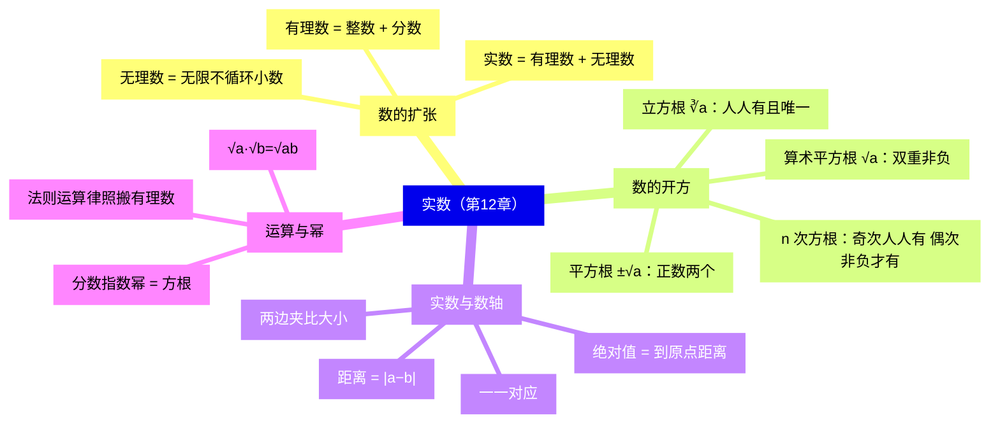
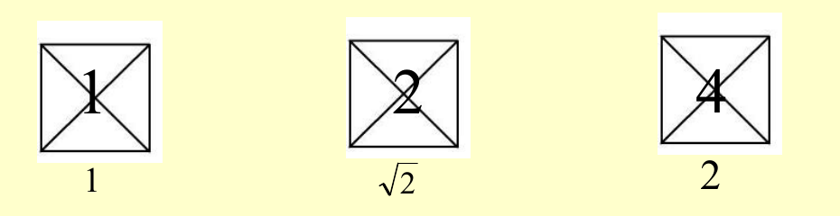
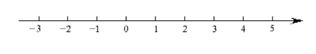
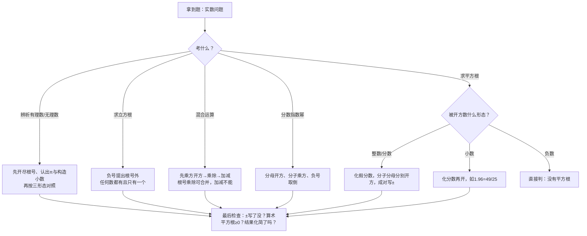

# 实数（详解版）

> [!note] 使用说明
> 本文是详解版，从"为什么"讲起供从头自学；考前速查和掌握度跟踪在概要版：[[03-数学/知识点/七年级/实数]]。本章配图裁自备课包课件与学习任务单原图。

## 0️⃣ 这章学什么 & 中考怎么考

- **这章解决什么问题**：到目前为止你认识的数——整数、分数、小数——**都能写成一个分数** $\dfrac{q}{p}$。但"面积为 2 的正方形，边长是多少"这个问题，有理数答不出来：不存在任何分数，它的平方恰好等于 2。于是数系必须再扩张一次：把"无限不循环小数"收编进来，得到**实数**。本章干两件事：①**学会"开方"**——加有减、乘有除、平方有开平方、立方有开立方，运算家族补齐另一半；②**把数轴填满**——以前数轴上有理数之间还有"空隙"，现在每一个点都对应一个实数。
- **和前后章节的关系**：往前，你要会乘方、分数小数互化（见[[03-数学/知识点/00-六至八年级核心公式定理总表]]数与式板块）；往后，八年级[[03-数学/知识点/八年级/二次根式]]把 $\sqrt a$ 的化简与运算系统展开，函数章节里求定义域、代值计算也都用本章的数。
- **中考怎么考**（依据概要版，不编造分值）：
  - 上海中考**计算题第一题**的地基：实数与二次根式的混合运算每分都从这里来；
  - **无理数辨析**是选择/填空的经典小题：给一串数判断谁是无理数，$\dfrac{22}{7}$、$3.14159$、$\sqrt4$ 这类"伪装者"专抓概念不清的人；
  - 平方根与算术平方根的区分（$\pm\sqrt a$ 与 $\sqrt a$）是高频失分点。
- 一句话总结：**平方根记个数（正数两个、0 一个、负数没有），立方根记一句话（人人有且唯一），无理数记三形态（开不尽、含 $\pi$、构造循环破），实数与数轴一一对应。**

### 学完本章，你应该能做到

1. 给一串数，30 秒内分清有理数、无理数，并说出每一条判断理由。
2. 默写平方根的个数规律，说清 $\pm\sqrt a$ 与 $\sqrt a$（算术平方根）的区别。
3. 口算 $\sqrt{16}$、$\sqrt[3]{-27}$、$(\sqrt5)^2$、$\sqrt{(-5)^2}$ 这类"平方与开方互逆"的小题。
4. 会用"两边夹"估计 $\sqrt2$、$\sqrt{10}$ 的大致位置，并在数轴上描点、求两点距离。
5. 会做含根号的混合运算，并会把 $8^{\frac23}$、$16^{-\frac34}$ 这类分数指数幂化成方根计算。

### 本章知识地图

## 🧭 先修自检（学不下去先回到这里）

> [!note] 先修自检怎么用
> 下面每一项都是本章的地基。做不出就先去补对应知识，硬学只会更挫败。

| # | 你应该会的 | 自查题（先做再看答案） | 答案 | 不会去哪补 |
| - | ---------- | ---------------------- | ---- | ---------- |
| 1 | 乘方运算（负数的幂） | $(-2)^3=$？$(-2)^2=$？ | $-8$；$4$（负数奇次幂为负，偶次幂为正） | [[03-数学/知识点/00-六至八年级核心公式定理总表]] |
| 2 | 带分数化假分数、小数化分数 | $2\dfrac79=$？ $0.49=$？ | $\dfrac{25}{9}$；$\dfrac{49}{100}$（开方前先"归位"成好开的形式） | 同上（数与式板块） |
| 3 | 完全平方公式 | $(x+1)^2=$？ | $x^2+2x+1$（本章含根号的运算常用它展开） | 同上 |
| 4 | 绝对值与相反数 | $\lvert-3\rvert=$？$3$ 的相反数是？ | $3$；$-3$（实数范围内原样照用） | 同上 |
| 5 | 有理数分类 | $-5$、$0.\dot{3}$、$\dfrac{22}{7}$ 哪些是分数？ | $0.\dot{3}$（无限循环小数）与 $\dfrac{22}{7}$ 是分数，$-5$ 是整数——它们都是有理数 | 同上 |

**自查题做错的，先把那一项补上再往下读。第 1、2 项是开方计算出错最多的源头。**

## 🌱 概念从头讲

> [!note] 概念讲法约定
> 每个概念按"**为什么需要它 → 它是什么 → 符号与记号含义 → 容易想错的地方**"四步讲。

### 概念 1：有理数为什么不够用——$\sqrt2$ 的诞生

- **为什么需要**：小学学了正数和 0，七年级补了负数；但这些都写得出分数。问题出在几何里：边长为 1 的正方形，沿对角线剪成四个直角三角形，恰好能拼成一个面积为 2 的大正方形。这个大正方形的边长 $x$ 满足 $x^2=2$——可是用"两边夹"试遍所有分数都夹不中它：$1.4^2=1.96<2$，$1.5^2=2.25>2$；再试 $1.41^2=1.9881<2$，$1.42^2=2.0164>2$……无论小数点后写多少位，平方总差那么一点，**而且永远循环不起来**。这个数需要新名字。
- **定义**：满足 $x^2=2$ 的正数记作 $\sqrt2$，读作"根号 2"。数学上可以严格证明它不是任何分数——教材的阅读材料里讲了古希腊毕达哥拉斯学派的弟子**希帕斯**发现这件事，引发了**第一次数学危机**。
- **为什么它"无限不循环"（说理雏形）**：假设 $\sqrt2$ 能写成最简分数 $\dfrac{q}{p}$（$p$、$q$ 互素），则 $q^2=2p^2$，于是 $q^2$ 是偶数，$q$ 也得是偶数；把 $q=2k$ 代回去得 $4k^2=2p^2$，即 $p^2=2k^2$，$p$ 也是偶数——这与"$p$、$q$ 互素（不能都是偶数）"矛盾。所以 $\sqrt2$ **不是有理数**：它的无限小数展开不可能循环（会循环就能化成分数）。
- **容易想错**：❌"$\sqrt2$ 是一个除不尽的分数。" → 它根本**不是分数**。$1.414$、$1.4142$ 都只是它的近似值；写成 $\sqrt2$ 这个记号才精确。

（看图体会：正方形面积翻倍，边长却不是翻倍——$1\to\sqrt2\to2$，中间这个 $\sqrt2$ 是有理数世界挤不进去的"新居民"。）

### 概念 2：无理数与实数的分类

- **为什么需要**：先把新居民登记造册，数的家谱才能画完整。
- **定义**：==无限不循环小数叫做无理数==；**有理数与无理数统称实数**。
- **符号/记号**：无理数常见三种形态，判断题逐一对照：
  1. **开方开不尽的数**：$\sqrt2$、$\sqrt5$、$\sqrt[3]{4}$——根号里的数不是某数的平方/立方；
  2. **含 $\pi$ 的数**：$\pi$、$\dfrac{\pi}{2}$、$\pi-3$（$\pi\approx3.14159\cdots$ 是无限不循环的）；
  3. **人为构造的无限不循环小数**：$0.101001000\cdots$（两个 1 之间依次多一个 0）、$0.3737737773\cdots$（7 的个数依次加一）——有规律但不循环。
  实数再按符号分三类：**正实数**（正有理数、正无理数）、**零**、**负实数**（负有理数、负无理数）。
- **容易想错**：
  - ❌"$3.14159$ 是无理数。" → 它是**有限小数**，是有理数；$\pi$ 才是无理数，$\pi$ 只能写成记号或无限小数。
  - ❌"$\dfrac{22}{7}$ 是无理数。" → 它是分数，是有理数（它是 $\pi$ 的**近似值**，不是 $\pi$）。
  - ❌"$\sqrt4$ 是无理数。" → $\sqrt4=2$，开得尽，是有理数。**先开方，再判断**。
  - ❌ 实数分类漏掉 $0$。 → 按符号分是"正实数、零、负实数"三类，0 既不是正数也不是负数。

### 概念 3：平方根与算术平方根（本章最容易混的一对）

- **为什么需要**："一个数的平方是 9，这个数是几？"答案有 $3$ 和 $-3$ 两个。已知平方结果反求原数，就是**开平方**——它是平方的逆运算。
- **定义**：若 $x^2=a$，则 $x$ 叫做 $a$ 的**平方根**（二次方根），记作 $\pm\sqrt a$，$a$ 叫**被开方数**；正数的**正**平方根和零的平方根，统称**算术平方根**，记作 $\sqrt a$。
- **符号/记号**：$\pm\sqrt a$ 表示"两个平方根"，$\sqrt a$ 只表示"算术平方根"。个数规律：

| $a$ 的类型 | 平方根 | 算术平方根 | 为什么 |
| ---------- | ------ | ---------- | ------ |
| 正数 | 两个：$\pm\sqrt a$，互为相反数 | 一个：$\sqrt a>0$ | 一正一负平方后都得 $a$；算术平方根专指"正的那个" |
| $0$ | 一个：$0$ | $0$ | $0^2=0$，正负没得区分 |
| 负数 | **不存在** | 不存在 | 任何实数的平方都 $\ge0$，$x^2=$ 负数无解——**平方运算天然造不出负数** |

- **容易想错**：
  - ❌"$\sqrt9=\pm3$。" → $\sqrt9$ 这个记号**只代表算术平方根**，$\sqrt9=3$；要说两个平方根必须写 $\pm\sqrt9=\pm3$。==漏写"±"是本章最高频错误==。
  - ❌"$-4$ 的平方根是 $\pm2$。" → 负数没有平方根；$\sqrt{-4}$ 无意义。
  - ❌"算术平方根可能是负的。" → ==双重非负==：被开方数 $a\ge0$，且结果 $\sqrt a\ge0$。见到 $\sqrt a<0$ 直接判错。
  - ❌"$\sqrt{81}$ 的平方根是 $\pm9$。" → 先算 $\sqrt{81}=9$，再问"9 的平方根"——答案是 $\pm3$。**从里往外一层层算**。

### 概念 4：立方根与 n 次方根

- **为什么需要**：体积为 8 的正方体棱长是多少？$x^3=8$，答案是 2。已知立方结果反求原数就是**开立方**。体积还可以是负数吗？体积不能，但数学上 $x^3=-8$ 有解 $x=-2$——立方运算**能**造出负数，这正是它与平方的本质区别。
- **定义**：若 $x^3=a$，则 $x$ 叫 $a$ 的**立方根**（三次方根），记作 $\sqrt[3]{a}$；推广：若 $x^n=a$，则 $x$ 叫 $a$ 的 $n$ 次方根。
- **符号/记号**：立方根的个数规律一句话——**任何实数都有且只有一个立方根**；正数的立方根是正数，0 的立方根是 0，负数的立方根是负数。常用两条：$\sqrt[3]{-a}=-\sqrt[3]{a}$（负号可以"进出"根号），$(\sqrt[3]{a})^3=a$（对任意实数成立）。
  $n$ 次方根看奇偶：**奇次方根**任何实数都有且只有一个；**偶次方根**只有非负数才有（正数两个 $\pm\sqrt[n]{a}$，0 一个，负数没有）——规律和平方根/立方根完全同款。
- **容易想错**：❌"负数没有立方根。" → 混到平方根上了。**负数没有平方根，但有（唯一的）立方根**：$\sqrt{-4}$ 无意义，$\sqrt[3]{-8}=-2$。对比记忆：偶次（平方、四次方…）照"平方根"规矩，奇次（立方、五次方…）照"立方根"规矩。

### 概念 5：实数与数轴——一一对应

- **为什么需要**：以前数轴上有理数之间留着"空隙"（比如 1 和 2 之间就没有有理数点表示 $\sqrt2$）。数系扩张到实数后，数轴第一次被**填满**。
- **定义**：==每一个实数都可以用数轴上的一个点表示，数轴上每一个点都表示唯一的一个实数==——**一一对应**。
- **符号/记号**：有理数范围内的一套概念**原样照用**：
  - 相反数：只有符号不同的两个实数，$-\sqrt2$ 与 $\sqrt2$ 互为相反数；
  - 绝对值：$\lvert a\rvert$ = 数轴上表示 $a$ 的点到原点的**距离**；两点 $A(a)$、$B(b)$ 的距离 $AB=\lvert a-b\rvert$；
  - 大小比较：数轴上**右边的点表示的数大**。无理数先用"两边夹"估出范围（$1<\sqrt2<2$，更细：$1.4<\sqrt2<1.5$）再比；负数比较**绝对值大的反而小**（$\sqrt{12}>\sqrt8$，加负号反转得 $-\sqrt{12}<-\sqrt8$）。
- **容易想错**：❌"无理数不能在数轴上表示。" → 能，且**精确**：以数轴上单位长为边作正方形，其对角线长恰是 $\sqrt2$，用圆规可以把这条长度"转"到数轴上。描大致位置时用两边夹就够（$\sqrt5$ 在 2 和 3 之间偏 2 一侧）。

### 概念 6：实数的运算——规则照搬 + 化简优先

- **为什么需要**：数的家族扩大了，运算规则要不要重学一遍？**不用**：有理数的运算法则、运算顺序、运算律在实数范围内**全部适用**——这是数系扩张一贯的"兼容"原则。
- **是什么**：
  - 顺序照旧：先乘方开方，再乘除，后加减，有括号先算括号；
  - 两条新的化简性质（八年级二次根式将系统展开）：$\sqrt a\cdot\sqrt b=\sqrt{ab}$（$a\ge0$，$b\ge0$），$\dfrac{\sqrt a}{\sqrt b}=\sqrt{\dfrac{a}{b}}$（$a\ge0$，$b>0$）；
  - ==结果要求==：题目没指明保留几位小数时，用法则把算式**化简**（如 $2\sqrt2+3\sqrt2=5\sqrt2$、$(\sqrt3)^2=3$）；要近似值才动计算器。
- **容易想错**：❌"$\sqrt2+\sqrt3=\sqrt5$。" → 加法**没有**这条性质！只有**乘除**能把根号内的数合并。$\sqrt2+\sqrt3$ 已经是最简，不能再化。

## 🧮 公式逐个拆解

> [!note] 公式拆解约定
> 每个公式都必须能回答四件事：每个符号是什么？什么时候能用？怎么变形？配一个一步能算的最小例子。

### 公式 1：平方与开方互逆三件套

$$(\pm\sqrt a)^2=a\ (a\ge0),\qquad(\sqrt a)^2=a\ (a\ge0),\qquad\sqrt{a^2}=\lvert a\rvert$$

| 符号 | 含义 | 注意 |
| ---- | ---- | ---- |
| $\pm\sqrt a$ | $a$ 的两个平方根 | 先平方再写时别丢 $\pm$ |
| $\sqrt{a^2}$ | "先平方，再开算术平方根" | 结果必须非负，所以套 $\lvert a\rvert$ |

- 成立条件：第一条、第二条要求 $a\ge0$；第三条对任意实数 $a$ 都成立。
- 怎么用：**"先开方再平方"与"先平方再开方"顺序不同，结果不同**——$(\sqrt{-5})^2$ 没意义（$\sqrt{-5}$ 先就无意义），而 $\sqrt{(-5)^2}=\lvert-5\rvert=5$。
- 最小例子：$\sqrt{(-4)^2}=\lvert-4\rvert=4$（不是 $-4$！）；$(-\sqrt4)^2=(-2)^2=4$；$-\sqrt4=-2$。三个式子长得像，答案两正一负，全看**运算顺序**。

### 公式 2：立方根两条

$$(\sqrt[3]{a})^3=a\ (\text{任意 }a),\qquad\sqrt[3]{-a}=-\sqrt[3]{a}$$

- 成立条件：第一条对**任何实数**成立（立方根人人有且唯一）；第二条是"负号进出门"。
- 怎么用：遇到 $\sqrt[3]{-N}$，把负号提到根号外再算正数的立方根，心里更踏实。
- 最小例子：$\sqrt[3]{-1000}=-\sqrt[3]{1000}=-10$；$\sqrt[3]{0.001}=0.1$（小数先化分数 $0.001=\dfrac1{1000}$ 再开）。

### 公式 3：根号乘除合并

$$\sqrt a\cdot\sqrt b=\sqrt{ab}\ (a\ge0,\ b\ge0),\qquad\frac{\sqrt a}{\sqrt b}=\sqrt{\frac{a}{b}}\ (a\ge0,\ b>0)$$

- 成立条件：被开方数都必须非负，除法还要求除数非零。
- 常用变形：反着用就是"拆"——$\sqrt{36}=\sqrt{4}\times\sqrt9$；顺向用是"合"——$\sqrt2\times\sqrt8=\sqrt{16}=4$。
- 最小例子：$\sqrt{10}\times\sqrt{40}=\sqrt{400}=20$（先乘进根号，开出完全平方数）。

### 公式 4：分数指数幂（方根与幂互化）

$$a^{\frac{m}{n}}=\sqrt[n]{a^m}\ (a\ge0),\qquad a^{-\frac{m}{n}}=\frac{1}{a^{\frac{m}{n}}}\ (a>0)$$

| 符号 | 含义 | 注意 |
| ---- | ---- | ---- |
| $m$（分子） | 乘方次数 | 先乘方 |
| $n$（分母） | 开方次数 | 后开方 |
| 负指数 | 取倒数 | 底数必须 $>0$，$0$ 没有负指数幂 |

- 成立条件：正指数要求 $a\ge0$；负指数要求 $a>0$。
- 怎么用：见到分数指数，**分母变根号指数、分子当乘方**；负号管倒数，与根号无关。
- 最小例子：$8^{\frac23}=(\sqrt[3]8)^2=2^2=4$；$16^{-\frac34}=\dfrac{1}{16^{\frac34}}=\dfrac{1}{(\sqrt[4]{16})^3}=\dfrac18$。

## 🪜 例题阶梯

> [!note] 例题怎么用
> 四级台阶，每一级都要动笔跟着算，不许只看。题源均为备课包课后练习/学习任务单原题，配图裁自原卷。

### 第 1 级 · 入门（求平方根：± 别丢、先"归位"）

> **题目**（12.2 课后练习 第 3 题节选）：求下列各数的平方根：(1) $36$；(5) $2\dfrac79$；(7) $1.96$。
>
> **每一步为什么这么做**：
> - 平方根是"已知平方结果反求原数"，正数的平方根有**两个**——先想好"谁平方等于它"，再成对写出 $\pm$。
> - 带分数、小数不是好开的样子，**先化成假分数**，分子分母分别开方。
>
> **完整解答**：
> (1) 因为 $(\pm6)^2=36$，所以 $36$ 的平方根是 $\pm6$。
> （心里默问"谁平方是 36"——$6$ 和 $-6$ 都行，写 $\pm6$ 才完整。）
> (5) $2\dfrac79=\dfrac{25}{9}$，因为 $(\pm\dfrac53)^2=\dfrac{25}{9}$，所以平方根是 $\pm\dfrac53$。
> （带分数直接开方必错：$\sqrt{2}$ 再加 $\sqrt{\dfrac79}$ 之类的拆法没有依据；先化假分数一步到位。）
> (7) $1.96=\dfrac{196}{100}$，因为 $(\pm\dfrac{14}{10})^2=\dfrac{196}{100}$，所以平方根是 $\pm1.4$。
> **验算**：$6^2=36$ ✓；$(\dfrac53)^2=\dfrac{25}{9}$ ✓；$1.4^2=1.96$ ✓。
>
> **变式提醒**：同题若问"**算术平方根**"，答案只剩正的那一半：$\sqrt{36}=6$、$\sqrt{\dfrac{25}{9}}=\dfrac53$、$\sqrt{1.96}=1.4$。做题第一步先圈出"平方根"还是"算术平方根"，再动笔。

### 第 2 级 · 标准（立方根与混合运算：一层一层剥）

> **题目**（12.6 课后练习 第 2（2）题）：计算：$(\sqrt3+1)^2-(\sqrt3-1)^2$。
>
> **每一步为什么这么做**：
> - 见到"两个平方相减"，先想**平方差公式** $A^2-B^2=(A+B)(A-B)$——能把四次乘法并成一次；
> - 也可以老实展开（完全平方公式对无理数照样成立），两条路互相验算。
>
> **完整解答**（平方差路线）：
> 原式 $=\left[(\sqrt3+1)+(\sqrt3-1)\right]\times\left[(\sqrt3+1)-(\sqrt3-1)\right]$
> $=2\sqrt3\times2=4\sqrt3$。
> （"和"里 $\pm1$ 抵消只剩 $2\sqrt3$；"差"里 $\sqrt3$ 抵消只剩 $2$——根号不参与加减合并，各自是整体。）
>
> **完整解答**（展开路线）：
> $(\sqrt3+1)^2=(\sqrt3)^2+2\sqrt3+1=4+2\sqrt3$；$(\sqrt3-1)^2=4-2\sqrt3$；
> 原式 $=(4+2\sqrt3)-(4-2\sqrt3)=4\sqrt3$。
> **验算**：两条路线结果一致 ✓；$4\sqrt3$ 已是最简算式（约 $6.93$，无近似要求就不必算出来）。
>
> **变式提醒**：把本题拆成单独一问 $(\sqrt3+1)^2$，答案是 $4+2\sqrt3$ 而不是 $3+1$——**$(\sqrt3)^2=3$ 只对"裸根号"成立**，带着 $+1$ 就必须用完全平方公式整体展开。易错点表里"$\sqrt a+\sqrt b=\sqrt{a+b}$"的错误也是同源：根号的乘除能合并，加减不能。

### 第 3 级 · 提高（数轴描点 + 距离：两边夹 + 绝对值）

> **题目**（12.5 学习任务单 学习任务五）：已知数轴上四个点 $A$、$B$、$C$、$D$ 所对应的实数依次是 $1$、$-\dfrac23$、$2\dfrac12$、$-\sqrt5$，$O$ 为原点。(1) 在数轴上描出四点的大致位置；(2) 求线段 $OA$、$OB$、$OC$、$OD$ 的长度；(3) 求线段 $AC$、$AB$ 的长度。
>
> 
>
> **思路从哪来**：描点靠**两边夹**把无理数钉在两个相邻整数之间；长度靠==绝对值==——"到原点的距离"与"两点距离"公式 $AB=\lvert a-b\rvert$。
>
> **完整解答**：
> (1) 定位：$A(1)$、$C(2\dfrac12=2.5)$ 直接放；$B(-\dfrac23\approx-0.67)$ 在 $-1$ 与 $0$ 之间偏左；$D(-\sqrt5)$：因为 $2<\sqrt5<3$（$2^2=4<5<9=3^2$），所以 $-3<-\sqrt5<-2$，且 $\sqrt5\approx2.24$ 靠近 2，故 $D$ 在 $-3$ 与 $-2$ 之间偏 $-2$ 一侧。
> （两边夹的依据：正数越大平方越大，所以比较 $2^2$ 与 $5$、$3^2$ 与 $5$ 就夹住了 $\sqrt5$；加负号后方向反转、大小反转。）
> (2) $OA=\lvert1\rvert=1$；$OB=\lvert-\dfrac23\rvert=\dfrac23$；$OC=\lvert2.5\rvert=2.5$；$OD=\lvert-\sqrt5\rvert=\sqrt5$。
> （到原点的距离就是绝对值；$OD$ 保留 $\sqrt5$ 这个精确记号，不要急着写 $2.24$。）
> (3) $AC=\lvert1-2.5\rvert=1.5$；$AB=\lvert1-(-\dfrac23)\rvert=\lvert1+\dfrac23\rvert=\dfrac53$。
> **验算**：从图上看 $AC$ 约一格半、$AB$ 约一格半多一点，与计算值一致 ✓。
>
> **变式提醒**：若把 (2) 最后一问改成"比较 $OD$ 与 $OC$ 的大小"，别把 $\sqrt5$ 四舍五入成 2.24 就下结论——精确比较用平方：$OD^2=5>OC^2=6.25$？不对，$6.25>5$，所以 $OC>OD$。**"平方比较"是处理无理数大小的正规武器**，估算只用来定位和验算。

### 第 4 级 · 综合（分数指数幂：负号管倒数，分母管根号）

> **题目**（12.7 课后练习 第 3 题）：计算：(1) $8^{\frac23}$；(2) $36^{\frac32}$；(3) $16^{-\frac34}$；(4) $(-64)^{-\frac23}$。
>
> **每一步为什么这么做**：
> - 口诀先立好：==分母开方、分子乘方、负号取倒==。遇到负指数，第一步先写成倒数（把负号处理掉），剩下的按正指数做；
> - 底数是负数时先检查条件：负**奇**次根可以开（立方根人人有），负**偶**次根不能开。
>
> **完整解答**：
> (1) $8^{\frac23}=(\sqrt[3]{8})^2=2^2=4$。
> （分母 2 → 开立方；分子 3 → 平方。先开方后乘方，中间数小好算。）
> (2) $36^{\frac32}=(\sqrt{36})^3=6^3=216$。
> （先开平方得 6，再立方；若先算 $36^3$ 再开方，数字会大到没法口算。）
> (3) $16^{-\frac34}=\dfrac{1}{16^{\frac34}}=\dfrac{1}{(\sqrt[4]{16})^3}=\dfrac{1}{2^3}=\dfrac18$。
> （负号只管"取倒数"这一件事；$\sqrt[4]{16}=2$ 是因为 $2^4=16$。）
> (4) $(-64)^{-\frac23}=\dfrac{1}{(-64)^{\frac23}}=\dfrac{1}{(\sqrt[3]{-64})^2}=\dfrac{1}{(-4)^2}=\dfrac{1}{16}$。
> （$-64$ 能进负指数：$\sqrt[3]{-64}=-4$ 是**立方根**，负数可以开；开出来平方后负号自然消失。）
> **验算**：$4^{\frac32}=8$、$8^{\frac32}$ 反推 $\sqrt[3]8=2$ ✓；$\dfrac18\times16^{\frac34}=\dfrac18\times8=1$ ✓（负指数与正指数互为倒数，乘回原数得 1）。
>
> **变式提醒**：若把 (4) 改成 $(-64)^{-\frac24}$（指数分母为 4），分母开**四次**方根，$-64$ 开偶次方根无意义——整题作废。**看见负底数，先看指数分母的奇偶**，这一眼决定题目合法与否。

## 🗺️ 解题流程图

## 🔥 易错点：为什么会错

| ❌ 常见错误想法 | 为什么会这样想 | ✅ 正确理解 / 自救方法 |
| -------------- | -------------- | ---------------------- |
| $\sqrt9=\pm3$ | 把"平方根有两个"错安到记号 $\sqrt{\ }$ 头上 | $\sqrt{\ }$ 这个记号**生来只表示算术平方根**；两个平方根要写 $\pm\sqrt9$。动笔前先圈题干关键词 |
| $\sqrt{(-4)^2}=-4$ | 觉得"开方就是抵消平方" | 顺序反了：先平方得 16，开**算术**平方根只能得非负的 4。背结论 $\sqrt{a^2}=\lvert a\rvert$ 最稳 |
| 负数没有立方根 | 与平方根规律串门 | 平方根：负数没有；立方根：人人有且唯一。奇偶次方根同款规律 |
| $\sqrt2+\sqrt3=\sqrt5$ | 把乘法合并性质外推到加法 | $\sqrt a\cdot\sqrt b=\sqrt{ab}$ 只管**乘除**；加减时根号是"不同单位的量"，不能再合并 |
| "$\dfrac{22}{7}$、$3.14159$ 是无理数" | 以为"长得像 π / 除不尽就是无理数" | 分数全是有理数；有限小数全是有理数。无理数三形态对照：开不尽、含 π、构造不循环 |
| $\sqrt{81}$ 的平方根答 $\pm9$ | 没看见根号已经"先算了一层" | 从里往外剥：$\sqrt{81}=9$，再求 9 的平方根得 $\pm3$。两层运算一层层来 |
| 比较 $-\sqrt{12}$ 与 $-\sqrt8$ 直接说 $-\sqrt{12}>-\sqrt8$ | 只看根号里的数 | 先比正数：$\sqrt{12}>\sqrt8$；加负号**反转**：$-\sqrt{12}<-\sqrt8$。负数大小过一遍"绝对值大反而小" |
| $0$ 没有分数指数幂 / 丢掉实数分类中的 0 | 分类不完整 | $0$ 有正指数幂（$0^{\frac23}=0$）但没有负指数幂；实数按符号分三类永远带着 0 |

## 📝 本讲小结

- **分类**：实数 = 有理数（有限小数 / 无限循环小数）+ 无理数（无限不循环小数）；按符号分正实数、零、负实数。
- **平方根**：正数两个互为相反数 $\pm\sqrt a$；0 一个；负数没有。算术平方根 $\sqrt a\ge0$，双重非负；$\sqrt{a^2}=\lvert a\rvert$。
- **立方根**：任何数都有且只有一个；$\sqrt[3]{-a}=-\sqrt[3]{a}$；n 次方根"奇次人人有，偶次非负才有"。
- **数轴**：实数与数轴上的点一一对应；绝对值 = 距离，$AB=\lvert a-b\rvert$；比较大小用两边夹，负号反转。
- **运算**：法则、顺序、运算律照搬有理数；$\sqrt a\cdot\sqrt b=\sqrt{ab}$ 只限乘除；无近似要求时化简到最简算式。
- **分数指数幂**：分母开方、分子乘方、负号取倒；负底数先看指数分母奇偶。
- **思想**：数形结合（数轴）、类比（平方根 ↔ 立方根 ↔ n 次方根）、从特殊到一般、反证法雏形（$\sqrt2$ 不是有理数）。

## ✅ 自测清单（能独立做到才打勾）

- [ ] 1. 能说出数系为什么扩张：面积为 2 的正方形边长不是有理数，并会用两边夹估计它
- [ ] 2. 能给一串数分清有理数/无理数，并识破 $\dfrac{22}{7}$、$3.14159$、$\sqrt4$ 三种伪装
- [ ] 3. 能默写平方根个数规律，说清 $\pm\sqrt a$ 与 $\sqrt a$ 的区别（含"双重非负"）
- [ ] 4. 能口算 $(\sqrt5)^2$、$\sqrt{(-5)^2}$、$\sqrt[3]{-27}$、$\sqrt[3]{0.064}$ 并说出依据
- [ ] 5. 能在数轴上描出 $\sqrt5$、$-\dfrac23$ 的大致位置并求两点距离
- [ ] 6. 能独立做出例题阶梯第 1～3 级
- [ ] 7. 能把 $8^{\frac23}$、$(-64)^{-\frac23}$ 这类分数指数幂一步步算到底
- [ ] 8. 能说出本章 3 个易错点及自救方法

## 🔗 关联

- 概要版：[[03-数学/知识点/七年级/实数]]（掌握度在这边更新）
- 前置知识：[[03-数学/知识点/00-六至八年级核心公式定理总表]]（有理数运算、乘方、分数小数互化）
- 兄弟详解：[[03-数学/知识点详解/七年级/相交线与平行线]] · [[03-数学/知识点详解/七年级/三角形]] · [[03-数学/知识点详解/七年级/平面直角坐标系]]（同册四章）
- 后续衔接：[[03-数学/知识点/八年级/二次根式]]（$\sqrt a$ 的系统化简与运算）、中考计算题第一题（实数与二次根式混合运算）
