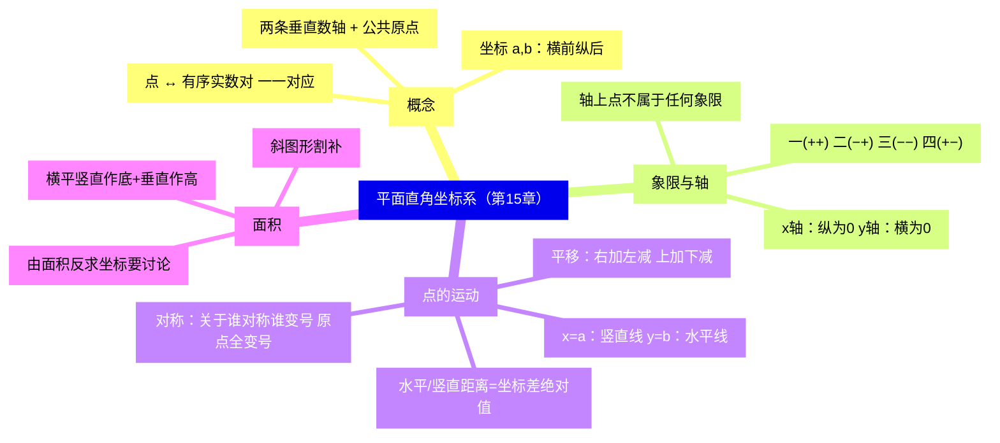
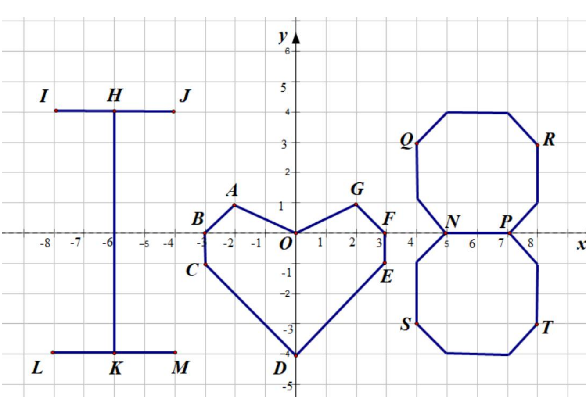
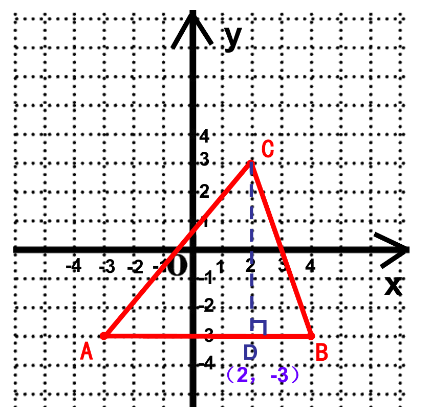
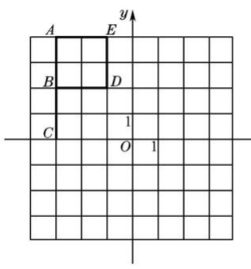
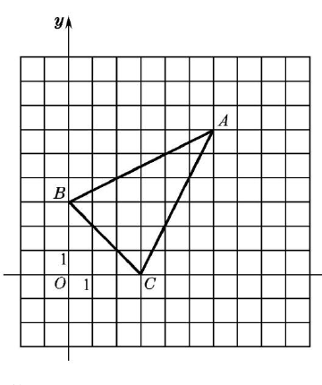
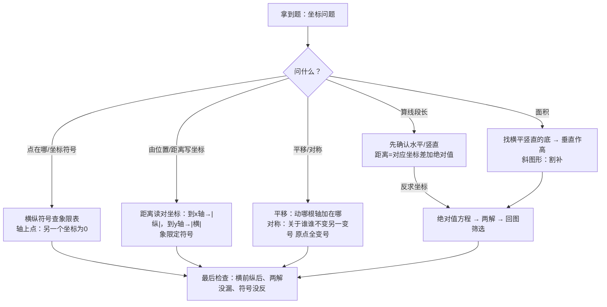

# 平面直角坐标系（详解版）

> [!note] 使用说明
> 本文是详解版，从"为什么"讲起供从头自学；考前速查和掌握度跟踪在概要版：[[03-数学/知识点/七年级/平面直角坐标系]]。本章配图裁自备课包课件与课后练习原图。

## 0️⃣ 这章学什么 & 中考怎么考

- **这章解决什么问题**：数轴上一个数就能定一个点的位置；但"教室里第 3 排第 5 座"这种**平面内**的位置，一个数不够用了——需要两个数按顺序配对。本章把"数"与"点"的对应从一条线（数轴）铺满整个平面：每个点 ↔ 唯一的有序实数对 $(a,b)$。有了坐标系，图形可以"翻译"成坐标，坐标可以"翻译"回图形——**代数与几何从此说同一种语言**。
- **和前后章节的关系**：往前，你要会[[03-数学/知识点/七年级/实数]]（数轴、实数与点一一对应——本章就是把数轴复制成两根）；往后，八年级[[03-数学/知识点/八年级/一次函数]]、九年级[[03-数学/知识点/九年级/二次函数]]的图象、顶点、平移，以及中考第 24 题坐标系里的几何计算，全都踩在本章的规律上。
- **中考怎么考**（依据概要版，不编造分值）：
  - 本章**直接考得不深**，但点的象限特征、坐标轴上点、平移与对称的坐标规律是函数题每天要用的基本功；
  - 平行于坐标轴的两点距离、格点图形面积（割补）在单元内成题出现；
  - "由面积/距离反求坐标"的两解讨论是易错送分点。
- 一句话总结：**符号定象限（轴上点不属于任何象限）；平移"右加左减、上加下减"；对称"关于谁对称谁变号、关于原点全变号"；距离就是对应坐标差加绝对值——四条规律全部能从定义推出来，不用死背。**

### 学完本章，你应该能做到

1. 看图秒读坐标、按描述秒写坐标（"第二象限、到 $x$ 轴 3 个单位、到 $y$ 轴 4 个单位"这类）。
2. 说出四象限的符号特征与"坐标轴上的点不属于任何象限"。
3. 用 $\lvert x_1-x_2\rvert$、$\lvert y_1-y_2\rvert$ 算水平/竖直两点距离，并知道字母型问题要加绝对值。
4. 从定义推导平移与对称的坐标规律，并对一个点快速算出变换后的坐标。
5. 会算格点多边形面积（横平竖直作底、割补），并会由面积反求坐标（防漏解）。

### 本章知识地图

## 🧭 先修自检（学不下去先回到这里）

> [!note] 先修自检怎么用
> 下面每一项都是本章的地基。做不出就先去补对应知识，硬学只会更挫败。

| # | 你应该会的 | 自查题（先做再看答案） | 答案 | 不会去哪补 |
| - | ---------- | ---------------------- | ---- | ---------- |
| 1 | 数轴三要素 | 数轴必须规定哪三样？ | 原点、正方向、单位长度 | [[03-数学/知识点/00-六至八年级核心公式定理总表]] |
| 2 | 实数与数轴 | 数轴上的点与什么一一对应？ | 实数（每个实数一个点，每个点一个实数） | [[03-数学/知识点/七年级/实数]] |
| 3 | 绝对值与距离 | 数轴上 $A(-2)$、$B(5)$，$AB=$？ | $\lvert5-(-2)\rvert=7$ | 同上 |
| 4 | 垂线与垂足 | "过点向 $x$ 轴作垂线"垂足是什么？ | 该点在 $x$ 轴上的正投影点（横坐标由它读出） | [[03-数学/知识点/七年级/相交线与平行线]] |
| 5 | 轴对称 | 两个点关于直线 $l$ 对称，连线段与 $l$ 什么关系？ | 被 $l$ 垂直平分（对称点到 $l$ 等距） | 同上 |

**自查题做错的，先把那一项补上再往下读。第 3、5 项分别是距离公式和对称规律的源头。**

## 🌱 概念从头讲

> [!note] 概念讲法约定
> 每个概念按"**为什么需要它 → 它是什么 → 符号与记号含义 → 容易想错的地方**"四步讲。

### 概念 1：从数轴到平面——为什么一个数不够了

- **为什么需要**：数轴是一根线，上面的点"前后排队"，一个数（到原点的带方向距离）就能定位。平面上的点却"四面八方"散开——只知道"离 $x$ 轴多远"仍可能在同一水平线上的任何位置，==必须再给一个数==才知道在左在右。两个数按顺序配对（有序数对），平面内每个点就都有了"身份证"。这正是"电影院几排几座"的数学化。
- **定义**：在平面内取一点 $O$，过 $O$ 画**两条互相垂直**的数轴，都以 $O$ 为公共原点：水平放置、正方向向右的一条叫**横轴（$x$ 轴）**；铅直放置、正方向向上的一条叫**纵轴（$y$ 轴）**；交点 $O$ 叫**原点**。这样建立的系统叫**平面直角坐标系**。
- **符号/记号**：过点分别向 $x$ 轴、$y$ 轴作垂线，垂足对应的数 $a$、$b$ 组成**有序实数对** $(a,b)$：$a$ 叫横坐标（读 $x$ 轴），$b$ 叫纵坐标（读 $y$ 轴）。==横前纵后，顺序不可换==——$(2,3)$ 与 $(3,2)$ 是两个不同的点（一个在"右 2 上 3"，一个在"右 3 上 2"）。
- **容易想错**：❌"$x$ 轴上的点横坐标是 0。" → 反了：$x$ 轴上的点**纵**坐标是 0（点就躺在 $x$ 轴上，"高度"为零）。$y$ 轴上的点横坐标是 0。❌ 坐标不画括号、不写逗号。 → 坐标是**有序数对** $(a,b)$，格式本身是定义的一部分。

### 概念 2：象限与坐标特征——一眼判断点在哪

- **为什么需要**：坐标 $(a,b)$ 的两个符号立刻暴露点的"方位"——这是函数图象分析（开口在哪个象限、交点在轴上方还是下方）的地基。
- **是什么**：两条坐标轴把平面分成四个区域，按**逆时针**（右上起）叫第一、二、三、四象限：

| 位置 | 坐标特征 | 图中例子 |
| ---- | ---- | ---- |
| 第一象限 | $(+,\ +)$ | $G(2,1)$、$Q(4,3)$ |
| 第二象限 | $(-,\ +)$ | $A(-2,1)$、$J(-4,4)$ |
| 第三象限 | $(-,\ -)$ | $C(-3,-1)$、$K(-6,-4)$ |
| 第四象限 | $(+,\ -)$ | $E(3,-1)$、$S(4,-3)$ |
| $x$ 轴上 | $(a,0)$ | $B(-3,0)$、$N(5,0)$ |
| $y$ 轴上 | $(0,b)$ | $D(0,-4)$ |
| 原点 | $(0,0)$ | $O$ |

- **符号/记号**：象限按"右上→左上→左下→右下"逆时针编号；==坐标轴上的点不属于任何象限==（象限只指四个"开放区域"）。
- **容易想错**：❌"原点属于第一象限（或同时属于四个象限）。" → 原点 $(0,0)$ 是两条轴的公共点，不属于任何象限。❌"横坐标相同就同象限。" → 横坐标相同的点排在同一条竖直线上（$x=a$），可以一上一下跨三个区域（$y>0$、$y=0$、$y<0$）。

### 概念 3：平行于坐标轴的直线与两点距离

- **为什么需要**：坐标一相同，点就"排队"——这是后面读图、算线段长、验证平行（一次函数里 $k$ 相同）的常备工具。
- **是什么**：
  - 横坐标都为 $a$ 的点排在竖直线 $x=a$ 上（这条线**平行于 $y$ 轴**）；
  - 纵坐标都为 $b$ 的点排在水平线 $y=b$ 上（这条线**平行于 $x$ 轴**）。
- **距离公式（从数轴"平移"过来）**：水平两点 $A(x_1,b)$、$B(x_2,b)$ 的距离就是把它们"压扁"到 $x$ 轴上看——$AB=\lvert x_1-x_2\rvert$；竖直两点 $C(a,y_1)$、$D(a,y_2)$：$CD=\lvert y_1-y_2\rvert$。==依据就是数轴上 $AB=\lvert a-b\rvert$（实数章），加绝对值是因为距离不分左右==。
- **容易想错**：❌"$A(2,1)$、$B(5,1)$ 的距离是 $5-2=3$？直接减不加绝对值行不行？" → 数小时行，==字母型问题（$b$ 是多少？）必须加绝对值==——$b$ 可能在左也可能在右，绝对值正是"两解"的来源。❌ 拿斜着两点硬套：$A(1,2)$、$B(4,6)$ 不是水平/竖直关系，公式不适用（要到八年级学勾股/距离公式才能算）。

### 概念 4：平移的坐标规律（推导）

- **为什么需要**：图形整体搬家时，每个点怎么动？图形动 = 所有点同步动——把一个点的规律推出来，全图规律就有了。
- **推导**：先看一根数轴上的点 $a$：向右移 $k$ 个单位，就是"往前数 $k$ 格"，得到 $a+k$；向左移得到 $a-k$——**加减只发生在"动的那根轴"上**。平面上：
  - 向右/左平移 $k$：只在 $x$ 轴方向动，$(a,b)\to(a+k,\,b)$ 或 $(a-k,\,b)$；
  - 向上/下平移 $k$：只在 $y$ 轴方向动，$(a,b)\to(a,\,b+k)$ 或 $(a,\,b-k)$；
  - 斜着移动（如"向右 2 再向上 4"）：==分两步走，横纵各结各的账==。
- **口诀与理解**：右加左减（横坐标）、上加下减（纵坐标）。自救方法：代一个具体点——$(0,0)$ 向右移 2 得 $(2,0)$，检查你的式子给的是不是它。
- **容易想错**：❌"向右平移 2，$y$ 也加 2。" → 平移是"整体滑动"，每个点的**高度不变**，只有横坐标变。❌ 连续两次平移只记最后一次。 → 两次平移=横纵各变一次，顺序不影响结果（加法交换），但**别漏算**。

### 概念 5：对称的坐标规律（推导）

- **为什么需要**：轴对称、中心对称在坐标系里变成"变号游戏"——先推出规律，函数章节里求对称点、翻折图象就都是口算。
- **推导（核心是对称点到对称轴等距、方向相反）**：
  - **关于 $x$ 轴对称**：$x$ 轴是"水平镜子"。点 $(a,b)$ 的对称点必须与它**同一条竖直线**上（横坐标不变，垂足相同），且到 $x$ 轴距离相等、一上一下（纵坐标变号）：$(a,b)\to(a,-b)$；
  - **关于 $y$ 轴对称**：同理"左右翻转"：$(a,b)\to(-a,b)$；
  - **关于原点对称**：中心对称 = 连续两次轴对称（先翻 $x$ 轴再翻 $y$ 轴）：$(a,b)\to(a,-b)\to(-a,-b)$，==横纵都变号==。
- **符号/记号**：口诀——**关于谁对称，谁不变，另一个变号；关于原点，全变号**。
- **容易想错**：❌"关于原点对称就是纵坐标变号。" → 那是关于 $x$ 轴对称。自查：$(3,-4)$ 关于原点的对称点 $(-3,4)$——两点连线过原点且被原点平分。❌ 把"横纵都变号"记成"都变相反数以外的运算"。 → 变号 = 乘 $-1$，没有别的操作。

### 概念 6：格点图形的面积——横平竖直作底，割补救斜图

- **为什么需要**：坐标系里的图形常常"斜着放"，但**面积必须算得出**——办法是只用水平/竖直线段当底和高，实在不行补一补、割一割。
- **是什么**：
  - 有一边横平（$y$ 相同）或竖直（$x$ 相同）的三角形：直接以它为底，第三个顶点到这条边的**竖直/水平距离**为高，$S=\dfrac12\times 底\times 高$；

  - 全斜的四边形/三角形：**割补**——补成矩形（大矩形减角上直角三角形），或沿一条竖线/横线割成两个直角梯形/三角形。
- **由面积反求坐标**：设出未知坐标，用面积列方程；==线段长要加绝对值==，所以方程常有两解——先画大致图形定位置，再决定都保留还是舍去。
- **容易想错**：❌ 高的长度直接用"纵坐标相减"不加绝对值。 → 顶点在底边下方时相减得负——面积不会是负的，加绝对值或"大减小"。❌ 由面积解出两解全舍/全留。 → 结合图形位置逐个检验：每个解都要"回图入座"。

## 🧮 规律逐个拆解

> [!note] 规律拆解约定
> 每条规律都能回答四件事：对谁的坐标做什么？什么时候用？怎么从定义推出来？配一个最小例子。

### 规律 1：象限符号表

| 象限 | 横坐标 | 纵坐标 | 记忆 |
| ---- | ------ | ------ | ---- |
| 一 | $+$ | $+$ | 全正 |
| 二 | $-$ | $+$ | 横负纵正（左上） |
| 三 | $-$ | $-$ | 全负 |
| 四 | $+$ | $-$ | 横正纵负（右下） |

- 用法：给坐标报象限、给象限报符号；$a<0$、$b>0$ ⟹ 第二象限。
- 最小例子：$(-2,1)$——横负纵正，第二象限；$(2,-1)$——横正纵负，第四象限。两点横坐标只差一个负号，象限"沿 $y$ 轴镜像"。

### 规律 2：平移规律

$$\text{右}k:\ (a,b)\to(a+k,b)\qquad \text{左}k:\ (a,b)\to(a-k,b)\qquad \text{上}k:\ (a,b)\to(a,b+k)\qquad \text{下}k:\ (a,b)\to(a,b-k)$$

- 怎么来：平移只发生在移动方向的轴上（数轴上"向前数 $k$ 格"），另一坐标原封不动。
- 最小例子：$(-5,0)$ 右移 2 再上移 4：$(-5+2,\ 0)=( -3,0)\to(-3,4)$。横账纵账分开结。

### 规律 3：对称规律

| 对称方式 | 坐标变化 | 谁变号 |
| -------- | -------- | ------ |
| 关于 $x$ 轴 | $(a,b)\to(a,-b)$ | 纵变号 |
| 关于 $y$ 轴 | $(a,b)\to(-a,b)$ | 横变号 |
| 关于原点 | $(a,b)\to(-a,-b)$ | 全变号 |

- 怎么来：对称点与原点同在垂直于镜面的直线上（不动的坐标不动），到镜面等距反向（动的坐标变号）；原点对称 = 两次轴对称叠加。
- 最小例子：$(2,3)$ 关于 $y$ 轴 → $(-2,3)$；关于 $x$ 轴 → $(2,-3)$；关于原点 → $(-2,-3)$。三个像关于 $(2,3)$ 各就各位。

### 规律 4：水平/竖直两点距离

$$A(x_1,b),\ B(x_2,b):\ AB=\lvert x_1-x_2\rvert\qquad C(a,y_1),\ D(a,y_2):\ CD=\lvert y_1-y_2\rvert$$

- 怎么来：同一条水平/竖直线上的两点，距离由"动的那根坐标"决定，压回数轴用 $\lvert a-b\rvert$。
- 用法一：正着算长度；用法二：反解坐标（绝对值方程，两解）。
- 最小例子：$E(0,1)$、$F(0,-3)$：$EF=\lvert1-(-3)\rvert=4$（竖直线 $x=0$，即 $y$ 轴本身）。

## 🪜 例题阶梯

> [!note] 例题怎么用
> 四级台阶，每题先自己在草稿上描点，再跟着"依据插话"走。题源均为备课包学习任务单/课后练习原题，配图裁自原卷。

### 第 1 级 · 入门（由位置写坐标：符号与距离双向翻译）

> **题目**（单元复习与小结 课后练习 第 1 题）：在平面直角坐标系中，写出下列各点的坐标：(1) 点 $A$ 在 $x$ 轴的负半轴上，与原点的距离为 5 个单位；(2) 点 $B$ 在 $y$ 轴的正半轴上，与原点的距离为 3 个单位；(3) 点 $C$ 在第二象限，它到 $x$ 轴、$y$ 轴的距离分别为 3 个单位和 4 个单位。
>
> **每一步为什么这么做**：
> - 轴上的点先定"哪条轴"再定"哪半轴"——负半轴、正半轴管**符号**，距离管**数值**；
> - 象限内的点：距离要"换轨"——到 $x$ 轴的距离是**纵**坐标的绝对值，到 $y$ 轴的距离是**横**坐标的绝对值（==竖着的距离读 $y$，横着的距离读 $x$==）。
>
> **完整解答**：
> (1) $x$ 轴上的点纵坐标为 0；负半轴 ⟹ 横坐标为负。所以 $A(-5,0)$。
> (2) $y$ 轴上的点横坐标为 0；正半轴 ⟹ 纵坐标为正。所以 $B(0,3)$。
> (3) 第二象限 ⟹ 横负纵正；到 $x$ 轴距离 3 ⟹ $\lvert$纵坐标$\rvert=3$；到 $y$ 轴距离 4 ⟹ $\lvert$横坐标$\rvert=4$。所以 $C(-4,3)$。
> （第 (3) 小问最容易答成 $(-3,4)$——==把"到 $x$ 轴的距离"错接到横坐标上==。垂直方向对垂直方向：点到 $x$ 轴的垂线段是竖直的，量的是纵坐标。）
> **验算**：$C(-4,3)$：在第二象限 ✓；到 $x$ 轴 $\lvert3\rvert=3$ ✓；到 $y$ 轴 $\lvert-4\rvert=4$ ✓。
>
> **变式提醒**：把 (3) 改成"第三象限、到 $x$ 轴 3、$y$ 轴 4"，答案变 $(-4,-3)$——==象限给符号、距离给绝对值，两步合起来才是坐标==。

### 第 2 级 · 标准（距离公式与两解：绝对值方程）

> **题目**（15.2 学习任务单 例题 1(1)～(3)，变式取(4)）：在直角坐标平面内：(1) 已知 $A(2,2)$ 和 $B(5,2)$，求 $AB$；(2) 已知 $C(3,1)$ 和 $D(3,6)$，求 $CD$；(3) 已知 $E(0,1)$ 和 $F(0,-3)$，求 $EF$；(4) 已知点 $G(2,1)$、$H(b,1)$，且 $GH=2$，求 $b$ 的值。
>
> **每一步为什么这么做**：
> - (1)～(3) 先辨认"哪条坐标相同"——相同的是"死"的坐标，**不同的那条**才是长度来源；
> - (4) 已知长度反求坐标：长度公式带绝对值，解绝对值方程必查两解。
>
> **完整解答**：
> (1) $A$、$B$ 纵坐标相同 ⟹ $AB$ 水平，$AB=\lvert5-2\rvert=3$。
> (2) $C$、$D$ 横坐标相同 ⟹ $CD$ 竖直，$CD=\lvert6-1\rvert=5$。
> (3) $E$、$F$ 都在 $y$ 轴上（横坐标同为 0），$EF=\lvert1-(-3)\rvert=4$。
> （三小题同一条规律：==水平看横坐标差、竖直看纵坐标差，都加绝对值==。）
> (4) $G$、$H$ 纵坐标相同 ⟹ 水平，$GH=\lvert b-2\rvert=2$。
> 所以 $b-2=2$ 或 $b-2=-2$，得 $b=4$ 或 $b=0$。
> **验算**：$b=4$：$H(4,1)$ 在 $G$ 右侧 2 格 ✓；$b=0$：$H(0,1)$ 在 $G$ 左侧 2 格 ✓。两个都符合 $GH=2$，**不能只留一个**。
>
> **变式提醒**：若题目追加"$H$ 在第一象限"，则 $b=0$（$H$ 落在 $y$ 轴上，不属于任何象限）不合要求，舍去——==两解之后必有"筛选"环节：象限、正负、图形位置都是筛子==。

### 第 3 级 · 提高（对称规律的图案级应用：坐标"乘 $-1$"是什么对称）

> **题目**（单元复习与小结 课后练习 第 3 题）：在平面直角坐标系中，由 $A(-3,4)$、$B(-3,2)$、$C(-3,0)$、$D(-1,2)$、$E(-1,4)$ 五个点用线段联结成一面如图所示的小旗图案。(1) 如果原来五个点的纵坐标保持不变，横坐标都乘以 $-1$，将对应所得的点用线段联结起来，所得图案与原图案有什么对称关系？(2) 如果横坐标保持不变，纵坐标都乘以 $-1$ 呢？
>
> 
>
> **思路从哪来**："$\times(-1)$"就是==变号==。对照对称规律：横变号 = 关于 $y$ 轴对称；纵变号 = 关于 $x$ 轴对称。图案由五个点定死，点的对称关系直接翻译成图案的对称关系。
>
> **完整解答**：
> (1) 每个点 $(a,b)\to(-a,b)$（纵坐标不变，横坐标乘 $-1$）。
> 逐点：$A(-3,4)\to A'(3,4)$，$B(-3,2)\to B'(3,2)$，$C(-3,0)\to C'(3,0)$，$D(-1,2)\to D'(1,2)$，$E(-1,4)\to E'(1,4)$。
> 新旧对应点连线都被 $y$ 轴垂直平分（横坐标相反、纵坐标相同），所以所得图案与原图案关于 $y$ 轴对称。
> （验证一个就够：$A$ 与 $A'$ 到 $y$ 轴都是 3 格、同高——正是"关于 $y$ 轴对称"的定义。）
> (2) 同理 $(a,b)\to(a,-b)$，如 $A(-3,4)\to A''(-3,-4)$，对应点连线都被 $x$ 轴垂直平分，所得图案与原图案关于 $x$ 轴对称。
> **验算**：(1) 中 $C(-3,0)\to C'(3,0)$：$C$ 本来就在 $x$ 轴上，关于 $y$ 轴对称后仍在 $x$ 轴上、跑到了 $y$ 轴右侧 ✓；旗杆 $AC$ 从 $y$ 轴左侧翻到右侧，旗面同步翻转 ✓。
>
> **变式提醒**：若横纵坐标**同时**乘 $-1$，即 $(a,b)\to(-a,-b)$——关于**原点**的中心对称。三连问（横变、纵变、全变）正好把三条对称规律各练一遍：==看到"乘 $-1$"先问"乘在谁头上"==。

### 第 4 级 · 压轴（坐标 + 全等：格点上判等腰三角形）

> **题目**（15.1 课后练习 第 4 题）：如图，(1) 写出图中点 $A$、$B$、$C$ 的坐标；(2) $\triangle ABC$ 是否为等腰三角形？为什么？（提示：利用三角形全等）
>
> 
>
> **思路从哪来**：(1) 数格子读坐标——先读 $x$ 轴方向再读 $y$ 轴方向。(2) 斜着的线段不能直接量长（七年级没有距离公式），但坐标系送来一件礼物：==水平/竖直的格子线可以构造直角三角形==，$AB$ 与 $AC$ 各自是某个直角三角形的斜边，用 S.A.S 证两个直角三角形全等，斜边就相等了。
>
> **完整解答**：
> (1) $A(6,6)$，$B(0,3)$，$C(3,0)$。
> （$A$：从原点右 6 上 6；$B$ 在 $y$ 轴上、原点上方 3 格；$C$ 在 $x$ 轴上、原点右侧 3 格。）
> (2) 是等腰三角形。理由：
> 取格点构造直角三角形：设水平线 $y=3$ 与竖直线 $x=6$ 交于点 $M(6,3)$，水平线 $y=6$ 与竖直线 $x=3$ 交于点 $N(3,6)$。
> 在 Rt$\triangle BMA$ 与 Rt$\triangle CNA$ 中：
> $BM=\lvert6-0\rvert=6$，$AM=\lvert6-3\rvert=3$；$CN=\lvert6-0\rvert=6$，$AN=\lvert6-3\rvert=3$（水平/竖直距离公式），
> 且 $\angle BMA=\angle CNA=90^\circ$（互相垂直），
> 所以 Rt$\triangle BMA\cong$Rt$\triangle CNA$（S.A.S），
> 所以 $AB=AC$（全等三角形对应边相等），
> 所以 $\triangle ABC$ 是等腰三角形（等腰三角形的定义）。
> **验算**：$\triangle BMA$ 与 $\triangle CNA$ 的两直角边都是 $6$ 和 $3$，位置一个"横 6 竖 3"、一个"竖 6 横 3"——互为旋转镜像，斜边必相等 ✓；$BC$ 是连接 $(0,3)$、$(3,0)$ 的斜线段，从图上看明显比 $AB$ 短，所以两腰是 $AB$、$AC$ ✓。
>
> **变式提醒**：本题原题提示"利用三角形全等"——坐标系里判等腰的标准套路：==斜线段 → 套进水平/竖直格子构成的直角三角形 → 证全等 → 对应斜边相等==。八年级学了两点距离公式后可以硬算 $AB^2=45=AC^2$ 验证，但七年级的全等路线才是本题要考的。

## 🗺️ 解题流程图

## 🔥 易错点：为什么会错

| ❌ 常见错误想法 | 为什么会这样想 | ✅ 正确理解 / 自救方法 |
| -------------- | -------------- | ---------------------- |
| $(2,3)$ 与 $(3,2)$ 混为一谈 | 觉得"两个数都在，换换序没差" | 坐标是**有序**数对：横前纵后。描点自查：一个在"右2上3"，一个在"右3上2" |
| $x$ 轴上的点横坐标为 0 | 把"躺在轴上"错接到横坐标 | 躺在 $x$ 轴上=高度为 0=**纵**坐标为 0；$y$ 轴上的点横坐标为 0 |
| 坐标轴上的点属于某象限 | 象限边界想"归"给旁边 | ==轴上的点不属于任何象限==；原点同此 |
| "到 $x$ 轴距离 3"写成横坐标 ±3 | 距离与坐标"接错轨" | 到 $x$ 轴的距离竖着量，读**纵**坐标绝对值；到 $y$ 轴的距离横着量，读横坐标绝对值 |
| 距离公式不加绝对值 | 数字题一直"大减小"没出过事 | 字母型（$b$ 未知）必须绝对值，否则漏解。$GH=2$ 型方程天生两解 |
| 平移方向弄反（右移写成 $x-2$） | 口诀背串 | 代点自救：$(0,0)$ 右移 2 必到 $(2,0)$；口诀分工——左右动横、上下动纵 |
| 关于原点对称只变一个号 | 与轴对称混淆 | 原点对称=横纵**都**变号；自查连线是否过原点且被平分 |
| 面积题把斜线段当底 | 图上"看着顺眼"的边就拿来用 | 底必须横平或竖直（长度才算得出）；没有就割补，或以 $y$ 轴截段为公共底分块算 |

## 📝 本讲小结

- **概念**：两条互相垂直、原点重合的数轴；坐标 $(a,b)$ 有序，横前纵后；点 ↔ 有序实数对一一对应。
- **特征**：四象限符号 $(+,+)(-,+)(-,-)(+,-)$ 逆时针排；$x$ 轴纵为 0、$y$ 轴横为 0；轴上点不属于任何象限。
- **运动**：$x=a$ 竖直线、$y=b$ 水平线；水平/竖直两点距离 = 对应坐标差的绝对值（反求坐标必有两解）。
- **平移**：右加左减（横）、上加下减（纵）；**对称**：关于谁对称谁不变、另一坐标变号；关于原点全变号。
- **面积**：横平竖直作底、垂直作高；斜图形割补；由面积反求坐标先画图定位置再解绝对值方程。
- **思想**：数形结合、从一维（数轴）到二维（坐标平面）的类比、变换观点（平移与对称=坐标的算术运算）。

## ✅ 自测清单（能独立做到才打勾）

- [ ] 1. 能说出坐标系的三要素（两条垂直数轴、公共原点）并规范描点、读点
- [ ] 2. 能秒报任意点所在象限，说清"轴上点不属于任何象限"
- [ ] 3. 能由"象限 + 到两轴距离"双向写出坐标，不把距离接错轨
- [ ] 4. 会用距离公式算水平/竖直线段长，并会解 $GH=2$ 型绝对值方程（两解）
- [ ] 5. 能从定义推导平移与对称的坐标规律（不靠死背），并对给定点快速算出变换结果
- [ ] 6. 能算格点三角形/四边形面积（直接作底或割补），并完成"由面积反求坐标"的讨论
- [ ] 7. 能独立做出例题阶梯第 1～4 级
- [ ] 8. 能说出本章 3 个易错点及自救方法

## 🔗 关联

- 概要版：[[03-数学/知识点/七年级/平面直角坐标系]]（掌握度在这边更新）
- 前置知识：[[03-数学/知识点/七年级/实数]]（数轴、实数与点的一一对应）、[[03-数学/知识点/七年级/相交线与平行线]]（垂直、垂线段）
- 兄弟详解：[[03-数学/知识点详解/七年级/实数]] · [[03-数学/知识点详解/七年级/相交线与平行线]] · [[03-数学/知识点详解/七年级/三角形]]（同册四章）
- 后续衔接：[[03-数学/知识点/八年级/一次函数]]、[[03-数学/知识点/九年级/二次函数]]（图象、顶点、平移与对称全用本章规律）、[[03-数学/知识点/00-六至八年级核心公式定理总表]]（坐标板块）
