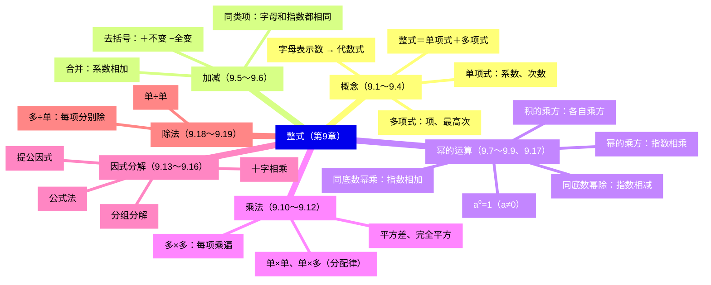
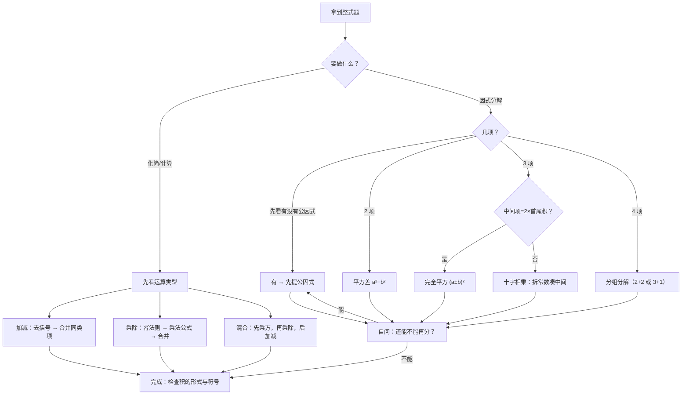

# 整式（详解版）

> [!note] 使用说明
> 本文是详解版，从"为什么"讲起供从头自学；考前速查和掌握度跟踪在概要版：[[03-数学/知识点/七年级/整式]]。

## 0️⃣ 这章学什么 & 中考怎么考

- **这章解决什么问题**：小学算式只会算"具体的数"：$3+5$、$12\times 7$。可很多问题里的数是"变"的：速度不知是多少、人数不知是多少。于是把数换成字母，式子从 $3+5$ 变成 $a+b$——**字母一旦进入算式，小学的所有运算法则都要重新"升级"一遍**：什么叫同类项、幂怎么乘、公式怎么背。这章就是干这件事：把"数的运算"整体搬进"式的运算"。
- **和前后章节的关系**：往前，你只需要小学算术和有理数运算（乘方、分配律）；往后，第 10 章分式（[[03-数学/知识点/七年级/分式]]）的约分通分全靠本章的**因式分解**，九年级解一元二次方程用**十字相乘**、二次函数配方用**添括号与完全平方**（见[[03-数学/知识点/九年级/二次函数]]）。可以说，这一章是整个初中代数变形的"地基工程"。
- **中考怎么考**（依据概要版与备课包，不编造分值）：
  - 直接考：计算题、化简求值题——去括号、合并同类项、幂运算、乘法公式一气呵成；
  - 间接考（更要命）：**因式分解**是分式化简、解方程、函数配方的核心工具，错一步全盘皆输。
- 一句话总结：**加减靠"去括号＋合并同类项"，乘除靠"幂法则＋乘法公式"，逆向变形靠"因式分解"——三条线都要熟到不假思索。**

### 学完本章，你应该能做到

1. 给一个式子，能判断它是不是整式；是单项式就能报出系数和次数，是多项式就能报出项数和次数。
2. 能说清"合并同类项"和"幂相乘"是两件事，混在一起也不出错（$2x^2+3x^2$ 与 $2x^2\cdot 3x^2$ 分得清）。
3. 能从"数个数"推导出每条幂运算法则，而不是死背；五个法则给出式子能立刻选对。
4. 能用面积图解释乘法公式为什么成立，并熟练展开 $(a+b)^2$、$(a-b)^2$、$(a+b)(a-b)$。
5. 拿到一个多项式，能按"一提二套三十字四分组"的顺序选择因式分解方法，并检查分解是否彻底。

### 本章知识地图



## 🧭 先修自检（学不下去先回到这里）

> [!note] 先修自检怎么用
> 下面每一项都是本章的地基。做不出就先去补对应知识，硬学只会更挫败。

| # | 你应该会的 | 自查题（先做再看答案） | 答案 | 不会去哪补 |
| - | ---------- | ---------------------- | ---- | ---------- |
| 1 | 有理数乘方 | $(-2)^3$ 和 $(-2)^2$ 各等于多少？符号怎么定？ | $(-2)^3=-8$（负数的奇次幂为负），$(-2)^2=4$（偶次幂为正） | [[03-数学/知识点/00-六至八年级核心公式定理总表]]（数与式板块） |
| 2 | 乘法分配律 | 用两种方法算 $3\times 102$ | $3\times 100+3\times 2=306$——分配律是"单×多"的老底子 | 同上 |
| 3 | 用字母写运算律 | 用字母表示"加法交换律"和"乘法对加法的分配律" | $a+b=b+a$；$a(b+c)=ab+ac$ | 同上 |
| 4 | 乘方的记号含义 | $2^3$ 里 2 叫什么、3 叫什么？$2^3$ 表示什么？ | 2 是底数，3 是指数；表示 $2\times2\times2$ | 同上 |
| 5 | 运算顺序 | 计算 $2+3\times 4^2$ | $2+3\times16=50$（先乘方，再乘除，后加减） | 同上 |

**自查题做错的，先把那一项补上再往下读。乘方（第 4 项）和分配律（第 2 项）是本章用得最多的两把刀。**

## 🌱 概念从头讲

> [!note] 概念讲法约定
> 每个概念按"**为什么需要它 → 它是什么 → 符号与记号含义 → 容易想错的地方**"四步讲。

### 概念 1：字母表示数（这章的出发点）

- **为什么需要**：$3+5=5+3$、$100+7=7+100$……这样的式子写得完吗？写不完。但只要写一句"$a+b=b+a$"，所有情况一次说完。字母是**把无数个具体的算式压缩成一句话**的工具。
- **是什么**：字母可以表示——①运算律（$a+b=b+a$）；②公式（$S_{三角形}=\dfrac12 ah$）；③未知数（方程里的 $x$）；④有变化规律的量（第一天 $a$ 人报名，第二天比第一天多 5 人，就是 $a+5$）。
- **容易想错**：
  - ❌"字母 $a$ 一定是正数。" → $a$ 可以是正数、负数、零。$-a$ 也不一定是负数——$a=-3$ 时 $-a=3$。
  - ❌ 同一个式子里 $a$ 一会儿是速度一会儿是时间。 → **同一个问题中，同一个字母只能表示同一个量**；不同含义要用不同字母。

### 概念 2：代数式与代数式的值

- **为什么需要**：有了字母，先得给"含字母的合法算式"起个名字，才能研究它们。
- **定义**：用**运算符号和括号**把数或表示数的字母连接而成的式子叫**代数式**。单独一个数或一个字母也是代数式。注意：用等号、不等号连接的式子（如 $S=\pi r^2$、$a>b$）**不是**代数式——它们是"两个代数式之间的关系"。
- **代数式的值**：用数值代替代数式里的字母，按运算关系算出的结果。求值三步：**代入 → 加括号（负数、分数必须）→ 按顺序计算**。
- **容易想错**：❌ 代入负数不加括号。 → 求 $x^2$ 当 $x=-3$ 的值，写成 $-3^2=-9$ 就错了，正确是 $(-3)^2=9$。**口诀：代入负数和分数，先给它们戴帽子（括号）**。

### 概念 3：单项式、多项式、整式（系数与次数）

- **为什么需要**：式子有了，下一步是**分类**——不同类的式子配不同的运算法则。就像先分清"整数加减要对齐数位、分数加减要通分"，式子也要先分类再谈运算。
- **定义**：
  - **单项式**：数与字母的**乘积**组成的代数式；单独一个数或一个字母也是单项式。
  - **多项式**：几个单项式的**和**。
  - **整式**：单项式与多项式统称整式。**一句话判别：分母里不含字母的就是整式**。
- **符号/记号**：
  - **系数**：单项式里的**数字因数**（带符号）。$-\dfrac{4}{3}x^2y^2$ 的系数是 $-\dfrac{4}{3}$，不是 $\dfrac{4}{3}$。
  - **次数**：单项式中**所有字母的指数的和**。$2a^2$ 次数是 2；$3\times10^5$ 不含字母，次数是 0。
  - **多项式的次数**：取**最高次项**的次数。$a^4-2a^3-3a$ 的次数是 4（三项都得看，取最大）。
- **容易想错**：
  - ❌"$\pi$ 是字母。" → $\pi$ 是**数**（一个具体的无理数），不是字母。$2\pi r$ 的系数是 $2\pi$，次数是 1（只数 $r$ 的指数）。同理 $\dfrac{x+2}{\pi}$ 分母是常数，仍是整式。
  - ❌"$\dfrac{4x+y}{x}$ 是多项式。" → 它分母含字母，**不是整式**（它是第 10 章要学的分式）。辨析（9.4 例题原题）：$ab^2$、$2a+3b$、$-\dfrac{4a^2b^4}{7}$ 是整式；$\dfrac{4x+y}{x}$ 不是。

### 概念 4：同类项与合并同类项

- **为什么需要**：$3$ 个苹果 $+2$ 个苹果 $=5$ 个苹果，人人会算；$3$ 个苹果 $+2$ 个橘子没法直接数。式子也一样：$3a+2a$ 能加，$3a+2b$ 不能。**"同类项"就是回答"哪些式子可以像苹果一样直接数"**。
- **定义**：所含**字母相同**，并且**相同字母的指数也相同**的项叫同类项；几个常数项也是同类项。判断只看两条：字母相同、相同字母的指数相同——**与系数无关**（$-4.5a$ 与 $2.3a$ 是同类项）。
- **合并同类项法则**：系数相加作结果的系数，**字母和字母的指数不变**。
- **法则为什么成立**（不是规定，是分配律）：$3a+2a=(3+2)a=5a$，这正是分配律 $a(b+c)=ab+ac$ 的**逆用**。所以"合并"从来不是新运算，只是分配律回放。
- **容易想错**：
  - ❌ $2x+3y=5xy$。 → 字母不同不是同类项，**不能合并**，答案就是 $2x+3y$。
  - ❌ $3x^2-2x^2=x^2$。 → 系数 $3-2=1$，系数为 1 **省略不写**，结果是 $x$。
  - ❌ $x^5+x^5=x^{10}$。 → 这是**合并同类项**（系数 $1+1=2$）：得 $2x^5$；而 $x^5\cdot x^5=x^{10}$ 才是幂相乘。**加法数个数、乘法加指数，分工明确**。

### 概念 5：去括号与添括号

- **为什么需要**：括号是"整体"的记号。$a-(b+c-d)$ 意思是"从 $a$ 里减去整个 $(b+c-d)$"。要动括号里的每一项，就得先弄清括号前面的符号"管辖范围有多大"。
- **法则**：
  - 括号前是"＋"号：去掉"＋"号和括号，括号里各项**不变号**：$a+(b+c-d)=a+b+c-d$；
  - 括号前是"－"号：去掉"－"号和括号，括号里各项**都变号**：$a-(b+c-d)=a-b-c+d$。
- **法则为什么成立**：括号前是"－"，意思是"减去括号里的**整体**"。用分配律看：$a-(b+c-d)=a+(-1)\cdot b+(-1)\cdot c+(-1)\cdot(-d)=a-b-c+d$——每一项都要乘 $(-1)$，所以**全部变号**；括号前是"＋"则相当于乘 $+1$，各项不变。也可以这样想：先减 $b$，再减 $c$，就要再加回 $d$（因为原来要减的是 $c-d$）。
- **添括号**是去括号的逆过程：添"－"号括号，进括号的各项同样**全部变号**。九年级配方时（见[[03-数学/知识点/九年级/二次函数]]）天天用。
- **容易想错**：❌ 负号只管第一项：$-(a-b)+(2c-3d)=-a-b+2c-3d$（错在 $-b$）。 → 正确：$-a+b+2c-3d$。**自查动作：去完括号，用具体数代一遍**——设 $a=3$、$b=1$，$-(3-1)=-2$，而 $-3+1=-2$ ✓。

## 🧮 法则逐个拆解（幂运算与整式乘除）

> [!note] 法则拆解约定
> 每条法则都必须能回答四件事：**它从哪来（推导）？什么时候能用（条件）？怎么用？用反例提醒自己哪里易错？**

### 法则 1：同底数幂的乘法 $a^m\cdot a^n=a^{m+n}$

- **推导**：$a^m$ 就是 $m$ 个 $a$ 相乘，$a^n$ 就是 $n$ 个 $a$ 相乘。乘起来一共 $m+n$ 个 $a$ 相乘，按乘方的定义就是 $a^{m+n}$。
  $$a^m\cdot a^n=\underbrace{a\cdot a\cdots a}_{m\text{个}}\times\underbrace{a\cdot a\cdots a}_{n\text{个}}=\underbrace{a\cdot a\cdots a}_{m+n\text{个}}=a^{m+n}$$
- **条件**：底数相同（数、字母、多项式都行）；$m$、$n$ 是正整数。三个及以上同样适用：$a^m\cdot a^n\cdot a^p=a^{m+n+p}$。
- **最小例子**：$2^3\times2^4=2^7=128$（可以逐个乘验证：$8\times16=128$ ✓）。底数是多项式也照用：$(a+b)^2\cdot(a+b)^3=(a+b)^5$。
- **易错**：❌ 底数不同硬套：$2^3\times3^2$ 绝不等于 $6^5$——底数不同，只能老老实实算。

### 法则 2：幂的乘方 $(a^m)^n=a^{mn}$

- **推导**：$(a^m)^n$ 是 $n$ 个 $a^m$ 相乘，用法则 1：$a^m\cdot a^m\cdots a^m=a^{m+m+\cdots+m}=a^{mn}$。**指数"相加加了 $n$ 次"就是相乘**。
- **与法则 1 的分工**（最易混的一对）：
  - $a^3\cdot a^4=a^{3+4}=a^7$ ——**乘法 → 指数相加**；
  - $(a^3)^4=a^{3\times4}=a^{12}$ ——**乘方 → 指数相乘**。
  自救：看运算符号——乘号"加"，括号"乘"。
- **最小例子**：$(10^2)^3=10^6$。

### 法则 3：积的乘方 $(ab)^n=a^nb^n$

- **推导**：$(ab)^n=\underbrace{ab\cdot ab\cdots ab}_{n\text{个}}$。用交换律、结合律把所有 $a$ 挪到一起、所有 $b$ 挪到一起：$=(a\cdot a\cdots a)(b\cdot b\cdots b)=a^nb^n$。
- **最小例子**：$(2a)^4=2^4a^4=16a^4$——**系数也要乘方**，别只给字母戴帽子。
- **易错**：❌ $(-3a)^2=-9a^2$。 → $(-3)^2=9$，负号在偶次幂下被"平方"掉了：$(-3a)^2=9a^2$。口诀：**先定符号，再算数字**。

### 法则 4：同底数幂的除法与零指数幂

$$a^m\div a^n=a^{m-n}\ (a\neq0,\ m>n),\qquad a^0=1\ (a\neq0)$$

- **推导（约分视角）**：$\dfrac{a^5}{a^3}=\dfrac{a\cdot a\cdot a\cdot a\cdot a}{a\cdot a\cdot a}=a^2$——约掉 3 个 $a$，指数 $5-3=2$。
- **$a^0=1$ 从哪来**：当 $m=n$ 时，$\dfrac{a^m}{a^m}=1$（分子分母相同）；另一方面若硬套法则得 $a^{m-m}=a^0$。两边要一致，只好**规定** $a^0=1$。注意 $a\neq0$：除以零没有意义，$0^0$ 也就没有意义。
- **符号统一的两个典型**：$(-a)^7\div a^6$：奇次幂把负号提出来，$(-a)^7=-a^7$，所以 $=-a$；$(a-b)^{19}\div(b-a)^{10}$：偶次幂 $(b-a)^{10}=(a-b)^{10}$，所以 $=(a-b)^9$。**先化同底数，再用法则**。
- **易错**：❌ $a^{10}\div a^5=a^2$。 → 指数**相减**不是相除：$a^{10}\div a^5=a^5$。

### 法则 5：整式的乘法（三级台阶）

- **单×单**：系数相乘作系数；同底数幂相乘（法则 1）；只在某个单项式里含有的字母，连同指数照抄。
  $-4ax^2\cdot(-3a^2x^3)$：系数 $(-4)\times(-3)=12$；$a\cdot a^2=a^3$；$x^2\cdot x^3=x^5$；积为 $12a^3x^5$。
  （依据：乘法交换律、结合律把数和各字母分别归堆，再各用各的法则。）
- **单×多**：分配律 $m(a+b+c)=ma+mb+mc$——**每一项都要乘到**。
- **多×多**：$(a+m)(b+n)=ab+an+bm+mn$。
  **推导**：把 $(a+m)$ 整体看成一个"大数"，先用一次分配律：$(a+m)(b+n)=(a+m)b+(a+m)n$；再对两段各用一次分配律：$=ab+mb+an+mn$。所以"多×多"不是新法则，是**分配律用两次**。
- **易错**：
  - ❌ 系数漏乘：$6a^8\cdot6a^8=12a^{16}$（错）。系数 $6\times6=36$，指数 $8+8=16$，正确 $36a^{16}$。
  - ❌ 多×多漏项：$(x-2)(x+7)$ 展开是 $x^2+7x-2x-14$ 四项，合并后 $x^2+5x-14$——先写满四项再合并，不重不漏。

### 法则 6：乘法公式——为什么成立（面积法）

**平方差公式**：$(a+b)(a-b)=a^2-b^2$

- **推导**：这是"多×多"的特例：$(a+b)(a-b)=a^2-ab+ab-b^2$，中间两项 $-ab+ab$ 正好抵消，剩 $a^2-b^2$。
- **面积验证**：边长 $a$ 的大正方形剪去一个边长 $b$ 的小角，剩下"曲尺形"，面积 $a^2-b^2$。沿一条缝剪开，把小矩形拼到另一侧，恰好拼成一个长 $(a+b)$、宽 $(a-b)$ 的大矩形——面积不变，所以 $(a+b)(a-b)=a^2-b^2$。
- **结构特征**：**一同异**——两个因式中一项完全相同、一项互为相反数；结果＝同号项的平方**减**异号项的平方。

```text
（示意图，非严格比例）平方差的面积验证

  a ┌─────────────┐         剪下右侧宽 (a-b)、长 b 的矩形
    │           ┌─┤ ↕b      拼到底部，拼成长 (a+b)、宽 (a-b) 的矩形
    │  a²−b²    │ │
    │           └─┤         两种面积相等：
  b │←——— a-b ———→│         (a+b)(a-b) = a²−b²
    └─────────────┘
```

**完全平方公式**：$(a\pm b)^2=a^2\pm 2ab+b^2$

- **面积验证（和的情形）**：边长 $(a+b)$ 的大正方形，用两条线割成四块：$a^2$、$ab$、$ab$、$b^2$。大正方形面积等于四块之和：
  $$(a+b)^2=a^2+ab+ab+b^2=a^2+2ab+b^2$$
  这就是"**中间项 $2ab$**"的来源——它不是凭空出现的，是两块 $ab$ 小矩形。
- **差的情形不用另记**：把 $-b$ 看成"加 $(-b)$"，代入和的公式：$(a-b)^2=(a+(-b))^2=a^2+2a(-b)+(-b)^2=a^2-2ab+b^2$。**一个公式管两用**。
- **为什么 $(a+b)^2\neq a^2+b^2$（反例纠错）**：取 $a=1$、$b=1$：$(1+1)^2=4$，而 $1^2+1^2=2$——不相等，因为丢了中间项 $2ab$。口诀：**首平方，尾平方，首尾两倍中间放**。
- **常用变形**（9.12 课后练习第 2(7)(8) 题原题）：两式相减、相加可得
  $$(a+b)^2-(a-b)^2=4ab,\qquad (a+b)^2+(a-b)^2=2a^2+2b^2$$
  由此 $a^2+b^2=(a+b)^2-2ab=(a-b)^2+2ab$——**"知二求一"的桥梁**，第 3 级例题马上用。

```text
（示意图，非严格比例）(a+b)² 的面积分割

        a         b
    ┌─────────┬─────┐
    │         │     │
    │   a²    │ ab  │  a
    │         │     │
    ├─────────┼─────┤
    │   ab    │ b²  │  b
    └─────────┴─────┘
    (a+b)² = a² + ab + ab + b² = a²+2ab+b²
```

- **易错**：
  - ❌ 带系数的项整体平方：$(3x+2)^2=9x^2+12x+4$，首项是 $(3x)^2$ 不是 $3x^2$。
  - ❌ 负号进出：$(-x-y)(x+y)=-(x+y)^2=-x^2-2xy-y^2$；$(-x-y)(x-y)=y^2-x^2$（两因式都变号或只变一个，结果符号不同）。

### 法则 7：整式的除法

- **单÷单**：系数相除作系数；同底数幂相除（法则 4）；只在被除式里含有的字母连同指数不变写进商。
  $16x^5y^8\div 4x^2y^3$：系数 $16\div4=4$；$x^5\div x^2=x^3$；$y^8\div y^3=y^5$；商 $4x^3y^5$。$-7x^4y^2\div(-21x^2y^2)=\dfrac13x^2$（负负得正）。
- **多÷单**：多项式的**每一项**分别除以这个单项式，再把商相加：$(ma+mb+mc)\div m=a+b+c$（分配律）。
  例：$(-18x^3y^2+12x^2y^3-6x^2y^2)\div(-3x^2y^2)=6x-4y+2$——每一项都别漏，符号逐项定。
- **验算习惯**：商 × 除式 应还原被除式。$6x-4y+2$ 乘回 $-3x^2y^2$：$-18x^3y^2+12x^2y^3-6x^2y^2$ ✓。

## 🔧 因式分解：四法与选择顺序

### 它是什么（先立标准再学方法）

- **定义**：把一个多项式化为**几个整式的积**的形式，叫做把这个多项式**因式分解**。
- **与整式乘法的关系**：方向正好相反，互为逆变形。$ab+ac=a(b+c)$：从左到右是因式分解，从右到左是整式乘法。
- **判断标准**（9.13 例题原题，三条对照）：
  - $3xy-4x^2y+5x^2y^2=xy(3-4x+5xy)$ ✓ 左边是和、右边是积；
  - $3x(x+y)=3x^2+3xy$ ✗ 这是整式乘法（方向反了）；
  - $1+2x+3x^2=1+x(2+3x)$ ✗ 右边不是"整式的积"（还有个 $1$ 加在外面）。
- **为什么需要**：约分要它（分式化简的第一步）、解方程要它（$x^2-3x=0$ 分解成 $x(x-3)=0$ 才能解）、配方也用它——它是后面所有章节的"万能起子"。

### 方法一：提取公因式法

- **公因式怎么找**：各项系数的**最大公约数** × 相同字母的**最低次幂**。$10a^3bc^2+15a^2b^2c$：系数 $\gcd(10,15)=5$；$a$ 取 $a^2$、$b$ 取 $b$、$c$ 取 $c$；公因式 $5a^2bc$，得 $5a^2bc(2ac^2+3b)$。
- **来源**：就是分配律的逆用。
- **易错**：
  - ❌ 提公因式后**括号里的项数不变**：$-4x^2y+6xy^2-2xy=-2xy(2x-3y+1)$，那个 "$+1$" 是 $-2xy\div(-2xy)$ 来的，**别丢**。
  - ❌ 首项为负要先提负号：$-3ax+6ab-12ay=-3a(x-2b+4y)$，进负号括号各项变号。

### 方法二：公式法（平方差）

- **识别**：**两项**、都能写成平方、中间是差：$a^2-b^2=(a+b)(a-b)$。
- 例：$x^2-100=(x+10)(x-10)$；$25-16a^4=(5+4a^2)(5-4a^2)$（9.14 课后练习）。
- **易错**：❌ $a^2+b^2$ 硬拆——**两项是"和"不能用平方差**，它已经不能再分。

### 方法三：公式法（完全平方）

- **识别**：**三项**，其中两项是平方、第三项恰是"两平方底数积的 2 倍"：$a^2\pm2ab+b^2=(a\pm b)^2$。
- 例：$x^2-8xy+16y^2=(x-4y)^2$（检验：$2\cdot x\cdot 4y=8xy$ ✓）。
- **易错**：❌ 把 $x^2+4x+4$ 拆成 $(x+2)(x-2)$——中间是 $+4x$ 不是 0，它是完全平方：$(x+2)^2$。**先看中间项，再决定用哪个公式**。

### 方法四：十字相乘法（沪教版七上就学）

- **模型**：$x^2+(a+b)x+ab=(x+a)(x+b)$。
- **为什么成立**：正向展开 $(x+a)(x+b)=x^2+bx+ax+ab=x^2+(a+b)x+ab$——所以拆法的口诀是**"拆常数项，凑中间项"**：把常数 $q$ 拆成两个数 $a$、$b$（$ab=q$），使它们的和恰好等于一次项系数 $p$（$a+b=p$）。
- 例：$x^2-7x+12$：拆 $12=(-3)\times(-4)$，且 $(-3)+(-4)=-7$ ✓，所以 $x^2-7x+12=(x-3)(x-4)$。
- **操作次序**：先列常数项的全部拆法，再用"和"筛选——拆法常常不止一种，**和对了才算数**。

### 方法五：分组分解法

- **识别**：**四项**且前三法都失灵。"2+2"分组后组内提公因式、组间再提：
  $$2ac-6ad+bc-3bd=2a(c-3d)+b(c-3d)=(2a+b)(c-3d)$$
- **"3+1"型**：先三项组成完全平方，再对剩下的用平方差：
  $$a^2+2ab+b^2-1=(a+b)^2-1=(a+b+1)(a+b-1)$$
- **易错**：分组的标准是"**每组提完公因式后，剩下的括号必须一样**"，否则分了也提不出公因式，要换一种分法。

### 选择顺序与"分解要彻底"

> **一提、二套、三十字、四分组，分解要彻底。**

1. 有公因式先**提**出来（永远的第一步）；
2. 两项想**平方差**，三项想**完全平方**；
3. 三项凑不上完全平方，试**十字相乘**；
4. 四项做**分组**。
5. **每分一步自问"还能不能再分"**，直到每个因式都不能再分。

例：$2a^3-8a=2a(a^2-4)=2a(a+2)(a-2)$（先提后套）；$x^4-16=(x^2+4)(x^2-4)=(x^2+4)(x+2)(x-2)$（平方差用两次，$x^2+4$ 已不能再分）。

## 🪜 例题阶梯

> [!note] 例题怎么用
> 四级台阶，每一级都要动笔跟着算，不许只看。题目全部选自备课包课后练习与单元任务单。

### 第 1 级 · 入门（照着模仿）

> **题目**（备课包·9.12 课后练习 第 4(2) 题）：化简：$(x+1)^2-(x-2)(x+2)$。
>
> **每一步为什么这么做**：
> - 式子里有平方和两因式相乘 → 分别套**完全平方**和**平方差**展开；
> - 中间是减号 → 先给 $(x-2)(x+2)$ 的结果**整体加括号**再变号，这是去括号法则的正用。
>
> **完整解答**：
> $(x+1)^2-(x-2)(x+2)$
> $=x^2+2x+1-(x^2-4)$
> （完全平方：$2\cdot x\cdot1=2x$；平方差：$(x-2)(x+2)=x^2-4$。）
> $=x^2+2x+1-x^2+4$
> （减号管整个括号：$-x^2$、$+4$，负负得正。）
> $=2x+5$。
> **验算**：取 $x=1$：原式 $=(2)^2-(-1)(3)=4+3=7$；结果 $2\times1+5=7$ ✓。
>
> **变式提醒**：① 若把减号换成加号：$(x+1)^2+(x-2)(x+2)=x^2+2x+1+x^2-4=2x^2+2x-3$；② 若问"当 $x=\dfrac12$ 时求值"，直接代 $2x+5=6$——**先化简再求值，永远比硬算省力**。

### 第 2 级 · 标准（单元复习题：多个乘法公式接力）

> **题目**（备课包·整式单元复习与小结 课后练习 三.4）：计算：$(x-2)(x+7)-2(3-x)(2+x)$。
>
> **读题→翻译成数学语言**：两个"多×多"相减。难点在第二因式 $(3-x)(2+x)$——它不是标准公式的样子，但 $(3-x)=-(x-3)$，提个负号就"变熟"。
>
> **完整解答**：
> $(x-2)(x+7)=x^2+5x-14$。
> （多×多四项：$x^2+7x-2x-14$，合并。）
> $(3-x)(2+x)=-(x-3)(x+2)=-(x^2-x-6)=-x^2+x+6$。
> （首项系数处理：$(3-x)=-(x-3)$，进负号括号变号；也可以直接展开 $6+3x-2x-x^2$，殊途同归。）
> 原式 $=x^2+5x-14-2(-x^2+x+6)=x^2+5x-14+2x^2-2x-12=3x^2+3x-26$。
> （$-2$ 乘进括号每一项；最后合并同类项。答案与备课包一致：$3x^2+3x-26$。）
> **验算**：取 $x=1$：原式 $=(-1)(8)-2(2)(3)=-8-12=-20$；结果 $3+3-26=-20$ ✓。
>
> **变式提醒**：单元讲评 课后练习 2(2) 的 $(x+3)(x-3)(x^2-9)$ 是同款思路的进阶：前两个因式用平方差得 $x^2-9$，于是原式 $=(x^2-9)^2=x^4-18x^2+81$（把 $x^2-9$ 看成一个整体再完全平方）。**先局部化简，再整体处理**。

### 第 3 级 · 提高（知二求一：乘法公式的逆向使用）

> **题目**（备课包·整式单元讲评 学习任务单 例 3）：（1）已知 $a+b=5$，$ab=3$，求 $a^2+b^2$ 的值；（2）已知 $(x+y)^2=7$，$(x-y)^2=3$，求 $x^2+y^2$、$xy$ 的值。
>
> **思路从哪来**：已知的是"和与积"，要的是"平方和"——这正是桥梁公式 $a^2+b^2=(a+b)^2-2ab$ 的主场。
>
> **完整解答**：
> （1）$a^2+b^2=(a+b)^2-2ab=5^2-2\times3=25-6=19$。
> （桥梁公式来自"完全平方减 $2ab$"：$(a+b)^2=a^2+2ab+b^2$ 移项即得。**不需要解出 $a$、$b$ 各是多少**——整体代换。）
> （2）两式相加：$(x+y)^2+(x-y)^2=2x^2+2y^2$，所以 $x^2+y^2=\dfrac{7+3}{2}=5$；
> 两式相减：$(x+y)^2-(x-y)^2=4xy$，所以 $xy=\dfrac{7-3}{4}=1$。
> （依据是常用变形 $(a+b)^2+(a-b)^2=2a^2+2b^2$、$(a+b)^2-(a-b)^2=4ab$——两条都能从完全平方展开自己推一遍。）
> **验算**：用恒等式复核：$2(x^2+y^2)=10$ 应等于 $(7+3)=10$ ✓；$4xy=4$ 应等于 $(7-3)=4$ ✓。两条恒等式（展开后左右完全一致）保证了只要题设成立，结果必成立。
>
> **变式提醒**：备课包讲评任务单任务一是同思想的"数字版"：
> $$\frac{2020^2+1}{2019^2+2021^2}=\frac{2020^2+1}{(2020-1)^2+(2020+1)^2}=\frac{2020^2+1}{2\times2020^2+2}=\frac12$$
> （分母用差的完全平方展开：$(a-1)^2+(a+1)^2=2a^2+2$。**大数字不要硬算，先找结构**。）

### 第 4 级 · 挑战（降次求值：为九年级"化简求值"埋种子）

> **题目**（备课包·整式单元讲评 学习任务单 例 4）：已知 $x^2+x-1=0$，求多项式 $x^3+2x^2-2$ 的值。
>
> **思路从哪来**：一个方程管不住 $x$ 的具体值（这是二次方程，九年级才会解），但 $x^2+x-1=0$ 告诉我们 **$x^2=1-x$**——高次可以借助它"降级"。
>
> **完整解答**：
> 由 $x^2+x-1=0$ 得 $x^2=1-x$。
> 第一步降 $x^3$：$x^3=x\cdot x^2=x(1-x)=x-x^2=x-(1-x)=2x-1$。
> （把 $x^2$ 整体换成 $1-x$，再用一次 $x^2=1-x$——**降次就是把高次幂反复用低次式替换**。）
> 第二步代入：$x^3+2x^2-2=(2x-1)+2(1-x)-2=2x-1+2-2x-2=-1$。
> **验算**：取满足 $x^2+x-1=0$ 的近似值 $x\approx0.618$：$x^3\approx0.236$，$x^3+2x^2-2\approx0.236+0.764-2=-1.000$ ✓。
>
> **变式提醒**：这题的另一半在九年级会重考：若已知改成 $x^2-x-1=0$，同法可求 $x^3$、$x^4$ 的值。**"降次"是方程与代数式求值之间的传送带**：方程负责给关系，恒等变形负责送货。

## 🗺️ 解题流程图



## 🔥 易错点：为什么会错

| ❌ 常见错误想法 | 为什么会这样想 | ✅ 正确理解 / 自救方法 |
| -------------- | -------------- | ---------------------- |
| $x^5+x^5=x^{10}$ | 把"合并同类项"和"幂相乘"混了 | 加法数个数：$2x^5$；乘法加指数：$x^5\cdot x^5=x^{10}$。看运算符号分工 |
| $(a+b)^2=a^2+b^2$ | 丢了中间项 | 面积图：中间有**两块** $ab$。反例 $a=b=1$：$4\neq2$。口诀"首尾两倍中间放" |
| $(2a)^3=2a^3$ | 只给字母乘方 | 积的乘方**每个因式都乘方**：$8a^3$ |
| $a^{10}\div a^5=a^2$ | 指数相除了 | 除法是**指数相减**：$a^5$ |
| 去括号只变第一项 | 负号"管辖范围"没看清 | 负号＝乘 $(-1)$，每项都要乘。代具体数验一遍 |
| $6a^8\cdot6a^8=12a^{16}$ | 系数相加了 | 系数相乘：$36a^{16}$ |
| 多×多漏项 | 心算跳步 | 强制写满四项再合并：$(a+m)(b+n)=ab+an+bm+mn$ |
| 提公因式丢 $+1$ 项 | 只看"有字母的项" | 括号内**项数不变**：$-4x^2y+6xy^2-2xy=-2xy(2x-3y+1)$ |
| 分解不彻底就停笔 | 得到一个"对"的中间结果就满足 | 每步自问"还能不能再分"：$x^4-16$ 要平方差两次 |
| $\pi$ 当字母数次数 | 把 $\pi$ 和 $x$ 混为一谈 | $\pi$ 是数：$2\pi r$ 系数 $2\pi$、次数 1 |

## 📝 本讲小结

- **概念链**：字母表示数 → 代数式 →（单项式/多项式）→ 整式；判别只看"分母有没有字母"；系数带符号、次数只数字母、多项式取最高次项。
- **加减**：去括号（＋不变、－全变）→ 合并同类项（系数相加、字母指数不变）；合并的合法性来自分配律。
- **幂运算**：乘（指数**加**）、乘方（指数**乘**）、积的乘方（**各自**乘方）、除（指数**减**）、$a^0=1$（$a\neq0$，由"除法自洽"规定）。底数不同不能套。
- **乘法**：单×单归堆相乘；单×多、多×多都是分配律（多×多用两次）；平方差＝同号平方减异号平方；完全平方＝平方和加减两倍积——都能用面积图解释。
- **因式分解**：与乘法互逆；一提二套三十字四分组，**分解要彻底**；括号内项数不变、首项负先提负号。
- **除法**：单÷单逐个相除；多÷单每项分别除；用"商×除式"验算。
- **思想**：类比（数→式）、化归（新运算→旧运算）、数形结合（公式面积图）、整体代换与降次（求值题）。

## ✅ 自测清单（能独立做到才打勾）

- [ ] 1. 能不看书写出整式的分类标准，并判断 $\dfrac{4x+y}{x}$、$\dfrac{x+2}{\pi}$、$3\times10^5$ 各是什么
- [ ] 2. 能从分配律推导"合并同类项"和"多×多"，说清它们为什么成立
- [ ] 3. 能用"数个数"推导五条幂运算法则，并区分 $a^3\cdot a^4$、$(a^3)^4$、$(2a)^4$
- [ ] 4. 能用面积图解释平方差与完全平方公式，并默写两条常用变形（$4ab$、$2a^2+2b^2$）
- [ ] 5. 能独立做出例题阶梯第 1、2 级，并写出每一步的依据
- [ ] 6. 能用桥梁公式完成"知二求一"（第 3 级），并解释为什么不用解出 $a$、$b$
- [ ] 7. 能用降次法做出第 4 级，并说清"方程给关系、变形送结果"
- [ ] 8. 能按流程图对任意多项式选择因式分解方法，并检查分解彻底
- [ ] 9. 能说出本章 5 个易错点及自救方法

## 🔗 关联

- 概要版：[[03-数学/知识点/七年级/整式]]（掌握度在这边更新）
- 前置知识：[[03-数学/知识点/00-六至八年级核心公式定理总表]]（有理数运算、乘方、分配律）
- 直接后继：[[03-数学/知识点/七年级/分式]]（因式分解是约分通分的前提；幂法则推广到整数指数幂）
- 后续应用：[[03-数学/知识点/八年级/一元二次方程]]（十字相乘法解方程）、[[03-数学/知识点/九年级/二次函数]]（配方的添括号与完全平方）
