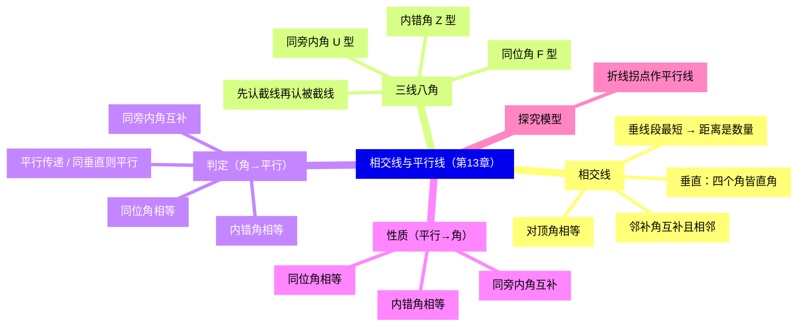
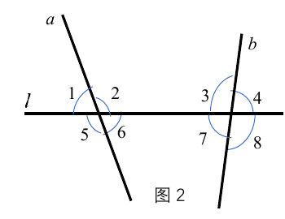
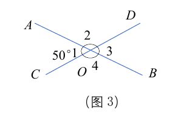
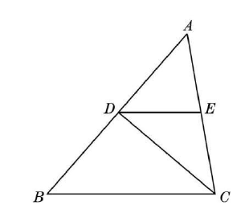
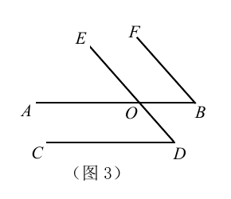
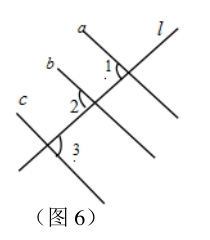
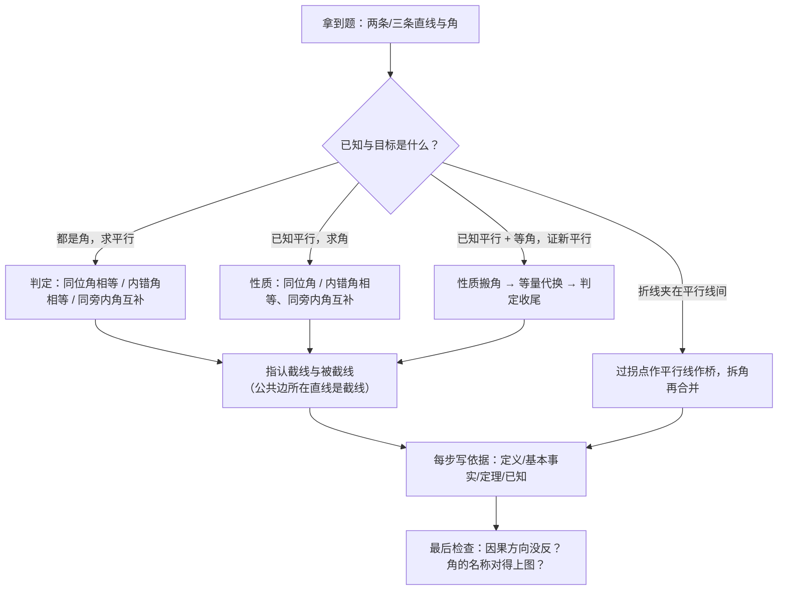

# 相交线与平行线（详解版）

> [!note] 使用说明
> 本文是详解版，从"为什么"讲起供从头自学；考前速查和掌握度跟踪在概要版：[[03-数学/知识点/七年级/相交线与平行线]]。本章配图裁自备课包学习任务单与课后练习原图。

## 0️⃣ 这章学什么 & 中考怎么考

- **这章解决什么问题**：以前你看两条直线的位置关系靠"眼睛量"，这一章开始**用规则说话**。两条直线相交，四个角之间藏着固定的数量关系（对顶角相等、邻补角互补）；三条直线叠在一起（两条被第三条所截），产生了同位角、内错角、同旁内角三套"位置编码"；位置编码又能反过来当"开关"——角的数量关系一满足，平行就被判定出来。**判定（角 ⟹ 平行）与性质（平行 ⟹ 角）这一对互逆的因果链，是全部初中几何说理的第一台发动机。**
- **和前后章节的关系**：往前，你要会角的概念、互余互补（见[[03-数学/知识点/00-六至八年级核心公式定理总表]]角与方程板块）；往后，[[03-数学/知识点/七年级/三角形]]的内角和、外角推导全靠平行线性质搬运角，八年级[[03-数学/知识点/八年级/几何证明]]的"每步写依据"也从本章练起。
- **中考怎么考**（依据概要版，不编造分值）：
  - 选择/填空常考三线八角识别、平行判定与性质的**方向辨析**（由角推平行还是由平行推角）；
  - 解答题中"∵…∴…（依据）"的说理链条是基本功——本章就是练这个的；
  - "平行线被折线所截"探究问题（过拐点作平行线作桥）是单元压轴的经典模型。
- 一句话总结：**相交线管"角的对数"（对顶角、邻补角），三线八角管"角的位置"（F/Z/U），判定与性质管"角与平行的因果"——方向别写反，每步带依据。**

### 学完本章，你应该能做到

1. 在任意相交线图中指认全部对顶角与邻补角，并说明"对顶角相等"的依据。
2. 说清"点到直线的距离"是数量不是图形，会用"垂线段最短"解释最短问题。
3. 在复杂图形中拆出一对角属于同位角、内错角还是同旁内角（先找截线）。
4. 默写三条判定、三条性质的因果方向，并在说理中正确选用、每步注明依据。
5. 会解"折线夹在平行线间"的拐点问题：过拐点作平行线，把角拆开再合并。

### 本章知识地图

## 🧭 先修自检（学不下去先回到这里）

> [!note] 先修自检怎么用
> 下面每一项都是本章的地基。做不出就先去补对应知识，硬学只会更挫败。

| # | 你应该会的 | 自查题（先做再看答案） | 答案 | 不会去哪补 |
| - | ---------- | ---------------------- | ---- | ---------- |
| 1 | 角的度量单位与特殊角 | 平角、直角各多少度？ | $180^\circ$；$90^\circ$ | [[03-数学/知识点/00-六至八年级核心公式定理总表]] |
| 2 | 互补与互余 | $\angle\alpha=135^\circ$，它的补角是？ | $45^\circ$（补角 $=180^\circ-\angle\alpha$） | 同上（角板块） |
| 3 | "同角的补角相等" | $\angle1$ 与 $\angle2$ 都是 $\angle3$ 的补角，$\angle1$ 与 $\angle2$ 什么关系？ | 相等（本章"对顶角相等"的说理全靠它） | 同上 |
| 4 | 用方程解角 | 一个角是它的补角的 2 倍，求这个角。 | 设为 $x$：$x=2(180^\circ-x)$，$x=120^\circ$ | 同上（方程板块） |
| 5 | 反证法雏形 | "两条直线相交有两个交点"为什么矛盾？ | 过两点有且只有一条直线，两"直线"重合，与是两条不同直线矛盾 | 本章概念 1 |

**自查题做错的，先把那一项补上再往下读。第 3、4 项是本章说理与算角的常用工具。**

## 🌱 概念从头讲

> [!note] 概念讲法约定
> 每个概念按"**为什么需要它 → 它是什么 → 符号与记号含义 → 容易想错的地方**"四步讲。

### 概念 1：两条直线相交——邻补角与对顶角

- **为什么需要**：两条直线相交于一点，产生四个小于平角的角。研究图形先研究"零件之间的关系"：任取两个角，要么**相邻**（有一条公共边），要么**相对**（没有公共边），两种关系各有固定结论。
- **定义**：
  - **邻补角**：有一条公共边，且另一边互为反向延长线的两个角——"相邻"+"互补"两个条件缺一不可；
  - **对顶角**：一个角的两边分别是另一个角两边的反向延长线——有公共顶点、**无公共边**，成对出现。
- **符号/记号**：设两直线交于 $O$，四个角依次 $\angle1$、$\angle2$、$\angle3$、$\angle4$。则 $\angle1$ 与 $\angle3$、$\angle2$ 与 $\angle4$ 是对顶角；$\angle1$ 与 $\angle2$、$\angle1$ 与 $\angle4$（每角各两对邻补角，共四对）是邻补角。
- **"对顶角相等"为什么成立（说理示范）**：$\angle1$ 与 $\angle2$ 是邻补角，$\angle1$ 与 $\angle4$ 也是邻补角（看图：$\angle2$、$\angle4$ 都是 $\angle1$ 的补角）。由==同角的补角相等==，得 $\angle2=\angle4$。这就是几何说理的模板：**结论不是"看出来的"，是从已知一步有依据地推出来的**。
- **"只有一个交点"的反证法雏形**：假设两条直线有两个交点，那么经过这两个交点有两条直线，与"过两点有且只有一条直线"矛盾——所以有且只有一个交点。第一次接触反证法：**假设不成立 ⟹ 矛盾 ⟹ 原结论成立**。
- **容易想错**：❌"相等的角就是对顶角。" → 方向反了：对顶角相等，但相等的角不一定是对顶角（两个无关的直角也相等）。❌"互补的两个角是邻补角。" → 邻补角还要**相邻**（有公共边、另一边反向延长）；平行线的同旁内角互补但不相邻，不是邻补角。

### 概念 2：垂线——垂直、垂线段与距离

- **为什么需要**：相交的特例——四个角都是直角——太重要了：它给出"最短距离"，也是后面坐标系 $x$ 轴 ⊥ $y$ 轴、点到直线距离的底座。
- **定义**：两条直线相交所成的四个角中，**有一个角是直角**，就说这两条直线互相垂直，记作 $AB\perp CD$，交点叫**垂足**。（有一个直角，其余三个由对顶角、邻补角立刻也都是直角。）
- **符号/记号**：
  - **垂线的唯一性**：平面内经过一点，==有且只有一条==直线与已知直线垂直（点在直线上、点在直线外都成立）；
  - **垂线段最短**：直线外一点与直线上各点连结的所有线段中，垂线段最短；
  - **点到直线的距离**：==垂线段的长度==（数量），不是垂线段这个图形本身；
  - **线段的垂直平分线（中垂线）**：经过线段中点且垂直于这条线段的直线，可用尺规作图（两端点为圆心、大于一半长为半径画弧取交点）。
- **容易想错**：❌"点到直线的距离是一条线段。" → 距离是**长度（数量）**；垂线段才是图形。❌"垂线段一定在图形内部。" → 钝角三角形的高（垂线段）可以落在边的延长线上，画在"形外"照样是垂线段。

### 概念 3：三线八角——同位角、内错角、同旁内角

- **为什么需要**：两条直线 $a$、$b$ 被第三条直线 $l$ 所截，形成 8 个角。它们之间的**位置关系**正是后面判定平行的"开关"——先学会认，才谈得上用。
- **形成条件（最容易忽略的一步）**：三线八角是**三条直线**的图形：两条**被截直线** + 一条**截线**。任给两个角，先问"公共边在哪条直线上"——公共边所在的直线就是**截线**，另外两条就是被截直线。
- **定义与形象**：

| 角的类型 | 位置特征 | 形象 | 上图中例子 |
| -------- | -------- | ---- | ---------- |
| 同位角 | 都在截线**同旁**、被截直线**同侧** | "F"型 | $\angle1$ 与 $\angle5$、$\angle3$ 与 $\angle7$ |
| 内错角 | 夹在两被截直线**之间**、截线**两旁** | "Z"型 | $\angle3$ 与 $\angle5$、$\angle4$ 与 $\angle6$ |
| 同旁内角 | 夹在两被截直线**之间**、截线**同旁** | "U"型 | $\angle3$ 与 $\angle6$、$\angle4$ 与 $\angle5$ |

- **容易想错**：❌"同位角相等。" → 三类角只是**位置关系**的名字，与大小无关——两直线不平行时，同位角、内错角没有任何数量结论（同旁内角也不互补）。**位置是"身份"，数量是"平行之后才发的奖金"。** 复杂图形里用"拆图"：把要认的两个角连同三条线单独抽出来看。

### 概念 4：平行线与判定（角 ⟹ 平行）

- **为什么需要**：同一平面内两条直线要么相交、要么**不相交**——不相交这种关系叫平行。怎么不经画图就断定平行？用角的数量关系当证据。
- **定义**：同一平面内，不相交的两条直线叫平行线，记作 $a\parallel b$。**平行线基本性质**：经过直线外一点，==有且只有一条==直线与这条直线平行（与"垂线唯一性"对仗着记）。
- **判定方法（沪教版体系）**：

| 判定方法 | 条件 ⟹ 结论 | 来源 |
| -------- | ------------ | ---- |
| 方法 1（基本事实） | 同位角相等 ⟹ 两直线平行 | 从"推三角尺画平行线"归纳：平移中同位角始终不变 |
| 方法 2 | 内错角相等 ⟹ 两直线平行 | 用对顶角把内错角化成同位角，再由方法 1 推出 |
| 方法 3 | 同旁内角互补 ⟹ 两直线平行 | 用邻补角把互补化成同位角相等，再由方法 1 推出 |
| 推论 1 | 平行于同一条直线的两条直线平行 | 平行传递 |
| 推论 2 | 同一平面内，垂直于同一条直线的两条直线平行 | 两角同为 $90^\circ$ ⟹ 同位角相等 ⟹ 平行 |

- **推论 2 的说理模板**（对应 13.4 任务单 图 5）：因为 $a\perp c$，$b\perp c$（已知），所以 $\angle1=\angle2=90^\circ$（垂直的意义），所以 $\angle1=\angle2$（等量代换），所以 $a\parallel b$（同位角相等，两直线平行）。**每一步括号里都有依据——这就是本章要练的全部格式。**
- **容易想错**：❌"内错角相等是基本事实，不用推。" → 沪教版的基本事实只有**同位角相等**这一条（判定方法 1）；内错角、同旁内角版本是**推论**，说理时写它们的名字即可，但你要知道它们"出身"于方法 1。❌"垂直于同一条直线的两直线平行"在任何情况都对。 → 必须加**同一平面内**（空间里可以异面垂直）。

### 概念 5：平行线的性质与判定·性质的互逆因果

- **为什么需要**：判定与性质像一道门的两面——判定回答"凭什么进门（平行）"，性质回答"进门之后能享受什么（角的关系）"。综合题里两者**交替连用**：判定 → 得平行 → 性质 → 得新角 → 再判定……
- **三条性质**：性质 1"两直线平行，同位角相等"是**基本事实**；性质 2（内错角相等）、性质 3（同旁内角互补）由性质 1 加对顶角/邻补角推出。
- **因果方向对照（方向写反全盘皆错）**：

| | 判定（角 ⟹ 平行） | 性质（平行 ⟹ 角） |
| ---- | ---- | ---- |
| 同位角 | ∵ 同位角相等，∴ 两直线平行 | ∵ 两直线平行，∴ 同位角相等 |
| 内错角 | ∵ 内错角相等，∴ 两直线平行 | ∵ 两直线平行，∴ 内错角相等 |
| 同旁内角 | ∵ 同旁内角互补，∴ 两直线平行 | ∵ 两直线平行，∴ 同旁内角互补 |

- **怎么判断该用哪个**：看**已知**和**目标**——已知是"角"，目标是"平行"，走判定；已知是"平行"，目标是"角"，走性质。==由角推平行用判定，由平行推角用性质==。
- **容易想错**：❌"同旁内角互补"无条件成立。 → 它的前提是**两直线平行**；不平行时同旁内角只是位置称呼，没有数量结论。❌ 说理写"显然相等"。 → 每步必须有依据：定义、基本事实、定理、已知条件，"看图显然"不是依据。

### 概念 6：平行线被折线所截——拐点作桥

- **为什么需要**：折线（拐了几道的线）夹在两条平行线之间时，"同位角/内错角"直接对不上号——因为折线不是一条直线。解法是**过拐点作一条平行线作"桥"**：桥把大角劈成两半，每半都能对上平行线的内错角。
- **是什么**：已知 $AB\parallel CD$，折线 $PB$ 从 $AB$ 上一点出发拐向 $CD$。过拐点 $P$ 作 $PQ\parallel AB$，由平行传递 $PQ\parallel CD$；于是"左侧角 = 两个内错角之和"。结论常见三种形状：一侧角之和 = 另一侧角、一侧角之和 = $180^\circ$ 等，具体看折线拐几次、朝哪拐——**不作桥硬猜是这题翻车的主因**。
- **容易想错**：❌ 把折线当直线用内错角。 → 折线不是直线，三线八角的前提不成立；先作辅助线把图形"掰直"。

## 🧮 定理逐个拆解

> [!note] 定理拆解约定
> 每条定理都能回答四件事：符号语言怎么写？因果方向是哪头？它是基本事实还是由谁推出？配一个最小使用场景。

### 定理 1：对顶角相等

- 符号语言：直线 $AB$、$CD$ 交于 $O$ ⟹ $\angle AOC=\angle BOD$。
- 因果方向：图形特征（对顶）⟹ 数量结论（相等）；说理依据链：邻补角定义 → 同角的补角相等。
- 最小场景：已知一个角求它的对顶角，直接写"对顶角相等"，不必再补角算一遍。

### 定理 2：垂线的唯一性与垂线段最短

- 符号语言：点 $P$（直线 $l$ 外或上）⟹ 有且只有一条直线过 $P$ 且 $\perp l$；$PA$、$PB$、…、$PH$（$PH\perp l$ 于 $H$）中 $PH$ 最短。
- 因果方向：垂直定义 + 基本性质；"距离"由此定义为垂线段的**长度**。
- 最小场景："从村庄修一条到公路的路，怎样最近"——答"沿垂线段方向修"，依据是垂线段最短。

### 定理 3：判定方法 1（基本事实）——同位角相等 ⟹ 两直线平行

- 符号语言：直线 $a$、$b$ 被 $l$ 所截，$\angle1=\angle2$（同位角）⟹ $a\parallel b$。
- 因果方向：角 ⟹ 平行；地位：**基本事实**（公认起点，不再证明）。
- 最小场景：平移三角尺画平行线后自检——三角尺移动中"贴直尺的角"不变，正是同位角相等。

### 定理 4：判定方法 2、3——内错角相等 / 同旁内角互补 ⟹ 两直线平行

- 符号语言：$\angle2=\angle3$（内错角）⟹ $a\parallel b$；$\angle2+\angle4=180^\circ$（同旁内角）⟹ $a\parallel b$。
- 因果方向：角 ⟹ 平行；出身：由定理 3 + 对顶角（或邻补角）转化推出。
- 最小场景：图中同位角没直接给出、但两条平行判定线之间有"Z"型角相等——用内错角版本最直接。

### 定理 5：性质 1（基本事实）——两直线平行 ⟹ 同位角相等

- 符号语言：$a\parallel b$，被 $l$ 所截 ⟹ 同位角 $\angle1=\angle2$。
- 因果方向：平行 ⟹ 角；地位：**基本事实**，是全部性质的地基（反过来说"同位角相等 ⟹ 平行"是判定，两边互为因果但**不能互相证明**，都是事实）。
- 最小场景：平行线画好后，量同位角验证确实相等——性质是"可以放心使用的事实"。

### 定理 6：性质 2、3——两直线平行 ⟹ 内错角相等 / 同旁内角互补

- 符号语言：$a\parallel b$ ⟹ 内错角相等；$a\parallel b$ ⟹ 同旁内角和为 $180^\circ$。
- 因果方向：平行 ⟹ 角；出身：性质 1 + 对顶角（或邻补角）。
- 最小场景：$a\parallel b$，直线 $l$ 截得一个 $60^\circ$ 角，要它对面的"Z"角——直接 $60^\circ$（内错角相等）。

## 🪜 例题阶梯

> [!note] 例题怎么用
> 四级台阶，每题先自己标条件再跟"依据插话"走。题源均为备课包学习任务单/课后练习原题，配图裁自原卷。

### 第 1 级 · 入门（对顶角 + 邻补角：四个角一网打尽）

> **题目**（13.1 学习任务单 例题 1）：如图，已知直线 $AB$、$CD$ 相交于点 $O$，$\angle AOC=50^\circ$，求 $\angle BOD$、$\angle AOD$、$\angle BOC$ 的度数。
>
> 
>
> **每一步为什么这么做**：
> - 已知一个角、求与它**相对**的角 → 想对顶角；求与它**相邻**的角 → 想邻补角；
> - 每一步写依据，把"看图猜数"升级成"按理得数"。
>
> **完整解答**：
> 因为直线 $AB$、$CD$ 相交于点 $O$（已知），
> 所以 $\angle BOD=\angle AOC=50^\circ$（对顶角相等）。
> （$\angle BOD$ 与 $\angle AOC$ 两边互为反向延长线——对顶角；相等不需要计算。）
> 因为 $\angle AOD$ 与 $\angle AOC$ 是邻补角（邻补角定义），
> 所以 $\angle AOD=180^\circ-\angle AOC=180^\circ-50^\circ=130^\circ$（邻补角互补）。
> 同理 $\angle BOC=180^\circ-\angle AOC=130^\circ$。
> **验算**：四个角 $50^\circ+130^\circ+50^\circ+130^\circ=360^\circ$（周角）✓；$\angle AOD=\angle BOC$（对顶角）✓。
>
> **变式提醒**：把条件改成"$\angle BOC=3\angle AOC$"，就要设 $\angle AOC=x$，$x+3x=180^\circ$（邻补角），$x=45^\circ$，再由对顶角得其余角——==几何小题一卡壳就"设未知角列方程"==，这是几何与方程的第一次会师。

### 第 2 级 · 标准（性质 + 角平分线：把角"搬运"回来）

> **题目**（13.5 课后练习 第 4 题）：如图，$CD$ 平分 $\angle ACB$，$DE\parallel BC$，$\angle AED=80^\circ$。请说明 $\angle BCD=40^\circ$ 的理由。
>
> 
>
> **思路从哪来**：要的角 $\angle BCD$ 挂在角平分线上 → 先求整个 $\angle ACB$；而 $\angle ACB$ 与已知角 $\angle AED$ 隔着平行线 $DE\parallel BC$ → 用性质把角搬过来。
>
> **完整解答**：
> 因为 $DE\parallel BC$（已知），
> 所以 $\angle AED=\angle ACB$（两直线平行，同位角相等）。
> （看图定角色：$AC$ 是截线，$\angle AED$ 与 $\angle ACB$ 在截线同旁、被截线同侧——同位角。）
> 又 $\angle AED=80^\circ$（已知），所以 $\angle ACB=80^\circ$（等量代换）。
> 因为 $CD$ 平分 $\angle ACB$（已知），
> 所以 $\angle BCD=\dfrac12\angle ACB=\dfrac12\times80^\circ=40^\circ$（角平分线的意义）。
> **验算**：$\angle ACD=\angle BCD=40^\circ$，$40^\circ+40^\circ=80^\circ=\angle ACB$ ✓。
>
> **变式提醒**：若把 $\angle AED$ 换成同旁内角位置（比如已知 $\angle EDC$），性质就要换成"两直线平行，内错角相等"或"同旁内角互补"——==先看两个角隔着平行线是什么位置关系，再选对应的性质==，别背题。

### 第 3 级 · 中档（性质 + 判定交替：一台发动机转两圈）

> **题目**（13.5 学习任务单 例题 2）：如图，已知 $\angle B=\angle D$，$AB\parallel CD$，那么 $DE$ 与 $BF$ 平行吗？为什么？
>
> 
>
> **思路从哪来**：目标是"$DE\parallel BF$"（判定）；要凑判定条件"内错角相等"，只有 $\angle B=\angle D$ 一个等量——中间还缺一座桥。桥从已知平行 $AB\parallel CD$ 来：用**性质**把 $\angle B$、$\angle D$ 都接到同一个角（对顶角）上。
>
> **完整解答**：记 $DE$ 与 $AB$ 的交点为 $O$。
> 因为 $AB\parallel CD$（已知），所以 $\angle D=\angle EOB$（两直线平行，内错角相等）。
> （截线是 $DE$，$\angle D$ 与 $\angle EOB$ 是"Z"型内错角：夹在被截直线 $AB$、$CD$ 之间、截线两旁——先在图上把这对角描出来再写。）
> 因为 $\angle B=\angle D$（已知），
> 所以 $\angle B=\angle EOB$（等量代换）。
> 因为 $\angle B$ 与 $\angle EOB$ 是直线 $BF$、$DE$ 被直线 $AB$ 所截形成的内错角（内错角定义），
> 所以 $DE\parallel BF$（内错角相等，两直线平行）。
> **验算**：整个链条"平行 → 角 → 角 → 平行"各步依据齐全；若 $\angle B=\angle D=50^\circ$，则 $\angle EOB=50^\circ$，与 $\angle B$ 相等成立 ✓。
>
> **变式提醒**：本题是==判定与性质交替连用==的样板：**性质**（$AB\parallel CD$ ⟹ $\angle D=\angle EOB$）搬来桥，**判定**（$\angle B=\angle EOB$ ⟹ $DE\parallel BF$）收尾。以后见到"已知一组平行 + 一组等角，证另一组平行"，一律套这个骨架。

### 第 4 级 · 提高（三条直线连用判定：一次条件判两次）

> **题目**（13.4 学习任务单 例题 1）：如图，直线 $l$ 与直线 $a$、$b$、$c$ 分别相交，且 $\angle1=\angle2=\angle3$。(1) 从 $\angle1=\angle2$ 可以得出哪两条直线平行？为什么？(2) 从 $\angle1=\angle3$ 可以得出哪两条直线平行？为什么？思考：$b\parallel c$ 吗？
>
> 
>
> **思路从哪来**：同位角、内错角都是"某两条被截直线 + 一条截线"的关系——==先为每一对角指认截线==，再选判定。三个角相等给出两笔"平行证据"，第三对平行用推论免费送。
>
> **完整解答**：
> (1) $\angle1$ 与 $\angle2$ 是直线 $a$、$b$ 被直线 $l$ 所截的内错角（截线 $l$，被截线 $a$、$b$）。
> 因为 $\angle1=\angle2$（已知），所以 $a\parallel b$（内错角相等，两直线平行）。
> (2) $\angle1$ 与 $\angle3$ 是直线 $a$、$c$ 被直线 $l$ 所截的同位角（截线 $l$，被截线 $a$、$c$）。
> 因为 $\angle1=\angle3$（已知），所以 $a\parallel c$（同位角相等，两直线平行）。
> 思考：因为 $a\parallel b$、$a\parallel c$（已证），所以 $b\parallel c$（平行于同一条直线的两条直线平行）。
> **验算**：三条直线两两平行，与图示"三条平行斜线"一致 ✓；$b\parallel c$ 没有直接用角判定，走的是**推论 1 平行传递**——判定用完之后，传递免费补齐最后一对。
>
> **变式提醒**：同图若只给 $\angle1=\angle3$（同位角）证 $a\parallel c$ 后想证 $b\parallel c$，没有 $\angle2$ 的条件就**证不出来**——推论 1 需要"$b$ 与谁平行"这一环。==数一数手里的平行证据够不够搭桥==，缺一环就得回头找角。

## 🗺️ 解题流程图

## 🔥 易错点：为什么会错

| ❌ 常见错误想法 | 为什么会这样想 | ✅ 正确理解 / 自救方法 |
| -------------- | -------------- | ---------------------- |
| 相等的角就是对顶角 | 把"对顶角相等"倒过来用 | 对顶角相等；相等的角不一定对顶（还得"两边互为反向延长线"）。反向命题必须重新论证 |
| 互补的两个角是邻补角 | 只记住"互补"忘了"相邻" | 邻补角 = 相邻 + 互补，两个条件都要验；平行线同旁内角互补但不相邻 |
| 点到直线的距离是垂线段 | 图形与数量混为一谈 | 距离是垂线段的**长度**（一个数），垂线段才是图形。填空题答"长度"不答"线段" |
| 同位角/内错角天然相等 | 把位置关系当成数量关系 | 三类角只描述位置；两直线不平行时没有任何数量结论。平行的"奖金"要靠判定或性质解锁 |
| 判定与性质方向写反 | 名字相近、条件结论对调 | 口诀：==由角推平行用判定，由平行推角用性质==。写理由前先问"我手里是角还是平行" |
| "垂直于同一条直线的两直线平行"忘加条件 | 背结论丢前提 | 必须**同一平面内**；推论 2 的说理模板：两个 $90^\circ$ → 同位角相等 → 平行 |
| 折线问题直接用内错角 | 把折线误当直线 | 折线不满足三线八角前提；过拐点作平行线作桥，把大角拆成可对号的几段 |
| 说理写"显然""看图可知" | 依赖直观偷懒 | 依据只能是：已知、定义、基本事实、定理。缺依据的步骤在中考按步扣分 |

## 📝 本讲小结

- **相交线**：对顶角相等（同角的补角相等）；邻补角互补且相邻；垂直 ⟹ 四角皆直角；过一点有且只有一条垂线；垂线段最短，距离是长度。
- **三线八角**：同位角（F）、内错角（Z）、同旁内角（U）——先认截线再认被截线，只讲位置不讲大小。
- **判定**（角 → 平行）：同位角相等 / 内错角相等 / 同旁内角互补 / 平行同一直线 / 同垂直同一直线（同一平面内）。
- **性质**（平行 → 角）：同位角相等（基本事实）、内错角相等、同旁内角互补。
- **方法**：判定与性质交替连用（性质搬桥、判定收尾）；折线问题过拐点作平行线；说理步步有依据。
- **思想**：说理（每步带依据）、反证法雏形（交点唯一性）、化归（内错角化同位角）。

## ✅ 自测清单（能独立做到才打勾）

- [ ] 1. 能在相交线图中指认全部对顶角、邻补角，并写出"对顶角相等"的说理过程
- [ ] 2. 能说清"点到直线的距离"与"垂线段"的区别，并用垂线段最短解释最短问题
- [ ] 3. 能在复杂图形中拆出一对角的三线八角身份（先找截线），并说不平行时它们没有数量结论
- [ ] 4. 能默写三条判定、三条性质及各自因果方向，说出哪两条是基本事实
- [ ] 5. 能独立做出例题阶梯第 1～3 级，每步括号里写依据
- [ ] 6. 能解折线拐点问题：过拐点作平行线、拆角合并
- [ ] 7. 能说出本章 3 个易错点及自救方法

## 🔗 关联

- 概要版：[[03-数学/知识点/七年级/相交线与平行线]]（掌握度在这边更新）
- 前置知识：[[03-数学/知识点/00-六至八年级核心公式定理总表]]（角的概念、互余互补）
- 兄弟详解：[[03-数学/知识点详解/七年级/实数]] · [[03-数学/知识点详解/七年级/三角形]] · [[03-数学/知识点详解/七年级/平面直角坐标系]]（同册四章）
- 后续衔接：[[03-数学/知识点/七年级/三角形]]（内角和、外角的说理全靠平行线性质）、[[03-数学/知识点/八年级/几何证明]]（证明格式的正式训练）、探究专题"平行线被折线所截问题"（单元压轴模型）
