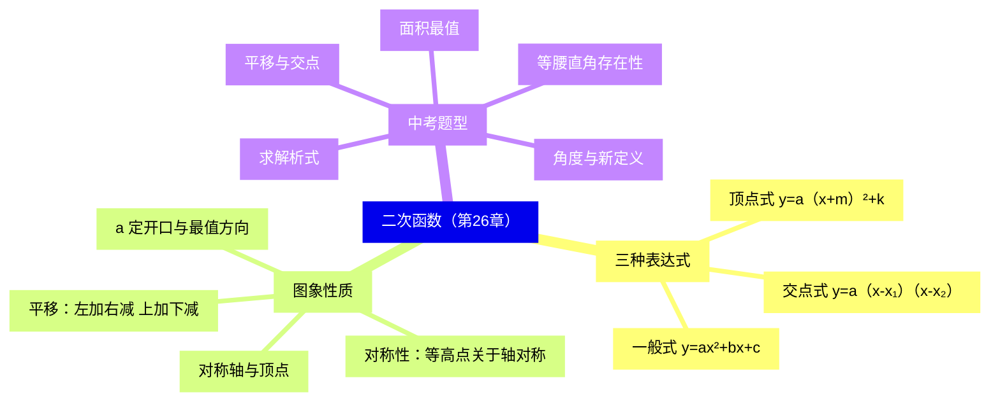
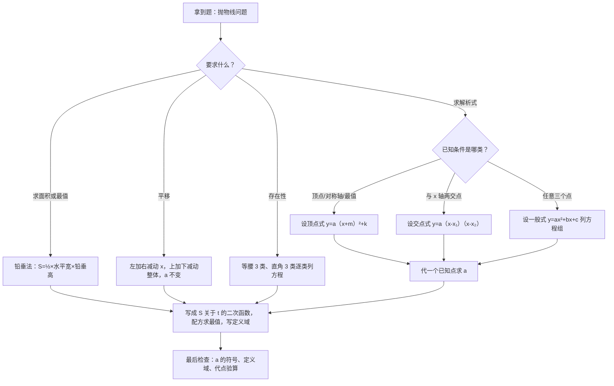

# 二次函数（详解版）

> **使用说明**：本文是详解版，从"为什么"讲起供从头自学；考前速查和掌握度跟踪在概要版：[[03-数学/知识点/九年级/二次函数]]。

## 0️⃣ 这章学什么 & 中考怎么考

- **这章解决什么问题**：八年级学过一次函数 $y=kx+b$，图象是直线，适合描述"匀速变化"。但很多量不是匀速变化的：投篮时球的高度先升后降、拱桥中间高两头低、利润随涨价先变大后变小。这类"先增后减"或"先减后增"的变化，要用**二次函数**描述，它的图象是一条光滑曲线，叫**抛物线**。
- **和前后章节的关系**：学这章前，你要会一次函数、会解一元二次方程、会配方（都在[[03-数学/知识点/00-六至八年级核心公式定理总表]]里）。学完这章，压轴题里和相似三角形结合的面积、线段问题（见[[03-数学/知识点详解/九年级/相似三角形]]）也都建立在本章之上。
- **中考怎么考**（依据概要版与专题笔记，不编造分值）：
  - 二次函数是**第 24 题（12 分）的专属考点**，也常出现在选择填空。
  - 第 24 题固定结构（见[[03-数学/专题/第24题-二次函数综合]]）：第 1 小题**求解析式**（必拿的基础分）→ 第 2 小题**图象与平移** → 第 3 小题**存在性/角度/新定义**（拉差距）。
- 一句话总结：**会求解析式 + 会看图 + 会平移，第 24 题前两小题的分就到手；后面的分靠分类讨论和定义域。**

### 学完本章，你应该能做到

1. 给三个合适的点，五分钟内写出解析式（并知道选哪种形式最快）。
2. 看到表达式，报出开口方向、对称轴、顶点、最值。
3. 看到平移要求，直接写出新解析式，并代点自检。
4. 会用铅垂法把"动点三角形面积"写成二次函数，并求最值。
5. 做存在性问题时，知道要分几类、每类怎么列方程、定义域写在哪。

### 本章知识地图



## 🧭 先修自检（学不下去先回到这里）

> 下面每一项都是本章的地基。做不出就先去补对应知识，硬学只会更挫败。

| # | 你应该会的 | 自查题（先做再看答案） | 答案 | 不会去哪补 |
| - | ---------- | ---------------------- | ---- | ---------- |
| 1 | 读坐标、写坐标 | 点 $(-2,3)$ 在第几象限？横坐标是几？ | 第二象限；横坐标 $-2$（左负右正，上正下负） | [[03-数学/知识点/00-六至八年级核心公式定理总表]] |
| 2 | 一次函数 $y=kx+b$ | $y=-2x+1$ 的图象随 $x$ 增大而怎样？与 $y$ 轴交点是？ | $k=-2<0$，$y$ 随 $x$ 增大而减小；交点 $(0,1)$ | 同上（函数板块） |
| 3 | 配方法 | 把 $x^2+6x+5$ 配成 $(x+3)^2+\square$ | $(x+3)^2-4$（因为 $x^2+6x+9-9+5$） | 同上（数与式板块） |
| 4 | 解一元二次方程 | 解 $x^2-x-6=0$ | 因式分解 $(x-3)(x+2)=0$，$x_1=3$，$x_2=-2$ | 同上（方程板块） |
| 5 | 判别式 | $x^2+2x+3=0$ 有没有实数根？ | $\Delta=4-12=-8<0$，没有实数根 | 同上 |

**自查题做错的，先把那一项补上再往下读。配方法（第 3 项）是本章用得最多的一把刀。**

## 🌱 概念从头讲

> 每个概念按"**为什么需要它 → 它是什么 → 符号与记号含义 → 容易想错的地方**"四步讲。

### 概念 1：二次函数的定义

- **为什么需要**：一次函数只能描述"匀速"变化。比如正方形边长从 1 加到 2，面积从 1 变到 4；从 2 加到 3，面积从 4 变到 9。每步都加 1，面积却多加 3、再多加 5——变化本身也在变。这种量必须用次数为 2 的式子刻画。
- **定义**：形如 $y=ax^2+bx+c$（$a\neq0$，$a$、$b$、$c$ 是常数）的函数叫二次函数。判断标准只有一条：**先化简整理，再看自变量的最高次数是不是 2，且二次项系数不为 0**。
- **符号/记号**：$a$ 叫二次项系数，$b$ 叫一次项系数，$c$ 叫常数项。比如 $y=3x^2-2x+1$ 里 $a=3$、$b=-2$、$c=1$；$y=-x^2+5$ 里 $b=0$、$c=5$。
- **容易想错**：
  - ❌"式子里有 $x^2$ 就是二次函数。" → $y=x^2+\dfrac{1}{x}$ 含 $x^2$，但它有分式，不是二次函数；$y=(x-1)^2+x^2$ 展开后是 $2x^2-2x+1$，最高次数是 2，**是**二次函数。口诀：**先化简，再数次数**。
  - ❌ 忘了 $a\neq0$。 → 若 $a=0$，式子退化成 $y=bx+c$（一次函数）。题目给 $y=(m-1)x^2+3$ 问何时是二次函数，第一反应写 $m-1\neq0$，即 $m\neq1$。

### 概念 2：抛物线、开口、对称轴、顶点

- **为什么需要**：光有表达式看不出高低起伏。"图象"让你一眼看到最大最小在哪、何时升何时降。画图前必须知道图象的形状和关键点。
- **定义**：二次函数的图象叫抛物线。它有一条竖直的对称直线，叫**对称轴**；对称轴与抛物线的交点叫**顶点**——整条曲线的最高点或最低点，最值就在这里取得。
- **符号/记号**：
  - 开口方向由 $a$ 决定：$a>0$ 开口向上（像碗），有**最小**值；$a<0$ 开口向下（像伞），有**最大**值。
  - 一般式 $y=ax^2+bx+c$ 的对称轴是直线 $x=-\dfrac{b}{2a}$，顶点横坐标就是 $-\dfrac{b}{2a}$。
  - $\lvert a\rvert$ 越大，开口越窄（越"瘦"）；$\lvert a\rvert$ 越小越"胖"。
- **容易想错**：❌"$a>0$ 就有最大值。" → 想反了。$a>0$ 开口向上，图象有最低点，是**最小值**；"最大值"只在 $a<0$ 时有。画个 3 秒小草图立刻判断。

```text
（示意图，非严格比例）

  a>0，开口向上：            a<0，开口向下：

      │                        │
      │ \         /           │   ____
      │  \       /            │  /    \
      │   \_____/             │ /      \
      │    最低点=最小值       │         最高点=最大值
      └────────── x           └────────── x
```

### 概念 3：沪教版顶点式（记号差异，最重要的一处）

- **为什么需要**：一般式里看不出顶点在哪。把一般式**配方**，就变成一眼看出顶点的形式——顶点式。求解析式、求最值、做平移，都用它。
- **定义**：$y=a(x+m)^2+k$，顶点是 $(-m,k)$，对称轴是直线 $x=-m$。
- **符号/记号**：⚠️ **沪教版括号里是 $+m$，顶点横坐标要取 $-m$**；全国教材写 $y=a(x-h)^2+k$（顶点 $(h,k)$），两套记号不能混。例如 $y=2(x+1)^2-3$：$m=1$，顶点是 $(-1,-3)$，不是 $(1,-3)$。
- **容易想错**：❌ 把 $y=a(x+m)^2+k$ 的顶点写成 $(m,k)$。 → 正确理解：括号里是"$x+3$"，说明图象整体向**左**移了 3 格（左加），所以顶点横坐标是 $-3$。口诀：**括号里加几，顶点横坐标就是负几**。

### 概念 4：平移（左加右减、上加下减）

- **为什么需要**：第 24 题常考"把抛物线平移后求新解析式"。平移只改位置、不改形状（$a$ 不变），所以只需改"位置有关的数"。
- **是什么**：
  - 左右平移只动**自变量**：向左移 $h$ 个单位，$x$ 换成 $x+h$（左加）；向右移 $h$ 个单位，$x$ 换成 $x-h$（右减）。
  - 上下平移只动**整体**：向上移 $h$ 个单位，式子整体 $+h$（上加）；向下 $-h$（下减）。
- **符号/记号**：用沪教版记号最顺手——$y=ax^2$ 向左移 2、向上移 3：$m=2$、$k=3$，得 $y=a(x+2)^2+3$；顶点从 $(0,0)$ 走到 $(-2,3)$。
- **容易想错**：❌"向右平移 2 个单位，把 $x$ 换成 $x+2$。" → 方向反了。自救：**代点检验**。$y=x^2$ 的顶点 $(0,0)$，右移 2 后顶点应在 $(2,0)$；若写成 $y=(x+2)^2$，它的顶点其实是 $(-2,0)$——错。正确是 $y=(x-2)^2$。

```text
（示意图，非严格比例）

  y
  |   \         /           \         /
  |    \  y=x² /             \       /
  |     \_____/               \_____/
  |       (0,0)               (2,-1)
  |
  |     y=x² ──向右移2、向下移1──> y=(x-2)²-1
  └──────────────────┬─────────────> x
                     2

  平移只改位置，不改形状（a 不变）
```

### 概念 5：对称性（等高点关于对称轴对称）

- **为什么需要**：题目常问"抛物线上纵坐标相等的两点"或"某点关于对称轴的对称点"。用对称性能把计算量砍一半。
- **是什么**：抛物线关于对称轴成轴对称。若两点纵坐标相等，它们到对称轴的距离相等——所以**对称轴的 $x$ 值等于这两点横坐标的平均数**。
- **符号/记号**：点 $(x_1,y)$ 与 $(x_2,y)$ 在同一条抛物线上 $\Rightarrow \dfrac{x_1+x_2}{2}=-\dfrac{b}{2a}$。
- **容易想错**：❌ 以为两点关于"顶点"对称。 → 是关于**对称轴这条直线**对称，不是关于一个点。反向使用更快：交点式 $y=a(x-x_1)(x-x_2)$ 与 $x$ 轴交于 $(x_1,0)$、$(x_2,0)$，两交点纵坐标都是 0，所以对称轴就是 $x=\dfrac{x_1+x_2}{2}$。

### 概念 6：从 a、b、c 读出图象位置（选择填空利器）

- **为什么需要**：选择题常给一张抛物线草图，问 $a$、$b$、$c$ 的符号，或者反过来给符号问图象。这要求你在"系数"和"图象特征"之间自由翻译。
- **是什么**：
  - $a$：开口向上为正，开口向下为负。
  - $c$：图象与 $y$ 轴交于 $(0,c)$——交点在 $x$ 轴上方则 $c>0$，下方 $c<0$，过原点则 $c=0$。
  - $a$ 与 $b$："**左同右异**"——对称轴 $x=-\dfrac{b}{2a}$ 在 $y$ 轴**左**侧时，$a$、$b$ **同**号；在**右**侧时**异**号。
  - 自检：$a=1$、$b=2$ 时对称轴 $x=-1$ 在左侧，$a$、$b$ 同为正 ✓，"左同"没错。
- **容易想错**：❌ 把口诀记成"左异右同"。 → 不背口诀也能推：对称轴在左侧即 $-\dfrac{b}{2a}<0$，也就是 $\dfrac{b}{2a}>0$，$a$、$b$ 同号。推一遍比背口诀牢。

## 🧮 公式逐个拆解

> 每个公式都必须能回答四件事：每个符号是什么？什么时候能用？怎么变形？配一个一步能算的最小例子。

### 公式 1：一般式 $y=ax^2+bx+c$（$a\neq0$）

| 符号 | 含义 | 注意 |
| ---- | ---- | ---- |
| $a$ | 二次项系数 | $a\neq0$；符号定开口方向，绝对值定胖瘦 |
| $b$ | 一次项系数 | 和 $a$ 一起决定对称轴位置 |
| $c$ | 常数项 | 图象与 $y$ 轴交点是 $(0,c)$ |

- 成立条件：$a\neq0$。已知**三个**点（或三组对应值）时用它，设出 $a$、$b$、$c$ 列三元方程组。
- 常用变形：配方变顶点式；令 $y=0$ 解一元二次方程得与 $x$ 轴的交点。
- 最小例子：抛物线过 $(0,1)$、$(1,3)$、$(-1,1)$。由 $(0,1)$ 得 $c=1$；代 $(1,3)$：$a+b+1=3$，即 $a+b=2$；代 $(-1,1)$：$a-b+1=1$，即 $a-b=0$。两式相加：$2a=2$，$a=1$，$b=1$。所以 $y=x^2+x+1$。**验算**：$x=1$ 时 $1+1+1=3$ ✓。

### 公式 2：顶点式 $y=a(x+m)^2+k$（$a\neq0$）

| 符号 | 含义 | 注意 |
| ---- | ---- | ---- |
| $a$ | 二次项系数 | 与一般式的 $a$ 是同一个 |
| $m$ | 沪教版记号 | 顶点横坐标是 $-m$，对称轴 $x=-m$ |
| $k$ | 顶点纵坐标 | 最值：$a>0$ 有最小值 $k$；$a<0$ 有最大值 $k$ |

- 成立条件：$a\neq0$。已知**顶点、对称轴或最值**时用它，最快。
- 常用变形：由一般式配方得 $m=\dfrac{b}{2a}$、$k=\dfrac{4ac-b^2}{4a}$；展开就回一般式。
- 最小例子：顶点 $(1,2)$、过点 $(0,5)$。顶点 $(1,2)$ 即 $-m=1$，$m=-1$，$k=2$，设 $y=a(x-1)^2+2$。代 $(0,5)$：$5=a\cdot1+2$，$a=3$。所以 $y=3(x-1)^2+2$。**验算**：$x=0$ 时 $3\times1+2=5$ ✓。

### 公式 3：交点式 $y=a(x-x_1)(x-x_2)$

| 符号 | 含义 | 注意 |
| ---- | ---- | ---- |
| $x_1,x_2$ | 与 $x$ 轴两个交点的横坐标 | 需与 $x$ 轴有交点，即 $\Delta=b^2-4ac\geq0$ |
| $a$ | 二次项系数 | 仍待定，由第三个点定 |

- 成立条件：已知**与 $x$ 轴的两个交点**（再加一个点）。
- 常用变形：对称轴 $x=\dfrac{x_1+x_2}{2}$（两个零点的平均数）；展开得一般式。
- 最小例子：与 $x$ 轴交于 $(2,0)$、$(5,0)$，就设 $y=a(x-2)(x-5)$，再代一个点定 $a$。

### 公式 4：对称轴 $x=-\dfrac{b}{2a}$

- 符号含义：$a$、$b$ 是一般式 $y=ax^2+bx+c$ 的系数。
- 成立条件：**必须先化成一般式**再取系数，别从顶点式里乱套。
- 常用变形：顶点纵坐标把 $x=-\dfrac{b}{2a}$ 代回原式算 $y$ 即可（比背 $\dfrac{4ac-b^2}{4a}$ 稳）；沪教版顶点式里 $m=\dfrac{b}{2a}$。
- 最小例子：$y=2x^2-4x+1$。对称轴 $x=-\dfrac{-4}{2\times2}=1$；顶点纵坐标 $y=2\times1-4\times1+1=-1$，顶点 $(1,-1)$。**验算**：配方 $y=2(x^2-2x)+1=2(x-1)^2-1$ ✓，即沪教版记号 $m=-1$，顶点 $(-m,k)=(1,-1)$ 一致。

### 公式 5：铅垂法求面积（第 24 题面积题专用）

$$S=\dfrac{1}{2}\times 水平宽 \times 铅垂高$$

| 符号 | 含义 | 注意 |
| ---- | ---- | ---- |
| 水平宽 | 三角形两个"底"顶点 $A$、$B$ 的横坐标之差（大减小） | 只看横坐标 |
| 铅垂高 | 过第三顶点 $P$ 作竖直线交直线 $AB$ 于 $Q$，取 $\lvert y_P-y_Q\rvert$ | 竖直方向的长度 |

- 成立条件：三角形有两个顶点 $A$、$B$ 位置固定，第三个顶点 $P$ 在抛物线上动。
- 常用变形：$AB$ 恰好在 $x$ 轴上时，铅垂高就是 $\lvert y_P\rvert$，公式变成 $S=\dfrac{1}{2}\times(x_B-x_A)\times\lvert y_P\rvert$。

```text
（示意图，非严格比例）铅垂法

  y
  │         P
  │        ╱│╲
  │       ╱ │ ╲        PQ ⊥ x 轴，PQ 就是铅垂高
  │      ╱  │h ╲       水平宽 = xB - xA（只看横坐标）
  │     ╱   │   ╲      S = ½ × 水平宽 × 铅垂高
  └────A────Q────B────→ x
       ←── 水平宽 ──→
```

- 最小例子：$A(-1,0)$、$B(3,0)$、$P(1,4)$，且 $AB$ 在 $x$ 轴上。水平宽 $=3-(-1)=4$，铅垂高 $=4$，$S=\dfrac{1}{2}\times4\times4=8$。**验算**：用"大矩形减小块"的割补法重算，结果同为 8 ✓。

### 公式 6：判别式 $\Delta=b^2-4ac$ 与交点个数

| $\Delta$ 的值 | 抛物线与 $x$ 轴的关系 | 对应方程 $ax^2+bx+c=0$ |
| ---- | ---- | ---- |
| $\Delta>0$ | 两个交点 | 两个不相等的实数根 |
| $\Delta=0$ | 一个交点（顶点落在 $x$ 轴上） | 两个相等的实数根 |
| $\Delta<0$ | 没有交点 | 没有实数根 |

- 符号含义：$\Delta$ 是令 $y=0$ 后所得一元二次方程的判别式（见[[03-数学/知识点/00-六至八年级核心公式定理总表]]）。
- 成立条件：$a\neq0$。
- 常用变形：反着用——"抛物线与 $x$ 轴有两个交点"翻译成不等式 $\Delta>0$，用来求参数范围（第 24 题常见）。
- 最小例子：$y=x^2-2x-3$：$\Delta=(-2)^2-4\times1\times(-3)=4+12=16>0$，有两个交点。解 $x^2-2x-3=0$ 得 $(x+1)(x-3)=0$，交点 $(-1,0)$、$(3,0)$。**验算**：$1+2-3=0$ ✓，$9-6-3=0$ ✓。

## 🪜 例题阶梯

> 三级台阶，每一级都要动笔跟着算，不许只看。

### 第 1 级 · 入门（照着模仿）

> **题目**：已知抛物线 $y=x^2-4x+3$。①化为顶点式；②写开口方向、对称轴、顶点和最值；③求它与 $x$ 轴的交点。
>
> **每一步为什么这么做**：
> - ①题目问顶点 → 一般式看不出顶点，配方是唯一桥梁。
> - ②看 $a$ 的符号定开口；顶点式里按沪教版记号读顶点。
> - ③与 $x$ 轴交点的纵坐标是 0 → 令 $y=0$，解一元二次方程。
>
> **完整解答**：
> ① $y=x^2-4x+3=x^2-4x+4-4+3=(x-2)^2-1$。
> （二次项系数是 1，配方只需"加上一次项系数一半的平方，再减回去"：$-4$ 的一半是 $-2$，平方是 4。）
> ② $a=1>0$ → 开口向上。顶点式即 $y=1\times(x+(-2))^2+(-1)$，沪教版记号 $m=-2$，顶点 $(-m,k)=(2,-1)$，对称轴 $x=2$，最小值 $-1$。
> （这里 $(x-2)$ 相当于 $(x+m)$ 中 $m=-2$，顶点横坐标取 $-m$，别直接抄成 $-2$。）
> ③ 令 $y=0$：$x^2-4x+3=0$，因式分解 $(x-1)(x-3)=0$，得 $x=1$ 或 $x=3$，交点 $(1,0)$、$(3,0)$。
> **验算**：$1-4+3=0$ ✓；$9-12+3=0$ ✓。再用对称性核对：$x=\dfrac{1+3}{2}=2$，与②的对称轴一致 ✓。

### 第 2 级 · 标准（中考中档，对应第 24 题第 1 小题）

> **题目**：抛物线经过 $A(-1,0)$、$B(3,0)$、$C(0,3)$ 三点，求它的解析式，并写出顶点坐标。
>
> **读题→翻译成数学语言**：给了三个点，其中两个纵坐标为 0——它们就是图象与 $x$ 轴的交点。所以选**交点式**最快，不必硬解三元方程组。
>
> **每一步为什么这么做**：
> - 先设 $y=a(x-x_1)(x-x_2)$，一次用掉两个交点条件，只剩待定系数 $a$。
> - 再把第三个点代进去，解一个一元一次方程——把三元问题降成一步。
> - 求顶点前先配方（或用对称性），不要靠死记顶点公式。
>
> **完整解答**：
> 设 $y=a(x+1)(x-3)$。
> （交点横坐标是 $-1$ 和 $3$；交点式写 $(x-x_1)$，$x_1=-1$ 时 "$x-(-1)=x+1$"，负号别丢。）
> 把 $C(0,3)$ 代入：$3=a(0+1)(0-3)=-3a$，得 $a=-1$。
> 所以 $y=-(x+1)(x-3)=-x^2+2x+3$。
> 配方求顶点：$y=-(x^2-2x-3)=-\left[(x-1)^2-1-3\right]=-(x-1)^2+4$。
> 所以顶点 $(1,4)$；$a=-1<0$，开口向下，最大值 4。
> **验算**：$C(0,3)$：$-(1)(-3)=3$ ✓；$A(-1,0)$：$-(0)(-4)=0$ ✓；$B(3,0)$：$-(4)(0)=0$ ✓。
>
> **另一种做法（对比着看）**：也可以设一般式 $y=ax^2+bx+c$，把三个点各代一次，得 $c=3$、$9a+3b+c=0$、$a-b+c=0$，解出 $a=-1$、$b=2$、$c=3$。结果一样，但要解三元方程组——这就是"选对形式"的价值：交点式把三元降成一步。

### 第 3 级 · 提高（与压轴接轨：面积最值）

> **题目**：接上题，抛物线 $y=-x^2+2x+3$ 与 $x$ 轴交于 $A(-1,0)$、$B(3,0)$。$P$ 是第一象限内抛物线上一动点，横坐标为 $t$（$0<t<3$）。求 △ABP 面积的最大值，并求此时 $P$ 的坐标。
>
> **思路从哪来**：动点 + 求面积最值 → 面积随 $t$ 变化，先写出 $S$ 关于 $t$ 的函数，再用二次函数求最值。底 $AB$ 固定且在 $x$ 轴上 → 铅垂法最省事。
>
> **完整解答**：
> 第一步：设 $P(t,\,-t^2+2t+3)$。
> （点在抛物线上，纵坐标就是把横坐标代入解析式。）
> 第二步：水平宽 $=x_B-x_A=3-(-1)=4$（定值）；$AB$ 在 $x$ 轴上，铅垂高 $=y_P=-t^2+2t+3$（$0<t<3$ 时为正）。
> 第三步：$S=\dfrac{1}{2}\times4\times(-t^2+2t+3)=-2t^2+4t+6$。
> （铅垂法公式，把"几何面积"翻译成"二次函数"。）
> 第四步：配方 $S=-2(t^2-2t)+6=-2(t-1)^2+2+6=-2(t-1)^2+8$。
> $a=-2<0$ → 有最大值。当 $t=1$ 时，$S_{最大}=8$，此时 $P(1,4)$。
> **验算**：$t=1$ 时 $y=-1+2+3=4$，$S=\dfrac{1}{2}\times4\times4=8$ ✓；$t=1$ 在范围 $0<t<3$ 内 ✓。
>
> **再走一步（第 24 题真长相）**：若把问题改成"当 △ABP 面积为 6 时，求 $P$ 的横坐标"，就要解方程 $-2t^2+4t+6=6$，即 $-2t^2+4t=0$，$-2t(t-2)=0$，得 $t=0$ 或 $t=2$。$t=0$ 时 $P(0,3)$ 落在 $y$ 轴上，不在第一象限（定义域 $0<t<3$ 不含 0），**舍去**；所以 $t=2$，$P(2,3)$。
> **验算**：$x=2$ 时 $y=-4+4+3=3$，$S=\dfrac{1}{2}\times4\times3=6$ ✓。
> 看出来了吗？**定义域不只是格式分**——它在这里直接负责淘汰一个假解。
>
> **和入门题的差别**：入门题是"静止的图象问题"；这题多了"动点 → 设参 → 建立二次函数 → 求最值"这条链，正是第 24 题第 2、3 小题的标准动作。别忘了**动点范围 $0<t<3$ 必须写在题里**：若配方出的顶点横坐标超出范围，最值就不在顶点处取，要改比端点。

## 🗺️ 解题流程图



## 🔥 易错点：为什么会错

| ❌ 常见错误想法 | 为什么会这样想 | ✅ 正确理解 / 自救方法 |
| -------------- | -------------- | ---------------------- |
| 顶点式 $y=a(x+m)^2+k$ 的顶点是 $(m,k)$ | 全国版教材是 $(x-h)^2$，两套记号混了 | 上海卷一律 $+m$ 记号，顶点 $(-m,k)$。自救：代 $x=-m$ 算一下 $y$ 是不是 $k$ |
| "$a>0$ 有最大值" | 只记了"a 正"，忘了"开口向上有个坑" | 开口向上图象有最低点 → 最小值；最大值要 $a<0$。画 3 秒草图判断 |
| 平移方向弄反 | 把"左加右减"用在整体上 | 口诀分工：左右只动自变量 $x$，上下只动整体。代点自检 |
| 动点问题不写定义域 | 只顾列式忘了范围 | 点在线段上 → 横坐标有范围。第 24 题写函数关系式必须带定义域 |
| 等腰/直角三角形存在性只算一类 | 没意识到"谁当顶角顶点/直角顶点"有 3 种 | 等腰 3 类（AB=AC、BA=BC、CA=CB），直角 3 类（谁当直角顶点），逐类打勾 |
| 求出坐标不代回检验 | 没养成习惯 | 把坐标代回抛物线和所有几何条件，10 秒钟能救回一道大题 |
| 对称轴 $x=-\dfrac{b}{2a}$ 忘了负号 | 只记得"负 b 比 2a"的形状 | 代入具体数自检：$y=x^2+2x$ 的对称轴应是 $x=-1$（顶点在左侧），$-\dfrac{2}{2}=-1$ ✓；再用两交点平均数交叉核对 |

## ✅ 自测清单（能独立做到才打勾）

- [ ] 1. 能不看书写出二次函数定义，并说清"式子里有 $x^2$"和"是二次函数"的区别（化简后最高次数为 2 且 $a\neq0$）
- [ ] 2. 能默写三种表达式，并说出每种"什么时候用最省事"
- [ ] 3. 能按沪教版记号说出 $y=a(x+m)^2+k$ 的顶点、对称轴、最值
- [ ] 4. 能对 $y=x^2-4x+3$ 在五分钟内完成：配方、求顶点、求交点、画草图
- [ ] 5. 能独立做出例题阶梯第 1、2 级
- [ ] 6. 能说出铅垂法公式每个字的意思，并独立做出第 3 级
- [ ] 7. 能说出 $\Delta$ 的符号与抛物线、$x$ 轴交点个数的对应关系
- [ ] 8. 能说出本章 3 个易错点及自救方法

## 🔗 关联

- 概要版：[[03-数学/知识点/九年级/二次函数]]（掌握度在这边更新）
- 前置知识：[[03-数学/知识点/00-六至八年级核心公式定理总表]]（一次函数、配方法、一元二次方程）
- 兄弟详解：[[03-数学/知识点详解/九年级/相似三角形]]（第 24 题里的面积比、线段比常靠相似转化）
- 相关专题：[[03-数学/专题/第24题-二次函数综合]] · [[03-数学/专题/填空压轴17-18-图形运动与新定义]]
