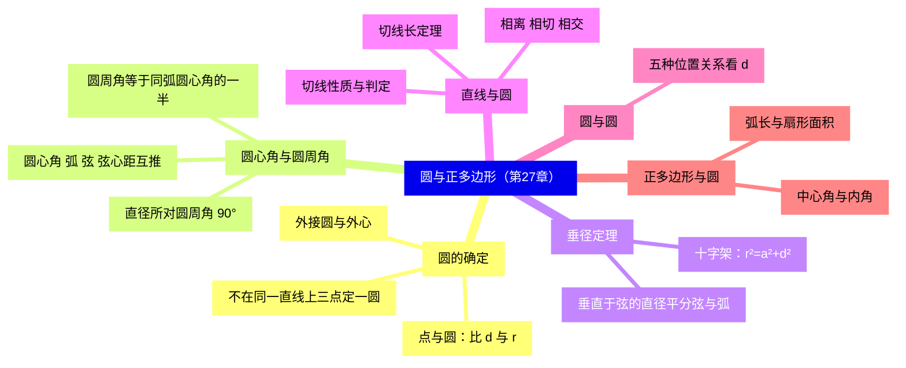
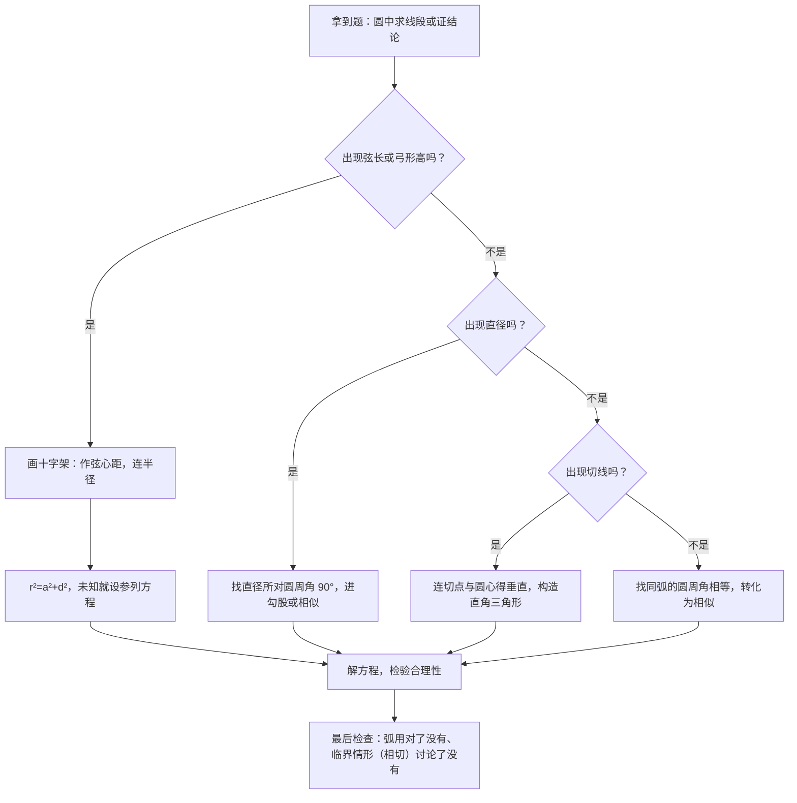

# 圆与正多边形（详解版）

> **使用说明**：本文是详解版，从"为什么"讲起供从头自学；考前速查和掌握度跟踪在概要版：[[03-数学/知识点/九年级/圆与正多边形]]。

## 0️⃣ 这章学什么 & 中考怎么考

- **这章解决什么问题**：圆是"最对称"的图形——车轮、摩天轮、硬币都是圆，因为圆上任一点到圆心距离相同，转起来平稳。这一章研究圆内部的角与线段（圆心角、圆周角、垂径定理）、圆与直线的关系（切线）、圆与圆的关系，以及"圆内接正多边形"和弧长、扇形面积的计算。
- **和前后章节的关系**：圆里到处是**等腰三角形**（半径相等）和**直角三角形**（直径、切线），再加上**相似**转化比例——所以它把前面几章全串起来了：[[03-数学/知识点详解/九年级/相似三角形]]、[[03-数学/知识点详解/九年级/锐角的三角比与解直角三角形]]、勾股定理。
- **中考怎么考**（依据概要版、学科总览与专题笔记）：
  - 圆是**第 25 题压轴的另一半（14 分：相似 + 圆）**，选择填空也常考基本性质；垂径定理 + 圆周角定理是两大支柱。
  - 第 21 题（10 分）三种轮换考法之一是"圆的基本计算"：垂径十字架、圆周角、切线、扇形弧长面积（见[[03-数学/专题/第21-22题-函数与三角比应用]]）。
- 一句话总结：**逢弦画十字架（勾股），见直径找直角（圆周角），遇切线连半径（得垂直），有等角转相似（比例式）。**

### 本章知识地图



## 🧭 先修自检（学不下去先回到这里）

> 下面每一项都是本章的地基。做不出就先去补对应知识，硬学只会更挫败。

| # | 你应该会的 | 自查题（先做再看答案） | 答案 | 不会去哪补 |
| - | ---------- | ---------------------- | ---- | ---------- |
| 1 | 勾股定理 | 直角边 6 和 8，斜边多长？ | $\sqrt{36+64}=10$ | [[03-数学/知识点/00-六至八年级核心公式定理总表]]（几何·直角三角形） |
| 2 | 等腰三角形 | $OA=OB$ 且 $\angle A=40°$，$\angle B=$？顶角呢？ | $\angle B=40°$（等边对等角）；顶角 $100°$ | 同上（几何·等腰） |
| 3 | 三线合一 | 等腰三角形底边上的高有什么额外作用？ | 同时是中线、角平分线 | 同上 |
| 4 | 三角形外角 | △ABC 中 $\angle A=50°$、$\angle B=60°$，$\angle C$ 的外角=？ | 外角 $=50°+60°=110°$ | 同上 |
| 5 | 二次根式化简 | 化简 $\sqrt{75}$ | $\sqrt{25\times3}=5\sqrt3$ | 同上（数与式·二次根式） |
| 6 | 圆的基本常识 | 半径 5 的圆，直径多长？圆周率 $\pi$ 是什么？ | 直径 10；$\pi$ 是周长与直径的比 | 同上 |

**自查题做错的，先把那一项补上再往下读。第 1、2、3 项是本章每天的口粮。**

## 🌱 概念从头讲

> 每个概念按"**为什么需要它 → 它是什么 → 符号与记号含义 → 容易想错的地方**"四步讲。

### 概念 1：圆、弦、弧、圆心角、圆周角

- **为什么需要**：先把"零件"认全，后面每个定理都是这些零件之间的关系。
- **定义与符号**：
  - **圆**：平面上到定点（圆心 $O$）距离等于定长（半径 $r$）的点的集合。圆心定位置，半径定大小。
  - **弦**：连接圆上两点的线段（如 $AB$）；**直径**是过圆心的弦，是最长的弦。
  - **弧**：圆上两点间的部分；小于半圆的叫**劣弧**，大于半圆的叫**优弧**。
  - **圆心角**：顶点在圆心的角（如 $\angle AOB$）。
  - **圆周角**：顶点在圆上、两边都与圆相交的角（如 $\angle ACB$，$C$ 在圆上）。
  - **弦心距**：圆心到弦的距离（垂线段长）。
- **容易想错**：❌"直径不是弦。" → 恰恰相反，直径是过圆心的弦，弦的性质它都有，只是最特殊。

```text
（示意图，非严格比例）

         ______
       /        \
      /     O    \        O：圆心
     |      |     |
     |      |←r── A     OA：半径
     |      |       \
      \     B────────C  BC：弦
       \____/
              ⌒：BC 上方那段是弧

  弦：连接圆上两点的线段；直径：过圆心的弦（最长）
```

### 概念 2：确定圆的条件与外心

- **为什么需要**：画一个圆需要圆心 + 半径。已知三个点，能不能找到"过这三点的圆"？
- **定义**：**过不在同一直线上的三个点确定一个圆**（圆心是到三点等距的点，即三边垂直平分线的交点）。这个圆叫三角形的外接圆，圆心叫**外心**——外心到三个顶点距离相等。
- **符号/记号**：⊙O 表示圆 O。
- **容易想错**：❌"任意三点都能确定一个圆。" → 三点**在同一直线上**时找不到到三点等距的点，确定不了圆。题目若给"三点共线"要警觉。

### 概念 3：点、直线与圆的位置关系

- **为什么需要**：动点、动直线与圆的关系是压轴题"存在性讨论"的基础，全部归结为**比较距离 $d$ 与半径 $r$**。
- **定义与符号**：
  - 点与圆：$d>r$ 点在圆外；$d=r$ 点在圆上；$d<r$ 点在圆内。
  - 直线与圆：$d>r$ 相离（0 个公共点）；$d=r$ 相切（1 个公共点，直线是切线）；$d<r$ 相交（2 个公共点，直线是割线）。
- **容易想错**：❌ 忘了 $d=r$ 是"临界情形"。 → 讨论动点与圆时，"恰好相切"这一档最容易被漏，而它往往就是答案。

### 概念 4：圆心角、弧、弦、弦心距之间的关系

- **为什么需要**：圆的对称性（绕圆心旋转不动）带来一条"一荣俱荣"的互推链，是圆中证等长、等角的常规武器。
- **定义**：在同圆或等圆中，**圆心角 ⟺ 弧 ⟺ 弦 ⟺ 弦心距**：一组量相等，其余量全都相等。
- **符号/记号**：如 $\angle AOB=\angle COD$（同圆中）$\Rightarrow \widehat{AB}=\widehat{CD}$，$AB=CD$，且两条弦心距相等。
- **容易想错**：❌ 忽略"同圆或等圆"这个前提。 → 不同大小的圆里，相等的圆心角对应的弦并不相等（大圆的弦长）。

### 概念 5：圆周角定理（本章两大支柱之一）

- **为什么需要**：圆上任意一段弧，从圆心看它和从圆上另一点看它，"张角"不一样大——定量关系就是圆周角定理。它把圆里的角全部打通。
- **定义**：**同弧所对的圆周角等于它所对的圆心角的一半**。
- **符号/记号**：$\angle APB=\dfrac{1}{2}\angle AOB$（$P$ 在圆上，$O$ 是圆心，$A$、$B$ 是弧的两个端点）。
- **重要推论**：**直径所对的圆周角是直角**（直径对应的圆心角是平角 $180°$，一半就是 $90°$）；反过来，$90°$ 的圆周角所对的弦是直径。这是"见直径找直角"的来源——无中生有造直角三角形。
- **容易想错**：❌ 用错弧：两个圆周角不相等就乱代公式。 → 先问自己"这个角的顶点在圆上吗？它的两条边夹住哪段弧？"确认同弧再换算。
- **关联工具**：圆内接四边形对角互补、外角等于内对角（见[[03-数学/专题/第23题-几何论证]]的证明工具箱）。

```text
（示意图，非严格比例）同弧 AB 上的两个角

          P
        ╱   ╲
       ╱     ╲          ∠APB：圆周角（顶点 P 在圆上）
      ╱       ╲         ∠AOB：圆心角（顶点 O 在圆心）
     A─────────B        同一段弧 AB：
      ╲       ╱         ∠APB = ½ ∠AOB
        ╲   ╱
          O
```

### 概念 6：垂径定理（本章两大支柱之二）

- **为什么需要**：圆里的计算题（求弦长、半径、弓形高）十有八九靠它，因为它凭空造出一个**直角三角形 + 中点**，勾股定理马上能用。
- **定义**：**垂直于弦的直径平分这条弦，并且平分弦所对的两条弧**。
- **符号/记号**：直径 $CD\perp AB$ 于 $M$（$AB$ 是非直径的弦）$\Rightarrow AM=MB$，$\widehat{AC}=\widehat{BC}$，$\widehat{AD}=\widehat{BD}$。
- **标准构图（逢垂径必画"十字架"）**：连半径 $OA$，得 Rt△OMA：$AM=a$（半弦）、$OM=d$（弦心距）、$OA=r$（半径），勾股得 $r^2=a^2+d^2$。
- **容易想错**：❌ 对"直径被垂直平分"也乱用定理。 → 垂径定理里的弦指的是**非直径弦**；两条直径互相垂直的情形要另想办法证。
- **易漏情形**：弦可能在圆心上方也可能在下方，弓形高相应是 $r-d$ 或 $r+d$，两种都要讨论（见例题）。

```text
（示意图，非严格比例）垂径定理"十字架"

            C
            │
        ╭───┼───╮
      ╱     │     ╲
     │      O      │      O：圆心（在直径 CD 上）
     A──────M──────B      AB：弦（非直径弦），CD⊥AB 于 M
      ╲     │     ╱
        ╰───┼───╯
            │

  M 是 AB 的中点（垂径定理）
  连 OA 得直角三角形 OMA：
  AM = a（半弦），OM = d（弦心距），OA = r（半径）
  勾股：r² = a² + d²
```

### 概念 7：切线（性质、判定、切线长）

- **为什么需要**：切线是"直线与圆恰好挨一下"的极限位置。它最大的贡献：**切线垂直于过切点的半径**——又一个现成直角。
- **定义与符号**：
  - **性质定理**：切线 $\perp$ 过切点的半径。$DC$ 切 ⊙O 于 $C$ $\Rightarrow OC\perp DC$。
  - **判定定理**：过半径外端且垂直于这条半径的直线是切线。证明"是切线"就写这两句话，一句都不能省。
  - **切线长定理**：从圆外一点引圆的两条切线，**切线长相等**；连接这一点与圆心，这条连线**平分两切线的夹角**。
- **容易想错**：❌ 证切线只写"垂直于半径"不写"过半径外端"。 → 两个条件缺一不可，写全才拿满分。
- **注意区分**：性质是"已知切线 → 得垂直"；判定是"已知垂直 + 过外端 → 得切线"。方向别反。

```text
（示意图，非严格比例）切线与切线长

       ╭─────────╮                P
     ／             ＼           ╱ │ ╲
    │        O        │        ╱  │  ╲
    │        │        │      A───┼───B   ← A、B 为切点
     ＼       │r      ／        ╲  │  ╱
       ╰─────C─────╯            ╲ │ ╱
  l ───────────C──────────         O
                │
  直线 l 是切线：与圆只有 1 个公共点 C，且 l ⊥ OC

  切线长定理：PA = PB，连 PO 平分 ∠APB
```

### 概念 8：圆与圆的位置关系

- **为什么需要**：两个轮子、两枚硬币——"外离、外切、相交、内切、内含"五种关系，全部由**圆心距 $d$ 与两半径 $R$、$r$** 的比较决定（速查表在公式区）。
- **容易想错**：❌ 相交的范围写成 $0<d<R+r$。 → 相交要"既不分离也不吞并"：$\lvert R-r\rvert<d<R+r$，两个端点值都是**相切**不是相交。

### 概念 9：正多边形与圆

- **为什么需要**：正多边形天然"内接于圆"（各顶点到中心等距），圆的公式立刻能算正多边形；这也是弧长、扇形公式的舞台。
- **定义与符号**：
  - **中心角**：正 $n$ 边形每条边对着圆心的角，$=\dfrac{360°}{n}$。
  - **内角**：$=\dfrac{(n-2)\cdot180°}{n}$（多边形内角和 ÷ $n$）。
  - **半径 $R$**（中心到顶点）、**边心距 $r$**（中心到边的距离）、**半边长 $a$**：中心、边中点、顶点构成直角三角形，$R^2=r^2+a^2$——和垂径十字架是同一个结构！

```text
（示意图，非严格比例）正多边形的基本直角三角形

       A────M────B     ← AB 是正多边形的一边，M 是中点
        ╲   │   ╱
         ╲  │r ╱          OM = r（边心距）
          ╲ │ ╱           OA = R（半径）
            O             AM = a（半边长）
                          Rt△OMA：R² = r² + a²
                          中心角 ∠AOB = 360°/n
```

## 🧮 公式逐个拆解

> 每个公式都必须能回答四件事：每个符号是什么？什么时候能用？怎么变形？配一个一步能算的最小例子。

### 公式 1：垂径十字架 $r^2=a^2+d^2$

| 符号 | 含义 | 注意 |
| ---- | ---- | ---- |
| $r$ | 半径 | 连圆心与弦的端点 |
| $a$ | 半弦（弦长的一半） | 垂径定理保证"垂直 → 平分" |
| $d$ | 弦心距 | 圆心到弦的垂线段长 |

- 成立条件：弦是**非直径弦**，且作了"垂直于弦的直径（或弦心距）"这条辅助线。
- 常用变形：$a=\sqrt{r^2-d^2}$，$d=\sqrt{r^2-a^2}$；弓形高 $=r-d$（弦离圆心近时）或 $r+d$（弦在圆心另一侧时），两解都要讨论。
- 最小例子：半径 5，弦长 8，则 $a=4$，$d=\sqrt{25-16}=3$。**验算**：$3^2+4^2=5^2$ ✓（3-4-5）。

### 公式 2：圆周角定理 $\angle APB=\dfrac{1}{2}\angle AOB$

- 符号含义：$P$ 在圆上，$O$ 是圆心，两个角对着**同一条弧** $AB$。
- 成立条件：同弧（或等弧）才可互推。
- 常用变形：直径所对圆周角 $=90°$（圆心角是 $180°$）；$90°$ 圆周角所对弦是直径（逆用，常用来证直径）。
- 最小例子：同弧所对圆心角 $80°$，则圆周角 $40°$。**验算**：$80\div2=40$ ✓。

### 公式 3：位置关系判定（点、直线、两圆）

| 关系 | 点与圆 | 直线与圆 | 圆与圆（半径 $R\geq r$，圆心距 $d$） |
| ---- | ---- | ---- | ---- |
| 分离 | $d>r$ | 相离 $d>r$ | 外离 $d>R+r$ |
| 恰好接触 | $d=r$（圆上） | 相切 $d=r$ | 外切 $d=R+r$；内切 $d=R-r$ |
| 重叠 | $d<r$（圆内） | 相交 $d<r$ | 相交 $\lvert R-r\rvert<d<R+r$；内含 $d<\lvert R-r\rvert$ |

- 成立条件：$d$ 是"点到圆心 / 直线到圆心 / 圆心到圆心"的距离。
- 常用变形：由位置关系反推 $d$ 的范围，做动点讨论。
- 最小例子：$R=5$，$r=2$。若 $d=6$：$3<6<7$，相交；若 $d=7$：恰好外切。**验算**：$R+r=7$，$R-r=3$ ✓。

### 公式 4：切线长定理 $PA=PB$

- 符号含义：$P$ 是圆外一点，$PA$、$PB$ 是两条切线（$A$、$B$ 为切点）。
- 成立条件：$P$ 在圆外；$A$、$B$ 是切点。
- 常用变形：连 $OP$，得两个全等的直角三角形；$OP$ 平分 $\angle APB$；用勾股求 $OP$。
- 最小例子：切线长 $PA=8$，半径 $r=6$，则 Rt△OAP 中 $OP=\sqrt{6^2+8^2}=10$。**验算**：$36+64=100$ ✓。

### 公式 5：正多边形中心角与内角

$$中心角=\dfrac{360°}{n}\qquad 内角=\dfrac{(n-2)\cdot180°}{n}$$

- 符号含义：$n$ 是边数。
- 成立条件：正 $n$ 边形（各边相等、各角相等）。
- 常用变形：中心角 $=360°\div n$；由中心角反求 $n=360°\div$中心角。
- 最小例子：正六边形：中心角 $=360°\div6=60°$，内角 $=120°$。**验算**：内角和 $(6-2)\times180°=720°$，$720\div6=120$ ✓。顺带一个好用的结论：正六边形中心角 $60°$，两个半径夹出等边三角形，所以**边长 = 半径**。

### 公式 6：弧长 $l=\dfrac{n\pi R}{180}$

| 符号 | 含义 | 注意 |
| ---- | ---- | ---- |
| $l$ | 弧长 | 圆周长的一部分 |
| $n$ | 弧所对圆心角的**度数** | 是纯数值，不带单位；公式分母是 180 |
| $R$ | 半径 | — |

- 成立条件：圆心角 $n°$、半径 $R$ 的圆弧。
- 常用变形：由弧长反求角 $n=\dfrac{180l}{\pi R}$；圆心角 $180°$ 时 $l=\pi R$（半圆，和周长公式对上）。
- 最小例子：$n=60$，$R=3$，$l=\dfrac{60\pi\times3}{180}=\pi$。**验算**：$60°$ 是圆的 $\dfrac{1}{6}$，周长 $2\pi\times3=6\pi$，$\dfrac{1}{6}\times6\pi=\pi$ ✓。

### 公式 7：扇形面积 $S=\dfrac{n\pi R^2}{360}=\dfrac{1}{2}lR$

- 符号含义：$n$ 圆心角度数，$R$ 半径，$l$ 弧长。
- 成立条件：扇形（两条半径 + 一段弧围成）。
- 常用变形：已知弧长用 $S=\dfrac{1}{2}lR$（形状像三角形面积公式：把弧当"底"，半径当"高"）。
- 最小例子：$n=60$，$R=3$：$S=\dfrac{60\pi\times9}{360}=\dfrac{3\pi}{2}$。**验算**：用另一形式 $S=\dfrac{1}{2}lR=\dfrac{1}{2}\times\pi\times3=\dfrac{3\pi}{2}$ ✓（和公式 6 算出的 $l=\pi$ 接上）。

## 🪜 例题阶梯

> 三级台阶，每一级都要动笔跟着算，不许只看。

### 第 1 级 · 入门（照着模仿）

> **题目**：⊙O 的半径为 5，弦 $AB=8$。求圆心 $O$ 到弦 $AB$ 的距离。
>
> **每一步为什么这么做**：
> - 求"圆心到弦的距离" → 作弦心距，同时连半径，凑出直角三角形。
> - 垂径定理保证垂足是中点 → 半弦可求 → 勾股收工。
>
> **完整解答**：
> 第一步：作 $OM\perp AB$ 于 $M$，连接 $OA$。
> （依据：要造弦心距，垂径定理的"十字架"构图。）
> 第二步：$OM\perp AB$，$OM$ 过圆心，所以 $AM=\dfrac{1}{2}AB=4$。
> （依据：垂径定理——垂直于弦的直径平分弦。）
> 第三步：在 Rt△OMA 中，$OA=5$，$AM=4$，由勾股定理 $OM=\sqrt{5^2-4^2}=3$。
> 所以圆心到弦的距离为 3。
> **验算**：$3^2+4^2=9+16=25=5^2$ ✓。

### 第 2 级 · 标准（第 21 题考法③风格：设参列方程）

> **题目**：⊙O 的直径 $AB$ 与弦 $CD$ 相交，$CD\perp AB$ 于点 $E$，$CD=12$，$BE=2$。求 ⊙O 的半径。
>
> **读题→翻译成数学语言**：垂直 + 直径 → 十字架。半径未知 → 设半径为 $r$，把两条直角边都用 $r$ 表示，勾股列方程。
>
> **每一步为什么这么做**：
> - 垂径定理给中点：$CE=\dfrac{1}{2}CD=6$，先求出半弦。
> - 弦心距 $OE$ 不好直接算 → 用 $r$ 表示：$OE=OB-EB=r-2$。
> - Rt△OEC 中三边都知道（含 $r$）→ 勾股列方程解 $r$。
>
> **完整解答**：
> 第一步：连接 $OC$。因为 $AB\perp CD$ 且 $AB$ 是直径，所以 $CE=\dfrac{1}{2}CD=6$。
> （依据：垂径定理。）
> 第二步：设半径为 $r$，则 $OC=r$，$OB=r$，$OE=OB-EB=r-2$。
> 第三步：在 Rt△OEC 中，$OC^2=OE^2+CE^2$，即
> $$r^2=(r-2)^2+6^2$$
> 展开右边：$(r-2)^2+36=r^2-4r+4+36$。
> 所以 $r^2=r^2-4r+40$，得 $4r=40$，$r=10$。
> **验算**：$OE=10-2=8$，$CE=6$，$8^2+6^2=64+36=100=10^2$ ✓。
>
> **易漏提醒**：如果题目给的是"弓形高"（弧顶到弦的距离）而没说弦在哪一侧，弦可能在圆心上方或下方，$OE$ 相应是 $r-h$ 或 $h-r$，两种情况都要讨论。

### 第 3 级 · 提高（第 25 题风格：直径 + 切线 + 相似一条龙）

> **题目**：$AB$ 是 ⊙O 的直径，$AB=10$，点 $C$ 在 ⊙O 上，$\angle BAC=30°$，过点 $C$ 作 ⊙O 的切线，与 $AB$ 的延长线交于点 $D$。①求 $BC$ 的长和 $\angle D$ 的度数；②求 $CD$ 的长；③连接 $AC$，求证：△BCD∽△CAD，并由此验证 $CD^2=BD\cdot AD$。
>
> **思路从哪来**：直径 → 直角（圆周角定理）；切线 → 垂直（连切点与圆心）；要求角和线段 → 等腰三角形（半径相等）+ 三角比/勾股；证相似 → 找两组相等的角（互余 + 公共角）。
>
> **完整解答**：
> ① 第一步：$\angle ACB=90°$。
> （依据：直径所对的圆周角是直角——"见直径找直角"。）
> 第二步：在 Rt△ACB 中，$\angle BAC=30°$，所以 $BC=\dfrac{1}{2}AB=5$。
> （依据：直角三角形中 30° 角所对的直角边等于斜边的一半。）
> 第三步：连接 $OC$。因为 $OA=OC$（都是半径），所以 $\angle OCA=\angle OAC=30°$（等边对等角）。
> $\angle COB=\angle OCA+\angle OAC=60°$。
> （依据：三角形的外角等于不相邻两个内角的和。）
> 第四步：因为 $DC$ 是切线，所以 $OC\perp DC$（切线的性质定理）。
> 在 Rt△OCD 中，$\angle D=90°-\angle COD=90°-60°=30°$。
> （依据：直角三角形的两个锐角互余。）
> ② 在 Rt△OCD 中，$\angle D=30°$，所以 $OC=\dfrac{1}{2}OD$，得 $OD=2OC=10$。
> 勾股：$CD=\sqrt{OD^2-OC^2}=\sqrt{100-25}=\sqrt{75}=5\sqrt3$。
> （也可用三角比：$\sin\angle D=\dfrac{OC}{OD}$，$OD=\dfrac{5}{\sin30°}=\dfrac{5}{1/2}=10$，见[[03-数学/知识点详解/九年级/锐角的三角比与解直角三角形]]。）
> **验算**：$\dfrac{OC}{OD}=\dfrac{5}{10}=\dfrac{1}{2}$，与 30° 角一致 ✓。
> ③ 先摆对应关系再写相似符号：
> 由 $OC\perp DC$ 知 $\angle OCB+\angle BCD=90°$；又 $OB=OC$，所以 $\angle OCB=\angle OBC=\angle B$（等边对等角）。
> 在 Rt△ACB 中 $\angle A+\angle B=90°$，所以 $\angle A=90°-\angle B=\angle BCD$。
> 又 $\angle BDC=\angle ADC$（公共角：$B$ 在线段 $AD$ 上，两个角其实是同一个角）。
> 所以 △BCD∽△CAD（两角对应相等的两个三角形相似；对应：$B$ 对 $C$，$C$ 对 $A$，$D$ 对 $D$）。
> **这一步为什么这么做**：相似符号的顶点顺序必须按对应写——写反了，比例式全错。这是[[03-数学/知识点详解/九年级/相似三角形]]反复强调的点。
> 由相似得 $\dfrac{CD}{AD}=\dfrac{BD}{CD}$，交叉相乘：$CD^2=BD\cdot AD$。
> 代数验证：$BD=OD-OB=10-5=5$，$AD=AB+BD=15$，$BD\cdot AD=5\times15=75$；而 $CD^2=(5\sqrt3)^2=75$ ✓。
>
> **和入门题的差别**：入门题只用一个定理；这题连用"直径 → 直角、切线 → 垂直、等腰 → 等角、相似 → 比例中项"四招，正是概要版说的"组合拳"，也是第 25 题第 1 小题的标准长相。

```text
（示意图，非严格比例）例 3 配图

              C
            ╱ | ╲
          ╱   |   ╲          OC：半径；DC：切线
        ╱     |     ╲        （切点 C，DC ⊥ OC）
      A──O────B───────D     AB 是直径，D 在 AB 延长线上
        ╲           ╱
          ╲       ╱
            ╰───╯
```

## 🗺️ 解题流程图



## 🔥 易错点：为什么会错

| ❌ 常见错误想法 | 为什么会这样想 | ✅ 正确理解 / 自救方法 |
| -------------- | -------------- | ---------------------- |
| 垂径定理随便用在直径上 | "直径也是弦嘛" | 定理中的弦指**非直径弦**；两条直径垂直的情形要另外证明。画十字架前先确认 |
| 圆周角代错弧 | 角和弧没对齐 | 先问三句：顶点在圆上吗？两边夹住哪段弧？和已知角同弧吗？再换算 |
| 相交两圆写成 $0<d<R+r$ | 只想到"不分离" | 相交还要"不吞并"：$\lvert R-r\rvert<d<R+r$；两个端点是**相切**不是相交 |
| 动点讨论漏"相切" | 相切是瞬间状态，画图容易跳过 | 点/直线与圆、圆与圆的讨论都要单列"恰好相切"一档，它常是答案或分界 |
| 弧长公式写成 $l=\dfrac{n\pi R}{360}$ 或 $n$ 带单位 | 和扇形面积分母 360 混了 | 弧长分母 180，扇形面积分母 360；$n$ 是角度的纯数值。代完用"占圆的几分之几"估算核对 |
| 弓形高只算一种 | 没意识到弦可在圆心两侧 | 高 $=r-d$ 或 $r+d$，分类讨论；第 2 级例题的"易漏提醒"再读一遍 |
| 证切线只写"垂直于半径" | 漏了位置条件 | 完整判定：**过半径外端**且**垂直于这条半径**的直线是切线，两句话写全 |

## ✅ 自测清单（能独立做到才打勾）

- [ ] 1. 能默写垂径定理，并画出十字架图、标出 $r$、$a$、$d$
- [ ] 2. 能默写圆周角定理及两个推论（直径 → 直角；直角 → 直径）
- [ ] 3. 能说出切线性质与判定的区别（一个"由切得垂直"，一个"由垂得切"），并写全判定两句话
- [ ] 4. 能背出两圆五种位置关系的 $d$ 判定条件
- [ ] 5. 能独立做出例题阶梯第 1、2 级，并说出每步依据
- [ ] 6. 能独立完成第 3 级：直径出直角、切线出垂直、相似出比例中项，一条龙写完
- [ ] 7. 能默写弧长与扇形面积公式，并各做一个 $60°$、$R=3$ 的小题
- [ ] 8. 能说出本章 3 个易错点及自救方法

## 🔗 关联

- 概要版：[[03-数学/知识点/九年级/圆与正多边形]]（掌握度在这边更新）
- 前置知识：[[03-数学/知识点/00-六至八年级核心公式定理总表]]（勾股、等腰三角形、解方程）
- 兄弟详解：[[03-数学/知识点详解/九年级/相似三角形]]（圆中等角 → 相似 → 比例式）· [[03-数学/知识点详解/九年级/锐角的三角比与解直角三角形]]（圆中直角三角形用三角比）· [[03-数学/知识点详解/九年级/二次函数]]（压轴里的动态圆与坐标）
- 相关专题：[[03-数学/专题/第25题-压轴-相似与圆]] · [[03-数学/专题/第23题-几何论证]] · [[03-数学/专题/第21-22题-函数与三角比应用]]
