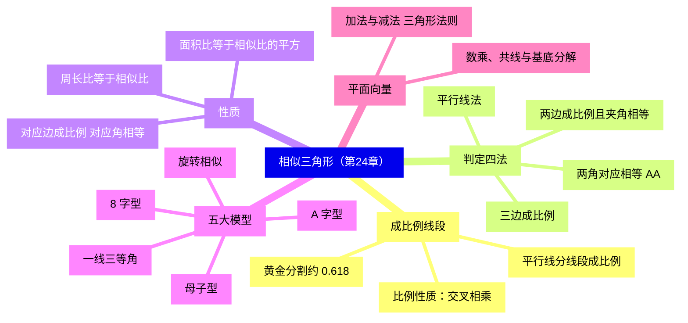
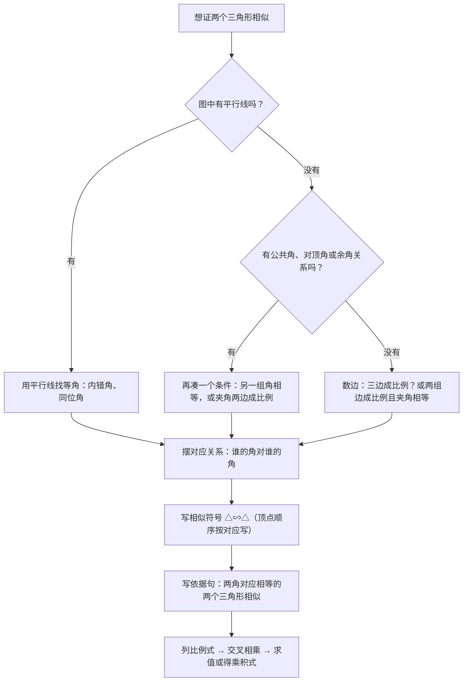

# 相似三角形（详解版）

> **使用说明**：本文是详解版，从"为什么"讲起供从头自学；考前速查和掌握度跟踪在概要版：[[03-数学/知识点/九年级/相似三角形]]。

## 0️⃣ 这章学什么 & 中考怎么考

- **这章解决什么问题**：全等三角形要求"形状、大小都相同"，太苛刻。生活里更多的是"形状相同、大小不同"：照片缩放、地图按比例缩小、影子与实物。这种关系叫**相似**，全等其实是相似比为 1 的特例。相似的价值在一个字——**比**：只要证出两个三角形相似，所有对应线段就按同一个比例缩放，未知线段就能算出来。
- **和前后章节的关系**：它站在六~八年级"全等、平行线、比例"的肩膀上（见[[03-数学/知识点/00-六至八年级核心公式定理总表]]）；向前，它是第 25 章锐角三角比的地基（三角比本质就是直角三角形里的相似比，见[[03-数学/知识点详解/九年级/锐角的三角比与解直角三角形]]），也是九年级下册圆中比例问题的主工具（见[[03-数学/知识点详解/九年级/圆与正多边形]]）。
- **中考怎么考**（依据概要版与专题笔记）：
  - 相似是**第 23 题（几何论证，12 分）的核心考点 + 第 25 题压轴的骨架**；第 23 题 12 分里约 8 分是"写对依据"的分。
  - **平面向量几乎每年在选择/填空考 1 题**，主流考法是用基底表示向量。
  - 黄金分割常与相似、圆结合出题。
- 一句话总结：**判定靠模型（A 字、8 字、母子），性质靠比值（面积比要平方），书写靠依据句——三样齐了，第 23 题的分就稳了。**

### 本章知识地图



## 🧭 先修自检（学不下去先回到这里）

> 下面每一项都是本章的地基。做不出就先去补对应知识，硬学只会更挫败。

| # | 你应该会的 | 自查题（先做再看答案） | 答案 | 不会去哪补 |
| - | ---------- | ---------------------- | ---- | ---------- |
| 1 | 比与分数 | 解 $\dfrac{x}{4}=\dfrac{3}{8}$ | 交叉相乘 $8x=12$，$x=1.5$ | [[03-数学/知识点/00-六至八年级核心公式定理总表]]（数与式） |
| 2 | 平行线的性质 | 两直线平行，同位角、内错角有什么关系？ | 分别相等 | 同上（几何·平行线） |
| 3 | 三角形内角和 | △ABC 中 $\angle A=50°$、$\angle B=60°$，$\angle C=$？ | $70°$ | 同上（几何·三角形） |
| 4 | 全等判定 | $\angle A=\angle D$，$AB=DE$，$\angle B=\angle E$，能判定全等吗？ | 能，依据 ASA（两角及夹边对应相等） | 同上（几何·全等） |
| 5 | 勾股定理 | 直角边 3 和 4，斜边多长？ | $\sqrt{3^2+4^2}=5$ | 同上 |
| 6 | 等腰三角形 | 等腰三角形底边上的高、中线、角平分线什么关系？ | 三线合一 | 同上 |

**自查题做错的，先把那一项补上再往下读。本章大量在"找相等的角"，第 2、3、4 项尤其关键。**

## 🌱 概念从头讲

> 每个概念按"**为什么需要它 → 它是什么 → 符号与记号含义 → 容易想错的地方**"四步讲。

### 概念 1：两条线段的比

- **为什么需要**：比较两段长，除了"谁长谁短"，更常用"几倍"。地图"比例尺 1:10000"，就是用比来缩放现实。
- **定义**：两条线段的长度之比叫这两条线段的比，记作 $a:b$ 或 $\dfrac{a}{b}$。
- **符号/记号**：比的前项、后项不能颠倒；**单位统一后才能作比**。
- **容易想错**：❌"3 米比 50 厘米等于 3 比 50。" → 单位没统一。正确：统一成厘米，$300:50=6:1$（统一成米算 $3:0.5=6:1$，结果一样）。

### 概念 2：成比例线段与比例的性质

- **为什么需要**：四条线段中，若两条的比等于另外两条的比，说明它们按同一比例缩放——这是"相似"的语言基础。
- **定义**：若 $\dfrac{a}{b}=\dfrac{c}{d}$（$b$、$d\neq0$），则 $a$、$b$、$c$、$d$ 成比例，$d$ 叫第四比例项。特别地，若 $b=c$，即 $a:b=b:d$，则 $b$ 叫 $a$、$d$ 的**比例中项**，满足 $b^2=ad$。
- **符号/记号**：比例式 $\dfrac{a}{b}=\dfrac{c}{d}$ 可以**交叉相乘**：$ad=bc$（内项积等于外项积）。这一步是所有比例计算的发动机。
- **容易想错**：❌ 写比例式时对应顺序乱放。 → 比例式有"顺序感"：$\dfrac{a}{b}=\dfrac{c}{d}$ 里 $a$、$c$ 扮演同一角色，$b$、$d$ 扮演另一角色。写之前先想清楚"谁比谁等于谁比谁"。

### 概念 3：黄金分割

- **为什么需要**：把一条线段分成两段，怎么分"最好看"？人们发现**较长段与全长的比**取一个固定值时视觉最和谐，建筑、摄影都在用。中考常与相似、圆结合出题。
- **定义**：点 $C$ 把线段 $AB$ 分成 $AC$（较长段）与 $BC$，若 $\dfrac{AC}{AB}=\dfrac{\sqrt5-1}{2}\approx0.618$，则 $C$ 叫 $AB$ 的黄金分割点。
- **符号/记号**：记两组数——"长比全"约 $0.618$；"全比长"是它的倒数 $\dfrac{\sqrt5+1}{2}\approx1.618$（[[03-数学/专题/第23题-几何论证]]里出现的就是倒数形式，两者不矛盾）。此时 $AC$ 也是 $AB$ 与 $BC$ 的比例中项：$AC^2=AB\times BC$。
- **容易想错**：❌ 把 $0.618$ 当成"短段比全长"。 → 定义里 $0.618$ 是**较长段比全长**；短段比全长是 $1-0.618=0.382$。

### 概念 4：平行线分线段成比例（A 字型的老家）

- **为什么需要**：相似最常用的通道是平行线——平行线天然制造"相等的角"，还能"按比例切分线段"。
- **定义**：平行于三角形一边的直线截其他两边（或两边的延长线），所得的对应线段成比例。
- **符号/记号**：△ABC 中 $DE\parallel BC$（$D$ 在 $AB$ 上，$E$ 在 $AC$ 上），则 $\dfrac{AD}{AB}=\dfrac{AE}{AC}=\dfrac{DE}{BC}$。两种读法都要会：**"上比全"**（$\dfrac{AD}{AB}$）与**"上比下"**（$\dfrac{AD}{DB}=\dfrac{AE}{EC}$）。
- **容易想错**：❌ 把两种读法混着写：$\dfrac{AD}{DB}=\dfrac{AE}{AC}$ 是错的。 → 分子分母必须"同一身份"：要么都用上半段，要么都用全段。写完画条竖线对齐检查。

```text
（示意图，非严格比例）A 字型：DE ∥ BC

        A
       / \
      /   \
     D-----E      ← 截线 DE 平行于底边
    /       \
   /         \
  B───────────C

  上比全：AD/AB = AE/AC = DE/BC
  上比下：AD/DB = AE/EC
```

### 概念 5：8 字型（X 型）

- **为什么需要**：两条直线相交、再有一组对边平行，就出现"上下两个三角形相似"。梯形对角线问题是它的标准出场方式。
- **是什么**：见下图——$AB\parallel DC$，两线交于 $O$，则 △AOB 与 △COD 相似。
- **符号/记号**：依据三句话——对顶角 $\angle AOB=\angle COD$；内错角 $\angle OAB=\angle OCD$、$\angle OBA=\angle ODC$（两直线平行，内错角相等）；于是 **AA** 判定成立。
- **容易想错**：❌ 写成 △AOB∽△DCO 之类顺序乱放的式子。 → 先摆对应关系：$\angle OAB$ 对 $\angle OCD$，所以 $A$ 对 $C$；$B$ 对 $D$。写全：**△AOB∽△COD**。顺序错了，比例式全错。

```text
（示意图，非严格比例）8 字型（X 型）：AB ∥ DC

      A───────────B
       \         /
        \       /
         \     /
          \   /
           \ /
            O
           / \
          /   \
         /     \
        /       \
       D─────────C

  结论：△AOB ∽ △COD
  AO/CO = BO/DO = AB/DC
```

### 概念 6：相似三角形的定义与记号

- **为什么需要**：给"形状相同的三角形"起个名字、定个记号，后面才能写证明。
- **定义**：三个角对应相等、三条边对应成比例的两个三角形叫相似三角形。判定其实不需要全查——后面会看到"两个条件就够"。
- **符号/记号**：读作"△ABC 相似于 △A'B'C'"，符号 ∽ 相当于"角对角、边对边"的**对位说明书**：写在相同位置的字母表示对应顶点，$\dfrac{AB}{A'B'}=\dfrac{BC}{B'C'}=\dfrac{CA}{C'A'}=k$，$k$ 叫**相似比**。
- **容易想错**：❌ 相似比不看方向随便写。 → △ABC∽△A'B'C' 时 $\dfrac{AB}{A'B'}$ 才是相似比；写反变成 $\dfrac{1}{k}$，第 2 问起全盘皆错。

### 概念 7：相似三角形的判定（四把钥匙）

| 判定 | 简写 | 什么时候用（典型图形） |
| ---- | ---- | ---- |
| 两角对应相等 | AA | 公共角、对顶角、同角的余角；最常用 |
| 两边成比例且**夹角**相等 | SAS | 旋转手拉手模型 |
| 三边成比例 | SSS | 网格题 |
| 平行线法（上海特色表述） | —— | 平行于三角形一边的直线截其他两边，所截得的三角形与原三角形相似（A 字、8 字） |

- **为什么 AA 最常用**：角的信息在图形里最"显眼"（公共角、对顶角、平行出的等角一眼可见），边的比例还要算，所以先找角。
- **容易想错**：❌ 用 SAS 时夹角没对上。 → 必须是**两组成比例的边共同夹住的那个角**相等；换成别的角就不行。

### 概念 8：常见模型（看见图形 3 秒内反应）

| 模型 | 识别特征 | 结论 |
| ---- | ---- | ---- |
| A 字型 | 一条平行线截三角形两边 | 上下两个三角形相似（含"上比全/上比下"） |
| 8 字型 | 两平行线 + 交于一点的两条线 | △AOB∽△COD（对顶角 + 内错角） |
| 母子型 | 直角三角形斜边上的高 | 分出的两个小三角形都与原三角形相似 |
| 一线三等角 | 一条直线上三个相等的角（K 型） | 两侧三角形相似 |
| 旋转相似 | 共端点的两个相似三角形叠放 | 常配合"共角共边"，手拉手找对应 |

母子型示意图（非严格比例）：

```text
（示意图，非严格比例）∠ACB=90°，CD ⊥ AB 于 D

          C
          /\
         /  \
        /    \
       /   |  \      ← CD 是斜边上的高
      /    |   \
     /     |    \
    A──────D──────B

  △ACD ∽ △BCD ∽ △ABC（三个三角形彼此相似）
  由相似可导出：CD² = AD·BD（CD 是 AD、BD 的比例中项）
```

一线三等角示意图（非严格比例）：

```text
（示意图，非严格比例）

      D               E
     / \             / \
    /   \           /   \
   /     \         /     \
  A───────C───────B      ← A、C、B 在同一条直线上

  若 ∠DAC = ∠DCE = ∠CBE，则 △ACD ∽ △BCE
  （对应关系别死记：三个等角逐个比对，现场推一遍最稳）
```

### 概念 9：相似三角形的性质

- **为什么需要**：判定解决"像不像"，性质解决"怎么算"。证相似的最终目的就是用性质求线段、面积。
- **是什么**：
  - 对应边成比例（比值 = 相似比 $k$），对应角相等。
  - **周长比 = 相似比**（每条边都乘 $k$，加起来还是乘 $k$）。
  - **面积比 = 相似比的平方**（面积 = 底 × 高 ÷ 2，底乘 $k$、高也乘 $k$，乘起来是 $k^2$）。
  - 对应高、对应中线、对应角平分线之比都等于相似比。
- **符号/记号**：相似比为 $k$ 时，$S_1:S_2=k^2$。
- **容易想错**：❌ 已知面积比求相似比时不开平方。 → 面积比 $=k^2$，要由 $k^2$ 回到 $k$，必须**开平方**（取正）。例如面积比 $9:4$ → 相似比 $3:2$。

### 概念 10：平面向量（24.6-24.7，选择填空常客）

- **为什么需要**：有些量既有大小又有方向（位移、力）。数学里用**向量**表示它，几何里的"走一段路"就是向量加法。
- **是什么**：
  - 向量记作 $\vec{AB}$：$A$ 是起点，$B$ 是终点，箭头指方向；长度（大小）记 $\lvert\vec{AB}\rvert$。
  - **加法三角形法则**：首尾相接，$\vec{AB}+\vec{BC}=\vec{AC}$。
  - **减法**：同起点相减，指向"被减向量"的终点，$\vec{AB}-\vec{AD}=\vec{DB}$。
  - **数乘**：$\lambda\vec{a}$，$\lambda>0$ 同向放大，$\lambda<0$ 反向。
  - **共线**：$\vec{AB}=\lambda\vec{AC}$（$\lambda$ 是实数）说明 $A$、$B$、$C$ 三点共线。
  - **基底分解**：选两个不共线的向量 $\vec{a}$、$\vec{b}$，任何平面向量都能唯一写成 $x\vec{a}+y\vec{b}$——上海卷的主流考法就是"用基底表示某个向量"。
- **符号/记号**：向量符号画在字母上方；书写时**起点在前、终点在后**，别倒。
- **容易想错**：❌ 把 $\vec{AB}-\vec{AD}$ 算成 $\vec{BD}$。 → 减法口诀"同起点，指被减"：$\vec{AB}-\vec{AD}$ 的结果应指向被减向量 $\vec{AB}$ 的终点 $B$，即 $\vec{DB}$。验算方法：$\vec{AD}+\vec{DB}=\vec{AB}$ ✓。

```text
（示意图，非严格比例）三角形法则

   A ──────────→ B ──────────→ C
        AB              BC

   A ──────────────────────────→ C
                  AC

   首尾相接：AB + BC = AC
```

## 🧮 公式逐个拆解

> 每个公式都必须能回答四件事：每个符号是什么？什么时候能用？怎么变形？配一个一步能算的最小例子。

### 公式 1：比例基本性质（交叉相乘）

$$\dfrac{a}{b}=\dfrac{c}{d}\ \Longleftrightarrow\ ad=bc\quad(b,d\neq0)$$

- 符号含义：$a$、$d$ 是外项，$b$、$c$ 是内项；等价于"内项积 = 外项积"。
- 成立条件：分母 $b$、$d$ 都不为 0。
- 常用变形：比例中项 $b^2=ad$（当 $b=c$）；求第四比例项 $d=\dfrac{bc}{a}$。
- 最小例子：解 $\dfrac{2}{x}=\dfrac{6}{9}$。交叉相乘：$6x=18$，$x=3$。**验算**：$\dfrac{2}{3}=\dfrac{6}{9}$ ✓。

### 公式 2：合比性质

$$\dfrac{a}{b}=\dfrac{c}{d}\ \Longrightarrow\ \dfrac{a+b}{b}=\dfrac{c+d}{d}$$

- 符号含义：比例式两边同时"分子加分母"。直观：前项占全长的份额不变。
- 成立条件：$b$、$d\neq0$。
- 常用变形：实战里最常用来求"部分比整体"。已知 $\dfrac{AD}{DB}=\dfrac{AE}{EC}=k$，则 $\dfrac{AE}{AC}=\dfrac{k}{k+1}$。
- 最小例子：$\dfrac{AD}{DB}=\dfrac{AE}{EC}=\dfrac{2}{3}$，求 $\dfrac{AE}{AC}$。$AE:EC=2:3$，所以 $AE:AC=2:(2+3)=2:5$。**验算**：设 $AE=2$、$EC=3$，$AC=5$，$\dfrac{2}{5}$ ✓。

### 公式 3：黄金分割比

$$\dfrac{AC}{AB}=\dfrac{\sqrt5-1}{2}\approx0.618\quad(C\text{ 是黄金分割点，}AC>BC)$$

- 符号含义：$AC$ 较长段，$AB$ 全长。
- 成立条件：$C$ 是 $AB$ 的黄金分割点，且 $AC$ 是较长段。
- 常用变形：$\dfrac{AB}{AC}=\dfrac{\sqrt5+1}{2}\approx1.618$；比例中项 $AC^2=AB\cdot BC$。
- 最小例子：$AB=10$ 厘米，$C$ 是黄金分割点（$AC$ 较长），则 $AC=10\times0.618\approx6.18$ 厘米，$BC\approx3.82$ 厘米。**验算**：$6.18+3.82=10$ ✓；$6.18^2\approx38.2$，$10\times3.82=38.2$ ✓（比例中项成立）。

### 公式 4：A 字型比例式（平行线分线段成比例）

$$DE\parallel BC\ \Longrightarrow\ \dfrac{AD}{AB}=\dfrac{AE}{AC}=\dfrac{DE}{BC}$$

- 符号含义：$D$、$E$ 分别在 $AB$、$AC$ 上，$DE$ 是截线。
- 成立条件：$DE\parallel BC$（没有平行就没有这些比例）。
- 常用变形："上比下"$\dfrac{AD}{DB}=\dfrac{AE}{EC}$；求线段时先写比例式再交叉相乘。
- 最小例子：$\dfrac{AD}{AB}=\dfrac{2}{5}$，$BC=10$，则 $DE=\dfrac{2}{5}\times10=4$。**验算**：相似比 $\dfrac{2}{5}$，大三角形底 10，小的就是 4 ✓。

### 公式 5：面积比等于相似比的平方

$$\dfrac{S_1}{S_2}=k^2\quad(k\text{ 为相似比})$$

- 符号含义：$S_1$、$S_2$ 是两相似三角形的面积，$k$ 是对应边的比。
- 成立条件：两个三角形**相似**。
- 常用变形：由面积比反求相似比要开平方：$k=\sqrt{\dfrac{S_1}{S_2}}$。
- 最小例子：相似比 $1:2$，小三角形面积 3，则面积比 $1:4$，大三角形面积 $3\times4=12$。**验算**：小三角形底 2 高 3 面积 3；大的底 4 高 6 面积 12 ✓。

### 公式 6：向量加法与减法（三角形法则）

$$\vec{AB}+\vec{BC}=\vec{AC}\qquad \vec{AB}-\vec{AD}=\vec{DB}$$

- 符号含义：箭头方向就是"行走方向"；加法首尾相接，减法同起点、结果指向被减向量的终点。
- 成立条件：字母按"起点→终点"书写。
- 常用变形：多段连加 $\vec{AB}+\vec{BC}+\vec{CD}=\vec{AD}$；共线判定 $\vec{AB}=\lambda\vec{AC}$。
- 最小例子：$\vec{AB}$ 表示"向右 3"，$\vec{BC}$ 表示"向右 2"，则 $\vec{AC}=\vec{AB}+\vec{BC}$ 表示"向右 5"。坐标验算：$A(0,0)\to B(3,0)\to C(5,0)$ ✓。

## 🪜 例题阶梯

> 三级台阶，每一级都要动笔跟着算，不许只看。

### 第 1 级 · 入门（照着模仿）

> **题目**：△ABC 中，$D$ 在 $AB$ 上、$E$ 在 $AC$ 上，$DE\parallel BC$，$AD=2$，$DB=3$，$AE=4$，$BC=10$。求 $EC$、$AC$ 和 $DE$ 的长。
>
> **每一步为什么这么做**：
> - 见平行 → 条件反射摆 A 字型比例式（平行线分线段成比例定理）。
> - "上比下"管分段（$AD:DB$ 对 $AE:EC$），"上比全"管整体（$AD:AB$ 对 $DE:BC$），两把尺子各量各的。
>
> **完整解答**：
> 第一步：$DE\parallel BC$，所以 $\dfrac{AD}{DB}=\dfrac{AE}{EC}$。
> （依据：平行线分线段成比例。）
> 代入：$\dfrac{2}{3}=\dfrac{4}{EC}$，交叉相乘 $2EC=12$，$EC=6$。
> 所以 $AC=AE+EC=4+6=10$。
> 第二步：$\dfrac{DE}{BC}=\dfrac{AD}{AB}$，其中 $AB=AD+DB=5$。
> 所以 $\dfrac{DE}{10}=\dfrac{2}{5}$，$DE=4$。
> **验算**：$\dfrac{2}{3}=\dfrac{4}{6}$ ✓；$\dfrac{4}{10}=\dfrac{2}{5}$ ✓。

### 第 2 级 · 标准（第 23 题第 1 小题风格：8 字型论证）

> **题目**：梯形 $ABCD$ 中，$AB\parallel DC$，对角线 $AC$、$BD$ 交于点 $O$，$AB=3$，$DC=6$，$AO=2$。求 $OC$ 和 $AC$ 的长。
>
> **读题→翻译成数学语言**：平行 + 相交 → 8 字型。要算 $OC$，就证 △AOB 与 △COD 相似，把 $OC$ 放进比例式。
>
> **每一步为什么这么做**：
> - 找角：平行线出内错角，对顶角现成——两个条件就够 AA。
> - 摆对应：$\angle OAB$ 对 $\angle OCD$，所以 $A$ 对 $C$、$B$ 对 $D$，相似符号写成 △AOB∽△COD。
> - 写比例、代数、解出，最后用"两段相加"得全长。
>
> **完整解答**：
> 第一步：因为 $AB\parallel DC$，所以 $\angle OAB=\angle OCD$（两直线平行，内错角相等）。
> 第二步：$\angle AOB=\angle COD$（对顶角相等）。
> 第三步：所以 △AOB∽△COD（两角对应相等的两个三角形相似）。
> 第四步：所以 $\dfrac{AO}{CO}=\dfrac{AB}{DC}$（相似三角形的对应边成比例）。
> 代入：$\dfrac{2}{CO}=\dfrac{3}{6}=\dfrac{1}{2}$，得 $CO=4$。
> 第五步：$AC=AO+CO=2+4=6$。
> **验算**：$\dfrac{2}{4}=\dfrac{1}{2}=\dfrac{3}{6}$ ✓；同理 $\dfrac{BO}{DO}=\dfrac{1}{2}$，与同一相似比一致 ✓。
>
> **书写提醒**：第 23 题 12 分里约 8 分是"写对依据"的分——每一步后面的括号依据句要写全，例如"两角对应相等的两个三角形相似"，只写"两角对应相等"会扣分。

### 第 3 级 · 提高（母子型：证明比例中项 + 计算）

> **题目**：Rt△ABC 中，$\angle ACB=90°$，$CD$ 是斜边 $AB$ 上的高。①求证：$CD^2=AD\cdot BD$；②若 $AD=2$，$BD=6$，求 $CD$、$AC$、$BC$ 的长。
>
> **思路从哪来**：斜边上的高 = 母子型标志。证"$x^2=ab$"型结论，先证两个小三角形相似，再把乘积式从比例式交叉相乘变形出来。
>
> **完整解答**：
> ① 第一步：$\angle ADC=\angle CDB=90°$（高的定义）。
> 第二步：$\angle ACD+\angle BCD=\angle ACB=90°$；又在 Rt△BCD 中 $\angle B+\angle BCD=90°$。
> 所以 $\angle ACD=\angle B$（同角的余角相等）。
> 第三步：△ACD∽△CBD（两角对应相等的两个三角形相似；对应关系：$C$ 对 $B$，$D$ 对 $D$，$A$ 对 $C$）。
> 第四步：所以 $\dfrac{CD}{BD}=\dfrac{AD}{CD}$（相似三角形的对应边成比例）。
> 交叉相乘：$CD^2=AD\cdot BD$。证毕。
> （这正是[[03-数学/专题/第23题-几何论证]]里说的"比例中项/射影定理"：结论必须整理成 $x^2=ab$ 的形式才算写完。）
> ② $CD^2=AD\cdot BD=2\times6=12$，$CD=\sqrt{12}=2\sqrt3$。
> 同理可证 $AC^2=AD\cdot AB$：因为 △ACD∽△ABC（公共角 $\angle A$ + 一对直角），所以 $\dfrac{AD}{AC}=\dfrac{AC}{AB}$，$AC^2=AD\cdot AB=2\times8=16$，$AC=4$。
> 同理 $BC^2=BD\cdot AB=6\times8=48$，$BC=\sqrt{48}=4\sqrt3$。
> **验算**：$AB=AD+BD=8$；勾股 $AC^2+BC^2=16+48=64=8^2$ ✓；面积法核对 $CD$：$\dfrac{1}{2}\times4\times4\sqrt3=8\sqrt3=\dfrac{1}{2}\times8\times CD$，$CD=2\sqrt3$ ✓。
>
> **和入门题的差别**：入门题是"图给了你、比例式现成"；这题要先自己证相似（找两组相等的角），再从比例式变出乘积式，最后算三个数——是第 23 题第 2 小题的完整流程。

## 🗺️ 解题流程图



## 🔥 易错点：为什么会错

| ❌ 常见错误想法 | 为什么会这样想 | ✅ 正确理解 / 自救方法 |
| -------------- | -------------- | ---------------------- |
| 相似比不看方向，$\dfrac{DE}{AB}$ 和 $\dfrac{AB}{DE}$ 随手写 | 图上"看谁好算就写谁" | 先写 ∽ 号定对应：△ABC∽△DEF 时 $\dfrac{AB}{DE}$ 才是相似比，写反全盘皆错 |
| 面积比 = 相似比 | "都按比例缩嘛" | 面积是两条线的乘积：底乘 $k$、高乘 $k$，所以是 $k^2$。由面积比反求 $k$ 要开平方 |
| "上比下"和"上比全"混用 | 分母随手写 | 分子分母同身份：$\dfrac{AD}{DB}=\dfrac{AE}{EC}$，$\dfrac{AD}{AB}=\dfrac{AE}{AC}$，不许交叉搭配 |
| 母子型漏用公共角 / 公共边 | 只盯着直角看 | 直角三角形斜边上的高造出两对"同角的余角相等"，公共的直角顶角也要用足 |
| 动点相似不分类 | 默认一种对应关系 | 对应关系可能有两种（谁相似于谁）、动点可能有两个位置，逐个讨论 |
| 依据句只写半句 | 赶时间 | "两角对应相等的**两个三角形相似**"才是完整依据；第 23 题约 8 分是依据句的分 |
| 向量减法方向反 | 把 $\vec{AB}-\vec{AD}$ 写成 $\vec{BD}$ | 口诀"同起点，指被减"：结果是 $\vec{DB}$。验算：$\vec{AD}+\vec{DB}=\vec{AB}$ ✓ |

## ✅ 自测清单（能独立做到才打勾）

- [ ] 1. 能说出相似与全等的关系（全等是相似比为 1 的特例）
- [ ] 2. 能默写四个判定方法，并说出"AA 最常用"的理由
- [ ] 3. 能画出 A 字型、8 字型、母子型的示意图并写出各自的比例式
- [ ] 4. 能默写"面积比 = 相似比的平方"并解释为什么，完成"面积比 9:4 → 相似比 3:2"
- [ ] 5. 能按沪教版书写规范完整做出例题阶梯第 2 级（每步带依据句）
- [ ] 6. 能独立证明母子型 $CD^2=AD\cdot BD$ 并完成第 3 级计算
- [ ] 7. 能用三角形法则做向量加减，并说出基底分解是什么
- [ ] 8. 能说出本章 3 个易错点及自救方法

## 🔗 关联

- 概要版：[[03-数学/知识点/九年级/相似三角形]]（掌握度在这边更新）
- 前置知识：[[03-数学/知识点/00-六至八年级核心公式定理总表]]（全等、平行线、勾股）
- 兄弟详解：[[03-数学/知识点详解/九年级/圆与正多边形]]（圆中等角转化相似）· [[03-数学/知识点详解/九年级/锐角的三角比与解直角三角形]]（三角比 = 直角三角形里的相似比）· [[03-数学/知识点详解/九年级/二次函数]]（压轴里相似算线段与面积）
- 相关专题：[[03-数学/专题/第23题-几何论证]] · [[03-数学/专题/第25题-压轴-相似与圆]]
