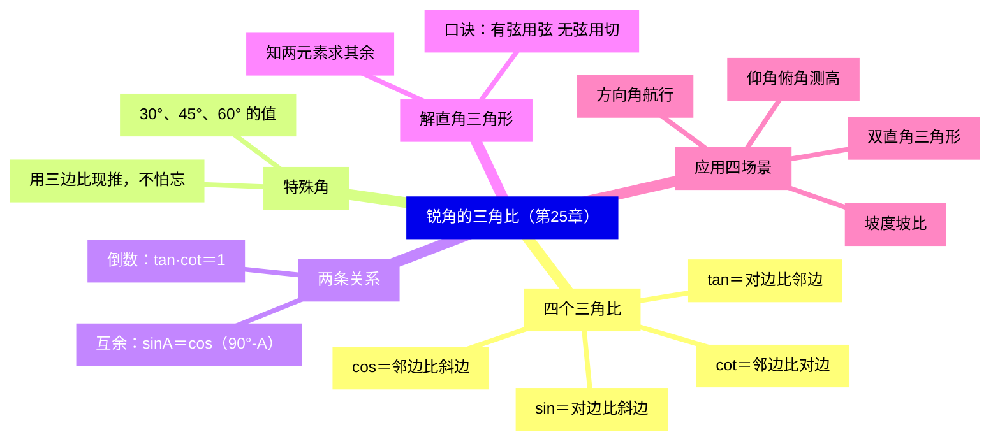
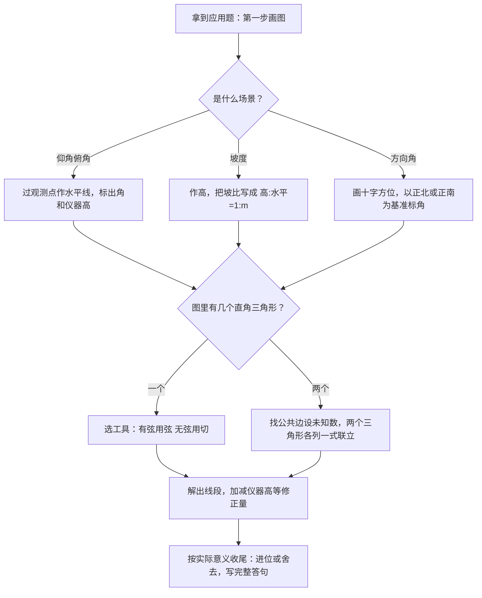

# 锐角的三角比与解直角三角形（详解版）

> **使用说明**：本文是详解版，从"为什么"讲起供从头自学；考前速查和掌握度跟踪在概要版：[[03-数学/知识点/九年级/锐角的三角比与解直角三角形]]。

## 0️⃣ 这章学什么 & 中考怎么考

- **这章解决什么问题**：想知道楼有多高，不用爬楼——在地面量一个角度、走一段距离，就能算出来。靠什么？靠"角和边之间的固定关系"。直角三角形里，一个锐角一旦确定，三边的比例就定了（放大缩小都不变），这个固定的比就是**三角比**。本章学四个三角比、特殊角的值，以及"已知部分求全部"的**解直角三角形**，最后用在测高、坡度、航行四类实际问题上。
- **和前后章节的关系**：三角比的本质是[[03-数学/知识点详解/九年级/相似三角形]]里的"相似比"——所有含同一个锐角的直角三角形都相似，对应边比值全一样。它又是[[03-数学/知识点详解/九年级/圆与正多边形]]里圆中直角三角形的常备工具（切线、直径造出的直角三角形常用三角比）。
- **中考怎么考**（依据概要版与专题笔记）：
  - 第 21 题（10 分）常客：解直角三角形应用（仰俯角/坡度/方向角三大场景），见[[03-数学/专题/第21-22题-函数与三角比应用]]。
  - 也常嵌入第 17-18 题压轴填空。
  - **特殊角三角比的值必须瞬间报出**——这是硬要求。
- 一句话总结：**认得清"对边、邻边、斜边"，背得出特殊角，会按"有弦用弦、无弦用切"选工具，应用题画图标角，分数就到手。**

### 本章知识地图



## 🧭 先修自检（学不下去先回到这里）

> 下面每一项都是本章的地基。做不出就先去补对应知识，硬学只会更挫败。

| # | 你应该会的 | 自查题（先做再看答案） | 答案 | 不会去哪补 |
| - | ---------- | ---------------------- | ---- | ---------- |
| 1 | 勾股定理 | 直角边 5 和 12，斜边多长？ | $\sqrt{25+144}=13$ | [[03-数学/知识点/00-六至八年级核心公式定理总表]]（几何·直角三角形） |
| 2 | 比与分数化简 | 化简 $\dfrac{\sqrt3}{3}$、$\dfrac{1}{\sqrt2}$ | $\dfrac{\sqrt3}{3}$ 已最简；$\dfrac{1}{\sqrt2}=\dfrac{\sqrt2}{2}$（分母有理化） | 同上（数与式·二次根式） |
| 3 | 互余 | 一个角是 $35°$，它的余角是多少？ | $90°-35°=55°$ | 同上 |
| 4 | 相似三角形 | 两个直角三角形有一个锐角相等，它们相似吗？ | 相似（两角对应相等：直角 + 这个锐角） | [[03-数学/知识点详解/九年级/相似三角形]] |
| 5 | 解简单方程 | 由 $\dfrac{h}{30}=\dfrac{\sqrt3}{3}$ 求 $h$ | $h=30\times\dfrac{\sqrt3}{3}=10\sqrt3$ | [[03-数学/知识点/00-六至八年级核心公式定理总表]] |

**自查题做错的，先把那一项补上再往下读。第 4 项是整章的"魂"：三角比就是相似比。**

## 🌱 概念从头讲

> 每个概念按"**为什么需要它 → 它是什么 → 符号与记号含义 → 容易想错的地方**"四步讲。

### 概念 1：为什么需要三角比（从相似到定值）

- **为什么需要**：相似三角形告诉你"对应边成比例"，但每个三角形的比例都不一样，用起来要现证现算。人们发现：只要**锐角相同**，直角三角形的对应边比值就是一个**定值**——干脆给这些定值起名字，做成查表就能用的工具。
- **是什么**：在直角三角形中，锐角 $\alpha$ 的**对边与斜边的比**是定值，叫 $\alpha$ 的正弦；另外三种边的比也各有名字。这四个定值合称**三角比**。
- **符号/记号**：$\sin\alpha$、$\cos\alpha$、$\tan\alpha$、$\cot\alpha$（读作正弦、余弦、正切、余切）。注意 $\sin\alpha$ 是一个**整体记号**，不是 $\sin\times\alpha$。
- **容易想错**：❌ 在任意三角形里直接用三角比。 → 三角比**只在直角三角形中有定义**。斜三角形必须先作高、拆出直角三角形（见易错表）。

### 概念 2：四个三角比的定义（对边、邻边跟着角走）

- **是什么**：Rt△ABC 中 $\angle C=90°$，对角 $A$ 而言：

$$\sin A=\dfrac{对边}{斜边}\qquad \cos A=\dfrac{邻边}{斜边}\qquad \tan A=\dfrac{对边}{邻边}\qquad \cot A=\dfrac{邻边}{对边}$$

- **符号/记号**：
  - **斜边**：直角所对的那条边（最长，图中 $AB$）。
  - **对边**：正对着角 $A$ 的直角边（图中 $BC$）。
  - **邻边**：角 $A$ 旁边的那条直角边（图中 $AC$）。
  - 换成角 $B$：$AC$ 变成对边、$BC$ 变成邻边——**对边、邻边跟着角换位**。
- **容易想错**：❌ 把"对边、邻边"记成固定某条边。 → 自救口诀：**"对边是对着角的，邻边是挨着角的，斜边永远对着直角"**。每次先圈出角，再指边。

```text
（示意图，非严格比例）∠C=90° 的直角三角形

        C
        |\
        | \
  b=AC  |  \  c=AB（斜边，对着直角 C）
        |   \
        |  90°\
        A──────B
           a=BC

  对角 A 来说：BC 是对边，AC 是邻边
  换成角 B：AC 是对边，BC 是邻边 —— 对边邻边跟着角走！
```

### 概念 3：特殊角三角比（30°、45°、60°）

- **为什么需要**：这三个角最常见，考试要求**瞬间报出**它们的三角比值。
- **是什么**：不用死背表——记住两个三角形的**三边比**，用定义现推，永远不怕忘：
  - 30°-60°-90°：三边比 $1:\sqrt3:2$（30° 角对最短的边 1）。
  - 45°-45°-90°：三边比 $1:1:\sqrt2$（等腰直角三角形）。
- **符号/记号**：完整速查表见"公式逐个拆解"。
- **容易想错**：❌ $\sin30°$ 和 $\cos30°$ 记串。 → 现推：30° 的**对边**是 1，斜边 2，$\sin30°=\dfrac{1}{2}$；30° 的**邻边**是 $\sqrt3$，$\cos30°=\dfrac{\sqrt3}{2}$。画个三角形 10 秒推出来，比硬背稳。

```text
（示意图，非严格比例）记不住表？画这两个三角形现推

  30-60-90：三边比 1 : √3 : 2          45-45-90：三边比 1 : 1 : √2

      B                                      B
      |\                                      |\
    1 |  \  2                              1 |  \  √2
      |    \                                  |    \
      |  60°  \                              |  45°  \
      C───────A                              C────────A
         √3                                       1

  ∠A=30°：sin30°=1/2（对1比斜2）       ∠A=45°：sin45°=1/√2=√2/2
          cos30°=√3/2（邻√3比斜2）             cos45°=√2/2
```

### 概念 4：互余关系与倒数关系

- **为什么需要**：少背一半！两个锐角互余时，一个角的三角比能用另一个角"翻译"过来。
- **是什么**：
  - **互余关系**：$\sin A=\cos(90°-A)$，$\cos A=\sin(90°-A)$。直观：角 $A$ 的对边，恰是它的余角 $(90°-A)$ 的邻边，分母都是斜边，所以换了个名字。
  - **倒数关系**：$\tan A\cdot\cot A=1$（对边比邻边 与 邻边比对边 互为倒数）。
- **符号/记号**：验算例子：$\sin30°=\dfrac{1}{2}=\cos60°$ ✓；$\tan30°=\dfrac{\sqrt3}{3}$，$\cot30°=\sqrt3$，乘积 $1$ ✓。
- **容易想错**：❌ 以为"互余关系"是 $\sin A=\sin(90°-A)$。 → 互余换的是**函数名**（sin 换 cos），不是照抄。

### 概念 5：解直角三角形

- **为什么需要**：实际测量往往只能得到"两个信息"（比如一段距离和一个角），要把剩下的边角全算出来。
- **是什么**：直角三角形六个元素（三边 + 两锐角 + 直角），除直角外，**知道两个元素（其中至少一个是边），就能求出其余全部**。过程就是反复选对三角比 + 勾股。
- **符号/记号**：开头必须写"**在 Rt△××× 中**"，写明哪个角——这是上海卷的规范分。
- **容易想错**：❌ 只给两个角就想解三角形。 → 两个角不含任何边的长度信息（形状定了、大小没定），必须有边。

### 概念 6：十六字口诀（选工具的说明书）

- **为什么需要**：一个直角三角形能列的三角比式子有四五个，选错工具就绕远路、多算多错。
- **是什么**：**"有弦用弦，无弦用切；宁乘毋除，取原避中。"**
  - 有弦用弦：已知斜边或求斜边 → 用 $\sin$、$\cos$（它们都带斜边）。
  - 无弦用切：斜边不出现 → 用 $\tan$、$\cot$。
  - 宁乘毋除：能用乘法就不用除法（$10\times\sin30°$ 比 $\dfrac{5}{\sin60°}$ 好算且不易错）。
  - 取原避中：用**原始数据**算最后一步，别用中间的近似值（近似值传误差）。
- **容易想错**：❌ 中途取了近似数继续算。 → 带 $\sqrt3$、$\pi$ 等精确值一路算到底，最后一步再按要求取近似。

### 概念 7：应用题四大场景（第 21 题的舞台）

| 场景 | 关键动作 | 图上要标什么 |
| ---- | ---- | ---- |
| 仰角俯角测高 | 过观测点作**水平线**；视线在水平线上方叫仰角、下方叫俯角；**别忘测角仪高度** | 水平线、视线、仪器高 |
| 坡度坡比 | 坡度 $i=\tan\alpha=\dfrac{h}{l}$，**规定写成 $1:m$ 形式**（高比水平） | 坡面、高、水平距离 |
| 方向角航行 | 基准是**正北或正南**（"北偏东 60°"从北往东数）；求最近距离 → 过目标作航线的垂线段 | 十字方位、目标、航线 |
| 双直角三角形 | 作高拆图，找**公共边**设未知数，两个三角形各列一式联立 | 公共边、两个直角标记 |

```text
（示意图，非严格比例）仰角：从水平线往上看

  A（塔顶）
  |\
  | \
  |  \ 视线
  |   \
  E────D   ← 过 D 的水平线；∠ADE 是仰角
  |    |
BE|    | CD（测角仪高）
  |    |
  B────C
  塔高 AB = AE + BE（视线抬高 + 仪器高）

（示意图，非严格比例）坡度：升高与水平前进的比

  A
  |\
h | \ ← 坡面 AB
  |  \
  B───C
    l

  i = tanα = h : l，规定写成 1 : m
  例：升高 2、水平 6 → i = 2:6 = 1:3
```

```text
（示意图，非严格比例）方向角：从正北或正南数起

            N 北
            │
            │   P（北偏东 60°）
            │  ╱
            │ ╱
            │╱
   西 ──────A──────── 东
            │
            S 南

  射线 AP 与正北夹 60° → 北偏东 60°
  常用转化：AP 与正东的夹角 = 90°-60° = 30°
```

## 🧮 公式逐个拆解

> 每个公式都必须能回答四件事：每个符号是什么？什么时候能用？怎么变形？配一个一步能算的最小例子。

### 公式 1：正弦 $\sin A=\dfrac{对边}{斜边}$

| 符号 | 含义 | 注意 |
| ---- | ---- | ---- |
| $\sin A$ | 角 $A$ 的正弦 | 只在**直角三角形**中定义；$A$ 是锐角 |
| 对边 | 角 $A$ 正对着的直角边 | 跟着角 $A$ 走 |
| 斜边 | 直角的对边（最长） | 永远对着直角 |

- 成立条件：$\angle C=90°$ 的直角三角形。
- 常用变形：**对边 = 斜边 × $\sin A$**；**斜边 = 对边 ÷ $\sin A$**（"知二求一"）。
- 最小例子：斜边 10，$\angle A=30°$，对边 $=10\times\sin30°=10\times\dfrac{1}{2}=5$。**验算**：这也符合"30° 角所对直角边等于斜边一半"✓。

### 公式 2：余弦 $\cos A=\dfrac{邻边}{斜边}$

- 符号含义：邻边是角 $A$ 旁边的直角边。
- 成立条件：同上，直角三角形。
- 常用变形：**邻边 = 斜边 × $\cos A$**；**斜边 = 邻边 ÷ $\cos A$**。
- 最小例子：斜边 $2\sqrt2$，$\angle A=45°$，邻边 $=2\sqrt2\times\dfrac{\sqrt2}{2}=2$。**验算**：$45°$ 等腰直角三角形两直角边相等，斜边 $=\sqrt{2^2+2^2}=2\sqrt2$ ✓。

### 公式 3：正切 $\tan A=\dfrac{对边}{邻边}$

- 符号含义：不含斜边的比，斜边不在场时用它。
- 成立条件：直角三角形。
- 常用变形：**对边 = 邻边 × $\tan A$**；**邻边 = 对边 ÷ $\tan A$**。
- 最小例子：邻边 1，$\angle A=60°$，对边 $=1\times\tan60°=\sqrt3$。**验算**：三边 $1:\sqrt3:2$，$\dfrac{\sqrt3}{1}$ ✓。

### 公式 4：余切 $\cot A=\dfrac{邻边}{对边}$（$\tan A$ 的倒数）

- 符号含义：$\tan$ 的分子分母对调。
- 成立条件：直角三角形。
- 常用变形：$\tan A\cdot\cot A=1$；$\cot A=\dfrac{1}{\tan A}$。
- 最小例子：$\cot60°=\dfrac{\sqrt3}{3}$。**验算**：$\tan60°\times\cot60°=\sqrt3\times\dfrac{\sqrt3}{3}=1$ ✓。

### 公式 5：特殊角三角比速查表（必须瞬间报出）

| | 30° | 45° | 60° |
| ---- | ---- | ---- | ---- |
| $\sin$ | $\dfrac{1}{2}$ | $\dfrac{\sqrt2}{2}$ | $\dfrac{\sqrt3}{2}$ |
| $\cos$ | $\dfrac{\sqrt3}{2}$ | $\dfrac{\sqrt2}{2}$ | $\dfrac{1}{2}$ |
| $\tan$ | $\dfrac{\sqrt3}{3}$ | $1$ | $\sqrt3$ |
| $\cot$ | $\sqrt3$ | $1$ | $\dfrac{\sqrt3}{3}$ |

- 记法：45° 那一列四个值全是 $\dfrac{\sqrt2}{2}$ 或 1（等腰直角三角形两直角边相等）；30° 与 60° 互余，靠"$\sin A=\cos(90°-A)$"互查：$\sin30°=\cos60°=\dfrac{1}{2}$。
- 自查方法：任选一格，画三角形 10 秒现推，推不出就回概念 3。

### 公式 6：互余关系 $\sin A=\cos(90°-A)$

- 符号含义：互余的两角，"sin 与 cos 换名"后相等。
- 成立条件：$A$ 为锐角，两角互余（和为 $90°$）。
- 常用变形：$\cos A=\sin(90°-A)$；考试常用来把"陌生的 50°"变成"熟悉的 40°"。
- 最小例子：$\sin40°=\cos50°$。**验算逻辑**：40° 的对边是 50° 的邻边，分母同为斜边，比值当然相等 ✓。

### 公式 7：坡度 $i=\tan\alpha=\dfrac{h}{l}$（写成 $1:m$）

| 符号 | 含义 | 注意 |
| ---- | ---- | ---- |
| $i$ | 坡度（坡比） | **规定写成 $1:m$**，1 对应"高" |
| $\alpha$ | 坡角 | 坡面与水平面的夹角 |
| $h$ | 竖直升高量 | — |
| $l$ | 水平前进量 | — |

- 成立条件：坡面是直角三角形的斜边（高 ⊥ 水平）。
- 常用变形：由 $1:m$ 反求：升高 $h$ 时水平前进 $mh$；坡面长用勾股 $\sqrt{h^2+l^2}$。
- 最小例子：坡比 $1:2$（升高 1 前进 2），若升高 3 米，水平前进 6 米，坡面长 $\sqrt{3^2+6^2}=\sqrt{45}=3\sqrt5$ 米。**验算**：$9+36=45$ ✓。

## 🪜 例题阶梯

> 三级台阶，每一级都要动笔跟着算，不许只看。

### 第 1 级 · 入门（照着模仿）

> **题目**：Rt△ABC 中，$\angle C=90°$，斜边 $AB=8$，$\angle A=30°$。求 $BC$ 和 $AC$ 的长。
>
> **每一步为什么这么做**：
> - 开头写"在 Rt△ABC 中"，指明在哪个三角形、哪个角上操作（规范分）。
> - 已知斜边 → "有弦用弦"：求 $BC$（$A$ 的对边）用 $\sin A$，求 $AC$（$A$ 的邻边）用 $\cos A$。
> - 都用乘法（宁乘毋除）。
>
> **完整解答**：
> 在 Rt△ABC 中，$\angle C=90°$，$\angle A=30°$，$AB=8$。
> $\sin A=\dfrac{BC}{AB}$，所以 $BC=AB\cdot\sin30°=8\times\dfrac{1}{2}=4$。
> $\cos A=\dfrac{AC}{AB}$，所以 $AC=AB\cdot\cos30°=8\times\dfrac{\sqrt3}{2}=4\sqrt3$。
> **验算**：勾股 $BC^2+AC^2=16+48=64=8^2$ ✓；$BC=4$ 恰为斜边一半，符合 30° 角性质 ✓。

### 第 2 级 · 标准（仰角测高：别忘测角仪高度）

> **题目**：小华用测角仪在 $D$ 处测得塔顶 $A$ 的仰角为 $30°$。测角仪高 $CD=1.5$ 米，$C$ 到塔底 $B$ 的水平距离为 $30$ 米。求塔高 $AB$（结果保留根号）。
>
> **读题→翻译成数学语言**：观测点 $D$ 离地 1.5 米，仰角从 $D$ 量。过 $D$ 作水平线交 $AB$ 于 $E$，把塔拆成两段：$AE$（直角三角形里算）+ $BE$（等于仪器高）。
>
> **每一步为什么这么做**：
> - 作水平线 $DE\perp AB$：把"斜着的视线"装进直角三角形。
> - $BE=CD=1.5$：水平线到地面的距离处处相等。
> - 在 Rt△AED 中用 $\tan$（已知邻边 $DE=30$ 求对边 $AE$）："无弦用切"。
>
> **完整解答**：
> 过 $D$ 作 $DE\perp AB$ 于 $E$。则 $BE=CD=1.5$ 米，$DE=BC=30$ 米。
> （依据：水平线平行于地面，夹在平行线间的竖直段相等。）
> 在 Rt△AED 中，$\angle ADE=30°$，$\tan\angle ADE=\dfrac{AE}{DE}$，
> 所以 $AE=30\times\tan30°=30\times\dfrac{\sqrt3}{3}=10\sqrt3$（米）。
> 塔高 $AB=AE+BE=10\sqrt3+1.5$（米）$\approx18.8$ 米。
> **验算**：$\dfrac{10\sqrt3}{30}=\dfrac{\sqrt3}{3}=\tan30°$ ✓；$10\sqrt3\approx17.32$，加 1.5 得 18.82 ✓。
>
> **易错提醒**：漏加 1.5 是这题最常见的丢分点——仪器站在地面，眼睛不在地面。

```text
（示意图，非严格比例）例 2 配图

  A（塔顶）
  |\
  | \
  |  \ 视线（仰角 30°）
AE|   \
  |    \
  E─────D   ← 过 D 的水平线
  |     |
BE|     | CD=1.5
  |     |
  B─────C
     30 米

  AB = AE + BE
```

### 第 3 级 · 提高（双直角三角形：设公共边列方程）

> **题目**：在地面上 $C$ 处测得塔顶 $A$ 的仰角为 $30°$，沿 $BC$ 方向向塔前进 $30$ 米到 $D$ 处，测得仰角为 $60°$。求塔高 $AB$（测角高度忽略不计，结果保留根号）。
>
> **思路从哪来**：图里有**两个**直角三角形，共用塔高 $AB$ 和塔底 $B$。塔高 $h$ 不能由任何一个三角形单独算出（各缺一条边）——标准动作：设塔高 $h$，把地面上的两段长度都用 $h$ 表示，再利用"两段相差 30"列方程。
>
> **完整解答**：
> 第一步：设塔高 $AB=h$ 米，$BC=x$ 米。
> 第二步：在 Rt△ABC 中，$\tan30°=\dfrac{h}{x}$，所以 $x=\dfrac{h}{\tan30°}=\sqrt3 h$。
> （这一步为什么这么做：把 $x$ 用 $h$ 表示——两个三角形靠"差 30 米"联系起来。）
> 第三步：在 Rt△ABD 中，$\tan60°=\dfrac{h}{x-30}$，所以 $x-30=\dfrac{h}{\tan60°}=\dfrac{h}{\sqrt3}$。
> 第四步：把 $x=\sqrt3h$ 代入：$\sqrt3h-30=\dfrac{h}{\sqrt3}$。
> 两边同乘 $\sqrt3$：$3h-30\sqrt3=h$，即 $2h=30\sqrt3$，$h=15\sqrt3$。
> 所以塔高 $15\sqrt3$ 米 $\approx26.0$ 米。
> **验算**：$BC=\sqrt3\times15\sqrt3=45$，$BD=45-30=15$；$\tan60°=\dfrac{15\sqrt3}{15}=\sqrt3$ ✓，$\tan30°=\dfrac{15\sqrt3}{45}=\dfrac{\sqrt3}{3}$ ✓。
>
> **和入门题的差别**：入门题一个三角形、一步乘法；这题两个三角形各缺一条边，必须**设未知数、找公共量、列方程**——这正是概要版"双直角三角形：公共边设未知数列方程"的标准流程，也是从"解三角形"跨到"方程思想"的一步。

```text
（示意图，非严格比例）例 3 配图：双直角三角形

  A（塔顶）
  │╲  ╲
  │ ╲    ╲
  │  ╲      ╲
h │   ╲        ╲
  │    ╲          ╲
  B─────D──────────C
        ←BD→←─30米─→
     仰角60°      仰角30°

  △ABD 与 △ABC 共用高 AB
```

## 🗺️ 解题流程图



## 🔥 易错点：为什么会错

| ❌ 常见错误想法 | 为什么会这样想 | ✅ 正确理解 / 自救方法 |
| -------------- | -------------- | ---------------------- |
| 非直角三角形直接用三角比 | 图看着"差不多直" | 三角比只在直角三角形有定义。先作高：等腰三角形作底边上的高（三线合一），一般三角形作一条垂线拆成两个直角三角形 |
| 对边、邻边认死 | 记成"固定那条" | 对边对着角、邻边挨着角，换角就换位。先圈角、再指边 |
| 忘加测角仪高度 | 把"眼睛"当"脚" | 物高 = 视线抬高 + 仪器高。画图时把仪器高单独标出来 |
| 结果不进位、不舍去 | 按纯数学题处理 | 实际问题看要求：地毯长度要**向上取整**（买少了不够），人数、件数取整数；题目写"保留根号"就别化成小数 |
| 开头不写"在 Rt△××× 中" | 觉得啰嗦 | 上海卷规范要求：写明三角形和角，否则扣过程分 |
| 坡度写成 $m:1$ 或高、水平颠倒 | 对"1:m"方向没概念 | 坡度 $i=\tan\alpha=\dfrac{h}{l}$，规定写成 $1:m$，1 对应**高**。代个数自检：$1:2$ 的坡，升高 1 前进 2，坡比小于 1，坡较缓 ✓ |
| 等腰三角形求角只算一种 | 默认底角是锐角 | 等腰三角形顶角可以是钝角，图形有两种；作图分类后再算（多解情形） |
| 中途取近似继续算 | 图省事 | 取原避中：带 $\sqrt3$ 等精确值算到底，最后一步再近似 |

## ✅ 自测清单（能独立做到才打勾）

- [ ] 1. 能不看书写出四个三角比的定义，并指着图形说清"对边、邻边、斜边"各是哪条
- [ ] 2. 能用两个特殊三角形的三边比（$1:\sqrt3:2$ 与 $1:1:\sqrt2$）现推出全部特殊角三角比
- [ ] 3. 能说出互余关系与倒数关系，并用 $\sin30°=\cos60°$、$\tan30°\cdot\cot30°=1$ 验证
- [ ] 4. 能默写十六字口诀，并解释每句在选什么工具
- [ ] 5. 能独立做出例题阶梯第 1、2 级，开头写"在 Rt△××× 中"
- [ ] 6. 能独立完成第 3 级：设公共量、列方程、解出并验算
- [ ] 7. 能说出坡度 $1:m$ 的含义并做一个小计算
- [ ] 8. 能说出本章 3 个易错点及自救方法

## 🔗 关联

- 概要版：[[03-数学/知识点/九年级/锐角的三角比与解直角三角形]]（掌握度在这边更新）
- 闪卡：[[03-数学/闪卡/公式定理速记]]（特殊角三角比做成闪卡滚动背）
- 前置知识：[[03-数学/知识点/00-六至八年级核心公式定理总表]]（勾股、二次根式）
- 兄弟详解：[[03-数学/知识点详解/九年级/相似三角形]]（三角比的本质是相似比）· [[03-数学/知识点详解/九年级/圆与正多边形]]（圆中直角三角形常用三角比）
- 相关专题：[[03-数学/专题/第21-22题-函数与三角比应用]] · [[03-数学/专题/中考题型地图]]
