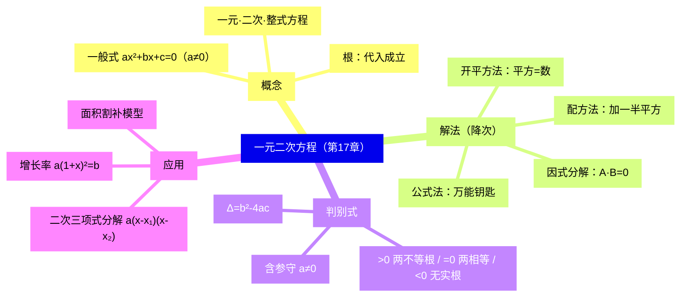
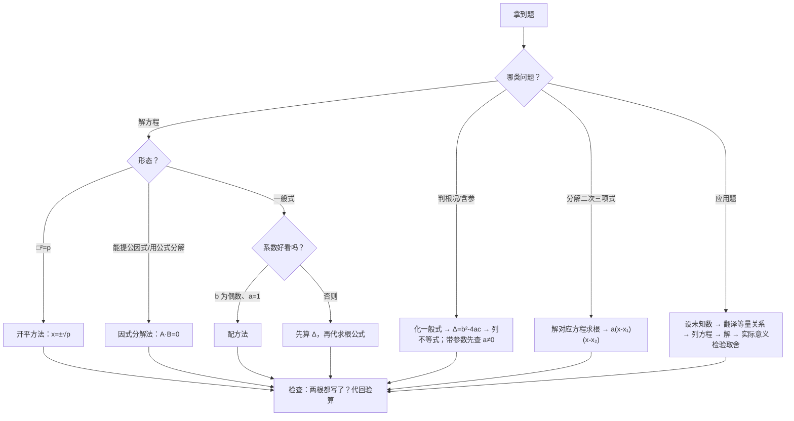

# 一元二次方程（详解版）

> [!note] 使用说明
> 本文是详解版，从"为什么"讲起供从头自学；考前速查和掌握度跟踪在概要版：[[03-数学/知识点/八年级/一元二次方程]]。

## 0️⃣ 这章学什么 & 中考怎么考

- **这章解决什么问题**：一元一次方程只能解"和差倍分"这类线性问题。但很多实际问题的等量关系里出现了"面积的平方项"：绿地长比宽多 10 米、面积 1200 平方米，设宽为 $x$ 得 $x(x+10)=1200$——展开就是 $x^2+10x-1200=0$，未知数的**最高次数是 2**。这类方程就是一元二次方程，本章学它的概念、四种解法、根的判别式和两类应用。
- **和前后章节的关系**：往前，你要会分解因式、配方、开平方，还要会二次根式的运算（求根公式里有 $\sqrt{b^2-4ac}$，见[[03-数学/知识点/八年级/二次根式]]）；往后，九年级二次函数令 $y=0$ 求与 $x$ 轴交点，解的就是一元二次方程，判别式直接决定抛物线和 $x$ 轴有几个交点（[[03-数学/知识点/九年级/二次函数]]）。
- **中考怎么考**（依据概要版，不编造分值）：
  - 选合适方法解方程（开平方/因式分解/公式）；
  - 判别式定根况、含参求范围；
  - 增长率、面积两类应用题。
- 一句话总结：**解方程的核心动作只有一个——降次（把二次降成一次）；判别式是"不解方程就预知根况"的探测器；应用题的根要过"实际意义"这一关。**

### 学完本章，你应该能做到

1. 化一般式、读准 $a$、$b$、$c$，并说清 $a\ne0$ 的原因。
2. 拿到方程先判断形态，选最快的解法（开平方 → 因式分解 → 公式）。
3. 独立推导求根公式，并用它解释判别式为什么"管"根况。
4. 用判别式处理含参问题，守住"$a\ne0$"这条暗线。
5. 列方程解增长率、面积问题，并对根做实际意义检验。

### 本章知识地图

## 🧭 先修自检（学不下去先回到这里）

> [!note] 先修自检怎么用
> 下面每一项都是本章的地基。做不出就先去补对应知识，硬学只会更挫败。

| # | 你应该会的 | 自查题（先做再看答案） | 答案 | 不会去哪补 |
| - | ---------- | ---------------------- | ---- | ---------- |
| 1 | 分解因式 | 分解 $x^2-3x$、$x^2-9$ | $x(x-3)$；$(x+3)(x-3)$ | [[03-数学/知识点/00-六至八年级核心公式定理总表]] |
| 2 | 完全平方 | 把 $x^2+6x$ 补成完全平方式 | $x^2+6x+9=(x+3)^2$（加的是一次项系数一半的平方） | 同上 |
| 3 | 开平方 | $x^2=25$ 的解是？ | $x=\pm5$（两个，别丢负的） | 同上 |
| 4 | 二次根式 | $\sqrt{25}$、$\sqrt{\dfrac{4}{9}}$ 等于多少？ | $5$；$\dfrac23$ | [[03-数学/知识点详解/八年级/二次根式]] |
| 5 | 列一元一次方程 | 长比宽多 10、周长 120，设宽 $x$ 列方程 | $2(x+x+10)=120$ | 同上（方程板块） |

**自查题做错的，先把那一项补上再往下读。第 1～3 项分别对应本章三种解法。**

## 🌱 概念从头讲

> [!note] 概念讲法约定
> 每个概念按"**为什么需要它 → 它是什么 → 符号与记号含义 → 容易想错的地方**"四步讲。

### 概念 1：一元二次方程的定义与一般式

- **为什么需要**：绿地问题（周长 120、长比宽多 10）用一元一次方程就能解；把"周长 120"换成"面积 1200"，等量关系变成 $x(x+10)=1200$，展开后最高次数是 2——旧工具失效，需要给"这类方程"起个名字、立一套解法。
- **定义**：只含**一个**未知数，并且未知数的最高次数是 **2** 的**整式**方程，叫做一元二次方程。三个关键词缺一不可：一元（一个未知数）、二次（最高次数 2）、整式（无分母含未知数）。
- **符号/记号**：一般式 $ax^2+bx+c=0$（$a\ne0$）。$ax^2$ 叫二次项，$a$ 是二次项系数；$bx$ 叫一次项，$b$ 是一次项系数；$c$ 叫常数项。**必须先化成一般式（去括号、移项、合并），再读系数**。
- **为什么必须 $a\ne0$**：若 $a=0$，二次项消失，方程退化成 $bx+c=0$——那是一元一次方程，判别式、求根公式全都不适用（公式里 $a$ 在分母，$a=0$ 直接无意义）。所以"$a\ne0$"是这类方程的身份标识。
- **容易想错**：
  - ❌"式子里有 $x^2$ 就是一元二次方程。" → 先化简再数次数：$(x+1)(x-4)=x^2-2x$ 展开后是 $-3x-4=0$，二次项抵消，**是**一元一次方程；$\dfrac1{x^2}+3x-1=0$ 含分式，不是整式方程。
  - ❌ 直接照抄原式的系数。 → 如 $2x(x-1)=3x-4$ 要先展开移项得 $2x^2-5x+4=0$，才能读出 $a=2,b=-5,c=4$——**别把展开前的"3、-4"当系数**。

### 概念 2：方程的根与"根的个数"

- **是什么**：使方程成立的未知数的值叫方程的**根**。判断一个数是不是根，只需**代入检验**：代进去左边 $=0$ 就是根，否则不是。
- **为什么"个数"值得单独讲**：一元一次方程要么一个根、要么无解；一元二次方程可能是**两个不相等的实数根、两个相等的实数根（习惯上算一个根，记 $x_1=x_2$）、或没有实数根**——"没有实数根"是新现象（如 $x^2+1=0$，任何实数平方后加 1 都是正数）。这个差别由判别式统一解释（见公式 4）。
- **容易想错**：❌ 解出一个根就收工。 → 二次方程"天生"倾向于有两个根，解出一个后要问自己：还有一个呢？（开平方忘了 $\pm$、因式分解漏因式，都是丢第二个根的常见姿势。）

### 概念 3：特殊根的系数特征（0、1、-1）

- **为什么需要**：判定"方程有没有根 0 / 1 / -1"，把根代入比解方程快得多；反过来，"编一个有根 1 的方程"也靠它。
- **推导（把根代入一般式）**：对 $ax^2+bx+c=0$：
  - 代 $x=0$：得 $c=0$——**常数项为零 $\iff$ 有一根为 0**；
  - 代 $x=1$：得 $a+b+c=0$——**系数和为零 $\iff$ 有一根为 1**；
  - 代 $x=-1$：得 $a-b+c=0$——**"交错和"为零 $\iff$ 有一根为 -1**。
- **容易想错**：❌ 见"有一个根是 0"就去解方程。 → 直接令 $c=0$。例如 "$(m-2)x^2+3x+m-4=0$ 有一个根是 0"：代 $x=0$ 得 $m-4=0$，$m=4$；再检查 $a=m-2=2\ne0$ ✓。两步完事。

### 概念 4：解法的总思想——降次

- **为什么需要**：我们会解的是一元一次方程。二次方程的未知数"次数太高"，所有解法的共同动作都是**降次**：把一个二次方程变成两个一次方程。
- **是什么**：四条路，按"快"排序：
  1. **开平方法**：方程已是"$\square^2=p$"的形状，直接开方 $x=\pm\sqrt p$；
  2. **因式分解法**：方程能整理成 $A\cdot B=0$，则 $A=0$ 或 $B=0$，拆成两个一次方程；
  3. **公式法**：一般式万能钥匙（见公式 3），先算判别式再代公式；
  4. **配方法**：把一般式硬配成"$\square^2=p$"，是推导公式的工具、二次函数配顶点的基本功，日常解方程用它最慢。
- **关键依据（零的性质）**：$A\cdot B=0\iff A=0$ 或 $B=0$。**乘积为零则至少一个因数为零**——这就是"降次"在因式分解法里的合法性来源。
- **容易想错**：❌ $2x(x-2)=3(x-2)$ 两边同除以 $(x-2)$。 → 你不知道 $x-2$ 是不是 0！除以一个可能为零的式子，等于悄悄扔掉 $x=2$ 这个根。**含未知数的因式只能移项提公因式**：$(x-2)(2x-3)=0$，得 $x=2$ 或 $x=\dfrac32$。这是单元复习专门设置的错误案例。

## 🧮 公式逐个拆解

> [!note] 公式拆解约定
> 每个公式都必须能回答四件事：每个符号是什么？什么时候能用？怎么变形？配一个一步能算的最小例子。

### 公式 1：开平方法——$(x+m)^2=p$（$p\ge0$）$\iff x+m=\pm\sqrt p$

| 符号 | 含义 | 注意 |
| ---- | ---- | ---- |
| $p$ | 常数 | $p\ge0$ 才有实数解 |
| $\pm$ | 两个平方根 | **两个根都要写** |

- **成立条件**：$p\ge0$。$p<0$ 时无实数解——因为任何实数的平方都 $\ge0$，"平方 = 负数"在实数范围内是空集（这正对应判别式 $\Delta<0$ 的情形）。
- **为什么有 $\pm$**：$x^2=25$ 意思是"平方等于 25 的数"，而 $5^2=25$、$(-5)^2=25$ 都成立，所以 $x=\pm5$。**漏掉负根 = 漏掉一半的解**。
- **常用变形**：$x^2=p$（$m=0$ 的特例）；$2(x+3)^2=49$ 先除以 2 化成标准形。
- **最小例子**：$(x-1)^2=9\Rightarrow x-1=\pm3\Rightarrow x_1=4,\ x_2=-2$。**验算**：$4^2-8\cdot$……直接代原式：$(4-1)^2=9$ ✓，$(-2-1)^2=9$ ✓。

### 公式 2：配方法——两边加"一次项系数一半的平方"

- **是什么**：把 $x^2+bx$ 补成完全平方：$x^2+bx+\Big(\dfrac b2\Big)^2=\Big(x+\dfrac b2\Big)^2$。**为什么加这一项**：完全平方 $(x+k)^2=x^2+2kx+k^2$ 里，一次项系数 $2k$ 与常数项 $k^2$ 的关系是"$k^2$ 是 $2k$ 的一半的平方"。要让 $2k=b$，就得配 $k=\dfrac b2$，补上 $k^2=\dfrac{b^2}4$。**等式两边同时加**，才不改变方程的解。
- **四步流程**（以 $x^2-4x+1=0$ 为例）：
  1. 移项：$x^2-4x=-1$（常数项搬到右边）；
  2. 配方：两边加 $(-2)^2=4$（一次项系数 $-4$ 的一半的平方）：$x^2-4x+4=3$；
  3. 写成平方：$(x-2)^2=3$；
  4. 开平方：$x=2\pm\sqrt3$。
- **二次项系数不是 1 时**：先两边同除以 $a$（如 $2x^2-8x+2=0$ 先除以 2）。
- **最小例子**：如上，$x^2-4x+1=0$ 的解是 $x=2\pm\sqrt3$。**验算**：$x=2+\sqrt3$ 时 $(2+\sqrt3)^2-4(2+\sqrt3)+1=7+4\sqrt3-8-4\sqrt3+1=0$ ✓。

### 公式 3：求根公式 $x=\dfrac{-b\pm\sqrt{b^2-4ac}}{2a}$（$a\ne0$，$b^2-4ac\ge0$）

| 符号 | 含义 | 注意 |
| ---- | ---- | ---- |
| $a,b,c$ | 一般式的三项系数 | 必须先化一般式、含前面的符号 |
| $b^2-4ac$ | 根的判别式 $\Delta$ | 决定能不能开方、开出来几个 |
| $\pm$ | 两个（或相等的）根 | $\Delta=0$ 时两根相等 |

- **完整推导（配方法一般化，建议自己推一遍）**：
  1. 方程 $ax^2+bx+c=0$（$a\ne0$）两边同除以 $a$：$x^2+\dfrac ba x+\dfrac ca=0$；
  2. 移项：$x^2+\dfrac ba x=-\dfrac ca$；
  3. 两边加 $\Big(\dfrac{b}{2a}\Big)^2$：$x^2+\dfrac ba x+\Big(\dfrac{b}{2a}\Big)^2=\Big(\dfrac{b}{2a}\Big)^2-\dfrac ca$；
  4. 左边配成完全平方：$\Big(x+\dfrac b{2a}\Big)^2=\dfrac{b^2-4ac}{4a^2}$；
  5. **关键时刻**：左边 $\ge0$，方程要有解，右边必须 $\ge0$。分母 $4a^2>0$ 恒成立，所以决定权全在分子 $b^2-4ac$ 的符号——**判别式 $\Delta=b^2-4ac$ 就是在这一步自然长出来的**，它回答的问题是"这个方程到底有没有实数解"；
  6. 当 $\Delta\ge0$，开平方：$x+\dfrac b{2a}=\pm\dfrac{\sqrt\Delta}{2a}$，移项即得 $x=\dfrac{-b\pm\sqrt\Delta}{2a}$。
- **最小例子**：$x^2-4x+1=0$：$\Delta=16-4=12$，$x=\dfrac{4\pm\sqrt{12}}2=2\pm\sqrt3$，与配方法结果一致 ✓。

### 公式 4：判别式 $\Delta=b^2-4ac$ 与根况

| $\Delta$ 与 0 的关系 | 根的情况 | 从公式看原因 |
| ---- | ---- | ---- |
| $\Delta>0$ | 两个不相等的实数根 | $\sqrt\Delta$ 是正数，"$+\sqrt\Delta$"与"$-\sqrt\Delta$"给出两个不同值 |
| $\Delta=0$ | 两个相等的实数根（$x_1=x_2=-\dfrac b{2a}$） | $\pm0$ 只给出一个值 |
| $\Delta<0$ | 没有实数根 | $\Big(x+\dfrac b{2a}\Big)^2=$ 负数，不可能 |

- **成立条件**：$a\ne0$。**含字母参数时两条暗线**："有实数根" $\Rightarrow\Delta\ge0$；"两不相等实数根" $\Rightarrow\Delta>0$ **且 $a\ne0$**（$a$ 带参数时务必单独检查，否则方程可能根本不是二次的）。
- **常用变形**：不解方程判根况（先化一般式、读准带符号的 $a,b,c$）；反着用——由根况反求参数范围。
- **最小例子**：$2x^2-2\sqrt6x+3=0$：$\Delta=(2\sqrt6)^2-4\times2\times3=24-24=0$，两相等实数根（17.3 例题 1(3) 同款）。

### 公式 5：二次三项式的因式分解 $ax^2+bx+c=a(x-x_1)(x-x_2)$

- **是什么**：若 $ax^2+bx+c=0$ 的两根为 $x_1,x_2$，则在实数范围内 $ax^2+bx+c=a(x-x_1)(x-x_2)$。
- **为什么成立**：展开右边：$a\big[x^2-(x_1+x_2)x+x_1x_2\big]=ax^2-a(x_1+x_2)x+ax_1x_2$。与一般式对照可知"根之和、根之积"与系数挂钩（这就是韦达定理的雏形）；既然两个根都让左边为零，两边最多差一个非零常数倍，展开核对后就是 $a$ 倍。
- **操作步骤**：①把式子等于 0 解出两根；②照式写出分解，**别漏掉二次项系数 $a$**；③双二次型（如 $2x^2-3xy-y^2$）把 $y$ 视为常数，当关于 $x$ 的二次三项式处理。
- **最小例子**：$2x^2-9x+7=0$ 两根为 $1,\ \dfrac72$，故 $2x^2-9x+7=2(x-1)\Big(x-\dfrac72\Big)=(x-1)(2x-7)$。**验算**：展开 $(x-1)(2x-7)=2x^2-9x+7$ ✓。

### 公式 6：增长率模型 $a(1+x)^2=b$

| 符号 | 含义 | 注意 |
| ---- | ---- | ---- |
| $a$ | 基准期数量（如 7 月营业额） | 起点 |
| $x$ | 每期相同的增长率 | $x>-1$（增长率为 $-1$ 即清零） |
| $b$ | 两期后的数量 | 期数是 2 就平方，三期就立方 |

- **为什么这样列**：7 月 $a$，8 月是 $a(1+x)$（增长 $x$ 就是变为原来的 $1+x$ 倍），9 月在 8 月基础上再乘 $(1+x)$，得 $a(1+x)^2$。**两次增长是"复利"关系，不是 $a+2ax$**。
- **解后必做**：$x$ 通常有正负两解，负根要过"实际意义"关——增长率 $x\ge-1$，且题目语境下一般取正。
- **最小例子**：$350(1+x)^2=504\Rightarrow(1+x)^2=1.44\Rightarrow1+x=\pm1.2\Rightarrow x=0.2$ 或 $x=-2.2$（舍去），增长率 20%。

## 🪜 例题阶梯

> [!note] 例题怎么用
> 四级台阶，每一级都要动笔跟着算，不许只看。题源均为备课包任务单与课后练习原题。

### 第 1 级 · 入门（化一般式 + 判断根）

> **题目**（17.1 学习任务单 例题 1、例题 2）：①把一元二次方程 $2x(x-1)=3x-4$ 化成一般式，并写出方程中的各项与各项的系数；②判断 20、30、-40 是不是一元二次方程 $x^2+10x=1200$ 的根。
>
> **每一步为什么这么做**：
> - ①读系数前必须先"化一般式"——去括号、移项、合并，顺序不能乱。
> - ②判断是不是根，定义就是"代进去成立"，所以**逐个代入**最快，不必解方程。
>
> **完整解答**：
> ① 展开：$2x^2-2x=3x-4$；移项合并：$2x^2-5x+4=0$。
> 所以二次项系数 $a=2$，一次项系数 $b=-5$，常数项 $c=4$。
> （注意 $b$ 是 $-5$ 不是 5——**符号跟着项走**。）
> ② 代 $x=20$：$400+200=600\ne1200$，不是根；
> 代 $x=30$：$900+300=1200$ ✓，是根；
> 代 $x=-40$：$1600-400=1200$ ✓，也是根。
> **验算与发现**：$x^2+10x=1200$ 即 $x^2+10x-1200=0$，分解得 $(x+40)(x-30)=0$，两根恰为 $30$ 和 $-40$——**负根也是根**，别因为"长度不能为负"就提前丢掉：它是不是合理解，要到应用题的"检验"那一步才做。
>
> **变式提醒**：若问"方程 $(m-2)x^2+3x+m-4=0$ 有一个根是 0，求 $m$"——代 $x=0$ 得 $m-4=0$，$m=4$，再检查二次项系数 $m-2=2\ne0$ ✓。"代根列式"比重解一遍方程快得多。

### 第 2 级 · 标准（四种形态选四种方法）

> **题目**（单元复习与小结 课后练习 第 6 题）：选择适当的方法解下列方程：
> (1) $(2-3x)^2-5=0$；(2) $x^2-4x+1=0$；(3) $x(x-2)+x-2=0$；(4) $(x+1)^2-4(x+1)-45=0$。
>
> **读题→翻译成数学语言**：选法的口诀是**看形态**——"平方 = 数"用开平方；能提公因式用因式分解；一般的用公式（或配方）；整体结构重复的，把"整体"当一个字母。
>
> **完整解答**：
> (1) 形态是"$\square^2=5$"，用开平方法：$(2-3x)^2=5$，$2-3x=\pm\sqrt5$，$3x=2\mp\sqrt5$，
> 得 $x_1=\dfrac{2+\sqrt5}{3}$，$x_2=\dfrac{2-\sqrt5}{3}$。
> （移项时 $2-3x=\pm\sqrt5$，两边除以 $-3$ 会翻 $\pm$，把 $-3x$ 移成 $3x=2\mp\sqrt5$ 更不容易错——**两根对调了无所谓，写全就行**。）
> (2) 二次项系数是 1、一次项系数是偶数，**配方最快**：$x^2-4x=-1$，加 $(-2)^2=4$：$(x-2)^2=3$，$x=2\pm\sqrt3$。
> （用公式法也可以，$\Delta=16-4=12$，$x=\dfrac{4\pm\sqrt{12}}2=2\pm\sqrt3$，殊途同归。）
> (3) 右边是 0 且有公因式 $(x-2)$，**因式分解**：$x(x-2)+(x-2)=0\Rightarrow(x-2)(x+1)=0$，得 $x_1=2$，$x_2=-1$。
> （千万别两边除以 $(x-2)$——那会把 $x=2$ 扔掉，只剩 $x=-1$，**丢一半的解**。）
> (4) 把 $(x+1)$ 看成一个整体 $t$：$t^2-4t-45=0$，分解 $(t-9)(t+5)=0$，$t=9$ 或 $t=-5$；回到 $x$：$x+1=9\Rightarrow x=8$；$x+1=-5\Rightarrow x=-6$。
> （**换元思想**：整体出现两次时，先解"整体"的方程再回代，避免展开成 $x^2-2x-50=0$ 自找麻烦。）
> **验算**：(4) 代 $x=8$：$81-36-45=0$ ✓；代 $x=-6$：$25+20-45=0$ ✓。
>
> **变式提醒**：四小题对应四种形态——考试拿到方程，先花 10 秒扫一遍：能开方吗？能提公因式吗？整体重复吗？都不行才上公式。

### 第 3 级 · 提高（判别式含参）

> **题目**（单元复习与小结 课后练习 第 5 题）：如果关于 $x$ 的一元二次方程 $-x^2+(2k+1)x+2-k^2=0$ 有实数根，求 $k$ 的取值范围。
>
> **思路从哪来**："有实数根"翻译成数学语言就是 $\Delta\ge0$。本题二次项系数是 $-1$，与 $k$ 无关，所以不用担心"$a\ne0$"——但这个检查动作必须做。
>
> **完整解答**：
> 第一步：读系数。一般式即 $-x^2+(2k+1)x+2-k^2=0$，所以 $a=-1$，$b=2k+1$，$c=2-k^2$。
> （$a=-1\ne0$ 恒成立，是真正的一元二次方程，判别式适用 ✓。）
> 第二步：列判别式不等式。
> $\Delta=b^2-4ac=(2k+1)^2-4\times(-1)\times(2-k^2)=(2k+1)^2+4(2-k^2)$。
> （$a=-1$ 让"$-4ac$"变成"$+4(2-k^2)$"——**别忘符号**，这是本题最容易错的一步。）
> 第三步：展开化简。
> $\Delta=4k^2+4k+1+8-4k^2=4k+9$。
> （$k^2$ 恰好抵消——含参判别式经常这样"降维"成一次式。）
> 第四步：解不等式。"有实数根" $\Rightarrow\Delta\ge0$，即 $4k+9\ge0$，得 $k\ge-\dfrac94$。
> **验算**：取 $k=-\dfrac94$：$\Delta=0$，应有两相等实数根。代回方程验证：此时 $b=2k+1=-\dfrac72$，$c=2-k^2=-\dfrac{49}{16}$，方程为 $-x^2-\dfrac72x-\dfrac{49}{16}=0$，即 $16x^2+56x+49=0$，$\Delta=3136-4\times16\times49=3136-3136=0$ ✓。
>
> **变式提醒**：若把条件改成"有**两个不相等**实数根"，答案是 $k>-\dfrac94$（去掉等号）；若二次项系数也含 $k$（如 $kx^2-(2k-1)x+k=0$），则必须再加条件 $k\ne0$——单元复习的问题 3-2 专门演示了漏掉它怎样丢分。另外，"判别式配方恒非负"型（如 $x^2+(m-1)x-m=0$ 的 $\Delta=(m+1)^2\ge0$，对一切 $m$ 都有根，见概要版例题速递）是含参问题的另一种问法：**从"求范围"变成"证恒成立"**。

### 第 4 级 · 压轴（面积应用题 + 根的取舍）

> **题目**（单元复习与小结 学习任务单 问题 1）：一块长方形空地的长是 24 米，宽是 12 米，现要在它的中央划一个小长方形区域种植花卉，其余四周种草，如果四周的宽度相同，小长方形面积是原长方形面积的 $\dfrac59$，那么小长方形的长和宽分别是多少米？
>
> **思路从哪来**：三个未知量（路宽、小长方形长、小长方形宽）其实只有一个自由度——设四周宽为 $x$ 米，小长方形的长宽就都是 $x$ 的式子。等量关系一句话：**小长方形面积 $=$ 原面积的 $\dfrac59$**。
>
> **完整解答**：
> 第一步：设四周宽度为 $x$ 米。
> 第二步：表示小长方形的长与宽。长方向两头各留 $x$ 米：长 $=24-2x$；宽方向同理：宽 $=12-2x$。
> （为什么是 $2x$ 不是 $x$？——**四周**等宽，两头各一条。画个草图，一半的错误都出在没画图。）
> 第三步：列方程。
> $(24-2x)(12-2x)=24\times12\times\dfrac59=160$。
> 第四步：解方程。展开：$288-72x+4x^2=160$，整理：$4x^2-72x+128=0$，两边除以 4：$x^2-18x+32=0$，分解 $(x-2)(x-16)=0$，得 $x_1=2$，$x_2=16$。
> 第五步：**实际意义检验（本题的灵魂）**。
> $x=16$ 时宽 $=12-2x=12-32=-20<0$，宽不可能是负数，**舍去**；
> $x=2$ 时小长方形长 $=24-4=20$ 米，宽 $=12-4=8$ 米，面积 $20\times8=160$ ✓。
> 答：小长方形的长为 20 米、宽为 8 米（四周宽 2 米）。
>
> **再走一步**：增长率问题的同款收尾——单元复习第 8 题里 $350(1+x)^2=504$ 解出 $x=0.2$ 与 $x=-2.2$，后者因"增长率不能低于 $-1$ 且本题语境为增长"舍去。**应用题解完方程只是半场，检验根的实际意义才是全场**。
>
> **和入门题的差别**：入门题是"给方程解方程"；这题多了"设未知数 → 用 $x$ 表示相关量 → 列方程 → 解 → 检验取舍"整条链。列方程的功夫在**翻译**：把"四周等宽""面积是 $\dfrac59$"逐句翻成代数式。

## 🗺️ 解题流程图

## 🔥 易错点：为什么会错

| ❌ 常见错误想法 | 为什么会这样想 | ✅ 正确理解 / 自救方法 |
| -------------- | -------------- | ---------------------- |
| 两边约去含未知数的因式 | 解 $2x(x-2)=3(x-2)$ 时"看着烦就除" | 除数可能为 0，除一次丢一个根。只能**移项提公因式**：$(x-2)(2x-3)=0$ |
| 开平方只取正根 | 习惯了算术平方根不带负号 | 解方程 $x^2=p$ 要**平方根**，两个：$\pm\sqrt p$。解完自查"第二个根呢" |
| 判别式漏查 $a\ne0$ | 只背了 $\Delta>0$ | $a$ 含参数时先写"当 $a\ne0$"。$kx^2-(2k-1)x+k=0$ 两不等实根 $\Rightarrow k\ne0$ 且 $\Delta>0$，两个条件缺一不可 |
| "有实数根"与"两不相等"混用 | 都写着"有根" | 前者 $\Delta\ge0$（等号在内），后者 $\Delta>0$（等号在外） |
| 读系数忘了符号 | 把 $-5x$ 的系数读成 5 | 化一般式后**符号跟项走**：$2x^2-5x+4=0$ 的 $b=-5$ |
| 求根公式里 $-b$ 忘了带符号 | 套模板 | $b$ 本身带符号：$b=-5$ 时 $-b=5$。代公式前先在草稿上列 $a=?\ b=?\ c=?$ |
| 应用题不检验根 | 解出方程就答题 | 负长度、负人数、增长率 $<-1$ 的根要写"不合实际，舍去"。**检验是答题的一部分** |
| $\Delta$ 计算中 $-4ac$ 符号错 | $c$ 为负时慌 | 先把 $a,b,c$ 连符号抄下，再算 $b^2-4ac$，一步一代入 |

## 📝 本讲小结

- **概念**：一元 + 二次 + 整式；一般式 $ax^2+bx+c=0$（$a\ne0$），先化简再读系数；根 = 代入成立。
- **特殊根**：根 0 $\iff c=0$；根 1 $\iff a+b+c=0$；根 $-1\iff a-b+c=0$——代根列式，快过解方程。
- **解法**：核心是==降次==。开平方（平方=数，两根都要）→ 因式分解（$A\cdot B=0$，不许约去含未知数因式）→ 公式法（先算 $\Delta$）→ 配方法（推导公式与配顶点用）。
- **判别式**：$\Delta=b^2-4ac$ 从配方法的"能否开方"一步自然产生；$\Delta>0$ 两不等、$=0$ 两相等、$<0$ 无实根；含参守住 $a\ne0$。
- **因式分解**：$ax^2+bx+c=a(x-x_1)(x-x_2)$，别漏系数 $a$。
- **应用**：增长率 $a(1+x)^2=b$、面积割补 $(长-2x)(宽-2x)=S$；根要过"实际意义"关。

## ✅ 自测清单（能独立做到才打勾）

- [ ] 1. 能说清"一元、二次、整式"三关键词，并举一个"看着像其实不是"的反例
- [ ] 2. 能不看推导独立完成求根公式的配方法推导，并指出判别式在哪一步出现
- [ ] 3. 拿到 $x^2+10x=1200$ 能在 30 秒内判断 20、30、-40 谁是根
- [ ] 4. 能对第 2 级四个方程各说出"为什么选这个方法"
- [ ] 5. 能独立完成第 3 级含参判别式（含 $a\ne0$ 检查与 $\Delta$ 化简）
- [ ] 6. 能独立完成第 4 级面积题，并说清 $x=16$ 为什么舍去
- [ ] 7. 能说出本章 4 个易错点及自救方法

## 🔗 关联

- 概要版：[[03-数学/知识点/八年级/一元二次方程]]（掌握度在这边更新）
- 前置知识：[[03-数学/知识点/00-六至八年级核心公式定理总表]]（分解因式、完全平方公式） · [[03-数学/知识点详解/八年级/二次根式]]（求根公式中的 $\sqrt{b^2-4ac}$）
- 后续：九年级二次函数令 $y=0$ 求交点即解一元二次方程；判别式 ↔ 抛物线与 $x$ 轴交点个数（[[03-数学/知识点/九年级/二次函数]]）
