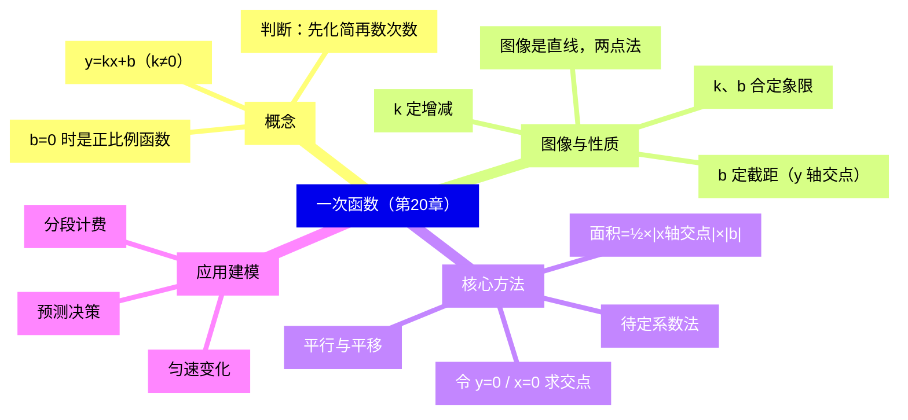
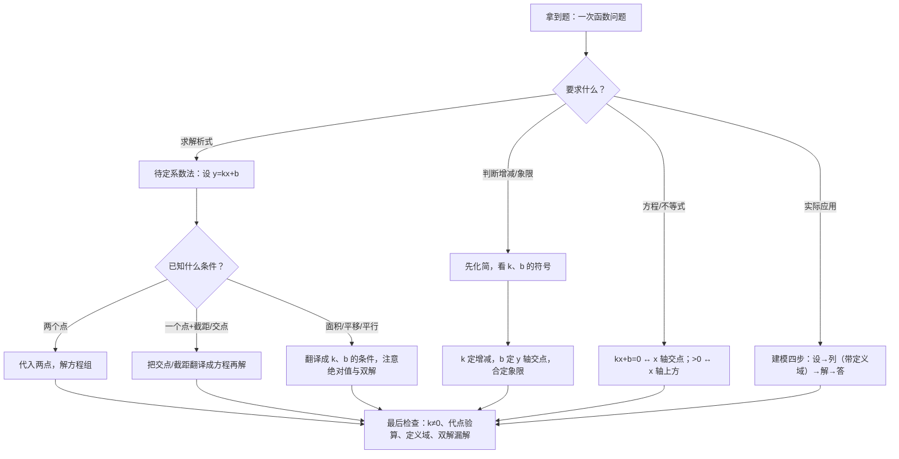

# 一次函数（详解版）

> [!note] 使用说明
> 本文是详解版，从"为什么"讲起供从头自学；考前速查和掌握度跟踪在概要版：[[03-数学/知识点/八年级/一次函数]]。

## 0️⃣ 这章学什么 & 中考怎么考

- **这章解决什么问题**：蜡烛匀速烧短、水池匀速进水、气温随海拔匀速下降——这类"变化率不变"的匀速变化，用两个数就能完全描述：**起点**和**速度**。把这两个数写成式子 $y=kx+b$，就是**一次函数**。它是你完整研究的第一个具体函数。
- **和前后章节的关系**：学这章前，你要有八上函数概念（变量、平面直角坐标系）。这章确立的"**表达式 → 图像 → 性质 → 应用**"研究路径，九年级的反比例函数、二次函数（见[[03-数学/知识点详解/九年级/二次函数]]）全部照此办理——本章是这条路的"样板房"。
- **中考怎么考**（依据概要版与备课包，不编造分值）：
  - ==图像与性质、待定系数法、图像与坐标轴交点的面积、实际应用建模==是常考点；
  - 题型多见于选择、填空和小解答题；它更是九年级反比例函数、二次函数综合的根基。
- 一句话总结：**会设式、会代点、会看 $k$ 和 $b$——图像题、面积题、应用题都是这三个动作的组合。**

### 学完本章，你应该能做到

1. 判断一个式子是不是一次函数：先化简、再看 $k\neq0$，系数含字母会分类讨论。
2. 用待定系数法五分钟求出解析式，并说清"为什么两个点就够"。
3. 看到解析式，报出增减性、与两坐标轴的交点、经过的象限。
4. 求直线与坐标轴围成的三角形面积，知道面积公式里的绝对值和双解。
5. 把实际问题描述成 $y=kx+b$，并写出实际意义下的定义域。

### 本章知识地图

## 🧭 先修自检（学不下去先回到这里）

> [!note] 先修自检怎么用
> 下面每一项都是本章的地基。做不出就先去补对应知识，硬学只会更挫败。

| # | 你应该会的 | 自查题（先做再看答案） | 答案 | 不会去哪补 |
| - | ---------- | ---------------------- | ---- | ---------- |
| 1 | 读坐标 | 点 $(-2,3)$ 在第几象限？横坐标是几？ | 第二象限；横坐标 $-2$（左负右正、上正下负） | [[03-数学/知识点/00-六至八年级核心公式定理总表]] |
| 2 | 化简代数式 | 把 $y=x^2-(x-1)(x-2)$ 化成 $kx+b$ 的形式 | 展开去括号：$x^2-(x^2-3x+2)=3x-2$ | 同上（数与式板块） |
| 3 | 解二元一次方程组 | 解 $\begin{cases}k+b=15\\ 5k+b=35\end{cases}$ | 两式相减：$4k=20$，$k=5$，$b=10$ | 同上（方程板块） |
| 4 | 绝对值 | $\left|-\dfrac{2}{3}\right|\times|{-3}|=?$ | $\dfrac{2}{3}\times3=2$（长度非负） | 同上 |
| 5 | 函数概念 | "y 是 x 的函数"是什么意思？ | $x$ 每取一个值，$y$ 都有唯一的值与之对应 | 八上函数章节 |

**自查题做错的，先把那一项补上再往下读。第 3 项（解方程组）是待定系数法的发动机。**

## 🌱 概念从头讲

> [!note] 概念讲法约定
> 每个概念按"**为什么需要它 → 它是什么 → 符号与记号含义 → 容易想错的地方**"四步讲。

### 概念 1：一次函数的定义

- **为什么需要**：蜡烛每分钟烧掉一样多、水池每小时进水一样多——"每一步的变化量相同"叫匀速变化。描述匀速变化只需要两个数：**起点是多少**（$b$）、**每单位时间变多少**（$k$）。把这两个数拼进式子，就是一次函数。
- **定义**：形如 $y=kx+b$（$k$、$b$ 是常数，且 $k\neq0$）的函数叫**一次函数**。$k$ 叫**比例系数**，$b$ 叫**截距**。当 $b=0$ 时，$y=kx$ 是**正比例函数**——==正比例函数是特殊的一次函数==。
- **符号/记号**：判断标准只有两条：**先化简成 $y=\dots$ 的形式**，再看①自变量的最高次数是 1；②一次项系数 $k\neq0$。系数含字母时必须**分类讨论**：如 $y=(a+1)x+a$，只有 $a\neq-1$ 才是一次函数（$a=-1$ 时 $y=-1$ 是**常值函数**）。
- **容易想错**：
  - ❌"式子里有 $x$ 的一次项就是一次函数。" → $y=x^2-(x-1)(x-2)$ 展开后是 $3x-2$，**是**；$y=-\dfrac{3}{x}$、$y=x^2+2$ **不是**。口诀：**先化简，再数次数**。
  - ❌ 忘了 $k\neq0$。 → 题目问"$m$ 取何值时 $y=(m-3)x+m+2$ 是一次函数"，第一反应写 $m-3\neq0$，即 $m\neq3$；若问"是**正比例**函数"，则还要 $m+2=0$，即 $m=-2$。

### 概念 2：图像为什么是直线、两点法

- **为什么需要**：光看式子，看不出函数"长什么样"。画图才能一眼看到升降、交点和范围。
- **是什么**：一次函数 $y=kx+b$ 的图像是**一条直线**，称为**直线 $y=kx+b$**；解析式 $y=kx+b$ 也称为这条直线的表达式。
- **为什么是直线**：$k$ 是"x 每增加 1，$y$ 就增加 $k$"的固定速度——匀速变化的轨迹不会拐弯，是直的（严格的严格证明到高中才学，八年级用描点验证即可，如备课包用描点法画 $y=\dfrac12x+3$ 的图像）。
- **为什么两点就够画图**：两点确定一条直线。最省事的两点是与坐标轴的交点 $(0,b)$ 和 $\left(-\dfrac{b}{k},0\right)$——**令 $x=0$ 得 $y$ 轴交点，令 $y=0$ 得 $x$ 轴交点**。
- **容易想错**：❌"截距就是距离，不能是负数。" → 截距是直线与 $y$ 轴交点 $(0,b)$ 的**纵坐标** $b$，可正、可负、可为 0。"截距为 $-5$"就是 $b=-5$，直线交 $y$ 轴于 $(0,-5)$，在原点**下方**。

### 概念 3：$k$ 的几何意义——为什么 $k$ 定升降

- **推导**（不背结论，自己走一遍）：取两个相邻的自变量 $x=a$ 和 $x=a+1$，对应的函数值是 $ka+b$ 和 $k(a+1)+b=ka+b+k$。后一个正好比前一个**多了 $k$**。
- **是什么**：所以 $k$ 就是"x 每增加 1，$y$ 增加多少"。于是：
  - $k>0$：每步都加 → 图像**上升**，$y$ 随 $x$ 增大而**增大**；
  - $k<0$：每步都减 → 图像**下降**，$y$ 随 $x$ 增大而**减小**；
  - $\lvert k\rvert$ 越大，每步变化越猛，直线越**陡**。
- **容易想错**：❌"y 随 x 增大而减小"记成 $k>0$。 → 自救：代 $m=1$ 想一想 $y=-x$：$x$ 变大时 $y$ 变小，而 $k=-1<0$——**下降对应 $k<0$**。把"上升=正坡、下降=负坡"想成上坡下坡，就不会反。

### 概念 4：$b$ 的几何意义、平移与平行

- **$b$ 是什么**：$x=0$ 时的函数值——直线与 $y$ 轴交于 $(0,b)$。$b>0$ 交在原点上方，$b<0$ 交在下方。
- **平移**：上移 $h$ 个单位，每个点的纵坐标都加 $h$，新函数 $y=kx+b+h$——==上下平移只改 $b$（上加下减），$k$ 不变==。左右平移时 $x$ 换成 $x-h$：$y=k(x-h)+b=kx+(b-kh)$，$k$ 仍不变、$b$ 变了。对直线来说，左右平移与上下平移可以互相等效（直线无限长），本质相同：**平移只改位置数 $b$，不改倾斜程度 $k$**。
- **平行**：直线 $y=k_1x+b_1$ 与 $y=k_2x+b_2$ 平行 $\iff k_1=k_2$ 且 $b_1\neq b_2$。为什么：$k$ 相同 → 倾斜程度相同；若 $b$ 也相同那就是同一条直线（重合），不算平行。
- **容易想错**：❌ 平移之后 $k$ 会变。 → 平移不改形状只改位置，$k$ 永远不变。自救：代点检验。$y=3x-2$ 向下移 5：点 $(0,-2)$ 走到 $(0,-7)$，新直线 $y=3x-7$ ✓。

### 概念 5：待定系数法为什么可行

- **为什么需要**：已知图像经过两个点，求解析式——这是"看图写式"的反向操作，应用题、压轴题第一步几乎都用它。
- **原理**：$y=kx+b$ 里只有两个待定的数 $k$、$b$（所以叫"待定系数"）。把一个已知点 $(x_0,y_0)$ 代入，得到一个方程 $kx_0+b=y_0$；两个点给两个方程，解一个二元一次方程组即可。几何事实"**两点确定一条直线**"保证了这组方程必有唯一的一组解。
- **四步口诀**：一设（设 $y=kx+b$）→ 二代（把两点代入）→ 三解（解方程组）→ 四写（写出解析式）。
- **容易想错**：❌ 一个点就想定解析式。 → 一个点只给一个方程，$k$、$b$ 有无穷多种搭配；必须凑够**两个独立条件**（两个点；或一个点加截距；或截距加与 $x$ 轴交点等）。

### 概念 6：一次函数与方程、不等式（数形结合）

- **是什么**：
  - $kx+b=0$ 的根 = 直线与 $x$ 轴交点的横坐标（令 $y=0$）；
  - $kx+b>0$ 的解集 = 图像在 $x$ 轴**上方**那一段对应的 $x$ 的范围；
  - $kx+b<0$ 的解集 = 图像在 $x$ 轴**下方**那一段对应的 $x$ 的范围。
- **为什么**："函数值大于 0"翻译成图形语言就是"图像上的点比 $x$ 轴高"，找到这段图像再看横坐标范围即可——==不等式的解集可以直接"看"出来==。
- **容易想错**：❌ 看图解不等式时把上下搞反、或忽略 $k$ 的符号。 → 自救：在草图上给 $x$ 轴上方的部分涂阴影，阴影正对着的横坐标区间就是 $>0$ 的解集；交点横坐标是解集的端点，务必先算交点。

### 概念 7：$k$、$b$ 的符号定象限

| $k$、$b$ 符号 | 经过象限 | 记法 |
| ---- | ---- | ---- |
| $k>0,\ b>0$ | 一、二、三 | 上升、交 $y$ 轴正半轴 |
| $k>0,\ b<0$ | 一、三、四 | 上升、交 $y$ 轴负半轴 |
| $k<0,\ b>0$ | 一、二、四 | 下降、交 $y$ 轴正半轴 |
| $k<0,\ b<0$ | 二、三、四 | 下降、交 $y$ 轴负半轴 |

- **为什么**：$k$ 的符号决定直线"必经过"的两个方向象限（$k>0$ 必过一、三；$k<0$ 必过二、四），$b$ 的符号决定它从 $y$ 轴哪一侧穿过，从而补上第三个象限。
- **容易想错**：❌ 死背表格背反。 → 画 3 秒小草图：$k>0$ 上升、$b>0$ 起点在上，上升线从左下往右上、起点在上方 → 一、二、三，其余类推。

## 🧮 公式逐个拆解

> [!note] 公式拆解约定
> 每个公式都必须能回答四件事：每个符号是什么？什么时候能用？怎么变形？配一个一步能算的最小例子。

### 公式 1：定义式 $y=kx+b$（$k\neq0$）

| 符号 | 含义 | 注意 |
| ---- | ---- | ---- |
| $k$ | 比例系数 | $k\neq0$；符号定增减，绝对值定陡缓 |
| $b$ | 截距 | 图像与 $y$ 轴交点 $(0,b)$ 的纵坐标 |

- 成立条件：$k\neq0$。已知**两个点**（或两组对应值）时用它，设出 $k$、$b$ 列二元方程组。
- 常用变形：$b=0$ 退化为正比例函数；系数含字母时先讨论字母。
- 最小例子：判断 $y=(a+1)x+a$ 何时是一次函数 → $a+1\neq0$，即 $a\neq-1$。**验算**：$a=-1$ 时 $y=-1$，是常值函数，不是一次函数 ✓。

### 公式 2：坐标轴交点 $(0,b)$ 与 $\left(-\dfrac{b}{k},0\right)$

- 符号含义：令 $x=0$ 得 $y$ 轴交点；令 $y=0$ 解 $kx+b=0$ 得 $x$ 轴交点。
- 成立条件：$k\neq0$；$b=0$ 时直线过原点，两个交点重合。
- 常用变形：知道两个交点反求 $k$、$b$（待定系数法的另一种条件形式）。
- 最小例子：$y=2x-4$：令 $x=0$ 得 $(0,-4)$；令 $y=0$ 得 $x=2$，交点 $(2,0)$。**验算**：$2\times2-4=0$ ✓。

### 公式 3：面积公式 $S=\dfrac12\left|-\dfrac{b}{k}\right|\times|b|$

| 符号 | 含义 | 注意 |
| ---- | ---- | ---- |
| $\left\lvert-\dfrac{b}{k}\right\rvert$ | $x$ 轴交点横坐标的绝对值（一条直角边） | **必须加绝对值** |
| $\lvert b\rvert$ | $y$ 轴交点纵坐标的绝对值（另一条直角边） | **必须加绝对值** |

- 成立条件：直线与两坐标轴都相交（$k\neq0$；$b=0$ 时三角形退化不存在）。
- 常用变形：**反求参数时常有两解**——交点落在正、负半轴各算一种，逐一检验。
- 最小例子：$y=x+6$ 与两轴交于 $(-6,0)$、$(0,6)$，$S=\dfrac12\times6\times6=18$。**验算**：直角边就是 6 和 6，面积 $18$ ✓。

### 公式 4：平行与平移

- 符号含义：平行 $\iff k_1=k_2$ 且 $b_1\neq b_2$；上下平移 $h$ 个单位 → $b\to b\pm h$（上加下减）。
- 常用变形：已知"与 $y=kx+b$ 平行"就直接抄 $k$，再用另一个条件定 $b$。
- 最小例子：把 $y=\dfrac23x+1$ 沿 $y$ 轴向上平移 3 个单位 → $y=\dfrac23x+4$。**验算**：$k$ 不变 ✓，$(0,1)$ 上移到 $(0,4)$ ✓。

### 公式 5：待定系数法

- 步骤：设 $y=kx+b$ → 两点各代一次得方程组 → 解出 $k$、$b$ → 写出解析式。
- 成立条件：两个**独立**条件；若已知"过点 $(x_0,0)$"这类条件，先翻译成方程。
- 最小例子：$x=2$ 时 $y=-1$，$x=5$ 时 $y=8$。代入得 $\begin{cases}2k+b=-1\\ 5k+b=8\end{cases}$，相减 $3k=9$，$k=3$，$b=-7$，所以 $y=3x-7$。**验算**：$3\times2-7=-1$ ✓，$3\times5-7=8$ ✓。

## 🪜 例题阶梯

> [!note] 例题怎么用
> 五级台阶，每一级都要动笔跟着算，不许只看。题目均选自国平台备课包（课后练习/学习任务单）。

### 第 1 级 · 入门：定义与分类讨论

> **题目**：已知函数 $y=(m+3)x+m$。（1）当 $m$ 取何值时，这个函数是正比例函数？（2）当 $m$ 在什么范围内取值时，这个函数是一次函数？
> （题源：《20.1 一次函数的概念》课后练习第 2 题）
>
> **每一步为什么这么做**：
> - 系数里含字母 → 先把"是一次函数/正比例函数"翻译成对 $k$、$b$ 的要求，再解字母。
> - 正比例函数 = $b=0$ **且** $k\neq0$；一次函数 = $k\neq0$。两个条件缺一不可。
>
> **完整解答**：
> （1）要使 $y=(m+3)x+m$ 是正比例函数，需要 $\begin{cases}m+3\neq0\\ m=0\end{cases}$，解得 $m=0$。
> （$b=m=0$ 保证过原点；$k=m+3=3\neq0$ 保证是"函数"而不是常值——两个条件分开检查。）
> （2）要使它是一次函数，只需要 $m+3\neq0$，即 $m\neq-3$。
> （$b=m$ 取任何值都不影响"是一次函数"，一次函数对 $b$ 没有要求。）
> **验算**：$m=0$ 时 $y=3x$，是正比例函数 ✓；$m=-3$ 时 $y=-3$，是常值函数，确实不是一次函数 ✓。
>
> **变式提醒**：① 若改问"$m$ 为何值时它是常值函数"→ $m=-3$；② 若式子升级成 $y=(m^2-m)x+m+3$，先保证系数 $m^2-m\neq0$（即 $m\neq0$ 且 $m\neq1$），若还要求次数恰好为 1，别把次数里的字母漏讨论。

### 第 2 级 · 标准：$k$、$b$ 的意义一起考

> **题目**：已知一次函数 $y=(1-2m)x+m+1$，函数值 $y$ 随自变量 $x$ 的值增大而减小。（1）求 $m$ 的取值范围；（2）这个函数的图像与 $y$ 轴的交点 $M$ 位于 $y$ 轴的正半轴还是负半轴？
> （题源：《20.3 一次函数的性质》学习任务单例题 2）
>
> **每一步为什么这么做**：
> - "增大而减小"是**图形语言**，翻译成**代数语言**就是 $k<0$。
> - 与 $y$ 轴的交点就是 $x=0$ 时的点 $(0,\ b)$，判断它在正半轴还是负半轴，就是判断 $b$ 的符号。
>
> **完整解答**：
> （1）由 $y$ 随 $x$ 增大而减小，得 $k=1-2m<0$，解得 $m>\dfrac12$。
> （不等号两边同除以 $-2$，方向要反转——这里最容易写成 $m>-\dfrac12$。）
> （2）令 $x=0$，得 $M(0,\ m+1)$。因为 $m>\dfrac12$，所以 $m+1>\dfrac32>0$，交点 $M$ 在 $y$ 轴的**正半轴**上。
> **验算**：取 $m=1$：$y=-x+2$，$k=-1<0$ 下降 ✓，交点 $(0,2)$ 在正半轴 ✓。
>
> **变式提醒**：① 若把条件改成"$y$ 随 $x$ 增大而**增大**"，则 $1-2m>0$，$m<\dfrac12$；此时 $m+1$ 可正可负，$M$ 的位置**要分类讨论**——$k$ 的条件定不了 $b$ 的符号，两者各管各的；② "图像不经过第几象限"这类题同样拆成"$k$ 的符号 + $b$ 的符号"两问来答。

### 第 3 级 · 标准+：面积与双解

> **题目**：在平面直角坐标系 $xOy$ 中，已知直线 $y=mx+2$ 分别与 $x$ 轴、$y$ 轴交于点 $A$ 和点 $B$。如果 $S_{\triangle AOB}=6$，求这条直线的表达式。
> （题源：《20.2 一次函数的图像》学习任务单"探究"题）
>
> **每一步为什么这么做**：
> - 交点坐标要用含 $m$ 的式子表示，面积才能写成关于 $m$ 的方程。
> - 交点可能落在负半轴，坐标为负 → 线段长必须取**绝对值**。
> - 面积方程只限制 $\lvert m\rvert$，正负都行 → 天然双解，一个都不能丢。
>
> **完整解答**：
> 令 $x=0$，得 $B(0,2)$；令 $y=0$，得 $x=-\dfrac2m$，即 $A\left(-\dfrac2m,\,0\right)$（$m\neq0$，否则直线与 $x$ 轴平行没有交点 $A$）。
> 所以 $OA=\left|-\dfrac2m\right|$，$OB=2$。
> （面积公式里两条直角边都是**长度**，负坐标要加绝对值。）
> 由 $S_{\triangle AOB}=\dfrac12\cdot\left|-\dfrac2m\right|\cdot2=\dfrac2{\lvert m\rvert}=6$，得 $\lvert m\rvert=\dfrac13$，所以 $m=\pm\dfrac13$。
> 这条直线的表达式是 $y=\dfrac13x+2$ 或 $y=-\dfrac13x+2$。
> **验算**：$m=\dfrac13$ 时 $A(-6,0)$，$S=\dfrac12\times6\times2=6$ ✓；$m=-\dfrac13$ 时 $A(6,0)$，$S=6$ ✓。两条直线关于 $y$ 轴对称，都符合题意。
>
> **变式提醒**：① 本题头号陷阱是**漏解**——只写 $m=\dfrac13$ 丢一半分；② 若再加条件"图像经过第二、三、四象限"，就用象限挑出 $m=-\dfrac13$；③ 若把 $y$ 轴交点也设成未知（如 $y=mx+b$，$S=6$），则 $m$、$b$ 都可能双解（参照概要版例 1：$b=\pm4$ 型），逐类检验。

### 第 4 级 · 应用：匀速变化建模

> **题目**：一根蜡烛长 30 厘米，点燃后匀速燃烧，经过 50 分钟其长度恰为原长一半。在燃烧过程中，设蜡烛的长为 $y$（厘米），时间为 $t$（分），写出 $y$ 关于 $t$ 的函数解析式及这个函数的定义域。
> （题源：《20.4 一次函数的应用》课后练习第 1 题）
>
> **每一步为什么这么做**：
> - 建模四步：**设变量 → 定 $k$、$b$ → 列解析式 → 写定义域**。
> - $t=0$ 的函数值就是 $b$；"匀速"给出 $k$；"长度不能为负"给出定义域的右端点。
>
> **完整解答**：
> 设 $y=kt+b$。当 $t=0$ 时 $y=30$，所以 $b=30$。
> 经过 50 分钟，长度恰为原长一半，即烧掉 $30-15=15$ 厘米，所以每分钟烧 $15\div50=\dfrac3{10}$ 厘米；长度在**减少**，故 $k=-\dfrac3{10}$。
> （$k$ 的符号由实际意义决定：越烧越短，$k$ 必须是负的。）
> 所以 $y=-\dfrac3{10}t+30$。
> 定义域：$t\geq0$，且 $y\geq0$ 即 $30-\dfrac3{10}t\geq0$，得 $t\leq100$。所以 $0\leq t\leq100$。
> **验算**：$t=50$ 时 $y=-15+30=15$，恰为原长一半 ✓；$t=100$ 时 $y=0$，蜡烛燃尽 ✓。
>
> **变式提醒**：① 把 $k$ 写成 $+\dfrac3{10}$ 是常见错误——先问自己"量在增还是在减"；② 定义域不是装饰：$t>100$ 时蜡烛已不存在，函数失效，漏写右端点要扣分；③ 同类题：水池进水（$k>0$，容积上限定右端点）、行李费（$x>30$ 的分段起点）。

### 第 5 级 · 应用+：建模型、做预测

> **题目**：小华暑假去某地旅游，导游介绍当地山区海拔每上升 100 米，气温下降 0.6℃。小华在山脚下看到气温为 34℃，乘缆车到山顶发现气温为 32.2℃。（1）试建立气温 $y$（℃）与缆车上升高度 $x$（米）之间的函数解析式；（2）估计山脚到山顶的垂直高度。
> （题源：《20.4 一次函数的应用》课后练习第 3 题）
>
> **每一步为什么这么做**：
> - "山脚"就是 $x=0$，它的气温 34℃ 直接给出 $b$；
> - "每上升 100 米降 0.6℃"是变化率，换算成**每米**的变化量才是 $k$；
> - 第（2）问是"知道函数值反求自变量"——解一个一元一次方程。
>
> **完整解答**：
> （1）当 $x=0$ 时 $y=34$，所以 $b=34$。
> 每上升 1 米气温下降 $\dfrac{0.6}{100}=\dfrac3{500}$ ℃，所以 $k=-\dfrac3{500}$。
> （别把 $k$ 直接写成 $-0.6$——那是每 100 米的下降量，单位要统一到"每米"。）
> 所以 $y=-\dfrac3{500}x+34$。
> （2）由题意 $32.2=34-\dfrac3{500}x$，即 $\dfrac3{500}x=1.8$，解得 $x=1.8\times\dfrac{500}3=300$。
> 所以山脚到山顶的垂直高度约为 300 米。
> **验算**：$x=300$ 时 $y=34-1.8=32.2$ ✓；300 米即 3 个 100 米，降 $3\times0.6=1.8$ ℃，$34-1.8=32.2$ ✓。
>
> **变式提醒**：① 应用题的问法有两种方向：给 $x$ 求 $y$（正代）、给 $y$ 求 $x$（反解方程）——动笔前先分清；② 这是"预测决策型"题的标准动作：**两组数据定系数，再代值作估计**（备课包"沙漠面积"题同款）；③ 若还问"缆车最多升到多高气温不低于 30℃"，就解不等式 $34-\dfrac3{500}x\geq30$，得 $x\leq\dfrac{2000}3\approx667$ 米。

## 🗺️ 解题流程图

## 🔥 易错点：为什么会错

| ❌ 常见错误想法 | 为什么会这样想 | ✅ 正确理解 / 自救方法 |
| -------------- | -------------- | ---------------------- |
| 截距是距离，不能为负 | "距"字误导 | 截距是交点 $(0,b)$ 的**纵坐标**，可正可负可为 0；"截距为 $-5$"就是 $b=-5$ |
| 系数含字母时不讨论 | 默认 $k\neq0$ 天然成立 | 判断题先写"$k\neq0$"这条（如 $m\neq-3$）；问正比例函数还要 $b=0$ |
| 面积不加绝对值、反求参数漏双解 | 忘了交点可能在负半轴 | 线段长 $=\lvert$坐标$\rvert$；"面积已知"通常解出 $\pm$ 两个参数值，逐一代回检验 |
| 平移方向弄反、平移后 $k$ 变 | 口诀记混 | 上下只动 $b$（上加下减），$k$ 永不变；代一个点自检方向 |
| 实际应用不写定义域 | 只顾解析式 | 定义域由实际意义（非负、上限、分段起点）确定，漏写必扣分 |
| "y 随 x 增大而减小"对应 $k>0$ | 文字与符号配错 | 上升 $=k>0$、下降 $=k<0$；代 $y=-x$ 检验一遍再落笔 |
| 判断"不经过第几象限"凭感觉 | 没有抓手 | 用 $k$、$b$ 符号表逐项排查，或画 3 秒草图（$k$ 定升降、$b$ 定起点高度） |
| 看图解不等式上下搞反 | 没先找交点 | 先算 $x$ 轴交点（解集端点），上方阴影对 $>$，下方对 $<$ |

## 📝 本讲小结

- **一个定义**：$y=kx+b$（$k\neq0$）；正比例函数是 $b=0$ 的特例；判断前**先化简、再看系数**，系数含字母必须讨论。
- **两个工具**：待定系数法（两点定一函数，一设二代三解四写）；令 $y=0$ / $x=0$ 求坐标轴交点。
- **两条性质**：$k$ 定增减（$k>0$ 增、$k<0$ 减），$b$ 定与 $y$ 轴交点；两者合起来定象限。
- **一个模型**：与坐标轴围成的三角形面积 $=\dfrac12\times\left\lvert x\text{ 轴交点横坐标}\right\rvert\times\lvert b\rvert$，注意绝对值与双解。
- **一种思想**：数形结合——不等式的解集看图像上下方；应用题先建模再求解，定义域由实际意义决定。

## ✅ 自测清单（能独立做到才打勾）

- [ ] 1. 能不看书写出一次函数定义，并说清"式子里有 $x$"和"是一次函数"的区别（先化简，最高次数为 1 且 $k\neq0$）
- [ ] 2. 能说清正比例函数、常值函数与一次函数的关系，并处理 $y=(m+3)x+m$ 这类分类讨论
- [ ] 3. 能用"每增加 1，$y$ 增加 $k$"解释为什么 $k$ 定升降
- [ ] 4. 能用两点法画出 $y=2x-4$ 的图像，并写出与两坐标轴的交点
- [ ] 5. 能独立做出例题阶梯第 1、2、3 级，并说出第 3 级为什么会双解
- [ ] 6. 能按"设→定 $k$、$b$→列式→写定义域"完成蜡烛、气温两道应用题
- [ ] 7. 能说出 $kx+b>0$ 的解集与图像的对应关系
- [ ] 8. 能说出本章 3 个易错点及自救方法

## 🔗 关联

- 概要版：[[03-数学/知识点/八年级/一次函数]]（掌握度在这边更新）
- 前置知识：[[03-数学/知识点/00-六至八年级核心公式定理总表]]（函数概念、坐标系、解二元一次方程组）
- 兄弟详解：[[03-数学/知识点详解/八年级/代数方程]]（应用题里的方程工具）· [[03-数学/知识点详解/九年级/二次函数]]（同一研究路径的进阶版：表达式→图像→性质→应用）
