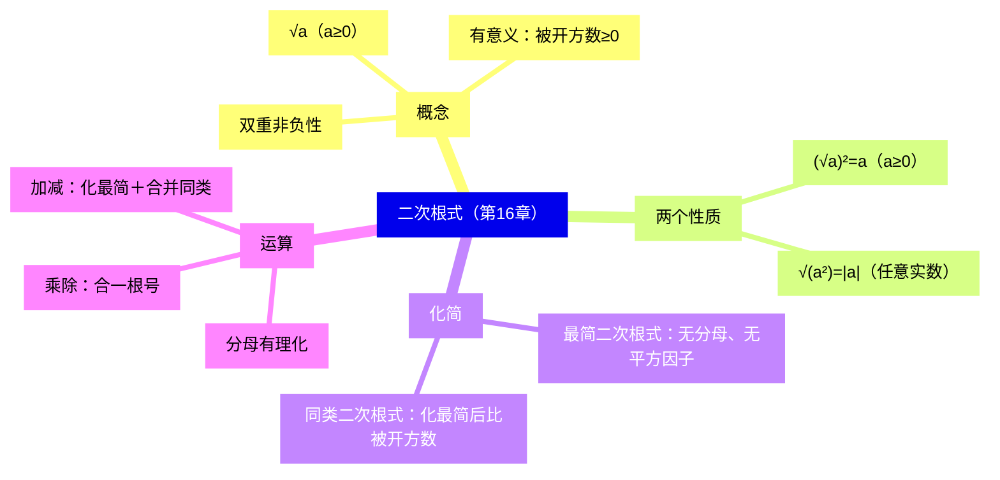
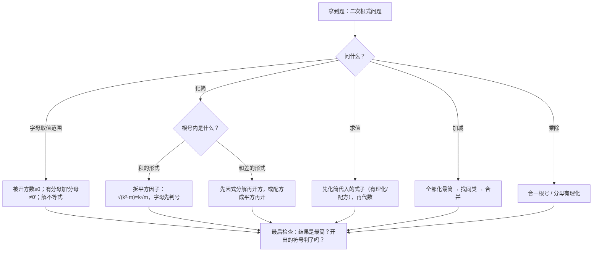

# 二次根式（详解版）

> [!note] 使用说明
> 本文是详解版，从"为什么"讲起供从头自学；考前速查和掌握度跟踪在概要版：[[03-数学/知识点/八年级/二次根式]]。

## 0️⃣ 这章学什么 & 中考怎么考

- **这章解决什么问题**：七年级学平方根时，被开方数都是具体的数，比如 $\sqrt{49}=7$。这一章把**字母**请进根号，得到 $\sqrt{a}$、$\sqrt{a^2+1}$ 这类式子，统一叫**二次根式**。它是初中代数式家族的最后一块拼图（整式 → 分式 → 二次根式）：整式加减靠合并同类项，分式运算靠通分约分，二次根式运算则要先把根号里的"平方因子"搬出来——本章学的就是这套"搬出与合并"的手艺。
- **和前后章节的关系**：往前，你要会算术平方根、完全平方公式、分解因式；往后，[[03-数学/知识点/八年级/一元二次方程]]的求根公式里有 $\sqrt{b^2-4ac}$，九年级二次函数配方、勾股定理求值（[[03-数学/知识点/八年级/几何证明]]）都建立在本章之上。**中考计算题第一题常年考它。**
- **中考怎么考**（依据概要版，不编造分值）：
  - 化简、混合运算、分母有理化，是计算题的常客；
  - ==根号下字母的取值范围==是选择填空的经典小题；
  - $\sqrt{a^2}=\lvert a\rvert$ 的判号，是历年最稳定的失分点。
- 一句话总结：**先把根号里的"平方因子"搬出来（化最简），再把被开方数相同的根式当同类项合并；被开方数开出来是正是负，必须先判断再写结果。**

### 学完本章，你应该能做到

1. 说清 $\sqrt a$ 有意义的条件，根号外还有分母时会叠加"分母 $\neq0$"。
2. 对任意实数 $a$，正确写出 $\sqrt{a^2}$（先判号，再脱绝对值）。
3. 把任一个二次根式化成最简二次根式，并判别两个根式是否同类。
4. 熟练完成乘除（合一根号、分母有理化）与加减（化最简、合并同类）。
5. 会解一次项系数或常数项含二次根式的一元一次方程和一元一次不等式。

### 本章知识地图

## 🧭 先修自检（学不下去先回到这里）

> [!note] 先修自检怎么用
> 下面每一项都是本章的地基。做不出就先去补对应知识，硬学只会更挫败。

| # | 你应该会的 | 自查题（先做再看答案） | 答案 | 不会去哪补 |
| - | ---------- | ---------------------- | ---- | ---------- |
| 1 | 算术平方根 | $\sqrt{49}$、$\sqrt{\dfrac{4}{9}}$ 各等于多少？有没有负的？ | $7$、$\dfrac23$；算术平方根只有**非负**的那一个，没有"±" | [[03-数学/知识点/00-六至八年级核心公式定理总表]] |
| 2 | 完全平方公式 | 展开 $(x-3)^2$ | $x^2-6x+9$ | 同上（整式乘法公式） |
| 3 | 分解因式 | 分解 $x^2-9$、$x^2-6x+9$ | $(x+3)(x-3)$；$(x-3)^2$ | 同上 |
| 4 | 绝对值 | $\lvert-5\rvert=$？若 $a<0$，$\lvert a\rvert=$？ | $5$；$-a$（负数的绝对值是它的相反数） | 同上 |
| 5 | 分数基本性质 | $\dfrac{2}{3}$ 的分子分母同乘 5，分数值变吗？ | 不变（$\dfrac{10}{15}=\dfrac23$）——分母有理化靠的就是它 | 小学分数 |

**自查题做错的，先把那一项补上再往下读。第 1、4 项是本章两条性质的命根子。**

## 🌱 概念从头讲

> [!note] 概念讲法约定
> 每个概念按"**为什么需要它 → 它是什么 → 符号与记号含义 → 容易想错的地方**"四步讲。

### 概念 1：二次根式的定义

- **为什么需要**：正数 $a$ 有两个平方根，其中正的那个叫算术平方根，记作 $\sqrt a$。当被开方数从具体的数换成含字母的式子后，我们需要一个统一的名字来研究"带二次根号的代数式"的化简与运算——这就是二次根式。
- **定义**：式子 $\sqrt a$（$a\ge 0$）叫做**二次根式**。根指数是 2，按习惯省略不写。"二次"指根指数为 2。
- **符号/记号**：$\sqrt{\ }$ 读"根号"；$a$ 叫**被开方数**，它可以是一个数，也可以是一个含字母的代数式。比如 $\sqrt{2}$、$\sqrt{x}$（$x\ge0$）、$\sqrt{a^2+1}$（恒有意义）都是二次根式。
- **容易想错**：
  - ❌"只要带根号就是二次根式。" → 判断标准只有一条：**化简后根指数是 2，且被开方数非负**。$\sqrt[3]{8}$ 根指数是 3（立方根），不是二次根式；$\sqrt{-4}$ 被开方数是负数，在实数范围内无意义，也不是。
  - ❌"$\sqrt a$ 中 $a$ 一定是正数。" → 条件是 $a\ge 0$，**允许等于 0**（$\sqrt 0=0$）。

### 概念 2：双重非负性

- **为什么需要**：二次根式的几乎所有取值范围、化简问题，都从"两层非负"出发，它是本章的公理级事实。
- **是什么**：$\sqrt a$（$a\ge0$）有**两处**非负：
  - 被开方数非负：$a\ge 0$（否则 $\sqrt a$ 无意义）；
  - 算术平方根本身非负：$\sqrt a\ge 0$（算术平方根的定义就是"正的（或零的）那个平方根"）。
- **符号/记号**：若 $\sqrt a+\sqrt b=0$，因为每一项都 $\ge0$，只能两项同时为 0，即 $a=b=0$。这是"非负性"最典型的用法——**几个非负数之和为 0，则每个都为 0**。
- **容易想错**：❌ 解方程 $\sqrt{x-1}+2=0$ 时去硬算。 → 左边是"非负数 $+2$"，恒大于 0，不可能等于 0，**该方程无解**。见到"根号 + 数 = 0"先想非负性，再动笔。

### 概念 3：二次根式有意义的条件

- **为什么需要**：含字母的根式不一定处处有意义，"什么时候有意义"本身就是一类考题，更是化简、求值前必须检查的前置条件。
- **是什么**：$\sqrt A$ 有意义 $\iff$ 被开方数 $A\ge 0$。若式子里还叠加了分母、零指数等结构，条件要**全部同时**满足：
  - $\sqrt{2x}$：$x\ge0$；
  - $\sqrt{\dfrac{2}{x-1}}$：被开方数 $\dfrac{2}{x-1}\ge0$。分子 2 已是正数，所以只需**分母 $x-1>0$**（注意分母不能等于 0）；
  - $\sqrt{-x^2}$：$-x^2\ge0\iff x^2\le 0\iff x=0$——只有这一个解。
- **容易想错**：❌"$\sqrt{\dfrac{2}{x-1}}$ 有意义就是 $x\ne1$"。 → 只排除了分母为零，忘了被开方数还要非负：若 $x<1$，分母为负，商为负，照样无意义。**两条限制取交集**，这里得到 $x>1$。

### 概念 4：最简二次根式

- **为什么需要**：$\sqrt{48}$、$4\sqrt3$、$2\sqrt{12}$ 数值相同、写法各异，不统一"标准形"就没法比较、没法合并。就像分数要化成最简分数、多项式要合并同类项一样，根式也要有"最简"的标准。
- **定义**：满足以下两条的二次根式叫**最简二次根式**：
  1. 被开方数**不含分母**；
  2. 被开方数中**不含能开得尽方的因数或因式**。
- **判别步骤**：先查根号内有无分母；再把被开方数分解因数/因式，看有没有"平方数因子"（$4,9,16,\dots$ 或 $a^2$ 型因子）。
  - $\sqrt{18}$：$18=9\times2$，含平方因子 9 → 不是最简，化成 $3\sqrt2$；
  - $\sqrt{\dfrac a3}$：根号内有分母 → 不是最简；
  - $\sqrt{a^2+b^2}$：和式已经"分解到头"，没有可开方的因子 → **是最简**（别看着像平方就去开，根本开不动）。
- **容易想错**：❌"$\sqrt{x^2+y^2}$ 能化简成 $x+y$"。 → 根号内的"+"不能拆：$x=3,y=4$ 时 $\sqrt{3^2+4^2}=5\neq7$。**根号对加法不分配**，这是 16.1 课后练习判断题专门设的坑。

### 概念 5：同类二次根式

- **为什么需要**：加减运算要"合并同类"，什么算"同类"？类比整式：$3x^2y$ 与 $-5x^2y$ 是同类项，因为字母部分完全相同；根式的"字母部分"就是**被开方数**。
- **定义**：几个二次根式**化成最简二次根式后**，如果被开方数相同，就叫做**同类二次根式**。
- **符号/记号**：$\sqrt{12}=2\sqrt3$、$\sqrt{\dfrac13}=\dfrac{\sqrt3}{3}$、$5\sqrt3$ 化最简后被开方数都是 3，是同类二次根式；$\sqrt2$ 与 $\sqrt3$ 无论怎么化都不同类。
- **容易想错**：❌ 直接看原式的被开方数判同类。 → $\sqrt{12}$ 与 $\sqrt{\dfrac13}$ 原式被开方数一个是 12 一个是 $\dfrac13$，看着毫不相干，化最简后都是 $\sqrt3$ 类。口诀：==先化最简，再看被开方数==。

### 概念 6：有理化因式与分母有理化

- **为什么需要**：运算结果约定俗成地要求**分母不含根号**（与"分数要约到最简"同理）：分母无根号后，通分、比大小、查近似值都方便。把分母的根号"化掉"的过程叫**分母有理化**，靠的工具就是有理化因式。
- **定义**：两个含二次根式的代数式相乘，如果**积不含二次根式**，就说它们互为**有理化因式**。
- **常用搭配**：

| 式子 | 它的有理化因式 | 依据 |
| ---- | ---- | ---- |
| $\sqrt a$ | $\sqrt a$ | $(\sqrt a)^2=a$（性质 1） |
| $\sqrt a\pm\sqrt b$ | $\sqrt a\mp\sqrt b$ | 平方差公式，积为 $a-b$ |
| $a\sqrt b$ | $\sqrt b$ | $a\cdot b$ 进入根号前先约 |

- **容易想错**：❌ 只把分母乘了有理化因式，分子忘乘。 → 分母有理化的依据是**分数基本性质**：分子分母必须**同乘**同一个因式，值才不变。

## 🧮 公式逐个拆解

> [!note] 公式拆解约定
> 每个公式都必须能回答四件事：每个符号是什么？什么时候能用？怎么变形？配一个一步能算的最小例子。

### 公式 1：$(\sqrt a)^2=a$（$a\ge0$）——性质 1

| 符号 | 含义 | 注意 |
| ---- | ---- | ---- |
| $\sqrt a$ | $a$ 的算术平方根 | 前提 $a\ge0$，否则式子无意义 |
| $(\ )^2$ | 先开方，再平方 | 顺序是"先开后平" |

- **成立条件**：$a\ge 0$。因为 $a<0$ 时 $\sqrt a$ 根本不存在。
- **为什么成立**：$(\sqrt a)^2$ 就是"求 $a$ 的算术平方根再平方"。平方与开平方互为逆运算，"开回去又平回来"就还原成 $a$ 本身，不损失任何符号信息。
- **常用变形**：**逆用**——把一个非负数写成平方形式：$5=(\sqrt5)^2$、$a=\big(\sqrt a\big)^2$（$a\ge0$）。因式分解、构造完全平方式时全靠它。
- **最小例子**：$(\sqrt5)^2=5$；逆用：$x^2+3=x^2+(\sqrt3)^2$，为因式分解 $x^2+3$ 铺路。

### 公式 2：$\sqrt{a^2}=\lvert a\rvert$（$a$ 为任意实数）——性质 2

| 符号 | 含义 | 注意 |
| ---- | ---- | ---- |
| $a^2$ | 先平方 | 平方保证被开方数 $\ge0$，所以对**任意实数**都有意义 |
| $\lvert a\rvert$ | 开出来的结果 | 必须经过绝对值，不能直接写 $a$ |

- **成立条件**：$a$ 是任意实数——这是它与性质 1 的本质区别。
- **为什么成立（讨论过程，本章最重要的一段推理）**：$\sqrt{a^2}$ 是 $a^2$ 的算术平方根，按 $a$ 的符号分三类：
  - 当 $a>0$：$a^2$ 的算术平方根就是 $a$，故 $\sqrt{a^2}=a$；
  - 当 $a=0$：$\sqrt{0^2}=0$；
  - 当 $a<0$：$a^2$ 是正数，它的算术平方根是**正的那个平方根**，即 $-a$（例如 $a=-5$ 时 $\sqrt{(-5)^2}=\sqrt{25}=5=-(-5)$），故 $\sqrt{a^2}=-a$。
  - 三类合写恰好是绝对值的定义：$\sqrt{a^2}=\begin{cases}a,&a\ge0\\-a,&a<0\end{cases}=\lvert a\rvert$。
- **和性质 1 对比着记**：
  - $(\sqrt a)^2$：**先开后平**——先开方这步要求 $a\ge0$，否则没意义；开回去又平回来，符号没被动过，结果就是 $a$。
  - $\sqrt{a^2}$：**先平后开**——平方把负号"抹平"了，开方只能开出非负的结果，所以要用绝对值把符号"找补"回来。
- **常用变形（两个常用落点）**：
  - 具体数：$\sqrt{(\pi-4)^2}=4-\pi$（因为 $\pi<4$，$\pi-4$ 是负的）；$\sqrt{(\pi-3)^2}=\pi-3$（因为 $\pi>3$）。**同一模型，方向相反**。
  - 含字母：$\sqrt{(a-b)^2}=\begin{cases}a-b,&a\ge b\\ b-a,&a<b\end{cases}$——先判断 $a-b$ 的符号，再决定要不要翻号。
- **最小例子**：$\sqrt{(-7)^2}=7$。**验算**：$(-7)^2=49$，$\sqrt{49}=7$ ✓。

### 公式 3：$\sqrt a\cdot\sqrt b=\sqrt{ab}$（$a\ge0$，$b\ge0$）——乘法法则

| 符号 | 含义 | 注意 |
| ---- | ---- | ---- |
| $\sqrt a,\sqrt b$ | 两个二次根式 | 必须**都有意义** |
| $\sqrt{ab}$ | 积的算术平方根 | $ab\ge0$ 自动满足 |

- **成立条件**：$a\ge0$ 且 $b\ge0$。$a$、$b$ 中有负数时左边无意义，等式无从谈起——**不要套用** $\sqrt{(-4)\times(-9)}$ 与左边对比。
- **为什么成立**：考察 $(\sqrt a\cdot\sqrt b)^2$。一方面它等于 $(\sqrt a)^2\cdot(\sqrt b)^2=ab$（性质 1 + 积的乘方）；另一方面 $\sqrt a\cdot\sqrt b\ge0$（非负数乘非负数）。"平方等于 $ab$ 的非负数只有 $ab$ 的算术平方根"，所以 $\sqrt a\cdot\sqrt b=\sqrt{ab}$。**先乘后开、先开后乘，殊途同归。**
- **常用变形**：反着用是**化简**——$\sqrt{ab}=\sqrt a\cdot\sqrt b$，把 $ab$ 拆成"平方因子 × 剩余因子"，平方因子开出去：$\sqrt{18}=\sqrt{9\times2}=3\sqrt2$。
- **最小例子**：$\sqrt4\cdot\sqrt{25}=2\times5=10$（先开尽方再乘更快）；同一个数的另一条路 $\sqrt{100}=10$，结果一致 ✓。

### 公式 4：$\dfrac{\sqrt a}{\sqrt b}=\sqrt{\dfrac ab}$（$a\ge0$，$b>0$）与分母有理化

| 符号 | 含义 | 注意 |
| ---- | ---- | ---- |
| $b$ | 除数（根号下） | 必须 $b>0$：分母不能为 0 |
| $\sqrt{\dfrac ab}$ | 商的算术平方根 | 要求 $\dfrac ab\ge0$，由 $a\ge0,b>0$ 保证 |

- **成立条件**：$a\ge0$，$b>0$。推导与乘法法则同款：$\Big(\dfrac{\sqrt a}{\sqrt b}\Big)^2=\dfrac{(\sqrt a)^2}{(\sqrt b)^2}=\dfrac ab$，且左边非负，所以它是 $\dfrac ab$ 的算术平方根。
- **常用变形（分母有理化的两个基本件）**：
  - $\dfrac{1}{\sqrt a}=\dfrac{\sqrt a}{\sqrt a\cdot\sqrt a}=\dfrac{\sqrt a}{a}$（分母同乘 $\sqrt a$）；
  - $\dfrac{1}{\sqrt a+\sqrt b}=\dfrac{\sqrt a-\sqrt b}{(\sqrt a+\sqrt b)(\sqrt a-\sqrt b)}=\dfrac{\sqrt a-\sqrt b}{a-b}$（分母同乘平方差搭档）。
- **最小例子**：$\dfrac{1}{\sqrt2}=\dfrac{\sqrt2}{2}$；$\dfrac{1}{\sqrt3+\sqrt2}=\sqrt3-\sqrt2$。**验算**：$(\sqrt3-\sqrt2)(\sqrt3+\sqrt2)=3-2=1$ ✓。

### 公式 5：加减法则——"化最简 + 合并同类"

$$\sqrt{a}\pm k\sqrt{a}=(1\pm k)\sqrt a\ (\text{同类二次根式之间})$$

- **是什么**：二次根式相加减，分三步：
  1. 每个根式**化成最简二次根式**（不化简就看不出谁与谁同类）；
  2. 按**被开方数**分组找同类；
  3. **同类合并**：系数相加减，根号部分照抄；不同类的不能合并，保留原样。
- **为什么类比整式**：$4\sqrt3+5\sqrt3=(4+5)\sqrt3=9\sqrt3$，与 $4x+5x=9x$ 逻辑完全一样——分配律在"把 $\sqrt3$ 看成一个字母"时照常工作。这就是**化归**：把新运算化归为已会的整式加减。
- **最小例子**：$\sqrt{48}+\sqrt{75}=4\sqrt3+5\sqrt3=9\sqrt3$。**验算**：$\sqrt{48}\approx6.93$，$\sqrt{75}\approx8.66$，和 $\approx15.59$；$9\sqrt3\approx15.59$ ✓。

### 公式 6：混合运算——顺序同整式，运算律照用

- **是什么**：运算顺序与整式一样：先乘方开方，再乘除，后加减，有括号先算括号；交换律、结合律、分配律、乘法公式（平方差、完全平方）在实数范围内**全部有效**。
- **怎么用**：$(\sqrt3+\sqrt2)(\sqrt3-\sqrt2)=3-2=1$（平方差）；$(\sqrt3+\sqrt2)^2=3+2\sqrt6+2=5+2\sqrt6$（完全平方，**中间项别丢**）。
- **本章延伸应用**：用这些运算解一次项系数或常数项含二次根式的**一元一次方程、不等式**——把 $\sqrt2$、$\sqrt3$ 当成"字母"参与合并与移项，如解 $\sqrt2 x-1=\sqrt8$ 时先化 $\sqrt8=2\sqrt2$ 再移项。
- **最小例子**：$2\sqrt2\Big(\dfrac12\sqrt2+\sqrt3\Big)=2\sqrt2\cdot\dfrac12\sqrt2+2\sqrt2\cdot\sqrt3=2+2\sqrt6$（分配律，逐项乘，别漏项）。

## 🪜 例题阶梯

> [!note] 例题怎么用
> 四级台阶，每一级都要动笔跟着算，不许只看。题源均为备课包任务单与课后练习原题。

### 第 1 级 · 入门（有意义条件）

> **题目**（16.1 课后练习 第 2 题）：$x$ 是怎样的实数时，下列各式在实数范围内有意义？
> (1) $\sqrt{-3x}$；(2) $\sqrt{2x+9}$；(3) $\sqrt{\dfrac{2}{x-1}}$；(4) $\sqrt{-x^2}$。
>
> **每一步为什么这么做**：
> - 有意义 = 被开方数 $\ge0$，这是唯一出发点；有分母再叠加"分母 $\ne0$"。
>
> **完整解答**：
> (1) $-3x\ge0$，即 $x\le0$。（系数是负的，移项时不等号方向要变——这一步用了不等式性质，因为两边同除以 $-3$。）
> (2) $2x+9\ge0$，即 $x\ge-\dfrac92$。（先移项再除以正数 2，方向不变。）
> (3) 被开方数 $\dfrac{2}{x-1}\ge0$：分子 $2>0$，所以必须**分母同号为正**，即 $x-1>0$，得 $x>1$。
> （为什么不写 $\ge$？因为 $x-1$ 还要作分母，$x=1$ 时分母为 0——分母非零这条限制把等号"挤掉了"。）
> (4) $-x^2\ge0$，即 $x^2\le0$。而任何实数的平方都 $\ge0$，两头一夹只剩 $x=0$。
> **验算**：$x=0$ 代入 (4)：$\sqrt{0^2}=0$，有意义 ✓；$x=2$ 代入 (4)：$\sqrt{-4}$ 无意义，与结论一致 ✓。
>
> **变式提醒**：把 (4) 换成 $\sqrt{x^2}$，答案是"任意实数"——$x^2\ge0$ 恒成立，且开出来是 $\lvert x\rvert$，这正是性质 2 的天下。

### 第 2 级 · 标准（化最简二次根式）

> **题目**（16.2 课后练习 第 2 题，选三小题）：将下列二次根式化为最简二次根式：
> (1) $\sqrt{18a^2b^5}$（$a>0$）；(2) $\sqrt{54(x-y)^4}$；(4) $\sqrt{25x^2-10x+1}$（$x<\dfrac15$）。
>
> **读题→翻译成数学语言**：化最简 = 把根号内**能开得尽方的因数/因式**全部搬出去。搬字母因子时要先确认它非负，搬不出门的（如 $b$ 的奇次幂）留一半在根号里。
>
> **完整解答**：
> (1) $\sqrt{18a^2b^5}=\sqrt{9a^2b^4\cdot 2b}=3ab^2\sqrt{2b}$。
> （拆因式：$18=9\times2$，$b^5=b^4\cdot b$；$9a^2b^4$ 是"平方因子"整队开出——用乘法法则 $\sqrt{9a^2b^4}\cdot\sqrt{2b}$，且 $\sqrt{a^2}=a$、$\sqrt{b^4}=b^2$ 合法，因为 $a>0$、$b^2\ge0$。）
> (2) $\sqrt{54(x-y)^4}=\sqrt{9\times6\cdot\big[(x-y)^2\big]^2}=3(x-y)^2\sqrt6$。
> （$(x-y)^4=\big[(x-y)^2\big]^2$ 是完全平方因子，整体开出；$54=9\times6$ 只开出 9，6 留守。$(x-y)^2\ge0$ 恒成立，开方不需要加绝对值。）
> (4) 根号内先分解因式：$25x^2-10x+1=(5x-1)^2$。
> 所以原式 $=\sqrt{(5x-1)^2}=\lvert5x-1\rvert$。
> 又 $x<\dfrac15$，则 $5x-1<0$，$\lvert5x-1\rvert=1-5x$。
> （前两步是"先因式分解再开方"；最后一步是性质 2 的**判号**——题目给的条件 $x<\dfrac15$ 就是为这一步准备的，不给条件就只能停在 $\lvert5x-1\rvert$。）
> **验算**：取 $x=0$（满足 $x<\frac15$）：原式 $=\sqrt1=1$；$1-5\times0=1$ ✓。
>
> **变式提醒**：若把 (4) 的条件改成 $x\ge\dfrac15$，则 $5x-1\ge0$，结果是 $5x-1$。**同一个式子，条件翻面，答案翻面。**

### 第 3 级 · 中档（加减混合运算）

> **题目**（16.3 学习任务单 例题 1(2)）：计算：$\Big(\sqrt{0.5}-2\sqrt{\dfrac13}\Big)-\Big(\sqrt{\dfrac18}-\sqrt{75}\Big)$。
>
> **思路从哪来**：根号里有小数、有分数——先把它们统一成"被开方数是分数/整式"的标准样子，各自化最简，再合并同类。
>
> **完整解答**：
> 第一批化简：
> $\sqrt{0.5}=\sqrt{\dfrac12}=\dfrac{\sqrt2}{\sqrt2\cdot\sqrt2}=\dfrac{\sqrt2}{2}$（分母有理化：分子分母同乘 $\sqrt2$）；
> $2\sqrt{\dfrac13}=2\cdot\dfrac{\sqrt3}{3}=\dfrac{2\sqrt3}{3}$；
> $\sqrt{\dfrac18}=\sqrt{\dfrac{1}{8}}=\dfrac{1}{2\sqrt2}=\dfrac{\sqrt2}{4}$（$\dfrac{1}{\sqrt8}=\dfrac{1}{2\sqrt2}$，再同乘 $\sqrt2$）；
> $\sqrt{75}=\sqrt{25\times3}=5\sqrt3$。
> （每个都化到"根号内无分母、无平方因子"——化最简是合并的前提，因为**不化简看不出谁是同类**。）
> 代入去括号（括号前是负号，去括号时里面各项全变号）：
> 原式 $=\Big(\dfrac{\sqrt2}{2}-\dfrac{2\sqrt3}{3}\Big)-\Big(\dfrac{\sqrt2}{4}-5\sqrt3\Big)=\dfrac{\sqrt2}{2}-\dfrac{2\sqrt3}{3}-\dfrac{\sqrt2}{4}+5\sqrt3$。
> 合并同类：$\sqrt2$ 类：$\dfrac{\sqrt2}{2}-\dfrac{\sqrt2}{4}=\dfrac{\sqrt2}{4}$；$\sqrt3$ 类：$-\dfrac{2\sqrt3}{3}+5\sqrt3=\dfrac{13\sqrt3}{3}$。
> 所以原式 $=\dfrac{\sqrt2}{4}+\dfrac{13\sqrt3}{3}$。
> **验算**：$\sqrt{0.5}\approx0.707$，$2\sqrt{\frac13}\approx1.155$，$\sqrt{\frac18}\approx0.354$，$\sqrt{75}\approx8.660$；原式 $\approx(0.707-1.155)-(0.354-8.660)\approx7.858$。结果 $\dfrac{\sqrt2}{4}+\dfrac{13\sqrt3}{3}\approx0.354+7.506=7.860$（近似误差）✓。
>
> **变式提醒**：同类根式的系数是分数时，通分后再加减；**$\sqrt2$ 与 $\sqrt3$ 不是同类，永远不能合并**，最后答案里必须各自保留。

### 第 4 级 · 提高（分母有理化 + 配方 + 整体思想）

> **题目**（单元复习与小结 学习任务单 练习 9）：已知 $x=\dfrac{\sqrt3-\sqrt2}{\sqrt3+\sqrt2}$，$y=\dfrac{\sqrt3+\sqrt2}{\sqrt3-\sqrt2}$，求 $x^2-2xy+y^2$ 的值。
>
> **思路从哪来**：直接把 $x$、$y$ 平方再代入是下策。先看出 $x^2-2xy+y^2=(x-y)^2$ 是完全平方——**先化简再求值**；而 $x$、$y$ 都是"分母带根号"的分数，先分母有理化，把 $x$、$y$ 化成 $a+b\sqrt6$ 型。
>
> **完整解答**：
> 第一步：分母有理化。
> $x=\dfrac{(\sqrt3-\sqrt2)^2}{(\sqrt3+\sqrt2)(\sqrt3-\sqrt2)}=\dfrac{3-2\sqrt6+2}{3-2}=5-2\sqrt6$。
> （分子用完全平方公式 $(a-b)^2=a^2-2ab+b^2$，其中 $2\sqrt3\cdot\sqrt2=2\sqrt6$；分母用平方差公式。**中间项 $-2\sqrt6$ 别丢**。）
> 同理 $y=\dfrac{(\sqrt3+\sqrt2)^2}{(\sqrt3-\sqrt2)(\sqrt3+\sqrt2)}=5+2\sqrt6$。
> 第二步：整体相减。
> $x-y=(5-2\sqrt6)-(5+2\sqrt6)=-4\sqrt6$。
> 第三步：配方求值。
> $x^2-2xy+y^2=(x-y)^2=(-4\sqrt6)^2=16\times6=96$。
> **验算**：$xy=(5-2\sqrt6)(5+2\sqrt6)=25-24=1$，$x+y=10$，$x^2+y^2=(x+y)^2-2xy=100-2=98$，故 $x^2-2xy+y^2=98-2=96$ ✓。
>
> **变式提醒**（同一考点的辨析题，见概要版例题速递）：化简求值 $\dfrac1a+\sqrt{\dfrac{1}{a^2}+a^2-2}$（$a=\dfrac15$）时，根号内配成 $\Big(\dfrac1a-a\Big)^2$ 后，开方必须先判号：$\dfrac1a-a=5-\dfrac15>0$，所以取 $\dfrac1a-a$；若像"乙"那样写成 $a-\dfrac1a<0$，整题就错。**$\sqrt{a^2}=\lvert a\rvert$ 的判号一步，是本章所有难题的共同命门。**

## 🗺️ 解题流程图

## 🔥 易错点：为什么会错

| ❌ 常见错误想法 | 为什么会这样想 | ✅ 正确理解 / 自救方法 |
| -------------- | -------------- | ---------------------- |
| $\sqrt{a^2+b^2}=a+b$ | 把根号当成了"分配律"，想拆开算 | 根号对加法**不分配**。代数验证：$a=3,b=4$ 时左边 $=5\neq7$。和式开不动就整体保留 |
| $\sqrt{(-a)^2}=\pm a$ | 见了平方就"正负都开" | $\sqrt{a^2}$ 是**算术**平方根，只有一个值 $\lvert a\rvert$。"±"属于解方程 $x^2=a$，两者场景不同 |
| $a<0$ 时仍写 $\sqrt{a^2}=a$ | 只记公式外形没记条件 | 性质 2 一律过绝对值：先判 $a$ 的符号再脱。见 $\sqrt{(3-\pi)^2}$ 这类题，先比大小 |
| $(\sqrt a)^2=a$ 对任何 $a$ 用 | 两条性质的条件张冠李戴 | 性质 1 要求 $a\ge0$（否则 $\sqrt a$ 不存在）；性质 2 才对任意实数成立 |
| 加减前不化最简就合并 | 想省一步 | 不化最简看不出同类（$\sqrt{12}$ 与 $\sqrt{\frac13}$ 就是同一类）。口诀：**先化最简，再合并** |
| 分母有理化只乘分母 | 把"消去分母根号"理解成"只动分母" | 依据是分数基本性质：**分子分母同乘**。乘完记得分子展开、约到最简 |
| 结果里 $\sqrt2$、$\sqrt3$ 硬合并 | 类比 $2x+3x$ 乘熟了 | 被开方数不同就不是同类，$\sqrt2+\sqrt3$ 已是最简，**不能**写成 $\sqrt5$ |
| 混合运算中间项丢失 | $(\sqrt a+\sqrt b)^2$ 漏掉 $2\sqrt{ab}$ | 完全平方公式照用不误：$a+2\sqrt{ab}+b$。展开后逐项清点 |

## 📝 本讲小结

- **概念**：$\sqrt a$（$a\ge0$）双重非负；有意义 = 被开方数 $\ge0$（有分母再加 $\ne0$，取交集）。
- **性质**：$(\sqrt a)^2=a$（$a\ge0$，先开后平不丢号）；$\sqrt{a^2}=\lvert a\rvert$（任意实数，先平后开靠绝对值把关）。
- **乘除**：法则推导同源——"平方相等 + 非负"锁定算术平方根；正用化简、逆用合一根号；分母有理化靠分数基本性质。
- **化简**：目标最简二次根式（无分母、无平方因子）；和式先因式分解或配方再开。
- **加减**：化最简 → 找同类 → 合并；类比整式加减，化归思想贯穿。
- **思想**：类比（同类项 ↔ 同类二次根式）、化归（新运算 → 旧运算）、分类讨论（判号三情形）。

## ✅ 自测清单（能独立做到才打勾）

- [ ] 1. 能不看书写出二次根式的定义和"双重非负性"，并举一个"带根号但不是二次根式"的例子
- [ ] 2. 能独立完成 $\sqrt{\dfrac{2}{x-1}}$、$\sqrt{-x^2}$ 型有意义条件的求解，并说明为什么 (3) 的等号被挤掉
- [ ] 3. 能完整复述 $\sqrt{a^2}=\lvert a\rvert$ 的三情形讨论过程
- [ ] 4. 能用"平方相等 + 非负"两句话说清乘法法则为什么成立
- [ ] 5. 能在两分钟内把 $\sqrt{18a^2b^5}$、$\sqrt{25x^2-10x+1}$ 化到最简
- [ ] 6. 能独立做出例题阶梯第 3、4 级，且结果不再化简的空间
- [ ] 7. 能说出本章 4 个易错点及自救方法

## 🔗 关联

- 概要版：[[03-数学/知识点/八年级/二次根式]]（掌握度在这边更新）
- 前置知识：[[03-数学/知识点/00-六至八年级核心公式定理总表]]（平方根、完全平方公式、分解因式、绝对值）
- 同册章节：[[03-数学/知识点详解/八年级/一元二次方程]]（求根公式里的 $\sqrt{b^2-4ac}$、应用题中的根式计算） · [[03-数学/知识点详解/八年级/几何证明]]（勾股定理求值要用本章的化简）
