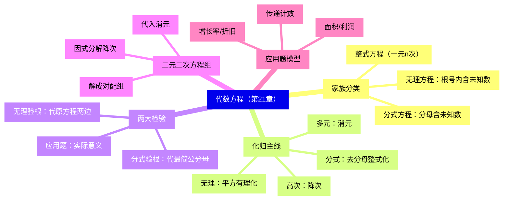
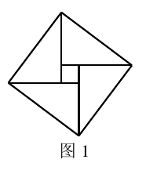
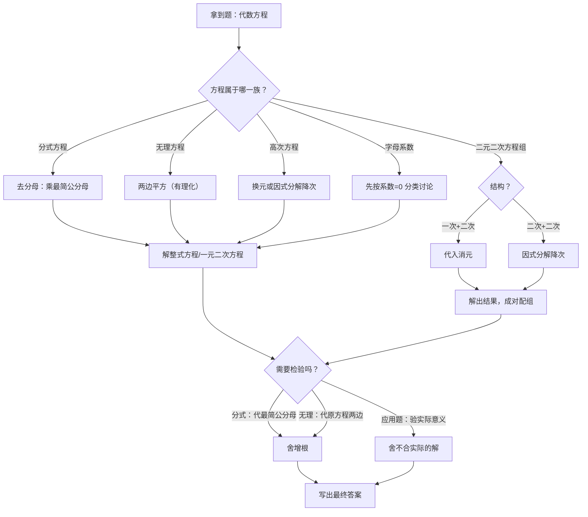

# 代数方程（详解版）

> [!note] 使用说明
> 本文是详解版，从"为什么"讲起供从头自学；考前速查和掌握度跟踪在概要版：[[03-数学/知识点/八年级/代数方程]]。

## 0️⃣ 这章学什么 & 中考怎么考

- **这章解决什么问题**：一元一次、一元二次方程你已经会解了，但真实的方程长得五花八门：分母里有未知数（分式方程）、根号里有未知数（无理方程）、次数超过 2（高次方程）、未知数有两个且次数到 2（二元二次方程组）。这一章的任务只有一个：**把所有"怪方程"都化归成你会解的一元一次、一元二次方程**。
- **和前后章节的关系**：学这章前，你要会解一元二次方程、会因式分解、会解二元一次方程组。学完这章，九年级的相似三角形设比例式列方程、二次函数交点问题解方程，用的都是这里的兵器。
- **中考怎么考**（依据概要版与备课包，不编造分值）：
  - 解方程是全卷基本功：分式方程、无理方程的**验根**、含字母系数方程的**分类讨论**、列方程（组）解应用题的**建模**，是三大高频动作；
  - 二元二次方程组的"消元、降次"是第 22～24 题里设参、列式的底层技能。
- 一句话总结：**一条化归主线 + 两次必检验（增根、实际意义）+ 一类必讨论（字母系数）——守住这三点，这章就稳了。**

### 学完本章，你应该能做到

1. 把任意一个代数方程放进"家族树"：整式 / 分式 / 无理，并说出对应的解法与验根方式。
2. 解含字母系数的方程时，主动按"系数是否为 0"分类，一个都不漏。
3. 解分式方程、无理方程后规范验根，并能解释增根是怎么产生的。
4. 用代入消元、因式分解降次解二元二次方程组，且解必须**成对配组**。
5. 按审设列解验答六步完成增长率、面积、利润、计数等应用题，双解逐一检验。

### 本章知识地图



## 🧭 先修自检（学不下去先回到这里）

> [!note] 先修自检怎么用
> 下面每一项都是本章的地基。做不出就先去补对应知识，硬学只会更挫败。

| # | 你应该会的 | 自查题（先做再看答案） | 答案 | 不会去哪补 |
| - | ---------- | ---------------------- | ---- | ---------- |
| 1 | 解一元二次方程 | 解 $x^2-x-2=0$ | 因式分解 $(x-2)(x+1)=0$，$x_1=2$，$x_2=-1$ | [[03-数学/知识点/00-六至八年级核心公式定理总表]] |
| 2 | 十字相乘 | 解 $x^2-3x-4=0$ | $(x-4)(x+1)=0$，$x_1=4$，$x_2=-1$ | 同上（方程板块） |
| 3 | 判别式 | $2x^2-4x+3=0$ 有无实数根？ | $\Delta=16-24=-8<0$，没有实数根 | 同上 |
| 4 | 解二元一次方程组 | 解 $\begin{cases}x+y=5\\ x-y=1\end{cases}$ | $x=3$，$y=2$ | 同上 |
| 5 | 因式分解 | 分解 $4x^2-9y^2$ | 平方差公式 $(2x+3y)(2x-3y)$ | 同上（数与式板块） |
| 6 | 平方根的意义 | $\sqrt{a}$ 什么时候有意义？ | $a\geq0$（被开方数非负） | 同上 |

**自查题做错的，先把那一项补上再往下读。第 1、2 项（解一元二次方程）是全章的终点站，每条化归路线最后都开到这里。**

## 🌱 概念从头讲

> [!note] 概念讲法约定
> 每个概念按"**为什么需要它 → 它是什么 → 符号与记号含义 → 容易想错的地方**"四步讲。

### 概念 1：代数方程的家族树（先分类，再选刀）

- **为什么需要**：不同方程的"病灶"不同——分母有未知数的要先**去分母**，根号里有未知数的要先**去根号**。分类就像分诊台：先看是什么病，才知道开什么药。
- **是什么**（备课包·本章小结课件口径）：

```text
代数方程
├── 有理方程
│   ├── 整式方程：一元一次、一元二次、一元高次方程
│   └── 分式方程：分母中含有未知数
└── 无理方程：根号内含有未知数
```

- **符号/记号**：判断归属只有一条铁律——==先化简，再看未知数待在什么位置==。$\dfrac{x^2+12x+2}{5}=1$ 分母是常数 5，它是**整式方程**；$\dfrac{2x+1}{x}=\dfrac47$ 分母含 $x$，才是分式方程。整式方程按"未知数个数 × 最高次数"命名：只含一个未知数、最高次数为 $n$ 的叫**一元 $n$ 次方程**；最高次数大于 2 的一元整式方程叫**高次方程**。
- **容易想错**：❌"式子里有根号就是无理方程。" → $\sqrt2\,x+1=0$ 里根号只罩着常数 $\sqrt2$，未知数不在根号内，它是一次方程。判断关键看==根号下有没有未知数==，和判断二次函数"先化简再数次数"是同一个道理。

### 概念 2：含字母系数的方程为什么必须分类讨论

- **为什么需要**：$ax=b$ 里 $a$ 是字母，它可能是 0——而"系数为 0"会把方程彻底改变性格。分类讨论不是套路，是**诚实面对字母的所有取值**。
- **是什么**：解关于 $x$ 的方程 $ax=b$：
  - $a\neq0$：唯一解 $x=\dfrac{b}{a}$；
  - $a=0$ 且 $b=0$：式子变成 $0=0$，任何 $x$ 都行——**有无数个解**；
  - $a=0$ 且 $b\neq0$：式子变成 $0=$ 非零数，矛盾——**无解**。
- 一元二次版同理：$ax^2+bx+c=0$ 中 $a\neq0$ 才能用判别式与求根公式；$a=0$ 退化成一次方程，按上面的三段讨论。
- **容易想错**：❌ 直接写 $x=\dfrac{b}{a}$。 → 除以字母等于默认它非零，这是"偷偷加了条件"。自救口诀：==见字母系数，先问"它能取 0 吗"==。备课包专设例题训练这个点，中考填空题常考。

### 概念 3：二项方程与实数根的个数

- **为什么需要**：$x^5=15$ 这类方程次数高，但结构极简——只有 $x$ 的 $n$ 次项和常数项，直接开方就能降次。
- **定义**：只含有未知数的 $n$ 次项和常数项的一元 $n$ 次方程叫**二项方程**，一般形式 $ax^n+b=0$（$a\neq0$，$b\neq0$）。
- **实数范围内解的情况**：

| $n$ 的奇偶 | 解的情况 |
| ---- | ---- |
| $n$ 为奇数 | **有且只有一个**实数根 $x=\sqrt[n]{-\dfrac{b}{a}}$ |
| $n$ 为偶数 | $a$、$b$ **异号**时有两个实数根 $\pm\sqrt[n]{-\dfrac{b}{a}}$；$a$、$b$ **同号**时没有实数根 |

- **为什么**：奇次开方唯一（如 $x^3=-8$ 只有 $x=-2$）；偶次开方要被开方数非负（如 $x^2=-1$ 无实数解），而 $x^4=16$ 有 $\pm2$ 两个。
- **容易想错**：❌ $x^4+1=0$ 有两个实数根。 → $a$、$b$ 同号（都是正），无实数根。判断根的个数**先看符号**，再动手开方。更高次的二项方程用**计算器**求近似根（保留三位小数）；$(x+m)^n$ 型先把 $x+m$ 看作整体。

### 概念 4：分式方程的增根从哪里来

- **为什么需要**：解分式方程必须验根——不搞清增根的来历，验根就只是走形式。
- **是什么**：解 $\dfrac{2}{x+1}=3$ 时，两边同乘 $x+1$ 得 $2=3(x+1)$。这一步"去分母"只在 $x+1\neq0$ 时才与原方程同解；若整式方程的根恰好让 $x+1=0$，它对原方程来说根本没意义——这就是**增根**。
- **一句话**：==去分母扩大了未知数的取值范围==（原来分母不能为 0，乘完之后这个限制消失了），所以解出的根必须逐个送回原方程"安检"。
- **验根方法**：把根代入**最简公分母**：使公分母为 0 的是增根，舍去；否则是原方程的根。
- **容易想错**：❌"无解 = 白做了。" → "无解"有两类：①化得的整式方程本身无解；②整式方程的根**全是增根**。两类都要排查，后者正是命题热点（见例题阶梯第 2 级与变式）。

### 概念 5：无理方程的增根从哪里来

- **为什么需要**：无理方程的验根方式和分式方程**不一样**——混用是高频失分点。
- **是什么**：解 $\sqrt{x+2}=-x$ 时两边平方得 $x+2=x^2$。"平方"抹掉了右边的**负号信息**（$(-x)^2=x^2$，不管 $x$ 正负平方都一样），原来"右边必须非负"的约束消失了——于是混进不合原方程的根。所以==平方这一步不是同解变形==。
- **验根方法**：把根代入**原方程两边**分别计算：使被开方数为负、或两边不相等的都是增根。
- **关系图**：有理方程 = 整式方程 + 分式方程；**代数方程 = 有理方程 + 无理方程**。
- **容易想错**：❌ 用"代最简公分母"的办法验无理方程。 → 无理方程没有公分母，验根必须**代回原方程两边算数值**，缺一步都不行（见例题阶梯第 3 级的完整示范）。

### 概念 6：二元二次方程（组）与"解要成对"

- **定义**：含有两个未知数、并且含未知数的项的最高次数是 2 的**整式方程**叫二元二次方程，一般形式 $ax^2+bxy+cy^2+dx+ey+f=0$（$a$、$b$、$c$ 不全为零）。其中 $ax^2$、$bxy$、$cy^2$ 是二次项，$dx$、$ey$ 是一次项，$f$ 是常数项。**二元二次方程组**：组成方程组的两个方程中**至少有一个**是二元二次方程。
- **解的意义**：使方程组里每个方程**同时成立**的一对未知数的值——解是**成对出现**的，写答案必须配对。
- **容易想错**：❌ 把两个方程分别解出的 $x_1,x_2$ 与 $y_1,y_2$ **交叉乱配**。 → 备课包专设错解辨析：由一个方程解出 $x=\pm1$、由另一个解出 $y=0,\dfrac23$，$(1,0)$、$(-1,\dfrac23)$ 这样的"拉郎配"多半不是解。自救：==每一对解必须回代方程组两个方程逐对检验==。

### 概念 7：化归——全章的总思想

```text
分式方程 ──去分母──→ 整式方程
无理方程 ──两边平方──→ 整式方程
高次方程 ──降次（换元/因式分解）──→ 一元二次方程
二元二次方程组 ──消元/降次──→ 二元一次方程组或一元二次方程
        一切化归的终点：一元一次方程、一元二次方程
```

- **为什么需要**：你只会解两类方程（一次、二次），所以一切新方程的唯一出路是**变成它们**。每一步化归都可能改变解集（去分母、平方都可能产生增根），这就是"两次必检验"的根源——==检验不是习惯，是化归的代价==。

## 🧮 方法逐个拆解

> [!note] 方法拆解约定
> 每个解法都必须能回答：步骤是什么？每步为什么？什么时候用？配一个最小例子。

### 方法 1：解分式方程（可化为一元二次方程）

| 步骤 | 做什么 | 为什么 |
| ---- | ---- | ---- |
| ① 化整式 | 两边同乘**最简公分母** | 消灭分母，化归为整式方程 |
| ② 解整式方程 | 因式分解/公式法 | 到达你已会的地盘 |
| ③ 验根 | 代入最简公分母 | 去分母可能产生增根 |

- 最小例子：$\dfrac1{x-2}=\dfrac4{x^2-4}+1$，完整解答见例题阶梯第 2 级。
- 提醒：最简公分母要"每出现一次因式取最高次幂"，$x^2-4=(x-2)(x+2)$。

### 方法 2：解无理方程（简单型）

| 步骤 | 做什么 | 为什么 |
| ---- | ---- | ---- |
| ① 有理化 | 两边平方（单个根号直接平） | 消灭根号，化归为整式方程 |
| ② 解整式方程 | 同上 | 同上 |
| ③ 验根 | 代入**原方程两边** | 平方可能产生增根 |

- 最小例子：$\sqrt{x+2}=-x$，完整解答见例题阶梯第 3 级。
- 提醒：平方前先看被开方数和另一边有没有明显不合法的范围（如右边必须 $\geq0$），能提前排除一些假根。

### 方法 3：代入消元法（二元一次 + 二元二次）

- 步骤：从二元一次方程解出 $y=mx+n$ → 代入二次方程 → 得一元二次方程 → 解出 $x$ → 回代求 $y$ → **成对写解**。
- 为什么可行：二元一次方程提供了一座"桥"，把两个未知数压成一个。
- 最小例子：$\begin{cases}y=x+1\\ x^2+y^2=13\end{cases}$：代得 $x^2+(x+1)^2=13$，即 $x^2+x-6=0$，$(x+3)(x-2)=0$，$x=-3$ 或 $2$；回代得 $y=-2$ 或 $3$。解为 $\begin{cases}x=-3\\y=-2\end{cases}$ 或 $\begin{cases}x=2\\y=3\end{cases}$。**验算**：$9+4=13$ ✓，$4+9=13$ ✓。

### 方法 4：因式分解降次（两个二元二次方程）

- 步骤：把能分解的二次方程分解成两个一次因式之积 → 拆成两个方程组 → 分别用代入法解。
- 为什么可行：$x^2-3xy+2y^2=0$ 即 $(x-y)(x-2y)=0$，说明 $x=y$ 或 $x=2y$——一个二次条件裂成两条一次"桥"。
- 最小例子：见例题阶梯第 4 级（$4x^2-9y^2=15$ 与 $2x-3y=5$）。
- 提醒：两个方程**都要**能提供降次/消元素材；只有一个能分解时，也可以"整体换元"（如 $x+y$ 看作整体，备课包练习"整体代入更简便"）。

### 方法 5：列方程（组）解应用题

- 步骤：**审 → 设 → 列 → 解 → 验 → 答**。这里的"验"是双重的：验根（若是分式/无理方程）+ 验实际意义。
- 常用模型：

| 模型 | 数量关系 |
| ---- | ---- |
| 增长率/折旧 | $a(1+x)^n=b$；折旧逐期乘 $(1-x)$ |
| 面积 | 长 $=$ 宽 $+$ 差，长 $\times$ 宽 $=$ 面积 |
| 销售利润 | 单件利润 $\times$ 销量 $=$ 总利润（降价 $x$ 元、每降 $m$ 元多售 $k$ 件） |
| 传递计数 | $n$ 人互发短信共 $n(n-1)$ 条（每人发 $n-1$ 条） |
| 分摊/工程 | 总量 $\div$ 人数（份数），人数变化单价跟着变 |

- 最小例子：全公司每人给其他每人发一条短信，共发 1190 条 → $n(n-1)=1190$，$n^2-n-1190=0$，$(n-35)(n+34)=0$，$n=35$（负值舍）。**验实际意义**：人数为正整数 ✓。

### 模型专栏：赵爽弦图——一个模型串起三种方程



- **模型**：四个全等直角三角形拼成大正方形，中间围出小正方形。已知大正方形面积 13、小正方形面积 1，设直角三角形两直角边为 $x$、$y$（$x<y$）。
- **视角一（二元二次方程组）**：大正方形边长是斜边 → $x^2+y^2=13$；小正方形边长是 $y-x$ → $(y-x)^2=1$。联立解得 $x=2$，$y=3$。
- **视角二（分式方程）**：由 $x^2+y^2=13$、$(y-x)^2=1$ 展开相减得 $xy=\dfrac{13-1}{2}=6$，即 $y=\dfrac6x$，再与 $y-x=1$ 联立，化成分式方程求解。
- **视角三（无理方程）**：$y=\sqrt{13-x^2}$，代入 $y-x=1$ 得 $\sqrt{13-x^2}-x=1$，平方后解整式方程，再验根。
- **为什么值得记**：同一张图、三个方程家族各走一条路——==中考若考"用两种方法解同一问题"，弦图就是标准素材==。

## 🪜 例题阶梯

> [!note] 例题怎么用
> 五级台阶，每一级都要动笔跟着算，不许只看。题目均选自国平台备课包（课后练习/学习任务单）。

### 第 1 级 · 入门：字母系数的分类讨论

> **题目**：当 $a$ 取何值时，关于 $x$ 的方程 $(a^2-4)x=a^2-5a+6$ 无解？
> （题源：《21.1 一元整式方程》课后练习第 3 题）
>
> **每一步为什么这么做**：
> - 系数含字母 → 按概念 2 先问"系数能不能取 0"。
> - "无解"对应 $a=0$ 且 $b\neq0$ 的情形：左边归零、右边非零。
>
> **完整解答**：
> 情形一：$a^2-4\neq0$，即 $a\neq\pm2$。此时方程是一元一次方程，有唯一解 $x=\dfrac{a^2-5a+6}{a^2-4}=\dfrac{(a-2)(a-3)}{(a-2)(a+1)}=\dfrac{a-3}{a+1}$，不符合"无解"。
> 情形二：$a^2-4=0$，即 $a=2$ 或 $a=-2$，方程左边变成 $0\cdot x$。
> - 若 $a=2$：右边 $=4-10+6=0$，方程即 $0=0$，**有无数个解**，不符合；
> - 若 $a=-2$：右边 $=4+10+6=20$，方程即 $0\cdot x=20$，**无解**，符合。
> 所以 $a=-2$。
> **验算**：$a=-2$ 代回：$(4-4)x=4+10+6$，即 $0=20$，确实无解 ✓；$a=2$ 时 $0=0$ 是无数解 ✓。
>
> **变式提醒**：① 本题最容易只答 $a=\pm2$——$a=2$ 是"无数解"不是"无解"，讨论必须完整；② 同族题："$a$ 为何值时方程 $(a^2-1)x=a+1$ 有唯一解 / 无解 / 无数个解"，把 $a=1$、$a=-1$ 逐一按三段论走一遍。

### 第 2 级 · 标准：分式方程与增根

> **题目**：解分式方程：$\dfrac{1}{x-2}=\dfrac{4}{x^2-4}+1$。
> （题源：《21.3 可化为一元二次方程的分式方程》学习任务单练习）
>
> **每一步为什么这么做**：
> - 先找**最简公分母**：$x^2-4=(x-2)(x+2)$，公分母取 $(x-2)(x+2)$。
> - 去分母化整式方程 → 解 → **逐根代回公分母**检验。
>
> **完整解答**：
> 方程两边同乘 $(x-2)(x+2)$，得
> $$(x+2)=4+(x^2-4),$$
> 整理得 $x^2-x-2=0$，因式分解 $(x-2)(x+1)=0$，所以 $x_1=2$，$x_2=-1$。
> 检验：把 $x=2$ 代入最简公分母 $(x-2)(x+2)=0$，所以 $x=2$ 是**增根**，舍去；
> 把 $x=-1$ 代入公分母 $=(-3)(1)=-3\neq0$，且代回原方程：左边 $=\dfrac1{-3}=-\dfrac13$，右边 $=\dfrac4{1-4}+1=-\dfrac43+1=-\dfrac13$，左边 $=$ 右边 ✓。
> 所以原方程的根是 $x=-1$。
>
> **变式提醒（增根反求参数，命题热点）**：备课包同款题——解方程 $\dfrac{k}{(x+1)(x-1)}+1=\dfrac{1}{x+1}$ 时出现增根 $x=-1$，求 $k$。思路：先按正常步骤去分母。两边乘 $(x+1)(x-1)$：$k+(x^2-1)=x-1$，整理 $x^2-x+k=0$。**增根也是"整式方程的根"**——把 $x=-1$ 代入整式方程：$1+1+k=0$，得 $k=-2$。验算：$k=-2$ 时按步骤解，确实解出 $x=-1$（增根）且另一根 $x=2$ 合法 ✓。核心认知：==增根是整式方程的根，只是原方程不收==。

### 第 3 级 · 标准+：无理方程与验根示范

> **题目**：解方程：$\sqrt{x+2}=-x$。
> （题源：《21.4 无理方程》学习任务单练习 1，备课包以填空形式搭好脚手架）
>
> **每一步为什么这么做**：
> - 单个根号 → 两边平方有理化；平方前先看右边符号，能提前圈定合法范围。
> - 解出根后**逐个代回原方程两边**——这一步不许省略、不许用"代公分母"替代。
>
> **完整解答**：
> 由原方程知右边 $-x\geq0$，即 $x\leq0$（先记下这个约束）。
> 两边平方，得 $x+2=x^2$，整理得 $x^2-x-2=0$，因式分解 $(x-2)(x+1)=0$，所以 $x_1=2$，$x_2=-1$。
> 检验：把 $x=2$ 代入原方程，左边 $=\sqrt{4}=2$，右边 $=-2$，左边 $\neq$ 右边（且 $x=2$ 违反 $x\leq0$），所以 $x=2$ 是**增根**，舍去。
> 把 $x=-1$ 代入原方程，左边 $=\sqrt1=1$，右边 $=1$，左边 $=$ 右边 ✓，所以 $x=-1$ 是原方程的根。
> 综上，原方程的根是 $x=-1$。
> **验算**：$\sqrt{-1+2}=1=-(-1)$ ✓。
>
> **变式提醒**：① 若把方程改成 $\sqrt{x+2}=x$，平方后是同一个整式方程，但这次合法的是 $x=2$（左边 2 $=$ 右边 2 ✓），$x=-1$ 成了增根——**方程一边的符号一换，合法根就互换**，这正是"平方抹掉符号"的直接后果；② 备考问法"下列方程中有一个根是 $x=2$ 的是____"，逐个代入原方程（不是代入平方后的方程）即可。

### 第 4 级 · 提高：二元二次方程组（因式分解降次）

> **题目**：解方程组：$\begin{cases}4x^2-9y^2=15,\\ 2x-3y=5.\end{cases}$
> （题源：《21.6 二元二次方程组的解法》学习任务单练习 2，即课本例题 2）
>
> **每一步为什么这么做**：
> - ①的左边是平方差 $4x^2-9y^2=(2x+3y)(2x-3y)$，而②恰好给出了 $2x-3y$ 的值——**因式分解降次**的水到渠成型。
> - 降次后得到两个二元一次方程，解完**成对配组**。
>
> **完整解答**：
> 由①得 $(2x+3y)(2x-3y)=15$。把② $2x-3y=5$ 代入，得 $5(2x+3y)=15$，所以 $2x+3y=3$。
> （一个二次方程被②"压"成了一次方程——降次完成。）
> 联立 $\begin{cases}2x+3y=3\\ 2x-3y=5\end{cases}$，两式相加得 $4x=8$，$x=2$；代入 $2x-3y=5$ 得 $4-3y=5$，$y=-\dfrac13$。
> 所以方程组的解是 $\begin{cases}x=2\\ y=-\dfrac13\end{cases}$。
> **验算**：①左边 $=4\times4-9\times\dfrac19=16-1=15$ ✓；②左边 $=4-3\times\left(-\dfrac13\right)=4+1=5$ ✓。
>
> **变式提醒**：① 只有一个方程能分解时（如 $x^2-3xy+2y^2=0$ 搭配一个二次方程），先把能分解的拆成 $x=y$ 或 $x=2y$ 两条路，再与另一个方程分别联立；② "整体换元"：$\begin{cases}x+y=-8\\ (x+y)^2+2xy=4\end{cases}$ 这类题把 $x+y$ 看成整体更简便（备课包练习第 3 题提示"利用整体代入"）；③ 配组纪律：解出的 $x$、$y$ 只能按"同一条计算路径"配对，交叉组合前先回代检验。

### 第 5 级 · 综合：列方程解应用题（双解 + 实际检验）

> **题目**：某旅行社为吸引市民组团去某风景区旅游，推出如下收费标准：如果人数不超过 25 人，人均旅游费用为 1000 元；如果人数超过 25 人，每增加 1 人，人均旅游费用降低 20 元，但人均旅游费用不得低于 700 元。某单位组织员工去这个风景区旅游，共支付给旅行社旅游费用 27000 元，请问该单位这次共有多少员工去旅游？
> （题源：《21.7 列方程（组）解应用题》学习任务单"探究"题）
>
> **每一步为什么这么做**：
> - 人数超过 25 才有优惠，先**假设并验证**落在哪一段；
> - "单件利润 × 销量 = 总利润"的模型在这里是"**人均费用 × 人数 = 总费用**"；
> - 二次方程双解，必须逐个过"人均不低于 700 元"这道实际关。
>
> **完整解答**：
> 设该单位共有 $x$ 名员工去旅游（$x>25$），则人均旅游费用为 $1000-20(x-25)=1500-20x$ 元。
> （"每增加 1 人降 20 元"从 25 人起算，超过部分是 $x-25$ 人。）
> 由题意得 $x(1500-20x)=27000$，整理得 $20x^2-1500x+27000=0$，即 $x^2-75x+1350=0$。
> 因式分解 $(x-30)(x-45)=0$，所以 $x_1=30$，$x_2=45$。
> 检验实际意义：当 $x=45$ 时，人均费用 $1500-20\times45=600$ 元 $<700$ 元，**不符合"不得低于 700 元"的规定，舍去**；
> 当 $x=30$ 时，人均费用 $1500-20\times30=900$ 元，符合题意。
> 所以该单位这次共有 30 名员工去旅游。
> **验算**：$30\times900=27000$ ✓，$900\geq700$ ✓，$30>25$ ✓。
>
> **变式提醒**：① 应用题双解（如同款童装降价题 $x=10$ 或 $20$ 都合法）与"单解+舍解"（本题）要分开：**舍解必须写出舍去的理由**，只写答案不写理由要扣分；② 若题目没有"不得低于 700 元"的限制，两个解就都要保留；③ 传递计数、增长率（$a(1+x)^n=b$）模型同样走"审设列解验答"六步，最后一步永远问自己"这个数在现实里存在吗"。

## 🗺️ 解题流程图



## 🔥 易错点：为什么会错

| ❌ 常见错误想法 | 为什么会这样想 | ✅ 正确理解 / 自救方法 |
| -------------- | -------------- | ---------------------- |
| $ax=b$ 直接写 $x=\dfrac ba$ | 除法习惯顺手 | 字母系数先问"能取 0 吗"：$a\neq0$ 唯一解、$a=0,b=0$ 无数解、$a=0,b\neq0$ 无解 |
| 分式方程验根代"分母随便一个" | 没找最简公分母 | 必须代**最简公分母**：为 0 即增根 |
| 无理方程验根代公分母 / 忘验根 | 与分式方程验法混淆 | 无理方程验根**代原方程两边算数值**；两族验法不同，别混 |
| $x^4+1=0$ 认为有实数根 | 只想着开方 | 二项方程 $n$ 为偶数时 $a$、$b$ **同号无实根**；先看符号再动手 |
| 二元二次方程组把 $x$、$y$ 交叉乱配 | 两组根"拉郎配"很省事 | 解要**成对配组**；每一对回代两个方程逐对检验 |
| 应用题双解只写一个 / 舍解不写理由 | 求出就收工 | 逐解检验实际意义；舍去的解必须写明理由（如人均 600 < 700） |
| 有根号就当无理方程 | 只看符号不看位置 | 根号**罩住未知数**才是无理方程；$\sqrt2\,x+1=0$ 是一次方程 |
| 去分母漏乘不含分母的项 | 看哪项有分母乘哪项 | 两边**每一项**都乘公分母，常数项也不例外 |

## 📝 本讲小结

- **一张分类图**：代数方程 = 有理方程（整式 + 分式）+ 无理方程；位置决定解法与验根方式，判断前先化简。
- **两条化归主线**：分式方程去分母、无理方程去根号，都化归为整式方程；高次降次、多元消元。
- **两次必检验**：分式方程代最简公分母、无理方程代原方程两边——增根来自"非同解变形"；应用题再验实际意义。
- **一种讨论**：字母系数方程按"系数是否为 0"分类，三段论走全。
- **一套组合技**：二元二次方程组——代入消元、因式分解降次、整体换元，解成对配组。
- **一个模型库**：增长率、面积、利润、传递计数；弦图模型一图串三种方程。

## ✅ 自测清单（能独立做到才打勾）

- [ ] 1. 能画出代数方程家族树，并把任意给定方程放进正确的格子
- [ ] 2. 能说出增根的两个来源（去分母、平方）以及对应的两种验根方式
- [ ] 3. 能独立完成 $(a^2-4)x=a^2-5a+6$ 型字母系数方程的完整三段讨论
- [ ] 4. 能解 $\dfrac1{x-2}=\dfrac4{x^2-4}+1$ 并规范书写检验过程
- [ ] 5. 能解 $\sqrt{x+2}=-x$，并解释为什么 $x=2$ 是增根
- [ ] 6. 能用代入消元法和因式分解降次各解一个二元二次方程组，解成对书写
- [ ] 7. 能用弦图列出 $x^2+y^2=13$、$(y-x)^2=1$ 并解出直角边
- [ ] 8. 能完成旅行社型应用题：设元、列式、双解、舍解写理由、作答

## 🔗 关联

- 概要版：[[03-数学/知识点/八年级/代数方程]]（掌握度在这边更新）
- 前置知识：[[03-数学/知识点/00-六至八年级核心公式定理总表]]（一元二次方程、因式分解、二元一次方程组）
- 兄弟详解：[[03-数学/知识点详解/八年级/一次函数]]（应用建模的函数视角）· [[03-数学/知识点详解/八年级/四边形]]（几何计算中的方程思想）
