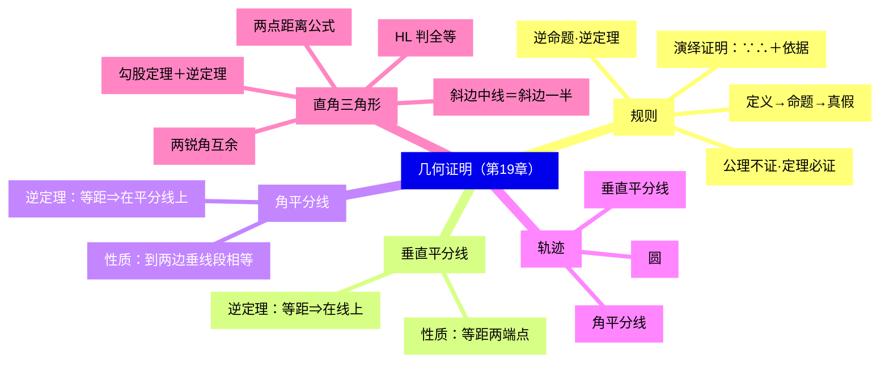
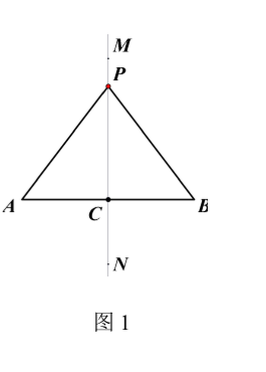
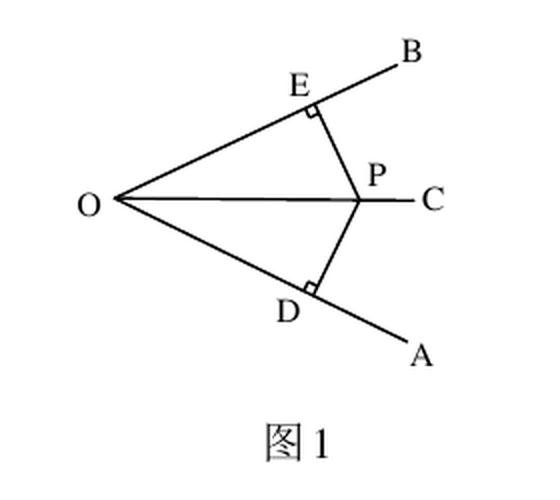
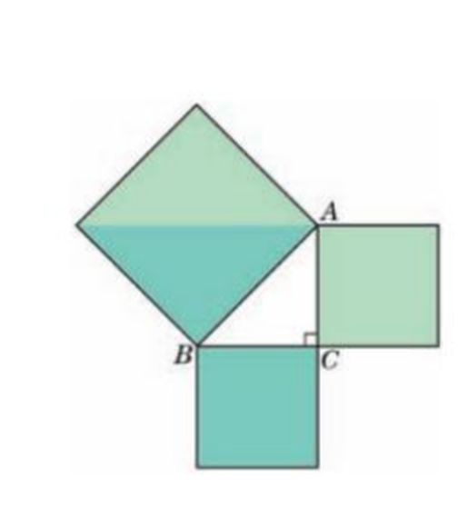
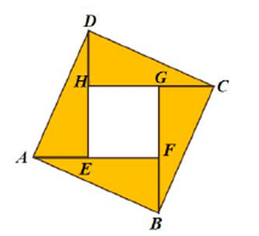
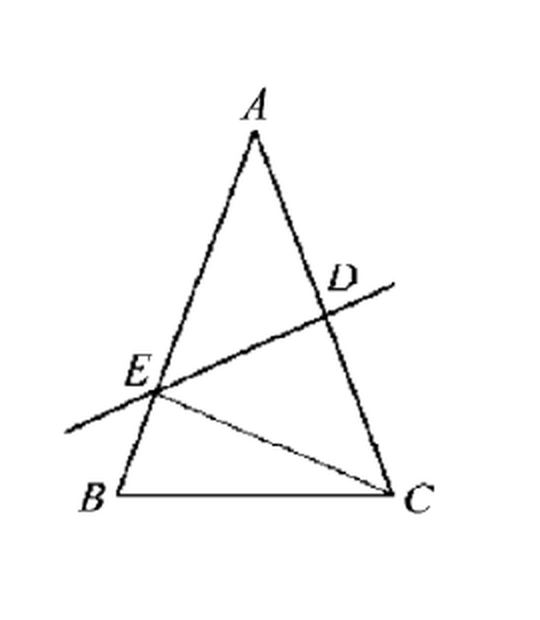
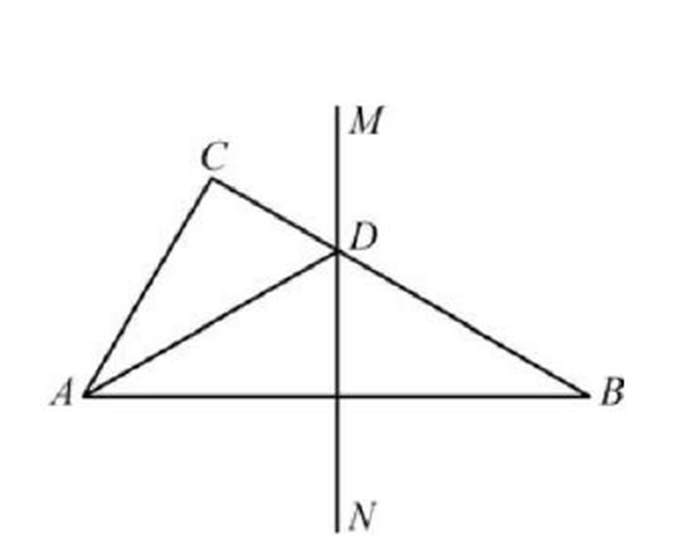
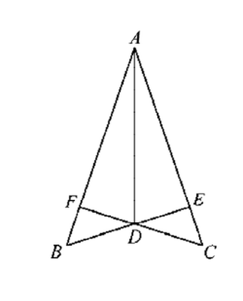
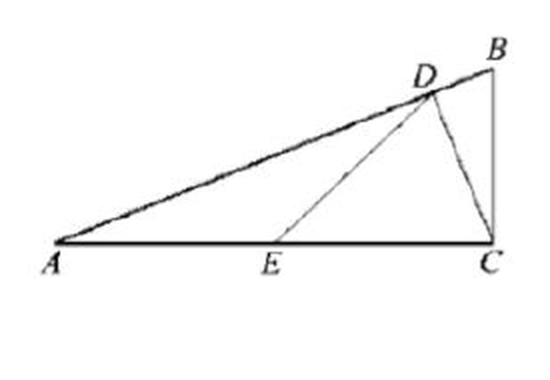
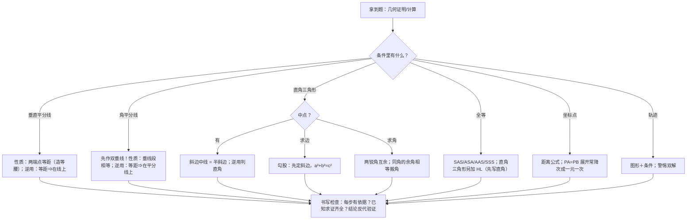

# 几何证明（详解版）

> [!note] 使用说明
> 本文是详解版，从"为什么"讲起供从头自学；考前速查和掌握度跟踪在概要版：[[03-数学/知识点/八年级/几何证明]]。本章配图裁自备课包任务单与课后练习原图。

## 0️⃣ 这章学什么 & 中考怎么考

- **这章解决什么问题**：以前的几何题你靠"观察"和"量一量"下结论，但眼睛会骗人——两个角看着相等，量出来差了 1°。从这章起，几何结论必须**按规则推理**出来：从已知出发，每一步注明依据（定义、公理、定理），一步步推出结论。这个"讲规矩"的过程叫**演绎证明**。本章立规矩（命题与证明），再攒工具（垂直平分线、角平分线、直角三角形、勾股定理），并顺带学三条基本轨迹。
- **和前后章节的关系**：往前，你要会全等三角形判定与性质、平行线、等腰三角形（见[[03-数学/知识点/00-六至八年级核心公式定理总表]]）；往后，九年级相似三角形、四边形的证明，以及中考第 22～25 题的几何综合，全部用本章的定理库和书写规范（[[03-数学/知识点/九年级/二次函数]]的压轴几何环节也一样）。
- **中考怎么考**（依据概要版，不编造分值）：
  - ==定理的符号语言==要能默写，书写每步带依据是硬性要求；
  - 垂直平分线/角平分线/直角三角形三大块定理是证明工具库；
  - 勾股定理与两点的距离公式是计算与解析法的常备件。
- 一句话总结：**性质定理是"见图形特征得结论"，判定定理是"凑条件定形状"；证明 = 已知 + 依据 + ∵∴ 因果链，一步都不能凭感觉。**

### 学完本章，你应该能做到

1. 分清定义、命题、真/假命题、公理、定理；会给假命题举反例。
2. 写出一个命题的逆命题，并判断定理是否有逆定理。
3. 默写垂直平分线、角平分线两组"性质定理 + 逆定理"的符号语言，并在证明中正确选用。
4. 说出三条基本轨迹，回答轨迹题"图形 + 条件"完整。
5. 用 HL 判定直角三角形全等；用两锐角互余、斜边中线、勾股定理（含逆定理）解题。
6. 会用两点距离公式，能从坐标条件反推几何关系。

### 本章知识地图



## 🧭 先修自检（学不下去先回到这里）

> [!note] 先修自检怎么用
> 下面每一项都是本章的地基。做不出就先去补对应知识，硬学只会更挫败。

| # | 你应该会的 | 自查题（先做再看答案） | 答案 | 不会去哪补 |
| - | ---------- | ---------------------- | ---- | ---------- |
| 1 | 全等判定 | $\triangle ABC$ 与 $\triangle DEF$ 中 $AB=DE$、$\angle A=\angle D$、$AC=DF$，依据什么判定全等？ | SAS（两边及夹角） | [[03-数学/知识点/00-六至八年级核心公式定理总表]] |
| 2 | 全等性质 | 全等三角形能得出哪三组相等？ | 对应边相等、对应角相等、（面积相等） | 同上 |
| 3 | 平行线 | 两直线平行，同旁内角______；同旁内角互补，两直线______ | 互补；平行（前者性质、后者判定） | 同上 |
| 4 | 三角形的角 | $\triangle ABC$ 中 $\angle A=50^\circ$、$\angle B=60^\circ$，外角 $\angle ACD=$？ | $110^\circ$（外角 = 不相邻两内角之和） | 同上 |
| 5 | 等腰三角形 | $AB=AC$，$\angle B=40^\circ$，顶角 $\angle A=$？ | $100^\circ$（等边对等角 + 内角和） | 同上 |
| 6 | 开方 | $\sqrt{3^2+4^2}$、$\sqrt{(2\sqrt2)^2}$ 各等于多少？ | $5$；$4$（勾股计算要用） | [[03-数学/知识点/八年级/二次根式]] |

**自查题做错的，先把那一项补上再往下读。第 1～3 项是所有证明的"弹药"，第 6 项是勾股的计算底子。**

## 🌱 概念从头讲

> [!note] 概念讲法约定
> 每个概念按"**为什么需要它 → 它是什么 → 符号与记号含义 → 容易想错的地方**"四步讲。

### 概念 1：定义、命题、真命题、假命题

- **为什么需要**：要推理，先得让每个词都有精确含义（定义），每句话都可判真假（命题）。"好看的图形"没法推理，"对顶角相等"才行。
- **定义**：能**界定某个对象含义**的句子。如"线段的垂直平分线：垂直于这条线段并且平分这条线段的直线"——定义给出判定标准（垂直 + 平分两个条件都要）。
- **命题**：**判断一件事情的句子**。命题由**题设（条件）与结论**两部分组成，都可改写成"如果……，那么……"。
  - **真命题**：判断正确；**假命题**：判断错误。判定假命题只需**一个反例**。
- **容易想错**：❌"反例举不出就是真的"。 → 举不出反例不代表真，要**证明**才能确认（这正是公理、定理存在的原因）。另外"句子"必须是可判断的："画一条线段"不是命题（没有判断）。

### 概念 2：公理与定理

- **为什么需要**：证明不能无限倒退，总得有个起点——起点就是公理；从公理推出的结论可以继续当下一步的依据，被"转正"的就是定理。
- **定义**：
  - **公理**：从长期实践中总结出来、**不需证明**就可作为推理依据的真命题（如"两点确定一条直线""全等三角形对应边相等"这一类公认事实）。
  - **定理**：从公理或其他真命题出发**经过推理证明为正确**、并进一步作为判断其他命题真假依据的真命题。
- **关系**：所有定理都是真命题，**但真命题不一定是定理**（有的真命题没被选作推理依据，如某个具体三角形的三边长恰好满足 $3^2+4^2=5^2$）。
- **容易想错**：❌"公理是因为太显然所以不用证"。 → 更准确地说：公理是推理链条的**约定起点**，它的"不证"是规则规定的，不是偷懒。

### 概念 3：演绎证明

- **为什么需要**：测量有误差、画图有偏差、举例子以偏概全，只有从已知条件按依据推理，结论才**普遍可靠**——19.1 用"对顶角相等"比较了量角器、折叠、推理几种办法，推理最可靠。
- **是什么**：从**已知**出发，依据已知的**定义、公理、定理**，一步步推出结论。规范格式：

```text
已知：……
求证：……
证明：∵……（依据），
      ∴……（依据）。
```

- **三条规矩**：①每一步都要有**依据**；②因果关系（"由什么推出什么"）不能颠倒；③"已知、求证"两行不能省——它们划定推理的起点和终点，**用结论证结论（循环论证）等于没证**。
- **容易想错**：❌ 证明里写"显然""可以看出"。 → 都换成具体依据；说不出依据的那一步，往往正是思路断裂处——**写不出依据，说明你还没真正想通**。

### 概念 4：互逆命题与逆定理

- **为什么需要**：几何定理常成对出现——"见特征得结论"与"满足结论反推特征"。分清方向，才能知道手里这道题该用哪一个。
- **定义**：两个命题中，第一个命题的**题设**是第二个命题的**结论**、第一个命题的**结论**是第二个命题的**题设**，这两个命题叫**互逆命题**；把其中一个叫**原命题**，另一个叫它的**逆命题**。
  - **逆定理**：如果一个定理的逆命题经过证明也是真命题（定理），那么它们是一对**互逆定理**。
- **关键事实**：==每个命题都有逆命题，但一个定理不一定有逆定理==。
  - 例（19.3 例题）："同旁内角互补，两直线平行"的逆命题"两直线平行，同旁内角互补"经证明为真 → 有逆定理；
  - "全等三角形对应边相等"的逆命题"对应边相等的三角形全等"（即 SSS，恰好为真，有逆定理）；
  - **"全等三角形对应角相等"的逆命题"对应角相等的三角形全等"是假命题**（三个角对应相等的两个三角形只是相似，大小可以不同）→ 该定理没有逆定理。
- **容易想错**：❌ 把性质定理当判定用（或反之）。 → 自检句式：垂直平分线性质定理的题设是"点**在**垂直平分线上"，逆定理的题设是"到两端点**距离相等**"。用定理前先问：**我手里的条件是哪个题设？**

### 概念 5：线段的垂直平分线（性质定理 + 逆定理）



- **为什么需要**：线段 $AB$ 关于直线 $MN$（垂直平分线）对称。对称直觉告诉我们：$MN$ 上任一点 $P$ 到两端点"应该"一样远——但直觉要升级成定理，必须全等证明。
- **性质定理**：**线段垂直平分线上的任意一点，与这条线段两个端点的距离相等。**
  - 符号语言：∵ 点 $P$ 在线段 $AB$ 的垂直平分线上，∴ $PA=PB$。
  - **为什么成立**：设垂足为 $C$。$PC\perp AB\Rightarrow\angle PCA=\angle PCB=90^\circ$（垂直定义）；$CA=CB$（平分）；$PC$ 公共 → $\triangle PCA\cong\triangle PCB$（SAS）→ $PA=PB$。**证明套路：垂直平分线 ⇒ 两个直角三角形全等。**
- **逆定理**：**与线段两个端点距离相等的点，在这条线段的垂直平分线上。**
  - 符号语言：∵ $PA=PB$，∴ 点 $P$ 在线段 $AB$ 的垂直平分线上。
  - **为什么成立**：$PA=PB$、$CA=CB$、$PC$ 公共 → $\triangle PCA\cong\triangle PCB$（SSS）→ $\angle PCA=\angle PCB$，而它们互补 → 各为 $90^\circ$ → $PC\perp AB$ 且过中点。
- **两个应用方向**：正用"在线上 → 等距"造等腰三角形（$PA=PB$ 的瞬间，$\triangle PAB$ 就成了等腰三角形，等边对等角随之可用）；逆用"等距 → 在线上"证垂直或平分。
- **容易想错**：❌ 只证了垂直就说垂直平分。 → 定义要**垂直**与**平分**同时满足；逆定理证明里 SSS 给出等角，再用互补定直角，一步不能省。

### 概念 6：角的平分线（性质定理 + 逆定理）



- **为什么需要**：角平分线上的点到角两边"看起来"一样近——这里的"距离"是**点到直线的距离 = 垂线段长**，所以讨论前必须先作垂线。
- **性质定理**：**在角的平分线上的点，到这个角两边的距离相等。**
  - 符号语言：∵ $OC$ 平分 $\angle AOB$，$P$ 在 $OC$ 上，$PD\perp OA$，$PE\perp OB$，∴ $PD=PE$。
  - **为什么成立**：$\angle PDO=\angle PEO=90^\circ$（垂直定义），$\angle DOP=\angle EOP$（平分），$OP$ 公共 → $\triangle PDO\cong\triangle PEO$（AAS）→ $PD=PE$。
- **逆定理**：**在一个角的内部（包括顶点）且到角的两边距离相等的点，在这个角的平分线上。**
  - 符号语言：∵ $PD\perp OA$，$PE\perp OB$，$PD=PE$，∴ 点 $P$ 在 $\angle AOB$ 的平分线上。
  - **为什么成立**：两个直角三角形中 $PD=PE$（直角边）、$OP$ 公共（斜边）→ HL 全等 → $\angle DOP=\angle EOP$。这条证明正是 19.7 的探究活动——**用 HL 证明角平分线的逆定理**。
- **辅助线口诀的由来**："见角平分线，作双垂线"——因为定理里的"距离"必须是垂线段，**没有作垂线就没有资格说距离相等**。
- **容易想错**：❌ 把"$P$ 到 $OA$ 的距离"画成斜线段 $PO$。 → 距离 = 垂线段长；图里 $PO$ 是斜的，$PD$、$PE$ 才是距离。逆定理还有个限定词"**在角的内部（包括顶点）**"——外角平分线方向到两边的距离也相等，但不在本定理范围内。

### 概念 7：点的轨迹与三条基本轨迹

- **为什么需要**：把"满足条件的所有点"打包成一个图形，就得到**轨迹**——它是前面两条"逆定理"的集合化升级：逆定理说的是"一个点在线上"，轨迹说的是"线上恰好装着全部这样的点"。这也首次引入**集合**思想。
- **定义**：**符合某些条件的所有的点的集合**叫做点的轨迹。
- **三条基本轨迹**：

| 条件 | 轨迹 |
| ---- | ---- |
| 到线段两个端点距离相等 | 这条线段的垂直平分线 |
| 在一个角的内部（包括顶点）且到这个角两边距离相等 | 这个角的平分线 |
| 到定点的距离等于定长 | 以这个定点为圆心、定长为半径的圆 |

- **回答格式**：轨迹题要**图形 + 条件**完整："是……"，并画出图形；有的条件对应**不止一条**轨迹——如"到直线 $AB$ 的距离等于 3cm 的点"的轨迹是**两条**平行于 $AB$ 的直线（两侧各一条），漏一条就错一半。
- **容易想错**：❌"以线段 $AB$ 为底边的等腰三角形两底角平分线的交点，轨迹是 $AB$ 的垂直平分线"。 → 反例：垂足（垂直平分线与 $AB$ 的交点）到底角平分线交点的条件**不满足**（它与 $A$、$B$ 距离相等但构不成三角形）。轨迹必须是"全部合格点的集合"，**多一点也不行，少一点也不行**。

### 概念 8：直角三角形全等的判定（HL）

- **为什么需要**：一般三角形没有"SSA"判定——两边及其中一边的对角，能画出两个不同形状的三角形（这就是 SSA 被排除的原因）。但**直角三角形**里，那个"对角"恒为直角，情形特殊，"斜边 + 一条直角边"反而能唯一确定直角三角形。
- **定理**：在两个直角三角形中，如果**斜边和一条直角边对应相等**，那么这两个直角三角形全等（记作 **H.L.**）。
- **为什么"直角"救活了 SSA**：设两个直角三角形斜边 $c$、直角边 $a$ 对应相等。第三边 $b=\sqrt{c^2-a^2}$ 由勾股定理**唯一确定**——三条边都定了，SSS 全等。换句话说，HL 的合法性由勾股定理背书（教材把它安排在勾股定理之前用拼补/作图说明唯一性，思路一致：直角把自由度锁死）。
- **书写规范**：先指出"都是直角三角形"（或 $\angle C=\angle C'=90^\circ$），再列 HL 的三条件（两斜边、一直角边）。
- **容易想错**：❌ 对一般三角形写"HL"。 → HL **只对直角三角形生效**；条件里没直角，就用 SAS/ASA/AAS/SSS 四选一。

### 概念 9：直角三角形的两个性质定理

- **定理 1（角的性质）**：**直角三角形的两个锐角互余。**
  - 为什么成立：内角和 $180^\circ$，直角占去 $90^\circ$，剩两个锐角和恰为 $90^\circ$。
  - 用法：$CD$ 是斜边上的高时，$\angle ACD=\angle B$、$\angle BCD=\angle A$（都与同一个角互余——**同角的余角相等**），这类"角搬家"是直角三角形证明的常客。
- **定理 2（特殊线段的性质）**：**直角三角形斜边上的中线等于斜边的一半。**
  - 符号语言：∵ $\angle ACB=90^\circ$，$D$ 为 $AB$ 中点，∴ $CD=\dfrac12AB$。
  - **为什么成立（拼补思路）**：取与 Rt$\triangle ABC$ 全等的直角三角形，让斜边 $AB$ 重合地拼在另一侧，拼成一个矩形——矩形对角线相等且互相平分，所以半条对角线 $CD=\dfrac12AB$。
  - **逆用可判直角**：一边上的中线等于这条边的一半的三角形是直角三角形（逆命题经证明为真）。用法要分清方向：**直角 → 半长；半长 → 直角**。
- **容易想错**：❌ 任意三角形中线 = 半边。 → 前提是直角；"中线是半边"反过来才能判直角。见到"中点 + 直角"立刻想这条定理，见到"中线 = 半边"立刻反推直角。

### 概念 10：勾股定理与逆定理



- **为什么从正方形面积说起**：上图中三个正方形面积分别以三边为边长。等腰直角三角形时，两小正方形（各为 $a^2$）恰好能拼满大正方形（$c^2$），即 $2a^2=c^2$。**"面积的等量关系"就是"边的等量关系"**——这一步把几何量代数化。
- **定理**：**直角三角形的两条直角边的平方和等于斜边的平方。** 在 Rt$\triangle ABC$ 中，$\angle C=90^\circ$，$a$、$b$ 为直角边，$c$ 为斜边，则 $a^2+b^2=c^2$。
- **为什么成立（面积割补法证明）**：用四个全等的直角三角形（直角边 $a$、$b$，斜边 $c$）拼成一个大正方形，中间留出边长 $c$ 的小正方形（下图即"赵爽弦图"）：



  - 一方面大正方形面积 $=(a+b)^2=a^2+2ab+b^2$；
  - 另一方面它又等于 $4\times\dfrac12ab+c^2=2ab+c^2$；
  - 两式相等：$a^2+2ab+b^2=2ab+c^2$，约去 $2ab$ 得 $a^2+b^2=c^2$。
  - **证明的全部逻辑就是"同一块面积，两种算法"**——数形结合的教科书式示范。我国《周髀算经》记载"勾三股四弦五"，赵爽的弦图正是这路证法。
- **逆定理**：**如果三角形的一条边的平方等于另外两条边的平方和，那么这个三角形是直角三角形。**
  - 验证步骤：**先找最大边**当 $c$，再算 $c^2\stackrel{?}{=}a^2+b^2$——最大边不挑对，整题作废。
- **容易想错**：❌ 直角边当斜边代入。 → 斜边一定是最长边；画个草图标直角再列式。

### 概念 11：两点的距离公式

- **是什么**：直角坐标平面内 $A(x_1,y_1)$、$B(x_2,y_2)$，则
  $$AB=\sqrt{(x_1-x_2)^2+(y_1-y_2)^2}$$
- **为什么成立（推导）**：过 $A$ 作 $x$ 轴的平行线、过 $B$ 作 $y$ 轴的平行线，交于点 $C(x_2,y_1)$，构造 Rt$\triangle ACB$：水平直角边 $AC=\lvert x_1-x_2\rvert$（同一水平线上两点距离 = 横坐标差的绝对值），竖直直角边 $BC=\lvert y_1-y_2\rvert$，勾股定理开方即得。**距离公式的本质就是勾股定理搬进坐标系。**
- **两个特殊情形**：两点同在 $x$ 轴上（或平行于 $x$ 轴的直线上）时 $AB=\lvert x_1-x_2\rvert$；同在 $y$ 轴方向时 $AB=\lvert y_1-y_2\rvert$。
- **容易想错**：❌ 去根号忘绝对值：写 $AB=x_1-x_2$。 → 坐标差可能为负，距离必须非负，**绝对值不能省**（根号里的平方倒是自带保护）。

## 🧮 公式逐个拆解

> [!note] 公式拆解约定
> 每条定理都必须能回答四件事：题设是什么？结论是什么？符号语言怎么写？配一个最小用法。

### 公式 1：线段垂直平分线——性质定理与逆定理

| | 性质定理 | 逆定理 |
| ---- | ---- | ---- |
| 题设 | 点 $P$ 在线段 $AB$ 的垂直平分线上 | $PA=PB$ |
| 结论 | $PA=PB$ | 点 $P$ 在线段 $AB$ 的垂直平分线上 |
| 用途 | 证线段相等（顺手造等腰三角形） | 证垂直/平分、定轨迹 |

- **成立条件**：都在"同一平面"内；性质定理的前提是"点在垂直平分线上"，逆定理的前提是"两点等距"——**方向不能反**。
- **最小例子**：等腰 $\triangle ABC$ 中 $DE$ 垂直平分腰 $AC$ 交 $AB$ 于 $E$：由性质定理 $EA=EC$，于是 $\triangle BCE$ 的周长 $=EB+BC+EC=EB+BC+EA=AB+BC$——**"搬线段"一步到位**（详见例题第 1 级）。

### 公式 2：角的平分线——性质定理与逆定理

| | 性质定理 | 逆定理 |
| ---- | ---- | ---- |
| 题设 | $OC$ 平分 $\angle AOB$，$P$ 在 $OC$ 上，$PD\perp OA$，$PE\perp OB$ | $PD\perp OA$，$PE\perp OB$，$PD=PE$ |
| 结论 | $PD=PE$ | 点 $P$ 在 $\angle AOB$ 的平分线上 |
| 用途 | 证垂线段相等 | 证角相等/平分 |

- **成立条件**：两边"距离"必须先是**垂线段**——没有作垂线，两个定理都无从谈起。
- **最小例子**：$AD$ 平分 $\angle BAC$，$D$ 在 $BC$ 上，$DE\perp AB$：由性质定理 $DC=DE$（$D$ 到两边距离相等），直接省去一次全等证明。
- **注意**：逆定理限定"在角的**内部**（包括顶点）"。

### 公式 3：三条基本轨迹

| 条件 | 轨迹 | 来源 |
| ---- | ---- | ---- |
| 到线段两端点距离相等 | 线段的垂直平分线 | 垂直平分线逆定理 |
| 在角内部（含顶点）且到两边等距 | 角的平分线 | 角平分线逆定理 |
| 到定点距离等于定长 | 圆（圆心定点、半径定长） | 圆的定义 |

- **回答格式**：图形 + 条件，缺一不可；警惕"双解"（如与直线距离为定长 → 两条平行线；经过两定点的圆的圆心 → 连线段的垂直平分线）。
- **最小例子**："到点 $A(2,0)$ 的距离为 4 的点的轨迹"：以 $A$ 为圆心、4 为半径的**圆**（单元复习练习题）。

### 公式 4：直角三角形全等判定 HL

- **符号语言**：∵ $\angle C=\angle C'=90^\circ$（都是直角三角形），$AB=A'B'$（斜边），$BC=B'C'$（直角边），∴ Rt$\triangle ABC\cong$Rt$\triangle A'B'C'$（H.L.）。
- **成立条件**：**只对直角三角形**；书写先写直角再列条件。
- **最小例子**：$BE\perp AC$、$CF\perp AB$ 交于 $D$ 且 $BD=CD$（例题第 3 级）：$\triangle BDF$ 与 $\triangle CDE$ 中各有一对直角、斜边 $BD=CD$，配一对对顶角（AAS）证全等得 $DF=DE$——注意这里用的是 AAS；等腰直角双垂线的场景里 HL 更常见（斜边 + 直角边）。

### 公式 5：直角三角形性质——互余与斜边中线

| 定理 | 内容 | 符号语言 |
| ---- | ---- | ---- |
| 定理 1 | 两个锐角互余 | ∵ $\angle C=90^\circ$，∴ $\angle A+\angle B=90^\circ$ |
| 定理 2 | 斜边上的中线等于斜边的一半 | ∵ $\angle ACB=90^\circ$，$D$ 为 $AB$ 中点，∴ $CD=\dfrac12AB$ |
| 定理 2 逆用 | 一边上的中线等于该边一半 ⇒ 直角三角形 | ∵ $CD=\dfrac12AB$（$D$ 为 $AB$ 中点），∴ $\angle ACB=90^\circ$ |

- **同角的余角相等**（定理 1 的搭档）：$\angle A+\angle B=90^\circ$ 且 $\angle A+\angle ACD=90^\circ$（$CD\perp AB$ 时）⇒ $\angle B=\angle ACD$。斜边上高线一画，两组等角自动到手。
- **最小例子**：Rt$\triangle$ 中斜边 $AB=13$，$D$ 为 $AB$ 中点 → $CD=6.5$。**验算方向**：$CD$ 应比两直角边都短（半斜边是"最长的中线"），可作粗检。

### 公式 6：勾股定理与逆定理

- **定理**：Rt$\triangle ABC$，$\angle C=90^\circ$，$a,b$ 直角边，$c$ 斜边：$a^2+b^2=c^2$。
  - **变形三件套**：$c=\sqrt{a^2+b^2}$；$a=\sqrt{c^2-b^2}$；$b=\sqrt{c^2-a^2}$——先在草稿上标出**谁是斜边**再开方。
- **逆定理**：最大边 $c$ 满足 $c^2=a^2+b^2$ ⇒ $\angle C=90^\circ$（直角对着最大边）。
- **最小例子**：$a=8$、$c=17$：$b=\sqrt{17^2-8^2}=\sqrt{(17+8)(17-8)}=\sqrt{225}=15$（平方差让口算成为可能）。

### 公式 7：两点的距离公式

$$AB=\sqrt{(x_1-x_2)^2+(y_1-y_2)^2}$$

| 符号 | 含义 | 注意 |
| ---- | ---- | ---- |
| $(x_1,y_1),(x_2,y_2)$ | 两点坐标 | 相减顺序随意（有平方） |
| 特殊情形 | 同水平/竖直线上 | $\lvert x_1-x_2\rvert$ 或 $\lvert y_1-y_2\rvert$，**带绝对值** |

- **成立条件**：直角坐标平面内任意两点。
- **常用变形**：由 $PA=PB$ 列出坐标方程，展开后二次项往往抵消，落成一元一次方程（见例题变式）。
- **最小例子**：$A(-1,4)$、$B(2,0)$：$AB=\sqrt{(-1-2)^2+(4-0)^2}=\sqrt{9+16}=5$。**验算**：$3^2+4^2=5^2$ ✓。

## 🪜 例题阶梯

> [!note] 例题怎么用
> 五级台阶，每题先自己画图标条件，再跟着"依据插话"走。题源均为备课包课后练习原题，配图裁自原卷。

### 第 1 级 · 入门（垂直平分线搬线段）

> **题目**（19.4 课后练习 第 3 题）：如图，已知等腰 $\triangle ABC$ 中，腰 $AB=8\text{ cm}$，$DE$ 是腰 $AC$ 的垂直平分线，垂足为点 $D$，$DE$ 与 $AB$ 相交于点 $E$，$\triangle BCE$ 的周长为 $14\text{ cm}$。求 $BC$ 的长。
>
> 
>
> **思路从哪来**：垂直平分线 → 性质定理给出 $EA=EC$ → 把 $EC$ "搬"成 $EA$，$\triangle BCE$ 的周长立刻塌缩成 $AB+BC$。
>
> **完整解答**：
> ∵ $DE$ 是 $AC$ 的垂直平分线，点 $E$ 在 $DE$ 上（已知），
> ∴ $EA=EC$（线段垂直平分线的性质定理）。
> ∵ $C_{\triangle BCE}=EB+BC+EC$（周长的意义），
> ∴ $C_{\triangle BCE}=EB+BC+EA=AB+BC$（等量代换）。
> 又 $C_{\triangle BCE}=14\text{ cm}$，$AB=8\text{ cm}$，
> ∴ $BC=14-8=6\text{ cm}$（等式性质）。
> **验算**：$AB=8>BC=6$，且 $8+8>6$，能构成三角形 ✓；周长 $EB+BC+EC$ 中 $EB+EC=AB=8$，$8+6=14$ ✓。
>
> **变式提醒**：同一道题反过来问"已知 $BC=6$ 求 $\triangle BCE$ 周长"，思路完全相同。19.4 课后练习第 1 题（$AC=AD$、$BC=BD$ 证 $EC=ED$）练的是**逆定理**方向：由两组等距推出 $AB$ 是 $CD$ 的垂直平分线，再用性质定理收尾——**性质与逆定理在同一题里接力**，是本节的经典结构。

### 第 2 级 · 标准（垂直平分线 + 等腰算角度）

> **题目**（19.4 课后练习 第 4 题）：如图，已知在 $\triangle ABC$ 中，$\angle C=90^\circ$，$AB$ 的垂直平分线 $MN$ 交 $BC$ 于点 $D$。
> (1) 如果 $\angle CAD=20^\circ$，求 $\angle B$ 的度数；
> (2) 如果 $\angle CAB=50^\circ$，求 $\angle CAD$ 的度数。
>
> 
>
> **思路从哪来**：垂直平分线性质定理给 $DA=DB$ → $\triangle DAB$ 等腰 → $\angle DAB=\angle B$（等边对等角）。于是 $\angle CAB=\angle CAD+\angle B$，而直角三角形里 $\angle CAB+\angle B=90^\circ$——**两个方程两个未知角**，全部角度被钉死。
>
> **完整解答**：
> ∵ 点 $D$ 在 $AB$ 的垂直平分线 $MN$ 上（已知），
> ∴ $DA=DB$（线段垂直平分线的性质定理），
> ∴ $\angle DAB=\angle B$（等边对等角）。
> (1) ∵ $\angle C=90^\circ$，∴ $\angle CAB+\angle B=90^\circ$（直角三角形两锐角互余）。
> 又 $\angle CAB=\angle CAD+\angle DAB=20^\circ+\angle B$（角的和差），
> ∴ $20^\circ+\angle B+\angle B=90^\circ$（等量代换），解得 $\angle B=35^\circ$。
> **验算**：$\angle CAB=20^\circ+35^\circ=55^\circ$，$55^\circ+35^\circ=90^\circ$ ✓。
> (2) 同理 $\angle CAB+\angle B=90^\circ$，得 $\angle B=40^\circ$；$\angle DAB=\angle B=40^\circ$；
> ∴ $\angle CAD=\angle CAB-\angle DAB=50^\circ-40^\circ=10^\circ$。
> **验算**：$\angle CAD+\angle DAB=10^\circ+40^\circ=50^\circ$ ✓。
>
> **变式提醒**：原题还有 (3)"$\angle CAD:\angle DAB=1:2$ 求 $\angle CAB$"——设 $\angle CAD=x$，则 $\angle DAB=\angle B=2x$，$x+2x+2x=90^\circ$，$x=18^\circ$，$\angle CAB=54^\circ$。**"设未知角"把几何算术题升级成小方程题**，比例条件多时尤其好用。

### 第 3 级 · 中档（双垂线 + 全等 + 角平分线逆定理）

> **题目**（19.5 课后练习 第 3 题）：已知：如图，$BE\perp AC$，$CF\perp AB$，垂足分别是点 $E$、$F$，$BE$、$CF$ 交于点 $D$，且 $BD=CD$。求证：$AD$ 平分 $\angle BAC$。
>
> 
>
> **思路从哪来**：要证 $AD$ 平分 $\angle BAC$，最好的工具是**角平分线的逆定理**——只需证 $D$ 到 $AB$、$AC$ 的距离相等，即 $DF=DE$（$DF$、$DE$ 恰好是垂线段）。而 $DF=DE$ 藏在一对直角三角形 $\triangle BDF$、$\triangle CDE$ 里。
>
> **完整解答**：
> 证明：∵ $BE\perp AC$，$CF\perp AB$（已知），
> ∴ $\angle BFD=\angle CED=90^\circ$（垂直定义）。
> 在 $\triangle BFD$ 和 $\triangle CED$ 中：
> $\angle BFD=\angle CED=90^\circ$（已证），
> $\angle BDF=\angle CDE$（对顶角相等），
> $BD=CD$（已知），
> ∴ $\triangle BFD\cong\triangle CED$（A.A.S.），
> ∴ $DF=DE$（全等三角形对应边相等）。
> 又 $DF\perp AB$，$DE\perp AC$（即 $CF\perp AB$、$BE\perp AC$，垂足 $F$、$E$），
> ∴ 点 $D$ 在 $\angle BAC$ 的平分线上（在一个角的内部且到角两边距离相等的点，在这个角的平分线上），
> 即 $AD$ 平分 $\angle BAC$。
> （依据链复盘：**对顶角 → AAS 全等 → 垂线段相等 → 角平分线逆定理**。最后一步用逆定理，省去了再证 $\angle FAD=\angle EAD$ 的一整轮全等——这正是逆定理存在的价值。）
> **验算**：由全等还有 $FB=EC$、$FD=ED$；$AD$ 公共 → $\triangle AFD\cong\triangle AED$（HL：$AD$ 斜边公共、$FD=ED$ 直角边）→ $\angle FAD=\angle EAD$，与逆定理结论一致 ✓。
>
> **变式提醒**：19.5 课后练习第 1 题（$AD$ 平分 $\angle BAC$、$DE\perp AB$、$EF\parallel BC$，证 $EC$ 平分 $\angle FED$）是"性质定理出发"的姊妹题：先由性质定理得 $DC=DE$ → $\angle DCE=\angle DEC$，再借平行搬角。**一正一逆两道题对照，方向感就长出来了。**

### 第 4 级 · 提高（斜边中线 + 等腰链条）

> **题目**（19.8 课后练习 第 1 题）：如图，已知 $\triangle ABC$ 中，$\angle ACB=90^\circ$，$CD\perp AB$，垂足为点 $D$，点 $E$ 是边 $AC$ 的中点，$DE=2\text{ cm}$，$\angle BCD=20^\circ$。那么 $AC=$＿＿＿＿＿＿＿＿cm，$\angle A=$＿＿＿＿＿＿＿＿$^\circ$。
>
> 
>
> **思路从哪来**："$CD\perp AB$"让 $\triangle ACD$ 成为直角三角形，"$E$ 是斜边 $AC$ 的中点"——**斜边中点**三个字一亮，斜边中线定理立刻上场：$DE=\dfrac12AC$，第一空秒出。求角则靠 $DE=EC=EA$ 造两个等腰三角形，把 $\angle A$ 集中到一个外角关系里。
>
> **完整解答**：
> 第一步（求 $AC$）：
> ∵ $CD\perp AB$（已知），∴ $\angle ADC=90^\circ$（垂直定义），即 $\triangle ACD$ 是直角三角形。
> ∵ 点 $E$ 是斜边 $AC$ 的中点（已知），
> ∴ $DE=\dfrac12AC$（直角三角形斜边上的中线等于斜边的一半），
> ∴ $AC=2DE=4\text{ cm}$。
> 第二步（求 $\angle A$）：
> 在 Rt$\triangle ACD$ 中，$\angle ACD=90^\circ-\angle BCD=70^\circ$（互余 + 等量代换）。
> ∵ $DE=\dfrac12AC=EC=EA$（中线定理 + 中点意义），
> ∴ $\triangle EDC$ 等腰，$\angle EDC=\angle ECD=70^\circ$（等边对等角），
> ∴ $\angle DEC=180^\circ-2\times70^\circ=40^\circ$（三角形内角和）。
> 又 $\triangle EDA$ 等腰（$DE=EA$），$\angle A=\angle ADE$（等边对等角），
> 而 $\angle DEC$ 是 $\triangle ADE$ 的外角：$\angle DEC=\angle A+\angle ADE=2\angle A$（外角性质），
> ∴ $\angle A=20^\circ$。
> **验算**：换一条路再算 $\angle A$——在 Rt$\triangle ACD$ 中 $\angle A+\angle ACD=90^\circ$；又 $\angle BCD+\angle ACD=\angle ACB=90^\circ$。**同角的余角相等**，故 $\angle A=\angle BCD=20^\circ$ ✓，与上面算出的结果吻合；$AC=4\text{ cm}$ 是正数且小于斜边不成问题（$AC$ 本身是直角边）✓。
>
> **变式提醒**：本题的反向工程——19.8 课后练习第 4 题：$\angle ACB=90^\circ$，$D$ 是 $AB$ 中点，$DE\parallel AC$ 且 $DE=AC$，证 $AE=\dfrac12AB$：先连 $CD$，证 $\triangle ADE\cong\triangle DAC$ 得 $AE=DC$，再用斜边中线 $DC=\dfrac12AB$。**"中线定理正着用给长度，配合全等转线段"**是这一节的固定套路；单元讲评例题 3（双等腰直角 + 中点）把这套套路推到压轴难度，学有余力可以挑战。

### 第 5 级 · 压轴（勾股定理 + 方程思想）

> **题目**（19.9 课后练习 第 4 题）：已知等腰直角三角形的底边长为 4，求腰上的中线长。
>
> **思路从哪来**：等腰直角三角形的"底边"就是斜边（两腰夹直角）。设腰为 $a$，勾股定理给出 $2a^2=16$；"腰上的中线"连接**直角顶点对侧**？——不，腰上的中线一端在腰的中点，另一端是这条腰所对的顶点（直角顶点），恰好落在另一个直角三角形里，再一次勾股。
>
> **完整解答**：
> 第一步：设等腰直角 $\triangle ABC$ 中 $\angle C=90^\circ$（顶角在 $C$），底边（斜边）$AB=4$，两腰 $AC=BC=a$。
> 由勾股定理：$a^2+a^2=4^2=16$，即 $2a^2=16$，$a^2=8$，$a=2\sqrt2$（取正值）。
> （**先解腰长**——中线长依赖于它；$a=2\sqrt2$ 由 $\sqrt8=\sqrt{4\times2}$ 化最简，用的是[[03-数学/知识点/八年级/二次根式]]。）
> 第二步：设 $M$ 是腰 $AC$ 的中点，$CM=\dfrac a2=\sqrt2$。$BM$ 是腰 $AC$ 上的中线。
> 在 $\triangle BCM$ 中，$\angle C=90^\circ$，两直角边 $BC=2\sqrt2$、$CM=\sqrt2$，
> 由勾股定理：$BM^2=BC^2+CM^2=8+2=10$，
> ∴ $BM=\sqrt{10}$。
> **验算**：$\sqrt{10}\approx3.16$。合理性：中线 $BM$ 应短于直角边 $BC\approx2.83$？——不对，$3.16>2.83$！**中线 $BM$ 可以比 $BC$ 长**（它从 $B$ 出发斜着伸向 $AC$ 中点，$\triangle BCM$ 中 $BM$ 是斜边，斜边当然最长 ✓）。再验：$BM^2=10$ 与 $BC^2+CM^2=8+2$ 一致 ✓。
> （顺带一提：若取的是**斜边上的中线**，答案是 $\dfrac12AB=2$——斜边中线定理一步到手。**"哪条边上的中线"读清楚**，两种问法答案完全不同。）
>
> **变式提醒**（与两点的距离公式会师）：19.10 课后练习第 3 题：点 $P(m,m)$ 到 $A(-2,3)$、$B(-1,-2)$ 距离相等，求 $m$。两把钥匙任选：①距离公式列方程 $(m+2)^2+(m-3)^2=(m+1)^2+(m+2)^2$，展开后 $2m^2$ 抵消，解得 $m=1$；②轨迹视角——$P$ 在线段 $AB$ 的垂直平分线上，求出 $AB$ 的垂直平分线 $y=x$ 再代 $P(m,m)$。**几何结论把代数方程"降维"**，正是本章"数形结合"的落点。

## 🗺️ 解题流程图



## 🔥 易错点：为什么会错

| ❌ 常见错误想法 | 为什么会这样想 | ✅ 正确理解 / 自救方法 |
| -------------- | -------------- | ---------------------- |
| 性质定理与逆定理方向用反 | 定理内容相似，只记了"等距" | 先问自己手里的条件是"在线上"还是"等距"，再对号入座 |
| 角平分线"距离"用斜线段 | 图里 $PO$ 最显眼 | 距离 = **垂线段**长；见角平分线先作双垂线，再谈相等 |
| HL 对一般三角形乱用 | 只记"边边角也行" | SSA 对一般三角形不成立；HL 必须先声明**都是直角三角形** |
| 任意三角形中线当半斜边 | 定理背串了 | 斜边中线的前提是直角；"中线 = 半边"逆用才能判直角 |
| 勾股把直角边当斜边 | 方程抄快了 | 斜边 = 最长边，对着直角；列式前先在图上标 $\angle C=90^\circ$ |
| 勾股逆定理不挑最大边 | 直接拿前两条边算 | 先定最大边为 $c$，再验证 $c^2=a^2+b^2$ |
| 书写省略依据/已知求证 | 觉得"显然" | 沪教版规范每步 ∵∴ 带依据；"已知、求证"两行不能省 |
| 轨迹答案漏"图形"或漏分支 | 只写了一半 | 轨迹 = 图形 + 条件；"到直线距离为定长"有**两条**平行线这类双解 |
| 距离公式去根号没绝对值 | 水平两点直接写坐标差 | $AB=\lvert x_1-x_2\rvert$，坐标差可负；先绝对值再谈大小 |

## 📝 本讲小结

- **规则**：定义 → 命题（题设+结论，真假/反例）→ 公理（不证）与定理（必证）；演绎证明 = 已知 + 依据 + ∵∴ 因果链，不许循环。
- **互逆**：每个命题都有逆命题；定理不一定有逆定理（反例：全等三角形对应角相等）。
- **垂直平分线**：在线上 ⇄ 到两端点等距；性质造等腰、逆定理证垂直平分。
- **角平分线**：到两边**垂线段**等距 ⇄ 在平分线上；辅助线"见角平分线作双垂线"。
- **轨迹**：合格点的集合；三条基本轨迹（垂直平分线、角平分线、圆）；答案图形 + 条件，防双解。
- **直角三角形**：HL（先写直角）；两锐角互余；斜边中线 = 半斜边（逆用判直角）；勾股定理 + 逆定理（先挑最大边）。
- **坐标**：两点距离公式 = 勾股进坐标系；$PA=PB$ 型方程二次项常自动抵消。
- **方法**：判定与性质分方向；分析从结论倒推"要证什么，只需证什么"；书写步步有据。

## ✅ 自测清单（能独立做到才打勾）

- [ ] 1. 能默写两组"性质定理 + 逆定理"的符号语言，并各举一个使用场景
- [ ] 2. 能说出"全等三角形对应角相等"为什么没有逆定理
- [ ] 3. 能解释"见角平分线作双垂线"口诀的道理
- [ ] 4. 能独立复述斜边中线定理的拼补证明思路
- [ ] 5. 能用赵爽弦图"一块面积两种算法"完整推出勾股定理
- [ ] 6. 能独立做出例题阶梯第 1～4 级，书写每步带依据
- [ ] 7. 能独立做出第 5 级（含"哪条边上的中线"辨析）与 19.10 距离公式变式
- [ ] 8. 能说出本章 5 个易错点及自救方法

## 🔗 关联

- 概要版：[[03-数学/知识点/八年级/几何证明]]（掌握度在这边更新）
- 前置知识：[[03-数学/知识点/00-六至八年级核心公式定理总表]]（全等三角形、平行线、等腰三角形） · [[03-数学/知识点详解/八年级/二次根式]]（勾股计算中的根式化简） · [[03-数学/知识点详解/八年级/一元二次方程]]（几何应用里偶发的二次方程）
- 后续：九年级相似三角形、四边形的证明沿用本章框架；两点的距离公式服务于解析法（[[03-数学/知识点/八年级/正比例函数与反比例函数]]）
