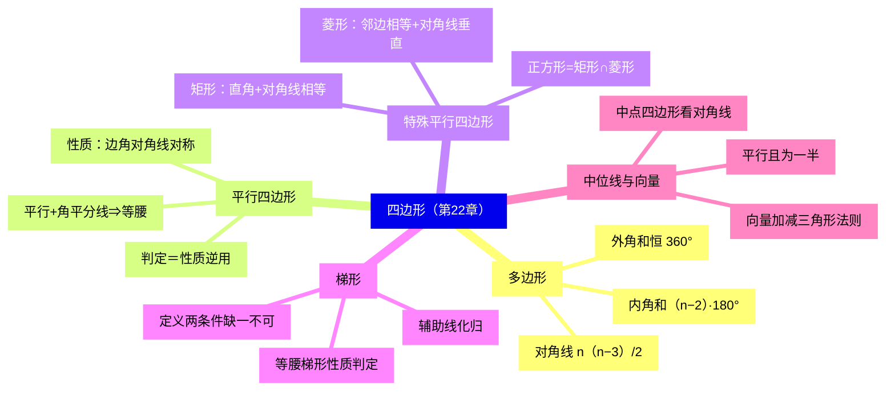
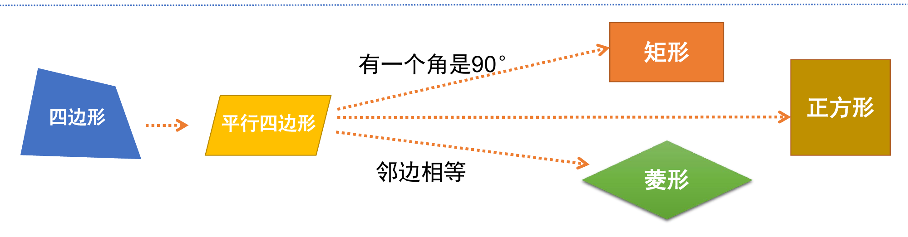
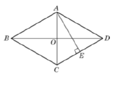
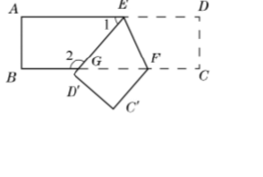
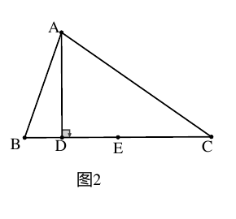
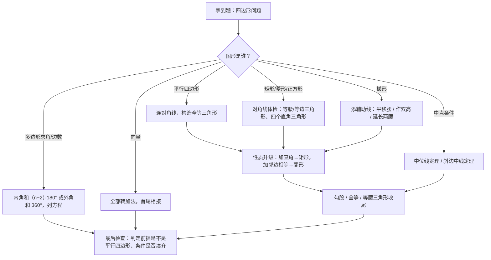

# 四边形（详解版）

> [!note] 使用说明
> 本文是详解版，从"为什么"讲起供从头自学；考前速查和掌握度跟踪在概要版：[[03-数学/知识点/八年级/四边形]]。

## 0️⃣ 这章学什么 & 中考怎么考

- **这章解决什么问题**：三角形你已经会研究了，四边形的"零件"更多（四条边、四个角、两条对角线），但研究套路完全一样：**定义 → 性质 → 判定**。这一章沿着"四边形 → 平行四边形 → 矩形/菱形 → 正方形"和"四边形 → 梯形"两条线，把特殊四边形的家底一次理清，最后补上"平面向量"这个新工具。
- **和前后章节的关系**：学这章前，你要会全等三角形、平行线、等腰三角形、勾股定理。学完这章，九年级相似三角形里的"平行线截线段成比例"、第 22～24 题里的几何论证与压轴题，特殊四边形与中位线都是常驻工具。
- **中考怎么考**（依据概要版与备课包，不编造分值）：
  - ==特殊平行四边形的性质与判定、梯形与中位线==是第 22～24 题几何论证与压轴题的常驻考点；
  - 常见动作：证平行四边形 → 加条件升级矩形/菱形 → 对角线构造等腰（等边）三角形 → 勾股计算；
  - 平面向量为高中向量知识起步，中考要求较低（识图与简单加减）。
- 一句话总结：**特殊四边形的问题最终都化归成三角形问题——连对角线、造全等，是这一章的万能起手式。**

### 学完本章，你应该能做到

1. 用对角线分割法推导并默写多边形内角和、外角和、对角线条数公式。
2. 说出平行四边形性质定理为什么成立（连对角线证全等），并能逆用性质叙述判定。
3. 画出"四边形家族树"，说清矩形、菱形、正方形谁包含谁、判定差哪两个条件。
4. 遇到梯形问题会添辅助线（平移腰、作双高），把梯形化归为三角形与平行四边形。
5. 区分中位线与中线，会用中位线定理做计算与论证；会向量加减的三角形法则。

### 本章知识地图

## 🧭 先修自检（学不下去先回到这里）

> [!note] 先修自检怎么用
> 下面每一项都是本章的地基。做不出就先去补对应知识，硬学只会更挫败。

| # | 你应该会的 | 自查题（先做再看答案） | 答案 | 不会去哪补 |
| - | ---------- | ---------------------- | ---- | ---------- |
| 1 | 全等三角形判定 | $AB=CD$，$AB\parallel CD$，能证 $\triangle ABC\cong\triangle CDA$ 吗？用什么判据？ | 能。$AB=CD$（S）、$\angle BAC=\angle DCA$（A，两直线平行内错角）、$AC=CA$（S）→ SAS | [[03-数学/知识点/00-六至八年级核心公式定理总表]] |
| 2 | 平行线性质 | 两直线平行，同旁内角________ | 互补 | 同上（几何板块） |
| 3 | 等腰三角形 | $\triangle ABC$ 中 $AB=AC$，$\angle B$ 与 $\angle C$ 什么关系？ | 相等（等边对等角） | 同上 |
| 4 | 直角三角形 | 直角三角形斜边上的中线与斜边什么关系？（若忘了，本章 22.3 会证明） | 等于斜边的一半 | 同上 |
| 5 | 勾股定理 | 直角边 5 和 12，斜边多长？ | $\sqrt{25+144}=13$ | 同上 |
| 6 | 对称性 | 中心对称图形旋转多少度与自身重合？ | $180°$ | 同上 |

**自查题做错的，先把那一项补上再往下读。第 1 项（连对角线证全等）是全章的万能起手式。**

## 🌱 概念从头讲

> [!note] 概念讲法约定
> 每个概念按"**为什么需要它 → 它是什么 → 符号与记号含义 → 容易想错的地方**"四步讲。

### 概念 1：多边形与内角和公式

- **为什么需要**：要研究"边数可以任意多"的图形，总不能一个个背结论——需要一条随边数变化的**公式**，把所有多边形一次说清。
- **定义**：平面内由不在同一直线上的一些线段**首尾顺次联结**所组成的封闭图形叫多边形；由 $n$ 条线段组成的多边形叫 $n$ 边形。初中研究的多边形都指**凸多边形**（任何一边双向延长，其他各边都在延长所得直线的同旁）。元素：边、顶点、内角、外角、**对角线**（联结不相邻两个顶点的线段）。
- **内角和为什么是 $(n-2)\cdot180°$**：从一个顶点出发引对角线。四边形引 1 条，分成 2 个三角形；五边形引 2 条，分成 3 个三角形……一般地，从一个顶点最多引 $n-3$ 条对角线（不能连自己，也不能连相邻两点），把 $n$ 边形分成 $n-2$ 个三角形。每个三角形内角和 $180°$，所以内角和 $=(n-2)\cdot180°$。这就是**化归**：把没学过的图形切成学过的三角形。
- **外角和为什么恒为 $360°$**：在每个顶点处，内角与相邻的外角拼成平角。$n$ 个平角共 $n\cdot180°=$ 内角和 $+$ 外角和，所以外角和 $=n\cdot180°-(n-2)\cdot180°=360°$——与边数无关。直觉：绕多边形走一圈，每个角转一下，回到出发方向时恰好转了一整圈。
- **容易想错**：❌ 对角线总数是 $n-3$。 → $n-3$ 是**从一个顶点出发**的条数；每条对角线连着两个顶点、被数了两次，总数 $=\dfrac{n(n-3)}{2}$。

### 概念 2：平行四边形——判定为什么与性质互逆成立

- **定义**：两组对边分别平行的四边形叫做平行四边形（记作 ▱ABCD）。
- **性质为什么成立**（万能起手式）：连对角线 $AC$，由 $AB\parallel CD$、$BC\parallel AD$ 得两组内错角相等，配上公共边 $AC$，$\triangle ABC\cong\triangle CDA$（ASA）——对边相等、对角相等全部读出来；再连 $BD$ 同理得**对角线互相平分**。平行四边形还是**中心对称图形**（对称中心是对角线交点）。
- **判定与性质为什么互逆**：性质说"平行四边形**有**这些特征"，判定说"**有**这些特征的四边形就是平行四边形"——条件结论恰好对调。互逆成立是有道理的：这些特征（如"对角线互相平分"）在一般四边形里是稀缺信号，一旦拥有，就足以逼出"两组对边分别平行"。沪教版判定清单：**定义**（两组对边分别平行）；**判定定理 1** 两组对边分别相等；**判定定理 2** 一组对边平行且相等；**判定定理 3** 对角线互相平分。每个判定都用"连对角线 + 全等"证明。
- **常用模型**：==“平行 + 角平分线”⇒ 等腰三角形==。角平分线给出两个相等的角，平行线再把其中一个"搬"过去成内错角——两个相等角凑到同一个三角形里，等角对等边。例：▱ABCD 中 $\angle ADC$ 的平分线交 $AB$ 于 $E$ ⇒ $\angle AED=\angle ADE$ ⇒ $AE=AD$。
- **容易想错**：❌ "一组对边平行，另一组对边相等"就是平行四边形。 → 反例是等腰梯形。判定定理 2 的"平行且相等"必须指**同一组对边**。

### 概念 3：特殊平行四边形——一张图看懂家族关系

- **定义**（逐级加条件）：
  - **矩形**：有一个内角是**直角**的平行四边形；
  - **菱形**：有一组**邻边相等**的平行四边形；
  - **正方形**：有一组邻边相等**并且**有一个内角是直角的平行四边形——它同时是特殊的矩形和特殊的菱形，是两条支路的汇合点。
- **判定的本质是性质的逆用**：先想"它比平行四边形特殊在哪"，再反过来说"具备该特征即判定"。沪教版清单：
  - 矩形：① 定义（有一个内角是直角的平行四边形）；② 对角线**相等**的平行四边形；③ 有三个角是直角的四边形；
  - 菱形：① 定义（有一组邻边相等的平行四边形）；② 对角线**互相垂直**的平行四边形；③ 四条边相等的四边形；
  - 正方形：**判定定理 1** 有一组邻边相等的**矩形**是正方形；**判定定理 2** 有一个内角是直角的**菱形**是正方形。
- **容易想错**：❌ "对角线相等的四边形是矩形。" → 判定前提必须是**平行四边形**——对角线相等的四边形还可能是等腰梯形。❌ 正方形只验一个条件。 → "邻边相等"与"一个直角"缺一不可：只有邻边相等是菱形，只有直角是矩形。

### 概念 4：对角线是特殊四边形的"体检表"

- **为什么需要**：特殊四边形的一切计算与证明，最后都落在对角线切出来的三角形上——会"体检"，就会解题。
- **矩形**：对角线相等且互相平分。
  - 一条对角线把矩形分成两个**直角三角形**；
  - 两条对角线把矩形分成四个**等腰三角形**（"矩形的对角线把矩形分成四个直角三角形"是**假**命题）；
  - 若对角线夹角为 $60°$，半对角线围出**等边三角形**——"矩形 + 对角线夹角"的标准模型。
- **菱形**：对角线互相垂直，且每条对角线平分一组对角。
  - 两条对角线把菱形分成四个**全等直角三角形**（真命题）→ 勾股定理的固定舞台；
  - 已知两条对角线求边长、已知边长和对角线求另一条，全靠这四个直角三角形。
- **重要推论**（沪教版 22.3 作业）：==直角三角形斜边上的中线等于斜边的一半==。证明思路：把直角三角形补成矩形，斜边就是矩形的对角线，斜边中线即"对角线交点与顶点的连线"——矩形对角线互相平分，所以中线 $=\dfrac12$ 对角线 $=\dfrac12$ 斜边。
- **容易想错**：❌ 见到"对角线相等"就用勾股。 → 勾股需要**直角**：矩形对角线分出的是等腰三角形（勾股用在"半对角线 + 半边"构成的小直角三角形里），菱形对角线分出的才是直角三角形。

### 概念 5：梯形——没有定理群，就靠辅助线化归

- **定义**：**一组对边平行而另一组对边不平行**的四边形。两个条件缺一不可（"一组对边平行且不相等的四边形"等价，但只说"一组对边平行"不行——那可能是平行四边形）。平行的两边叫**底**（==较短的叫上底、较长的叫下底，按长短分、不按上下位置分==），不平行的两边叫**腰**，两底间距离叫**高**。
- **特殊梯形**：**直角梯形**（一腰垂直于底）、**等腰梯形**（两腰相等）。
- **等腰梯形**是这一族的"主角"：性质——同一底上的两个内角相等；两条对角线相等；轴对称图形（对称轴是过两底中点的直线）。判定——定义（两腰相等）；同一底上两个内角相等的梯形；对角线相等的梯形。
- **为什么靠辅助线化归**：平行四边形有"边角对角线"全套定理，梯形的定理少得多。解题时主动添线，把梯形拆进"有定理的地盘"：
  - **平移一腰**：过一端作另一腰的平行线，梯形拆成"平行四边形 + 三角形"（把两腰、两底角聚拢到同一个三角形里）；
  - **作双高**：从上底两端向下底作垂线，拆成"矩形 + 两个直角三角形"（$30°$、$45°$ 角求坝底长度就用它）；
  - **延长两腰**交于一点，得到大三角形；**平移对角线**，把两条对角线放进同一个三角形。
- **容易想错**：❌ 梯形的高画在"下面"就下底大。 → 上下底看长短；图形倒过来画时，"上底"可能在下方。

### 概念 6：中位线——"平行且为一半"

- **定义**：联结三角形**两边中点**的线段叫三角形的中位线。==中位线 ≠ 中线==：中线联结**顶点与对边中点**，中位线联结**两边中点**。
- **三角形中位线定理**：中位线**平行于第三边，并且等于第三边的一半**。为什么成立（沪教版证明思路）：延长 $DE$ 到 $F$ 使 $EF=DE$，联结 $FC$。由 $\triangle ADE\cong\triangle CFE$（SAS）得 $CF\parallel AB$、$CF=AD=BD$，于是 $BCFD$ 是平行四边形（一组对边平行且相等）——所以 $DF\parallel BC$ 且 $DF=BC$，即 $DE\parallel BC$、$DE=\dfrac12BC$。本质仍是"构造平行四边形"。
- **梯形中位线定理**：中位线**平行于两底，并且等于两底之和的一半**。证明思路：联结一条对角线，梯形中位线被交点分成两段，各是上下两个三角形的中位线，加起来即得。
- **中点四边形**（顺次联结四边形四条边中点）：一定是平行四边形；==形状由原四边形两条对角线决定，与边无关==——对角线相等 → 矩形；对角线互相垂直 → 菱形。为什么：中点四边形的每条边都是某条对角线的一半，"第三边"正是另一条对角线，于是对角线的长短、垂直关系直接变成中点四边形的边角关系。
- **容易想错**：❌ 中点三角形的面积是原三角形的一半。 → 周长是一半，**面积是四分之一**（相似比 $\dfrac12$，面积比 $\dfrac14$）。

### 概念 7：平面向量——大小与方向都要交代

- **有向线段**：带有方向的线段，三要素**起点、方向、长度**；$\overrightarrow{PQ}$ 与 $\overrightarrow{QP}$ 方向相反，不是同一条。**向量**：既有大小又有方向的量（力、速度都是）；只有大小的叫数量。
- **加法（三角形法则）**：作 $\overrightarrow{OA}=\vec{a}$、$\overrightarrow{AB}=\vec{b}$，则 $\overrightarrow{OB}=\vec{a}+\vec{b}$——==首尾相接，和向量从第一个起点指向第二个终点==；满足交换律、结合律。**零向量**：大小为 0、方向任意；互为相反向量的两向量之和是零向量。
- **减法**：向量减法是向量**加法的逆运算**（$\vec{b}+\vec{x}=\vec{a}\Rightarrow\vec{x}=\vec{a}-\vec{b}$）。同一起点作 $\vec{a}$、$\vec{b}$，则 $\vec{a}-\vec{b}$ 是==从 $\vec{b}$ 的终点指向 $\vec{a}$ 的终点==的向量；也可转化为加法 $\vec{a}-\vec{b}=\vec{a}+(-\vec{b})$。
- **化简套路**：全部转成加法，首尾相接拼链条，如 $\overrightarrow{AB}-\overrightarrow{AC}+\overrightarrow{BC}=\overrightarrow{AB}+\overrightarrow{CA}+\overrightarrow{BC}=\vec{0}$。
- **容易想错**：❌ 减法方向画反。 → 记口诀"**减向量指向被减向量**"：$\vec{a}-\vec{b}$ 的箭头指向 $\vec{a}$ 的终点（被减的那个）。

## 🧮 定理与公式逐个拆解

> [!note] 定理拆解约定
> 每条都必须能回答：内容是什么？前提是什么？怎么用？配一个最小例子。

### 定理 1：多边形角度与对角线公式

| 量 | 公式 | 前提与注意 |
| ---- | ---- | ---- |
| 内角和 | $(n-2)\cdot180°$ | $n\geq3$；常用它**列方程**求边数 |
| 外角和 | $360°$ | 与边数无关 |
| 每个内角（各角相等时） | $\dfrac{(n-2)\cdot180°}{n}$ | 先算内角和再除以 $n$ |
| 每个外角（各角相等时） | $\dfrac{360°}{n}$ | 外角和直接除 |
| 一个顶点出发的对角线 | $n-3$ 条 | 别与总数混 |
| 对角线总数 | $\dfrac{n(n-3)}{2}$ 条 | 每条被两个端点各数一次，除以 2 |

- 最小例子：内角和 $2160°$ → $(n-2)\cdot180°=2160$ → $n-2=12$ → $n=14$。**验算**：$12\times180°=2160°$ ✓。
- 常用变形："各内角都是 $160°$"→ 每个外角 $20°$ → $n=\dfrac{360°}{20°}=18$（用外角和更快）。

### 定理 2：平行四边形的性质与判定清单

| 方向 | 内容 | 前提 |
| ---- | ---- | ---- |
| 性质 1 | 对边相等 | 已知是平行四边形 |
| 性质 2 | 对角相等 | 同上 |
| 性质 3 | 对角线互相平分 | 同上 |
| 对称性 | 中心对称图形 | 对称中心=对角线交点 |
| 判定 1 | 两组对边分别相等 ⇒ 平行四边形 | 四边形 |
| 判定 2 | 一组对边平行且相等 ⇒ 平行四边形 | ==同一组对边== |
| 判定 3 | 对角线互相平分 ⇒ 平行四边形 | 四边形 |
| 定义 | 两组对边分别平行 ⇒ 平行四边形 | 四边形 |

- 最小例子：▱ABCD 周长 24，相邻两边相差 4 → 设两边 $x$、$x+4$，$2(2x+4)=24$ → $x=4$，两边为 4 和 8。**验算**：$2\times(4+8)=24$ ✓。

### 定理 3：矩形、菱形、正方形性质与判定对照

| | 边 | 角 | 对角线 | 对称性 |
| ---- | ---- | ---- | ---- | ---- |
| 平行四边形 | 对边平行且相等 | 对角相等 | 互相平分 | 中心对称 |
| 矩形 | 同平行四边形 | **四个角都是直角** | **相等**且互相平分 | 中心对称 + 轴对称 |
| 菱形 | **四条边相等** | 同平行四边形 | **互相垂直**、每条平分一组对角 | 中心对称 + 轴对称 |
| 正方形 | 四边相等 | 四直角 | 相等、垂直、每条平分一组对角 | 中心对称 + 轴对称 |

| 图形 | 判定方法 |
| ---- | ---- |
| 矩形 | 定义；对角线相等的**平行四边形**；三个角是直角的四边形 |
| 菱形 | 定义；对角线互相垂直的**平行四边形**；四条边相等的四边形 |
| 正方形 | 有一组邻边相等的**矩形**；有一个内角是直角的**菱形** |

- 最小例子：菱形周长 24 → 边长 6；较短对角线 6 → 半条对角线 3 → 由等边三角形知半条长对角线 $=3\sqrt3$ → 较大内角 $=120°$。**验算**：$6^2=(3)^2+(3\sqrt3)^2=9+27=36$ ✓。

### 定理 4：梯形与等腰梯形

- 面积：$S=\dfrac{(\text{上底}+\text{下底})\times\text{高}}{2}=$ 中位线 $\times$ 高。
- 等腰梯形：同一底上两内角相等；对角线相等；轴对称。判定反之亦然（定义 / 等角 / 等对角线）。
- 最小例子：直角梯形 $AD\parallel BC$，$AD=10$，$AB\perp BC$，$AB=12$，$DC=13$ → 过 $D$ 作 $DE\perp BC$，$EC=BC-AD$（平移垂直腰成矩形）→ 由勾股求 $EC=5$ → $BC=15$。**验算**：$5^2+12^2=13^2$ ✓（完整解答见例题阶梯第 3 级）。

### 定理 5：中位线定理（三角形 / 梯形）

- 三角形中位线 $\parallel$ 第三边且 $=\dfrac12$ 第三边；梯形中位线 $\parallel$ 两底且 $=\dfrac12$（两底之和）。
- 前提：先确认"两个中点"（中位线）而不是"顶点 + 对边中点"（中线）。
- 最小例子：△ABC 中 $D$、$E$、$F$ 是三边中点，$AB=12$，$BC=16$，$AC=18$ → △DEF 周长 $=\dfrac12\times(12+16+18)=23$。**验算**：三条中位线各为对应边一半 ✓。

### 公式 6：平行四边形周长与面积

- 周长 $=2\times$（两邻边之和）；面积 $=$ 底 $\times$ 高（高从含 $30°$ 等特殊角的直角三角形里求）。
- 最小例子：▱ABCD 中 $AB=8$，$BC=10$，$\angle D=30°$ → 高 $=BC\cdot\sin30°=5$？注意：以 $AB$ 为底，高是 $BC$ 边上的点到 $AB$ 的距离，由 $\angle D=30°$ 的直角三角形得高 $=10\times\dfrac12=5$，面积 $=8\times5=40$。**验算**：备课包课后练习同款，答案 $40\text{ cm}^2$ ✓。

## 🪜 例题阶梯

> [!note] 例题怎么用
> 五级台阶，每一级都要动笔跟着算、跟着证，不许只看。题目均选自国平台备课包（课后练习/学习任务单）。

### 第 1 级 · 入门：平行四边形的边与角

> **题目**：已知平行四边形的周长是 24，相邻两边的长度相差 4，那么相邻两边的长分别是多少？
> （题源：《22.2 平行四边形》课后练习第 1(2) 题）
>
> **每一步为什么这么做**：
> - 平行四边形对边相等 → 周长 $=2\times$（两邻边之和），这是列方程的依据。
> - "相差 4"翻译成"一边 $=$ 另一边 $+4$"。
>
> **完整解答**：
> 设较短边为 $x$，则相邻一边为 $x+4$。
> 由周长 24 得 $2\left[x+(x+4)\right]=24$，即 $2x+4=12$，解得 $x=4$。
> 所以相邻两边的长分别是 4 和 8。
> **验算**：$2\times(4+8)=24$ ✓，$8-4=4$ ✓。
>
> **变式提醒**：① 角的同款题：▱ABCD 中 $\angle A:\angle B=2:3$ → 相邻角互补 $2k+3k=180°$ → $\angle C=\angle A=72°$、$\angle D=\angle B=108°$（对角相等别忘了）；② "一边比另一边长 3"与"两边之比 $3:2$"只是换汤不换药，都是"两邻边之和 ×2 = 周长"这一个方程。

### 第 2 级 · 标准：菱形 + 垂直平分线

> **题目**：如图，已知菱形 $ABCD$ 的对角线 $AC$ 与 $BD$ 相交于点 $O$，$AE$ 垂直平分边 $CD$，垂足为点 $E$，求 $\angle BCD$ 的度数。
>
> 
>
> （题源：练习部分第 41 页，习题 22.3(1) 第 4 题）
>
> **每一步为什么这么做**：
> - "垂直平分"是信号词 → 用**线段垂直平分线性质**：线上的点到线段两端距离相等 → $AC=AD$。
> - 菱形四边相等 → $AD=CD$。两条信息合并：$AC=AD=CD$ → 等边三角形。
> - 菱形对角线平分对角 → $\angle BCD=2\angle ACD$。
>
> **完整解答**：
> 因为 $AE$ 垂直平分 $CD$，所以 $AC=AD$（线段垂直平分线上的点到线段两端距离相等）。
> 因为四边形 $ABCD$ 是菱形，所以 $AD=CD$（菱形四条边相等）。
> 所以 $AC=AD=CD$，$\triangle ACD$ 是等边三角形，$\angle ACD=60°$。
> 又菱形每条对角线平分一组对角，即 $AC$ 平分 $\angle BCD$，
> 所以 $\angle BCD=2\angle ACD=120°$。
> **验算**：菱形相邻内角互补，$\angle ABC=180°-120°=60°$，与 $\angle BAC=\angle CAD=\angle ACD=\angle ACB=60°$ 一致 ✓。
>
> **变式提醒**：① 姊妹题（矩形版）：矩形 $ABCD$ 对角线交于 $O$，$AE$ 垂直平分 $BO$，$BD=15$ → $\triangle ABO$ 等边，$AB=AO=7.5$（概要版例 1 已详解）；② 见到"垂直平分"先写 $AC=AD$ 这一步，别直接跳到等边——每一步都要有依据。

### 第 3 级 · 标准+：直角梯形与辅助线

> **题目**：在直角梯形 $ABCD$ 中，$AD\parallel BC$，$AD=10\text{ cm}$，$DC=13\text{ cm}$，$BC=15\text{ cm}$，求 $AB$ 的长。
> （题源：《22.4 梯形》学习任务单巩固练习 1）
>
> **每一步为什么这么做**：
> - 直角梯形只有一条腰垂直于底。$DC=13$ 是斜腰（若 $DC$ 垂直则 $AB$ 与 $DC$ 平行且不平行矛盾），所以 $AB\perp BC$。
> - 梯形没直角三角形可算 → **作双高**（这里一条即可）：过 $D$ 作 $DE\perp BC$，把"斜腰 $DC$"放进直角三角形。
>
> **完整解答**：
> 过点 $D$ 作 $DE\perp BC$，垂足为 $E$。
> 因为 $AD\parallel BC$、$AB\perp BC$、$DE\perp BC$，所以四边形 $ABED$ 是矩形（三个角是直角的四边形），
> 所以 $BE=AD=10\text{ cm}$，$AB=DE$。
> （矩形把"竖直方向的量"原封不动搬了下来——这就是作高的意义。）
> 所以 $EC=BC-BE=15-10=5\text{ cm}$。
> 在 Rt$\triangle DEC$ 中，由勾股定理 $DE=\sqrt{DC^2-EC^2}=\sqrt{13^2-5^2}=12\text{ cm}$。
> 所以 $AB=12\text{ cm}$。
> **验算**：$5^2+12^2=25+144=169=13^2$ ✓。
>
> **变式提醒**：① 备课包例题 2（水库大坝）：$AD=6$ 米、$CD=20$ 米、$\angle B=30°$、$\angle C=45°$，同样作双高：$45°$ 一侧 $CH=DH=\dfrac{20}{\sqrt2}=10\sqrt2$，$30°$ 一侧 $BK=\dfrac{DH}{\tan30°}=10\sqrt6$，$BC=BK+KH+HC=10\sqrt6+6+10\sqrt2\approx44.6$ 米——双高是梯形计算题的通法；② 添辅助线前先写"过点 D 作 DE⊥BC"，作图语句本身也是规范分。

### 第 4 级 · 提高：矩形折叠（平行线 + 翻折）

> **题目**：如图，把一张长方形的纸片 $ABCD$ 沿着 $EF$ 折叠后，点 $D$、$C$ 分别落在 $D'$、$C'$ 的位置，$ED'$ 与 $BC$ 的交点为 $G$。若 $\angle EFG=65°$，求 $\angle1$ 和 $\angle2$ 的度数。
>
> 
>
> （题源：练习部分第 41 页，习题 22.3(1) 第 5 题，问题探究选做）
>
> **每一步为什么这么做**：
> - 折叠 = **轴对称**：折痕前后的对应角相等——$\angle FED'=\angle FED$，这是本题的钥匙。
> - $AD\parallel BC$ 提供内错角相等，把 $\angle EFG$ 的度数"搬"到 $E$ 处。
> - $\angle1$、$\angle2$ 都靠"平角 $180°$"补出来。
>
> **完整解答**：
> 因为四边形 $ABCD$ 是矩形，所以 $AD\parallel BC$，
> 所以 $\angle FED=\angle EFG=65°$（两直线平行，内错角相等）。
> 由折叠可知 $\angle FEG=\angle FED=65°$（对应角相等）。
> 所以 $\angle DEG=\angle FED+\angle FEG=130°$，
> 所以 $\angle1=180°-130°=50°$（$\angle1$ 与 $\angle DEG$ 互补，$A$、$E$、$D$ 共线）。
> 在 $\triangle EFG$ 中，$\angle EGF=180°-65°-65°=50°$（内角和），
> 所以 $\angle2=180°-\angle EGF=130°$（$\angle2$ 与 $\angle EGF$ 互补，$B$、$G$、$F$ 共线）。
> **验算**：折叠后 $\angle EGD'=180°-\angle2=50°=\angle1$，与"$\triangle EFG$ 等腰（两底角 $65°$）"的图形直观一致 ✓。
>
> **变式提醒**：① 折叠题通用三板斧：**找对应角（相等）→ 用平行线搬角 → 平角补角**；② 若把已知角改成 $\angle EFG=50°$，方法照旧，数值自算（$\angle1=80°$，$\angle2=100°$）；③ 折叠还常与勾股结合求线段长（设未知数、用"折叠前后线段相等"列方程），九年级综合题常见。

### 第 5 级 · 综合：中位线 + 斜边中线

> **题目**：如图，在 $\triangle ABC$ 中，$\angle B=2\angle C$，$AD\perp BC$，垂足为点 $D$，点 $E$ 是边 $BC$ 的中点。求证：$AB=2DE$。
>
> 
>
> （题源：《22.6 三角形、梯形的中位线》课后练习第 5 题）
>
> **思路从哪来**：要证 $AB=2DE$，而中位线定理恰好产"$\dfrac12$"——**取 $AC$ 中点 $F$，构造中位线 $EF=\dfrac12AB$**，问题转化为证 $DE=EF$；$DF$ 又是直角三角形斜边上的中线，两条定理在这里会师。
>
> **完整解答**：
> 取边 $AC$ 的中点 $F$，联结 $DF$、$EF$。
> 因为 $E$、$F$ 分别是 $BC$、$AC$ 的中点，所以 $EF$ 是 $\triangle ABC$ 的中位线，
> 所以 $EF\parallel AB$，$EF=\dfrac12AB$（三角形中位线定理）。
> 因为 $AD\perp BC$，所以 $\triangle ADC$ 是直角三角形；又 $DF$ 是斜边 $AC$ 上的中线，
> 所以 $DF=AF=FC$（直角三角形斜边上的中线等于斜边的一半），
> 所以 $\angle FDC=\angle C$（等边对等角），即 $\angle FDE=\angle C$（$D$ 落在 $E$、$B$ 之间，射线 $DE$ 与 $DC$ 同向）。
> 因为 $EF\parallel AB$，所以 $\angle FEC=\angle B=2\angle C$（同位角），
> 所以 $\angle FED=180°-2\angle C$（邻补角）。
> 在 $\triangle DFE$ 中，$\angle DFE=180°-\angle FDE-\angle FED=180°-\angle C-(180°-2\angle C)=\angle C$（内角和）。
> 所以 $\angle DFE=\angle FDE$，$DE=FE$（等角对等边）。
> 所以 $AB=2EF=2DE$。∎
> **验算（代特例）**：取 $\angle C=30°$、$\angle B=60°$、$\angle A=90°$ 的直角三角形，设 $AB=1$，则 $BC=2$、$AC=\sqrt3$；$E$ 为 $BC$ 中点，$EC=1$；垂足满足 $DC=AC\cos\angle C=\sqrt3\times\dfrac{\sqrt3}2=\dfrac32$，所以 $DE=DC-EC=\dfrac12$，而 $AB=2DE=1$ ✓。
>
> **变式提醒**：① 本题是"两个一半"的合奏：**中位线的一半**（$EF=\frac12AB$）与**斜边中线的一半**（$DF=\frac12AC$）——见到"中点"+"直角"，先想这两个定理；② 同款思路：直角三角形斜边上中线长 5 → 斜边 10 → 斜边上的中点到三个顶点等距；③ 若 $\angle B=2\angle C$ 改成一般条件，结论不再成立——定理的使用前提（直角、中点）一个都不能少。

## 🗺️ 解题流程图

## 🔥 易错点：为什么会错

| ❌ 常见错误想法 | 为什么会这样想 | ✅ 正确理解 / 自救方法 |
| -------------- | -------------- | ---------------------- |
| "一组对边平行"就是梯形 | 只记了半句定义 | 梯形定义**两条件**：一组对边平行，另一组**不平行**；否则可能是平行四边形 |
| "平行且相等"用在两组不同的对边上 | 判定定理 2 背漏了限定 | 判定定理 2 的"平行且相等"必须是**同一组对边** |
| 对角线相等的四边形是矩形 | 只记特征忘了前提 | 判定前提是**平行四边形**；对角线相等的四边形可能是等腰梯形 |
| 正方形只验"邻边相等"或只验"直角" | 两条判定定理混为一谈 | 正方形 = 矩形 ∩ 菱形，**两条件缺一不可** |
| 中位线与中线不分 | 都带"中"字 | 中位线连**两边中点**；中线连**顶点与对边中点** |
| 对角线总数写成 $n-3$ | 与"一个顶点出发"混淆 | 一个顶点 $n-3$ 条；总数 $\dfrac{n(n-3)}{2}$ |
| "矩形对角线分出四个直角三角形"当真 | 与菱形记混 | 矩形分出四个**等腰**三角形；菱形分出四个**直角**三角形（判断题常客） |
| 向量减法方向画反 | "减"字想当然 | $\vec a-\vec b$ 从 $\vec b$ 的终点指向 $\vec a$ 的终点（指向被减向量）；零向量方向任意 |
| 用勾股算矩形对角线分出的"直角三角形" | 看图想当然 | 矩形对角线分出的是等腰三角形；勾股要用"半对角线 + 半边 + 边心距"构成的小直角三角形 |

## 📝 本讲小结

- **两个定理族**：多边形内角和 $(n-2)\cdot180°$、外角和恒为 $360°$；中位线"平行且为一半"（三角形对第三边、梯形对两底）。
- **一张性质表**：平行四边形 → 矩形/菱形 → 正方形，边、角、对角线、对称性逐级叠加。
- **一张判定表**：从定义出发，==性质逆用即判定==；正方形 = 矩形 + 菱形的公共部分；判定前提常是"平行四边形"。
- **一类化归**：梯形添辅助线（平移腰、作双高）化归为三角形与平行四边形；特殊四边形靠对角线化归为三角形。
- **一个工具**：平面向量——有向线段表向量，加法首尾相接、减法"指向被减向量"。
- **一个模型**：中点四边形的形状由对角线定（相等 → 矩形，垂直 → 菱形），与边无关。

## ✅ 自测清单（能独立做到才打勾）

- [ ] 1. 能用对角线分割法推导内角和公式，并解释外角和为什么恒为 $360°$
- [ ] 2. 能连对角线证明平行四边形的性质定理 1，并说出判定定理与性质的互逆关系
- [ ] 3. 能画出四边形家族树，说出矩形、菱形、正方形各差哪几个判定条件
- [ ] 4. 能默写矩形、菱形、正方形的性质对照表（边、角、对角线、对称性）
- [ ] 5. 能独立做出例题阶梯第 1～4 级，并写出梯形题的辅助线作图语句
- [ ] 6. 能证明"直角三角形斜边上的中线等于斜边的一半"，并说明证明思路
- [ ] 7. 能独立完成第 5 级（$AB=2DE$）的证明，说出"两个一半"各来自哪条定理
- [ ] 8. 能说出本章 3 个易错点及自救方法，会做向量加减的化简

## 🔗 关联

- 概要版：[[03-数学/知识点/八年级/四边形]]（掌握度在这边更新）
- 前置知识：[[03-数学/知识点/00-六至八年级核心公式定理总表]]（全等三角形、平行线、等腰三角形、勾股定理）
- 兄弟详解：[[03-数学/知识点详解/八年级/代数方程]]（几何计算里的方程与勾股）· [[03-数学/知识点详解/九年级/相似三角形]]（平行线截线段成比例的进阶）
