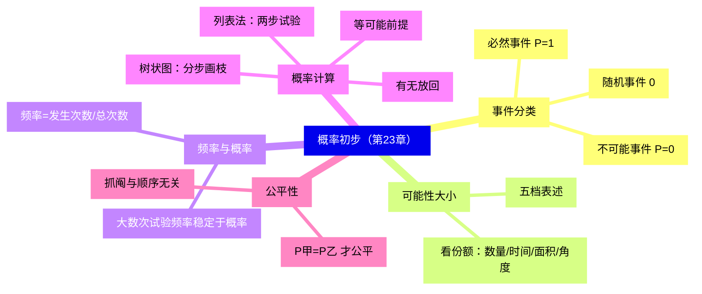
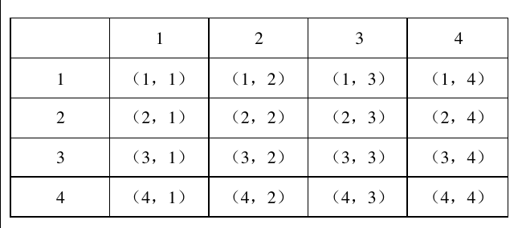
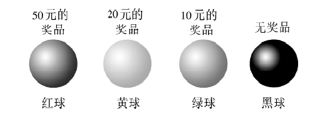
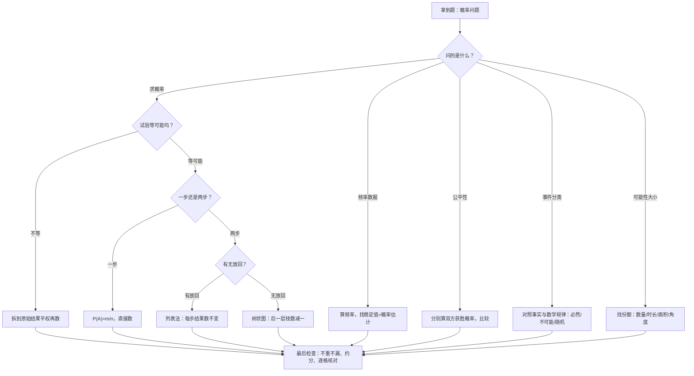

# 概率初步（详解版）

> [!note] 使用说明
> 本文是详解版，从"为什么"讲起供从头自学；考前速查和掌握度跟踪在概要版：[[03-数学/知识点/八年级/概率初步]]。

## 0️⃣ 这章学什么 & 中考怎么考

- **这章解决什么问题**：生活里充满"不一定"的事：明天下不下雨、抽签抽中谁、彩票中不中奖。数学管不了"下一次到底发生不发生"，但能**量化"发生的机会有多大"**——这个数就是概率。这一章从"会不会发生"（事件分类）出发，经过"发生可能性有大有小"（比较），最后学会**算出**这个可能性（$P(A)=\dfrac mn$）。
- **和前后章节的关系**：这一章不依赖前面多少计算，是初中数学里最"轻"的一章；但它确立的"列举所有等可能结果"的思想，九年级统计与概率、甚至高考的古典概型都一脉相承。
- **中考怎么考**（依据概要版与备课包，不编造分值）：
  - 常以选择、填空或小解答题出现，考==事件分类、可能性大小比较、树状图与列表法求概率、游戏公平性判断==；
  - 这一章是中考的**必拿分点**——题型固定、方法固定，练熟就是送分。
- 一句话总结：**先分清事件类型，再数清"分子分母"——所有概率题都是"数对 $m$ 和 $n$"。**

### 学完本章，你应该能做到

1. 把任意事件准确归入必然事件、不可能事件、随机事件，包括用数学对象造出来的事件。
2. 用"份额"比较可能性大小，并用五档词语规范表述。
3. 说出三类事件的概率值与范围，能用大数次试验的频率估计概率。
4. 判断一次试验是否"等可能"，会用列表法或树状图不重不漏地数出所有结果。
5. 用"双方获胜概率是否相等"判断游戏公平性，并会修改规则使游戏公平。

### 本章知识地图



## 🧭 先修自检（学不下去先回到这里）

> [!note] 先修自检怎么用
> 下面每一项都是本章的地基。做不出就先去补对应知识，硬学只会更挫败。

| # | 你应该会的 | 自查题（先做再看答案） | 答案 | 不会去哪补 |
| - | ---------- | ---------------------- | ---- | ---------- |
| 1 | 分数比较 | 比较 $\dfrac13$、$\dfrac25$、$\dfrac14$ 的大小 | 通分：$\dfrac{20}{60}>\dfrac{15}{60}>\dfrac{12}{60}$，即 $\dfrac13>\dfrac25>\dfrac14$ | [[03-数学/知识点/00-六至八年级核心公式定理总表]] |
| 2 | 约分 | 把 $\dfrac4{16}$、$\dfrac{7}{10}$ 化到最简 | $\dfrac4{16}=\dfrac14$；$\dfrac7{10}$ 已最简 | 同上（数与式板块） |
| 3 | 乘法计数 | 3 件上衣配 2 条裤子有几种穿法？ | $3\times2=6$ 种（分步相乘） | 同上 |
| 4 | 列举不重不漏 | 用 2、6、8 能组成哪些没有重复数字的两位数？ | 26、28、62、68、82、86，共 6 个 | 同上 |
| 5 | 百分数 | $0.6$ 写成百分数是多少？ | $60\%$ | 同上 |

**自查题做错的，先把那一项补上再往下读。第 4 项（不重不漏地列举）是概率计算的命脉。**

## 🌱 概念从头讲

> [!note] 概念讲法约定
> 每个概念按"**为什么需要它 → 它是什么 → 符号与记号含义 → 容易想错的地方**"四步讲。

### 概念 1：确定事件和随机事件

- **为什么需要**：讨论"可能性"之前，得先把事件按"能不能事先确定"分堆——有的事先就知道结果，有的悬而未决，它们待遇完全不同。
- **定义**：

| 类别 | 含义 | 例子 |
| ---- | ---- | ---- |
| **必然事件** | 一定发生的事件 | 太阳从东边升起；十进制中 $1+1=2$ |
| **不可能事件** | 一定不发生的事件 | 水中捞月；在实数范围内解 $x^2+1=0$ 得到两个实数根 |
| **随机事件** | 可能发生、也可能不发生 | 抛硬币正面朝上；买彩票中大奖 |

- **符号/记号**：**确定事件** = 必然事件 + 不可能事件（事先能确定发不发生）；随机事件是确定事件之外的事件。判断套路只有一条：==与事实或数学规律对照——违背规律⇒不可能，永远成立⇒必然，其余⇒随机==。数学对象也能造事件：任取两个无理数求和（$\sqrt2+(-\sqrt2)=0$ 是有理数）是**随机事件**；10 只鸟关进 3 个笼子"至少一个笼子超过 3 只"是**必然事件**（若每笼最多 3 只，总数最多 9 只，装不下 10 只）。
- **容易想错**：❌"数学规律是确定的，所以涉及数学的事件都是确定事件。" → "任意选取两个无理数，它们的和是无理数"——$\sqrt2+(-\sqrt2)=0$ 是有理数，$\sqrt2+\sqrt2=2\sqrt2$ 是无理数，两种结果都可能出现，是**随机事件**。判断靠**逐例试证**，不靠感觉。

### 概念 2：事件发生的可能性有大小

- **为什么需要**：同样是随机事件，"明天出太阳"和"明天陨石砸中你家"显然不是一个量级——只知道"可能发生"还不够，得能**比较**。
- **是什么**：可能性大小由事件占的**份额**决定：

| 情境 | 比较依据 |
| ---- | ---- |
| 摸球（10 红、3 黄、1 白） | 球的数量：红 > 黄 > 白 |
| 交通信号灯（红 30 s、绿 50 s、黄 3 s） | 时长：遇绿 > 遇红 > 遇黄 |
| 游戏转盘 | 扇形圆心角度数（等价于面积）：度数大 ⇔ 可能性大 |

- **符号/记号**：可能性的表述分五档（从大到小）：**一定发生 > 很有可能发生 > 可能发生 > 不太可能发生 > 一定不会发生**。抛硬币反面朝上——"可能发生"；买发行量很大的彩票中五百万——"很不可能发生"；连续雨天路上遇到撑伞行人——"很有可能发生"。
- **容易想错**：❌"可能性很小 = 不可能发生；可能性很大 = 必然发生。" → ==可能性小的事件也可能发生==（彩票确实有人中），可能性大的事件也可能不发生。"很可能"与"一定"之间隔着一道墙，五档词语不要越级使用。

### 概念 3：概率——给可能性一个数

- **为什么需要**：五档词语太粗。要让"可能性"能进入计算、能比较"大多少"，必须给它一个数。
- **定义**：刻画事件发生可能性大小的数叫**概率**，事件 $A$ 的概率记作 $P(A)$，且 $0\leq P(A)\leq1$。
- **符号/记号**：三类事件的概率——不可能事件 $P=0$；必然事件 $P=1$；随机事件 $0<P<1$。其中很可能发生的事件 $P$ **接近 1**，小概率事件 $P$ **接近 0**。
- **容易想错**：❌"$P(A)=0.9$ 就是 10 次里发生 9 次。" → 概率是**长期、大量**试验下的稳定趋势，不是每 10 次的保证——10 次里可能发生 5 次也可能 10 次。概率回答"机会多大"，不回答"下一次成不成"。

### 概念 4：频率与概率——为什么要"大数次"试验

- **为什么需要**：很多事件（图钉针尖朝上、某队获胜）没有现成的对称结构来算概率，只能靠**做试验**估计。
- **定义**：$n$ 次重复试验中事件 $A$ 发生 $m$ 次，比值 $\dfrac mn$ 叫事件 $A$ 发生的**频率**。
- **关系**：频率随试验而波动（前 10 次可能是 0.3，后 10 次可能是 0.5），概率是客观的稳定值；==大数次试验中，频率稳定于概率，可以用频率估计概率==。备课本例：摸球 200 次，131 次红、69 次白，红球频率 $\dfrac{131}{200}=0.655\approx\dfrac23$，故估计袋中红球约 2 个、白球约 1 个。
- **为什么"大数次"才行**：次数少时波动大（抛 2 次硬币可能 2 次都正面），次数越多波动越被"摊薄"，频率才靠得住——这与"样本越多越能代表总体"是同一个道理。
- **容易想错**：❌ 拿少量试验的频率直接当概率。 → 少量试验的频率只能参考；题目给出一列随次数增长的频率，要找它**稳定趋近**的那个值（见例题阶梯第 3 级）。

### 概念 5：等可能试验与古典定义——"等可能"为什么是前提

- **为什么需要**：掷骰子、摸球这些试验有天然的对称性：每个结果"地位平等"，于是可能性可以直接用**个数之比**算——这就是能"算"概率的原因。
- **定义**：一次试验中所有可能的结果有 $n$ 个（每个结果等可能），事件 $A$ 包含其中 $m$ 个结果，则
  $$P(A)=\frac{m}{n}.$$
- **"等可能"为什么是前提**：$P=\dfrac mn$ 的分子分母必须是**同一套等可能的结果**。反例：布袋里 3 个红球、2 个白球，若把结果粗暴分成"摸到红球 / 摸到白球"两类，就得出 $P(\text{红})=\dfrac12$——错！因为这两类**不是等可能的结果**（红球那类"压着"3 个原始结果，白球只压着 2 个）。正确做法：以 5 个球为等可能结果，$P(\text{红})=\dfrac35$。
- **推论（抓阄与顺序无关）**：3 人抓 1 张有记号的纸片，先抓、后抓的概率都是 $\dfrac13$——每个人抽中的原始结果数都是 1/3 份额，"先抓机会大"是错的。
- **容易想错**：❌ 把"几类"当"几个结果"。 → 数 $n$ 之前先问：**我数的这些结果，每个发生的可能性真的相等吗？** 不等就继续拆，拆到每个原始结果都平权为止。

### 概念 6：列表法与树状图——把 $m$、$n$ 数清楚

- **为什么需要**：两步试验（摸两次、掷两次）的结果悄悄"相乘"，光靠脑子数容易漏。列表和树状图是**不重不漏**的两件工具。
- **列表法**：适合"两步"试验——行放第一步的结果，列放第二步的结果，每格就是一种结果。例如四张牌（1～4）**放回**抽两次：



  共 $4\times4=16$ 种等可能结果；对角线上 $(1,1)$、$(2,2)$ 等格子**只在有放回时存在**。
- **树状图**：按步骤逐层画"枝"，每层列出该步所有可能，一条从根到叶的路径对应一个结果。袋中 1 红 1 白、**不放回**摸两次：

```text
开始
├── 第一次摸红 ──→ 第二次只能摸白 ⇒（红，白）
└── 第一次摸白 ──→ 第二次只能摸红 ⇒（白，红）
```

  若**放回**再摸，每层都有红、白两枝，共 4 条路径——==有无放回画图不同，先看清规则==。
- **怎么选**：两步且每步结果不多 → 列表（整齐、全覆盖）；步骤多于两步、或"不放回"导致第二步枝数变化 → 树状图更灵活。
- **容易想错**：❌ 树状图第二层永远画同样的枝数。 → 不放回时摸走一个少一个，第二层枝数要**减一**；列树状图前先确认放回规则。

### 概念 7：游戏公平性——公平就是概率相等

- **为什么需要**："轮流掷骰子谁点数大谁赢"这类问题，要判断规则是否偏心——偏心的数学表述就是**双方获胜概率不等**。
- **是什么**：==游戏规则公平 $\iff$ 双方获胜的概率相等==。不公平时，可以通过修改规则（换事件、改分值）使双方概率一致。
- **为什么"数结果个数"不够**：如"两数之和等于 8 甲胜、等于 9 乙胜"——都是"一个和值"，看似对称，但和为 8 有 5 种搭配、和为 9 只有 4 种，概率 $\dfrac5{36}\neq\dfrac4{36}$，不公平。**必须比概率，不能只比"字面条数"**。
- **容易想错**：❌"事件'长得像'就公平。" → 每个事件都要回到"包含几个等可能结果"上数一数（见例题阶梯变式）。

## 🧮 公式逐个拆解

> [!note] 公式拆解约定
> 每个公式都必须能回答四件事：每个符号是什么？什么时候能用？怎么变形？配一个一步能算的最小例子。

### 公式 1：概率的取值范围

| 事件类型 | 概率 | 例子 |
| ---- | ---- | ---- |
| 不可能事件 | $P=0$ | 摸出红球（袋中无红球） |
| 随机事件 | $0<P<1$ | 摸到红球（袋中红白都有） |
| 必然事件 | $P=1$ | 摸出红球或白球（袋中只有红白） |

- 符号含义：$P(A)$ 越大，$A$ 发生的可能性越大；"接近 1"是大概率、"接近 0"是小概率的口语化表述。
- 常用变形：已知 $P(A)$ 与试验总次数的估计，反推有利结果的份额（见例题阶梯第 3 级）。
- 最小例子：$P(A)=0$、$P(B)=1$、$0<P(C)<1$ → $A$ 不可能、$B$ 必然、$C$ 随机。

### 公式 2：古典定义 $P(A)=\dfrac mn$

| 符号 | 含义 | 注意 |
| ---- | ---- | ---- |
| $n$ | 试验所有等可能结果的个数 | ==必须等可能==、不重不漏 |
| $m$ | 事件 $A$ 包含的结果个数 | 从列表/树状图里**数**出来 |

- 成立条件：等可能试验（结果两两平权）。
- 常用变形：同一试验可以按"有序"或"无序"数结果——只要 $m$、$n$ 用**同一套**口径，概率不变（见例题阶梯第 4 级）。
- 最小例子：掷一枚骰子，$P(\text{掷出偶数})=\dfrac36=\dfrac12$。**验算**：偶数 2、4、6 共 3 个，共 6 种结果 ✓。

### 公式 3：频率 $\dfrac mn$ 估计概率

- 符号含义：$n$ 为试验总次数，$m$ 为事件发生次数。
- 成立条件：试验**可重复**且每次条件相同；$n$ 要足够大。
- 常用变形：已知频率稳定值 $p$ 与总数 $N$，估计各类的个数：某类个数 $=N\times p$。
- 最小例子：摸球 200 次红球出现 131 次 → 频率 $0.655\approx\dfrac23$ → 若袋中 3 球，估计红球 2 个。**验算**：$2/3\approx0.667$ 与 $0.655$ 接近 ✓。

### 公式 4：两步试验的结果计数

- 有放回：每步都有 $k$ 种 → 总结果 $k\times k$ 种（如 4 张牌放回抽两次：16 种）。
- 不放回：第二步少一种 → 总结果 $k\times(k-1)$ 种（如 3 把伞发 3 人：$3\times2\times1=6$ 种）。
- 最小例子：从 2、6、8 中选两个数字组成两位数：6×2=... 即首位 3 种 × 次位 2 种 $=6$ 个。**验算**：逐一列举 26、28、62、68、82、86 ✓。

## 🪜 例题阶梯

> [!note] 例题怎么用
> 五级台阶，每一级都要动笔跟着数，不许只看。题目均选自国平台备课包（课后练习/学习任务单）。

### 第 1 级 · 入门：事件分类与概率值

> **题目**：描述下列事件的概率（若是很可能发生的事件，填"接近 1"；若是很不可能发生的事件，填"接近 0"）：
> （1）用 $A$ 表示"下雨天出门遭雷击"，则 $P(A)$＿＿＿＿＿＿＿＿；
> （2）用 $B$ 表示"标准大气压下的水在 100℃ 时沸腾"，则 $P(B)$＿＿＿＿＿＿＿＿；
> （3）用 $C$ 表示"买了一张彩票，但是没有中奖"，则 $P(C)$＿＿＿＿＿＿＿＿；
> （4）用 $D$ 表示"既要马儿跑，又要马儿不吃草"，则 $P(D)$＿＿＿＿＿＿＿＿。
> （题源：《23.3 事件的概率》课后练习第 1 题）
>
> **每一步为什么这么做**：
> - 先给事件**分类**（必然 / 不可能 / 随机），概率值就自动确定；
> - 随机事件再分"大概率（接近 1）"与"小概率（接近 0）"两档。
>
> **完整解答**：
> （1）遭雷击是极小概率的随机事件 → $P(A)$ **接近 0**；
> （2）标准大气压下水在 100℃ 沸腾是物理规律，必然事件 → $P(B)=1$（等于 1）；
> （3）买一张彩票不中奖是大概率随机事件（中奖才是小概率）→ $P(C)$ **接近 1**；
> （4）"又要马儿跑又不给吃草"违背常识，不可能事件 → $P(D)=0$（等于 0）。
> **验算**：四类覆盖"小概率随机 / 必然 / 大概率随机 / 不可能"，与三类事件的概率取值对应一致 ✓。
>
> **变式提醒**：①"接近 1 / 等于 1"是两回事：等于 1 的是**必然事件**，接近 1 的仍是**随机事件**——填空时先分清；② 数学事件同样能套："$2^m$（$m$ 为正整数）是偶数"→ 必然，$P=1$。

### 第 2 级 · 标准：可能性大小比较（份额法）

> **题目**：从 1 到 100 这一百个自然数中，随机取一个数。
> （1）比较下列事件发生的可能性大小，并将它们按可能性**从小到大**的顺序排列：
> （1）取到的数是一个偶数；（2）取到的数比 10 大；（3）取到的数是 0；（4）取到的数比 95 大。
> （2）举一个比上述四个事件发生的可能性都大的例子。
> （题源：《23.2 事件发生的可能性》学习任务单例题 3）
>
> **每一步为什么这么做**：
> - 一百个数个个等可能 → 每个"份额"就是满足条件的个数除以 100；
> - 逐一数个数（不重不漏），再比较分数大小。
>
> **完整解答**：
> （1）取到偶数：$2,4,\dots,100$ 共 50 个，份额 $\dfrac{50}{100}=\dfrac12$；
> 比 10 大：$11\sim100$ 共 90 个，份额 $\dfrac9{10}$；
> 是 0：1 到 100 中没有 0，份额 $0$（不可能事件）；
> 比 95 大：$96\sim100$ 共 5 个，份额 $\dfrac{5}{100}=\dfrac1{20}$。
> 比较大小：$0<\dfrac1{20}<\dfrac12<\dfrac9{10}$，
> 所以从小到大排列为：（3）是 0，（4）比 95 大，（1）是偶数，（2）比 10 大。
> （2）例如"取到的数大于 1"：99 个，份额 $\dfrac{99}{100}=0.99>\dfrac9{10}$ ✓（或"取到的数是正数"，必然事件，份额 1）。
> **验算**：各事件包含的个数 $0<5<50<90<99$，与排列一致 ✓。
>
> **变式提醒**：① 备课包同章还有"非数字版"：书包摸数学书（份额 $\dfrac1{12}$）> 抽中全校唯一大奖 > 中五百万——份额思想不变，只是估个数；② 表述五档要与份额对应：份额 0 → "一定不会发生"，份额接近 1 → "很有可能发生"，别越级。

### 第 3 级 · 标准+：用频率估计概率

> **题目**：在一个不透明的盒子里装有只有颜色不同的黑、白两种球共 40 个。将球搅匀后从中随机摸出一个球记下颜色，再放回，不断重复。试验数据如下：
>
> | 摸球次数 $n$ | 100 | 200 | 300 | 500 | 800 | 1000 | 3000 |
> | ---- | ---- | ---- | ---- | ---- | ---- | ---- | ---- |
> | 摸到白球次数 $m$ | 65 | 124 | 178 | 302 | 481 | 599 | 1803 |
>
> （1）计算并完成表中"摸到白球的频率"（精确到 0.01）；
> （2）估计当 $n$ 很大时，摸到白球的频率接近多少？
> （3）试估算盒子里黑、白两种颜色的球各有多少只？
> （题源：《23.3 事件的概率》课后练习第 3 题）
>
> **每一步为什么这么做**：
> - 频率 $=\dfrac mn$，逐列做除法；
> - 找频率**稳定趋近**的值——不看个别波动，看尾巴；
> - 频率稳定值即概率的估计值 → 概率 × 总数 = 该类球的估计个数。
>
> **完整解答**：
> （1）$\dfrac{65}{100}=0.65$，$\dfrac{124}{200}=0.62$，$\dfrac{178}{300}\approx0.59$，$\dfrac{302}{500}\approx0.60$，$\dfrac{481}{800}\approx0.60$，$\dfrac{599}{1000}\approx0.60$，$\dfrac{1803}{3000}\approx0.60$。
> （2）随次数增大，频率在 0.60 附近波动且越来越贴近，估计摸到白球的频率接近 $0.6$。
> （3）白球个数 $\approx40\times0.6=24$（个），黑球个数 $\approx40-24=16$（个）。
> **验算**：$24+16=40$ ✓；按"24 白 16 黑"的理论概率 $\dfrac{24}{40}=0.6$，与（2）的估计吻合 ✓。
>
> **变式提醒**：① 前几列频率（0.65、0.62）**波动是正常的**，不要拿 100 次的频率直接定概率——"大数次"三个字是估计的前提；② 反向题：袋中 3 球，摸 200 次红球 131 次 → 红球频率 $0.655\approx\dfrac23$ → 红球约 2 个、白球 1 个（备课包例题同款）；③ 图钉、硬币等"不可计算型"试验只能走这条路。

### 第 4 级 · 提高：列表法 / 组合计数求概率

> **题目**：某公司在联欢活动中通过摸球抽奖。布袋里有 5 个一样（只是颜色不同）的小球，其中红球、黄球、绿球各 1 个，黑球 2 个。奖品的情况如图所示。
> （1）摸出 1 个球，拿不到奖品的概率是多少？
> （2）同时摸出 2 个球，获得的奖品价值超过 10 元的概率是多少？
>
> 
>
> （题源：《23.4 概率计算举例》课后练习第 3 题）
>
> **每一步为什么这么做**：
> - （1）小题一步古典定义：数出"无奖品"（黑球）的份额；
> - （2）"同时摸出 2 个"是**不放回、不分顺序**——等可能结果按"两只球一组"数，共 $\dfrac{5\times4}{2}=10$ 组；每组的价值要**逐一列出**再数 $m$。
>
> **完整解答**：
> （1）5 个球中黑球 2 个（无奖品），所以 $P(\text{拿不到奖品})=\dfrac25$。
> （2）从 5 个球中同时摸出 2 个，共有 $\dfrac{5\times4}{2}=10$ 种等可能结果（两两一组，不分先后）：
> 红黄（$50+20=70$ 元）、红绿（$60$ 元）、红黑（$50$ 元）、红黑（$50$ 元）、黄绿（$30$ 元）、黄黑（$20$ 元）、黄黑（$20$ 元）、绿黑（$10$ 元）、绿黑（$10$ 元）、黑黑（$0$ 元）。
> 其中价值**超过** 10 元的有 7 组（红黄、红绿、红黑×2、黄绿、黄黑×2；注意绿黑恰为 10 元，"超过"不包含它），
> 所以 $P=\dfrac7{10}$。
> **验算**：用"有序对"口径重数：不放回摸两次共 $5\times4=20$ 种等可能有序结果，超过 10 元的有序结果 $7\times2=14$ 种，$P=\dfrac{14}{20}=\dfrac7{10}$ ✓——口径不同、概率相同，==只要 $m$、$n$ 用同一套等可能结果==。
>
> **变式提醒**：①（2）的头号陷阱是"绿黑 $=10$ 元"——题目问"超过 10 元"，恰好 10 元不算；② 若问"不高于 10 元"则分子变 3（绿黑×2、黑黑），$P=\dfrac3{10}$；③ 同款列表法题：四张牌放回抽两次点和为 5 的概率 $\dfrac4{16}=\dfrac14$（备课包第 4 题，16 种结果直接查表数出 4 个）。

### 第 5 级 · 综合：树状图与公平性

> **题目**：三位同伴进饭店用餐，把每人自带的雨伞交给服务员放在一起保管。如果离店时服务员把他们的雨伞随机还给各人，那么三位同伴**恰好拿到各自雨伞**的概率是多少？
> （题源：《23.4 概率计算举例》学习任务单例题 3）
>
> **每一步为什么这么做**：
> - 三个人依次领伞是三步试验 → 画**树状图**逐层列枝；
> - 不放回 → 第二层枝数减一、第三层只剩一枝；
> - 数出总路径 $n$ 和"全对"路径数 $m$。
>
> **完整解答**：
> 设三人为甲、乙、丙，雨伞相应为甲伞、乙伞、丙伞。按领伞顺序画树状图：
>
> ```text
> 开始
> ├── 甲领甲伞 ─┬─ 乙领乙伞 → 丙领丙伞 ✓（全对）
> │             └─ 乙领丙伞 → 丙领乙伞 ✗
> ├── 甲领乙伞 ─┬─ 乙领甲伞 → 丙领丙伞 ✗
> │             └─ 乙领丙伞 → 丙领甲伞 ✗
> └── 甲领丙伞 ─┬─ 乙领甲伞 → 丙领乙伞 ✗
>               └─ 乙领乙伞 → 丙领甲伞 ✗
> ```
>
> 共 $3\times2\times1=6$ 条等可能路径，恰好各拿各伞的只有 1 条，
> 所以 $P(\text{恰好拿到各自雨伞})=\dfrac16$。
> **验算**：用排列口径复核：三人全错位排列以外的"恒等排列"只有 1 个，共 $3!=6$ 个排列，$\dfrac16$ ✓。
>
> **变式提醒（树状图 + 公平性联动）**：备课包延伸题——甲、乙各自掷一枚骰子，方案①"两数之和等于 8 时甲胜，等于 9 时乙胜"公平吗？用列表法数：和为 8 的搭配 $(2,6)(3,5)(4,4)(5,3)(6,2)$ 共 5 种，和为 9 的 $(3,6)(4,5)(5,4)(6,3)$ 共 4 种，$\dfrac5{36}\neq\dfrac4{36}$，**不公平**，乙吃亏；改成"和等于 8 甲胜、和等于 6 乙胜"（和为 6 也是 5 种搭配）就公平了（备课包参考答案同款）。核心：==判断公平永远比概率，"字面对称"不等于概率相等==。
>
> **再走一步**：三册书（上、中、下）随机排成一排，"从左到右恰好是上中下"或"从右到左恰好是上中下"的概率？共 $3!=6$ 种等可能排列，符合要求的 2 种（上中下、下中上），$P=\dfrac26=\dfrac13$（备课包第 2 题）。

## 🗺️ 解题流程图



## 🔥 易错点：为什么会错

| ❌ 常见错误想法 | 为什么会这样想 | ✅ 正确理解 / 自救方法 |
| -------------- | -------------- | ---------------------- |
| 可能性很小 = 不可能发生 | "几乎不会"与"不会"混同 | ==可能性小的事件也可能发生==；五档表述不越级（"很可能"≠"一定"） |
| 少量试验的频率当概率 | 前几次结果印象太深 | 频率随试验波动，概率是稳定值；**大数次**试验的频率才能估计概率 |
| 把"几类"当"几个等可能结果" | 分类顺手就当数完了 | 检查等可能：3 红 2 白袋中"红/白"两类不等权，要拆成 5 个球来数 |
| 有无放回没看清就画图 | 默认每步枝数一样 | 有放回才有 $(2,2)$ 这类结果；不放回第二层枝数减一，先读题再动笔 |
| 判断公平只数"规则条数" | 字面对称的错觉 | 必须比**概率**：和为 8 与 9 的搭配数不同（5 vs 4） |
| "超过 10 元"把恰好 10 元算进去 | 审题跳读 | 圈出关键词"超过 / 不超过 / 至少"；边界值单独核对 |
| 概率 $0.9$ 理解为"10 次必中 9 次" | 把长期趋势当逐批保证 | 概率描述长期平均趋势，不保证每一批的精确次数 |
| 抓阄认为"先抓机会大" | 直觉偏向先手 | 抓阄与顺序无关，每人概率相同（3 人 1 张有记号：各 $\dfrac13$） |

## 📝 本讲小结

- **一次分类**：确定事件（必然 $P=1$、不可能 $P=0$）与随机事件（$0<P<1$）；数学对象也能造随机事件。
- **两级比较**：可能性大小看"份额"（数量、时长、面积、角度）；表述分五档（一定发生 → 一定不会发生）。
- **一个桥梁**：频率 $\xrightarrow{\text{大数次试验}}$ 稳定值 $=$ 概率，用频率估计概率；少量试验的频率只作参考。
- **两个工具**：**列表法**（两步试验全排列）与**树状图**（分步画枝、不放回减枝），数出 $m$ 与 $n$ 后 $P(A)=\dfrac mn$。
- **一个前提**：==等可能==——$m$、$n$ 必须是同一套平权的原始结果，"几类"不等于"几个等可能结果"。
- **一条准则**：游戏公平 $\iff$ 双方获胜概率相等；抓阄与先后顺序无关。

## ✅ 自测清单（能独立做到才打勾）

- [ ] 1. 能把"任意两个无理数之和是无理数""10 只鸟关 3 个笼"这类事件正确分类并说明理由
- [ ] 2. 能用份额法比较摸球、信号灯、转盘三类情境的可能性大小，并用五档词语表述
- [ ] 3. 能说出三类事件的概率值，并解释"接近 1"与"等于 1"的区别
- [ ] 4. 能用一列频率数据找出概率估计值，并反推球的颜色个数
- [ ] 5. 能指出"把红/白两类当等可能结果"为什么错，并给出正确算法
- [ ] 6. 能用列表法完成"放回抽两次"的概率计算，用树状图完成"不放回摸两次"的计算
- [ ] 7. 能独立做出例题阶梯第 4、5 级，并判断骰子游戏规则是否公平、如何修改
- [ ] 8. 能说出本章 3 个易错点及自救方法

## 🔗 关联

- 概要版：[[03-数学/知识点/八年级/概率初步]]（掌握度在这边更新）
- 前置知识：[[03-数学/知识点/00-六至八年级核心公式定理总表]]（分数运算、乘法计数）
- 兄弟详解：[[03-数学/知识点详解/八年级/一次函数]] · [[03-数学/知识点详解/八年级/代数方程]] · [[03-数学/知识点详解/八年级/四边形]]（同册四章，方法互为工具）
